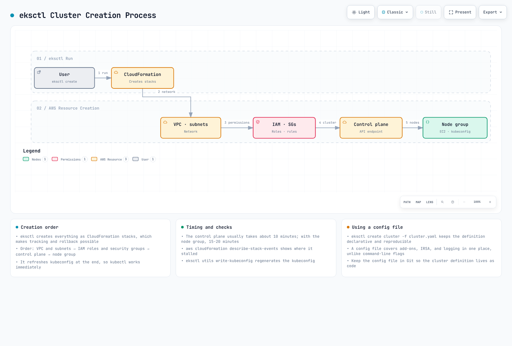

# 第 2 部分：使用 eksctl 创建集群

> **最后更新**：2026 年 9 月 11 日

请先完成[第 1 部分的前提准备](02-eks-cluster-creation-part1.md)，并使用专用培训账户/集群及临时私有 kubeconfig（`EKS_KUBECONFIG`）。以下示例是彼此替代的方案，并非要按顺序执行的一组脚本。将 `EKS_CLUSTER_NAME`/`EKS_REGION` 设为审阅过的目标值，并使用已批准的现有身份。创建 AWS 资源的命令会产生费用；本次审阅没有创建这些资源。示例已按 eksctl 0.230.0 和 EKS 1.36 进行核对。

## 使用 eksctl 创建集群

eksctl 为 EKS 提供命令行和声明式配置接口。eksctl 使用 CloudFormation 创建 EKS 集群及相关资源。

下图展示了使用 eksctl 创建 EKS 集群的过程，其中相关的 VPC、IAM、控制平面和节点组资源通过 CloudFormation 堆栈依赖关系创建：



[🔍 查看交互式图表](https://www.atomai.click/kubernetes-docs/archmaps/en-eks-02-eks-cluster-creation-part2-0.html)

这是创建新 VPC 的工作流。也可以复用现有 VPC；耗时会因环境而异；写入 kubeconfig 本身并不能建立授权或证明集群已就绪。

### 基本集群创建

使用审阅过的配置文件创建基本集群：

```bash
eksctl create cluster --config-file cluster.yaml --kubeconfig "${EKS_KUBECONFIG:?}"
```

运行此命令前，请先阅读并编辑下方的 `cluster.yaml`。配置中明确选择了 EKS 1.36、AL2023、现有 VPC 子网以及节点组容量。请将示例标识符和文档专用 CIDR 替换为实际获批的值。这些是本示例选定的设置，不代表每个 eksctl 版本的默认值。

### 使用配置文件创建集群

对于更复杂的配置，可以使用 YAML 文件定义集群：

```yaml
# cluster.yaml
apiVersion: eksctl.io/v1alpha5
kind: ClusterConfig
metadata:
  name: my-cluster
  region: us-west-2
  version: '1.36'
vpc:
  id: vpc-12345678
  subnets:
    private:
      us-west-2a:
        id: subnet-12345678
      us-west-2b:
        id: subnet-87654321
    public:
      us-west-2a:
        id: subnet-23456789
      us-west-2b:
        id: subnet-98765432
  clusterEndpoints:
    privateAccess: true
    publicAccess: true
  publicAccessCIDRs:
  - 203.0.113.10/32
managedNodeGroups:
- name: ng-1
  instanceType: m5.large
  desiredCapacity: 2
  minSize: 1
  maxSize: 3
  privateNetworking: true
  volumeSize: 80
  volumeType: gp3
  amiFamily: AmazonLinux2023
  disableIMDSv1: true
- name: ng-2
  instanceType: c5.xlarge
  desiredCapacity: 2
  privateNetworking: true
  spot: true
  amiFamily: AmazonLinux2023
  disableIMDSv1: true
cloudWatch:
  clusterLogging:
    enableTypes:
    - api
    - audit
    - authenticator
    - controllerManager
    - scheduler
fargateProfiles:
- name: fp-default
  selectors:
  - namespace: default
    labels:
      env: fargate
iam:
  withOIDC: true
accessConfig:
  authenticationMode: API
```

使用此配置文件创建集群的命令如下：

```bash
eksctl create cluster -f cluster.yaml --kubeconfig "${EKS_KUBECONFIG:?}"
```

以上配置演示了 EC2 节点和可选的应用程序 Fargate 配置文件。CoreDNS 保持运行在 EC2 上；若要将它迁移到 Fargate，需要同时审阅 CoreDNS 的计算设置和相应配置文件。

此配置从节点角色中移除了宽泛的附加组件权限。启用 `iam.withOIDC` 时，应审阅 eksctl 生成的 CNI IRSA 配置和策略，并为其他与 AWS 集成的控制器配置单独的角色。还要检查实际的附加组件配置，以及是否存在传统的节点角色 CNI 权限回退。使用 API 身份验证时，操作人员仍需配置适当的 EKS 访问条目/策略。节点组的最小/最大数量设置不会安装 Cluster Autoscaler。

### 创建托管节点组

下图展示了 EKS 集群的托管节点组架构：


[🔍 查看交互式图表](https://www.atomai.click/kubernetes-docs/archmaps/en-eks-02-eks-cluster-creation-part2-1.html)

负责创建基础设施的是 AWS EKS 托管节点组服务及其 Auto Scaling 组。该图演示 EKS 选择的 AMI 默认值；自定义 AMI 需要单独审阅其引导配置。Kubernetes 会将 Pod 调度到生成的节点上。

运行以下命令，可向现有集群添加托管节点组：

```bash
eksctl create nodegroup \
  --cluster my-cluster \
  --region us-west-2 \
  --name my-nodegroup \
  --node-type m5.large \
  --nodes 3 \
  --nodes-min 1 \
  --nodes-max 5 \
  --managed --node-ami-family AmazonLinux2023 --node-private-networking
```

也可以使用配置文件：

```yaml
# nodegroup.yaml
apiVersion: eksctl.io/v1alpha5
kind: ClusterConfig

metadata:
  name: my-cluster
  region: us-west-2

managedNodeGroups:
  - name: my-nodegroup
    instanceType: m5.large
    desiredCapacity: 3
    minSize: 1
    maxSize: 5
    volumeSize: 80
    volumeType: gp3
    amiFamily: AmazonLinux2023
    privateNetworking: true
    disableIMDSv1: true
    ssh:
      allow: false
```

```bash
eksctl create nodegroup -f nodegroup.yaml
```

### 创建 Fargate 配置文件

配置文件用于选择匹配的 Pod；它不会创建 Pod，也不会扩展应用副本数。请核实私有子网、Fargate Pod 执行角色以及工作负载所需功能是否受支持。应用程序配置文件不会自动将 CoreDNS 迁移到 Fargate。下面的命令行和文件示例是替代方案。

Fargate 配置文件根据命名空间和标签选择 Pod。如果多个配置文件重叠匹配，应明确通过 `eks.amazonaws.com/fargate-profile` 选择匹配的配置文件；AWS 文档说明，在多个配置文件均匹配时会按配置文件名称的字母数字顺序选择。启动延迟取决于镜像、容量和环境。

<!-- 资产审阅修复待完成：修正重叠配置文件的选择说明，并移除未经测量的启动时间比较。父级修复资产后，再恢复此嵌入图和链接。


[🔍 查看交互式图表](https://www.atomai.click/kubernetes-docs/archmaps/en-eks-02-eks-cluster-creation-part2-2.html)
-->

运行以下命令创建 Fargate 配置文件：

```bash
eksctl create fargateprofile \
  --cluster my-cluster \
  --region us-west-2 \
  --name my-fargate-profile \
  --namespace default \
  --labels env=fargate
```

也可以使用配置文件：

```yaml
# fargate.yaml
apiVersion: eksctl.io/v1alpha5
kind: ClusterConfig

metadata:
  name: my-cluster
  region: us-west-2

fargateProfiles:
- name: my-fargate-profile
  selectors:
    - namespace: default
      labels:
        env: fargate
```

```bash
eksctl create fargateprofile -f fargate.yaml
```

### 更新集群

每次仅升级一个受支持的小版本。升级前先审阅 EKS 升级洞察、已移除的 API、kubelet 版本偏差、附加组件、容量和工作负载中断风险。EKS 的支持周期独立于上游版本发布。第一次运行 eksctl 升级命令会预览变更；`--approve` 才会启动升级。

```bash
aws eks describe-cluster-versions --region "${EKS_REGION:?}" --output table
aws eks describe-cluster --name "${EKS_CLUSTER_NAME:?}" --region "$EKS_REGION" \
  --query 'cluster.{version:version,status:status}' --output table

# Select the next supported minor after compatibility/readiness review.
eksctl upgrade cluster --name "$EKS_CLUSTER_NAME" --region "$EKS_REGION" \
  --version "${NEXT_MINOR_VERSION:?}"

# This separate command actually starts the reviewed control-plane upgrade.
eksctl upgrade cluster --name "$EKS_CLUSTER_NAME" --region "$EKS_REGION" \
  --version "$NEXT_MINOR_VERSION" --approve
```

等待控制平面更新成功后，再按审阅过的顺序更新兼容的附加组件和托管节点组。以下节点组命令会应用 EKS 选定的 AMI 更新；自定义 AMI 则需使用经过审阅的相同启动模板版本。托管节点更新会替换实例，且与控制平面更新分开进行。PDB 和备用容量有助于控制中断，但不保证服务可用性。

```bash
# After control-plane completion and add-on/workload compatibility checks.
eksctl upgrade nodegroup --cluster "${EKS_CLUSTER_NAME:?}" \
  --region "${EKS_REGION:?}" --name "${EKS_NODEGROUP_NAME:?}" --wait
```

### 删除集群

创建集群后，将实验集群的 ARN 记录为 `EKS_EXPECTED_CLUSTER_ARN`。删除前，应在相关控制器仍运行时移除实验用 LoadBalancer Service/Ingress，等待 AWS 完成清理，并检查 PVC 回收策略和保留的数据。确认集群中只包含你打算删除的资源。下面的 ARN 检查会核对已记录的账户/区域/名称；它不是备份，也不是不可变的创建标识符。

```bash
if CURRENT_CLUSTER_ARN=$(aws eks describe-cluster \
  --name "${EKS_CLUSTER_NAME:?}" --region "${EKS_REGION:?}" \
  --query cluster.arn --output text) &&
  [ "$CURRENT_CLUSTER_ARN" = "${EKS_EXPECTED_CLUSTER_ARN:?Recorded lab cluster ARN required}" ]; then
  eksctl delete cluster --name "$EKS_CLUSTER_NAME" --region "$EKS_REGION" --wait
else
  printf '%s\n' 'Cluster lookup/identity mismatch; no deletion attempted.' >&2
fi
```

之后检查 CloudFormation 删除事件以及保留的/独立创建的资源。本示例不拥有任何现有共享 VPC。生命周期依赖关系请参阅[完整清理指南](02-eks-cluster-creation-part5.md)。

## EKS 集群生命周期管理

生命周期包括创建、配置、运行、审阅升级以及最终清理。应在相关控制器仍运行时先移除应用程序负载均衡器资源，然后再移除节点组/配置文件和集群。只有在专用 VPC 的依赖资源全部移除后，才删除该 VPC。

<!-- 资产审阅修复待完成：修正升级目标/批准步骤和资源清理顺序；必须先移除依赖资源，再删除 VPC。父级修复资产后，再恢复此嵌入图和链接。


[🔍 查看交互式图表](https://www.atomai.click/kubernetes-docs/archmaps/en-eks-02-eks-cluster-creation-part2-3.html)
-->

## 测验

要检验本章所学内容，请完成 [EKS 集群创建 - 第 2 部分测验](../quizzes/eks/02-eks-cluster-creation-part2-quiz.md)。

## 参考资料

- [eksctl 架构](https://schema.eksctl.io/)
- [EKS 版本](https://docs.aws.amazon.com/eks/latest/userguide/kubernetes-versions.html)
- [AL2023](https://docs.aws.amazon.com/eks/latest/userguide/al2023.html)
- [Fargate 配置文件](https://docs.aws.amazon.com/eks/latest/userguide/fargate-profile.html)
- [升级 EKS](https://docs.aws.amazon.com/eks/latest/userguide/update-cluster.html)
- [托管节点更新](https://docs.aws.amazon.com/eks/latest/userguide/managed-node-update-behavior.html)
