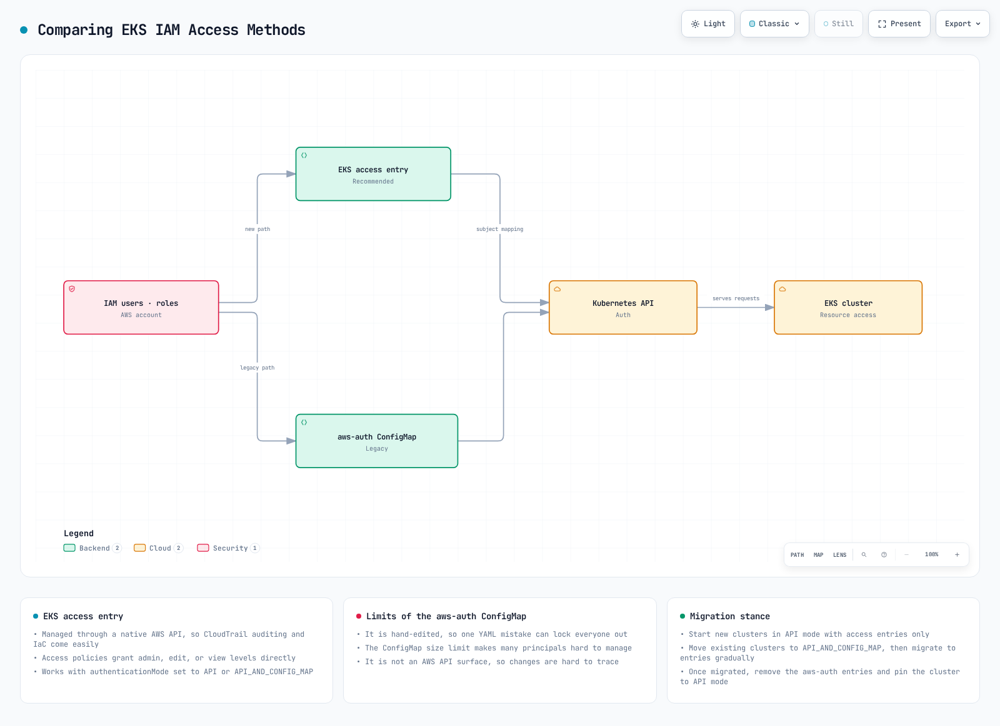
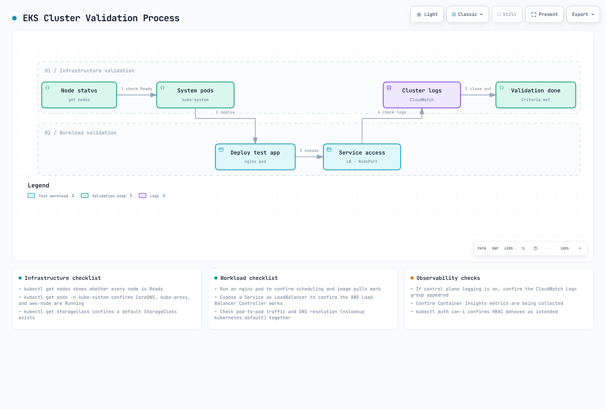
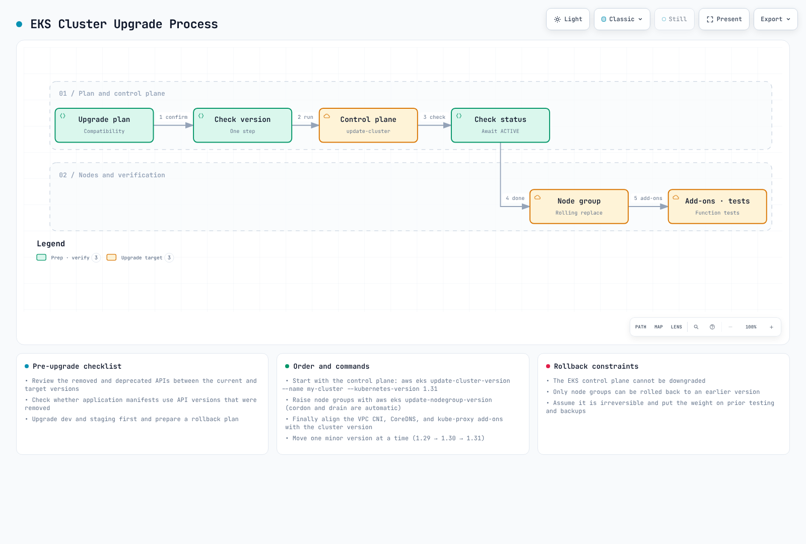

# 第 5 部分：集群访问、验证、升级和删除

> **最后更新**：September 11, 2026

本指南介绍现有 EKS 集群。请使用经过授权的账户/Region 和私有 kubeconfig。本指南中的示例已对照当前 AWS 文档和本地解析器进行审查；本次审计未执行任何 AWS 更改、集群工作负载操作或生产恢复测试。

## 配置集群访问

### 建立上下文

为目标集群设置 `EXAMPLE_CLUSTER` 和 `EXAMPLE_REGION`。当前 AWS CLI 身份需要具备相应的 AWS API 权限。要管理 Kubernetes，请使用已获授权的身份；也可以将 `ADMIN_ROLE_ARN` 设置为操作员可以承担的已批准角色。kubeconfig 不会授予权限。初始管理权限取决于集群的引导/访问配置，而不是某种通用的“只有创建者才能访问”规则。

请使用一个专用 Bash 会话来设置以下变量和辅助函数。只运行所需的工作流；升级和删除是独立操作。

```bash
set -euo pipefail
umask 077
: "${EXAMPLE_CLUSTER:?Set the existing cluster name}"
: "${EXAMPLE_REGION:?Set the Region}"
EKS_REVIEW_DIR=$(mktemp -d /tmp/eks-lifecycle-review.XXXXXX)
ADMIN_KUBECONFIG="$EKS_REVIEW_DIR/admin.kubeconfig"
aws eks describe-cluster --name "$EXAMPLE_CLUSTER" --region "$EXAMPLE_REGION" \
  --query cluster --output json > "$EKS_REVIEW_DIR/cluster-before.json"
jq -e '{arn,createdAt} | (.arn | type == "string") and (.createdAt != null)' \
  "$EKS_REVIEW_DIR/cluster-before.json" >/dev/null
EXPECTED_CLUSTER_ARN=$(jq -er '.arn' "$EKS_REVIEW_DIR/cluster-before.json")
EXPECTED_CLUSTER_CREATED=$(jq -er '.createdAt | tostring' "$EKS_REVIEW_DIR/cluster-before.json")
CLUSTER_KUBERNETES_VERSION=$(jq -er '.version' "$EKS_REVIEW_DIR/cluster-before.json")
KUBECONFIG_ARGS=(--name "$EXAMPLE_CLUSTER" --region "$EXAMPLE_REGION"
  --kubeconfig "$ADMIN_KUBECONFIG" --alias "$EXAMPLE_CLUSTER-review")
if [ -n "${ADMIN_ROLE_ARN:-}" ]; then
  KUBECONFIG_ARGS+=(--role-arn "$ADMIN_ROLE_ARN")
fi
aws eks update-kubeconfig "${KUBECONFIG_ARGS[@]}"
```
这会在已记录的审查目录下写入一个私有 kubeconfig，而不会更改默认上下文。如果不指定 `--kubeconfig`，AWS CLI 会根据 `KUBECONFIG` 或默认路径 `~/.kube/config` 选择输出位置；并非所有环境中的路径都固定不变。

<!-- Audit 2026-09-11: parent asset repair required. Material correction:access-policy andRBACpermissionsareadditive;RBACcannotnarrowAmazonEKSClusterAdminPolicy. Arrow3narrowandfooter--asprincipal effectiveEKSpermissionsclaimarewrong;testactualIAMcredentials. Rebuilddiagramasalternative/additiveauthorizationpaths.


[🔍 View interactive diagram](https://www.atomai.click/kubernetes-docs/archmaps/en-eks-02-eks-cluster-creation-part5-0.html)
-->

Access entry 可以使用 EKS 访问策略、带有 RBAC 的 Kubernetes 组，或同时使用两者。它们的权限是**叠加的**：命名空间 RoleBinding 无法缩小 EKS 集群管理员访问策略的权限。此示例使用自定义组和命名空间 RBAC，不添加范围宽泛的访问策略。
### 等待 EKS 更新

配置/版本更改是异步的。请使用返回的更新 ID；遇到错误时停止，不要将一次 `ACTIVE`/`InProgress` 状态视为操作已完成的证明：

```bash
# Additional describe-update arguments can identify a node group or add-on.
wait_eks_update() {
  local update_id="$1"
  shift
  local update_json update_status attempt
  for attempt in $(seq 1 120); do
    update_json=$(aws eks describe-update --name "$EXAMPLE_CLUSTER" \
      --region "$EXAMPLE_REGION" --update-id "$update_id" "$@" --output json) || return 1
    update_status=$(printf '%s' "$update_json" | jq -er '.update.status') || return 1
    case "$update_status" in
      Successful) return 0 ;;
      Failed|Cancelled)
        printf '%s' "$update_json" | jq '.update.errors' >&2
        return 1 ;;
      InProgress) sleep 10 ;;
      *) printf 'Unexpected update status: %s\n' "$update_status" >&2; return 1 ;;
    esac
  done
  printf 'Update %s did not finish within this wait window; inspect it before retrying.\n' "$update_id" >&2
  return 1
}
```
### 方法 1：访问条目和范围受限的 RBAC

先检查身份验证模式。经过迁移审查后，可以为旧版 `CONFIG_MAP` 集群启用 `API_AND_CONFIG_MAP`。`API` 集群已支持访问条目；不要尝试重新启用 ConfigMap 访问。在单向迁移期间，应保留管理员和节点访问权限。

```bash
AUTH_MODE=$(aws eks describe-cluster --name "$EXAMPLE_CLUSTER" --region "$EXAMPLE_REGION" \
  --query cluster.accessConfig.authenticationMode --output text)
case "$AUTH_MODE" in
  CONFIG_MAP)
    AUTH_UPDATE_ID=$(aws eks update-cluster-config --name "$EXAMPLE_CLUSTER" \
      --region "$EXAMPLE_REGION" --access-config authenticationMode=API_AND_CONFIG_MAP \
      --query update.id --output text)
    wait_eks_update "$AUTH_UPDATE_ID"
    ;;
  API_AND_CONFIG_MAP|API)
    printf '%s\n' 'Access entries are already enabled.'
    ;;
  *)
    printf 'Unexpected authentication mode: %s\n' "$AUTH_MODE" >&2
    exit 1
    ;;
esac
```
请使用**另一个现有的开发者 IAM 角色**，不要使用唯一的管理员角色。生成的组和命名空间可避免影响无关的绑定。让 EKS 生成用户名，以便仍能识别通过角色承担的会话。对于这个限制在特定命名空间内的示例，`system:masters` 并不是合适的组。

```bash
# Use a separate, existing developer IAM role; retain the administrator's access.
: "${DEVELOPER_ROLE_ARN:?Existing role that the test operator can assume}"
ACCESS_NAMESPACE="eks-access-$(date +%s)-$$"
DEVELOPER_GROUP="$ACCESS_NAMESPACE-developers"
kubectl --kubeconfig "$ADMIN_KUBECONFIG" create namespace "$ACCESS_NAMESPACE"
ACCESS_NAMESPACE_UID=$(kubectl --kubeconfig "$ADMIN_KUBECONFIG" \
  get namespace "$ACCESS_NAMESPACE" -o jsonpath='{.metadata.uid}')
: "${ACCESS_NAMESPACE_UID:?}"
jq -n --arg name "$ACCESS_NAMESPACE" --arg uid "$ACCESS_NAMESPACE_UID" \
  '{namespace:$name,namespaceUID:$uid}' > "$EKS_REVIEW_DIR/access-namespace.json"
kubectl --kubeconfig "$ADMIN_KUBECONFIG" label namespace "$ACCESS_NAMESPACE" \
  pod-security.kubernetes.io/enforce=restricted \
  "pod-security.kubernetes.io/enforce-version=v$CLUSTER_KUBERNETES_VERSION"

# Creation fails rather than rewriting an existing principal's entry.
aws eks create-access-entry --cluster-name "$EXAMPLE_CLUSTER" --region "$EXAMPLE_REGION" \
  --principal-arn "$DEVELOPER_ROLE_ARN" --type STANDARD \
  --kubernetes-groups "$DEVELOPER_GROUP" \
  --query accessEntry --output json > "$EKS_REVIEW_DIR/created-access-entry.json"
```
创建匹配的 Role 和 Group 绑定，然后使用开发者角色本身进行测试。此 Role 不会授予直接读取 Secret 或管理 RBAC/命名空间的权限。创建工作负载仍可能使用该命名空间中可用的身份和 Secret；若需要更强隔离，请通过准入控制限制允许使用的服务账户/挂载。

```bash
kubectl --kubeconfig "$ADMIN_KUBECONFIG" -n "$ACCESS_NAMESPACE" create -f - <<EOF
apiVersion: rbac.authorization.k8s.io/v1
kind: Role
metadata:
  name: developer
rules:
- apiGroups: [""]
  resources: ["pods", "pods/log"]
  verbs: ["get", "list", "watch"]
- apiGroups: [""]
  resources: ["services", "configmaps"]
  verbs: ["get", "list", "watch", "create", "update", "patch", "delete"]
- apiGroups: ["apps"]
  resources: ["deployments", "statefulsets"]
  verbs: ["get", "list", "watch", "create", "update", "patch", "delete"]
---
apiVersion: rbac.authorization.k8s.io/v1
kind: RoleBinding
metadata:
  name: developer-binding
subjects:
- kind: Group
  name: $DEVELOPER_GROUP
  apiGroup: rbac.authorization.k8s.io
roleRef:
  kind: Role
  name: developer
  apiGroup: rbac.authorization.k8s.io
EOF

DEVELOPER_KUBECONFIG="$EKS_REVIEW_DIR/developer.kubeconfig"
aws eks update-kubeconfig --name "$EXAMPLE_CLUSTER" --region "$EXAMPLE_REGION" \
  --role-arn "$DEVELOPER_ROLE_ARN" --kubeconfig "$DEVELOPER_KUBECONFIG" \
  --alias "$EXAMPLE_CLUSTER-developer"

# Allow for access-entry propagation; test using the role, not --as impersonation.
kubectl --kubeconfig "$DEVELOPER_KUBECONFIG" auth can-i list pods -n "$ACCESS_NAMESPACE"
kubectl --kubeconfig "$DEVELOPER_KUBECONFIG" -n "$ACCESS_NAMESPACE" get pods
NODE_DELETE_ALLOWED=$(kubectl --kubeconfig "$DEVELOPER_KUBECONFIG" auth can-i delete nodes 2>"$EKS_REVIEW_DIR/can-i-errors.txt") || {
  # kubectl returns nonzero for an ordinary "no"; distinguish other failures.
  [ "$NODE_DELETE_ALLOWED" = no ] || exit 1
}
[ "$NODE_DELETE_ALLOWED" = no ] || {
  printf '%s\n' 'Unexpected cluster-wide permission; review all access policies and RBAC bindings.' >&2
  exit 1
}
```
访问条目最终会保持一致；检查错误，并在重试前留出传播时间。`kubectl --as`/`--as-group` 模拟测试的是 Kubernetes RBAC，而不是 IAM 主体的 EKS 访问策略权限。同样，`auth can-i --list` 并不能完整列出 EKS 访问策略授予的权限。IAM 用户可以作为主体，但建议优先使用具有临时凭证的角色；现有用户需要通过单独配置的凭证路径进行访问。
### 方法 2：旧版 aws-auth 迁移



[🔍 查看交互式示意图](https://www.atomai.click/kubernetes-docs/archmaps/en-eks-02-eks-cluster-creation-part5-1.html)

仅当集群身份验证模式仍包含 ConfigMap 访问时，才使用此方法。保留完整的实际 ConfigMap；不要用仅包含一个节点角色的示例替换它。现有托管节点和 Fargate 映射必须保留，直到验证相应的访问条目为止。两种方法都可以通过 IaC 管理，并通过相应的 AWS/Kubernetes 日志进行审计。

```bash
kubectl --kubeconfig "$ADMIN_KUBECONFIG" -n kube-system get configmap aws-auth -o yaml   > "$EKS_REVIEW_DIR/aws-auth-before.yaml"
kubectl --kubeconfig "$ADMIN_KUBECONFIG" -n kube-system edit configmap aws-auth
```
只将经过审查的角色/用户条目合并到现有的 `mapRoles`/`mapUsers` YAML 中，并使用与其 RoleBinding 相同的自定义 Group。保留节点用户名/组以及所有无关映射。旧版 aws-auth 对角色 ARN 路径的限制与访问条目不同；请遵循有文档说明的迁移路径，不要手动规范化任意 ARN。当同一主体同时存在于两个系统中时，以访问条目映射为准。验证迁移后的身份时，请保留一个单独的管理员会话。
## 集群验证

### 检查预期的计算资源和系统组件

<!-- Audit 2026-09-11: parent asset repair required. Footercriteriaareincomplete:RunningdoesnotmeanReady,defaultStorageClassnotuniversallyrequired,LoadBalancerdoesnotproveAWSLBCwithoutclass/ownership,loggroupexistencedoesnotprovedelivery. Mainflowusableaftercaption/footercorrection.


[🔍 View interactive diagram](https://www.atomai.click/kubernetes-docs/archmaps/en-eks-02-eks-cluster-creation-part5-2.html)
-->

```bash
kubectl --kubeconfig "$ADMIN_KUBECONFIG" get nodes -o wide
kubectl --kubeconfig "$ADMIN_KUBECONFIG" get pods -n kube-system -o wide
aws eks list-addons --cluster-name "$EXAMPLE_CLUSTER" --region "$EXAMPLE_REGION"
```
验证预期的节点数量/就绪状态、Deployment/DaemonSet 发布状态和附加组件健康状态。`Running` 是 Pod 阶段，并不能证明容器已就绪；成功的 Job 处于 `Succeeded` 状态也可能完全正常。节点列表为空并不代表常规 EC2 集群运行正常。Auto Mode、Fargate 和 Hybrid Nodes 的系统组件布局各不相同；只有依赖默认 StorageClass 的工作负载才需要默认 StorageClass。
### 部署一个自有的 HTTP 测试

这个面向常规 Linux 的示例会在新建的命名空间中运行一个小型 HTTP 响应程序。它会测试调度、镜像拉取、DNS 和 ClusterIP Service，而不会自动预配公共负载均衡器。组织范围内的现有策略可能要求为 DNS/HTTP 流量批准例外；此示例不会停用这些策略。

```bash
VALIDATION_NAMESPACE="eks-validation-$(date +%s)-$$"
kubectl --kubeconfig "$ADMIN_KUBECONFIG" create namespace "$VALIDATION_NAMESPACE"
VALIDATION_NAMESPACE_UID=$(kubectl --kubeconfig "$ADMIN_KUBECONFIG" \
  get namespace "$VALIDATION_NAMESPACE" -o jsonpath='{.metadata.uid}')
: "${VALIDATION_NAMESPACE_UID:?}"
jq -n --arg name "$VALIDATION_NAMESPACE" --arg uid "$VALIDATION_NAMESPACE_UID" \
  '{namespace:$name,namespaceUID:$uid}' > "$EKS_REVIEW_DIR/validation-namespace.json"
kubectl --kubeconfig "$ADMIN_KUBECONFIG" label namespace "$VALIDATION_NAMESPACE" \
  pod-security.kubernetes.io/enforce=restricted \
  "pod-security.kubernetes.io/enforce-version=v$CLUSTER_KUBERNETES_VERSION"
kubectl --kubeconfig "$ADMIN_KUBECONFIG" -n "$VALIDATION_NAMESPACE" create -f - <<'EOF'
apiVersion: apps/v1
kind: Deployment
metadata:
  name: http-validation
spec:
  replicas: 3
  selector:
    matchLabels: {app: http-validation}
  template:
    metadata:
      labels: {app: http-validation}
    spec:
      automountServiceAccountToken: false
      securityContext:
        runAsNonRoot: true
        runAsUser: 1000
        runAsGroup: 1000
        fsGroup: 1000
        seccompProfile: {type: RuntimeDefault}
      containers:
      - name: server
        image: public.ecr.aws/docker/library/busybox:1.38.0
        command: [sh, -c]
        args:
        - 'printf "%s\n" eks-validation-ok > /work/index.html && exec httpd -f -p 8080 -h /work'
        ports:
        - containerPort: 8080
        readinessProbe:
          httpGet: {path: /, port: 8080}
        resources:
          requests: {cpu: 50m, memory: 32Mi}
          limits: {cpu: 200m, memory: 64Mi}
        securityContext:
          allowPrivilegeEscalation: false
          readOnlyRootFilesystem: true
          capabilities: {drop: [ALL]}
        volumeMounts:
        - {name: work, mountPath: /work}
      volumes:
      - name: work
        emptyDir: {}
---
apiVersion: v1
kind: Service
metadata:
  name: http-validation
spec:
  type: ClusterIP
  selector: {app: http-validation}
  ports:
  - {port: 8080, targetPort: 8080, protocol: TCP}
EOF
kubectl --kubeconfig "$ADMIN_KUBECONFIG" -n "$VALIDATION_NAMESPACE" \
  rollout status deployment/http-validation --timeout=180s
```

```bash
kubectl --kubeconfig "$ADMIN_KUBECONFIG" -n "$VALIDATION_NAMESPACE" create -f - <<'EOF'
apiVersion: batch/v1
kind: Job
metadata:
  name: dns-http-check
spec:
  backoffLimit: 0
  template:
    spec:
      restartPolicy: Never
      automountServiceAccountToken: false
      securityContext:
        runAsNonRoot: true
        runAsUser: 1000
        seccompProfile: {type: RuntimeDefault}
      containers:
      - name: client
        image: public.ecr.aws/docker/library/busybox:1.38.0
        command: [sh, -c]
        args:
        - |
          set -eu
          nslookup http-validation
          response=$(wget -qO- -T 5 http://http-validation:8080/) || exit 1
          [ "$response" = eks-validation-ok ]
          printf '%s\n' 'DNS and Service HTTP check passed'
        resources:
          requests: {cpu: 10m, memory: 16Mi}
          limits: {cpu: 100m, memory: 32Mi}
        securityContext:
          allowPrivilegeEscalation: false
          readOnlyRootFilesystem: true
          capabilities: {drop: [ALL]}
EOF
kubectl --kubeconfig "$ADMIN_KUBECONFIG" -n "$VALIDATION_NAMESPACE" \
  wait --for=condition=complete job/dns-http-check --timeout=120s
kubectl --kubeconfig "$ADMIN_KUBECONFIG" -n "$VALIDATION_NAMESPACE" logs job/dns-http-check
```
测试通过只说明此路径正常，并不代表所有网络、存储或应用要求都已满足。可选的负载均衡器验证需要已安装/获授权的控制器、经过审查的方案、子网/安全规则，以及适用于常规或 Auto Mode 计算资源的正确 `loadBalancerClass`。AWS 通常会在 `status.loadBalancer.ingress` 中返回主机名，而不是字面意义上的外部 IP。此类测试会创建计费资源，必须包含清理步骤。port-forward 适合调试，但会绕过常规的 Service/负载均衡器数据路径。

```bash
CURRENT_VALIDATION_UID=$(kubectl --kubeconfig "${ADMIN_KUBECONFIG:?}" \
  get namespace "${VALIDATION_NAMESPACE:?}" --ignore-not-found \
  -o jsonpath='{.metadata.uid}') || exit 1
if [ -z "$CURRENT_VALIDATION_UID" ]; then
  printf '%s\n' 'Validation namespace is already absent.'
elif [ "$CURRENT_VALIDATION_UID" = "${VALIDATION_NAMESPACE_UID:?Recorded UID required}" ]; then
  kubectl --kubeconfig "$ADMIN_KUBECONFIG" delete namespace "$VALIDATION_NAMESPACE" --wait=true
else
  printf '%s\n' 'Namespace identity changed; no deletion attempted.' >&2
  exit 1
fi
```
### 验证实际日志交付

在启用控制平面日志后，才能期待新事件出现。在正确的 Region 中检查已启用的日志类型和流时间戳；日志组存在本身并不能证明日志已交付。日志交付是尽力而为的，日志流也会轮换。请在具备适当权限的情况下查看实际相关事件，而不要将日志倾倒到公开报告中。

```bash
aws eks describe-cluster --name "$EXAMPLE_CLUSTER" --region "$EXAMPLE_REGION" \
  --query cluster.logging
aws logs describe-log-streams --region "$EXAMPLE_REGION" \
  --log-group-name "/aws/eks/$EXAMPLE_CLUSTER/cluster" \
  --order-by LastEventTime --descending --max-items 5 \
  --query 'logStreams[].{stream:logStreamName,lastEvent:lastEventTimestamp}'
```
Worker kubelet/container 日志需要各自的采集路径。仅启用 EKS 控制平面日志并不会自动启用这些日志。
## 集群升级

<!-- Audit 2026-09-11: parent asset repair required. Materialcorrection:footerincorrectlydeniesEKScontrolplanerollback;currentAWSsupportsconditionalpreviousminorrollbackwithin7days. Stale1.31copytarget/1.29→1.30→1.31; trackupdateIDSuccessful,notACTIVEalone. Preservecompatiblecomponentsequence/preflight.


[🔍 View interactive diagram](https://www.atomai.click/kubernetes-docs/archmaps/en-eks-02-eks-cluster-creation-part5-3.html)
-->

请查阅 EKS 版本日历和升级洞察。审查已移除的 API、工作负载/数据备份、容量以及兼容的附加组件版本。在升级控制平面之前，请按 EKS 流程的要求，先将托管节点/Fargate 节点升级到控制平面的当前次要版本，并按建议更新自管理/Hybrid 节点。kubelet 版本不得高于 API server。以下 API 工作流不能替代这些就绪情况检查；对于由 Terraform/eksctl 管理的资源，请使用相应的资源所有者工作流。

```bash
# Read the EKS release catalog; add-on versions are not the cluster release catalog.
aws eks describe-cluster-versions --region "$EXAMPLE_REGION" \
  --query 'clusterVersions[].{version:clusterVersion,status:versionStatus,standardEnd:endOfStandardSupportDate,extendedEnd:endOfExtendedSupportDate}' \
  --output table

: "${NEXT_KUBERNETES_VERSION:?Select the next supported minor after readiness review}"
CURRENT_KUBERNETES_VERSION=$(aws eks describe-cluster --name "$EXAMPLE_CLUSTER" \
  --region "$EXAMPLE_REGION" --query cluster.version --output text)
if [[ "$CURRENT_KUBERNETES_VERSION" =~ ^1\.([0-9]+)$ ]]; then
  EXPECTED_NEXT_VERSION="1.$((BASH_REMATCH[1] + 1))"
else
  printf '%s\n' 'Unexpected version; stop and inspect.' >&2
  exit 1
fi
[ "$NEXT_KUBERNETES_VERSION" = "$EXPECTED_NEXT_VERSION" ] || {
  printf '%s\n' 'This upgrade workflow only permits the next minor version.' >&2
  exit 1
}
CLUSTER_UPDATE_ID=$(aws eks update-cluster-version --name "$EXAMPLE_CLUSTER" \
  --region "$EXAMPLE_REGION" --kubernetes-version "$NEXT_KUBERNETES_VERSION" \
  --query update.id --output text)
wait_eks_update "$CLUSTER_UPDATE_ID"
```
### 更新节点和附加组件

对于每个经过审查的托管节点组，请先验证更新策略、PDB、备用容量和持久卷限制。不要将强制驱逐作为常规变通方法：

```bash
# Configure/review node update strategy and PDB/capacity prerequisites separately first.
: "${NODEGROUP_TO_UPDATE:?Select an owned managed node group}"
NODE_UPDATE_ID=$(aws eks update-nodegroup-version --cluster-name "$EXAMPLE_CLUSTER" \
  --region "$EXAMPLE_REGION" --nodegroup-name "$NODEGROUP_TO_UPDATE" \
  --query update.id --output text)
wait_eks_update "$NODE_UPDATE_ID" --nodegroup-name "$NODEGROUP_TO_UPDATE"
```
自管理/Hybrid 节点需要各自的映像/软件包更新和 drain 生命周期。Auto Mode 会管理自己的节点生命周期；现有 Fargate Pod 可能需要受控替换，才能使用当前版本。请确保 Cluster Autoscaler 等控制器与目标次要版本匹配。决定哪些前置更新必须在控制平面步骤之前完成时，请遵循各附加组件的兼容性流程。

```bash
: "${ADDON_NAME:?Select an existing managed add-on}"
TARGET_CLUSTER_VERSION=$(aws eks describe-cluster --name "$EXAMPLE_CLUSTER" \
  --region "$EXAMPLE_REGION" --query cluster.version --output text)
aws eks describe-addon --cluster-name "$EXAMPLE_CLUSTER" --region "$EXAMPLE_REGION" \
  --addon-name "$ADDON_NAME" > "$EKS_REVIEW_DIR/addon-before.json"
aws eks describe-addon-versions --region "$EXAMPLE_REGION" --addon-name "$ADDON_NAME" \
  --kubernetes-version "$TARGET_CLUSTER_VERSION"

: "${REVIEWED_ADDON_VERSION:?Choose a compatible build before inspecting its schema}"
aws eks describe-addon-configuration --region "$EXAMPLE_REGION" --addon-name "$ADDON_NAME" \
  --addon-version "$REVIEWED_ADDON_VERSION" --query configurationSchema --output text \
  > "$EKS_REVIEW_DIR/addon-target-schema.json"
# Preserve the configuration string, whether the service returned JSON or YAML.
jq -er '(.addon.configurationValues // "{}") |
  if type != "string" then error("Unexpected configurationValues type")
  elif . == "" then "{}" else . end' \
  "$EKS_REVIEW_DIR/addon-before.json" > "$EKS_REVIEW_DIR/addon-values-reviewed.txt"
# Stop here to review this file against the target schema, plus IAM and direct customizations.
```
应用前，请根据目标架构审查已保存的配置。记录任何未包含在 `configurationValues` 中的直接 Kubernetes 自定义项；对于托管 CoreDNS，请将自定义 Corefile 放在受支持的 `corefile` 配置键中。`PRESERVE` 不能代替配置所有权管理或架构审查。

```bash
: "${REVIEWED_ADDON_VERSION:?Use the reviewed compatible build}"
ADDON_UPDATE_ID=$(aws eks update-addon --cluster-name "$EXAMPLE_CLUSTER" \
  --region "$EXAMPLE_REGION" --addon-name "$ADDON_NAME" \
  --addon-version "$REVIEWED_ADDON_VERSION" --resolve-conflicts PRESERVE \
  --configuration-values "file://$EKS_REVIEW_DIR/addon-values-reviewed.txt" \
  --query update.id --output text)
wait_eks_update "$ADDON_UPDATE_ID" --addon-name "$ADDON_NAME"
aws eks describe-addon --cluster-name "$EXAMPLE_CLUSTER" --region "$EXAMPLE_REGION" \
  --addon-name "$ADDON_NAME" --query 'addon.{status:status,version:addonVersion,health:health}'
```
目前，EKS 支持在原地升级后的七天内有条件地回滚到上一个次要版本。这不会回退 etcd、工作负载配置或持久数据。请准备好兼容的节点/附加组件，并检查所有回滚资格条件；Auto Mode 会处理自己的节点回滚。不要依赖“一律无法降级”之类的笼统说法，也不要认为撤销操作无条件可用。
## 集群删除

<!-- Audit 2026-09-11: parent asset repair required. Bulkall-namespacesservicedeleteexampleandunconditionalPVCdeleteflowneedownedinventory/dataretentionguards;RetainvsDelete/CSIcleanupwaits matter. Specifyallownedgroups/profileswaitersandoriginalIaCowner;retentionbackupbeforedeletion.


[🔍 View interactive diagram](https://www.atomai.click/kubernetes-docs/archmaps/en-eks-02-eks-cluster-creation-part5-4.html)
-->

退役是一个需要单独审查的操作。确认目标账户/Region、集群身份、备份/恢复需求，以及每项相关资源的所有权。先清点资源；不要运行一刀切的 PVC 或删除所有命名空间中的 Service 的命令。

```bash
# Read-only inventory: review ownership and data retention before selecting any deletion.
kubectl --kubeconfig "$ADMIN_KUBECONFIG" get services,ingresses -A
kubectl --kubeconfig "$ADMIN_KUBECONFIG" get pvc -A
kubectl --kubeconfig "$ADMIN_KUBECONFIG" get pv
aws eks list-nodegroups --cluster-name "$EXAMPLE_CLUSTER" --region "$EXAMPLE_REGION"
aws eks list-fargate-profiles --cluster-name "$EXAMPLE_CLUSTER" --region "$EXAMPLE_REGION"
aws eks list-capabilities --cluster-name "$EXAMPLE_CLUSTER" --region "$EXAMPLE_REGION"
```
仅通过资源所有者删除明确经过审查的 Service/Ingress 和数据资源。PVC 删除可能会根据 `Delete` 回收策略删除存储；`Retain`、快照、备份和 finalizer 需要单独处理。当控制器和 IAM 权限仍然可用时，停止应用，并等待预期的存储/负载均衡器清理完成。EKS 节点组列表只涵盖托管节点组；还需单独清点自管理 ASG/实例和 Hybrid Nodes。
### 使用原始资源所有者

对于分层 Terraform 项目，请使用第 4 部分中已保存并经过审查的逆序销毁计划。对于由 eksctl 创建的集群，请在完成资源/数据前置工作后遵循其删除流程，并等待操作完成：

```bash
eksctl delete cluster --name "${EXAMPLE_CLUSTER:?}" --region "${EXAMPLE_REGION:?}" --wait
```
不要通过 API 删除由 Terraform 或 CloudFormation 所有的资源，然后假定状态/堆栈仍保持一致。对于由 API 管理的集群，请在最后删除集群之前处理所有由其管理的托管节点组、Fargate profile 和 EKS Capabilities。ACK、Argo CD 或 kro 等 Capability 各自有其清理策略。只能通过经过审查的所有者工作流停用删除保护；如果删除保护仍处于启用状态，以下检查会停止操作。

```bash
check_retirement_cluster() {
  [ "${RETIREMENT_REVIEWED:?Set yes only after this cluster retirement is reviewed}" = yes ] || return 1
  local current_cluster
  current_cluster=$(aws eks describe-cluster --name "$EXAMPLE_CLUSTER" --region "$EXAMPLE_REGION" \
    --query cluster --output json) || return 1
  printf '%s' "$current_cluster" |
    jq -e --arg arn "${EXPECTED_CLUSTER_ARN:?}" --arg created "${EXPECTED_CLUSTER_CREATED:?}" \
      '.arn == $arn and (.createdAt | tostring) == $created and .deletionProtection != true' \
      >/dev/null || {
        printf '%s\n' 'Cluster identity changed or deletion protection is enabled; stop.' >&2
        return 1
      }
}
```

```bash
# For an API-owned group, after workload/data cleanup and ownership review.
: "${NODEGROUP_TO_DELETE:?Select a reviewed managed node group}"
aws eks describe-nodegroup --cluster-name "$EXAMPLE_CLUSTER" --region "$EXAMPLE_REGION" \
  --nodegroup-name "$NODEGROUP_TO_DELETE" --query 'nodegroup.{arn:nodegroupArn,status:status}'
if [ "${RETIREMENT_REVIEWED:?Set yes only for this reviewed cluster retirement}" = yes ]; then
  check_retirement_cluster
  aws eks delete-nodegroup --cluster-name "$EXAMPLE_CLUSTER" --region "$EXAMPLE_REGION" \
    --nodegroup-name "$NODEGROUP_TO_DELETE"
  aws eks wait nodegroup-deleted --cluster-name "$EXAMPLE_CLUSTER" --region "$EXAMPLE_REGION" \
    --nodegroup-name "$NODEGROUP_TO_DELETE"
fi
```

```bash
# Delete profiles serially; another profile cannot be deleted while one is DELETING.
: "${FARGATE_PROFILE_TO_DELETE:?Select a reviewed Fargate profile}"
aws eks describe-fargate-profile --cluster-name "$EXAMPLE_CLUSTER" --region "$EXAMPLE_REGION" \
  --fargate-profile-name "$FARGATE_PROFILE_TO_DELETE"
if [ "${RETIREMENT_REVIEWED:?}" = yes ]; then
  check_retirement_cluster
  aws eks delete-fargate-profile --cluster-name "$EXAMPLE_CLUSTER" --region "$EXAMPLE_REGION" \
    --fargate-profile-name "$FARGATE_PROFILE_TO_DELETE"
  aws eks wait fargate-profile-deleted --cluster-name "$EXAMPLE_CLUSTER" --region "$EXAMPLE_REGION" \
    --fargate-profile-name "$FARGATE_PROFILE_TO_DELETE"
fi
```
对每项经过审查的自有资源重复执行，并串行删除 Fargate profile。通过相应的文档化所有者完成 Capability 和自管理基础设施清理。然后，在最后调用 API 之前，验证记录的集群身份以及托管资源列表为空：

```bash
# Final API-owned-cluster step. It does not disable deletion protection or delete capabilities.
[ "${RETIREMENT_REVIEWED:?}" = yes ] || exit 1
check_retirement_cluster
aws eks describe-cluster --name "$EXAMPLE_CLUSTER" --region "$EXAMPLE_REGION" \
  --query cluster --output json > "$EKS_REVIEW_DIR/cluster-before-delete.json"
jq -e --arg arn "${EXPECTED_CLUSTER_ARN:?}" --arg created "${EXPECTED_CLUSTER_CREATED:?}" \
  '.arn == $arn and (.createdAt | tostring) == $created and .deletionProtection != true' \
  "$EKS_REVIEW_DIR/cluster-before-delete.json" >/dev/null || {
    printf '%s\n' 'Cluster identity changed or deletion protection is enabled; stop.' >&2
    exit 1
  }
aws eks list-nodegroups --cluster-name "$EXAMPLE_CLUSTER" --region "$EXAMPLE_REGION" \
  > "$EKS_REVIEW_DIR/remaining-nodegroups.json"
aws eks list-fargate-profiles --cluster-name "$EXAMPLE_CLUSTER" --region "$EXAMPLE_REGION" \
  > "$EKS_REVIEW_DIR/remaining-fargate.json"
aws eks list-capabilities --cluster-name "$EXAMPLE_CLUSTER" --region "$EXAMPLE_REGION" \
  > "$EKS_REVIEW_DIR/remaining-capabilities.json"
jq -e '.nodegroups | type == "array" and length == 0' \
  "$EKS_REVIEW_DIR/remaining-nodegroups.json" >/dev/null
jq -e '.fargateProfileNames | type == "array" and length == 0' \
  "$EKS_REVIEW_DIR/remaining-fargate.json" >/dev/null
jq -e '.capabilities | type == "array" and length == 0' \
  "$EKS_REVIEW_DIR/remaining-capabilities.json" >/dev/null
aws eks delete-cluster --name "$EXAMPLE_CLUSTER" --region "$EXAMPLE_REGION"
aws eks wait cluster-deleted --name "$EXAMPLE_CLUSTER" --region "$EXAMPLE_REGION"
```
### 检查剩余资源和保留策略

如文档所述，删除 Auto Mode 集群也会删除其托管节点/EC2 实例和负载均衡器。这并不意味着可以删除任意共享 VPC 资源。请根据记录的所有权和保留计划，检查保留的卷/快照、NAT 网关/EIP、ENI、安全组、IAM 角色、OIDC 提供商和日志组。

在适用情况下，请使用原始 VPC/IAM Terraform state 或 CloudFormation 堆栈。单独运行 `delete-vpc` 命令并不能按依赖关系安全拆除资源。不要分离通用的 `EKSClusterRole`/`EKSNodeRole` 策略，也不要仅凭名称删除共享角色。保留审计/恢复所需的日志组和加密密钥；删除 EKS 控制平面并不意味着应将它们一并删除。

## 测验

[EKS 集群创建 - 第 5 部分测验](../quizzes/eks/02-eks-cluster-creation-part5-quiz.md)

## 参考资料

- [访问条目组](https://docs.aws.amazon.com/eks/latest/userguide/create-k8s-group-access-entry.html)
- [访问策略授权](https://docs.aws.amazon.com/eks/latest/userguide/access-policies.html)
- [访问迁移](https://docs.aws.amazon.com/eks/latest/userguide/migrating-access-entries.html)
- [EKS 版本生命周期](https://docs.aws.amazon.com/eks/latest/userguide/kubernetes-versions.html)
- [集群升级](https://docs.aws.amazon.com/eks/latest/userguide/update-cluster.html)
- [集群回滚](https://docs.aws.amazon.com/eks/latest/userguide/rollback-cluster.html)
- [控制平面日志记录](https://docs.aws.amazon.com/eks/latest/userguide/control-plane-logs.html)
- [集群删除](https://docs.aws.amazon.com/eks/latest/userguide/delete-cluster.html)
