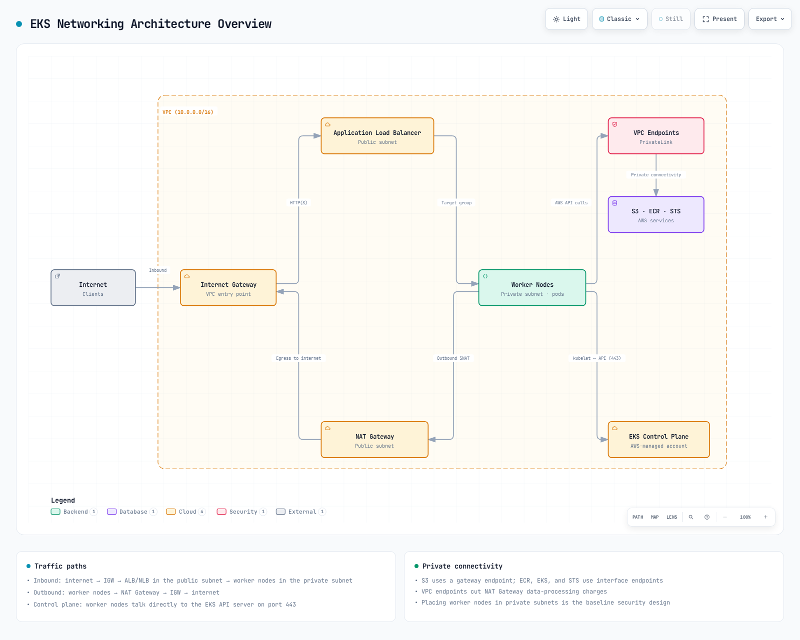
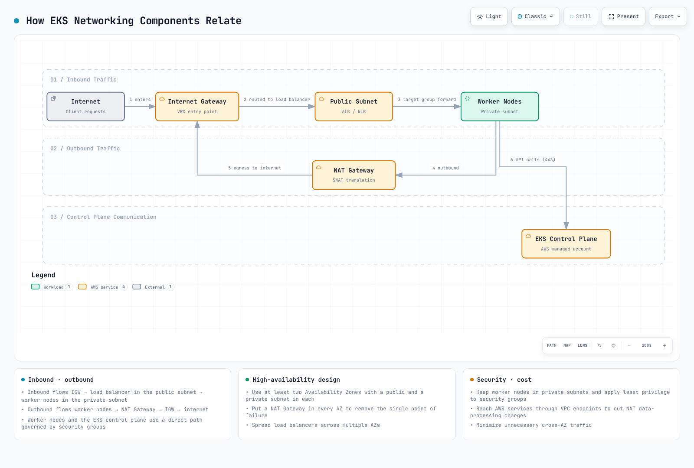
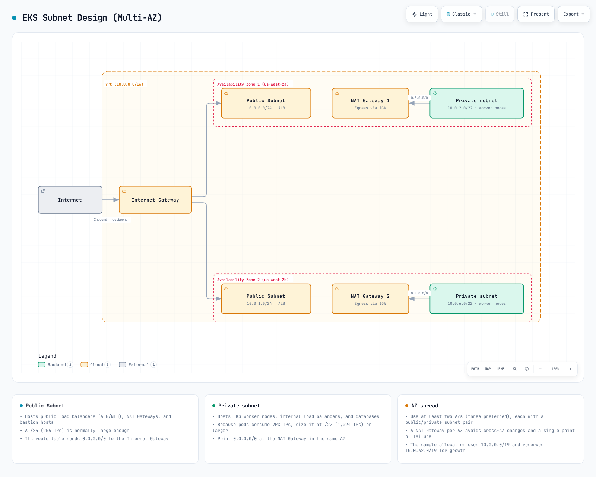

# EKS 网络

## 概述

本章介绍常规 EKS 集群的 VPC/子网规划和安全组流量路径。AWS 在 AWS 管理的基础设施中管理控制平面；客户 VPC 中包含集群连接 ENI、节点/Pod 网络接口，以及负载均衡器和端点资源。不要把客户 VPC 边界理解为托管控制平面或区域级 S3/ECR/STS 服务的物理位置。

## EKS 网络架构

<!-- Audit 2026-09-11: parent asset repair required. MoveAWS-managedcontrolplaneandregionalS3/ECR/STSservicesoutsidethecustomerVPCboundary;showcustomerclusterENIs/interfaceendpointendsinsideVPC. ScopeNATpathasIPv4internetexample,notalltraffic.


[🔍 View interactive diagram](https://www.atomai.click/kubernetes-docs/archmaps/en-eks-03-eks-networking-part1-0.html)
-->

| 组件 | 作用 |
| --- | --- |
| VPC 和子网 | 地址与路由边界；每个子网属于一个可用区 |
| 路由表 | 为目标地址范围选择下一跳 |
| Internet Gateway | 连接到 VPC；公有子网通过路由表指向它 |
| 公有 NAT Gateway | 放置在公有子网并配置 EIP/IGW 路由后，为私有 IPv4 提供共用的互联网出站路径 |
| 安全组 | 关联到受支持网络接口/资源的有状态规则 |
| 网络 ACL | 子网边界上的无状态规则，包括必需的返回流量规则 |
| CNI | 配置 Pod 网络；行为取决于所选实现和模式 |

### 流量路径

<!-- Audit 2026-09-11: parent asset repair required. NodePortusesallocatedportsfromthedefaultrange,nottheentire30000–32767rangeoneverynode;separateNLBServicefromALBIngress/GatewayandIPvsinstancetargetpaths. KOPNGfooterappearscropped;parentfullPagecapture.


[🔍 View interactive diagram](https://www.atomai.click/kubernetes-docs/archmaps/en-eks-03-eks-networking-part1-1.html)
-->

Pod 到 Pod 的流量可以留在同一节点，也可以跨越节点接口和 VPC 路由。同节点流量不一定经过 VPC 网络，因此 VPC Flow Logs 并不完整记录所有 Pod 通信。Service 流量使用已配置的服务代理路径和所选后端；Service 本身不是专用转发设备。外部入站和出站流量取决于方案类型、路由、目标类型和安全控制。控制平面流量与应用流量是不同的路径。



[🔍 查看交互式图表](https://www.atomai.click/kubernetes-docs/archmaps/en-eks-03-eks-networking-part1-2.html)

图中展示的是公有入站和按可用区设置 NAT 的 IPv4 出站方案。这只是其中一种设计，并不意味着每个 EKS 集群都必须创建公有子网和 NAT。完全私有的端点、集中式出站以及原生 IPv6 路径有不同的要求和成本。

## VPC 和子网要求

<!-- Audit 2026-09-11: parent asset repair required. InternetaccessisnotuniversalEKSprerequisite;fullyprivateendpointsareanalternative. IGWattachesVPC,notpublicsubnet. Replacearbitrarysmall/mediumCIDRswithmeasuredplanninginputs.


[🔍 View interactive diagram](https://www.atomai.click/kubernetes-docs/archmaps/en-eks-03-eks-networking-part1-3.html)
-->

* 对于区域级 EKS 集群，请选择至少跨两个可用区的合格子网。每个集群子网至少需要 6 个可用 IP 地址；AWS 建议至少预留 16 个。还应为升级期间替换控制平面 ENI 及其他资源留出空间。
* 启用 VPC DNS support 和 DNS hostnames。集群子网与节点/Pod 子网不必相同，但必须按需具备可路由的路径。
* 节点需要访问 Kubernetes API、镜像仓库以及其所用的 AWS 服务。这并不总是要求访问公有互联网：私有端点或镜像仓库可以提供这些路径。EKS AWS 服务端点与集群 Kubernetes API 端点是不同的。
* 如果启用了 `controlPlaneEgressMode=CUSTOMER_ROUTED`，请检查自定义控制平面出站路由；集群子网路由和安全规则必须能够访问所需的 webhook/OIDC 及其他端点。
* 更改集群子网仍受原 VPC 和可用区集合的约束。关联新的 VPC CIDR 并不会让所有控制平面操作立即完成；AWS 文档说明协调过程最长可能需要一小时。

### CIDR 规划

<!-- Audit 2026-09-11: parent asset repair required. Removeuniversal1–10node/24,10–100node/20,100+node/16and20–30%headroomguarantees;countreserved/ENI/warm/controlplane/LB/upgradeIPs. RFC1918onlylabeltoobroad;nonoverlapandsupportedCIDRrulesmatter.


[🔍 View interactive diagram](https://www.atomai.click/kubernetes-docs/archmaps/en-eks-03-eks-networking-part1-4.html)
-->

根据预期节点数、普通 Pod 和分支 ENI Pod、预热池/前缀块、控制平面接口、负载均衡器/端点、增长需求和更新容量来规划地址。检查地址是否与 Service CIDR、互连的 VPC 及本地网络重叠。仅凭节点数无法选出安全的 VPC CIDR；固定预留 20–30% 也不是适用于所有情况的容量规则。

以下是 **IPv4 地址总数**，不是集群规模建议或可供 Pod 使用的容量：

| CIDR | 地址总数 |
| --- | ---: |
| /24 | 256 |
| /22 | 1,024 |
| /20 | 4,096 |
| /16 | 65,536 |

对于普通 AWS IPv4 子网分配，AWS 会保留每个子网的前四个地址和最后一个地址：因此，/24 有 251 个可分配地址，/22 有 1,019 个，且这还未扣除工作负载和基础设施占用的地址。这是针对每个子网的规则，不是整个 VPC 只保留五个地址；BYOIP 有文档列明的例外。现有子网 CIDR 不能直接在原位扩大。前缀委派需要连续地址块，也不会创建新的地址空间。

### 子网设计示例

<!-- Audit 2026-09-11: parent asset repair required. Private10.0.2.0/22and10.0.6.0/22arenoncanonical;canonicalfirstoverlapspublicsubnets. Use10.0.4.0/22and10.0.8.0/22;showzonalpublicNATplacementandIGWroute;rawIPcountsnotusable.


[🔍 View interactive diagram](https://www.atomai.click/kubernetes-docs/archmaps/en-eks-03-eks-networking-part1-5.html)
-->

对于 `10.0.0.0/16` VPC，以下对齐后的地址范围互不重叠。它们用于说明公有负载均衡器/按可用区设置 NAT 的设计，并非经过容量测算的建议。公有子网需要关联指向 IGW 的路由；仅有标签或子网名称并不会使其成为公有子网。私有节点可以使用 NAT 或相应的私有服务端点。

| 类型 | 可用区 | CIDR | 示例用途 |
| --- | --- | --- | --- |
| 公有 | us-west-2a | 10.0.0.0/24 | 公有负载均衡器和按可用区设置的 NAT |
| 公有 | us-west-2b | 10.0.1.0/24 | 公有负载均衡器和按可用区设置的 NAT |
| 私有 | us-west-2a | 10.0.4.0/22 | 工作节点/Pod |
| 私有 | us-west-2b | 10.0.8.0/22 | 工作节点/Pod |

旧版 `10.0.2.0/22` 和 `10.0.6.0/22` 并非对齐的网络地址。AWS 会将 CIDR 规范化；第一个旧范围会变为 `10.0.0.0/22`，与公有子网重叠。配置前请验证网络边界和地址重叠。按可用区设置 NAT 路径可以避免依赖跨可用区 NAT，但仍需审查冗余容量/路由及工作负载放置。

### 子网发现标签

<!-- Audit 2026-09-11: parent asset repair required. Tagrequirementsdependcontroller/version/features;LBC>=2.12.1canuseSubnetDiscoveryByReachabilitywithoutroletags. owned/sharedarenotsecurityisolation;privatesubnetscanhaveegress. Removewithouttagsalwaysfailsclaim.


[🔍 View interactive diagram](https://www.atomai.click/kubernetes-docs/archmaps/en-eks-03-eks-networking-part1-6.html)
-->

子网发现规则取决于所选控制器及其版本。对于 AWS Load Balancer Controller 3.5，角色标签用于选择公有/内部子网；合格的值是 `1` 或空值。现代 LBC 并不总是要求旧式集群所有权标签。没有角色标签候选子网时，如果启用了 `SubnetDiscoveryByReachability`，LBC 2.12.1 及更高版本可以根据路由发现子网。集群标签筛选、可用 IP 数量及每个可用区的选择仍然重要。EKS Auto Mode 有其单独的文档化标签要求。

* 面向互联网的放置：`kubernetes.io/role/elb`。
* 内部放置：`kubernetes.io/role/internal-elb`。
* `kubernetes.io/cluster/<cluster-name>` 可能影响筛选/优先级；`owned`/`shared` 不是安全边界，也不是自动路由规则。

```bash
# After reviewing subnet ownership and its associated routes, tag the intended public subnet.
aws ec2 describe-subnets --region "${EXAMPLE_REGION:?}" --subnet-ids "${PUBLIC_SUBNET_ID:?}" \
  --query 'Subnets[].{id:SubnetId,vpc:VpcId,cidr:CidrBlock,free:AvailableIpAddressCount,tags:Tags}'
aws ec2 create-tags --region "$EXAMPLE_REGION" --resources "$PUBLIC_SUBNET_ID" \
  --tags Key=kubernetes.io/role/elb,Value=1
```
对于经过审查的私有/内部放置，请使用 internal-elb 角色标签。不要给任意现有子网打标签，也不要为了绕过未经审查的发现故障而禁用集群标签检查。显式指定子网时，仍必须满足负载均衡器的资格要求。

### 安全组流量路径

<!-- Audit 2026-09-11: parent asset repair required. Replace1025–65535kubeletrangewithactualTCP10250;distinguishprivateAPI443,DNS53,webhook/workloadports,andstatefulSGvsNACLreturnports. EKSdefaultclusterSGmaybesharedwithMNG;publicAPIusesCIDRs;alloutboundnotuniversalneed.


[🔍 View interactive diagram](https://www.atomai.click/kubernetes-docs/archmaps/en-eks-03-eks-networking-part1-7.html)
-->

EKS 会创建一个默认集群安全组，并将其关联到集群 ENI，通常也会关联到托管节点接口。这并非普遍适用的固定双安全组布局。额外的集群安全组不会自动成为节点安全组；自定义启动模板安全组和 Pod 安全组会改变流量路径。修改规则前请检查实际关联情况：

```bash
aws eks describe-cluster --name "${EXAMPLE_CLUSTER:?}" --region "${EXAMPLE_REGION:?}" \
  --query 'cluster.resourcesVpcConfig.{clusterSG:clusterSecurityGroupId,additionalSGs:securityGroupIds,subnets:subnetIds,public:endpointPublicAccess,private:endpointPrivateAccess,publicCIDRs:publicAccessCidrs}'
```

| 流量 | 常见目标端口 | 需要审查的范围 |
| --- | --- | --- |
| 节点/获准连接的客户端 → 私有 Kubernetes API | TCP 443 | 集群端点安全组及获准来源 |
| 控制平面 → kubelet | TCP 10250 | 目标节点安全组及路由 |
| 节点/Pod → DNS 后端 | UDP 和 TCP 53 | 实际 CoreDNS/NodeLocal DNS 路径 |
| 控制平面 → 准入 Webhook | 已配置的后端端口 | Webhook Service/端点及安全组路径 |
| 应用/负载均衡器 → 工作负载 | 已配置的应用/健康检查端口 | 目标类型、目标安全组和健康检查 |

当收紧默认集群安全组时，AWS 文档将 TCP 443、TCP 10250 及到集群安全组的 TCP/UDP 53 列为最低出站规则集；此外还需要满足实际应用、节点间通信和服务访问要求。旧的 kubelet 端口范围 `1025–65535` 并非该最低规则集。安全组是有状态的；允许流量的返回包不需要一概开放临时端口范围。NACL 是无状态的，必须允许相应的返回路径。

集群更新期间可能会重新创建默认的自身入站和自身出站/EFA 规则。在一个已关联安全组中增加狭窄规则，并不能抵消另一个已关联安全组中的宽泛允许规则。公有 API 访问使用 `publicAccessCidrs`；集群安全组控制私有端点路径。请审查面向镜像仓库/AWS API 的出站路径，并使用合适的端点或路由，不要假定每个集群都需要 `ALL → 0.0.0.0/0`。

## 后续步骤和测验

[EKS 网络（第 2 部分）](./03-eks-networking-part2.md)介绍 Service、负载均衡和策略。请通过[第 1 部分测验](../quizzes/eks/03-eks-networking-part1-quiz.md)检查理解情况。

## 参考资料

- [EKS VPC/子网](https://docs.aws.amazon.com/eks/latest/userguide/network-reqs.html)
- [私有集群](https://docs.aws.amazon.com/eks/latest/userguide/private-clusters.html)
- [子网容量规划](https://docs.aws.amazon.com/vpc/latest/userguide/subnet-sizing.html)
- [安全组](https://docs.aws.amazon.com/eks/latest/userguide/sec-group-reqs.html)
- [LBC 子网发现](https://github.com/kubernetes-sigs/aws-load-balancer-controller/blob/v3.5.0/docs/deploy/subnet_discovery.md)
