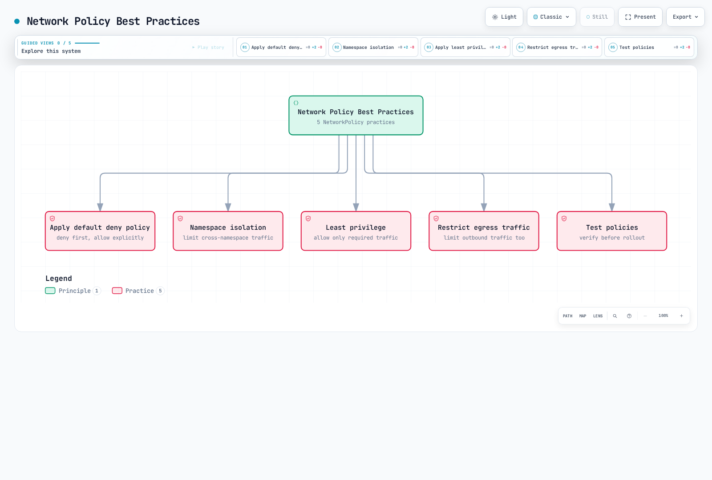

# EKS 网络 - 第 2 部分：Service、负载均衡和网络策略

> **已验证示例版本**：EKS Kubernetes 1.36、AWS Load Balancer Controller 3.6.0、Gateway API 1.6.0
> **最后更新**：October 16, 2026

## 概述

本文将介绍 Amazon EKS 中的 Service、负载均衡和网络策略。我们将了解如何通过 Kubernetes Service 暴露应用、如何与 AWS 负载均衡器集成，以及如何使用网络策略控制 Pod 之间的通信。

## Kubernetes Service 类型

Kubernetes 提供以下 Service 类型：


[🔍 查看交互式图表](https://www.atomai.click/kubernetes-docs/archmaps/en-eks-03-eks-networking-part2-0.html)

1. **ClusterIP**：用于集群路由的 Service 虚拟 IP；它不是授权边界
2. **NodePort**：在符合条件的节点地址和分配的端口上暴露 Service，实际访问受路由和防火墙规则限制
3. **LoadBalancer**：由已安装的负载均衡器实现进行协调的 Service；负载均衡器可以是内部负载均衡器
4. **ExternalName**：为外部 Service 提供 CNAME 记录

### ClusterIP Service

ClusterIP 是默认类型。其虚拟 IP 用于集群网络；它不会强制实施命名空间隔离或身份验证。无头 Service（`clusterIP: None`）则通过 DNS 暴露端点地址。

```yaml
apiVersion: v1
kind: Service
metadata:
  name: my-service
spec:
  selector:
    app: my-app
  ports:
  - port: 80
    targetPort: 8080
  type: ClusterIP
```

### NodePort Service

NodePort 通常使用已配置的节点地址集，以及 30000–32767 范围内的一个端口（默认范围）。节点是否就绪、Service 代理配置、`externalTrafficPolicy`、路由和安全规则共同决定实际可达性。单个 Service 无需开放整个端口范围。

```yaml
apiVersion: v1
kind: Service
metadata:
  name: my-service
spec:
  selector:
    app: my-app
  ports:
  - port: 80
    targetPort: 8080
    nodePort: 30080
  type: NodePort
```

### LoadBalancer Service

此 Service 由已安装的控制器进行协调。该示例明确选择 LBC，并创建一个使用 Pod IP 作为目标的内部 NLB；ALB 则通过 Ingress 或 ALB Gateway 配置。EKS Auto Mode 使用 `eks.amazonaws.com/nlb`，并有自己支持的配置方式。不要同时应用同一个 `my-service` 示例的两个版本。
```yaml
apiVersion: v1
kind: Service
metadata:
  name: my-service
  annotations:
    service.beta.kubernetes.io/aws-load-balancer-scheme: internal
    service.beta.kubernetes.io/aws-load-balancer-nlb-target-type: ip
spec:
  type: LoadBalancer
  loadBalancerClass: service.k8s.aws/nlb
  allocateLoadBalancerNodePorts: false
  selector:
    app: my-app
  ports:
  - port: 80
    targetPort: 8080
```

### ExternalName Service

ExternalName Service 为外部 Service 提供 CNAME 记录。它不会代理流量，也不会配置 TLS、端口或防火墙访问。HTTP Host 标头和证书名称仍必须与目标匹配。

```yaml
apiVersion: v1
kind: Service
metadata:
  name: my-service
spec:
  type: ExternalName
  externalName: my-service.example.com
```

## AWS 负载均衡器集成

EKS 将 Kubernetes Service 与 AWS 负载均衡器集成，使应用能够从外部访问。

<!-- Diagram repair pending: see batch report.


[🔍 View interactive diagram](https://www.atomai.click/kubernetes-docs/archmaps/en-eks-03-eks-networking-part2-1.html)
-->

### Classic Load Balancer (CLB)

旧版 AWS Service Controller 路径可以创建 CLB。这不是现代 LBC 的默认行为：LBC 2.5+ 通常会为新建的 LoadBalancer Service 分配其 NLB 类。在迁移现有 Service 前，请检查实际使用的控制器、类和资源所有权；直接修改所有权注解可能导致资源泄漏或改变暴露方式。

### Network Load Balancer (NLB)

使用上面的 NLB 示例。以下内容是要合并到该 Service 中的**注解片段**，不是独立清单：
```yaml
metadata:
  annotations:
    service.beta.kubernetes.io/aws-load-balancer-scheme: internal
    service.beta.kubernetes.io/aws-load-balancer-nlb-target-type: ip
    service.beta.kubernetes.io/aws-load-balancer-attributes: load_balancing.cross_zone.enabled=true
    service.beta.kubernetes.io/aws-load-balancer-target-group-attributes: preserve_client_ip.enabled=true
```
`aws-load-balancer-nlb-target-type` 用于选择目标类型。`preserve_client_ip.enabled` 会改变源 IP 行为，而不是目标类型。跨区负载均衡涉及容量、可用性和成本方面的取舍；请检查各可用区的目标和故障行为。Proxy Protocol v2 是可选项，需要后端解析器；在普通 HTTP 服务器上启用它可能会导致请求失败。

### Application Load Balancer (ALB)

要使用 ALB，需要安装 AWS Load Balancer Controller 并使用 Ingress 资源：


[🔍 查看交互式图表](https://www.atomai.click/kubernetes-docs/archmaps/en-eks-03-eks-networking-part2-2.html)

1. 与平台所有者一起准备控制器。这些命令会下载固定版本的 IAM 策略并渲染固定版本的 chart；它们不会建立 IAM 信任。首先，为 `kube-system/aws-load-balancer-controller` ServiceAccount 配置经过审核的 Pod Identity 关联或 IRSA 角色/OIDC 信任以及发布所需策略。现有安装应继续由其原有的 Helm/IaC 所有者管理。确认子网发现、API/webhook 连通性和可用的 kubeconfig。
```bash
set -euo pipefail
: "${CLUSTER_NAME:?Set the existing cluster name}"
: "${AWS_REGION:?Set the cluster Region}"
: "${VPC_ID:?Set the cluster VPC ID}"
curl --fail --show-error --location \
  https://raw.githubusercontent.com/kubernetes-sigs/aws-load-balancer-controller/v3.6.0/docs/install/iam_policy.json \
  --output lbc-iam-policy-v3.6.0.json
helm repo add eks https://aws.github.io/eks-charts
helm repo update eks
helm template aws-load-balancer-controller eks/aws-load-balancer-controller \
  --version 3.6.0 --namespace kube-system \
  --set-string clusterName="$CLUSTER_NAME" \
  --set-string region="$AWS_REGION" --set-string vpcId="$VPC_ID" \
  --set serviceAccount.create=false \
  --set-string serviceAccount.name=aws-load-balancer-controller \
  > lbc-rendered.yaml
```
检查渲染后的资源并满足 IAM 先决条件后，安装操作会修改集群。按照文档中的发布流程升级 CRD；Helm 升级不会自动升级所有 CRD。
```bash
helm upgrade --install aws-load-balancer-controller eks/aws-load-balancer-controller \
  --version 3.6.0 --namespace kube-system \
  --set-string clusterName="$CLUSTER_NAME" \
  --set-string region="$AWS_REGION" --set-string vpcId="$VPC_ID" \
  --set serviceAccount.create=false \
  --set-string serviceAccount.name=aws-load-balancer-controller
kubectl -n kube-system rollout status deployment/aws-load-balancer-controller --timeout=180s
```
2. 创建一个 `spec.ingressClassName: alb` 的 Ingress。将第一个示例中的 **ClusterIP** `my-service` 用作其后端，以避免创建另一个负载均衡器。其选中的 Pod 必须确实监听端口 8080。上图展示的是逻辑配置：流量不会经过 Ingress API 对象或控制器 Pod。
```yaml
apiVersion: networking.k8s.io/v1
kind: Ingress
metadata:
  name: my-ingress
  annotations:
    alb.ingress.kubernetes.io/scheme: internal
    alb.ingress.kubernetes.io/target-type: ip
spec:
  ingressClassName: alb
  rules:
  - http:
      paths:
      - path: /
        pathType: Prefix
        backend:
          service:
            name: my-service
            port:
              number: 80
```
对于 HTTPS，将此片段合并到 Ingress 中，并将 ACM ARN 和安全组替换为真实的、位于同一区域/VPC 的资源。请自行配置自定义前端安全组；后端规则管理是另一项单独的选择。仅添加 action 注解不会启用重定向，除非有规则引用该 action；下面的 `ssl-redirect` 提供了文档说明的快捷方式。
```yaml
metadata:
  annotations:
    alb.ingress.kubernetes.io/listen-ports: '[{"HTTP":80},{"HTTPS":443}]'
    alb.ingress.kubernetes.io/certificate-arn: arn:aws:acm:us-west-2:123456789012:certificate/00000000-0000-4000-8000-000000000000
    alb.ingress.kubernetes.io/ssl-redirect: "443"
    alb.ingress.kubernetes.io/security-groups: sg-0123456789abcdef0
    alb.ingress.kubernetes.io/manage-backend-security-group-rules: "true"
```

### Service 和负载均衡器最佳实践

<!-- Diagram repair pending: see batch report.


[🔍 View interactive diagram](https://www.atomai.click/kubernetes-docs/archmaps/en-eks-03-eks-networking-part2-3.html)
-->

1. **内部 Service 使用 ClusterIP**：仅在集群内部访问的 Service 使用 ClusterIP 类型。
2. **外部 Service 使用 LoadBalancer 或 Ingress**：需要外部访问的 Service 使用 LoadBalancer 类型或 Ingress 资源。
3. **使用 ALB**：需要基于路径的路由、SSL 终止和身份验证等功能时使用 ALB。
4. **使用 NLB**：需要 TCP/UDP 流量、高性能和静态 IP 时使用 NLB。
5. **使用内部负载均衡器**：对于通过路由连接的私有客户端（包括允许的已连接 VPC/本地网络），使用内部负载均衡器；对于集群内客户端，通常使用 ClusterIP 就足够了。
6. **启用跨区负载均衡**：根据目标容量、可用区故障测试和数据传输成本评估跨区行为；仅启用跨区负载均衡并不能保证高可用性。
7. **选择合适的目标类型**：选择 `ip` 目标类型，直接使用 Pod IP 作为目标；或选择 `instance` 目标类型，使用节点 IP 作为目标。

## 网络策略

在启用了策略实施的情况下，NetworkPolicy 会在 L3/L4 层筛选选定的 Pod 和流量方向。Amazon VPC CNI 在受支持的 EC2/Linux 配置上提供原生网络策略支持；并非一定要安装其他 CNI。请在[ AWS 指南](https://docs.aws.amazon.com/eks/latest/userguide/cni-network-policy.html)中检查具体的附加组件版本、内核/计算限制、standard/strict 模式以及托管 Pod 要求。

<!-- Diagram repair pending: see batch report.


[🔍 View interactive diagram](https://www.atomai.click/kubernetes-docs/archmaps/en-eks-03-eks-networking-part2-4.html)
-->

### 选择策略实现方式

对于 EKS 管理的 VPC CNI 附加组件，在检查 `describe-addon-configuration` 后，由附加组件所有者将以下片段合并到现有配置中；保留无关设置。请通过正向和反向 TCP 测试验证策略是否生效，而不仅仅是确认策略对象存在。
```json
{"enableNetworkPolicy":"true"}
```
Calico 是另一种策略引擎。与 VPC CNI 搭配使用时，请遵循[官方 EKS 仅策略流程](https://docs.tigera.io/calico/latest/getting-started/kubernetes/managed-public-cloud/eks)，包括 `cni.type: AmazonVPC`、Pod IP 注解权限和版本兼容性。不要同时启用 VPC CNI 原生策略实施功能。在现有 VPC CNI 集群上应用 VXLAN 网络清单并不是仅策略安装。替换网络需要单独设计迁移方案。

### 默认网络策略

如果没有 NetworkPolicy 选中某个 Pod，该 Pod 在相应方向上就不会被隔离；路由、安全组和其他控制仍然适用。Ingress 和 egress 的隔离是分开的，所有匹配策略中的允许规则会累加。如果源端 egress 和目标端 ingress 都处于隔离状态，则两者都必须允许连接。回复流量会被隐式允许。以下是彼此独立的策略示例，而不是一组累积实施限制的策略：下面的命名空间范围 ingress 允许规则也会允许后续仅允许前端的示例本想限制的流量。

### 命名空间隔离策略

此策略会选中 `my-namespace` 中的所有 Pod，并且**仅隔离 ingress**。它允许同一命名空间内所有端口的 ingress；不会限制 egress。请先创建命名空间和预期的工作负载标签。

```yaml
apiVersion: networking.k8s.io/v1
kind: NetworkPolicy
metadata:
  name: namespace-isolation
  namespace: my-namespace
spec:
  podSelector: {}
  policyTypes:
  - Ingress
  ingress:
  - from:
    - podSelector: {}
```

### 特定 Pod 通信允许策略

仅允许具有特定标签的 Pod 之间通信的策略：

```yaml
apiVersion: networking.k8s.io/v1
kind: NetworkPolicy
metadata:
  name: allow-frontend-to-backend
  namespace: my-namespace
spec:
  podSelector:
    matchLabels:
      app: backend
  policyTypes:
  - Ingress
  ingress:
  - from:
    - podSelector:
        matchLabels:
          app: frontend
    ports:
    - protocol: TCP
      port: 80
```

### 外部流量限制策略

允许来自某个源 CIDR 的 ingress，但仍受其他累加策略约束。此策略会评估策略实施点可见的源 IP；NAT、NodePort 和负载均衡器可能会改变该 IP。它不能替代前端负载均衡器安全组或 WAF 规则。

```yaml
apiVersion: networking.k8s.io/v1
kind: NetworkPolicy
metadata:
  name: allow-external-traffic
  namespace: my-namespace
spec:
  podSelector:
    matchLabels:
      app: web
  policyTypes:
  - Ingress
  ingress:
  - from:
    - ipBlock:
        cidr: 192.168.1.0/24
        except:
        - 192.168.1.10/32
    ports:
    - protocol: TCP
      port: 80
```

### Egress 流量限制策略

仅允许向特定目标发送 egress 流量的策略：`203.0.113.0/24` 是文档专用网段；请将其替换为实际获准的外部目标。DNS 允许规则假设使用常规 CoreDNS Pod；如果使用 NodeLocal DNS 或其他 DNS 设计，则必须相应调整。从 `0.0.0.0/0` 中排除 RFC1918 网段，无法确定某一个外部服务，也无法可靠保护实例元数据。

```yaml
apiVersion: networking.k8s.io/v1
kind: NetworkPolicy
metadata:
  name: limit-egress-traffic
  namespace: my-namespace
spec:
  podSelector:
    matchLabels:
      app: web
  policyTypes:
  - Egress
  egress:
  - to:
    - podSelector:
        matchLabels:
          app: db
    ports:
    - protocol: TCP
      port: 5432
  - to:
    - ipBlock:
        cidr: 203.0.113.0/24
    ports:
    - protocol: TCP
      port: 443
  - to:
    - namespaceSelector:
        matchLabels:
          kubernetes.io/metadata.name: kube-system
      podSelector:
        matchLabels:
          k8s-app: kube-dns
    ports:
    - protocol: UDP
      port: 53
    - protocol: TCP
      port: 53
```

### 网络策略最佳实践



[🔍 查看交互式图表](https://www.atomai.click/kubernetes-docs/archmaps/en-eks-03-eks-networking-part2-5.html)

1. **应用默认拒绝策略**：默认拒绝所有流量，仅明确允许必要的流量。
2. **命名空间隔离**：通过限制命名空间之间的通信来增强安全性。
3. **遵循最小权限原则**：仅允许最低限度的必要通信。
4. **限制 egress 流量**：通过限制 Pod 的出站流量来增强安全性。
5. **测试策略**：应用网络策略前先进行测试，避免意外阻断通信。

---

## Gateway API

### 概述

Gateway API 将基础设施所有权（GatewayClass/Gateway）与应用路由分离。LBC 使用**独立的 ALB 和 NLB Gateway**；一个 Gateway 不能混用 L4 和 L7 路由。ALB 支持 HTTPRoute/GRPCRoute，NLB 支持 TCPRoute/UDPRoute/TLSRoute，具体以控制器文档说明的功能子集为准。

<!-- Diagram repair pending: see batch report.


[🔍 View interactive diagram](https://www.atomai.click/kubernetes-docs/archmaps/en-eks-03-eks-networking-part2-6.html)
-->

### 先决条件

这些示例使用 LBC **3.6.0** 和 Gateway API **1.6.0**，即该版本发布说明中指定的版本。3.6.0 使用与 3.5.0 相同的 Gateway API 1.6.0 CRD，但其发布说明要求在升级控制器前应用最新的 AWS 提供的 CRD（chart CRD 和 LBC Gateway CRD）。较早版本从 2.13.3 开始支持 L4，从 2.14.0 开始支持 L7；“2.13+ 支持所有功能”是不正确的。在 3.6.0 中，控制器会检测 CRD，并默认启用 `NLBGatewayAPI`/`ALBGatewayAPI`。没有 `EnableGatewayAPI` 开关。TCPRoute 和 UDPRoute 现在是 standard channel 中的 v1 资源；不要不加区分地安装较旧的 experimental CRD。
```bash
set -euo pipefail
curl --fail --show-error --location \
  https://github.com/kubernetes-sigs/gateway-api/releases/download/v1.6.0/standard-install.yaml \
  --output gateway-standard-v1.6.0.yaml
curl --fail --show-error --location \
  https://raw.githubusercontent.com/kubernetes-sigs/aws-load-balancer-controller/v3.6.0/config/crd/gateway/gateway-crds.yaml \
  --output lbc-gateway-crds-v3.6.0.yaml
```
在应用这些集群范围的更新前，请检查下载内容以及现有 CRD 的所有权和已存储版本。对于现有安装，请遵循发布迁移流程。如果控制器启动时尚未安装这些 CRD，请在 CRD 建立后重启/重新协调控制器。
```bash
kubectl apply --server-side -f gateway-standard-v1.6.0.yaml
kubectl apply --server-side -f lbc-gateway-crds-v3.6.0.yaml
kubectl get crd gateways.gateway.networking.k8s.io \
  tcproutes.gateway.networking.k8s.io udproutes.gateway.networking.k8s.io \
  loadbalancerconfigurations.gateway.k8s.aws
```


### GatewayClass 和 Gateway 设置

首先创建专用的 `gateway-demo` 命名空间以及指定的后端 Service/就绪工作负载。请替换 ACM ARN 和源 CIDR；该证书必须能供其所在区域的 ALB 使用。这只是一个配置示例，并非已执行的生产部署。所引用的默认 TargetGroupConfiguration 会使 ClusterIP 后端使用 IP 目标；否则控制器默认可能使用需要 NodePort 的 instance 目标。此 LBC 专用 HTTPS 模式通过 LoadBalancerConfiguration 配置 ACM，并有意省略此实现不支持的 `tls.certificateRefs`。
```yaml
apiVersion: gateway.networking.k8s.io/v1
kind: GatewayClass
metadata:
  name: amazon-alb
spec:
  controllerName: gateway.k8s.aws/alb
---
apiVersion: gateway.k8s.aws/v1
kind: TargetGroupConfiguration
metadata:
  name: ip-targets
  namespace: gateway-demo
spec:
  defaultConfiguration:
    targetType: ip
---
apiVersion: gateway.k8s.aws/v1
kind: LoadBalancerConfiguration
metadata:
  name: alb-config
  namespace: gateway-demo
spec:
  scheme: internal
  sourceRanges:
  - 10.0.0.0/16
  defaultTargetGroupConfiguration:
    name: ip-targets
  listenerConfigurations:
  - protocolPort: HTTPS:443
    defaultCertificate: arn:aws:acm:us-west-2:123456789012:certificate/00000000-0000-4000-8000-000000000000
---
apiVersion: gateway.networking.k8s.io/v1
kind: Gateway
metadata:
  name: my-hotel-gateway
  namespace: gateway-demo
spec:
  gatewayClassName: amazon-alb
  infrastructure:
    parametersRef:
      group: gateway.k8s.aws
      kind: LoadBalancerConfiguration
      name: alb-config
  listeners:
  - name: https
    protocol: HTTPS
    port: 443
    hostname: app.example.com
    allowedRoutes:
      namespaces:
        from: Same
```


### HTTPRoute 示例（L7 → ALB）

90/10 权重适用于与 `/api` 匹配的符合条件的请求；这不保证精确的请求数量，也不构成基于运行状况的故障转移策略。此路由会关联到 HTTPS listener，并要求主机名相交。后端端口是 Service 端口。跨命名空间路由/后端需要相应的 allowedRoutes/ReferenceGrant 控制。
```yaml
apiVersion: gateway.networking.k8s.io/v1
kind: HTTPRoute
metadata:
  name: app-route
  namespace: gateway-demo
spec:
  parentRefs:
  - name: my-hotel-gateway
    sectionName: https
  hostnames:
  - app.example.com
  rules:
  - matches:
    - path:
        type: PathPrefix
        value: /api
    backendRefs:
    - name: api-service
      port: 80
      weight: 90
    - name: api-service-v2
      port: 80
      weight: 10
  - matches:
    - path:
        type: PathPrefix
        value: /
    backendRefs:
    - name: frontend-service
      port: 80
```


### TCPRoute 示例（L4 → NLB）

此独立的内部 NLB Gateway 会复用 `ip-targets`。`postgres-service` 必须存在于 `gateway-demo` 中，并且在 Service 的 targetPort 上具有就绪且可路由的目标。TCP listener 会转发字节流；它本身不会配置数据库身份验证或 TLS。
```yaml
apiVersion: gateway.networking.k8s.io/v1
kind: GatewayClass
metadata:
  name: amazon-nlb
spec:
  controllerName: gateway.k8s.aws/nlb
---
apiVersion: gateway.k8s.aws/v1
kind: LoadBalancerConfiguration
metadata:
  name: nlb-config
  namespace: gateway-demo
spec:
  scheme: internal
  sourceRanges:
  - 10.0.0.0/16
  defaultTargetGroupConfiguration:
    name: ip-targets
---
apiVersion: gateway.networking.k8s.io/v1
kind: Gateway
metadata:
  name: my-nlb-gateway
  namespace: gateway-demo
spec:
  gatewayClassName: amazon-nlb
  infrastructure:
    parametersRef:
      group: gateway.k8s.aws
      kind: LoadBalancerConfiguration
      name: nlb-config
  listeners:
  - name: tcp
    protocol: TCP
    port: 5432
    allowedRoutes:
      namespaces:
        from: Same
---
apiVersion: gateway.networking.k8s.io/v1
kind: TCPRoute
metadata:
  name: db-route
  namespace: gateway-demo
spec:
  parentRefs:
  - name: my-nlb-gateway
    sectionName: tcp
  rules:
  - backendRefs:
    - name: postgres-service
      port: 5432
```


### QUIC/HTTP3 支持

ALB HTTPS listener **不会**自动启用 HTTP/3。LBC 3.6.0 文档说明，可通过 `listenerConfigurations[].quicEnabled` 为 NLB UDP/TCP_UDP listener 启用 QUIC。这要求使用 IP 目标，并且 NLB 未附加安全组。后端必须自行终止 QUIC/HTTP3。以下内容是一个单独 NLB Gateway 的配置组件，该 Gateway 使用 UDP:443 和 UDPRoute；这不是 ALB 配置，也不是完整部署。在选择不使用安全组的设计前，请规划目标端的安全性和运行状况检查。
```yaml
apiVersion: gateway.k8s.aws/v1
kind: LoadBalancerConfiguration
metadata:
  name: quic-config
  namespace: gateway-demo
spec:
  scheme: internal
  disableSecurityGroup: true
  defaultTargetGroupConfiguration:
    name: ip-targets
  listenerConfigurations:
  - protocolPort: UDP:443
    quicEnabled: true
```


### 证书发现

静态证书使用 `LoadBalancerConfiguration.spec.listenerConfigurations[].defaultCertificate`（额外 ARN 使用 `certificates`）。或者，对于安全 listener，LBC 会根据 listener 和已关联路由的主机名发现匹配的 ACM 证书。HTTPRoute 本身既不会添加 HTTPS listener，也不会签发证书。此 LBC 版本不支持指向 Kubernetes Secret 的 Gateway `certificateRefs`；创建此类 Secret 不会将其导入 ACM。

### 安全组

默认情况下，LBC 会管理前端/后端安全组路径。自定义前端安全组通过 LoadBalancerConfiguration 配置，**而不是**通过 `gateway.k8s.aws/security-group-ids` 配置。将以下字段合并到 `alb-config` 中，同时保留其证书、scheme 和目标配置；另行配置前端规则。`sourceRanges` 不会对显式提供的前端安全组额外增加筛选。请确认后端规则的所有权，并且只允许必要的目标/运行状况检查端口。
```yaml
apiVersion: gateway.k8s.aws/v1
kind: LoadBalancerConfiguration
metadata:
  name: alb-config
  namespace: gateway-demo
spec:
  securityGroups:
  - sg-0123456789abcdef0
  manageBackendSecurityGroupRules: true
```


### 带外目标组

LBC 的扩展使用 `group: ""`、`kind: TargetGroupName` 和**现有 AWS 目标组名称**，而不是 Kubernetes TargetGroupBinding。注册、生命周期、协议、VPC 和负载均衡器关联兼容性仍由外部所有者负责。此示例是前面根路径路由的替代方案；不要在同一个 listener 上创建相互冲突的根路径匹配规则。
```yaml
apiVersion: gateway.networking.k8s.io/v1
kind: HTTPRoute
metadata:
  name: oob-route
  namespace: gateway-demo
spec:
  parentRefs:
  - name: my-hotel-gateway
    sectionName: https
  hostnames:
  - app.example.com
  rules:
  - backendRefs:
    - group: ""
      kind: TargetGroupName
      name: existing-target-group
      weight: 1
```


### Gateway API 与 Ingress 对比

| 功能 | 使用 LBC 的 Ingress | 使用 LBC 3.6.0 的 Gateway API |
|---|---|---|
| 路由 | 主机/路径加控制器注解 | HTTPRoute/GRPCRoute 匹配规则和受支持的扩展 |
| L4 | 使用独立的 NLB Service | 使用 TCPRoute/UDPRoute/TLSRoute 的独立 NLB Gateway |
| 流量拆分 | 引用加权转发 action | Route 后端权重 |
| 所有权 | IngressClass 和 Ingress | GatewayClass、Gateway 和 Route 角色 |
| TLS 证书 | ACM 注解/发现 | ACM LoadBalancerConfiguration/发现；不支持 Secret certificateRefs |
| 可移植性 | 控制器专用注解 | 检查控制器一致性；并非所有标准筛选器都已实现 |

官方参考资料：[LBC Gateway API](https://kubernetes-sigs.github.io/aws-load-balancer-controller/latest/guide/gateway/gateway/)、[LoadBalancerConfiguration](https://kubernetes-sigs.github.io/aws-load-balancer-controller/latest/guide/gateway/loadbalancerconfig/)、[Kubernetes Services](https://kubernetes.io/docs/concepts/services-networking/service/)、[NetworkPolicy](https://kubernetes.io/docs/concepts/services-networking/network-policies/)。

## 测验

要测试你在本章学到的内容，请尝试[主题测验](../quizzes/eks/03-eks-networking-part2-quiz.md)。
