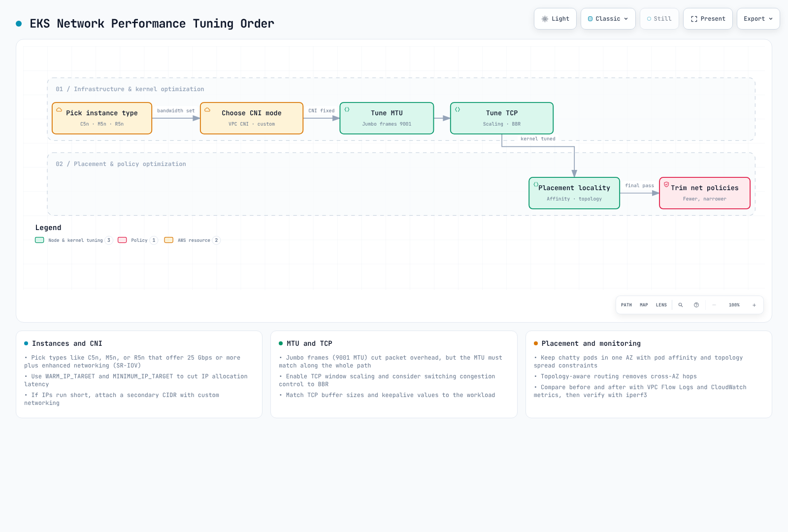
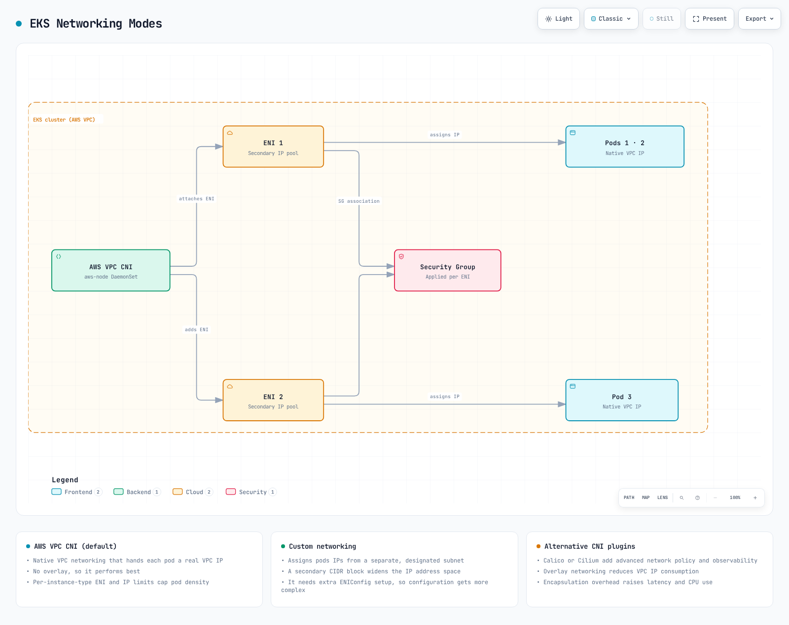
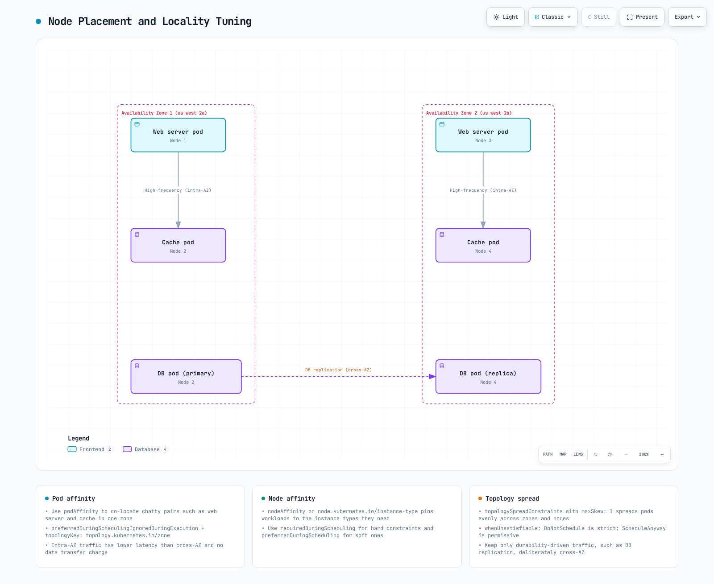
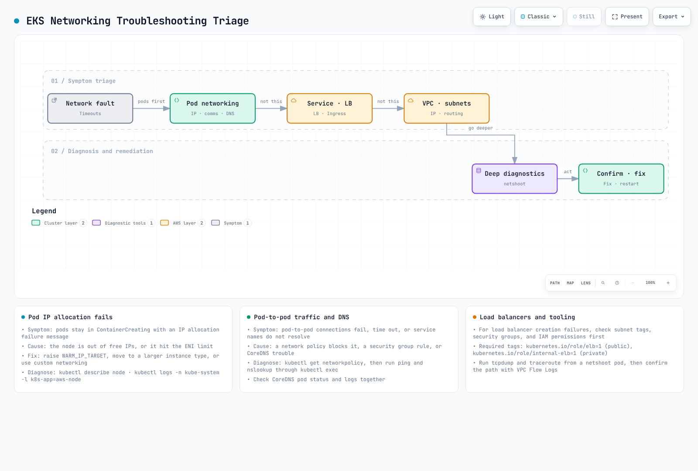

# 第 3 部分：故障排除

> **已验证示例版本**：EKS Kubernetes 1.36、Amazon VPC CNI 1.23.2
> **最后更新**：October 16, 2026

## 概述

本文介绍 Amazon EKS 网络的性能优化、故障排除方法和高级用例。我们将讨论如何优化网络性能、解决常见网络问题，以及如何利用高级网络功能。

## 网络性能优化

有多种策略可以优化 EKS 集群中的网络性能。

<!-- Diagram repair pending: see batch report.


[🔍 View interactive diagram](https://www.atomai.click/kubernetes-docs/archmaps/en-eks-03-eks-networking-part3-0.html)
-->

### 实例类型选择

C5/M5/R5 是支持 ENA 的实例系列示例，并非建议选择较旧一代实例。请比较实际实例类型的基准/突发带宽、每秒数据包数、连接跟踪、ENA 队列、单流限制和工作负载 CPU。更大的实例规格并不一定能降低延迟，100 Gbps 也不是 ENA 的通用上限。

[官方 M5 规格](https://docs.aws.amazon.com/ec2/latest/instancetypes/gp.html)列出 **m5.large：0.75 Gbps 基准带宽 / 突发时最高 10 Gbps**，以及 **m5.24xlarge：25 Gbps**。这些是实例限制，并非测得的应用程序吞吐量。持续流量、目标位置和单流限制可能产生更大影响。请查询目标区域，而不要根据实例系列名称推断：
```bash
set -euo pipefail
: "${AWS_REGION:?Set the instance Region}"
aws ec2 describe-instance-types --region "$AWS_REGION" \
  --instance-types m5.large m5.24xlarge \
  --query 'InstanceTypes[].{Type:InstanceType,Network:NetworkInfo.NetworkPerformance,Cards:NetworkInfo.NetworkCards,ENIs:NetworkInfo.MaximumNetworkInterfaces,IPsPerENI:NetworkInfo.Ipv4AddressesPerInterface}'
```

### 集群网络模式

EKS 支持多种网络模式，各自具有不同的性能特征。



[🔍 View interactive diagram](https://www.atomai.click/kubernetes-docs/archmaps/en-eks-03-eks-networking-part3-1.html)

1. **Amazon VPC CNI（普通 EC2 节点）**：
   * 直接为 Pod 分配 VPC IP 地址。
   * 使用原生 VPC 寻址；吞吐量和延迟仍取决于实例/路径限制。前缀委派主要改变 IP 分配和 Pod 密度，而非数据包路径延迟。
   * 每个节点可分配的 IP 地址数量有限。
2. **自定义网络**：
   * 可以为 Pod 分配来自特定子网的 IP 地址。
   * 可以通过同一 VPC/AZ 的 ENIConfig 子网使用路由配置适当的辅助 VPC CIDR。它不能原地扩大现有子网。
   * 可更精细地控制网络拓扑。
3. **替代 CNI 插件**：
   * 可以使用 Calico 和 Cilium 等替代 CNI 插件。
   * 功能和性能差异取决于仅策略/链式/覆盖网络模式、加密和工作负载。原生 VPC CNI 也支持在受支持的计算环境中使用 NetworkPolicy。Auto Mode 和 Hybrid Nodes 具有不同的网络/运维模型；请勿使用普通 EC2 说明替换它们的 CNI。

### MTU 优化

VPC CNI 实际使用的环境变量是 **`AWS_VPC_ENI_MTU`**，而不是 `ENI_MTU`。在 1.23.2 中，其默认值为 9001；`POD_MTU` 控制 Pod 虚拟接口，未设置时会根据 ENI MTU 推导。更改配置前，请检查 init 容器和主容器：
```bash
kubectl -n kube-system get daemonset aws-node -o json > aws-node-current.json
python3 - <<'PY'
import json
with open("aws-node-current.json") as stream:
    spec = json.load(stream)["spec"]["template"]["spec"]
for field in ("initContainers", "containers"):
    for container in spec.get(field, []):
        settings = {e["name"]: e.get("value", "<valueFrom>")
                    for e in container.get("env", [])
                    if e["name"] in {"AWS_VPC_ENI_MTU", "POD_MTU",
                      "DISABLE_TCP_EARLY_DEMUX", "POD_SECURITY_GROUP_ENFORCING_MODE"}}
        print(field, container["name"], settings)
PY
```
如果路径测试确认 1500 合适，请将此 **Helm values 片段**合并到现有配置所有者的配置中。如果使用 EKS add-on，请检查其确切配置架构，并保留现有值，而不要修补由 Helm 管理的 DaemonSet。ENI/Pod 接口更改可能需要有计划地替换节点/Pod；请分别验证新建接口和现有工作负载。
```yaml
env:
  AWS_VPC_ENI_MTU: "1500"
  POD_MTU: "1500"
```
巨型帧可以减少数据包开销，但整个**实际路径**都必须能够容纳相应数据包大小。SG 和子网不是可配置 MTU 的设备。Internet Gateway/VPN 路径通常会将 MTU 限制为 1500；Gateway、对等连接、隧道和负载均衡器各有自己的限制。请允许路径 MTU 发现所需的 ICMP“需要分片”/IPv6 Packet Too Big 消息。小型 ping 成功并不能证明大型应用程序数据包也能正常工作。IPv4 CNI 范围为 576–9001，IPv6 范围为 1280–9001；设置值有效并不代表端到端适用。

### TCP 优化

**TCP early demux：**这不是通用的吞吐量开关。在文档所述的 Pod 安全组 **strict** 模式场景中，禁用它可使 kubelet TCP 探测能够到达 branch-ENI Pod。此设置属于 `aws-vpc-cni-init`，而非 `aws-node` 主容器。standard 模式不需要此变通方法。只有在确认模式和故障路径后才应用；Helm 片段如下：
```yaml
init:
  env:
    DISABLE_TCP_EARLY_DEMUX: "true"
```
**Keepalive：**只有应用程序在套接字上启用 TCP keepalive 时，它才会检测不活动/断开的长连接。它与 HTTP 连接池不同，也不会加速短连接。请先读取受影响主机/网络命名空间中的值；在管理员的笔记本电脑上运行 `sysctl` 读取的是该笔记本电脑的设置，而不是 EKS 节点的设置：
```bash
sysctl net.ipv4.tcp_keepalive_time net.ipv4.tcp_keepalive_intvl \
  net.ipv4.tcp_keepalive_probes net.ipv4.tcp_rmem net.ipv4.tcp_wmem \
  net.core.rmem_max net.core.wmem_max
```
原有的 60/15/6 数值是**未经测量的调优示例**，并非通用生产默认值。对于兼容的 Linux 内核和非 hostNetwork 工作负载，从 Kubernetes 1.29 起，这些 sysctl 属于安全集合。请仅将这些 sysctl 合并到现有 Pod securityContext 中，并保留其余设置：
```yaml
spec:
  template:
    spec:
      securityContext:
        sysctls:
        - name: net.ipv4.tcp_keepalive_time
          value: "60"
        - name: net.ipv4.tcp_keepalive_intvl
          value: "15"
        - name: net.ipv4.tcp_keepalive_probes
          value: "6"
```
**缓冲区：**使用以字节为单位的带宽时延积来确定实验规模：`bandwidth_bits_per_second × RTT_seconds / 8`。TCP 自动调优、并行流、套接字覆盖设置和总内存压力都会产生影响。此前的 16,777,216 字节最大值（16 MiB）以及 `4096 87380 16777216` / `4096 65536 16777216` 这些三元组只是示例，并非测得的最优值。从 Kubernetes 1.32 开始，在内核 4.15+ 上，`tcp_rmem`/`tcp_wmem` 属于安全 Pod sysctl；不能假定 `net.core.*` 设置也具有相同的准入/隔离支持。节点级更改应使用节点所有者受控的配置，并比较更改前后的错误、延迟、吞吐量和内存情况。

### 节点放置与局部性

以下是同一 Deployment 的不同调度示例。请先在相同命名空间中创建带有匹配标签 `app=cache` 的 Pod。优先规则不会强制放置，也不会迁移已运行的 Pod。Python 服务器是一个培训用夹具；为确保可复现，请固定为经过批准的镜像摘要。应在局部性与副本分散及节点/AZ 故障容忍度之间取得平衡；同一节点上的放置会共享故障域。

优化节点放置和局部性可以提升网络性能。



[🔍 View interactive diagram](https://www.atomai.click/kubernetes-docs/archmaps/en-eks-03-eks-networking-part3-2.html)

1. **可用区局部性**：
   * 将频繁通信的 Pod 放置在同一可用区，以降低延迟。
   * 使用 Pod 亲和性和反亲和性控制 Pod 放置。

```yaml
apiVersion: apps/v1
kind: Deployment
metadata:
  name: web-server
spec:
  replicas: 3
  selector:
    matchLabels:
      app: web
  template:
    metadata:
      labels:
        app: web
    spec:
      automountServiceAccountToken: false
      securityContext:
        runAsNonRoot: true
        runAsUser: 10001
        runAsGroup: 10001
        seccompProfile:
          type: RuntimeDefault
      containers:
      - name: http
        image: python:3.13-alpine
        command:
        - python
        - -u
        - -c
        args:
        - |
          import os
          from http.server import BaseHTTPRequestHandler, HTTPServer
          class Handler(BaseHTTPRequestHandler):
              def do_GET(self):
                  self.send_response(200)
                  self.end_headers()
                  self.wfile.write((os.environ["APP_NAME"] + "\n").encode())
          HTTPServer(("0.0.0.0", 8080), Handler).serve_forever()
        env:
        - name: APP_NAME
          value: web
        ports:
        - name: http
          containerPort: 8080
        readinessProbe:
          httpGet:
            path: /health
            port: http
        resources:
          requests:
            cpu: 50m
            memory: 32Mi
          limits:
            cpu: 200m
            memory: 64Mi
        securityContext:
          allowPrivilegeEscalation: false
          readOnlyRootFilesystem: true
          capabilities:
            drop:
            - ALL
      affinity:
        podAffinity:
          preferredDuringSchedulingIgnoredDuringExecution:
          - weight: 100
            podAffinityTerm:
              labelSelector:
                matchExpressions:
                - key: app
                  operator: In
                  values:
                  - cache
              topologyKey: topology.kubernetes.io/zone
```

2. **节点局部性**：
   * 将频繁通信的 Pod 放置在同一节点，以减少网络跳数。
   * 这对延迟敏感型应用尤其有用。

```yaml
apiVersion: apps/v1
kind: Deployment
metadata:
  name: web-server
spec:
  replicas: 3
  selector:
    matchLabels:
      app: web
  template:
    metadata:
      labels:
        app: web
    spec:
      automountServiceAccountToken: false
      securityContext:
        runAsNonRoot: true
        runAsUser: 10001
        runAsGroup: 10001
        seccompProfile:
          type: RuntimeDefault
      containers:
      - name: http
        image: python:3.13-alpine
        command:
        - python
        - -u
        - -c
        args:
        - |
          import os
          from http.server import BaseHTTPRequestHandler, HTTPServer
          class Handler(BaseHTTPRequestHandler):
              def do_GET(self):
                  self.send_response(200)
                  self.end_headers()
                  self.wfile.write((os.environ["APP_NAME"] + "\n").encode())
          HTTPServer(("0.0.0.0", 8080), Handler).serve_forever()
        env:
        - name: APP_NAME
          value: web
        ports:
        - name: http
          containerPort: 8080
        readinessProbe:
          httpGet:
            path: /health
            port: http
        resources:
          requests:
            cpu: 50m
            memory: 32Mi
          limits:
            cpu: 200m
            memory: 64Mi
        securityContext:
          allowPrivilegeEscalation: false
          readOnlyRootFilesystem: true
          capabilities:
            drop:
            - ALL
      affinity:
        podAffinity:
          preferredDuringSchedulingIgnoredDuringExecution:
          - weight: 100
            podAffinityTerm:
              labelSelector:
                matchExpressions:
                - key: app
                  operator: In
                  values:
                  - cache
              topologyKey: kubernetes.io/hostname
```

3. **Service 流量优先级**：

在当前示例中，请在兼容的 Service 代理上使用 `trafficDistribution: PreferSameZone`。它优先选择同一区域内就绪的端点，并在没有此类端点时回退；它不提供隔离或跨 AZ 成本保证。请确保本地容量充足。如果有意切换方案，请移除现有的 `service.kubernetes.io/topology-mode: Auto` 注解，因为它具有优先权。`internalTrafficPolicy: Local`/`externalTrafficPolicy: Local` 对各自的流量施加更严格的节点本地行为，并具有优先权；如果没有本地端点，它们可能会丢弃流量。
```yaml
apiVersion: v1
kind: Service
metadata:
  name: my-service
spec:
  selector:
    app: my-app
  ports:
  - port: 80
    targetPort: 8080
  type: ClusterIP
  trafficDistribution: PreferSameZone
```

### NetworkPolicy 优化

Kubernetes NetworkPolicy 的允许规则是累加的；规则顺序或策略名称不会定义“首个匹配规则生效”。将常用规则放在前面并不是可移植的优化方法。Calico tiers/order 和其他供应商的策略属于不同 API。通过相应所有者，在移除已确认重复/过时规则时，保留所需的入站/出站隔离。请在具有代表性的负载下测量所选引擎的策略编程时间、规则/映射用量、CPU 和数据包丢弃情况；仅凭策略数量无法确定是否存在瓶颈。

## 网络故障排除

让我们了解 EKS 集群中可能出现的常见网络问题，以及如何解决这些问题。



[🔍 View interactive diagram](https://www.atomai.click/kubernetes-docs/archmaps/en-eks-03-eks-networking-part3-3.html)

### Pod 网络问题

<!-- Diagram repair pending: see batch report.


[🔍 View interactive diagram](https://www.atomai.click/kubernetes-docs/archmaps/en-eks-03-eks-networking-part3-4.html)
-->

首先查看实际的 Pod 事件。`ContainerCreating` 可能表示 CNI/IPAM、镜像、卷或运行时故障；它并不能证明 IP 已耗尽。请关联受影响的节点、子网可用地址、ENI/IP 限制、前缀碎片、API 错误/限流和 CNI 日志：
```bash
set -euo pipefail
: "${APP_NAMESPACE:?Set the affected namespace}"
: "${APP_POD:?Set the affected Pod}"
: "${APP_SERVICE:?Set the affected Service}"
kubectl -n "$APP_NAMESPACE" describe pod "$APP_POD"
kubectl -n "$APP_NAMESPACE" get events --field-selector "involvedObject.name=$APP_POD" --sort-by=.metadata.creationTimestamp
kubectl -n "$APP_NAMESPACE" get service "$APP_SERVICE" -o yaml
kubectl -n "$APP_NAMESPACE" get endpointslices \
  -l "kubernetes.io/service-name=$APP_SERVICE" -o yaml
kubectl -n "$APP_NAMESPACE" get networkpolicy
kubectl -n kube-system logs -l k8s-app=aws-node -c aws-node --tail=200 --prefix=true
```
**IP 分配：**增加 `WARM_IP_TARGET` 会预留更多空闲地址，可能加剧子网耗尽。只有在满足已观察到的分配/启动需求且容量充足时，才调整 warm target。如果子网没有连续的 /28 地址段，即使空闲 IP 总数很多，也无法分配前缀。更改节点大小无法扩大子网。确定瓶颈后，再规划子网/前缀预留、受支持的节点密度或分阶段网络迁移。

**连通性：**使用应用程序实际采用的 TCP/UDP 协议，对比同节点、跨节点、跨可用区、Pod IP 和 Service 路径。DNS 故障、缺少工具或 ICMP 被阻止，并不能证明是 NetworkPolicy 拒绝。以下示例假设已有获准使用且包含所示工具的诊断 Pod；请根据实际情况调整集群 DNS 后缀和目标 URL。不要仅为运行此示例而在生产 Pod 中安装特权工具：
```bash
set -euo pipefail
: "${APP_NAMESPACE:?Set the affected namespace}"
: "${DIAGNOSTIC_POD:?Set a running diagnostic Pod with curl and DNS tools}"
: "${TARGET_URL:?Set the real application URL and port}"
kubectl -n "$APP_NAMESPACE" exec "$DIAGNOSTIC_POD" -- cat /etc/resolv.conf
kubectl -n "$APP_NAMESPACE" exec "$DIAGNOSTIC_POD" -- nslookup kubernetes.default.svc.cluster.local
kubectl -n "$APP_NAMESPACE" exec "$DIAGNOSTIC_POD" -- curl \
  --fail --show-error --max-time 10 "$TARGET_URL"
```
**DNS：**检查 dnsPolicy/dnsConfig、resolv.conf、DNS Service/EndpointSlices、CoreDNS 事件/日志和上游可达性。`nslookup` 和 `dig` 是可选工具，不保证包含在应用镜像中。Auto Mode 原生 DNS 采用不同的管理路径；没有传统 CoreDNS Deployment 并不自动代表发生故障。在考虑重启之前，请保留托管 add-on 配置和相关证据。

### Service 和负载均衡问题


[🔍 View interactive diagram](https://www.atomai.click/kubernetes-docs/archmaps/en-eks-03-eks-networking-part3-5.html)

**Service 路径：**验证命名空间、选择器标签、实际监听端口、Service 端口/targetPort、就绪状态和 EndpointSlice 地址/条件。请使用 EndpointSlices，而不是可能会截断大型后端集合的旧版 Endpoints API。随后检查实际的 service-proxy/CNI 模式，以及任何流量策略/局部性偏好。

**负载均衡器/Ingress：**首先确定所属的控制器和类。对于普通 LBC，请检查 Ingress 事件、控制器日志和 AWS 目标运行状况原因代码。Auto Mode 使用托管控制器，诊断路径不同。检查方案/客户端可达性、子网发现/配置、前端和目标 SG 规则、实际目标类型、运行状况检查端口/路径、证书/SNI 和 DNS。子网标签不会创建路由，“控制器处于 Running 状态”也不能证明目标运行状况良好。
```bash
set -euo pipefail
: "${APP_NAMESPACE:?Set the affected namespace}"
: "${INGRESS_NAME:?Set the affected Ingress}"
: "${AWS_REGION:?Set the load balancer Region}"
: "${TARGET_GROUP_ARN:?Set the target group identified from this Ingress}"
kubectl -n "$APP_NAMESPACE" describe ingress "$INGRESS_NAME"
kubectl -n kube-system logs -l app.kubernetes.io/name=aws-load-balancer-controller --tail=200 --prefix=true
aws elbv2 describe-target-health --region "$AWS_REGION" --target-group-arn "$TARGET_GROUP_ARN"
```
一次只更改一个已确认的原因，保留回滚路径，并重复相同的正向和反向应用检查。以上命令仅为诊断示例；本次审核未对 EKS 集群执行这些命令。

官方参考资料：[EC2 带宽](https://docs.aws.amazon.com/AWSEC2/latest/UserGuide/ec2-instance-network-bandwidth.html)、[MTU](https://docs.aws.amazon.com/AWSEC2/latest/UserGuide/network_mtu.html)、[VPC CNI 1.23.2 设置](https://github.com/aws/amazon-vpc-cni-k8s/blob/v1.23.2/README.md)、[Kubernetes sysctl](https://kubernetes.io/docs/tasks/administer-cluster/sysctl-cluster/)、[Service 流量分配](https://kubernetes.io/docs/reference/networking/virtual-ips/)。

## 测验

想检验你对本章内容的掌握程度，请尝试[主题测验](../quizzes/eks/03-eks-networking-part3-quiz.md)。
