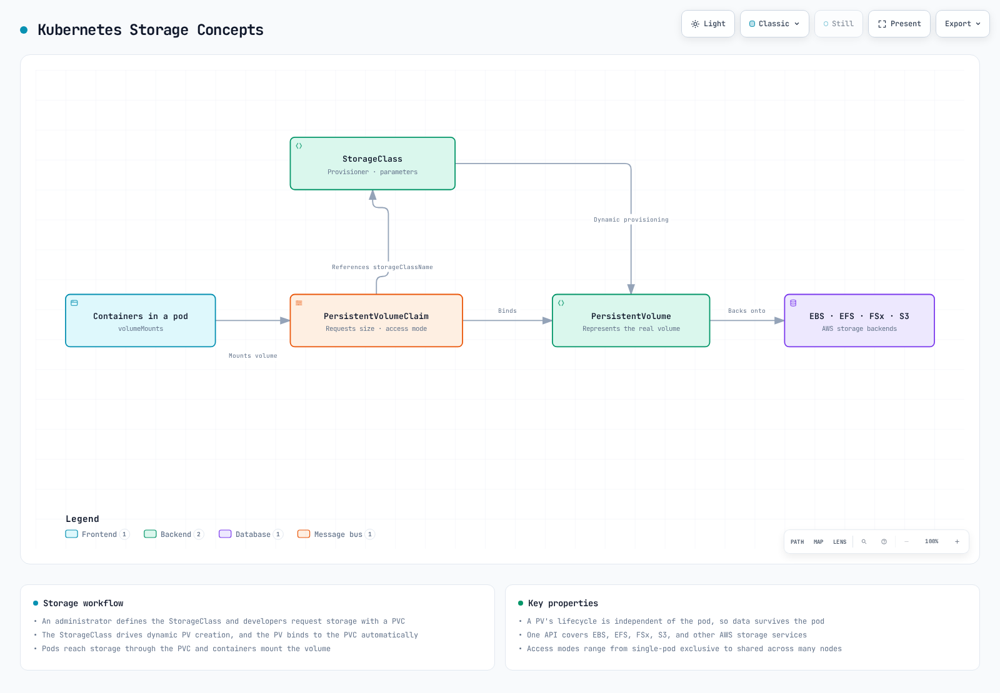
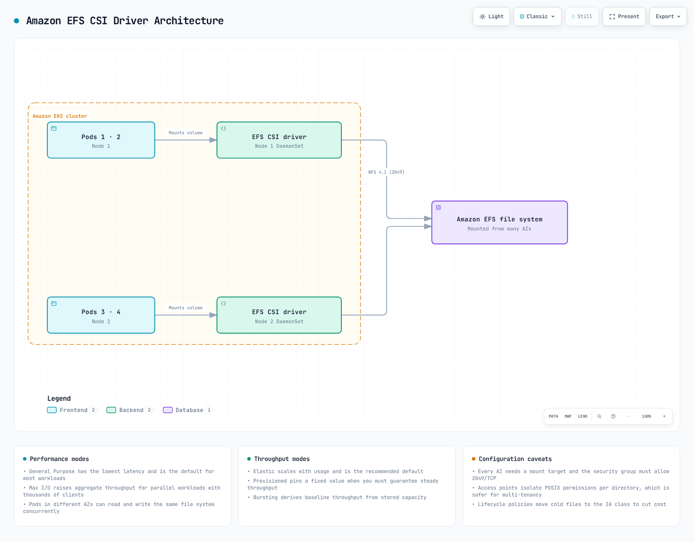
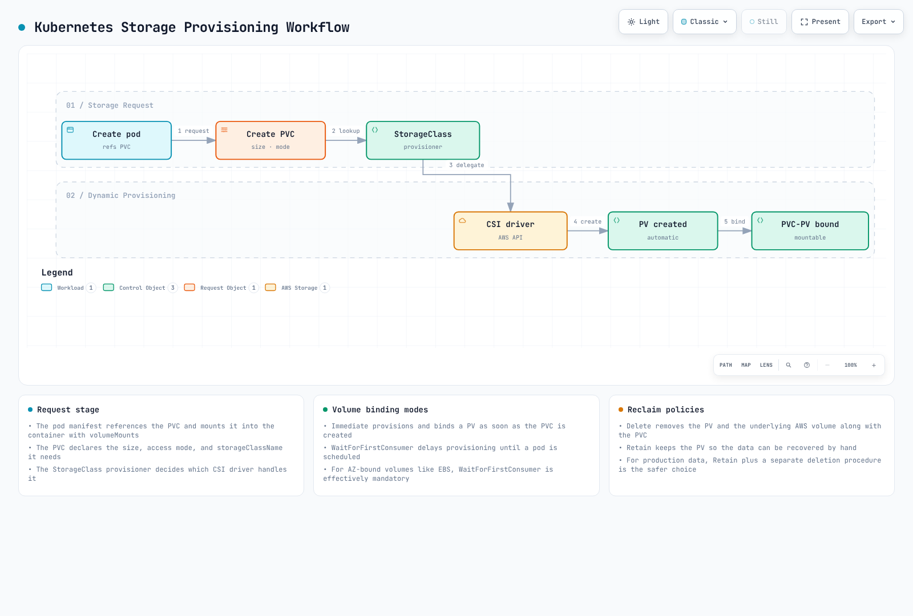

# EKS 存储

> **最后更新**: September 28, 2026

在 Amazon EKS 上运行应用程序时，有多种存储选项可用于存储和管理数据。本文介绍 EKS 存储的基本概念，以及如何使用 Amazon EBS（Elastic Block Store）和 Amazon EFS（Elastic File System）。

## 目录

1. [Kubernetes 存储基本概念](04-eks-storage-part1.md#kubernetes-storage-basic-concepts)
2. [Amazon EKS 存储选项概览](04-eks-storage-part1.md#amazon-eks-storage-options-overview)
3. [使用 Amazon EBS 存储](04-eks-storage-part1.md#storage-with-amazon-ebs)
4. [使用 Amazon EFS 存储](04-eks-storage-part1.md#storage-with-amazon-efs)
5. [存储类和动态配置](04-eks-storage-part1.md#storage-classes-and-dynamic-provisioning)

## Kubernetes 存储基本概念 {#kubernetes-storage-basic-concepts}

首先了解 Kubernetes 中管理存储的关键概念。



[🔍 查看交互式图表](https://www.atomai.click/kubernetes-docs/archmaps/en-eks-04-eks-storage-part1-0.html)

### Volume

Volume 将存储作为文件系统挂载公开给容器，也可以在受支持的情况下作为原始块设备公开。其生命周期取决于 Volume 类型：`emptyDir` 在容器重启后仍会保留，但会随其 Pod 一起删除；由 PVC 支持的持久卷则具有单独管理的生命周期。删除 Pod 并不一定会删除其底层数据。

### Persistent Volume (PV)

持久卷是由管理员配置，或通过存储类动态配置的集群存储。PV 对象独立于 Pod，但保留策略由 PVC 所有权和回收策略控制。例如，通用临时卷的 PVC 可以随其所属 Pod 一起被垃圾回收。

### Persistent Volume Claim (PVC)

持久卷声明是用户对存储的请求。PVC 会请求特定大小和访问模式的存储，该请求将绑定到适当的 PV。

PVC 属于命名空间，通常绑定到一个 PV；如果访问模式和后端允许，该命名空间中的多个 Pod 可以使用此声明。绑定本身不会授予应用层文件权限，也不能保证容量或性能可用。

### StorageClass

存储类描述管理员提供的存储“类别”。使用存储类可以在创建 PVC 时动态配置 PV。

### 访问模式

Kubernetes 支持以下访问模式：

* **ReadWriteOnce (RWO)**：可由单个节点以读写方式挂载
* **ReadOnlyMany (ROX)**：可由多个节点以只读方式挂载
* **ReadWriteMany (RWX)**：可由多个节点以读写方式挂载
* **ReadWriteOncePod (RWOP)**：对于兼容的 CSI 组件栈，将读写使用限制为整个集群中的一个 Pod；此模式在 1.22 中引入，自 1.29 起为稳定版

**RWO 表示一个节点，而不是一个 Pod**：该节点上的多个 Pod 可以共享 PVC。RWOP 是一项单独的限制，需要兼容的 CSI sidecar。其他访问模式主要用于匹配和挂载能力；如有需要，请使用只读挂载标志、文件系统权限和服务授权。RWX 并不能确保应用程序的并发写入安全。

## Amazon EKS 存储选项概览 {#amazon-eks-storage-options-overview}

在 Amazon EKS 中，你可以使用各种 AWS 存储服务为容器化应用程序提供存储。


[🔍 查看交互式图表](https://www.atomai.click/kubernetes-docs/archmaps/en-eks-04-eks-storage-part1-1.html)

### 主要存储选项

1. **Amazon EBS (Elastic Block Store)**
   * 以可用区为范围的网络块存储；普通 gp3 文件系统卷使用单节点挂载（RWO 或兼容的 RWOP）
   * 高性能、持久的块存储
   * 适用于数据库、有状态应用程序
2. **Amazon EFS (Elastic File System)**
   * 完全托管的 NFS 文件系统
   * 可同时从多个节点挂载 (RWX)
   * 适用于需要共享文件系统的工作负载
3. **Amazon FSx for Lustre**
   * 高性能文件系统
   * 适用于机器学习、HPC、大数据分析
   * 可同时从多个节点挂载 (RWX)
4. **Amazon S3 (Simple Storage Service)**
   * 对象存储
   * 可通过 S3 API 或官方的 Mountpoint for Amazon S3 CSI 驱动程序访问（静态存储桶和有限的 POSIX 接口）；S3 Files 是使用 EFS CSI 3.0+ 的另一种独立共享文件系统选项
   * 适用于大规模数据存储
5. **EC2 Instance Store（本地 NVMe）**
   * 物理连接到 EC2 实例的临时本地 NVMe 存储，延迟极低
   * EC2 Instance Store CSI 驱动程序于 2026 年 5 月 5 日成为 EKS 插件。它将本地 NVMe 存储作为 Kubernetes PV 进行管理，但 PV 对象并不能让实例存储数据在节点丢失/终止后保持持久。安装前请确认实例、操作系统和插件的兼容性
   * 适用于 AI/ML 临时数据处理、Spark/Hadoop 本地缓存、高吞吐量日志处理和数据库缓存层
   * 成本：规划兼容的 EC2 实例及相关 AWS 资源；本地存储与所选实例绑定（[来源](https://aws.amazon.com/about-aws/whats-new/2026/05/ec2-csi-eks/)）

### 存储选项对比

性能取决于大小、吞吐量/IOPS 模式、客户端/网络限制和工作负载。以下是能力对比，并非实测排名。

| 选项 | 接口 | 典型用途 | 主要限制 |
|---|---|---|---|
| EBS | 块/文件系统 | 数据库、每个副本独立的状态数据 | 普通卷只能位于一个可用区；需遵守挂载和一致性规则 |
| EFS | 共享 NFS 文件系统 | 共享文件 | Regional/One Zone、吞吐量、POSIX 身份和挂载目标路径各不相同 |
| FSx for Lustre | 并行文件系统 | HPC/ML 数据集 | 客户端/内核支持、部署类型、大小和预配置吞吐量 |
| S3 + Mountpoint CSI | 对象/文件接口 | 大型对象数据集 | 静态存储桶配置；不支持所有 POSIX 操作 |
| S3 Files + EFS CSI | 由 S3 支持的共享文件系统 | 以文件方式访问 S3 数据 | 需要单独配置服务/IAM；需要 EFS CSI 3.0+，且有计算资源限制 |
| EC2 Instance Store CSI | 本地块/文件系统 | 可重建的缓存/临时空间 | 数据的生命周期受节点/本地介质生命周期限制 |

请参阅 [Mountpoint CSI](https://docs.aws.amazon.com/eks/latest/userguide/s3-csi.html) 和 [S3 Files](https://docs.aws.amazon.com/eks/latest/userguide/s3files-csi.html)，了解它们不同的语义以及控制器/节点 IAM 要求。两者都不能自动替代事务型数据库文件系统。

## 使用 Amazon EBS 存储 {#storage-with-amazon-ebs}

Amazon EBS 提供可附加到 EC2 实例的块级存储卷。在 EKS 中，你可以通过 EBS CSI (Container Storage Interface) 驱动程序将 EBS 卷挂载到 Kubernetes Pod。

<!-- Diagram repair pending: controller attach versus node mount path; see batch report.


[🔍 查看交互式图表](https://www.atomai.click/kubernetes-docs/archmaps/en-eks-04-eks-storage-part1-2.html)
-->

### 安装 EBS CSI 驱动程序

对于普通 Linux EC2 节点，请通过基础设施所有者安装兼容的 EBS CSI 插件。Auto Mode 使用 `ebs.csi.eks.amazonaws.com` 管理块存储；标准的 `ebs.csi.aws.com` 卷使用不同的配置器。迁移不能通过就地编辑已绑定的 PVC 或其驱动程序来完成。请使用经过测试的备份/快照恢复方案，或使用当前的 [AWS 迁移指南中的停止工作负载、Retain 和重新创建静态 PV/PVC 流程](https://docs.aws.amazon.com/eks/latest/userguide/migrate-auto.html)来重用现有 EBS 卷。在恢复写入前，请验证备份恢复、卷/可用区/KMS 所有权、IAM/标签权限、回收策略、finalizer 和新绑定。EBS 无法由 Fargate Pod 或 Hybrid Nodes 挂载。EBS 控制器可以在 Fargate 上运行，但其节点插件不能；这属于不同的部署/身份设计。

以下共享工作流程支持 EBS 或 EFS。本节中将 `CSI_ADDON_NAME=aws-ebs-csi-driver`，检查目录并选择确切的兼容插件版本。AWS API 不接受字面字符串 `latest` 作为插件版本。`eksctl --version latest` 是单独的工具便捷功能，不是 AWS API 值。
```bash
set -euo pipefail
: "${CLUSTER_NAME:?Set the existing cluster name}"
: "${AWS_REGION:?Set the cluster Region}"
: "${CSI_ADDON_NAME:?Use aws-ebs-csi-driver or aws-efs-csi-driver}"
case "$CSI_ADDON_NAME" in
  aws-ebs-csi-driver|aws-efs-csi-driver) ;;
  *) echo "Unexpected add-on"; exit 1 ;;
esac
KUBERNETES_VERSION=$(aws eks describe-cluster --region "$AWS_REGION" --name "$CLUSTER_NAME" \
  --query cluster.version --output text)
CLUSTER_ENDPOINT=$(aws eks describe-cluster --region "$AWS_REGION" --name "$CLUSTER_NAME" \
  --query cluster.endpoint --output text)
CURRENT_ENDPOINT=$(kubectl config view --minify -o jsonpath='{.clusters[0].cluster.server}')
test "$CURRENT_ENDPOINT" = "$CLUSTER_ENDPOINT" || { echo "kubeconfig points to another cluster"; exit 1; }
aws eks describe-addon-versions --region "$AWS_REGION" --addon-name "$CSI_ADDON_NAME" \
  --kubernetes-version "$KUBERNETES_VERSION" --output json > csi-addon-versions.json
aws eks list-addons --region "$AWS_REGION" --cluster-name "$CLUSTER_NAME" --output json
```
安装前，请为 `kube-system/ebs-csi-controller-sa` 准备准确的 Pod Identity 角色/信任关系，并在受支持的计算环境中准备 Pod Identity agent。检查 `AmazonEBSCSIDriverPolicyV2` 或范围受限的策略，以及所需的客户密钥 KMS 权限。IRSA 部署则使用范围配置正确的 OIDC 信任关系和 `--service-account-role-arn`；请勿盲目混用身份选项。如果已存在安装，此代码会停止；请使用该安装所有者的更新/接管流程，而不是覆盖现有安装。
```bash
set -euo pipefail
: "${CSI_ADDON_VERSION:?Choose a reviewed compatible version from csi-addon-versions.json}"
: "${CSI_ROLE_ARN:?Set the prepared Pod Identity role ARN}"
: "${CLUSTER_NAME:?Run the inspection step first}"
: "${AWS_REGION:?Run the inspection step first}"
: "${CSI_ADDON_NAME:?Run the inspection step first}"
case "$CSI_ADDON_NAME" in
  aws-ebs-csi-driver) CSI_SA=ebs-csi-controller-sa; CSI_PREFIX=ebs-csi ;;
  aws-efs-csi-driver) CSI_SA=efs-csi-controller-sa; CSI_PREFIX=efs-csi ;;
  *) echo "Unexpected add-on"; exit 1 ;;
esac
python3 - "$CSI_ADDON_NAME" "$CSI_ADDON_VERSION" <<'PY'
import json, sys
with open("csi-addon-versions.json") as stream:
    catalog = json.load(stream)
versions = [v["addonVersion"] for a in catalog["addons"]
            if a["addonName"] == sys.argv[1] for v in a["addonVersions"]]
if sys.argv[2] not in versions:
    raise SystemExit("Version not present in the inspected compatible catalog")
PY
aws eks list-addons --region "$AWS_REGION" --cluster-name "$CLUSTER_NAME" \
  --output json > csi-existing-addons.json
python3 - "$CSI_ADDON_NAME" <<'PY'
import json, sys
with open("csi-existing-addons.json") as stream:
    names = json.load(stream)["addons"]
if sys.argv[1] in names:
    raise SystemExit("Existing add-on: use its owner's update procedure")
PY
EXISTING_CSI=$(kubectl -n kube-system get "deployment/$CSI_PREFIX-controller" \
  "daemonset/$CSI_PREFIX-node" --ignore-not-found -o name)
test -z "$EXISTING_CSI" || { echo "Existing CSI installation: review its owner"; exit 1; }
aws eks describe-addon-configuration --region "$AWS_REGION" \
  --addon-name "$CSI_ADDON_NAME" --addon-version "$CSI_ADDON_VERSION"
aws eks create-addon --region "$AWS_REGION" --cluster-name "$CLUSTER_NAME" \
  --addon-name "$CSI_ADDON_NAME" --addon-version "$CSI_ADDON_VERSION" \
  --pod-identity-associations "serviceAccount=$CSI_SA,roleArn=$CSI_ROLE_ARN" \
  --resolve-conflicts NONE
aws eks wait addon-active --region "$AWS_REGION" --cluster-name "$CLUSTER_NAME" \
  --addon-name "$CSI_ADDON_NAME"
```
插件状态为 Active 并不能证明应用程序能够附加、挂载、写入和恢复卷。请在专用环境中验证这些操作。本章的 AWS 命令在运行时会创建资源；本次审计仅执行了本地检查。

### 创建 EBS Storage Class

创建用于动态配置 EBS 卷的存储类。这里使用 gp3 卷类型。

本章中带命名空间的示例统一使用 `storage-demo` 命名空间。请专门为本练习创建一个新命名空间；如果该命名空间已存在，请先停止操作并检查其所有者。StorageClass 和快照类属于集群级资源，也需要检查所有权。所示版本仅为示例，并非生产环境的容量规划。
```yaml
apiVersion: v1
kind: Namespace
metadata:
  name: storage-demo
  labels:
    pod-security.kubernetes.io/enforce: restricted
    pod-security.kubernetes.io/enforce-version: v1.36
```
运行创建命令**之前**，请将命名空间清单保存为 `storage-demo-namespace.yaml`。请谨慎保留数据：示例使用 `Retain`，删除 PVC 后，可能仍会留下产生费用的 AWS 资源。
```bash
kubectl create -f storage-demo-namespace.yaml
```


```yaml
apiVersion: storage.k8s.io/v1
kind: StorageClass
metadata:
  name: ebs-gp3
provisioner: ebs.csi.aws.com
volumeBindingMode: WaitForFirstConsumer
reclaimPolicy: Retain
allowVolumeExpansion: true
parameters:
  type: gp3
  encrypted: 'true'
  csi.storage.k8s.io/fstype: ext4
```

### 创建 Persistent Volume Claim (PVC)

创建供应用程序使用的 PVC。

```yaml
apiVersion: v1
kind: PersistentVolumeClaim
metadata:
  name: ebs-claim
  namespace: storage-demo
spec:
  accessModes:
  - ReadWriteOnce
  storageClassName: ebs-gp3
  resources:
    requests:
      storage: 10Gi
```

### 在 Pod 中使用 PVC

将创建的 PVC 挂载到 Pod 中。

```yaml
apiVersion: v1
kind: Pod
metadata:
  name: app-with-ebs
  namespace: storage-demo
spec:
  automountServiceAccountToken: false
  securityContext:
    runAsNonRoot: true
    runAsUser: 1000
    runAsGroup: 1000
    fsGroup: 1000
    seccompProfile:
      type: RuntimeDefault
  containers:
  - name: app
    image: busybox:1.38.0
    command:
    - sh
    - -c
    args:
    - test -w /data && touch /data/demo-marker && sync && sleep 3600
    securityContext:
      allowPrivilegeEscalation: false
      readOnlyRootFilesystem: true
      capabilities:
        drop:
        - ALL
    resources:
      requests:
        cpu: 10m
        memory: 16Mi
      limits:
        cpu: 100m
        memory: 64Mi
    volumeMounts:
    - name: data
      mountPath: /data
  volumes:
  - name: data
    persistentVolumeClaim:
      claimName: ebs-claim
```

### EBS 卷快照

使用这些资源前，请准备好快照 CRD、兼容的快照控制器和驱动程序的 snapshotter 组件。请使用其托管所有者提供的版本或经过审核并固定的发行版，不要使用浮动的 `master` 清单。快照类的驱动程序必须与卷的配置器相匹配。快照是某个时间点的块副本；如果一致性有要求，请暂停/刷新应用程序，或使用其支持的备份协议。
```yaml
apiVersion: snapshot.storage.k8s.io/v1
kind: VolumeSnapshotClass
metadata:
  name: ebs-snapshot-retain
driver: ebs.csi.aws.com
deletionPolicy: Retain
```

```yaml
apiVersion: snapshot.storage.k8s.io/v1
kind: VolumeSnapshot
metadata:
  name: ebs-snapshot
  namespace: storage-demo
  labels:
    storage-demo: ebs
spec:
  volumeSnapshotClassName: ebs-snapshot-retain
  source:
    persistentVolumeClaimName: ebs-claim
```

```bash
set -euo pipefail
kubectl -n storage-demo wait --for=jsonpath='{.status.readyToUse}'=true \
  volumesnapshot/ebs-snapshot --timeout=300s
kubectl -n storage-demo get volumesnapshot ebs-snapshot -o yaml
```
恢复时，请在快照所在的命名空间中创建新的 PVC，大小至少为 `status.restoreSize`，然后创建使用者并验证恢复的数据。这里的 20 Gi 请求假定快照不大于该大小。直到完成调度之前，`WaitForFirstConsumer` 都可能使恢复 PVC 保持 Pending。快照的 `deletionPolicy` 与 PV 的 `reclaimPolicy` 相互独立；Retain 会保留后端快照，供后续受控清理。
```yaml
apiVersion: v1
kind: PersistentVolumeClaim
metadata:
  name: ebs-restored
  namespace: storage-demo
spec:
  accessModes:
  - ReadWriteOnce
  storageClassName: ebs-gp3
  resources:
    requests:
      storage: 20Gi
  dataSource:
    name: ebs-snapshot
    kind: VolumeSnapshot
    apiGroup: snapshot.storage.k8s.io
```


### 扩展 EBS 卷

StorageClass 必须允许扩展，驱动程序/文件系统也必须支持扩展。对于这个 10 Gi 示例，请通过其所有者将 PVC 请求量仅增加到 20 Gi。不要缩小容量，也不要手动编辑 PV 容量来模拟调整大小。请验证 PVC 条件/容量和已挂载的文件系统；`FileSystemResizePending` 可能需要按文档说明执行重新挂载/重启流程。
```bash
set -euo pipefail
kubectl -n storage-demo get pvc ebs-claim -o yaml
kubectl -n storage-demo patch pvc ebs-claim --type merge \
  -p '{"spec":{"resources":{"requests":{"storage":"20Gi"}}}}'
kubectl -n storage-demo describe pvc ebs-claim
```

### EBS 卷类型和性能

Amazon EBS 提供多种卷类型：

| 卷类型 | 描述 | 使用场景 |
| ----------- | ------------------------ | ------------------------------------------- |
| gp3 | 通用型 SSD | 适用于大多数工作负载，经济高效 |
| io2 | 预配置 IOPS SSD | 高性能数据库 |
| st1 | 吞吐量优化型 HDD | 大数据、日志处理 |
| sc1 | 冷 HDD | 不常访问的数据 |

gp3 是常见的起点，但应根据工作负载和实例 EBS 限制选择大小、IOPS 和吞吐量。普通 gp3 文件系统卷不是供多节点共享的文件系统。EBS CSI 1.66.0 有一条适用于 `ReadWriteMany` 的 io2 **raw-block** Multi-Attach 路径；它需要兼容的节点和应用层协调/隔离机制，并不能让 ext4/XFS 能够安全地由多个独立挂载同时使用。RWOP 与 RWO 不同，CSI sidecar 的兼容性也很重要。

## 使用 Amazon EFS 存储 {#storage-with-amazon-efs}

Amazon EFS 是一种完全托管的 NFS 文件系统，可由多个 EC2 实例同时访问。在 EKS 中，你可以通过 EFS CSI 驱动程序将 EFS 文件系统同时挂载到多个 Pod。



[🔍 查看交互式图表](https://www.atomai.click/kubernetes-docs/archmaps/en-eks-04-eks-storage-part1-3.html)

### 安装 EFS CSI 驱动程序

对于受支持的 Linux EC2 计算环境，请使用前面的插件工作流程，并设置 `CSI_ADDON_NAME=aws-efs-csi-driver`，选择兼容的 EFS 插件版本，并为 `kube-system/efs-csi-controller-sa` 准备好角色。检查 `AmazonEFSCSIDriverPolicy` 或范围受限的等效策略。Fargate 通过其托管集成挂载 EFS，并且只支持静态配置，不支持动态配置。托管 EFS CSI 支持矩阵不包括 Windows/Hybrid Nodes。S3 Files 使用 EFS CSI 3.0+，但需要单独配置控制器**和节点** IAM 权限，且不支持 Fargate。

### 2026 年 9 月更新：EFS CSI 驱动程序挂载选项注入 (CVE-2026-6437)

2026 年 9 月 25 日，AWS 发布了 [CVE-2026-6437](https://aws.amazon.com/security/security-bulletins/2026-016-aws/) 安全公告，指出 EFS CSI 驱动程序存在挂载选项注入问题。拥有 PersistentVolume 创建权限的行为者可以通过两个未经清理的字段（`volumeHandle` 中的接入点 ID 和 `volumeAttribute` 中的 `mounttargetip`）注入任意挂载选项，因为以逗号分隔的值会被追加，导致挂载实用程序将它们解析为单独的挂载选项。EFS CSI 驱动程序 **v3.0.0 及更早版本**受影响；此问题已在 **v3.0.1** 中修复。请将驱动程序（包括 EKS 托管插件）更新到 v3.0.1 或更高版本，并使用 Kubernetes RBAC 将 PersistentVolume 和 StorageClass 的创建权限限制为集群管理员，以防止不受信任的用户提供任意字段值。

### 创建 EFS 文件系统

动态的 `efs-ap` 配置会在**现有**文件系统中创建接入点。请通过网络/存储所有者创建该文件系统和挂载目标。以下可选 CLI 示例会创建一个新的加密 Regional 文件系统，并在**两个不同的可用区**各创建一个挂载目标。请选择客户端实际使用的子网；如果需要覆盖更多可用区，应将设计扩展为每个可用区一个目标，而不是为每个子网都创建目标。如果文件系统已由 IaC 管理，请改用现有所有者的工作流程。

请先准备好操作员权限、正确的区域/账户、可访问客户端安全组以及 DNS/NFS 路径。脚本会保存返回的 ID，而不是搜索含义不明确的 Name 标签；写入前会验证 VPC/可用区选项，并在部分失败时保留创建记录。稳定且唯一的创建令牌仅适用于此请求；收到已有令牌的响应，并不表示你有权接管/更改其他文件系统。请检查/协调部分创建的资源，不要盲目地重新运行创建操作。
```bash
set -euo pipefail
umask 077
: "${CLUSTER_NAME:?Set the cluster name}"
: "${AWS_REGION:?Set the Region}"
: "${EFS_CREATION_TOKEN:?Set a unique, stable token for this new filesystem}"
: "${EFS_SUBNET_A:?Set the first approved subnet}"
: "${EFS_SUBNET_B:?Set a subnet in a different AZ}"
: "${NFS_CLIENT_SG_ID:?Set the SG of the actual NFS clients}"
EFS_SETUP_DIR=$(mktemp -d -t eks-efs-setup.XXXXXX)
printf 'Creation records: %s\n' "$EFS_SETUP_DIR"
VPC_ID=$(aws eks describe-cluster --region "$AWS_REGION" --name "$CLUSTER_NAME" \
  --query cluster.resourcesVpcConfig.vpcId --output text)
aws ec2 describe-subnets --region "$AWS_REGION" \
  --subnet-ids "$EFS_SUBNET_A" "$EFS_SUBNET_B" --output json > "$EFS_SETUP_DIR/subnets.json"
aws ec2 describe-security-groups --region "$AWS_REGION" \
  --group-ids "$NFS_CLIENT_SG_ID" --output json > "$EFS_SETUP_DIR/client-sg.json"
python3 - "$EFS_SETUP_DIR" "$VPC_ID" "$EFS_CREATION_TOKEN" <<'PY'
import json, pathlib, sys
root, vpc, token = pathlib.Path(sys.argv[1]), sys.argv[2], sys.argv[3]
subnets = json.loads((root / "subnets.json").read_text())["Subnets"]
groups = json.loads((root / "client-sg.json").read_text())["SecurityGroups"]
if not 1 <= len(token) <= 64 or not token.isascii():
    raise SystemExit("Creation token must contain 1–64 ASCII characters")
if len(subnets) != 2 or len({s["SubnetId"] for s in subnets}) != 2:
    raise SystemExit("Exactly two distinct subnets are required")
if any(s["VpcId"] != vpc for s in subnets) or len({s["AvailabilityZoneId"] for s in subnets}) != 2:
    raise SystemExit("Subnets must be in the cluster VPC and different AZs")
if len(groups) != 1 or groups[0]["VpcId"] != vpc:
    raise SystemExit("The NFS client SG must belong to the cluster VPC")
PY
aws efs create-file-system --region "$AWS_REGION" --creation-token "$EFS_CREATION_TOKEN" \
  --performance-mode generalPurpose --throughput-mode elastic --encrypted \
  --tags Key=Name,Value=eks-storage-demo --output json > "$EFS_SETUP_DIR/filesystem-created.json"
EFS_FS_ID=$(python3 - "$EFS_SETUP_DIR/filesystem-created.json" <<'PY'
import json, sys
with open(sys.argv[1]) as stream:
    print(json.load(stream)["FileSystemId"])
PY
)
test -n "$EFS_FS_ID"
FS_READY=false
for ((attempt=0; attempt<60; attempt++)); do
  STATE=$(aws efs describe-file-systems --region "$AWS_REGION" --file-system-id "$EFS_FS_ID" \
    --query 'FileSystems[0].LifeCycleState' --output text)
  case "$STATE" in
    available) FS_READY=true; break ;;
    creating) sleep 5 ;;
    *) echo "Unexpected filesystem state: $STATE"; exit 1 ;;
  esac
done
test "$FS_READY" = true || { echo "Filesystem readiness timed out"; exit 1; }
aws ec2 create-security-group --region "$AWS_REGION" --group-name "efs-nfs-$EFS_FS_ID" \
  --description "NFS clients for $EFS_FS_ID" --vpc-id "$VPC_ID" \
  --output json > "$EFS_SETUP_DIR/sg-created.json"
EFS_SG_ID=$(python3 - "$EFS_SETUP_DIR/sg-created.json" <<'PY'
import json, sys
with open(sys.argv[1]) as stream:
    print(json.load(stream)["GroupId"])
PY
)
test -n "$EFS_SG_ID"
aws ec2 authorize-security-group-ingress --region "$AWS_REGION" --group-id "$EFS_SG_ID" \
  --protocol tcp --port 2049 --source-group "$NFS_CLIENT_SG_ID"
for SUBNET_ID in "$EFS_SUBNET_A" "$EFS_SUBNET_B"; do
  aws efs create-mount-target --region "$AWS_REGION" --file-system-id "$EFS_FS_ID" \
    --subnet-id "$SUBNET_ID" --security-groups "$EFS_SG_ID" --output json \
    > "$EFS_SETUP_DIR/mount-target-$SUBNET_ID.json"
done
TARGETS_READY=false
for ((attempt=0; attempt<60; attempt++)); do
  aws efs describe-mount-targets --region "$AWS_REGION" --file-system-id "$EFS_FS_ID" \
    --output json > "$EFS_SETUP_DIR/mount-targets.json"
  STATE=$(python3 - "$EFS_SETUP_DIR/mount-targets.json" <<'PY'
import json, sys
with open(sys.argv[1]) as stream:
    targets = json.load(stream)["MountTargets"]
states = [t["LifeCycleState"] for t in targets]
if any(s not in ("creating", "available") for s in states):
    raise SystemExit("Unexpected mount-target state")
print("available" if len(states) == 2 and all(s == "available" for s in states) else "creating")
PY
)
  if test "$STATE" = available; then TARGETS_READY=true; break; fi
  sleep 5
done
test "$TARGETS_READY" = true || { echo "Mount-target readiness timed out"; exit 1; }
printf 'Filesystem: %s\nMount-target SG: %s\nCreation records: %s\n' "$EFS_FS_ID" "$EFS_SG_ID" "$EFS_SETUP_DIR"
```
此示例使用有次数上限的 Describe 轮询来检查生命周期是否就绪。控制器的 CSI IAM 角色并非通用的文件系统配置角色。NFS 入站规则使用实际客户端 SG；请确认在所选设计中，挂载流量来自节点 ENI 还是 Pod ENI。

### 创建 EFS Storage Class

创建用于使用 EFS 的存储类。请将文件系统 ID 替换为已记录的 ID。此示例有意在接入点强制使用 UID/GID1000，并保留唯一目录；请根据你的信任边界选择身份。已启用 TLS。`iam` 挂载选项使用的是 **CSI 节点 Pod 的身份**，不会自动使用应用程序的 ServiceAccount。控制器配置权限与客户端挂载权限是分开的。

```yaml
apiVersion: storage.k8s.io/v1
kind: StorageClass
metadata:
  name: efs-sc
provisioner: efs.csi.aws.com
reclaimPolicy: Retain
mountOptions:
- tls
parameters:
  provisioningMode: efs-ap
  fileSystemId: fs-0123456789abcdef0
  directoryPerms: '750'
  uid: '1000'
  gid: '1000'
  basePath: /storage-demo
  ensureUniqueDirectory: 'true'
```

### 创建 Persistent Volume Claim (PVC)

创建用于 EFS 的 PVC。`5Gi` 请求是 Kubernetes 绑定元数据，并不代表 EFS 目录配额或已分配容量。扩展时仍需规划吞吐量/IOPS、接入点配额和成本。

```yaml
apiVersion: v1
kind: PersistentVolumeClaim
metadata:
  name: efs-claim
  namespace: storage-demo
spec:
  accessModes:
  - ReadWriteMany
  storageClassName: efs-sc
  resources:
    requests:
      storage: 5Gi
```

### 在 Pod 中使用 EFS PVC

将创建的 PVC 挂载到 Pod 中。

```yaml
apiVersion: v1
kind: Pod
metadata:
  name: app-with-efs
  namespace: storage-demo
spec:
  automountServiceAccountToken: false
  securityContext:
    runAsNonRoot: true
    runAsUser: 1000
    runAsGroup: 1000
    fsGroup: 1000
    seccompProfile:
      type: RuntimeDefault
  containers:
  - name: app
    image: busybox:1.38.0
    command:
    - sh
    - -c
    args:
    - test -w /shared-data && touch /shared-data/demo-marker && sync && sleep 3600
    securityContext:
      allowPrivilegeEscalation: false
      readOnlyRootFilesystem: true
      capabilities:
        drop:
        - ALL
    resources:
      requests:
        cpu: 10m
        memory: 16Mi
      limits:
        cpu: 100m
        memory: 64Mi
    volumeMounts:
    - name: data
      mountPath: /shared-data
  volumes:
  - name: data
    persistentVolumeClaim:
      claimName: efs-claim
```

### EFS 接入点

接入点会设置呈现的根目录和强制使用的 POSIX 身份。接入点本身并不是完整的命名空间隔离边界：应通过文件系统的 IAM 策略和网络控制，强制执行预期的接入点/TLS/客户端权限。不要在由相互不信任的租户共享的类中启用 `reuseAccessPoint`；在经过审查的驱动程序中，其重用令牌使用 PVC 名称，而不使用命名空间，因此两个声明可能指向相同的数据。

以下静态示例明确将一个 PVC 绑定到预先存在的接入点，并通过 `storageClassName: ""` 选择退出动态/默认配置。这是前面动态声明的替代方案。接入点的根目录和 POSIX 权限必须已经适用。使用者必须引用 `storage-demo` 中的 `efs-static-claim`：
```yaml
apiVersion: v1
kind: PersistentVolume
metadata:
  name: efs-static-pv
spec:
  capacity:
    storage: 5Gi
  volumeMode: Filesystem
  accessModes:
  - ReadWriteMany
  persistentVolumeReclaimPolicy: Retain
  storageClassName: ''
  mountOptions:
  - tls
  csi:
    driver: efs.csi.aws.com
    volumeHandle: fs-0123456789abcdef0::fsap-0123456789abcdef0
---
apiVersion: v1
kind: PersistentVolumeClaim
metadata:
  name: efs-static-claim
  namespace: storage-demo
spec:
  accessModes:
  - ReadWriteMany
  storageClassName: ''
  volumeName: efs-static-pv
  resources:
    requests:
      storage: 5Gi
```


### EFS 性能模式和吞吐量模式

- **General Purpose** 是 AWS 为所有文件系统推荐的性能模式。**Max I/O** 是上一代模式，每次操作的延迟较高，且不能与 Elastic 吞吐量或 One Zone 文件系统结合使用。
- **Elastic** 会根据需求调整吞吐量，**Provisioned** 会预留选定的吞吐量，而 **Bursting** 取决于存储数据/积分。请明确选择；不要将控制台/API 默认值视为通用默认值。
- Regional 和 One Zone 具有不同的故障/可用性特征。目前 One Zone 也支持 Elastic 吞吐量，但这不会消除其单可用区持久性方面的考量。
- 请测量实际访问模式和客户端限制。这些说明并未为示例提供延迟/吞吐量基准。

## 存储类和动态配置 {#storage-classes-and-dynamic-provisioning}

使用 Kubernetes 存储类可以动态配置持久卷。在 EKS 中，你可以为各种 AWS 存储服务配置存储类。



[🔍 查看交互式图表](https://www.atomai.click/kubernetes-docs/archmaps/en-eks-04-eks-storage-part1-4.html)

### Volume 绑定模式

存储类中的 `volumeBindingMode` 字段决定了创建 PVC 时如何绑定 PV：

* **Immediate**：创建 PVC 时立即配置并绑定 PV。
* **WaitForFirstConsumer**：延迟 PV 配置，直到 Pod 尝试使用 PVC。

对于普通的、以可用区为范围的 EBS 卷，建议使用 `WaitForFirstConsumer`，以便调度器约束参与配置/绑定。EBS 是网络连接的块存储，并非物理实例存储介质；驱动程序单独提供的预挂载节点本地缓存模式是另一项功能。对于待处理的延迟绑定 PVC，不要设置 `spec.nodeName` 来绕过调度器；请使用 nodeSelector 等调度器约束。

### 设置默认 Storage Class

当 PVC 未指定 storageClassName 时，将应用默认类；显式设置 `storageClassName: ""` 则表示选择退出。请通过现有默认类的所有者检查这些默认类。转换期间允许存在多个默认类，并会选择最近创建的默认类，但转换后应只保留一个预期的默认类。这不会迁移现有的已绑定卷。以下重复的类示例是可选方案，而不是依次执行的参数修改。

```yaml
apiVersion: storage.k8s.io/v1
kind: StorageClass
metadata:
  name: ebs-gp3
  annotations:
    storageclass.kubernetes.io/is-default-class: 'true'
provisioner: ebs.csi.aws.com
volumeBindingMode: WaitForFirstConsumer
reclaimPolicy: Retain
allowVolumeExpansion: true
parameters:
  type: gp3
  encrypted: 'true'
  csi.storage.k8s.io/fstype: ext4
```

### Storage Class 示例

**1. EBS gp3 Storage Class**

```yaml
apiVersion: storage.k8s.io/v1
kind: StorageClass
metadata:
  name: ebs-gp3
provisioner: ebs.csi.aws.com
volumeBindingMode: WaitForFirstConsumer
reclaimPolicy: Retain
allowVolumeExpansion: true
parameters:
  type: gp3
  encrypted: 'true'
  csi.storage.k8s.io/fstype: ext4
  iops: '3000'
  throughput: '125'
```

**2. EFS Storage Class**

```yaml
apiVersion: storage.k8s.io/v1
kind: StorageClass
metadata:
  name: efs-sc
provisioner: efs.csi.aws.com
reclaimPolicy: Retain
mountOptions:
- tls
parameters:
  provisioningMode: efs-ap
  fileSystemId: fs-0123456789abcdef0
  directoryPerms: '750'
  uid: '1000'
  gid: '1000'
  basePath: /storage-demo
  ensureUniqueDirectory: 'true'
```

**3. FSx for Lustre Storage Class**

请先准备受支持的 FSx CSI/控制器 IAM 角色、Lustre 客户端/内核和网络路径。这个最精简的 SCRATCH_2 类有意省略了仅适用于持久存储的吞吐量和备份设置。请使用可丢弃/可恢复的数据；Retain 并不会让临时存储变成持久备份。在 CSI 1.10.0 中，如果所选 FSx 部署支持相应集成，`s3ImportPath` 是有效的可选参数。

```yaml
apiVersion: storage.k8s.io/v1
kind: StorageClass
metadata:
  name: fsx-lustre
provisioner: fsx.csi.aws.com
reclaimPolicy: Retain
parameters:
  subnetId: subnet-0123456789abcdef0
  securityGroupIds: sg-0123456789abcdef0
  deploymentType: SCRATCH_2
  dataCompressionType: NONE
```

### 回收策略

持久卷的回收策略决定了删除 PVC 时如何处理 PV 及其数据：

* **Delete**：在声明释放/保护之后，配置器会根据驱动程序尝试清理后端。对于 EBS，这会删除卷；对于 EFS 动态配置，通常会删除接入点，而不会默认删除文件系统或文件。EFS 控制器的 `deleteAccessPointRootDir` 设置会改变这一行为。
* **Retain**：删除 PVC 时，会保留 PV 和数据。管理员必须手动清理。
* **Recycle**：已弃用的策略；请改用动态配置和存储类。

StorageClass 字段是 **`reclaimPolicy`**；**`persistentVolumeReclaimPolicy`** 属于 PV 的 spec。类会为新配置的 PV 设置初始策略；更改该策略不会自动改写现有 PV 的策略。在删除声明前，请检查每个实际 PV 和备份：

```yaml
apiVersion: storage.k8s.io/v1
kind: StorageClass
metadata:
  name: ebs-gp3-retain
provisioner: ebs.csi.aws.com
volumeBindingMode: WaitForFirstConsumer
reclaimPolicy: Retain
allowVolumeExpansion: true
parameters:
  type: gp3
  encrypted: 'true'
  csi.storage.k8s.io/fstype: ext4
```

官方参考资料：[EBS CSI](https://docs.aws.amazon.com/eks/latest/userguide/ebs-csi.html)、[EFS CSI](https://docs.aws.amazon.com/eks/latest/userguide/efs-csi.html)、[快照控制器](https://docs.aws.amazon.com/eks/latest/userguide/csi-snapshot-controller.html)、[EFS 性能](https://docs.aws.amazon.com/efs/latest/ug/performance.html)、[Kubernetes PV](https://kubernetes.io/docs/concepts/storage/persistent-volumes/)。

## 结论

在 Amazon EKS 中，你可以使用各种存储选项配置满足应用程序需求的存储解决方案。本文介绍了基本概念以及侧重于 EBS 和 EFS 的配置方法。下一篇文档将介绍使用 FSx for Lustre 和 S3 的高级存储配置。

## 测验

要测试你对本章内容的掌握情况，请尝试[主题测验](../quizzes/eks/04-eks-storage-part1-quiz.md)。
