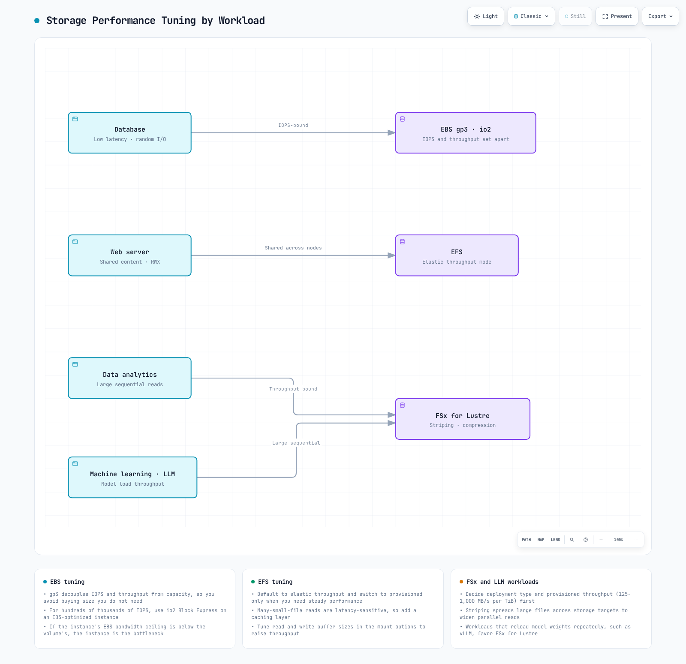

# 第 2 部分：存储类

> **最后更新**：October 16, 2026

本文是 Amazon EKS 存储系列的第二部分，介绍 FSx for Lustre、Amazon S3、快照、卷扩展和性能优化。

## 目录

1. [Amazon FSx for Lustre](04-eks-storage-part2.md#amazon-fsx-for-lustre)
2. [Amazon S3 存储集成](04-eks-storage-part2.md#amazon-s3-storage-integration)
3. [快照和备份](04-eks-storage-part2.md#snapshots-and-backups)
4. [卷扩展和调整大小](04-eks-storage-part2.md#volume-expansion-and-resizing)
5. [卷克隆](04-eks-storage-part2.md#volume-cloning)
6. [Multi-Attach EBS](04-eks-storage-part2.md#multi-attach-ebs)
7. [深入了解 Mountpoint for S3 CSI](04-eks-storage-part2.md#mountpoint-for-s3-csi-deep-dive)
8. [存储性能优化](04-eks-storage-part2.md#storage-performance-optimization)

## Amazon FSx for Lustre

FSx for Lustre 是一种并行文件系统，适用于受支持的 HPC/ML/分析工作负载。性能取决于部署/存储类型、容量、预置吞吐量、客户端和网络；一个小型示例文件系统无法达到所有宣传的聚合上限。

该图展示了可选的 S3 数据存储库集成。必须配置导入/导出策略、任务和权限；仅创建 CSI 卷并不会建立自动双向同步。


[🔍 查看交互式图表](https://www.atomai.click/kubernetes-docs/archmaps/en-eks-04-eks-storage-part2-0.html)

### 安装 FSx for Lustre CSI 驱动程序

使用基础设施所有者支持的 EKS 附加组件或已发布的 Helm 版本。对于下面的托管附加组件示例，请设置 `CSI_ADDON_NAME=aws-fsx-csi-driver`。为 `kube-system/fsx-csi-controller-sa` 准备一个角色，并配置经过审查的 FSx 驱动程序权限以及 Pod Identity 信任关系/代理。也支持通过 OIDC 信任和相应的附加组件角色选项使用 IRSA。Pod Identity 代理仅在使用该身份验证方法时才是必需的，IRSA 不需要它。Fargate 不是受支持的 FSx CSI 节点环境；请确认 Linux 内核/Lustre 客户端以及实际计算环境均受支持。

使用 `eksctl --role-only` 创建的角色不是 Kubernetes ServiceAccount。托管附加组件会创建自己的账户；Helm 安装则必须创建或引用实际账户，并为其附加预期身份。不要只创建 role-only 角色并设置 `serviceAccount.create=false`，却不准备该账户。
```bash
set -euo pipefail
: "${CLUSTER_NAME:?Set the existing cluster name}"
: "${AWS_REGION:?Set the cluster Region}"
: "${CSI_ADDON_NAME:?Use aws-fsx-csi-driver}"
case "$CSI_ADDON_NAME" in
  aws-fsx-csi-driver) ;;
  *) echo "Unexpected add-on"; exit 1 ;;
esac
KUBERNETES_VERSION=$(aws eks describe-cluster --region "$AWS_REGION" --name "$CLUSTER_NAME" \
  --query cluster.version --output text)
CLUSTER_ENDPOINT=$(aws eks describe-cluster --region "$AWS_REGION" --name "$CLUSTER_NAME" \
  --query cluster.endpoint --output text)
CURRENT_ENDPOINT=$(kubectl config view --minify -o jsonpath='{.clusters[0].cluster.server}')
test "$CURRENT_ENDPOINT" = "$CLUSTER_ENDPOINT" || { echo "kubeconfig points to another cluster"; exit 1; }
aws eks describe-addon-versions --region "$AWS_REGION" --addon-name "$CSI_ADDON_NAME" \
  --kubernetes-version "$KUBERNETES_VERSION" --output json > csi-addon-versions.json
aws eks list-addons --region "$AWS_REGION" --cluster-name "$CLUSTER_NAME" --output json
```

```bash
set -euo pipefail
: "${CSI_ADDON_VERSION:?Choose a reviewed compatible version from csi-addon-versions.json}"
: "${CSI_ROLE_ARN:?Set the prepared Pod Identity role ARN}"
: "${CLUSTER_NAME:?Run the inspection step first}"
: "${AWS_REGION:?Run the inspection step first}"
: "${CSI_ADDON_NAME:?Run the inspection step first}"
case "$CSI_ADDON_NAME" in
  aws-fsx-csi-driver) CSI_SA=fsx-csi-controller-sa; CSI_PREFIX=fsx-csi ;;
  *) echo "Unexpected add-on"; exit 1 ;;
esac
python3 - "$CSI_ADDON_NAME" "$CSI_ADDON_VERSION" <<'PY'
import json, sys
with open("csi-addon-versions.json") as stream:
    catalog = json.load(stream)
versions = [v["addonVersion"] for a in catalog["addons"]
            if a["addonName"] == sys.argv[1] for v in a["addonVersions"]]
if sys.argv[2] not in versions:
    raise SystemExit("Version not present in the inspected compatible catalog")
PY
aws eks list-addons --region "$AWS_REGION" --cluster-name "$CLUSTER_NAME" \
  --output json > csi-existing-addons.json
python3 - "$CSI_ADDON_NAME" <<'PY'
import json, sys
with open("csi-existing-addons.json") as stream:
    names = json.load(stream)["addons"]
if sys.argv[1] in names:
    raise SystemExit("Existing add-on: use its owner's update procedure")
PY
EXISTING_CSI=$(kubectl -n kube-system get "deployment/$CSI_PREFIX-controller" \
  "daemonset/$CSI_PREFIX-node" --ignore-not-found -o name)
test -z "$EXISTING_CSI" || { echo "Existing CSI installation: review its owner"; exit 1; }
aws eks describe-addon-configuration --region "$AWS_REGION" \
  --addon-name "$CSI_ADDON_NAME" --addon-version "$CSI_ADDON_VERSION"
aws eks create-addon --region "$AWS_REGION" --cluster-name "$CLUSTER_NAME" \
  --addon-name "$CSI_ADDON_NAME" --addon-version "$CSI_ADDON_VERSION" \
  --pod-identity-associations "serviceAccount=$CSI_SA,roleArn=$CSI_ROLE_ARN" \
  --resolve-conflicts NONE
aws eks wait addon-active --region "$AWS_REGION" --cluster-name "$CLUSTER_NAME" \
  --addon-name "$CSI_ADDON_NAME"
```
此工作流会在检测到现有安装时停止；请由其所有者负责迁移/更新。附加组件状态为 Active 并不能证明文件系统挂载成功。以下示例会复用第 1 部分中的专用 `storage-demo` 命名空间，并要求使用经过审查的集群范围资源名称。

### 创建 FSx for Lustre 文件系统

**选择动态或静态置备。** 动态置备会根据 PVC 创建文件系统；不要先创建另一个文件系统，并期望动态存储类接管它。以下可选的手动工作流适用于静态路径。请选择受支持 AZ 中经批准的子网，以及已预先配置且包含所需客户端/文件系统流量规则的 Lustre SG。不要选择 `Subnets[0]`，也不要假设仅配置 TCP988 就能满足所有受支持的设计。此有限示例要求使用集群 VPC；连接的 VPC 设计需要单独审查路由/安全设置。运行后会创建计费资源；如果失败，请保留返回的 ID。
```bash
set -euo pipefail
: "${CLUSTER_NAME:?Set the existing cluster}"
: "${AWS_REGION:?Set the filesystem Region}"
: "${FSX_SUBNET_ID:?Select an approved subnet in a supported AZ}"
: "${FSX_SECURITY_GROUP_ID:?Set the reviewed Lustre filesystem SG}"
: "${FSX_CREATION_TOKEN:?Set a unique stable token for this new filesystem}"
FSX_SETUP_DIR=$(mktemp -d -t eks-fsx-setup.XXXXXX)
printf 'Creation records: %s\n' "$FSX_SETUP_DIR"
VPC_ID=$(aws eks describe-cluster --region "$AWS_REGION" --name "$CLUSTER_NAME" \
  --query cluster.resourcesVpcConfig.vpcId --output text)
aws ec2 describe-subnets --region "$AWS_REGION" --subnet-ids "$FSX_SUBNET_ID" \
  --output json > "$FSX_SETUP_DIR/subnet.json"
aws ec2 describe-security-groups --region "$AWS_REGION" --group-ids "$FSX_SECURITY_GROUP_ID" \
  --output json > "$FSX_SETUP_DIR/sg.json"
python3 - "$FSX_SETUP_DIR" "$VPC_ID" <<'PY'
import pathlib, json, sys
root, vpc = pathlib.Path(sys.argv[1]), sys.argv[2]
subnets = json.loads((root / "subnet.json").read_text())["Subnets"]
groups = json.loads((root / "sg.json").read_text())["SecurityGroups"]
if len(subnets) != 1 or len(groups) != 1 or subnets[0]["VpcId"] != vpc or groups[0]["VpcId"] != vpc:
    raise SystemExit("This example requires one subnet and SG in the cluster VPC")
PY
aws fsx create-file-system --region "$AWS_REGION" --file-system-type LUSTRE \
  --client-request-token "$FSX_CREATION_TOKEN" --storage-capacity 1200 --storage-type SSD \
  --subnet-ids "$FSX_SUBNET_ID" --security-group-ids "$FSX_SECURITY_GROUP_ID" \
  --lustre-configuration DeploymentType=SCRATCH_2,DataCompressionType=NONE \
  --tags Key=Name,Value=eks-lustre-demo --output json > "$FSX_SETUP_DIR/created.json"
FSX_FILE_SYSTEM_ID=$(python3 - "$FSX_SETUP_DIR/created.json" <<'PY'
import json, sys
with open(sys.argv[1]) as stream:
    print(json.load(stream)["FileSystem"]["FileSystemId"])
PY
)
FSX_READY=false
for ((attempt=0; attempt<60; attempt++)); do
  STATE=$(aws fsx describe-file-systems --region "$AWS_REGION" --file-system-ids "$FSX_FILE_SYSTEM_ID" \
    --query 'FileSystems[0].Lifecycle' --output text)
  case "$STATE" in
    AVAILABLE) FSX_READY=true; break ;;
    CREATING) sleep 10 ;;
    *) echo "Unexpected filesystem state: $STATE"; exit 1 ;;
  esac
done
test "$FSX_READY" = true || { echo "Filesystem creation still pending; inspect recorded ID"; exit 1; }
aws fsx describe-file-systems --region "$AWS_REGION" --file-system-ids "$FSX_FILE_SYSTEM_ID" \
  --query 'FileSystems[0].{Id:FileSystemId,State:Lifecycle,DNS:DNSName,MountName:LustreConfiguration.MountName,CapacityGiB:StorageCapacity}' \
  --output json > "$FSX_SETUP_DIR/available.json"
cat "$FSX_SETUP_DIR/available.json"
```


### 创建 FSx for Lustre Storage Class

对于**动态**路径，请在存储类中提供实际子网和安全组。容量取自 PVC 请求，而不是被忽略的 `storageCapacity` 存储类参数。SCRATCH_2 不能与仅适用于持久型的每单位吞吐量/备份设置组合使用。返回的挂载名称应放在静态 PV 的 volumeAttributes 中，而不是作为 `mountName` 存储类参数。
```yaml
apiVersion: storage.k8s.io/v1
kind: StorageClass
metadata:
  name: fsx-lustre-sc
provisioner: fsx.csi.aws.com
reclaimPolicy: Retain
parameters:
  subnetId: subnet-0123456789abcdef0
  securityGroupIds: sg-0123456789abcdef0
  deploymentType: SCRATCH_2
  dataCompressionType: NONE
```


### 创建 PVC 并挂载到 Pod

此只读使用者仅验证挂载是否可访问。它不是 GPU 工作负载，也不是吞吐量基准测试；执行此检查不需要 CUDA 镜像。请为 UID/GID1000 和实际客户端网络路径准备文件系统权限。
```yaml
apiVersion: v1
kind: PersistentVolumeClaim
metadata:
  name: fsx-claim
  namespace: storage-demo
spec:
  accessModes:
  - ReadWriteMany
  storageClassName: fsx-lustre-sc
  resources:
    requests:
      storage: 1200Gi
```

```yaml
apiVersion: v1
kind: Pod
metadata:
  name: app-with-fsx
  namespace: storage-demo
spec:
  automountServiceAccountToken: false
  securityContext:
    runAsNonRoot: true
    runAsUser: 1000
    runAsGroup: 1000
    fsGroup: 1000
    seccompProfile:
      type: RuntimeDefault
  containers:
  - name: app
    image: busybox:1.38.0
    command:
    - sh
    - -c
    args:
    - test -r /data && sleep 3600
    securityContext:
      allowPrivilegeEscalation: false
      readOnlyRootFilesystem: true
      capabilities:
        drop:
        - ALL
    resources:
      requests:
        cpu: 10m
        memory: 16Mi
      limits:
        cpu: 100m
        memory: 64Mi
    volumeMounts:
    - name: data
      mountPath: /data
      readOnly: true
  volumes:
  - name: data
    persistentVolumeClaim:
      claimName: fsx-claim
```


### FSx for Lustre 挂载的静态置备

使用现有文件系统的实际 ID、DNSName、MountName 和容量。这是动态 PVC 的替代方案。请根据查询结果替换下面的占位符，然后绑定预留的静态 PV/PVC；`storageClassName: ""` 可防止默认动态置备。使用者必须使用 `fsx-static-claim`。
```bash
set -euo pipefail
: "${AWS_REGION:?Set the filesystem Region}"
: "${FSX_FILE_SYSTEM_ID:?Set the owned existing filesystem ID}"
aws fsx describe-file-systems --region "$AWS_REGION" --file-system-ids "$FSX_FILE_SYSTEM_ID" \
  --query 'FileSystems[0].{Id:FileSystemId,State:Lifecycle,DNS:DNSName,MountName:LustreConfiguration.MountName,CapacityGiB:StorageCapacity}' \
  --output json
```

```yaml
apiVersion: v1
kind: PersistentVolume
metadata:
  name: fsx-lustre-static
spec:
  capacity:
    storage: 1200Gi
  volumeMode: Filesystem
  accessModes:
  - ReadWriteMany
  persistentVolumeReclaimPolicy: Retain
  storageClassName: ''
  claimRef:
    namespace: storage-demo
    name: fsx-static-claim
  csi:
    driver: fsx.csi.aws.com
    volumeHandle: fs-0123456789abcdef0
    volumeAttributes:
      dnsname: replace-with-filesystem-dns.example.internal
      mountname: replace-with-mountname
---
apiVersion: v1
kind: PersistentVolumeClaim
metadata:
  name: fsx-static-claim
  namespace: storage-demo
spec:
  accessModes:
  - ReadWriteMany
  storageClassName: ''
  volumeName: fsx-lustre-static
  resources:
    requests:
      storage: 1200Gi
```


### FSx for Lustre 部署类型

- **SCRATCH_1/SCRATCH_2** 适用于临时、可再现的数据。仅仅将 Scratch 挂载为 PV，并不会提供持久部署复制/恢复能力；SCRATCH_2 具有不同的突发/性能和加密特性。
- **PERSISTENT_1/PERSISTENT_2** 提供不同存储/吞吐量/延迟能力的持久部署选项。并非所有 Region/AZ 配置都支持 PERSISTENT_2。
- 吞吐量字段应与所选部署/存储类型相匹配。PERSISTENT_2 SSD 支持125/250/500/1000MB/s/TiB 选项；其他部署/存储组合有所不同。Retain 是 Kubernetes 生命周期策略，并不会提高 scratch 存储的数据持久性。

### vLLM 的 FSx for Lustre 配置

vLLM 是 LLM 推理/服务项目，并不是“Vector Language Model”。以下示例仅展示模型文件存储分配，并非经过优化或测量的 vLLM 部署。模型加载还取决于文件格式、CPU 反序列化、缓存状态和 GPU 初始化。压缩可能会给已压缩数据带来额外开销；请进行测量。
```yaml
apiVersion: storage.k8s.io/v1
kind: StorageClass
metadata:
  name: fsx-lustre-vllm
provisioner: fsx.csi.aws.com
reclaimPolicy: Retain
parameters:
  subnetId: subnet-0123456789abcdef0
  securityGroupIds: sg-0123456789abcdef0
  deploymentType: PERSISTENT_2
  dataCompressionType: LZ4
  perUnitStorageThroughput: '1000'
---
apiVersion: v1
kind: PersistentVolumeClaim
metadata:
  name: vllm-models
  namespace: storage-demo
spec:
  accessModes:
  - ReadWriteMany
  storageClassName: fsx-lustre-vllm
  resources:
    requests:
      storage: 4800Gi
```

## Amazon S3 存储集成

S3 是对象存储。应用程序可以直接使用其 API，Hadoop 可以使用 S3A，而 Mountpoint CSI 可以通过文件系统接口公开现有存储桶，但有文档所述的限制。这些路径不能互换为 POSIX 文件系统。第 1 部分介绍的 S3 Files 是另一种集成方式，有其自身的 EFS CSI 要求。


[🔍 查看交互式图表](https://www.atomai.click/kubernetes-docs/archmaps/en-eks-04-eks-storage-part2-1.html)

### 使用 Pod Identity 或 IRSA 访问 S3

复用第 1 部分中的专用 `storage-demo` 命名空间。准备现有存储桶、Region，以及一个权限范围限定为目标存储桶/前缀的 IAM 角色。此示例策略允许列出一个存储桶，并且只读取 `training/`；不授予写入权限。SSE-KMS 对象还需要适当的密钥策略和范围受限的 KMS 解密权限。存储桶策略、端点和跨账户信任可能会施加其他限制。

```json
{
  "Version": "2012-10-17",
  "Statement": [
    {
      "Sid": "ListOneBucket",
      "Effect": "Allow",
      "Action": [
        "s3:ListBucket"
      ],
      "Resource": "arn:aws:s3:::replace-with-owned-data-bucket"
    },
    {
      "Sid": "ReadTrainingPrefix",
      "Effect": "Allow",
      "Action": [
        "s3:GetObject"
      ],
      "Resource": "arn:aws:s3:::replace-with-owned-data-bucket/training/*"
    }
  ]
}
```

下面的 ServiceAccount 展示了 **IRSA**：将示例 ARN 替换为已准备好的角色 ARN；该角色的 OIDC 信任必须仅允许此集群、`system:serviceaccount:storage-demo:s3-access-sa` 和 STS audience。仅添加注释并不会创建角色/信任关系。对于 **EKS Pod Identity**，请省略 IRSA 注释，并为此应用账户创建经过审查的关联，同时使用受支持的代理；不要同时配置两者并将其用作意外的回退机制。清单中不得包含静态 AWS 密钥。

```yaml
apiVersion: v1
kind: ServiceAccount
metadata:
  name: s3-access-sa
  namespace: storage-demo
  annotations:
    eks.amazonaws.com/role-arn: arn:aws:iam::111122223333:role/storage-demo-s3-reader
```

### 配置 Pod 以访问 S3

这个范围明确的只读列表 Job 使用官方 AWS CLI 镜像和已准备好的账户。使用前请替换存储桶/Region。其私有可写目录可供非特权 CLI 进程使用；仅凭退出状态并不能证明应用程序可以读取所有预期对象。请检查 Job/日志，并单独验证一个具有代表性的授权对象。

```yaml
apiVersion: batch/v1
kind: Job
metadata:
  name: s3-read-check
  namespace: storage-demo
spec:
  backoffLimit: 0
  activeDeadlineSeconds: 120
  template:
    spec:
      serviceAccountName: s3-access-sa
      restartPolicy: Never
      securityContext:
        runAsNonRoot: true
        runAsUser: 1000
        runAsGroup: 1000
        fsGroup: 1000
        seccompProfile:
          type: RuntimeDefault
      containers:
      - name: reader
        image: public.ecr.aws/aws-cli/aws-cli:2.36.43
        command:
        - aws
        args:
        - s3api
        - list-objects-v2
        - --bucket
        - replace-with-owned-data-bucket
        - --prefix
        - training/
        - --max-items
        - '5'
        env:
        - name: AWS_REGION
          value: us-west-2
        - name: AWS_EC2_METADATA_DISABLED
          value: 'true'
        securityContext:
          allowPrivilegeEscalation: false
          readOnlyRootFilesystem: true
          capabilities:
            drop:
            - ALL
        resources:
          requests:
            cpu: 100m
            memory: 128Mi
          limits:
            cpu: 500m
            memory: 256Mi
        volumeMounts:
        - name: private-home
          mountPath: /root
        - name: tmp
          mountPath: /tmp
      volumes:
      - name: private-home
        emptyDir: {}
      - name: tmp
        emptyDir: {}
```

### Hadoop S3A 访问

S3A 是 Hadoop 的 `s3a://` 文件系统实现，不是 Kubernetes 卷挂载。Hadoop3.5.0 使用适用于 Java 的 AWS SDK v2。请构建并审查包含匹配版本 `hadoop-common`/`hadoop-aws` 及其兼容 shaded SDK bundle 的镜像；下面的占位符并非已发布的即用型镜像。镜像约定包括 PATH 中存在 `hadoop`、包含 `/opt/hadoop/etc/hadoop`，并支持 UID1000。将 `hadoop-aws` 与任何其他必需的可选工具一并配置。v2 默认凭证提供程序在捆绑的 SDK 支持所选工作负载身份时可以使用该身份；不要复用 v1 `com.amazonaws` 提供程序类。

```yaml
apiVersion: v1
kind: ConfigMap
metadata:
  name: hadoop-s3a-config
  namespace: storage-demo
data:
  core-site.xml: |
    <?xml version="1.0" encoding="UTF-8"?>
    <configuration>
      <property>
        <name>fs.s3a.aws.credentials.provider</name>
        <value>software.amazon.awssdk.auth.credentials.DefaultCredentialsProvider</value>
      </property>
      <property>
        <name>fs.s3a.endpoint.region</name>
        <value>us-west-2</value>
      </property>
    </configuration>
---
apiVersion: batch/v1
kind: Job
metadata:
  name: hadoop-s3a-read-check
  namespace: storage-demo
spec:
  backoffLimit: 0
  activeDeadlineSeconds: 120
  template:
    spec:
      serviceAccountName: s3-access-sa
      restartPolicy: Never
      securityContext:
        runAsNonRoot: true
        runAsUser: 1000
        runAsGroup: 1000
        fsGroup: 1000
        seccompProfile:
          type: RuntimeDefault
      containers:
      - name: hadoop
        image: registry.example.com/reviewed-hadoop-s3a:3.5.0
        command:
        - hadoop
        args:
        - fs
        - -ls
        - s3a://replace-with-owned-data-bucket/training/
        env:
        - name: AWS_REGION
          value: us-west-2
        - name: AWS_EC2_METADATA_DISABLED
          value: 'true'
        - name: HADOOP_CONF_DIR
          value: /opt/hadoop/etc/hadoop
        - name: HADOOP_OPTIONAL_TOOLS
          value: hadoop-aws
        securityContext:
          allowPrivilegeEscalation: false
          readOnlyRootFilesystem: true
          capabilities:
            drop:
            - ALL
        resources:
          requests:
            cpu: 100m
            memory: 128Mi
          limits:
            cpu: 500m
            memory: 256Mi
        volumeMounts:
        - name: tmp
          mountPath: /tmp
        - name: hadoop-config
          mountPath: /opt/hadoop/etc/hadoop/core-site.xml
          subPath: core-site.xml
          readOnly: true
      volumes:
      - name: tmp
        emptyDir: {}
      - name: hadoop-config
        configMap:
          name: hadoop-s3a-config
```

使用 subPath 挂载一个 ConfigMap 键可保留镜像中的其他 Hadoop 配置文件。subPath 挂载不会接收 ConfigMap 的实时更新；配置更改后请重新创建 Job。

### 使用 Mountpoint CSI 挂载现有存储桶

经审查的上游版本组合为 CSI2.8.0 和随附的 Mountpoint1.23.0。独立的 Mountpoint1.24.0 不会自动更改 CSI 镜像。请检查实际的 EKS 附加组件版本和计算环境兼容性：此上游 CSI 版本要求 Kubernetes1.31+，且不再支持 AL2/Ubuntu22.04。优先使用现有基础设施所有者；不要在托管附加组件或现有驱动程序上安装 Helm。

如果由独立的所有者管理 Helm 安装，请先渲染**已发布的 chart** 以供审查；`--kube-version` 应使用实际集群版本。Git checkout 中的 chart 并非受支持的发行版本，不得绕过其发布保护机制。通过选定的所有者部署之前，请审查特权节点组件、CRD 所有权和 `mount-s3` 命名空间：

```bash
set -euo pipefail
helm repo add aws-mountpoint-s3-csi-driver https://awslabs.github.io/mountpoint-s3-csi-driver
helm repo update aws-mountpoint-s3-csi-driver
helm template aws-mountpoint-s3-csi-driver \
  aws-mountpoint-s3-csi-driver/aws-mountpoint-s3-csi-driver \
  --version 2.8.0 --namespace kube-system --kube-version 1.36.0 --include-crds \
  > s3-driver-review.yaml
```

已发布的 chart 默认会创建 `s3-csi-driver-sa` 和 `s3-csi-driver-controller-sa`。下面的 PV 明确选择来自 `s3-access-sa` 的**Pod 级凭证**；此卷会忽略驱动程序级凭证。此处同时支持 IRSA 和 EKS Pod Identity。就绪状态要求实际安装驱动程序/身份机制，而不仅仅是 Helm 成功渲染。

Mountpoint CSI 使用**静态置备**现有存储桶，而不是旧示例中展示的动态 StorageClass。请将两个 storageClassName 字段都留空，并使用显式 PV/PVC 预绑定和集群内唯一的 volumeHandle。容量字段用于满足 Kubernetes 绑定元数据要求；它们不会创建或限制 S3 存储桶容量。请同时替换存储桶、前缀和 Region。只读挂载和 IAM 权限提供的是独立控制措施：

```yaml
apiVersion: v1
kind: PersistentVolume
metadata:
  name: s3-training-pv
spec:
  capacity:
    storage: 1Ti
  volumeMode: Filesystem
  accessModes:
  - ReadOnlyMany
  persistentVolumeReclaimPolicy: Retain
  storageClassName: ''
  claimRef:
    namespace: storage-demo
    name: training-data
  mountOptions:
  - read-only
  - region us-west-2
  - prefix training/
  - allow-other
  - uid 1000
  - gid 1000
  - dir-mode 0750
  - file-mode 0440
  csi:
    driver: s3.csi.aws.com
    volumeHandle: storage-demo-s3-training-v1
    volumeAttributes:
      bucketName: replace-with-owned-data-bucket
      authenticationSource: pod
      stsRegion: us-west-2
---
apiVersion: v1
kind: PersistentVolumeClaim
metadata:
  name: training-data
  namespace: storage-demo
spec:
  accessModes:
  - ReadOnlyMany
  storageClassName: ''
  volumeName: s3-training-pv
  resources:
    requests:
      storage: 1Ti
```


```yaml
apiVersion: v1
kind: Pod
metadata:
  name: app-with-s3
  namespace: storage-demo
spec:
  serviceAccountName: s3-access-sa
  securityContext:
    runAsNonRoot: true
    runAsUser: 1000
    runAsGroup: 1000
    seccompProfile:
      type: RuntimeDefault
  containers:
  - name: reader
    image: busybox:1.38.0
    command:
    - sh
    - -c
    args:
    - ls -la /data && sleep 3600
    securityContext:
      allowPrivilegeEscalation: false
      readOnlyRootFilesystem: true
      capabilities:
        drop:
        - ALL
    resources:
      requests:
        cpu: 10m
        memory: 16Mi
      limits:
        cpu: 100m
        memory: 64Mi
    volumeMounts:
    - name: data
      mountPath: /data
      readOnly: true
  volumes:
  - name: data
    persistentVolumeClaim:
      claimName: training-data
      readOnly: true
```

挂载选项会将文件系统所有权映射到 UID/GID1000；它们不会更改 S3 对象所有权。`allow-other` 允许应用程序 UID 访问由驱动程序创建的挂载。应用程序容器无需 AWS CLI 或 FUSE 特权即可使用此挂载的只读路径。

### S3 使用场景

数据湖、模型存储库、归档、静态资产和审计对象都可以使用 S3。如果应用程序需要对象版本、条件请求或 Mountpoint 文件系统契约之外的功能，请选择 API 访问。需要随机更新和 POSIX 锁的可写数据库目录应采用其他存储设计。

## 快照和备份

CSI 快照需要特定驱动程序/后端提供支持；仅有 PVC 并不意味着支持快照。以下 EBS 示例用于捕获块卷的时间点状态。必要时请暂停/刷新应用程序，或使用适合数据库的备份/WAL 归档。快照成功并不能证明应用程序一致性或数据库时间点恢复能力。


[🔍 查看交互式图表](https://www.atomai.click/kubernetes-docs/archmaps/en-eks-04-eks-storage-part2-2.html)

### 准备快照控制器

首先检查现有快照 CRD、控制器所有者和 CSI snapshotter。使用兼容的 EKS 附加组件，或经过审查且固定版本的 external-snapshotter；不要将浮动的 master CRD 应用于现有安装。External-snapshotter8.6.0 是经过审查的上游参考版本，并非所有附加组件的自动升级目标。第 1 部分中有关驱动程序和命名空间的前提条件同样适用。

```bash
set -euo pipefail
kubectl get crd volumesnapshots.snapshot.storage.k8s.io \
  volumesnapshotcontents.snapshot.storage.k8s.io volumesnapshotclasses.snapshot.storage.k8s.io
kubectl -n storage-demo get pvc ebs-claim -o yaml
```

### 创建存储类和快照

存储类驱动程序必须与 PV 驱动程序匹配。此手动管理的存储类使用 Retain；删除其 Kubernetes 快照不会自动删除保留的 EBS 快照。请跟踪所有权和费用，不要将此策略与下面的 Velero 生命周期混淆。此 EBS 示例无需设置空的 snapshotter-secret 参数。

```yaml
apiVersion: snapshot.storage.k8s.io/v1
kind: VolumeSnapshotClass
metadata:
  name: ebs-snapshot-class
driver: ebs.csi.aws.com
deletionPolicy: Retain
```


```yaml
apiVersion: snapshot.storage.k8s.io/v1
kind: VolumeSnapshot
metadata:
  name: ebs-part2-snapshot
  namespace: storage-demo
  labels:
    storage-demo: ebs
spec:
  volumeSnapshotClassName: ebs-snapshot-class
  source:
    persistentVolumeClaimName: ebs-claim
```


```bash
set -euo pipefail
kubectl -n storage-demo wait --for=jsonpath='{.status.readyToUse}'=true \
  volumesnapshot/ebs-part2-snapshot --timeout=300s
kubectl -n storage-demo get volumesnapshot ebs-part2-snapshot -o yaml
```

### 恢复到新 PVC

`readyToUse=true` 后，请检查 restoreSize 以及绑定的内容/驱动程序。在同一命名空间中使用独立名称，容量至少与 restoreSize 相同。此20Gi 示例假设快照不大于此容量。请保持现有 claim 不变；WaitForFirstConsumer 可能会使候选 PVC 保持 Pending，直到调度兼容的使用者。通过隔离且兼容的应用程序验证恢复的数据，然后再进行受控切换。

```yaml
apiVersion: v1
kind: PersistentVolumeClaim
metadata:
  name: ebs-part2-restored
  namespace: storage-demo
spec:
  accessModes:
  - ReadWriteOnce
  storageClassName: ebs-gp3
  resources:
    requests:
      storage: 20Gi
  dataSource:
    name: ebs-part2-snapshot
    kind: VolumeSnapshot
    apiGroup: snapshot.storage.k8s.io
```

### 使用 Velero 安排备份

经审查的版本组合为 Velero1.18.4 和 AWS plugin1.14.4。安装前请验证 CLI 发行版本校验和以及插件兼容性。Velero 已集成 CSI 支持，但此路径仍需要 `EnableCSI`；不要添加旧的独立 CSI 插件。请准备私有备份存储桶/前缀、网络访问权限、范围适当的 IAM/KMS 权限，以及适用于 `velero/velero` 的 IRSA 角色。以下命令会渲染新安装清单供审查，不会创建资源：

```bash
set -euo pipefail
: "${BACKUP_BUCKET:?Set the existing private backup bucket}"
: "${VELERO_ROLE_ARN:?Set the reviewed IRSA role for system:serviceaccount:velero:velero}"
: "${AWS_REGION:?Set the bucket/snapshot Region for this example}"
velero install --provider aws \
  --plugins velero/velero-plugin-for-aws:v1.14.4 \
  --bucket "$BACKUP_BUCKET" --prefix eks-storage-demo \
  --backup-location-config "region=$AWS_REGION" \
  --snapshot-location-config "region=$AWS_REGION" \
  --features EnableCSI --no-secret \
  --sa-annotations "eks.amazonaws.com/role-arn=$VELERO_ROLE_ARN" \
  --dry-run -o yaml > velero-review.yaml
```

即使是 CLI dry-run，也要使用实际有效的 kubeconfig；渲染结果并非授权或备份测试。不要覆盖现有 Velero/CRD 安装。默认 ServiceAccount 会创建并附加 IRSA 注释；若改用 `--service-account-name`，则会选择现有账户并忽略 `--sa-annotations`。Pod Identity 是另一种选择，需要自行配置关联/代理。无需静态凭证文件。

对于 CSI 存储类选择，每个驱动程序只为一个存储类添加默认标签，或者使用受支持的备份/计划注释来选择存储类。请结合现有存储类审查以下存储类：

```yaml
apiVersion: snapshot.storage.k8s.io/v1
kind: VolumeSnapshotClass
metadata:
  name: ebs-velero-snapshots
  labels:
    velero.io/csi-volumesnapshot-class: 'true'
driver: ebs.csi.aws.com
deletionPolicy: Retain
```

**Velero 负责管理其 CSI 备份快照的生命周期。** 备份过期或删除时，即使原始存储类使用 Retain，Velero 也会将 VolumeSnapshotContent 删除策略改为 Delete 并删除快照。请谨慎设置备份 TTL 和任何独立的保留/归档流程。存储在 S3 中的 Velero 备份不一定包含所有卷数据：CSI 快照、文件系统备份和数据移动器是不同的路径。例如，FSx CSI1.10.0 不实现 CSI 快照；请使用受支持的 FSx/应用程序备份策略。

```bash
set -euo pipefail
velero schedule create storage-demo-daily --schedule="0 1 * * *" \
  --include-namespaces=storage-demo --ttl=168h0m0s -o yaml > velero-schedule-review.yaml
```

计划命令也只会输出 YAML。通过其所有者部署已审查的计划，然后检查实际 Backup 阶段、错误、快照/数据移动器完成情况以及恢复测试。计划快照本身并不能提供任意数据库 PITR。

恢复时，请选择经过实际验证的备份，而不要使用硬编码的历史时间戳。即使使用 `-o yaml`，此命令仍会执行 API 发现并读取所选 Backup，因此需要对目标集群具有读取权限。此清单预览会限制请求的资源类型并映射命名空间；提交之前请检查依赖项和插件恢复操作。确认目标命名空间已隔离、名称不会冲突，并且存储类/CSI 驱动程序/KMS/AZ 映射有效。这不是完整的生产恢复操作手册：

```bash
set -euo pipefail
: "${VERIFIED_BACKUP:?Choose an actual completed backup after checking its contents/errors}"
velero restore create storage-demo-recovery-review --from-backup "$VERIFIED_BACKUP" \
  --namespace-mappings storage-demo:storage-recovery \
  --include-namespaces storage-demo \
  --include-resources persistentvolumes,persistentvolumeclaims,volumesnapshots.snapshot.storage.k8s.io,volumesnapshotcontents.snapshot.storage.k8s.io \
  --restore-volumes=true -o yaml > velero-restore-review.yaml
```

只有在候选数据通过应用程序检查后，才启动恢复的工作负载，并保留回滚路径。跨集群 CSI 恢复需要匹配的驱动程序名称以及可访问的快照/密钥；仅进行命名空间映射无法让云资源变得可移植。

## 卷扩展和调整大小


[🔍 查看交互式图表](https://www.atomai.click/kubernetes-docs/archmaps/en-eks-04-eks-storage-part2-3.html)

请使用设置了 `allowVolumeExpansion: true` 且 CSI 驱动程序/文件系统支持扩展的存储类。保持已绑定 claim 原有的 storageClassName；它不是调整大小的开关。此示例复用第 1 部分中的 `ebs-gp3`，只增加 claim 请求的容量。请先检查当前请求/容量，以免缩小已经更大的 claim。
```yaml
apiVersion: storage.k8s.io/v1
kind: StorageClass
metadata:
  name: ebs-gp3
provisioner: ebs.csi.aws.com
volumeBindingMode: WaitForFirstConsumer
reclaimPolicy: Retain
allowVolumeExpansion: true
parameters:
  type: gp3
  encrypted: 'true'
  csi.storage.k8s.io/fstype: ext4
```

```bash
set -euo pipefail
kubectl -n storage-demo get pvc ebs-claim -o yaml
kubectl -n storage-demo patch pvc ebs-claim --type merge \
  -p '{"spec":{"resources":{"requests":{"storage":"20Gi"}}}}'
kubectl -n storage-demo describe pvc ebs-claim
```
在支持的情况下，CSI 会处理后端和文件系统扩展。请检查 PVC 条件、控制器/节点日志以及已挂载容量。如有需要，请按照驱动程序文档执行重新挂载/重启流程；不要在应用程序容器中对猜测的 `/dev/xvdf` 运行 `resize2fs`。切勿通过编辑 PV 容量来绕过扩展。请规划配额/成本上限，并避免在之前的调整大小操作仍处于待处理状态时反复自动扩容。

## 卷克隆

当前 EBS CSI 支持通过 `dataSource` 和 CSI 克隆功能克隆 PVC；EBS CSI1.67.0 使用原生 EBS 卷复制（`CopyVolumes`），并非假设中隐藏的快照。使用前请检查已部署驱动程序/附加组件是否支持此功能。目标卷独立存在，但“可用”和“完全初始化后的性能”是不同状态。


对于常规 PVC dataSource 工作流，请使用同一命名空间中已绑定的源卷、兼容的卷模式/驱动程序，以及容量不小于源卷的请求。请显式设置 storageClassName；省略时会采用默认存储类规则，而不会自动继承源卷的存储类。原生 EBS 副本会保留在源卷所在 AZ。除非应用程序已适当暂停/刷新，否则它们只能保证崩溃一致性。同一时间只能从一个源卷初始化一个副本，并且受账户/Region 配额限制。

此专用训练源可避免在生产命名空间中启动未经验证的数据库克隆。请将写入方和读取方中的示例 AZ 都替换为实际支持的 AZ。Seed Job 使用源 PVC 创建一个标记文件而不覆盖现有标记，然后退出：
```yaml
apiVersion: v1
kind: PersistentVolumeClaim
metadata:
  name: ebs-clone-source
  namespace: storage-demo
spec:
  accessModes:
  - ReadWriteOnce
  storageClassName: ebs-gp3
  resources:
    requests:
      storage: 10Gi
---
apiVersion: batch/v1
kind: Job
metadata:
  name: ebs-clone-seed
  namespace: storage-demo
spec:
  backoffLimit: 0
  template:
    metadata:
      labels:
        app: ebs-clone-seed
    spec:
      restartPolicy: Never
      automountServiceAccountToken: false
      nodeSelector:
        topology.kubernetes.io/zone: us-west-2a
      securityContext:
        runAsNonRoot: true
        runAsUser: 1000
        runAsGroup: 1000
        fsGroup: 1000
        seccompProfile:
          type: RuntimeDefault
      containers:
      - name: writer
        image: busybox:1.38.0
        command:
        - sh
        - -c
        args:
        - |
          set -eu
          (set -C; printf 'clone-demo\n' > /data/seed.txt)
          sync
        securityContext:
          allowPrivilegeEscalation: false
          readOnlyRootFilesystem: true
          capabilities:
            drop:
            - ALL
        resources:
          requests:
            cpu: 10m
            memory: 16Mi
          limits:
            cpu: 100m
            memory: 64Mi
        volumeMounts:
        - name: data
          mountPath: /data
      volumes:
      - name: data
        persistentVolumeClaim:
          claimName: ebs-clone-source
```

```bash
kubectl -n storage-demo wait --for=condition=complete job/ebs-clone-seed --timeout=300s
kubectl -n storage-demo get pvc ebs-clone-source -o yaml
```
Seed Job 完成后，创建独立的克隆及其只读使用者。标记检查展示了需要验证的内容；本次审查并未执行云端复制。复制数据库不会重置现有数据库密码；如果之后要将目标卷作为数据库启动，则必须使用兼容的数据库版本。
```yaml
apiVersion: v1
kind: PersistentVolumeClaim
metadata:
  name: ebs-clone
  namespace: storage-demo
spec:
  accessModes:
  - ReadWriteOnce
  storageClassName: ebs-gp3
  resources:
    requests:
      storage: 10Gi
  dataSource:
    kind: PersistentVolumeClaim
    name: ebs-clone-source
---
apiVersion: v1
kind: Pod
metadata:
  name: app-with-clone
  namespace: storage-demo
spec:
  automountServiceAccountToken: false
  securityContext:
    runAsNonRoot: true
    runAsUser: 1000
    runAsGroup: 1000
    fsGroup: 1000
    seccompProfile:
      type: RuntimeDefault
  containers:
  - name: app
    image: busybox:1.38.0
    command:
    - sh
    - -c
    args:
    - test "$(cat /data/seed.txt)" = clone-demo && sleep 3600
    securityContext:
      allowPrivilegeEscalation: false
      readOnlyRootFilesystem: true
      capabilities:
        drop:
        - ALL
    resources:
      requests:
        cpu: 10m
        memory: 16Mi
      limits:
        cpu: 100m
        memory: 64Mi
    volumeMounts:
    - name: data
      mountPath: /data
      readOnly: true
  volumes:
  - name: data
    persistentVolumeClaim:
      claimName: ebs-clone
  nodeSelector:
    topology.kubernetes.io/zone: us-west-2a
```
| 属性 | PVC/原生卷复制 | 快照恢复 |
|---|---|---|
| 源 | 现有卷/PVC | 保留的时间点快照 |
| 就绪状态 | 在后台初始化完成前即可使用 | 取决于快照/恢复和初始化状态 |
| 放置位置 | 原生 EBS 副本保留在源 AZ | 新恢复的卷可以放置在另一个获准的 AZ |
| 一致性 | 可能需要暂停应用程序 | 可能需要适用于应用程序的备份 |
| 命名空间 | 常规 PVC dataSource 要求在同一命名空间 | 快照对象有命名空间范围；跨命名空间/集群导入需要明确且受支持的工作流 |
| 成本/保留 | 复制操作和新卷费用；生命周期独立 | 快照存储费用加恢复卷费用；删除策略独立 |

不要根据“一个步骤”还是“两个步骤”推断速度、存储开销或 RPO。原生卷副本不支持快速快照恢复或预置初始化速率；请遵循实际的副本初始化指南。

## Multi-Attach EBS

EC2 服务支持符合条件的 io1/io2 卷使用 Multi-Attach，最多可挂载到同一 AZ 中的16 个兼容 Nitro 实例，但受卷类型/Region 限制。**EBS CSI1.66.0 动态路径支持 io2 + ReadWriteMany + volumeMode: Block**，并通过该功能启用 Multi-Attach。此路径不支持将 `multiAttachEnabled` 用作 StorageClass 开关。RWOP 是单个 Pod 的约束条件，并非 Multi-Attach 访问模式。


共享块设备本身不提供应用程序写入协调。不得让多个节点以读写方式独立挂载普通 ext4/XFS；应使用适当的协调型应用程序/集群文件系统以及隔离设计。io2 支持 NVMe reservation 隔离，但应用程序必须正确使用该功能。以下仅演示**附加操作，不进行设备 I/O 或格式化**。匹配的标签/反亲和性要求在卷所在 AZ 中有两个合适的节点。实际工作负载需要经过审查的设备访问和协调机制，而不是这个休眠容器：
```yaml
apiVersion: storage.k8s.io/v1
kind: StorageClass
metadata:
  name: ebs-io2-multi-attach
provisioner: ebs.csi.aws.com
volumeBindingMode: WaitForFirstConsumer
reclaimPolicy: Retain
allowVolumeExpansion: true
parameters:
  type: io2
  iops: '10000'
  encrypted: 'true'
---
apiVersion: v1
kind: PersistentVolumeClaim
metadata:
  name: shared-block-pvc
  namespace: storage-demo
spec:
  accessModes:
  - ReadWriteMany
  volumeMode: Block
  storageClassName: ebs-io2-multi-attach
  resources:
    requests:
      storage: 100Gi
---
apiVersion: v1
kind: Pod
metadata:
  name: shared-block-a
  namespace: storage-demo
  labels:
    app: shared-block-demo
spec:
  automountServiceAccountToken: false
  securityContext:
    runAsNonRoot: true
    runAsUser: 1000
    runAsGroup: 1000
    seccompProfile:
      type: RuntimeDefault
  affinity:
    podAntiAffinity:
      requiredDuringSchedulingIgnoredDuringExecution:
      - labelSelector:
          matchLabels:
            app: shared-block-demo
        topologyKey: kubernetes.io/hostname
  containers:
  - name: attachment-only
    image: busybox:1.38.0
    command:
    - sleep
    - '3600'
    securityContext:
      allowPrivilegeEscalation: false
      readOnlyRootFilesystem: true
      capabilities:
        drop:
        - ALL
    resources:
      requests:
        cpu: 10m
        memory: 16Mi
      limits:
        cpu: 100m
        memory: 64Mi
    volumeDevices:
    - name: shared
      devicePath: /dev/ebs-shared
  volumes:
  - name: shared
    persistentVolumeClaim:
      claimName: shared-block-pvc
---
apiVersion: v1
kind: Pod
metadata:
  name: shared-block-b
  namespace: storage-demo
  labels:
    app: shared-block-demo
spec:
  automountServiceAccountToken: false
  securityContext:
    runAsNonRoot: true
    runAsUser: 1000
    runAsGroup: 1000
    seccompProfile:
      type: RuntimeDefault
  affinity:
    podAntiAffinity:
      requiredDuringSchedulingIgnoredDuringExecution:
      - labelSelector:
          matchLabels:
            app: shared-block-demo
        topologyKey: kubernetes.io/hostname
  containers:
  - name: attachment-only
    image: busybox:1.38.0
    command:
    - sleep
    - '3600'
    securityContext:
      allowPrivilegeEscalation: false
      readOnlyRootFilesystem: true
      capabilities:
        drop:
        - ALL
    resources:
      requests:
        cpu: 10m
        memory: 16Mi
      limits:
        cpu: 100m
        memory: 64Mi
    volumeDevices:
    - name: shared
      devicePath: /dev/ebs-shared
  volumes:
  - name: shared
    persistentVolumeClaim:
      claimName: shared-block-pvc
```
在服务规定的条件下，io2 Multi-Attach 卷支持修改大小/IOPS；笼统声称“无法在线扩容”并不正确。io1 的修改支持情况有所不同。启用/禁用 Multi-Attach 要求卷未挂载；安全的调整大小流程仍取决于 CSI/文件系统/应用程序的支持情况。共享卷发生故障可能会影响所有已挂载实例。Retain 和附加设置都不能替代备份策略。

## 深入了解 Mountpoint for S3 CSI

以下行为基于随 CSI2.8.0 捆绑的 Mountpoint1.23.0 进行了核验。采用更新的独立版本选项之前，请先确认实际安装的版本。


### 性能特征

顺序读取大型对象和顺序写入新对象是常见的适用场景；Mountpoint 会自动预取。支持随机范围读取，但结果取决于对象大小、请求速率、网络、缓存状态和应用程序并发度。不支持任意原地随机写入，这不仅仅是性能不佳的优化选项。

**历史数据，未经核实：** 之前的英文文本列出了以下聚合数据，但没有可再现的设置或可追溯的来源。这里保留这些历史说法，但它们不代表当前服务限制、本次审查的实测结果或容量规划保证。

| 历史操作 | 原始说法 |
|---|---|
| 顺序读取大型文件 | 聚合吞吐量高达100Gbps |
| 顺序写入新文件 | 聚合吞吐量高达50Gbps |
| 小型随机读取 | 延迟较高/吞吐量较低，取决于工作负载 |

之前定性的“优秀/良好/一般”评级同样并非受控基准测试结果。

### 文件系统和一致性限制

- S3 提供强读取/列表一致性。Mountpoint 缓存可能会有意保留过期的元数据/内容或否定条目，直到 TTL 到期；不要将 S3 本身描述为最终一致。
- 新文件以顺序方式写入。替换现有对象需要 `allow-overwrite` 和截断式打开；仍不支持任意随机更新。
- Availability Zone 中的 S3 Express One Zone 目录存储桶支持通过 `incremental-upload` 进行追加以及原子单文件重命名。通用存储桶无法通过此版本 Mountpoint 重命名文件；不支持目录重命名。Local Zone 中的目录存储桶具有不同的功能支持。替换重命名还需要覆盖权限/选项。
- 删除功能需要通过 `allow-delete` 和 IAM 权限显式启用；只读示例两者都未启用。追加操作并不总是等同于“创建一个新的对象版本”。
- 不支持硬链接/符号链接、chmod/chown、扩展属性、POSIX 锁、设备文件和常规稀疏文件语义。不要基于这些缺失操作来保障数据库正确性。

### 缓存设置

Mountpoint CLI 选项应放在 **PV.spec.mountOptions** 中，而不是 StorageClass 参数中。选项值是诸如 `metadata-ttl 300` 的字符串。Mountpoint1.23 的元数据 TTL 单位为秒，独立 `max-cache-size` 的单位为 **MiB**，read/write-part-size 的单位为**字节**；8MiB 是 8,388,608bytes。之前示例中的 prefetch-bytes/read-ahead/max-read-parallelism/max-cache-size-mb/cache-block-size 不是有效的1.23 CLI 标志。

CSI v2 会为其**Mountpoint Pod** 创建缓存存储，通常位于 `mount-s3`。应用程序 Pod 的 emptyDir 不会变成该缓存。以下替代静态 PV 使用由磁盘支持的10Gi emptyDir 缓存，并由驱动程序强制执行其大小限制；Memory 表示 tmpfs RAM，而不是 NVMe。请替换实际存储桶/前缀/Region，并使用其单独的预绑定 PVC：

```yaml
apiVersion: v1
kind: PersistentVolume
metadata:
  name: s3-training-cached-pv
spec:
  capacity:
    storage: 1Ti
  volumeMode: Filesystem
  accessModes:
  - ReadOnlyMany
  persistentVolumeReclaimPolicy: Retain
  storageClassName: ''
  claimRef:
    namespace: storage-demo
    name: training-data-cached
  mountOptions:
  - read-only
  - region us-west-2
  - prefix training/
  - allow-other
  - uid 1000
  - gid 1000
  - dir-mode 0750
  - file-mode 0440
  - metadata-ttl 300
  - read-part-size 8388608
  csi:
    driver: s3.csi.aws.com
    volumeHandle: storage-demo-s3-training-cached-v1
    volumeAttributes:
      bucketName: replace-with-owned-data-bucket
      authenticationSource: pod
      stsRegion: us-west-2
      cache: emptyDir
      cacheEmptyDirSizeLimit: 10Gi
      cacheEmptyDirMedium: ''
---
apiVersion: v1
kind: PersistentVolumeClaim
metadata:
  name: training-data-cached
  namespace: storage-demo
spec:
  accessModes:
  - ReadOnlyMany
  storageClassName: ''
  volumeName: s3-training-cached-pv
  resources:
    requests:
      storage: 1Ti
```

300 秒 TTL 可能会在这段时间内隐藏外部变更；如果这很重要，请使用不可变/带版本的数据集前缀。缓存内容以明文形式存储在本地存储中，因此应将节点/存储访问纳入威胁模型。请分别为缓存容量、驱逐和 Mountpoint Pod 内存制定预算，不要与训练容器混为一谈。另一种受支持的选项是使用 `cache: ephemeral`，以及相应的存储类和请求字段配置临时 PVC 缓存；请评估其生命周期和成本。不要传入旧式主机缓存路径并假设 CSI v2 仍会使用它。

### 大型数据集训练示例

这是一个**未经执行的集成模板**，不是经过优化的 p4d 基准测试。请准备经过审查的 GPU 兼容镜像，其中包含 `/opt/training/train.py`、四个可调度的 GPU/设备插件，以及上述账户和缓存数据 PVC；此外还需要一个 UID/GID1000 可访问的可写 RWX `reviewed-model-output-rwx` PVC。脚本必须实现所示参数并创建独立的输出目录。部署前请解析所有占位符。

```yaml
apiVersion: batch/v1
kind: Job
metadata:
  name: s3-sharded-training
  namespace: storage-demo
spec:
  completions: 4
  parallelism: 4
  completionMode: Indexed
  backoffLimit: 0
  activeDeadlineSeconds: 7200
  template:
    spec:
      serviceAccountName: s3-access-sa
      restartPolicy: Never
      securityContext:
        runAsNonRoot: true
        runAsUser: 1000
        runAsGroup: 1000
        fsGroup: 1000
        seccompProfile:
          type: RuntimeDefault
      containers:
      - name: trainer
        image: registry.example.com/reviewed-trainer:replace-me
        command:
        - sh
        - -c
        args:
        - exec python /opt/training/train.py --data-dir=/data --shard-index="$JOB_COMPLETION_INDEX"
          --shard-count=4 --output-dir="/models/$JOB_COMPLETION_INDEX"
        env:
        - name: JOB_COMPLETION_INDEX
          valueFrom:
            fieldRef:
              fieldPath: metadata.annotations['batch.kubernetes.io/job-completion-index']
        resources:
          requests:
            cpu: '4'
            memory: 16Gi
            nvidia.com/gpu: 1
          limits:
            cpu: '8'
            memory: 32Gi
            nvidia.com/gpu: 1
        securityContext:
          allowPrivilegeEscalation: false
          readOnlyRootFilesystem: true
          capabilities:
            drop:
            - ALL
        volumeMounts:
        - name: data
          mountPath: /data
          readOnly: true
        - name: output
          mountPath: /models
        - name: tmp
          mountPath: /tmp
      volumes:
      - name: data
        persistentVolumeClaim:
          claimName: training-data-cached
          readOnly: true
      - name: output
        persistentVolumeClaim:
          claimName: reviewed-model-output-rwx
      - name: tmp
        emptyDir: {}
```

四个索引完成任务是互相独立的数据分片，每个分片使用一个 GPU。它们不能建立分布式训练集结、梯度同步或严格一次副作用。请确保输出处理支持安全重试。之前的4-GPU/8-GPU 示例是不同的演示布局，而非对比测量结果；请根据测量出的实际需求选择硬件/资源。

### 选择 S3、EFS 或 FSx

| 关注点 | Mountpoint/S3 | EFS | FSx for Lustre |
|---|---|---|---|
| 接口 | 对象存储支持的文件系统子集 | 托管 NFS 文件系统 | 并行 Lustre 文件系统 |
| 常见适用场景 | 大型不可变输入数据集 | 共享应用程序文件 | 受支持的 HPC/ML 并行 I/O |
| 写入 | 受文档规定的顺序/覆盖及特定存储桶追加限制 | 需要应用程序协调的文件系统写入 | 需要应用程序协调的文件系统写入 |
| 容量规划依据 | 请求模式、缓存、网络和对象布局 | 性能/吞吐量模式、客户端和访问模式 | 部署、容量、吞吐量、客户端和条带化 |
| 成本/并发 | 测量请求、传输、缓存和客户端限制 | 测量吞吐量/存储/客户端限制 | 测量分配量/吞吐量/客户端限制 |

不能仅根据服务名称得出通用的低/中/高成本或客户端数量无限制的排名。

## 存储性能优化

下面介绍多种优化 EKS 存储性能的策略。



[🔍 查看交互式图表](https://www.atomai.click/kubernetes-docs/archmaps/en-eks-04-eks-storage-part2-4.html)

### EBS 性能优化

根据实测工作负载需求和实例 EBS 限制选择卷类型和预置 IOPS/吞吐量。之前给出的16,000IOPS/1,000MiB/s 数值仍然是有效的配置示例，但并非当前 gp3 的通用最高值：Regional gp3 最高支持80,000IOPS/2,000MiB/s，具体受大小/IOPS 约束；Outposts 的限制更低。不要假设预置最大值既有必要又足够。

空卷无需初始化。从快照恢复的卷和原生副本可能会产生初始化延迟；两者的操作流程不同。**写入零会破坏现有数据，不是安全的初始化方法。** 请先准确识别卷。对于快照恢复，请评估受支持的预置初始化速率、快速快照恢复或文档所述的基于读取的流程；这些加速功能不适用于原生副本。以下命令只会在经过授权的节点环境中检查元数据：
```bash
lsblk -o NAME,SERIAL,SIZE,TYPE,MOUNTPOINT
```

### EFS 性能优化

AWS 建议使用 General Purpose 性能模式，包括高并发工作负载；Max I/O 是上一代选项，操作延迟更高。请根据实测需求匹配吞吐量模式。请在 StorageClass 或 PV 中配置挂载选项，而不是放在 `Pod.spec.volumes` 下。

这是供新 claim 使用的替代存储类。EFS helper 推荐的1MiB RPC 大小、hard 挂载、超时和 noresvport 是起点，并非基准测试结果。`retrans=2` 会在重试后触发进一步恢复；hard 挂载不会在尝试两次后放弃请求。请按照第 1 部分中的说明准备文件系统 ID 和访问点身份：
```yaml
apiVersion: storage.k8s.io/v1
kind: StorageClass
metadata:
  name: efs-tuned
provisioner: efs.csi.aws.com
reclaimPolicy: Retain
mountOptions:
- tls
- rsize=1048576
- wsize=1048576
- hard
- timeo=600
- retrans=2
- noresvport
parameters:
  provisioningMode: efs-ap
  fileSystemId: fs-0123456789abcdef0
  directoryPerms: '750'
  uid: '1000'
  gid: '1000'
  basePath: /storage-demo
  ensureUniqueDirectory: 'true'
```

### FSx for Lustre 性能优化

应综合选择部署/存储/吞吐量配置和客户端容量。请根据文件大小、并发度和实测瓶颈规划 Lustre 条带化；条带越多并不总是越快。使用受支持的 PV/StorageClass 挂载选项，并从 noatime 和 relatime 中选择一种策略，避免两者冲突。压缩的效果取决于数据。`s3ImportPath` 是受支持的 CSI 参数，但导入/导出的可用性和自动化取决于所选 FSx 集成方式。

### vLLM 工作负载的存储优化

复用前文明确指定的存储类/PVC 分配，而不要使用只有 `storageCapacity` 字段的存储类。请对冷/热模型加载、元数据访问、CPU/GPU 初始化和并发使用者进行基准测试。量化/分片会改变模型内存/计算行为以及文件布局，并非自动的存储优化。只有受支持的文件系统/客户端或通信堆栈才能从 EFA 中获益；仅选择支持 EFA 的 GPU 实例并不会加速所有存储路径。

## 结论

本文介绍了 Amazon EKS 中的 FSx for Lustre、S3、快照、卷扩展和性能优化。每种存储选项都有不同的特征和使用场景，因此应根据应用程序需求选择并优化适当的存储解决方案。

下一部分将介绍 EKS 存储的监控、故障排除、成本优化和安全性。

## 参考资料

* [Amazon FSx for Lustre CSI 驱动程序](https://github.com/kubernetes-sigs/aws-fsx-csi-driver)
* [Amazon S3 CSI 驱动程序](https://github.com/awslabs/mountpoint-s3-csi-driver)
* [Kubernetes 卷快照](https://kubernetes.io/docs/concepts/storage/volume-snapshots/)
* [Velero 备份和恢复](https://velero.io/docs/)
* [Amazon EKS 存储最佳实践](https://docs.aws.amazon.com/eks/latest/best-practices/storage.html)

* [Mountpoint CSI2.8 配置](https://github.com/awslabs/mountpoint-s3-csi-driver/blob/v2.8.0/docs/CONFIGURATION.md)
* [Mountpoint CSI2.8 缓存](https://github.com/awslabs/mountpoint-s3-csi-driver/blob/v2.8.0/docs/CACHING.md)
* [Mountpoint1.23 文件系统语义](https://github.com/awslabs/mountpoint-s3/blob/mountpoint-s3-1.23.0/doc/SEMANTICS.md)
* [Hadoop3.5 S3A 身份验证](https://hadoop.apache.org/docs/r3.5.0/hadoop-aws/tools/hadoop-aws/index.html)
* [Velero1.18 CSI 快照生命周期](https://velero.io/docs/v1.18/csi/)
* [Velero AWS 插件兼容性](https://github.com/velero-io/velero-plugin-for-aws)
* [EBS 原生复制](https://docs.aws.amazon.com/ebs/latest/userguide/ebs-copying-volume.html)
* [EBS Multi-Attach](https://docs.aws.amazon.com/ebs/latest/userguide/ebs-volumes-multi.html)
* [FSx CSI 附加组件身份](https://docs.aws.amazon.com/eks/latest/userguide/fsx-csi-create.html)

## 测验

要检验你对本章内容的掌握情况，请尝试[主题测验](../quizzes/eks/04-eks-storage-part2-quiz.md)。
