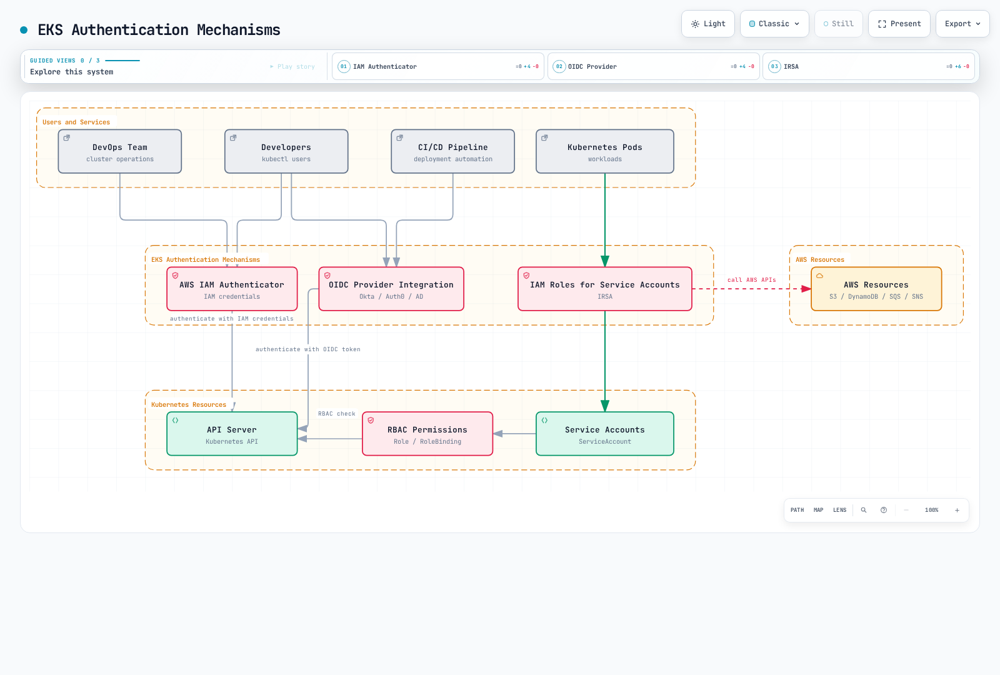

# EKS 集群访问身份验证：IAM 和访问条目

> **最后更新**：2026年11月21日

本页详细拆分了 [Amazon EKS 安全性](./05-eks-security.md) 中的“IAM 和身份验证”部分。内容涵盖人类用户和自动化 IAM 主体如何通过身份验证访问 Kubernetes API 并获得权限、EKS 集群角色和资源预置调用方所需的权限，以及带有命名空间范围 RBAC 和访问策略的访问条目。工作负载（Pod）如何获取 AWS 凭证，请参阅 [IRSA 和 OIDC 提供商](./05-eks-security-irsa-oidc.md) 和 [EKS Pod Identity](./05-eks-security-pod-identity.md)；其中的示例会沿用此处准备的 `security-demo` 命名空间。

## 目录

1. [身份和授权层](#identities-and-authorization-layers)
2. [集群角色和资源预置调用方](#cluster-role-and-provisioning-caller)
3. [访问条目和命名空间授权](#access-entries-and-namespace-authorization)

## 身份和授权层

| 身份/控制机制 | 用途 |
|---|---|
| 人类用户/自动化 IAM 主体 | 通过已配置的 IAM 映射/访问条目路径进行集群访问身份验证 |
| Kubernetes RBAC 和 EKS 访问策略 | 授权 Kubernetes 操作；允许权限可叠加 |
| 外部 OIDC 身份提供商 | 单独配置的 Kubernetes API 用户登录，带有客户端/声明设置 |
| EKS 集群 IAM 角色 | 允许 EKS 服务为集群调用 AWS API |
| EC2 节点 IAM 角色 | 支持引导程序及节点代理所需的 AWS 操作 |
| IRSA 或 EKS Pod Identity 角色 | 为应用程序提供临时 AWS 凭证 |
| Kubernetes ServiceAccount 令牌 | 在相应 RBAC 权限范围内对 Pod 访问 Kubernetes API 进行身份验证 |

用于 IRSA 的 IAM OIDC 提供商，与用于 Kubernetes 用户登录的外部 OIDC 提供商是不同的。应用程序的 AWS 权限不会自动授予 Kubernetes API 权限。

<!-- Diagram repair pending: IRSA/Pod Identity give workload AWS credentials; the ordinary Pod-to-Kubernetes API path uses its Kubernetes ServiceAccount token/RBAC.


[🔍 View interactive diagram](https://www.atomai.click/kubernetes-docs/archmaps/en-eks-05-eks-security-2.html)
-->

## 集群角色和资源预置调用方

标准 EKS 集群角色信任 EKS 服务。以下是该角色的信任关系，而不是人类开发者的权限策略：

```json
{
  "Version": "2012-10-17",
  "Statement": [
    {
      "Effect": "Allow",
      "Principal": {
        "Service": "eks.amazonaws.com"
      },
      "Action": "sts:AssumeRole"
    }
  ]
}
```

该角色需要 AmazonEKSClusterPolicy 或受支持的自定义策略，以执行其服务操作。Auto Mode 还有额外的角色/策略要求。资源预置调用方则需要所选配置要求的操作权限，以及传递指定角色的权限。当前授权参考中列出的 CreateCluster 不支持按资源 ARN 限定范围，因此请在该操作中使用受支持的请求条件；对于支持资源 ARN 限定范围的操作和 PassRole，请限定其范围。向开发者角色附加 AmazonEKSClusterPolicy 并不会授予 Kubernetes 应用程序访问权限。

## 访问条目和命名空间授权

对于 IAM 集群访问，优先使用受支持的访问条目 API。检查当前模式，并在迁移前保留现有的管理员/节点映射。从 CONFIG_MAP 转为 API_AND_CONFIG_MAP/API 并非可随意反向切换的操作。不要用省略节点角色的简短示例覆盖 aws-auth。选择仅使用 API 的模式前，请检查所有身份、策略、节点以及恢复路径。

```bash
set -euo pipefail
: "${CLUSTER_NAME:?Set the existing cluster name}"
: "${AWS_REGION:?Set its Region}"
aws eks describe-cluster --name "$CLUSTER_NAME" --region "$AWS_REGION" \
  --query 'cluster.{Name:name,Status:status,Endpoint:endpoint,Access:accessConfig}' --output json
```

以下示例假设已准备好经批准的 IAM 开发者角色，集群已支持访问条目，并且平台操作员具备相应权限。请通过命名空间所有者准备专用命名空间。其 Pod Security Admission 版本与经审核的 EKS 1.36 示例一致；请根据目标集群选择适当的版本：

```yaml
apiVersion: v1
kind: Namespace
metadata:
  name: security-demo
  labels:
    pod-security.kubernetes.io/enforce: restricted
    pod-security.kubernetes.io/enforce-version: v1.36
```

```bash
set -euo pipefail
: "${CLUSTER_NAME:?Set the verified cluster name}"
: "${AWS_REGION:?Set its Region}"
: "${DEVELOPER_ROLE_ARN:?Set a prepared IAM role ARN, not an STS session ARN}"
MODE=$(aws eks describe-cluster --name "$CLUSTER_NAME" --region "$AWS_REGION" \
  --query cluster.accessConfig.authenticationMode --output text)
case "$MODE" in
  API|API_AND_CONFIG_MAP) ;;
  *) echo "Access entries are not enabled; review the migration first"; exit 1 ;;
esac
aws eks list-access-entries --cluster-name "$CLUSTER_NAME" --region "$AWS_REGION" \
  --output json > security-access-entries.json
python3 - "$DEVELOPER_ROLE_ARN" <<'PY'
import json, sys
with open("security-access-entries.json") as stream:
    existing = json.load(stream)["accessEntries"]
if sys.argv[1] in existing:
    raise SystemExit("Entry already exists; inspect its groups/policies instead of overwriting")
PY
aws eks create-access-entry --cluster-name "$CLUSTER_NAME" --region "$AWS_REGION" \
  --principal-arn "$DEVELOPER_ROLE_ARN" --type STANDARD \
  --kubernetes-groups security-demo-developers
```

```yaml
apiVersion: rbac.authorization.k8s.io/v1
kind: Role
metadata:
  name: developer
  namespace: security-demo
rules:
- apiGroups:
  - ''
  resources:
  - pods
  verbs:
  - get
  - list
  - watch
- apiGroups:
  - apps
  resources:
  - deployments
  verbs:
  - get
  - list
  - watch
  - create
  - update
  - patch
- apiGroups:
  - batch
  resources:
  - jobs
  verbs:
  - get
  - list
  - watch
  - create
  - update
  - patch
---
apiVersion: rbac.authorization.k8s.io/v1
kind: RoleBinding
metadata:
  name: developer
  namespace: security-demo
subjects:
- kind: Group
  name: security-demo-developers
  apiGroup: rbac.authorization.k8s.io
roleRef:
  kind: Role
  name: developer
  apiGroup: rbac.authorization.k8s.io
```

该条目将 IAM 主体映射到一个组，而 RoleBinding 会授予该组所示的命名空间权限。仅有组名并不能建立命名空间边界。创建工作负载控制器的权限可能使用户能够创建使用该命名空间内 ServiceAccount、Secret 和 PVC 的 Pod。请隔离不同租户，并通过适当的准入和所有权控制约束工作负载/ServiceAccount 的使用。

对于经过单独审核的查看者条目，EKS 访问策略可以替代自定义 RBAC。在添加此命名空间查看权限前，请检查条目当前所属的组和关联策略：

```bash
set -euo pipefail
: "${CLUSTER_NAME:?Set the verified cluster name}"
: "${AWS_REGION:?Set its Region}"
: "${VIEWER_ROLE_ARN:?Set the IAM principal of a prepared, reviewed access entry}"
aws eks list-associated-access-policies --cluster-name "$CLUSTER_NAME" --region "$AWS_REGION" \
  --principal-arn "$VIEWER_ROLE_ARN"
aws eks associate-access-policy --cluster-name "$CLUSTER_NAME" --region "$AWS_REGION" \
  --principal-arn "$VIEWER_ROLE_ARN" \
  --policy-arn arn:aws:eks::aws:cluster-access-policy/AmazonEKSViewPolicy \
  --access-scope type=namespace,namespaces=security-demo
```

添加 View 不会撤销范围更广的 RBAC/访问策略授权。更新可能需要一段时间才能传播。请使用实际预期的 IAM 登录方式进行测试；kubectl --as 测试的是 Kubernetes 模拟身份/RBAC，并不能证明 IAM 访问策略路径有效。kubeconfig 会将客户端指向集群并指定凭证机制；它本身不会授予任何权限。

IAM eks:DescribeCluster/ListClusters 支持 AWS 管理/发现操作。eks:AccessKubernetesApi 是控制台查看权限。eks:namespaces 条件会筛选访问策略关联请求；它不是适用于 kubectl API 调用的通用命名空间筛选条件。

## 参考资料

- [EKS 访问条目](https://docs.aws.amazon.com/eks/latest/userguide/access-entries.html)
- [EKS 访问策略](https://docs.aws.amazon.com/eks/latest/userguide/access-policies.html)
- [Kubernetes RBAC](https://kubernetes.io/docs/reference/access-authn-authz/rbac/)

## 后续步骤

- 下一步：[IRSA 和 OIDC 提供商](./05-eks-security-irsa-oidc.md)
- 相关内容：[EKS Pod Identity](./05-eks-security-pod-identity.md)
- 返回概览：[Amazon EKS 安全性](./05-eks-security.md)

## 测验

要检验你在本章学到的内容，请尝试[主题测验](../quizzes/eks/05-eks-security-cluster-access-quiz.md)。
