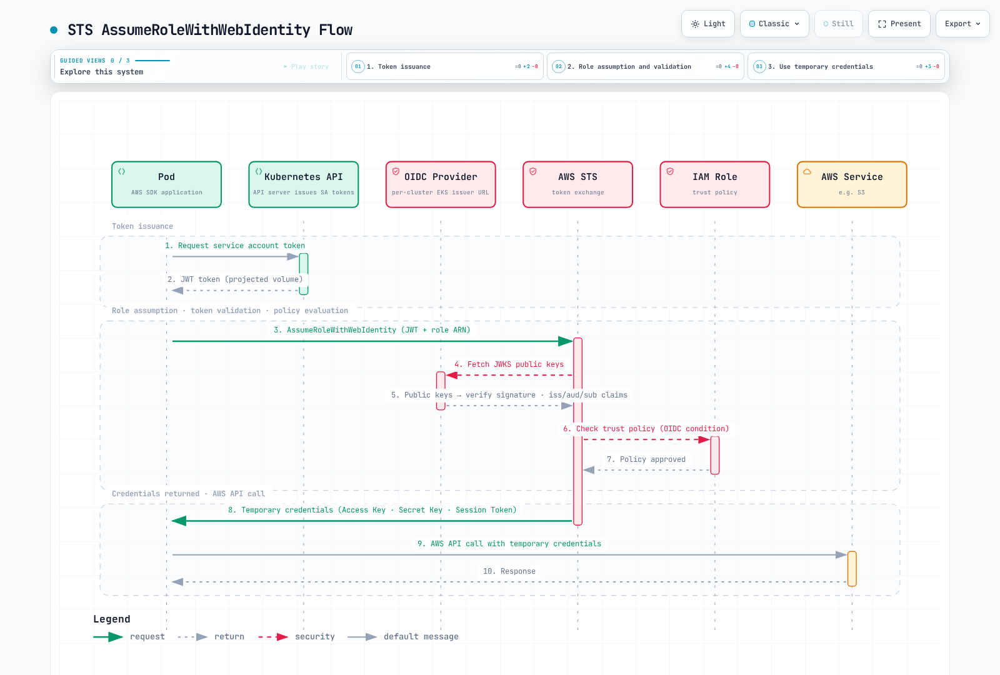

# IRSA 和 OIDC 提供商

> **最后更新**：2026年11月21日

本页是 [Amazon EKS 安全](./05-eks-security.md)中“O​​IDC 提供商深入解析”部分拆分出的详细内容。本文介绍集群 OIDC 发行者与 IAM OIDC 提供商之间的关系、IRSA 令牌如何通过 STS 换取临时凭证、如何检查发现文档/JWKS，以及一个范围受限的 IRSA 角色和 Job 示例。示例使用[集群访问](./05-eks-security-cluster-access.md#access-entries-and-namespace-authorization)页面中准备的 `security-demo` 命名空间。逐步展示 IRSA 流程的示意图也见[IRSA 的工作原理](../security/17-eks-workload-identity-migration.md#irsa-flow)。

## 目录

1. [OIDC 发行者和 IAM OIDC 提供商](#oidc-issuer-and-iam-oidc-provider)
2. [IRSA 令牌和角色交换](#irsa-token-and-role-exchange)
3. [发现文档和 JWKS 检查](#discovery-and-jwks-inspection)
4. [范围受限的 IRSA 示例](#a-scoped-irsa-example)

## OIDC 发行者和 IAM OIDC 提供商

EKS 会发布集群 OIDC 发行者和公钥。仅有该端点并不会创建 IAM OIDC 提供商，也不会授权通过角色获取权限。要使用 IRSA，角色所属账户必须具有预期的 IAM OIDC 提供商，角色必须通过正确的发行者/主体/受众条件信任该提供商，并且工作负载必须使用兼容的 SDK。



[🔍 查看交互式示意图](https://www.atomai.click/kubernetes-docs/archmaps/en-eks-05-eks-security-3.html)

## IRSA 令牌和角色交换

IRSA webhook 会为符合条件的 Pod 添加投射令牌/角色配置。SDK 使用 AssumeRoleWithWebIdentity 将 Web 身份令牌交给 STS 进行交换。STS 会验证发行者、签名和令牌，以及角色信任关系，然后返回临时 AWS 凭证。应用使用这些凭证执行获准的 AWS 操作。Kubernetes 会轮换投射令牌；SDK 会刷新 AWS 凭证。这两者的有效期不同。

以下是一个示意性的**解码后载荷结构**，其中故意使用较早的/已过期时间戳和占位身份。它不是已签名的令牌，也不是身份验证测试。STS 受众用于 IRSA 流程；Pod Identity 使用不同的受众：

```json
{
  "aud": [
    "sts.amazonaws.com"
  ],
  "exp": 1234567890,
  "iat": 1234567800,
  "iss": "https://oidc.eks.us-west-2.amazonaws.com/id/REPLACE_WITH_CLUSTER_ISSUER_ID",
  "kubernetes.io": {
    "namespace": "security-demo",
    "pod": {
      "name": "irsa-read-check-example",
      "uid": "example-pod-uid"
    },
    "serviceaccount": {
      "name": "irsa-reader",
      "uid": "example-serviceaccount-uid"
    }
  },
  "sub": "system:serviceaccount:security-demo:irsa-reader"
}
```

请验证发行者、受众、过期时间和预期主体，而不要只检查 JSON 是否能够解码。不要在示例或日志中保留原始令牌、AWS 秘密访问密钥和会话令牌。一个角色可以信任多个明确获准的 ServiceAccount 或发行者；IRSA 并不要求每个 ServiceAccount 都恰好对应一个角色。

## 发现文档和 JWKS 检查

请使用实际集群返回的发行者。此诊断会获取公开的发现文档/JWKS，并检查发现文档中的发行者和 HTTPS 方案。它不会验证工作负载令牌或 IAM 权限：

```bash
set -euo pipefail
: "${CLUSTER_NAME:?Set the verified cluster}"
: "${AWS_REGION:?Set its Region}"
OIDC_URL=$(aws eks describe-cluster --name "$CLUSTER_NAME" --region "$AWS_REGION" \
  --query cluster.identity.oidc.issuer --output text)
case "$OIDC_URL" in https://*) ;; *) echo "Unexpected issuer URL"; exit 1 ;; esac
curl --fail --silent --show-error --proto '=https' --connect-timeout 5 --max-time 20 \
  "${OIDC_URL%/}/.well-known/openid-configuration" > oidc-discovery.json
JWKS_URI=$(python3 - "$OIDC_URL" <<'PY'
import json, sys, urllib.parse
with open("oidc-discovery.json") as stream:
    doc = json.load(stream)
if doc["issuer"] != sys.argv[1]:
    raise SystemExit("Discovery issuer does not match the cluster issuer")
uri = doc["jwks_uri"]
parsed = urllib.parse.urlparse(uri)
if parsed.scheme != "https" or not parsed.hostname or parsed.username or parsed.password:
    raise SystemExit("JWKS must be an HTTPS URL without embedded credentials")
print(uri)
PY
)
curl --fail --silent --show-error --proto '=https' --connect-timeout 5 --max-time 20 \
  "$JWKS_URI" > oidc-jwks.json
python3 - <<'PY'
import json
with open("oidc-jwks.json") as stream:
    keys = json.load(stream).get("keys")
if not isinstance(keys, list) or not keys or not all(isinstance(k, dict) and "kty" in k for k in keys):
    raise SystemExit("Unexpected JWKS response")
print("Fetched", len(keys), "public keys; no token signature was validated")
PY
```

自动验证程序必须根据 Cache-Control 缓存密钥，并使用经过审核的 JWT 库处理签名密钥轮换/未知的 kid。EKS 每七天轮换一次 OIDC 签名密钥。目前 EKS 还支持用于集群 OIDC 发现/JWKS 的 PrivateLink 接口端点 `com.amazonaws.region-code.oidc-eks`，供无法访问互联网的验证程序使用。请确认该端点对区域/DNS 的要求；EKS 管理 API 端点是另一项服务。

## 范围受限的 IRSA 示例

请由相应负责人准备 IAM OIDC 提供商、角色和存储桶。统一替换账户、完整的发行者主机名/路径以及角色 ARN；IPv6 集群可以使用双栈发行者主机名。此示例仅将 `security-demo/irsa-reader` 和 STS 受众绑定在一起；它是一个新的角色信任示例，并非用于替换现有角色的其他信任声明：

```json
{
  "Version": "2012-10-17",
  "Statement": [
    {
      "Effect": "Allow",
      "Principal": {
        "Federated": "arn:aws:iam::111122223333:oidc-provider/oidc.eks.us-west-2.amazonaws.com/id/REPLACE_WITH_CLUSTER_ISSUER_ID"
      },
      "Action": "sts:AssumeRoleWithWebIdentity",
      "Condition": {
        "StringEquals": {
          "oidc.eks.us-west-2.amazonaws.com/id/REPLACE_WITH_CLUSTER_ISSUER_ID:sub": "system:serviceaccount:security-demo:irsa-reader",
          "oidc.eks.us-west-2.amazonaws.com/id/REPLACE_WITH_CLUSTER_ISSUER_ID:aud": "sts.amazonaws.com"
        }
      }
    }
  ]
}
```

读取策略允许访问特定存储桶前缀。如果对象使用客户管理的加密密钥，只添加所需的 KMS 权限，并审核存储桶/端点策略。此仅针对一个前缀的示例不需要账户范围的 AmazonS3ReadOnlyAccess 策略：

```json
{
  "Version": "2012-10-17",
  "Statement": [
    {
      "Effect": "Allow",
      "Action": [
        "s3:ListBucket"
      ],
      "Resource": "arn:aws:s3:::replace-with-owned-security-bucket",
      "Condition": {
        "StringLike": {
          "s3:prefix": [
            "security-demo/",
            "security-demo/*"
          ]
        }
      }
    },
    {
      "Effect": "Allow",
      "Action": [
        "s3:GetObject"
      ],
      "Resource": "arn:aws:s3:::replace-with-owned-security-bucket/security-demo/*"
    }
  ]
}
```

准备好 [security-demo 命名空间](./05-eks-security-cluster-access.md#access-entries-and-namespace-authorization)和角色后，创建以下 ServiceAccount 和范围受限的列举 Job。官方 AWS CLI 镜像包含该客户端；任意一个 amazonlinux:2 镜像都不能保证包含它。请替换存储桶/区域/角色值。该 Job 会列举一个前缀，但不会打印机密值；此操作成功并不能证明应用拥有所有 GetObject/KMS 权限。

```yaml
apiVersion: v1
kind: ServiceAccount
metadata:
  name: irsa-reader
  namespace: security-demo
  annotations:
    eks.amazonaws.com/role-arn: arn:aws:iam::111122223333:role/SecurityDemoIRSAReader
---
apiVersion: batch/v1
kind: Job
metadata:
  name: irsa-read-check
  namespace: security-demo
spec:
  backoffLimit: 0
  activeDeadlineSeconds: 120
  template:
    spec:
      serviceAccountName: irsa-reader
      restartPolicy: Never
      securityContext:
        runAsNonRoot: true
        runAsUser: 1000
        runAsGroup: 1000
        fsGroup: 1000
        seccompProfile:
          type: RuntimeDefault
      containers:
      - name: reader
        image: public.ecr.aws/aws-cli/aws-cli:2.36.43
        command:
        - aws
        args:
        - s3api
        - list-objects-v2
        - --bucket
        - replace-with-owned-security-bucket
        - --prefix
        - security-demo/
        - --max-items
        - '5'
        env:
        - name: AWS_REGION
          value: us-west-2
        - name: AWS_EC2_METADATA_DISABLED
          value: 'true'
        securityContext:
          allowPrivilegeEscalation: false
          readOnlyRootFilesystem: true
          capabilities:
            drop:
            - ALL
        resources:
          requests:
            cpu: 100m
            memory: 128Mi
          limits:
            cpu: 500m
            memory: 256Mi
        volumeMounts:
        - name: private-home
          mountPath: /root
        - name: tmp
          mountPath: /tmp
      volumes:
      - name: private-home
        emptyDir: {}
      - name: tmp
        emptyDir: {}
      nodeSelector:
        kubernetes.io/os: linux
```

## 参考资料

- [EKS IRSA](https://docs.aws.amazon.com/eks/latest/userguide/iam-roles-for-service-accounts.html)
- [IRSA 的最低 SDK 版本](https://docs.aws.amazon.com/eks/latest/userguide/iam-roles-for-service-accounts-minimum-sdk.html)
- [将 EKS 节点 IAM 权限迁移到 IRSA 和 Pod Identity](../security/17-eks-workload-identity-migration.md)

## 后续步骤

- 上一页：[EKS 集群访问身份验证：IAM 和访问条目](./05-eks-security-cluster-access.md)
- 下一页：[EKS Pod Identity](./05-eks-security-pod-identity.md)
- 返回概览：[Amazon EKS 安全](./05-eks-security.md)

## 测验

要检验你在本章学到的内容，请尝试[主题测验](../quizzes/eks/05-eks-security-irsa-oidc-quiz.md)。
