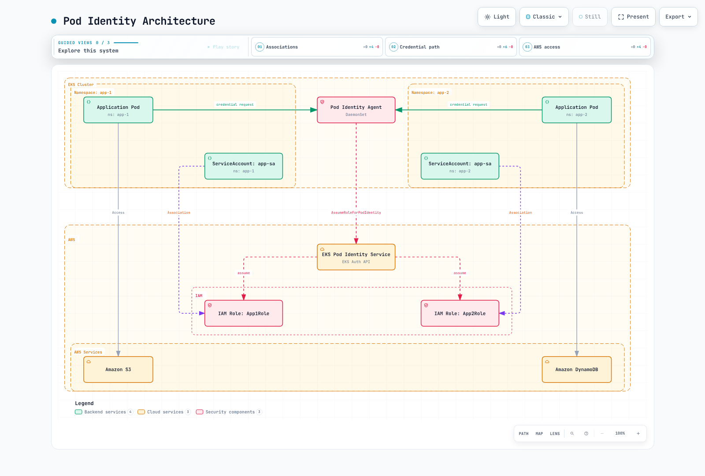

# EKS Pod Identity

> **最后更新**：2026年11月21日

本页是 [Amazon EKS 安全性](./05-eks-security.md)中“EKS Pod Identity”部分的详细拆分内容，介绍 Pod Identity Agent 和凭证流程、角色信任关系与关联的准备工作，以及跨账户和缓存方面的注意事项。工作手册 [将 EKS 节点 IAM 权限迁移到 IRSA 和 Pod Identity](../security/17-eks-workload-identity-migration.md)是 IRSA 对比、生产环境迁移顺序和现场演示的参考资料，因此本页仅作概述并提供链接。

## 目录

1. [Pod Identity 提供的功能](#what-pod-identity-provides)
2. [与 IRSA 的比较](#comparison-with-irsa)
3. [Agent 和凭证流程](#agent-and-credential-flow)
4. [预先配置角色和关联](#prepared-role-and-association)
5. [跨账户和缓存注意事项](#cross-account-and-cache-considerations)
6. [从 IRSA 迁移到 Pod Identity 的流程](#irsa-to-pod-identity-migration-procedure)

## Pod Identity 提供的功能

EKS Pod Identity 通过 SDK 的容器凭证提供程序和 EKS Auth 提供临时 AWS 凭证。Pod Identity 关联是集群/命名空间/ServiceAccount 到 IAM 角色的映射；它既不会创建 ServiceAccount，也不会授予 Kubernetes RBAC 权限。

## 与 IRSA 的比较

工作手册中的 [IRSA 与 Pod Identity 对比](../security/17-eks-workload-identity-migration.md#irsa-and-pod-identity-compared)表格介绍了这两种机制的差异（每个集群的配置、信任策略、规模限制、跨账户和职责分离）。阅读本页的配置示例时，请牢记这些差异：

- **信任与绑定**：IRSA 使用带有颁发者/主体/受众信任条件的 IAM OIDC 提供程序；Pod Identity 使用 `pods.eks.amazonaws.com` 角色信任关系和 EKS API 关联。
- **凭证路径**：使用 IRSA 时，SDK 会通过 STS 交换 Web 身份令牌（[IRSA 的工作原理](../security/17-eks-workload-identity-migration.md#irsa-flow)）；使用 Pod Identity 时，SDK 会调用节点 Agent 的容器凭证端点，该 Agent 从 EKS Auth 获取凭证（[EKS Pod Identity 的工作原理](../security/17-eks-workload-identity-migration.md#pod-identity-flow)）。
- **会话标签**：Pod Identity 的 Kubernetes 会话标签默认启用，也可以有意禁用。会话标签用于标记代入角色的会话；它们不会自动标记应用创建的每个 AWS 资源。

配置更简单，并不意味着可以省略 IAM、网络、SDK 或应用验证。

## Agent 和凭证流程

<!-- Diagram repair pending: SDK calls container credential endpoint; agent calls EKS Auth AssumeRoleForPodIdentity, not STS directly or arbitrary request interception.


[🔍 View interactive diagram](https://www.atomai.click/kubernetes-docs/archmaps/en-eks-05-eks-security-4.html)
-->

对于新创建且已建立关联的 Pod，EKS 会注入一个受众为 pods.eks.amazonaws.com 的令牌、一个令牌文件环境变量和一个容器凭证 URI。SDK 会调用 Agent 的端点，通常是 169.254.170.23/v1/credentials。Agent 会在 **EKS Auth 上调用 AssumeRoleForPodIdentity**，并将返回的凭证提供给 SDK。它不会透明拦截所有应用请求；应用仍会使用自己的凭证直接调用 AWS 服务。分步流程图请参阅[ EKS Pod Identity 的工作原理](../security/17-eks-workload-identity-migration.md#pod-identity-flow)。

标准的受支持 EC2 节点使用 Pod Identity Agent 附加组件/DaemonSet。Auto Mode 将此功能作为其托管节点的一部分提供。Hybrid Nodes 在符合文档要求的操作系统、Agent 和节点凭证配置下支持此功能（在节点的 `nodeadm` 配置中设置 `spec.hybrid.enableCredentialsFile: true`，并在 Agent 附加组件中设置 `daemonsets.hybrid.create`；Bottlerocket 需使用单独的设置；请参阅 [Hybrid Nodes 附加组件放置和 Pod Identity](../eks-hybrid-nodes/04-node-bootstrap.md#add-on-placement-and-pod-identity)）；不要不加区分地复用标准 EC2 Agent 配置。EKS Fargate 不支持此 Pod Identity Agent 路径，Windows 节点、Outposts 和 EKS Anywhere 也不支持。请确认实际计算环境是否受支持，以及节点是否具备 EKS Auth 所需的权限和网络访问能力。

## 预先配置角色和关联

对于采用标准托管 Agent 的安装，请通过集群所有者检查实际集群版本和兼容的附加组件目录。不要硬编码旧版 v1.0.0，也不要在 Auto Mode 或其他所有者管理的环境中重复安装 Agent：

```bash
set -euo pipefail
: "${CLUSTER_NAME:?Set the existing cluster}"
: "${AWS_REGION:?Set its Region}"
EKS_VERSION=$(aws eks describe-cluster --name "$CLUSTER_NAME" --region "$AWS_REGION" \
  --query cluster.version --output text)
aws eks describe-addon-versions --addon-name eks-pod-identity-agent \
  --kubernetes-version "$EKS_VERSION" --region "$AWS_REGION" --output json
```

准备一个与集群处于同一账户的 IAM 角色，附加[ IRSA 示例中的 S3 范围限定读取策略](./05-eks-security-irsa-oidc.md#a-scoped-irsa-example)，并配置以下信任关系。请同时替换账户和集群值。此示例依赖默认会话标签；如果禁用标签，就必须重新审核这些条件。调用方需要具备适当的关联权限，以及对目标角色的 iam:PassRole 权限：

```json
{
  "Version": "2012-10-17",
  "Statement": [
    {
      "Effect": "Allow",
      "Principal": {
        "Service": "pods.eks.amazonaws.com"
      },
      "Action": [
        "sts:AssumeRole",
        "sts:TagSession"
      ],
      "Condition": {
        "StringEquals": {
          "aws:RequestTag/eks-cluster-arn": "arn:aws:eks:us-west-2:111122223333:cluster/my-cluster",
          "aws:RequestTag/kubernetes-namespace": "security-demo",
          "aws:RequestTag/kubernetes-service-account": "podid-reader"
        }
      }
    }
  ]
}
```

以下新建关联示例会拒绝覆盖已有的关联。它不会创建 IAM 角色、安装 Agent 或创建 Kubernetes 账户：

```bash
set -euo pipefail
: "${CLUSTER_NAME:?Set the verified cluster}"
: "${AWS_REGION:?Set its Region}"
: "${POD_ID_ROLE_ARN:?Set the prepared same-account role matching the trust example}"
aws eks list-pod-identity-associations --cluster-name "$CLUSTER_NAME" --region "$AWS_REGION" \
  --namespace security-demo --service-account podid-reader --output json > podid-associations-before.json
python3 - <<'PY'
import json
with open("podid-associations-before.json") as stream:
    existing = json.load(stream)["associations"]
if existing:
    raise SystemExit("Association exists; review its owner/configuration before changing it")
PY
aws eks create-pod-identity-association --cluster-name "$CLUSTER_NAME" --region "$AWS_REGION" \
  --namespace security-demo --service-account podid-reader --role-arn "$POD_ID_ROLE_ARN"
```

关联传播完成后，创建 ServiceAccount 和一个新的、带有运行时限的测试 Job。IAM 角色信任关系、命名空间、账户名称和存储桶前缀必须相互匹配。在关联建立之前创建的 Pod 可能需要重新创建，才能接收注入的配置。检查实际选用的凭证提供程序和具有代表性的权限；不要输出凭证/令牌文件。

```yaml
apiVersion: v1
kind: ServiceAccount
metadata:
  name: podid-reader
  namespace: security-demo
---
apiVersion: batch/v1
kind: Job
metadata:
  name: podid-read-check
  namespace: security-demo
spec:
  backoffLimit: 0
  activeDeadlineSeconds: 120
  template:
    spec:
      serviceAccountName: podid-reader
      restartPolicy: Never
      securityContext:
        runAsNonRoot: true
        runAsUser: 1000
        runAsGroup: 1000
        fsGroup: 1000
        seccompProfile:
          type: RuntimeDefault
      containers:
      - name: reader
        image: public.ecr.aws/aws-cli/aws-cli:2.36.43
        command:
        - aws
        args:
        - s3api
        - list-objects-v2
        - --bucket
        - replace-with-owned-security-bucket
        - --prefix
        - security-demo/
        - --max-items
        - '5'
        env:
        - name: AWS_REGION
          value: us-west-2
        - name: AWS_EC2_METADATA_DISABLED
          value: 'true'
        securityContext:
          allowPrivilegeEscalation: false
          readOnlyRootFilesystem: true
          capabilities:
            drop:
            - ALL
        resources:
          requests:
            cpu: 100m
            memory: 128Mi
          limits:
            cpu: 500m
            memory: 256Mi
        volumeMounts:
        - name: private-home
          mountPath: /root
        - name: tmp
          mountPath: /tmp
      volumes:
      - name: private-home
        emptyDir: {}
      - name: tmp
        emptyDir: {}
      nodeSelector:
        kubernetes.io/os: linux
```



[🔍 查看交互式图表](https://www.atomai.click/kubernetes-docs/archmaps/en-eks-05-eks-security-5.html)

## 跨账户和缓存注意事项

关联角色必须位于 EKS 集群所在的账户中。可选的目标 IAM 角色可以位于另一个账户中；Pod Identity 会从同账户角色切换到该目标角色，并且必须配置双方的信任关系和代入角色权限。这并不意味着可以将任意外部角色直接设为关联角色。

当前目标角色指南说明，不配置目标角色时，缓存凭证的有效期为 6 小时；配置目标角色时，有效期为 59 分钟。更改关联不会重置该缓存；重新创建 Pod 可以更快获取新配置。请在应用中检查实际的刷新/撤销行为。较新的关联会话策略选项要求禁用会话标签，并且在配置了目标角色时会限制该目标角色；不要未经审核就将此选项与要求这些标签的信任条件组合使用。

## 从 IRSA 迁移到 Pod Identity 的流程

请按照工作手册中的[生产集群迁移顺序](../security/17-eks-workload-identity-migration.md#migration-order-for-production-clusters)执行逐步迁移，并使用其中的金丝雀命令；如需了解如何对某个应用的三个副本进行有度量的迁移，请参阅其[现场演示](../security/17-eks-workload-identity-migration.md#live-demo)。本页仅保留迁移前需要关注的要点。

在准备迁移之前，请保留现有 IRSA 信任关系和 ServiceAccount 配置。如果将角色信任关系替换为只包含 Pod Identity 服务主体的配置，凭证刷新时可能会导致现有使用方出错。以下命令仅记录配置：

```bash
set -euo pipefail
: "${IRSA_ROLE_NAME:?Set the existing role whose trust must be preserved}"
: "${WORKLOAD_NAMESPACE:?Set the workload namespace}"
: "${SERVICE_ACCOUNT:?Set the existing application ServiceAccount}"
aws iam get-role --role-name "$IRSA_ROLE_NAME" \
  --query Role.AssumeRolePolicyDocument --output json > irsa-trust-before.json
kubectl -n "$WORKLOAD_NAMESPACE" get serviceaccount "$SERVICE_ACCOUNT" \
  -o yaml > irsa-serviceaccount-before.yaml
```

- 首先确认实际计算环境受支持、SDK/容器凭证提供程序兼容、Pod Identity Agent 或内置功能可用，并且 IAM 角色权限已准备妥当。
- 通过策略所有者，将审核通过的 Pod Identity 信任声明合并到现有信任策略中；在所有使用方完成迁移之前，保留 IRSA 的颁发者、主体和受众条件，以及其他无关但有效的声明。
- 如果同一个 ServiceAccount 同时具有 IRSA 注释和关联，EKS 只会向**新 Pod**注入 Pod Identity 环境变量，不会注入 IRSA 环境变量。运行中的 Pod 会继续保留其 IRSA 环境变量，直至重新创建，因此应通过受控的滚动更新进行切换，并在之后删除不再使用的注释。由于生产 ServiceAccount 上的关联会切换使用它的每个新 Pod，应先在单独的 ServiceAccount 上通过金丝雀进行验证，在此之前不要删除生产环境中的 IRSA 注释或重启生产 Deployment。
- 仅凭 get-caller-identity 成功并显示相同的 IAM 角色，无法区分使用的是 IRSA 还是 Pod Identity。在不输出令牌或机密值的前提下，检查新 Pod 中注入的环境变量名称和预期的 AWS 访问权限，并确保 SDK 链中没有仍在使用的更早优先级凭证提供程序，例如显式凭证。
- 为工作负载配置准备经过测试的回退路径。只有在清点所有仍在使用的使用方并确认迁移已完成后，才能移除旧的 IRSA 信任关系。

## 参考资料

- [EKS Pod Identity](https://docs.aws.amazon.com/eks/latest/userguide/pod-identities.html)
- [Pod Identity 的工作原理](https://docs.aws.amazon.com/eks/latest/userguide/pod-id-how-it-works.html)
- [Hybrid 附加组件和 Pod Identity](https://docs.aws.amazon.com/eks/latest/userguide/hybrid-nodes-add-ons.html)
- [将 EKS 节点 IAM 权限迁移到 IRSA 和 Pod Identity](../security/17-eks-workload-identity-migration.md)

## 后续步骤

- 上一篇：[IRSA 和 OIDC 提供程序](./05-eks-security-irsa-oidc.md)
- 下一篇：[Amazon EKS 安全性 - 集群端点访问控制](./05-eks-security.md#cluster-endpoint-access-control)
- 相关内容：[EKS 集群访问身份验证：IAM 和访问条目](./05-eks-security-cluster-access.md)
- 返回概览：[Amazon EKS 安全性](./05-eks-security.md)

## 测验

要检验你在本章学到的内容，请尝试[主题测验](../quizzes/eks/05-eks-security-pod-identity-quiz.md)。
