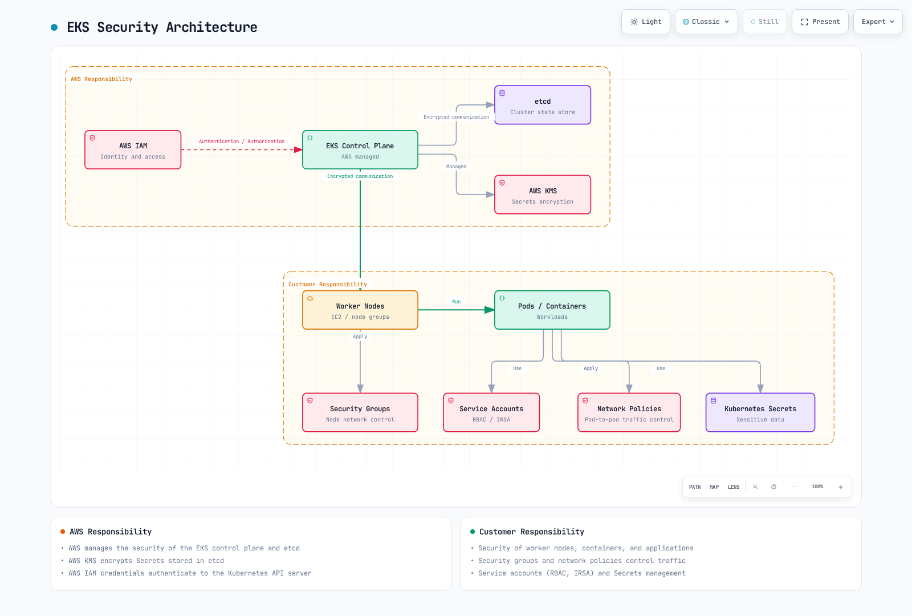
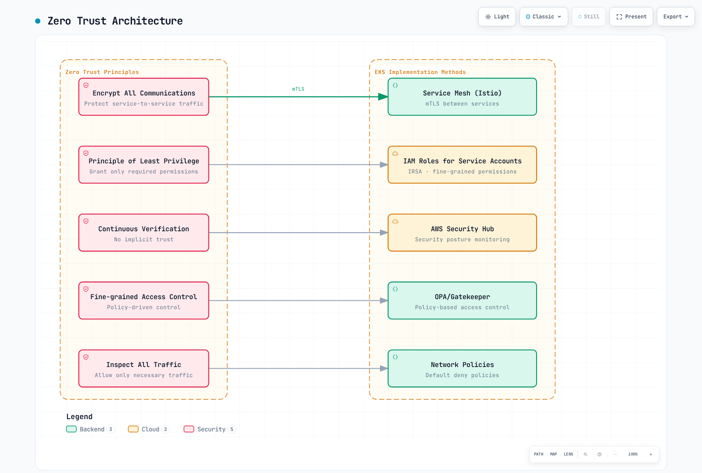
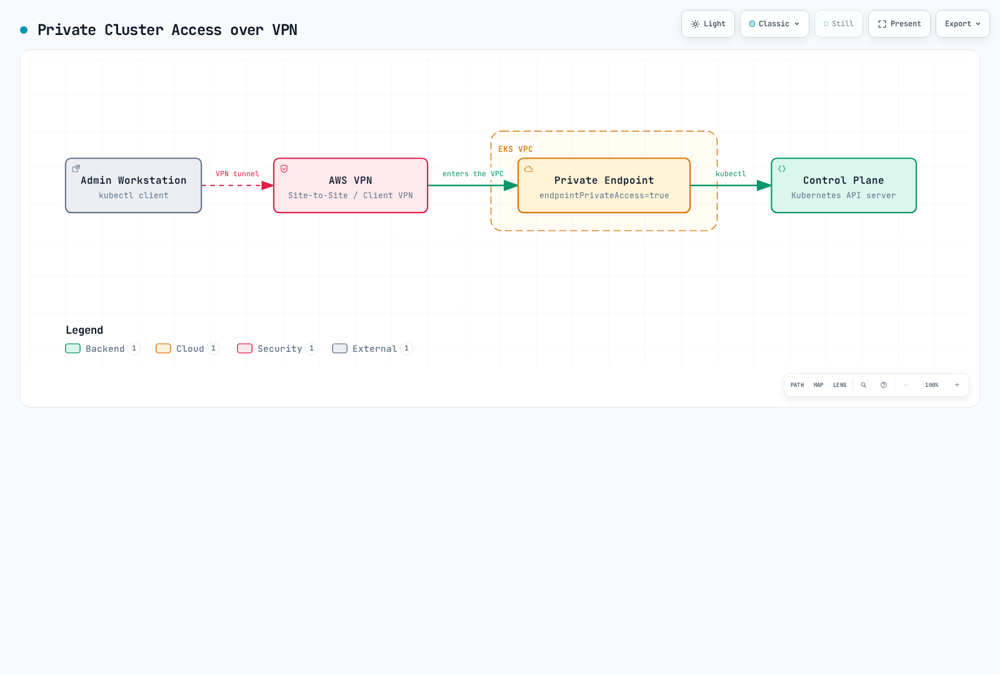
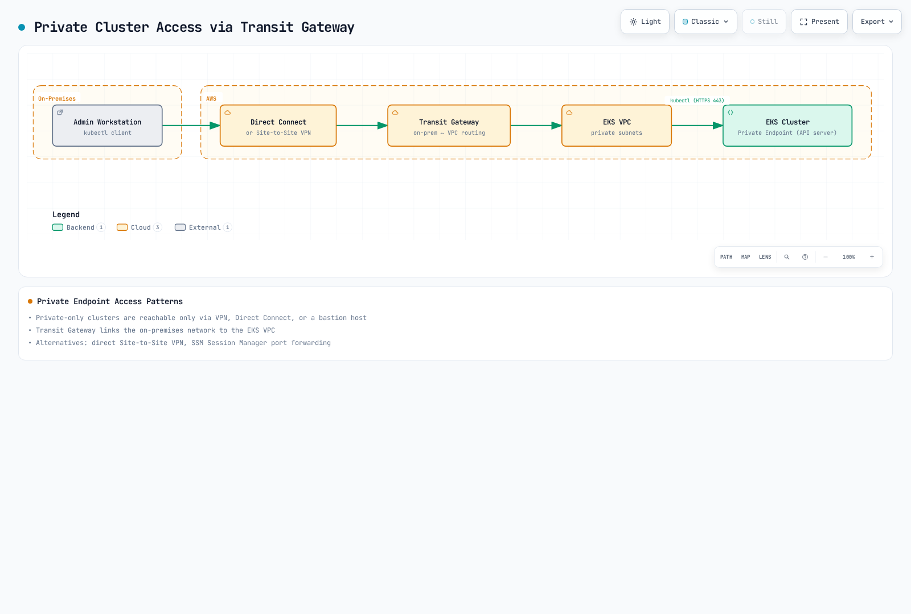
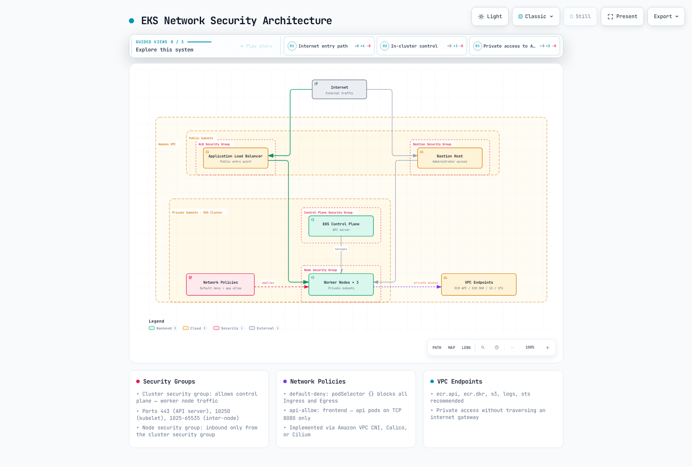
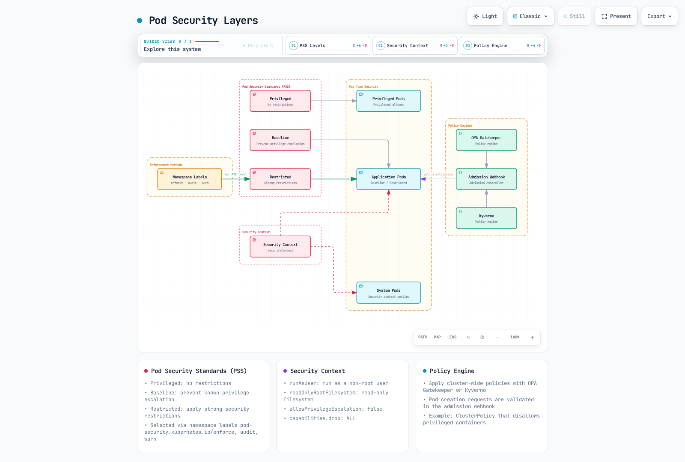
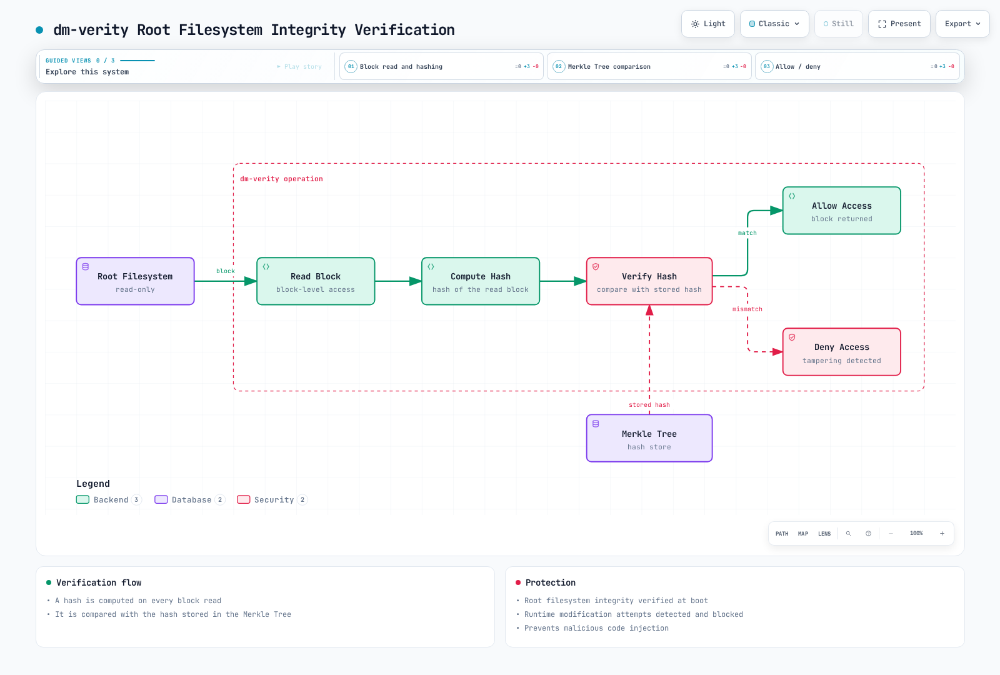
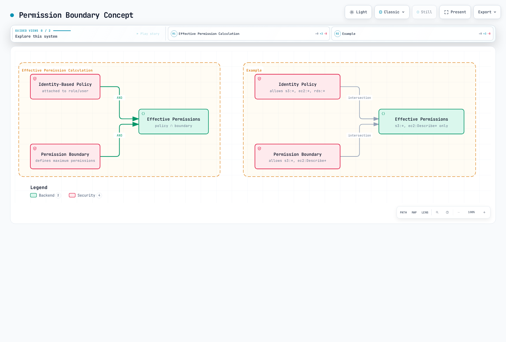
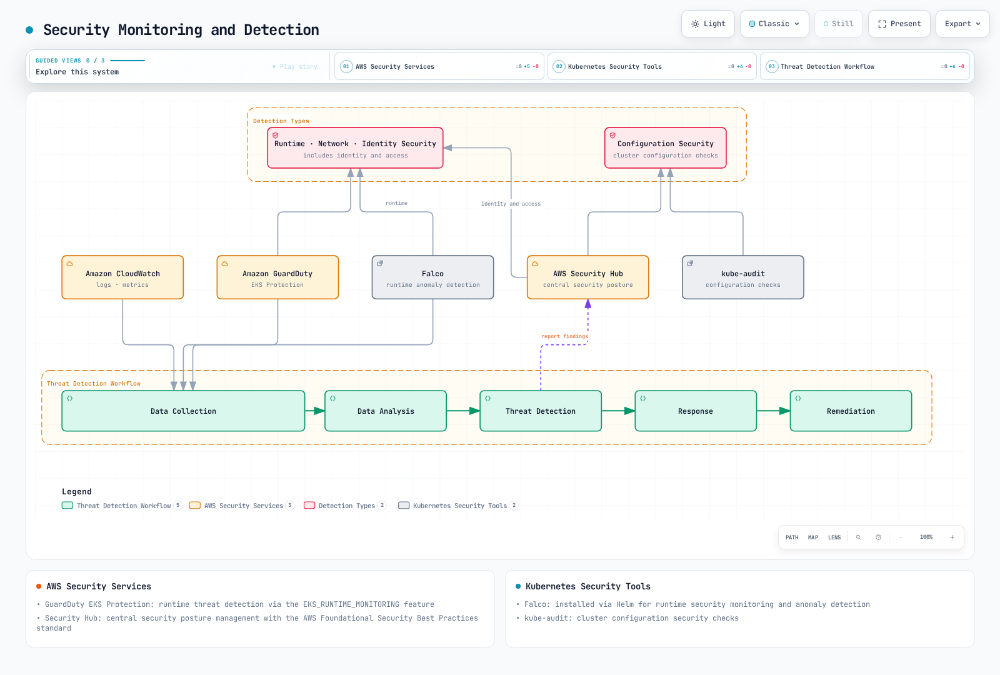
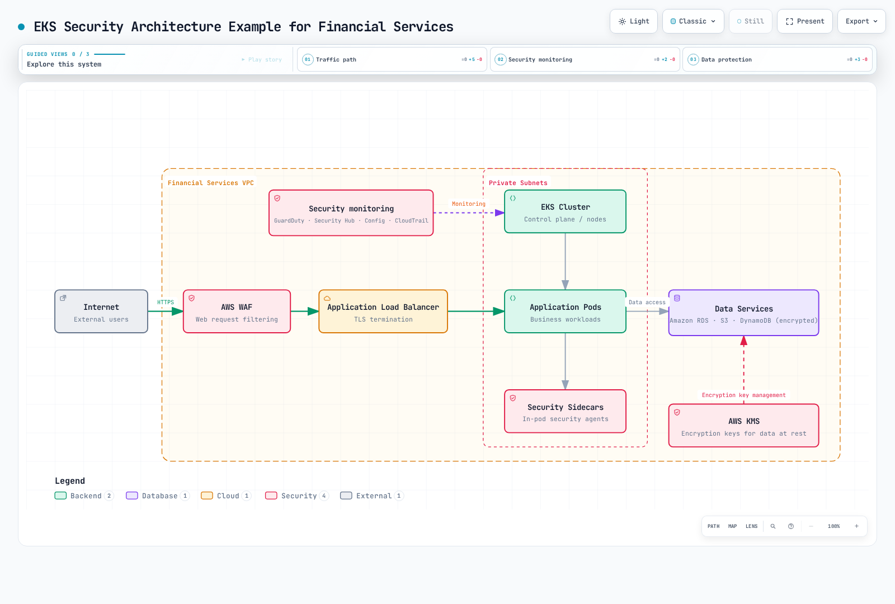

# Amazon EKS 安全

> **支持的版本**：EKS 标准支持 1.34–1.37；扩展支持 1.31–1.33（截至 2026 年 10 月 12 日核查）
> **最后更新**：2026 年 11 月 21 日

要在 Amazon EKS（Elastic Kubernetes Service）上安全地运行工作负载，你需要了解并实施各种安全层和最佳实践。本文介绍加强 EKS 集群安全性的关键概念、组件和最佳实践。

## 目录

1. [EKS 安全概览](#eks-security-overview)
2. [安全实践](#security-practices)
3. [IAM 和身份验证](#iam-and-authentication)
4. [深入了解 OIDC 提供方](#oidc-provider-deep-dive)
5. [EKS Pod Identity](#eks-pod-identity)
6. [集群端点访问控制](#cluster-endpoint-access-control)
7. [网络安全](#network-security)
8. [Pod 安全](#pod-security)
9. [Bottlerocket 和只读操作系统](#bottlerocket-and-read-only-os)
10. [IAM 权限边界](#iam-permission-boundaries)
11. [加密和机密管理](#encryption-and-secrets-management)
12. [合规与审计](#compliance-and-auditing)
13. [安全监控与检测](#security-monitoring-and-detection)
14. [EKS 安全最佳实践](#eks-security-best-practices)
15. [金融服务的 EKS 安全注意事项](#eks-security-considerations-for-financial-services)

## EKS 安全概览

将基础设施、集群访问和工作负载控制分开管理。AWS 管理控制平面；节点/操作系统的责任取决于使用的是 EC2 自管理节点或托管节点、Fargate、Auto Mode 还是 Hybrid Nodes。客户仍需负责应用镜像、身份、数据处理和工作负载策略。标准 EC2 节点示意图并不意味着客户要为 Auto Mode/Fargate 主机操作系统打补丁。



[🔍 查看交互式图表](https://www.atomai.click/kubernetes-docs/archmaps/en-eks-05-eks-security-0.html)

## 安全实践

使用范围明确的多种控制措施；没有任何单一工具能建立零信任或证明工作负载安全。验证调用方/工作负载身份，授权预期操作，限制网络路径，并根据威胁模型收集相应证据。

<!-- Diagram repair pending: network policies filter traffic; posture findings are not continuous request authentication or complete zero-trust enforcement.


[🔍 View interactive diagram](https://www.atomai.click/kubernetes-docs/archmaps/en-eks-05-eks-security-1.html)
-->

### 身份和网络控制

IRSA 和 Pod Identity 为工作负载提供 AWS 凭证；NetworkPolicy 提供受支持的网络过滤；准入引擎会检查已配置的 Kubernetes 请求。兼容且维护良好的服务网格可以增加 mTLS 和应用流量策略。AWS App Mesh 将于 2026 年 9 月 30 日结束支持，因此现有部署需要迁移计划，而不应将其作为新的默认建议。

### 供应链安全

采用经过审查的构建/来源证明流程（例如 SLSA），使用 SBOM 清点组件，扫描相关漏洞，并根据预期的签名者身份验证制品签名。Syft 是 SBOM 工具；Grype 是漏洞扫描器。ECR/Inspector 和其他扫描器的覆盖范围及更新要求各不相同。镜像已签名或已扫描，并不能证明其代码无害。也要保护构建身份、仓库和准入配置。

当前 ECR 支持使用 AWS Signer 进行托管镜像签名，也支持通过 Notation 手动签名。签名和准入验证是两个独立步骤；注册表筛选条件、签名配置文件权限和验证器信任设置都必须符合预期的流水线。

### 运行时检测和策略即代码

GuardDuty EKS Protection 会分析独立的 EKS 审计日志流。Runtime Monitoring 是单独的基于代理的功能；当前支持 EKS on EC2 和 Auto Mode，但有平台/代理要求，且不支持 EKS Fargate 和 Hybrid Nodes。CloudWatch 审计日志传输需要单独配置。Security Hub CSPM 会评估已配置的控制；Security Hub 可以关联发现项。二者都不能取代应用授权，也不能代替对所有监管要求的评估。

使用受支持的运行时工具和策略引擎，例如 Falco、Gatekeeper 或 Kyverno，并满足所需的内核、控制器、API 和元数据集成要求。gVisor/Kata 等额外沙箱运行时需要兼容的节点/运行时设计，并非每种 EKS 计算路径都支持。策略、镜像或操作系统加固可以降低特定风险，但不能保证所有逃逸或恶意操作都不可能发生。

策略即代码工具也在不同阶段发挥作用：Gatekeeper/Kyverno 可以评估 Kubernetes 准入，CloudFormation Guard 或 Sentinel 可以评估基础设施变更，而 AWS Config 可以评估受支持的已部署资源配置。Detective 等调查工具依赖于已配置的数据源。不要将这些用途与运行时防护混为一谈。

## IAM 和身份验证

人员和自动化 IAM 主体通过已配置的 IAM 映射/访问条目路径进行身份验证；Kubernetes RBAC 和 EKS 访问策略负责授权 Kubernetes 操作，且允许权限会叠加。EKS 集群角色和节点角色分别用于服务和节点执行 AWS 调用；它们不是开发人员的 Kubernetes 权限。用于 IRSA 的 IAM OIDC 提供方不同于用于 Kubernetes 用户登录的外部 OIDC 提供方；应用的 AWS 权限不会授予 Kubernetes API 权限。更改身份验证模式前，保留管理员/节点映射；并使用实际 IAM 登录验证权限，而不是使用 `kubectl --as`。

详情：[EKS 集群访问身份验证：IAM 和访问条目](./05-eks-security-cluster-access.md)

## 深入了解 OIDC 提供方

EKS 发布的集群 OIDC 签发者和公钥签名密钥本身不会创建 IAM OIDC 提供方，也不会授权角色代入。IRSA 需要在角色所在账户中配置 IAM OIDC 提供方，并将角色信任范围限定为签发者、主题和受众；还需要兼容的 SDK 通过 STS AssumeRoleWithWebIdentity 交换投影令牌。EKS 每七天轮换一次 OIDC 签名密钥，因此自定义验证器必须遵循 Cache-Control，并处理未知的 kid 值。

详情：[IRSA 和 OIDC 提供方](./05-eks-security-irsa-oidc.md)

## EKS Pod Identity

EKS Pod Identity 通过 EKS API 关联（集群、命名空间和 ServiceAccount 到 IAM 角色）以及 `pods.eks.amazonaws.com` 角色信任，为 Pod 提供临时 AWS 凭证。SDK 会调用节点代理的容器凭证端点，而代理则通过 EKS Auth 上的 AssumeRoleForPodIdentity 获取凭证。关联的角色必须位于集群账户中；访问其他账户中的资源时，需要通过目标角色链式代入。有关 IRSA 对比、迁移顺序和现场演示，请参阅[将 EKS 节点 IAM 权限迁移到 IRSA 和 Pod Identity](../security/17-eks-workload-identity-migration.md)。

详情：[EKS Pod Identity](./05-eks-security-pod-identity.md)

## 集群端点访问控制

端点配置决定网络可达性，而 API 操作仍由身份验证和授权控制。根据运维要求选择访问路径，并检查实际设置，不要假定工具的默认值。

| 公有 | 私有 | 网络行为 |
|---|---|---|
| 已启用 | 已禁用 | 客户端和节点需要有到公有地址的路由；受限 CIDR 必须包含实际的公有出口来源 |
| 已禁用 | 已启用 | 访问需要 VPC/私有路由、DNS 和安全组规则，包括获准的互联网络 |
| 已启用 | 已启用 | 从集群 VPC 发起的请求使用私有路径；获准的外部客户端可以使用公有访问 |

公有寻址本身并不能证明 EC2 到 EKS 的流量会离开 AWS 网络。私有访问不会自动授权调用方、配置 VPN/DNS 或提供恢复路径。EKS 要求至少启用一种访问模式。

### 检查并保留现有配置

在同一个 shell 中运行相关代码块，并保留新建的审查目录。使用能够检查/恢复端点设置的 AWS 管理身份，该身份应与 Kubernetes 登录身份分开。此操作仅记录可变的端点访问字段以供恢复；不会尝试恢复无关的 VPC 设置或下文所述的单向出口模式。

```bash
set -euo pipefail
umask 077
: "${CLUSTER_NAME:?Set the existing cluster name}"
: "${AWS_REGION:?Set its Region}"
ENDPOINT_REVIEW_DIR=$(mktemp -d -t eks-endpoint-review.XXXXXX)
printf 'Review records: %s\n' "$ENDPOINT_REVIEW_DIR"
aws eks describe-cluster --name "$CLUSTER_NAME" --region "$AWS_REGION" \
  --query cluster --output json > "$ENDPOINT_REVIEW_DIR/cluster-before.json"
python3 - "$ENDPOINT_REVIEW_DIR" "$CLUSTER_NAME" <<'PY'
import json, pathlib, sys, urllib.parse
root = pathlib.Path(sys.argv[1])
cluster = json.loads((root / "cluster-before.json").read_text())
if cluster["name"] != sys.argv[2] or cluster["status"] != "ACTIVE":
    raise SystemExit("Unexpected cluster or cluster is not ACTIVE")
endpoint = urllib.parse.urlparse(cluster["endpoint"])
if endpoint.scheme != "https" or not endpoint.hostname or endpoint.username or endpoint.password:
    raise SystemExit("Unexpected Kubernetes endpoint")
(root / "endpoint-host.txt").write_text(endpoint.hostname + "\n")
config = cluster["resourcesVpcConfig"]
before = {k: config[k] for k in ["endpointPublicAccess", "endpointPrivateAccess", "publicAccessCidrs"] if k in config}
(root / "endpoint-before.json").write_text(json.dumps(before, indent=2) + "\n")
(root / "endpoint-private.json").write_text(json.dumps({"endpointPublicAccess": False, "endpointPrivateAccess": True}, indent=2) + "\n")
(root / "ssm-remote-host.json").write_text(json.dumps({"host": [endpoint.hostname], "portNumber": ["443"], "localPortNumber": ["6443"]}, indent=2) + "\n")
print(json.dumps(before, indent=2))
PY
```

### 限制公有地址路径

公有允许列表必须包含实际获准的公有 NAT/VPN/办公网络出口地址。10.0.0.0/8 等私有地址段不能代表公有源地址。203.0.113.0/24 等文档示例地址是占位符，不是可用的办公网络。

将 PUBLIC_EGRESS_CIDRS 设置为由网络所有者提供的 JSON 数组。此受限示例接受 IPv4 CIDR，并拒绝明显的私有/默认/文档示例地址段；但它无法证明地址归属，也无法证明当前客户端包含在其中。请检查范围、配额和集群的 IP 地址族支持情况。双栈/IPv6 设置需要单独验证允许列表。

```bash
set -euo pipefail
: "${ENDPOINT_REVIEW_DIR:?Run the inspection step in this shell first}"
: "${PUBLIC_EGRESS_CIDRS:?Set a JSON array of approved actual public IPv4 egress CIDRs}"
python3 - "$ENDPOINT_REVIEW_DIR" "$PUBLIC_EGRESS_CIDRS" <<'PY'
import ipaddress, json, pathlib, sys
values = json.loads(sys.argv[2])
if not isinstance(values, list) or not values:
    raise SystemExit("Provide a nonempty reviewed CIDR list")
cidrs = []
for value in values:
    network = ipaddress.ip_network(value, strict=True)
    if network.version != 4 or network.prefixlen == 0 or not network.is_global or network.is_multicast or network.is_reserved:
        raise SystemExit("This IPv4 example requires actual public egress CIDRs, not private/default/documentation ranges")
    cidrs.append(str(network))
if len(cidrs) != len(set(cidrs)):
    raise SystemExit("Remove duplicate CIDRs")
desired = {"endpointPublicAccess": True, "endpointPrivateAccess": True, "publicAccessCidrs": cidrs}
path = pathlib.Path(sys.argv[1]) / "endpoint-public-restricted.json"
path.write_text(json.dumps(desired, indent=2) + "\n")
print(json.dumps(desired, indent=2))
PY
```

计划中的公有访问受限配置也会启用私有访问。若未启用私有访问，则必须继续允许节点/Fargate 的公有出口地址，否则节点到 API 的通信可能失败。选择 ENDPOINT_CHANGE=public-restricted 前，请检查生成的 JSON。

### 私有连接路径



[🔍 查看交互式图表](https://www.atomai.click/kubernetes-docs/archmaps/en-eks-05-eks-security-6.html)



[🔍 查看交互式图表](https://www.atomai.click/kubernetes-docs/archmaps/en-eks-05-eks-security-7.html)

VPN、Direct Connect/TGW 和获准的管理主机都可以作为访问路径，但必须正确配置路由、DNS、安全组和授权。单条 Client VPN 创建命令不会配置子网关联、授权规则、路由、证书和连接日志。运行 AWS CLI 镜像的 Deployment 不会创建 SSM 托管堡垒主机，也不会安装 kubectl/SSM Agent。

要使用 SSM 远程主机端口转发，请准备一台 SSM Agent 3.1.1374.0 或更高版本的托管主机，并配置 Session Manager IAM/网络访问、本地 Session Manager 插件，以及通往私有 EKS 端点的 DNS/路由。确认已启用私有端点访问，并确认主机确实能解析并访问其私有路径。在第一个终端中保持转发会话运行：

```bash
set -euo pipefail
: "${AWS_REGION:?Set the cluster/managed-instance Region for this example}"
: "${MANAGED_INSTANCE_ID:?Set the prepared SSM-managed instance with a private route to EKS}"
: "${ENDPOINT_REVIEW_DIR:?Use the endpoint inspection directory}"
aws ssm start-session --region "$AWS_REGION" --target "$MANAGED_INSTANCE_ID" \
  --document-name AWS-StartPortForwardingSessionToRemoteHost \
  --parameters "file://$ENDPOINT_REVIEW_DIR/ssm-remote-host.json"
```

在第二个终端中使用同一集群的 kubeconfig，并保留其 CA 和预期的 IAM exec 身份验证。保留真实 TLS 服务器名称，通过本地连接访问。不要通过禁用证书验证来掩盖主机名不匹配：

```bash
set -euo pipefail
: "${ENDPOINT_REVIEW_DIR:?Set the same review directory in this second terminal}"
: "${CLUSTER_KUBECONFIG:?Set the kubeconfig for this same EKS cluster and intended IAM identity}"
EKS_ENDPOINT_HOST=$(cat "$ENDPOINT_REVIEW_DIR/endpoint-host.txt")
kubectl --kubeconfig "$CLUSTER_KUBECONFIG" \
  --server https://127.0.0.1:6443 --tls-server-name "$EKS_ENDPOINT_HOST" \
  --request-timeout=10s -n security-demo get pods
```

远程主机文档会转发到提供的 EKS 主机。较旧的 AWS-StartPortForwardingSession 文档会转发托管实例自身的端口；转发其 443 端口并不会让该实例成为 EKS API 服务器。隧道/运行状况检查成功本身并不能证明已授权或私有路由有效。在移除公有访问前，请验证预期的 API 操作、DNS/私有地址和实际路由。

### 应用经过审查的端点变更

启用私有访问并验证预期的私有客户端路径后，在选择 ENDPOINT_CHANGE=private 前，重新进行检查并保存快照。以下操作会拒绝不同的集群/账户、已更改的端点设置，或在尚未启用私有访问前切换到仅私有模式。读取/检查并非原子事务；请与所有者协调变更。

```bash
set -euo pipefail
: "${CLUSTER_NAME:?Use the inspected cluster}"
: "${AWS_REGION:?Use its Region}"
: "${ENDPOINT_REVIEW_DIR:?Use the review directory}"
: "${ENDPOINT_CHANGE:?Choose public-restricted or private after validating the intended route}"
case "$ENDPOINT_CHANGE" in
  public-restricted|private) ;;
  *) echo "Unexpected endpoint change"; exit 1 ;;
esac
test -f "$ENDPOINT_REVIEW_DIR/endpoint-$ENDPOINT_CHANGE.json"
aws eks describe-cluster --name "$CLUSTER_NAME" --region "$AWS_REGION" \
  --query cluster --output json > "$ENDPOINT_REVIEW_DIR/cluster-current.json"
python3 - "$ENDPOINT_REVIEW_DIR" "$CLUSTER_NAME" "$ENDPOINT_CHANGE" <<'PY'
import json, pathlib, sys
root = pathlib.Path(sys.argv[1])
before = json.loads((root / "cluster-before.json").read_text())
current = json.loads((root / "cluster-current.json").read_text())
keys = ["endpointPublicAccess", "endpointPrivateAccess", "publicAccessCidrs"]
if current["name"] != sys.argv[2] or current["arn"] != before["arn"] or current["status"] != "ACTIVE":
    raise SystemExit("Cluster identity/state differs from the reviewed target")
if any(current["resourcesVpcConfig"].get(k) != before["resourcesVpcConfig"].get(k) for k in keys):
    raise SystemExit("Endpoint configuration changed; inspect and review again")
if sys.argv[3] == "private" and current["resourcesVpcConfig"].get("endpointPrivateAccess") is not True:
    raise SystemExit("Enable and verify private access before disabling public access")
PY
aws eks update-cluster-config --name "$CLUSTER_NAME" --region "$AWS_REGION" \
  --resources-vpc-config "file://$ENDPOINT_REVIEW_DIR/endpoint-$ENDPOINT_CHANGE.json" \
  --output json > "$ENDPOINT_REVIEW_DIR/update-response.json"
EKS_UPDATE_ID=$(python3 - "$ENDPOINT_REVIEW_DIR/update-response.json" <<'PY'
import json, sys
with open(sys.argv[1]) as stream:
    print(json.load(stream)["update"]["id"])
PY
)
UPDATE_DONE=false
for ((attempt=0; attempt<60; attempt++)); do
  STATE=$(aws eks describe-update --name "$CLUSTER_NAME" --region "$AWS_REGION" \
    --update-id "$EKS_UPDATE_ID" --query update.status --output text)
  case "$STATE" in
    Successful) UPDATE_DONE=true; break ;;
    InProgress) sleep 10 ;;
    *) echo "Update $EKS_UPDATE_ID status: $STATE; inspect before further changes"; exit 1 ;;
  esac
done
test "$UPDATE_DONE" = true || { echo "Update still pending; inspect $EKS_UPDATE_ID"; exit 1; }
aws eks describe-cluster --name "$CLUSTER_NAME" --region "$AWS_REGION" \
  --query cluster.resourcesVpcConfig --output json
```

请使用返回的更新 ID 和 Successful 状态确认更新，不能只看集群是否为 ACTIVE。超时意味着需要检查现有操作；不要盲目再次提交变更。之后重新检查实际 API 路径。保留先前的端点字段和 AWS 管理恢复访问权限；本次审查并未实际更改端点。

### 私有 AWS 服务依赖项

| 路径 | 相关端点/依赖项 |
|---|---|
| Kubernetes API | 集群端点私有访问及其路由/DNS/安全组 |
| AWS EKS 管理 API | 需要私有管理访问时使用 eks 接口端点 |
| Pod Identity 代理 | 节点无法使用公有出口时使用 eks-auth 接口端点 |
| OIDC 发现/JWKS 工具 | oidc-eks 接口端点；公钥数据无需身份验证，且仅使用默认端点策略 |
| IRSA 凭证交换 | 区域 STS 端点，与 OIDC 密钥检索分开 |
| ECR 镜像拉取 | ecr.api/ecr.dkr 接口端点，以及可用的 S3 层下载路径 |
| 其他控制器/应用 | 仅包括其实际使用的 EC2、Logs、Secrets Manager、SSM 或其他服务依赖项 |

EKS 接口端点不是 Kubernetes API 端点。S3 网关端点使用路由表；接口端点使用子网/安全组/私有 DNS。不要通过遗漏端点类型的单个循环创建所有服务。OIDC PrivateLink 不会改变 STS 令牌验证，也不会授权 IRSA 角色。请按照创建章节准备完整的自有网络/身份/计算配置；此处的端点示例并非可直接用于生产的集群部署方案。

### 客户路由的控制平面出口（2026 年 6 月）

CUSTOMER_ROUTED 于 2026 年 6 月 18 日公布，是受支持的 EKS 控制平面出口模式。它使用子网中现有的跨账户集群网络接口，而不是创建单独的出口 ENI。它适用于面向客户的 API 服务器调用，例如准入 Webhook、OIDC 发现和聚合 API 服务器。

**此切换是单向的：启用 CUSTOMER_ROUTED 后，集群无法恢复为 AWS_MANAGED。** 不要把已保存的配置或 Kubernetes 版本回滚说成撤销此模式的方法。如果新路径失败，应修正路由/连接。

```bash
set -euo pipefail
: "${CLUSTER_NAME:?Set the existing cluster}"
: "${AWS_REGION:?Set its Region}"
aws eks describe-cluster --name "$CLUSTER_NAME" --region "$AWS_REGION" \
  --query 'cluster.{Status:status,Vpc:resourcesVpcConfig,IPFamily:kubernetesNetworkConfig.ipFamily}' --output json
```

切换前，清点 Webhook/OIDC/聚合 API 的目标和端口。验证集群 ENI 子网的路由、出站安全组规则、NACL 返回流量和 DNS。VPC DHCP 选项必须包含 AmazonProvidedDNS；对于实际目标，Route53 私有区域/Resolver 转发和外部 DNS 解析都必须正常。根据目标情况，出口路径可以使用 NAT、防火墙或集中路由。IPv6 集群需要采用文档规定的 IPv4 和 IPv6 路径；仅支持 IPv4 的依赖项仍需要可用的 IPv4 路径。

完成上述审查后，以下命令会实际调用 API。此命令仅在离线环境中通过了语法检查，本次审计未在 AWS 集群上执行：

```bash
set -euo pipefail
: "${CLUSTER_NAME:?Set the reviewed cluster}"
: "${AWS_REGION:?Set its Region}"
# One-way change: complete subnet route/SG/NACL/DNS and dependency checks first.
aws eks update-cluster-config --name "$CLUSTER_NAME" --region "$AWS_REGION" \
  --resources-vpc-config controlPlaneEgressMode=CUSTOMER_ROUTED --output json
```

记录返回的更新 ID，并检查 DescribeUpdate，直到状态为 Successful；仅凭 ACTIVE 不够。然后测试实际配置的 Webhook、用户 OIDC 和聚合 API 路径。不要声称本地 CLI 解析器测试证明了 VPC 连接正常。

| 流量 | 此设置的影响 |
|---|---|
| 面向客户的 API 服务器出口 | 使用配置的客户 VPC 路径 |
| Kubelet API 的 10250 端口 | 使用集群 ENI/节点路径；不是外部出口设备 |
| etcd、CloudWatch Logs、EKS 内部流量 | 继续使用 EKS 管理的路径 |
| EKS Capabilities 控制器，例如托管 ArgoCD/ACK/KRO | 在单独的托管基础设施中运行；此功能不会重新路由这些流量 |
| 应用程序对 STS/EKS Auth/S3 的调用 | 遵循工作负载/节点网络；不受此 API 服务器模式控制 |

该功能在 EKS 区域提供，不额外收取功能费用，但 NAT/防火墙/PrivateLink/日志资源会单独计费。如果需要网络流证据，必须配置 Flow Logs；它们不会自动暴露加密的有效载荷，也不能证明应用已获得授权。

#### 请求范围的 SCP 示例

eks:controlPlaneEgressMode 键会评估 CreateCluster/UpdateClusterConfig 请求中指定的模式。不带存在性条件的 StringNotEquals 拒绝条件也会匹配未提供该键的情况。以下示例要求新建集群指定该模式，并拒绝更新时明确指定不同模式的请求，同时允许省略模式的无关更新请求：

```json
{
  "Version": "2012-10-17",
  "Statement": [
    {
      "Sid": "RequireCustomerRoutedForNewClusters",
      "Effect": "Deny",
      "Action": "eks:CreateCluster",
      "Resource": "*",
      "Condition": {
        "StringNotEquals": {
          "eks:controlPlaneEgressMode": "CUSTOMER_ROUTED"
        }
      }
    },
    {
      "Sid": "RejectExplicitOtherEgressMode",
      "Effect": "Deny",
      "Action": "eks:UpdateClusterConfig",
      "Resource": "*",
      "Condition": {
        "Null": {
          "eks:controlPlaneEgressMode": "false"
        },
        "StringNotEquals": {
          "eks:controlPlaneEgressMode": "CUSTOMER_ROUTED"
        }
      }
    }
  ]
}
```

这是有意设置的请求防护措施，不会自动迁移现有集群。根据此示例，现有 AWS_MANAGED 集群仍可以接收无关更新。要求采用不同推出策略的组织必须另行建模。SCP 不会授予 IAM 权限，也不会配置路由/DNS。部署前，请审查策略继承，并与组织所有者一起测试具有代表性的允许/拒绝请求。

## 网络安全

安全组、路由、NetworkPolicy 和应用身份验证分别用于各自的层。该图展示的是传统网络布局；公有堡垒主机和私有 AWS 端点都是可选组件，必须实际配置，并非每个 EKS 集群都固有具备。



[🔍 查看交互式图表](https://www.atomai.click/kubernetes-docs/archmaps/en-eks-05-eks-security-8.html)

### 安全组和必需路径

对于 API/节点路径，应允许所需的节点到 API TCP443 流量，以及控制平面到 kubelet TCP10250 的流量。DNS、Webhook 和工作负载可能还需要其他实际目标端口。没有普遍要求必须开放 TCP1025–65535 作为“节点间通信”。安全组是有状态的；NACL 及其返回路径规则需要单独配置。

检查附加到实际 ENI/节点上的安全组。自定义启动模板中的安全组配置不会自动继承 EKS 的所有默认规则。Pod 安全组和 Auto Mode NodeClass Pod 安全组选择器是不同的机制，各有自身的支持范围/行为；安全组并不只属于抽象的实例层。请检查所选的计算/CNI 和实际源接口。

### NetworkPolicy 语义

NetworkPolicy 需要有支持且已配置的强制执行实现。仅创建 YAML 不会过滤数据包。使用现有网络所有者支持的 EKS VPC CNI 策略功能，或有意选择的兼容网络堆栈。不要在现有集群上安装来源不明的 Calico 清单或无关的 Cilium 配置。Auto Mode 自行管理网络；它不适用于随意替换 CNI。

策略是累加的。对于隔离连接，源端出站和目标端入站都必须允许该连接。规则顺序不是拒绝/允许优先级系统。单独的 podSelector 仅选择策略所在命名空间中的对等对象；同一对等项中的 namespaceSelector 加 podSelector 是 AND 条件。不同的对等项则组合为可选条件。

### 隔离策略练习

此示例使用新建的演示命名空间、启用了强制执行 CNI 的 Linux EC2 网络，以及 kube-system 中标签为 k8s-app=kube-dns 的传统 CoreDNS Deployment。它假定已准备好带有 app=frontend/api/database 标签的前端/API/数据库 Pod；API 监听 8080 并在 9090 提供演示指标，数据库监听 5432。这些策略不会部署上述应用。

默认拒绝包括两个方向。此处明确设置了 DNS 和每种预期的源/目标流量。未清点所有依赖项前，不要将这些假设应用于现有生产命名空间：

```yaml
apiVersion: v1
kind: Namespace
metadata:
  name: security-network-demo
  labels:
    pod-security.kubernetes.io/enforce: restricted
    pod-security.kubernetes.io/enforce-version: v1.36
---
apiVersion: v1
kind: Namespace
metadata:
  name: security-monitoring-demo
---
apiVersion: networking.k8s.io/v1
kind: NetworkPolicy
metadata:
  name: default-deny
  namespace: security-network-demo
spec:
  podSelector: {}
  policyTypes:
  - Ingress
  - Egress
---
apiVersion: networking.k8s.io/v1
kind: NetworkPolicy
metadata:
  name: allow-dns
  namespace: security-network-demo
spec:
  podSelector: {}
  policyTypes:
  - Egress
  egress:
  - to:
    - namespaceSelector:
        matchLabels:
          kubernetes.io/metadata.name: kube-system
      podSelector:
        matchLabels:
          k8s-app: kube-dns
    ports:
    - protocol: UDP
      port: 53
    - protocol: TCP
      port: 53
---
apiVersion: networking.k8s.io/v1
kind: NetworkPolicy
metadata:
  name: frontend-to-api
  namespace: security-network-demo
spec:
  podSelector:
    matchLabels:
      app: frontend
  policyTypes:
  - Egress
  egress:
  - to:
    - podSelector:
        matchLabels:
          app: api
    ports:
    - protocol: TCP
      port: 8080
---
apiVersion: networking.k8s.io/v1
kind: NetworkPolicy
metadata:
  name: api-ingress
  namespace: security-network-demo
spec:
  podSelector:
    matchLabels:
      app: api
  policyTypes:
  - Ingress
  ingress:
  - from:
    - podSelector:
        matchLabels:
          app: frontend
    ports:
    - protocol: TCP
      port: 8080
---
apiVersion: networking.k8s.io/v1
kind: NetworkPolicy
metadata:
  name: api-to-database
  namespace: security-network-demo
spec:
  podSelector:
    matchLabels:
      app: api
  policyTypes:
  - Egress
  egress:
  - to:
    - podSelector:
        matchLabels:
          app: database
    ports:
    - protocol: TCP
      port: 5432
---
apiVersion: networking.k8s.io/v1
kind: NetworkPolicy
metadata:
  name: database-ingress
  namespace: security-network-demo
spec:
  podSelector:
    matchLabels:
      app: database
  policyTypes:
  - Ingress
  ingress:
  - from:
    - podSelector:
        matchLabels:
          app: api
    ports:
    - protocol: TCP
      port: 5432
---
apiVersion: networking.k8s.io/v1
kind: NetworkPolicy
metadata:
  name: monitor-api
  namespace: security-network-demo
spec:
  podSelector:
    matchLabels:
      app: api
  policyTypes:
  - Ingress
  ingress:
  - from:
    - namespaceSelector:
        matchLabels:
          kubernetes.io/metadata.name: security-monitoring-demo
      podSelector:
        matchLabels:
          app: prometheus
    ports:
    - protocol: TCP
      port: 9090
```

监控 Pod 也需要出站权限。以下单独的演示策略允许其访问 API 指标和传统 DNS 路径；这并不是完整的生产 Prometheus 网络策略：

```yaml
apiVersion: networking.k8s.io/v1
kind: NetworkPolicy
metadata:
  name: prometheus-to-demo-api
  namespace: security-monitoring-demo
spec:
  podSelector:
    matchLabels:
      app: prometheus
  policyTypes:
  - Egress
  egress:
  - to:
    - namespaceSelector:
        matchLabels:
          kubernetes.io/metadata.name: security-network-demo
      podSelector:
        matchLabels:
          app: api
    ports:
    - protocol: TCP
      port: 9090
  - to:
    - namespaceSelector:
        matchLabels:
          kubernetes.io/metadata.name: kube-system
      podSelector:
        matchLabels:
          k8s-app: kube-dns
    ports:
    - protocol: UDP
      port: 53
    - protocol: TCP
      port: 53
```

纯 Auto Mode 使用节点本地 CoreDNS，而不是传统 Deployment；NodeLocal DNS/自定义解析器路径也可能不同。改写 DNS 规则前，请检查实际解析路径。标签是选择器，不是加密的工作负载身份；应控制谁可以创建/重新标记工作负载，并在需要时使用应用授权。

### 外部目标和验证限制

以下仅用于文档的地址在进行连接练习前，必须替换为获准的真实目标。它展示的是一条 IP/端口权限规则，而不是 AWS 服务/FQDN 允许列表：

```yaml
apiVersion: networking.k8s.io/v1
kind: NetworkPolicy
metadata:
  name: approved-https-example
  namespace: security-network-demo
spec:
  podSelector:
    matchLabels:
      app: external-client
  policyTypes:
  - Egress
  egress:
  - to:
    - ipBlock:
        cidr: 203.0.113.10/32
    ports:
    - protocol: TCP
      port: 443
```

允许 0.0.0.0/0 的 443 端口会放行大量公有目标；排除私有/链路本地地址段并不能识别可信服务。原生 NetworkPolicy 不会把域名解析为持久的允许列表，也不会提供 IAM 授权。节点/hostNetwork 例外、NAT 顺序和实现特定行为也意味着 NetworkPolicy 并非隔离 IMDS 的唯一机制。

请在实际 CNI 上测试新的正向和负向连接。策略变更可能会异步传播，现有连接的处理方式由具体实现决定。本次审查仅使用合成的选择器/端口案例检查了示例；未执行数据包过滤、DNS 解析或实时流量测试。

## Pod 安全

Pod Security Standards 定义配置文件；Pod Security Admission (PSA) 强制执行所选的命名空间策略。PSA 自 Kubernetes 1.25 起已稳定。PodSecurityPolicy 于 1.21 弃用，并且**已在 1.25 移除**；它不是当前 EKS 集群可部署的 API。名称中包含 PSP 的 Gatekeeper 约束属于独立自定义资源，并非已移除的 API。



[🔍 查看交互式图表](https://www.atomai.click/kubernetes-docs/archmaps/en-eks-05-eks-security-9.html)

### 按版本指定配置文件并实施

| 配置文件 | 含义 |
|---|---|
| Privileged | 此 PSS 配置文件不施加限制；其他授权/准入控制仍然适用 |
| Baseline | 对已知会扩大权限的配置施加一组基线限制 |
| Restricted | 增加更严格的限制，包括受支持的非 root、能力和 seccomp 要求 |

命名空间的 enforce 策略会拒绝违反要求的 Pod 请求。Audit 和 warn 会记录/报告违规情况；它们不会让成功应用控制器配置成为 Pod 可以运行的证明。对于 Deployment/Job 模板，audit/warn 可以报告问题，而 enforce 则会应用于生成的 Pod。请检查发布状态/事件，而不仅仅是 kubectl apply 是否成功。更改命名空间策略不会追溯驱逐现有 Pod。

### 完整的 Linux 安全上下文示例

以下是一个小型 Linux 身份/安全上下文演示，使用真实镜像，且没有可写的应用运行时路径。它不是 nginx 应用部署。请使用适用于实际集群的 PSS 版本；此示例固定为已审查的 EKS 1.36 策略。

```yaml
apiVersion: v1
kind: Namespace
metadata:
  name: security-demo
  labels:
    pod-security.kubernetes.io/enforce: restricted
    pod-security.kubernetes.io/enforce-version: v1.36
    pod-security.kubernetes.io/audit: restricted
    pod-security.kubernetes.io/audit-version: v1.36
    pod-security.kubernetes.io/warn: restricted
    pod-security.kubernetes.io/warn-version: v1.36
---
apiVersion: v1
kind: Pod
metadata:
  name: security-context-demo
  namespace: security-demo
spec:
  automountServiceAccountToken: false
  nodeSelector:
    kubernetes.io/os: linux
  securityContext:
    runAsNonRoot: true
    runAsUser: 1000
    runAsGroup: 1000
    seccompProfile:
      type: RuntimeDefault
  containers:
  - name: app
    image: busybox:1.38.0
    command:
    - sh
    - -c
    args:
    - id && sleep 3600
    securityContext:
      allowPrivilegeEscalation: false
      readOnlyRootFilesystem: true
      capabilities:
        drop:
        - ALL
    resources:
      requests:
        cpu: 10m
        memory: 16Mi
      limits:
        cpu: 100m
        memory: 64Mi
```

Pod 级别的 runAsUser/runAsGroup/runAsNonRoot/seccomp 设置与容器级别的 allowPrivilegeEscalation 和 capabilities 不同。fsGroup 是 Pod 级别的卷所有权设置，其行为因驱动/文件系统而异；它不是容器能力。readOnlyRootFilesystem 是额外的应用兼容性加固措施，并非 PSS Restricted 的普遍要求，也不会让每个挂载的 PVC 都变成只读。

对于真实应用，请准备好镜像的 UID/GID、可写临时/缓存/套接字卷和探测端口。不要假设面向 root 用户的 nginx 镜像无需配置这些路径，就能以任意 UID 和只读根文件系统启动。标准控制可以降低风险，但不能证明所有内核/运行时逃逸都不可能发生。

### 准入策略示例

使用兼容且由你负责维护的策略引擎安装，并使用其实际 CRD。Kyverno 1.19.1 提供 policies.kyverno.io/v1 ValidatingPolicy API；该版本中较旧的 ClusterPolicy 格式已弃用。以下有限范围的示例仅应用于 security-demo，并检查常规容器、init 容器和临时容器。若省略 privileged，则默认值为 false 并会被接受；privileged:true 会被拒绝。

```yaml
apiVersion: policies.kyverno.io/v1
kind: ValidatingPolicy
metadata:
  name: demo-disallow-privileged
spec:
  validationActions:
  - Deny
  failurePolicy: Fail
  matchConstraints:
    resourceRules:
    - apiGroups:
      - ''
      apiVersions:
      - v1
      resources:
      - pods
      - pods/ephemeralcontainers
      operations:
      - CREATE
      - UPDATE
      scope: Namespaced
  matchConditions:
  - name: demo-namespace
    expression: has(object.metadata.namespace) && object.metadata.namespace == 'security-demo'
  validations:
  - expression: object.spec.containers.all(c, !has(c.securityContext) || !has(c.securityContext.privileged)
      || c.securityContext.privileged == false) && (!has(object.spec.initContainers)
      || object.spec.initContainers.all(c, !has(c.securityContext) || !has(c.securityContext.privileged)
      || c.securityContext.privileged == false)) && (!has(object.spec.ephemeralContainers)
      || object.spec.ephemeralContainers.all(c, !has(c.securityContext) || !has(c.securityContext.privileged)
      || c.securityContext.privileged == false))
    message: Privileged containers, including init and ephemeral containers, are not
      allowed in security-demo.
```

这一条规则不能完全替代 PSS 配置文件或镜像签名验证。平台 CSI/监控代理和有意设置的例外应由单独审查的所有者负责；不要将演示策略一概应用到 kube-system。Gatekeeper 替代方案同样需要匹配的 ConstraintTemplate、约束 Schema 和经过测试的行为，不能仅凭猜测选择约束类型。

本地使用已发布的 CRD 和实际 Kyverno CLI 检查了 CEL 策略，测试了省略/false、常规/init/临时容器设为 true，以及其他命名空间等情况。未运行实时准入 Webhook、部署 Pod 或执行策略强制操作。生产环境强制执行前，请审查现有资源和控制器发布状态。

## Bottlerocket 和只读操作系统

Bottlerocket 是一种 Linux 容器主机，主机软件面较小，通过 API 管理设置，并采用基于镜像的更新。其只读根文件系统不会让所有存储都变为不可变，也不会消除内核/运行时漏洞。

### 基于 API 的配置

通常通过其 API 管理主机，而不是安装 SSH 服务器或包管理器。控制/管理主机容器具有不同的访问权限和特权。应保护 SSM/SSH 入口、节点 IAM 和本地 API 套接字的访问权限；访问该套接字可以更改主机配置。仅启用控制容器不会配置 SSM 注册、权限或网络连接。

```bash
# Run inside an authorized Bottlerocket control container.
apiclient get settings.host-containers.admin
apiclient get settings.updates
apiclient get settings.motd
```

经过批准的设置变更可以使用 `apiclient set motd="EKS Bottlerocket node"`。`set` 命令会**自动提交并应用**，并可能重启受影响的服务。不存在单独的 `apiclient commit` 命令。底层暂存事务则使用 API 事务的提交并应用操作。

用户数据使用 TOML，而不是 Bash。这是需要与为实际集群生成的引导配置合并的设置片段；它不包含集群端点、CA 或所有引导要求：

```toml
[settings]
motd = "EKS Bottlerocket node"

[settings.host-containers.admin]
enabled = false
```

### SELinux 和文件系统完整性

SELinux 以强制模式运行，并根据进程和文件标签限制访问。预期的主机服务仍需要特权访问，而权限足够高的用户可以更改某些标签。这些控制措施可以降低风险，但不能证明能防范所有容器逃逸。

在 EKS Kubernetes 1.37 上，SELinux 卷挂载已稳定，并且在受支持的配置中默认启用。当 Pod 设置 `seLinuxOptions` 且 CSI 驱动声明 `seLinuxMount: true` 时，会应用此行为。由于一个挂载只能携带一个 SELinux 标签，如果同一节点上的另一个 Pod 已使用该卷，且使用了不同的 SELinux 标签、`seLinuxChangePolicy` 或特权级别，则 Pod 可能会停留在 `ContainerCreating` 状态；未启用 SELinux 的节点不受影响。升级前，请查找设置了 `seLinuxMount: true` 的驱动，并对共享卷的 Pod 统一设置 `seLinuxOptions.level` 和 `seLinuxChangePolicy`（`Recursive` 可保留先前的重新标记行为）。请参阅 [EKS 标准支持版本说明](https://docs.aws.amazon.com/eks/latest/userguide/kubernetes-versions-standard.html)中 Kubernetes 1.37 部分。

根文件系统使用 dm-verity：读取受保护的块时，会根据哈希树进行验证。这并不表示启动时扫描了每个文件。日志、容器镜像、应用卷和设置都包含可变存储；`/etc` 的部分内容是临时的，必须通过受支持的机制进行配置。



[🔍 查看交互式图表](https://www.atomai.click/kubernetes-docs/archmaps/en-eks-05-eks-security-11.html)

### 更新：原地更新或替换节点

Bottlerocket **支持原地镜像更新**。`apiclient update check` 会查找符合条件的更新；`apiclient update apply` 会写入备用分区，并将其选为下次启动使用的分区。除非明确与更新合并执行，否则重启是一个单独且会造成中断的步骤。原始 apiclient/SSM 更新命令不会排空 Kubernetes 工作负载。

对于 Kubernetes，Bottlerocket 文档建议使用 Brupop 编排原地更新。EKS 托管节点组更新则可以改为替换实例。为整个节点集群选择一个协调一致的负责人，审查版本/变体兼容性、容量、PDB、本地数据和工作负载运行状况，并在继续之前验证小规模发布。A/B 分区支持恢复机制，但不能保证从每一种应用或引导故障中自动恢复。

`settings.updates.version-lock` 接受完整版本号（例如 `1.64.0`）或 `latest`；`1.15.%` 不是受支持的通配符锁定值。锁定会控制更新选择，不会控制更新计划，也不保证自动更新成功完成。除非有意使用经过验证的自定义仓库，否则应保留该变体的更新仓库设置。不要替换为通用更新 URL。

### EKS 托管节点组示例

将以下内容保存为 `bottlerocket-nodegroup.yaml`，并替换为现有自有集群的集群名称/区域/版本及相应规模。此示例使用 eksctl 托管节点组配置和生成的引导设置。创建资源前，请验证 Bottlerocket AMI 变体支持集群版本和实例架构，并检查私有子网出口/端点、节点角色以及单独的工作负载/CNI 身份。上文使用的操作系统发行版本号仅是语法示例，并非要求将所有节点升级到该版本。

```yaml
apiVersion: eksctl.io/v1alpha5
kind: ClusterConfig
metadata:
  name: secure-cluster
  region: us-west-2
  version: "1.36"
managedNodeGroups:
  - name: bottlerocket-ng
    amiFamily: Bottlerocket
    instanceType: m5.large
    privateNetworking: true
    minSize: 2
    desiredCapacity: 3
    maxSize: 5
    volumeSize: 100
    volumeType: gp3
    volumeEncrypted: true
    updateConfig:
      maxUnavailable: 1
    bottlerocket:
      enableAdminContainer: false
      settings:
        motd: "EKS Bottlerocket node"
        host-containers:
          control:
            enabled: true
```

对于经过审查的部署，创建命令为 `eksctl create nodegroup --config-file bottlerocket-nodegroup.yaml`。不要仅仅为了完成节点边界示例，就将应用的 Secrets Manager 权限或 CSI 控制器卷管理权限授予每个节点。应为这些工作负载配置各自受支持的身份。根据启用的功能，审查节点所需的 EKS Auth/注册表/SSM 权限。

更改节点集群前，请检查其托管节点组和节点实际报告的操作系统。确保 kubectl 上下文指向同一自有集群：

```bash
set -euo pipefail
: "${CLUSTER_NAME:?Set the owned cluster name}"
: "${NODEGROUP_NAME:?Set the owned managed node group name}"
: "${AWS_REGION:?Set the cluster Region}"
aws eks describe-nodegroup --region "$AWS_REGION" \
  --cluster-name "$CLUSTER_NAME" --nodegroup-name "$NODEGROUP_NAME" \
  --query 'nodegroup.{Name:nodegroupName,Status:status,AMIType:amiType,Release:releaseVersion,Kubernetes:version,Role:nodeRole,Update:updateConfig,Health:health.issues}'
kubectl get nodes -l "eks.amazonaws.com/nodegroup=$NODEGROUP_NAME" \
  -o custom-columns='NAME:.metadata.name,OS:.status.nodeInfo.osImage,KUBELET:.status.nodeInfo.kubeletVersion'
```

AMI 发行版本不能构成后续 API 设置变更或原地操作系统更新的完整审计记录。请保留期望设置、更新结果和正在运行的节点清单。替换节点需要明确的运行状况/回滚计划；不要将未经检查的排空操作、删除 emptyDir 和删除节点组连在一起执行。

此处的验证涵盖 TOML 语法、已发布的 eksctl 配置 Schema 和 shell 语法。未创建或实际使用 Bottlerocket 节点、更新、SSM 会话或节点组。

主要参考资料：[Bottlerocket API 客户端](https://github.com/bottlerocket-os/bottlerocket-core-kit/tree/v15.0.0/sources/api/apiclient)、[原地更新](https://bottlerocket.dev/en/os/1.64.x/update/methods/in-place/)、[节点替换](https://bottlerocket.dev/en/os/1.64.x/update/methods/node-replacement/)、[版本锁定](https://bottlerocket.dev/en/os/1.64.x/update/locking-to-a-specific-release/)、[dm-verity](https://docs.kernel.org/admin-guide/device-mapper/verity.html)。

## IAM 权限边界

权限边界会限制基于身份的策略可授予 IAM 用户或角色的权限；它本身不会授予权限。对于身份策略路径，允许的操作是身份策略与边界的交集，同时还受适用的会话/Organizations 策略和显式拒绝约束。



[🔍 查看交互式图表](https://www.atomai.click/kubernetes-docs/archmaps/en-eks-05-eks-security-12.html)

该图展示的是身份策略路径，并非所有 IAM 授权情况。同一账户中直接向用户 ARN 或角色会话 ARN 授权的资源策略，对于隐式拒绝的处理方式可能不同。显式拒绝仍然有效。请检查确切的主体和资源策略；不要假设权限边界在所有可能的基于资源的授权情况下都无条件构成上限。避免将资源策略中的 `NotPrincipal` 与针对带有权限边界的主体的 `Deny` 结合使用；应使用文档说明的主体 ARN 条件模式。

### 限定范围的工作负载边界

此示例边界只允许列出一个存储桶并读取其中对象。请替换为自有资源，并提供单独的身份策略和正确的 IRSA/Pod Identity 信任关系。对于 SSE-KMS 对象，还要审查特定 KMS 密钥的权限和密钥策略；此处仅限 S3 的边界有意不授予或允许 KMS 操作。

```json
{
  "Version": "2012-10-17",
  "Statement": [
    {
      "Sid": "ListOwnedBucket",
      "Effect": "Allow",
      "Action": "s3:ListBucket",
      "Resource": "arn:aws:s3:::amzn-s3-demo-app-bucket"
    },
    {
      "Sid": "ReadOwnedObjects",
      "Effect": "Allow",
      "Action": "s3:GetObject",
      "Resource": "arn:aws:s3:::amzn-s3-demo-app-bucket/*"
    }
  ]
}
```

请通过角色现有的 IaC/所有权流程应用经过审查的边界，并验证允许和拒绝的使用场景。Pod 角色可以使用边界，但仍须满足关联、信任和会话要求。应防止受委派的管理员替换/移除其必需的边界或更改其策略版本。

不要将此边界附加到 EKS 节点角色。节点要求取决于启用的功能，可能包括 EKS 节点发现、注册表拉取、`eks-auth:AssumeRoleForPodIdentity` 和 SSM 操作。手写的不完整允许列表可能导致节点或凭证无法正常工作。在尝试对金丝雀节点实施边界前，先清点实际节点策略和功能依赖项。应将应用机密权限和 CSI/CNI 控制器权限保留在其受支持的工作负载身份上，而不是添加到每个节点。

### 最小权限模式

**Kubernetes 命名空间访问**：使用带有命名空间范围 EKS 访问策略的访问条目，或 RBAC Role/RoleBinding，如 [EKS 集群访问身份验证](./05-eks-security-cluster-access.md#access-entries-and-namespace-authorization)所示。`eks:AccessKubernetesApi` 允许通过 EKS 控制台查看 Kubernetes 对象；它不是适用于 kubectl 的通用命名空间 RBAC 权限。`eks:namespaces` 是 AssociateAccessPolicy/DisassociateAccessPolicy 请求中的 ArrayOfString 条件，不适用于 AccessKubernetesApi。IAM `DescribeCluster`/`ListClusters` 本身不会授权 Kubernetes 操作。多项授权会叠加；狭窄范围的关联不会移除已有的集群范围授权。

**限定仓库范围的拉取**：镜像读取操作可以限定为获准的仓库 ARN。`GetAuthorizationToken` 要求 `Resource: "*"`；此身份验证权限本身不会授予镜像访问权限。

```json
{
  "Version": "2012-10-17",
  "Statement": [
    {
      "Sid": "PullApprovedRepository",
      "Effect": "Allow",
      "Action": [
        "ecr:GetDownloadUrlForLayer",
        "ecr:BatchGetImage",
        "ecr:BatchCheckLayerAvailability"
      ],
      "Resource": "arn:aws:ecr:us-west-2:123456789012:repository/approved-*"
    },
    {
      "Sid": "RegistryAuthentication",
      "Effect": "Allow",
      "Action": "ecr:GetAuthorizationToken",
      "Resource": "*"
    }
  ]
}
```

**S3 存储桶 ABAC**：当前 S3 通用存储桶支持对包括 ListBucket/GetObject 在内的操作使用存储桶标签条件，但必须先在该存储桶上**启用 ABAC**。默认情况下它处于禁用状态。以下 IAM 策略使用存储桶的 Environment 标签，而不是对象标签：

```json
{
  "Version": "2012-10-17",
  "Statement": [
    {
      "Sid": "ListMatchingEnvironment",
      "Effect": "Allow",
      "Action": "s3:ListBucket",
      "Resource": "arn:aws:s3:::amzn-s3-demo-app-bucket",
      "Condition": {
        "StringEquals": {
          "aws:ResourceTag/Environment": "${aws:PrincipalTag/Environment}"
        }
      }
    },
    {
      "Sid": "ReadMatchingEnvironment",
      "Effect": "Allow",
      "Action": "s3:GetObject",
      "Resource": "arn:aws:s3:::amzn-s3-demo-app-bucket/*",
      "Condition": {
        "StringEquals": {
          "aws:ResourceTag/Environment": "${aws:PrincipalTag/Environment}"
        }
      }
    }
  ]
}
```

必须由单独治理的主体/会话实际携带匹配的 Environment 标签。给 Kubernetes 对象或 Pod Identity 关联资源添加标签，并不会自动提供此类自定义主体标签。启用 ABAC 前，请审计现有存储桶策略，并限制谁可以更改标签或 ABAC 状态。启用后，请使用 S3 `TagResource`/`UntagResource` 更改存储桶标签；`PutBucketTagging`/`DeleteBucketTagging` 将不再生效。使用 `aws s3api get-bucket-abac --bucket YOUR_OWNED_BUCKET --region YOUR_REGION` 检查状态。此示例不会启用 ABAC 或修改存储桶。

### Organizations SCP 防护措施

SCP 会限制成员账户中适用的主体；它们不会授予权限，也不适用于管理账户或服务关联角色。SCP 不能替代 Kubernetes RBAC 或网络控制。在有限 OU/账户中进行测试，并在扩大附加范围前保留自有恢复路径。仅包含拒绝规则的示例假定 Organizations 层次结构中仍存在所需的 Allow 策略。

例如，以下删除防护措施会将明确命名的一个操作员角色排除在此 Deny 之外。请替换为经过审查的恢复主体账户/角色；此例外本身不授予删除权限：

```json
{
  "Version": "2012-10-17",
  "Statement": [
    {
      "Sid": "RestrictClusterDeletion",
      "Effect": "Deny",
      "Action": "eks:DeleteCluster",
      "Resource": "*",
      "Condition": {
        "ArnNotEquals": {
          "aws:PrincipalArn": "arn:aws:iam::123456789012:role/EKSDeletionOperator"
        }
      }
    }
  ]
}
```

### 七个新增 EKS IAM 条件键（2026 年 4 月）

2026 年 4 月 20 日的公告有效。每个条件都只能与当前服务授权参考中公开支持该条件的操作搭配使用：

| 键 | 类型 | 支持的操作范围 |
|---|---|---|
| `eks:endpointPublicAccess`、`eks:endpointPrivateAccess` | Bool | CreateCluster、UpdateClusterConfig |
| `eks:encryptionConfigProviderKeyArns` | ArrayOfARN | CreateCluster、AssociateEncryptionConfig |
| `eks:kubernetesVersion` | String | CreateCluster、UpdateClusterVersion |
| `eks:controlPlaneScalingTier` | String | CreateCluster、UpdateClusterConfig |
| `eks:deletionProtection` | Bool | CreateCluster、UpdateClusterConfig |
| `eks:zonalShiftEnabled` | Bool | CreateCluster、UpdateClusterConfig |

以下是**请求防护措施示例**，并非完整的组织策略。它要求新建集群时明确设置仅私有端点和客户托管密钥，拒绝更新时明确削弱端点安全性的请求，并采用本次审查中的示例批准版本列表。请随组织策略和支持窗口变化维护此列表；它不是升级现有集群的命令。

```json
{
  "Version": "2012-10-17",
  "Statement": [
    {
      "Sid": "RequireExplicitPrivateOnlyCreation",
      "Effect": "Deny",
      "Action": "eks:CreateCluster",
      "Resource": "*",
      "Condition": {
        "BoolIfExists": {
          "eks:endpointPublicAccess": "true"
        }
      }
    },
    {
      "Sid": "RequireExplicitPrivateEndpointCreation",
      "Effect": "Deny",
      "Action": "eks:CreateCluster",
      "Resource": "*",
      "Condition": {
        "BoolIfExists": {
          "eks:endpointPrivateAccess": "false"
        }
      }
    },
    {
      "Sid": "DenyEnablingPublicEndpoint",
      "Effect": "Deny",
      "Action": "eks:UpdateClusterConfig",
      "Resource": "*",
      "Condition": {
        "Bool": {
          "eks:endpointPublicAccess": "true"
        }
      }
    },
    {
      "Sid": "DenyDisablingPrivateEndpoint",
      "Effect": "Deny",
      "Action": "eks:UpdateClusterConfig",
      "Resource": "*",
      "Condition": {
        "Bool": {
          "eks:endpointPrivateAccess": "false"
        }
      }
    },
    {
      "Sid": "RequireCustomerKeyAtCreation",
      "Effect": "Deny",
      "Action": "eks:CreateCluster",
      "Resource": "*",
      "Condition": {
        "Null": {
          "eks:encryptionConfigProviderKeyArns": "true"
        }
      }
    },
    {
      "Sid": "RequireReviewedVersion",
      "Effect": "Deny",
      "Action": [
        "eks:CreateCluster",
        "eks:UpdateClusterVersion"
      ],
      "Resource": "*",
      "Condition": {
        "StringNotEquals": {
          "eks:kubernetesVersion": [
            "1.34",
            "1.35",
            "1.36"
          ]
        }
      }
    }
  ]
}
```

创建语句会有意拒绝省略端点字段的请求，即使 API 原本可以采用默认值。更新语句使用 Bool 而不是 IfExists，因此省略这些字段的无关更新不会被这些语句拒绝。这些条件检查的是请求，而不是集群的完整当前状态，也不会修复现有集群。

客户密钥条件只检查是否存在该值；若要限制为批准的密钥列表，需要对 ArrayOfARN 键使用适当的集合/ARN 运算符并处理缺失值。该条件不适用于 UpdateClusterConfig。要求使用客户密钥属于所有权/控制要求：EKS 1.28+ 已使用 AWS 拥有的 KMS v2 机制，默认加密所有 Kubernetes API 数据。CreateCluster 不支持按集群资源 ARN 限定范围，因此其语句使用带有请求条件的 `Resource: "*"`。

已在本地执行 JSON 和有针对性的条件真值表检查。未附加 SCP、变更 IAM 角色或执行 AWS 策略授权模拟；推出前请验证完整的组织/资源策略上下文。

主要参考资料：[IAM 边界](https://docs.aws.amazon.com/IAM/latest/UserGuide/access_policies_boundaries.html)、[SCP 的影响](https://docs.aws.amazon.com/organizations/latest/userguide/orgs_manage_policies_scps.html)、[EKS 授权参考](https://docs.aws.amazon.com/service-authorization/latest/reference/list_eks.html)、[EKS 条件键公告](https://aws.amazon.com/about-aws/whats-new/2026/04/amazon-eks-iam-condition-keys/)、[启用 S3 ABAC](https://docs.aws.amazon.com/AmazonS3/latest/userguide/buckets-tagging-enable-abac.html)、[存储桶标签条件](https://docs.aws.amazon.com/AmazonS3/latest/userguide/buckets-tagging.html)。

## 加密和机密管理

### 默认加密和客户密钥所有权

运行 Kubernetes 1.28+ 的 EKS 集群会使用 AWS 拥有的密钥，通过默认 KMS v2 信封加密对**所有 Kubernetes API 数据**进行加密，包括 Secrets 和 ConfigMaps。这与现有的 etcd 磁盘加密不同。客户托管 KMS 密钥会改变密钥的所有权/控制权；它不会让原本以明文存储的当前 EKS 集群数据变成已加密数据。选择客户密钥前，请审查授权、密钥可用性、轮换和删除保护。此控制不会加密节点上的应用数据、EBS/EFS 卷或网络连接。

Secret 清单中的 Base64 编码不是加密。API 授权、准入权限、备份、节点访问和工作负载访问仍然重要：允许通过 API 读取 Secret 的主体，即使数据经过静态加密，也能获取其内容。

<!-- Audit: parent diagram repair needed: KMS v2 AWS-owned default versus customer key; ESO sync versus ASCP file mount are distinct paths.


[🔍 View interactive diagram](https://www.atomai.click/kubernetes-docs/archmaps/en-eks-05-eks-security-13.html)
-->

### 选择一种机密交付路径

| 集成 | 结果和运维边界 |
|---|---|
| External Secrets Operator (ESO) | 读取已配置的后端并写入 Kubernetes Secret；应用随后通过常规 Secret 卷或环境变量引用来使用 |
| 带有 Secrets Store CSI Driver 的 ASCP | 将后端值挂载为文件；可选的 Kubernetes Secret 同步是需单独启用的驱动功能 |
| SOPS | 加密用于存储/审查的文件；受控的部署流程必须先解密这些文件，才能应用可用的 Kubernetes Secret 数据 |

不要让 ESO 和 CSI 同步同时管理同一个目标 Secret。请验证所选提供方/驱动的当前节点支持和身份机制；CSI 节点插件并非普遍适用于 Fargate 或所有混合配置。

### 使用命名空间范围的 IRSA 身份运行 ESO

对于**新的、自有的安装**，此示例固定使用 Chart/应用 2.10.0 及其 `external-secrets.io/v1` API。请先检查现有 Helm release 和 CRD 所有权；对于现有安装，请审查迁移流程，而不要再运行第二个控制器。已在本地针对 Kubernetes 1.36 渲染该 Chart，但未部署到 EKS。

```bash
helm repo add external-secrets https://charts.external-secrets.io
helm repo update external-secrets
helm install external-secrets external-secrets/external-secrets \
  --version 2.10.0 --namespace external-secrets --create-namespace \
  --set installCRDs=true --wait --timeout 5m
```

请通过获准的机密输入流程准备一个包含 `username` 和 `password` 属性的 Secrets Manager JSON 机密。在所有示例中，将其替换为确切的 ARN、账户、区域和角色。角色的 IRSA 信任关系必须使用实际 IAM OIDC 提供方以及精确的命名空间/service-account subject。替换整个签发者主机名/路径，包括任何双栈签发者格式：

```json
{
  "Version": "2012-10-17",
  "Statement": [
    {
      "Effect": "Allow",
      "Principal": {
        "Federated": "arn:aws:iam::123456789012:oidc-provider/oidc.eks.us-west-2.amazonaws.com/id/EXAMPLEOIDCID"
      },
      "Action": "sts:AssumeRoleWithWebIdentity",
      "Condition": {
        "StringEquals": {
          "oidc.eks.us-west-2.amazonaws.com/id/EXAMPLEOIDCID:aud": "sts.amazonaws.com",
          "oidc.eks.us-west-2.amazonaws.com/id/EXAMPLEOIDCID:sub": "system:serviceaccount:security-secrets-demo:eso-reader"
        }
      }
    }
  ]
}
```

对于下方明确列出的远程密钥，读取策略可以限定到该机密。如果使用客户托管 KMS 密钥，则应添加该密钥对应的 `kms:Decrypt` 权限，并满足密钥策略要求；以下示例不包含 KMS 授权：

```json
{
  "Version": "2012-10-17",
  "Statement": [
    {
      "Effect": "Allow",
      "Action": [
        "secretsmanager:GetSecretValue",
        "secretsmanager:DescribeSecret"
      ],
      "Resource": "arn:aws:secretsmanager:us-west-2:123456789012:secret:training/db-credentials-ABC123"
    }
  ]
}
```

ServiceAccount、SecretStore 和 ExternalSecret 位于同一命名空间。ESO 会为引用的 ServiceAccount 请求短期令牌；禁用该账户的自动令牌挂载不会阻止 TokenRequest 操作。控制器需要 Chart 所要求的 Kubernetes RBAC，以及访问 Kubernetes API、区域 STS 和 Secrets Manager 的网络权限。

```yaml
apiVersion: v1
kind: Namespace
metadata:
  name: security-secrets-demo
  labels:
    pod-security.kubernetes.io/enforce: restricted
    pod-security.kubernetes.io/enforce-version: v1.36
---
apiVersion: v1
kind: ServiceAccount
metadata:
  name: eso-reader
  namespace: security-secrets-demo
  annotations:
    eks.amazonaws.com/role-arn: arn:aws:iam::123456789012:role/EKSSecretReader
automountServiceAccountToken: false
---
apiVersion: external-secrets.io/v1
kind: SecretStore
metadata:
  name: aws-secretsmanager
  namespace: security-secrets-demo
spec:
  provider:
    aws:
      service: SecretsManager
      region: us-west-2
      auth:
        jwt:
          serviceAccountRef:
            name: eso-reader
---
apiVersion: external-secrets.io/v1
kind: ExternalSecret
metadata:
  name: db-credentials
  namespace: security-secrets-demo
spec:
  refreshPolicy: Periodic
  refreshInterval: 1h
  secretStoreRef:
    name: aws-secretsmanager
    kind: SecretStore
  target:
    name: eso-db-credentials
    creationPolicy: Owner
    deletionPolicy: Retain
  data:
    - secretKey: username
      remoteRef:
        key: arn:aws:secretsmanager:us-west-2:123456789012:secret:training/db-credentials-ABC123
        property: username
    - secretKey: password
      remoteRef:
        key: arn:aws:secretsmanager:us-west-2:123456789012:secret:training/db-credentials-ABC123
        property: password
```

这里的 `creationPolicy: Owner` 会使 ExternalSecret 拥有 `eso-db-credentials`；删除 ExternalSecret 可能触发垃圾回收并删除该 Secret。`deletionPolicy: Retain` 针对的是后端机密缺失的情况，并不能防止所有者垃圾回收。检查 SecretStore/ExternalSecret 的 Ready 条件和事件时，不要打印 Secret 数据。

**Pod Identity 替代方案**：将 ESO 控制器自己的 ServiceAccount 与其角色关联，并省略 store 的 `auth` 块，以使用控制器的凭证链。不要保留 `auth.jwt.serviceAccountRef` 并期待 ESO 代入任意与 Pod Identity 关联的账户。每个 store 单独使用 IRSA 与控制器使用 Pod Identity 是不同的身份验证路径；请审查由此产生的控制器级信任边界。

### 轮换和应用重新加载

后端轮换、同步和应用重新加载是不同步骤。Secrets Manager 支持为受支持的机密配置轮换；Parameter Store 不提供相同的内置凭证轮换工作流。此处 ESO 的一小时间隔并不保证立即刷新。Secret 卷通常会最终更新，但 subPath 挂载不会收到这些更新，现有环境变量也不会改变。应用必须重新打开/重新加载文件，或通过受控发布完成更新，并根据凭证情况安排重叠/回滚。

`aws secretsmanager rotate-secret` 默认会立即轮换。`--no-rotate-immediately` 仍会测试 Lambda 轮换配置，并可能创建/移除 AWSPENDING 版本；此前计划的基于速率/日期的轮换仍可能发生。它不是只读验证命令。调用前请审查已配置的轮换函数、权限、网络路径和计划。本次审查未执行任何机密轮换。

### 用 SOPS 加密文件

SOPS 由 getsops 项目维护；“Mozilla SOPS”是其历史名称来源。请使用经过验证的发行版/工具安装。以下 SOPS 3.13.3 语法使用经过审查的 AWS KMS 密钥加密 Kubernetes Secret 的 data/stringData 字段。明文不得放在 Git 中，不要将机密值作为命令参数传递，也不要启用 shell 跟踪：

```bash
set -euo pipefail
umask 077
: "${SOPS_KMS_ARN:?Set the reviewed KMS key ARN}"
: "${PLAINTEXT_FILE:?Set a protected YAML file outside the Git working tree}"
: "${ENCRYPTED_FILE:?Set a new output path for the encrypted YAML}"
test -f "$PLAINTEXT_FILE"
test ! -e "$ENCRYPTED_FILE"
sops encrypt --kms "$SOPS_KMS_ARN" \
  --input-type yaml --output-type yaml \
  --encrypted-regex '^(data|stringData)$' \
  --output "$ENCRYPTED_FILE" "$PLAINTEXT_FILE"
```

此正则表达式会让 metadata 和其他字段保持可见；它专用于 Kubernetes Secret 文件，并不适用于任意 YAML。若使用 `.sops.yaml` 创建规则，`path_regex` 匹配的是输入路径（或 `--filename-override`），而不是 shell 重定向的目标路径。暂存文件前请检查加密后的输出。KMS 访问仍需要实际调用方的权限和密钥策略。

如需进行获准的本地检查，请将文件解密到私有临时文件，并在退出时删除；不要在 CI 日志中打印明文：

```bash
set -euo pipefail
umask 077
: "${ENCRYPTED_FILE:?Set the reviewed encrypted YAML path}"
review_dir=$(mktemp -d "${TMPDIR:-/tmp}/eks-secret-review.XXXXXXXX")
trap 'rm -rf -- "$review_dir"' EXIT
sops decrypt --output "$review_dir/secret.yaml" "$ENCRYPTED_FILE"
# Use this private file only in an authorized local validation step.
# Do not print it, commit it, or enable shell tracing.
test -s "$review_dir/secret.yaml"
```

在所有文件系统上，删除临时文件都不能保证安全擦除。请保护执行环境和备份。Terraform `sensitive` 只会隐藏选定的显示输出；它本身不能防止机密值进入状态文件。避免将真实机密值放入 Terraform 示例资源或未受保护的 plan/state 制品中。

验证使用了已发布的 ESO CRD/Chart、原生 Kubernetes Schema 和合成的本地 age 加密 SOPS 数据。本次未执行 AWS KMS 加密/解密、机密检索、控制器协调或应用轮换；这些仍需根据具体环境进行检查。

主要参考资料：[EKS 信封加密](https://docs.aws.amazon.com/eks/latest/userguide/envelope-encryption.html)、[ESO 2.10 AWS 身份验证](https://github.com/external-secrets/external-secrets/blob/v2.10.0/docs/provider/aws-access.md)、[ESO 发行版本](https://github.com/external-secrets/external-secrets/releases/tag/helm-chart-2.10.0)、[Kubernetes Secrets](https://kubernetes.io/docs/concepts/configuration/secret/)、[Secrets Manager 轮换 CLI](https://docs.aws.amazon.com/cli/latest/reference/secretsmanager/rotate-secret.html)、[SOPS](https://getsops.io/docs/)。

## 合规与审计

### EKS 控制平面审计日志

Kubernetes 审计日志会记录审计策略和级别选定的请求；它们并不保证记录每个请求正文或工作负载中的每项操作。CloudTrail 记录 AWS API 活动，而应用数据访问可能需要应用/服务专用日志。这些来源可以互为补充。

请先检查实际的集群日志配置。EKS 控制平面日志传输到 CloudWatch 是尽力而为，通常需要数分钟，并会产生摄取/存储成本。请配置保留期、访问控制、下游传输，以及对日志缺失的检测。启用导出不会追溯生成未导出事件的记录。

```bash
set -euo pipefail
: "${CLUSTER_NAME:?Set the owned cluster name}"
: "${AWS_REGION:?Set the cluster Region}"
aws eks describe-cluster --name "$CLUSTER_NAME" --region "$AWS_REGION" \
  --query 'cluster.{ARN:arn,Status:status,Logging:logging}'
```

<!-- Audit: parent diagram repair needed: Security Hub receives findings, not all raw logs; Config/Inspector checks do not certify CIS Kubernetes or regulatory compliance.


[🔍 View interactive diagram](https://www.atomai.click/kubernetes-docs/archmaps/en-eks-05-eks-security-14.html)
-->

若要执行经过批准的日志变更，以下命令会启用五种日志类型并检查返回的更新。必须先检查子网 IP 要求、账户/集群身份和现有更新状态：

```bash
set -euo pipefail
: "${CLUSTER_NAME:?Set the reviewed cluster name}"
: "${AWS_REGION:?Set the cluster Region}"
UPDATE_ID=$(aws eks update-cluster-config \
  --name "$CLUSTER_NAME" --region "$AWS_REGION" \
  --logging '{"clusterLogging":[{"types":["api","audit","authenticator","controllerManager","scheduler"],"enabled":true}]}' \
  --query 'update.id' --output text)
if [[ -z "$UPDATE_ID" || "$UPDATE_ID" == None ]]; then
  printf '%s\n' 'No update ID returned; inspect the request result.' >&2
  exit 1
fi
aws eks describe-update --name "$CLUSTER_NAME" --region "$AWS_REGION" \
  --update-id "$UPDATE_ID" \
  --query 'update.{ID:id,Status:status,Errors:errors}'
```

最后的 DescribeUpdate 调用只是状态检查，不是等待器。应重复检查，直到显示 Successful 或终止失败，然后确认已配置的日志类型以及 `/aws/eks/CLUSTER_NAME/cluster` 中是否实际收到日志。UpdateClusterConfig 返回了 ID，并不能证明发布成功。

### AWS Config 和 Security Hub CSPM

使用准确的托管规则及其参数/区域可用性。以下两个名称相似的日志规则都有效：

| 规则 | 检查内容 |
|---|---|
| `eks-cluster-logging-enabled` | 定期检查是否启用了所有控制平面日志类型；无参数 |
| `eks-cluster-log-enabled` | 配置变更检查；可选的 `logTypes` CSV 用于选择日志类型 |
| `eks-cluster-oldest-supported-version` | 与提供的 `oldestVersionSupported` 进行比较；应维护该参数，而不是依赖会自动更新的支持目录 |
| `eks-endpoint-no-public-access` | 检查端点是否可通过公有网络访问 |
| `eks-secrets-encrypted` | 检查显式的 encryptionConfig/secrets 以及可选的 `kmsKeyArns`；发现结果并不能证明当前 EKS API 数据以明文存储 |

Security Hub CSPM 会评估已启用标准（例如 AWS Foundational Security Best Practices (FSBP) 和受支持的 CIS AWS Foundations 标准）中的受支持控制。FSBP 不是 CIS Kubernetes Benchmark。控制通过或得分达标，并不等于应用获得认证、完成 Kubernetes 加固审计，或证明符合 PCI DSS/HIPAA/隐私法规。AWS Config 记录、受支持的资源/区域覆盖范围、控制状态和集中管理的配置都会影响结果。

对于已启用 CSPM 且由你负责的账户/区域，请检查 `aws securityhub describe-hub --region YOUR_REGION` 和 `aws securityhub get-enabled-standards --region YOUR_REGION`。FSBP 订阅 ARN 以 `standards/aws-foundational-security-best-practices/v/1.0.0` 结尾；不要将该订阅标记为 CIS。使用集中配置时，请与委派管理员协调启用和标准变更。

当前的 Security Hub OCSF 发现项工作流与 CSPM ASFF 事件使用不同的 Schema。对于 EventBridge，CSPM 使用 `Security Hub Findings - Imported`；V2 事件为 `Findings Imported V2`。请匹配实际 Schema，并测试有代表性的事件。这两种集成都不意味着所有 CloudWatch 原始日志会自动被摄取为发现项。

## 安全监控与检测

针对基于审计的威胁检测、基于代理的运行时遥测、态势评估和事件响应，分别使用不同的控制措施。服务已启用，并不能证明集群/节点覆盖完整或通知已成功送达。



[🔍 查看交互式图表](https://www.atomai.click/kubernetes-docs/archmaps/en-eks-05-eks-security-15.html)

### GuardDuty 审计和运行时覆盖范围

**EKS Protection** 通过 GuardDuty 的独立日志流分析 Kubernetes 审计日志。启用客户自己的 CloudWatch 审计日志导出有助于调查，但不是 GuardDuty 分析 EKS 审计日志的前提条件。

**Runtime Monitoring** 使用 GuardDuty 安全代理及其数据端点。当前 EKS 运行时覆盖范围支持由 EC2 提供计算能力的节点和 EKS Auto Mode，但不支持 EKS Fargate 或 Hybrid Nodes。请核实已发布的代理/操作系统/Kubernetes 兼容矩阵，以及实际资源的覆盖状态。代理兼容矩阵中较旧操作系统的技术条目，并不会延长该操作系统的支持生命周期。

```bash
set -euo pipefail
: "${AWS_REGION:?Set the reviewed Region}"
: "${DETECTOR_ID:?Select the owned regional detector; do not pick an arbitrary first result}"
aws guardduty get-detector --region "$AWS_REGION" --detector-id "$DETECTOR_ID" \
  --query '{Status:Status,Features:Features}'
aws guardduty list-coverage --region "$AWS_REGION" --detector-id "$DETECTOR_ID"
```

对于经过审查的功能配置，当前名称各不相同：

```json
[
  {
    "Name": "EKS_AUDIT_LOGS",
    "Status": "ENABLED"
  },
  {
    "Name": "RUNTIME_MONITORING",
    "Status": "ENABLED"
  }
]
```

这是功能负载示例，并非完整的账户范围推出方案。请先清点现有区域检测器和组织策略。如果已启用旧版 `EKS_RUNTIME_MONITORING`，请按照文档迁移到 `RUNTIME_MONITORING`；不要同时启用互不兼容的新旧模式。

请谨慎选择手动还是自动管理代理。自动管理可以部署代理，并创建 GuardDuty 数据端点/安全组；包含/排除标签及其编辑权限会影响覆盖范围。手动管理需要受支持的代理和可达的数据端点。请测试覆盖范围及受控的发现项/通知路径；不要仅凭 API 成功响应推断防护有效。

### Falco 运行时规则

Falco 会根据规则评估运行时事件。以下培训示例使用稳定版 Chart 9.2.0 / Falco 0.45.0、支持现代 eBPF 的兼容 Linux EC2 节点，以及 Chart 的容器元数据插件。此示例并未针对 Fargate、Hybrid Nodes 或所有 Auto Mode 配置完成部署验证。安装前，请检查渲染出的特权/主机访问、运行时套接字、内核/BTF 要求、调度情况和命名空间准入例外。

保存为 `falco-demo-values.yaml`。此示例会添加一个唯一命名的 shell 审计规则，而不是重新定义内置的 Terminal shell in container 规则。规则会包括成功的 exec 事件和终端检查；正常的管理 shell 也可能匹配。输出不会暴露命令行参数，也不会假定已启用 Kubernetes 元数据增强：

```yaml
driver:
  kind: modern_ebpf
  loader:
    enabled: false
falcoctl:
  artifact:
    follow:
      enabled: false
customRules:
  eks-shell-demo.yaml: |
    - rule: Interactive shell in container - EKS demo
      desc: Audit successful shell execution with a terminal; tune expected administrative use.
      condition: evt.type in (execve, execveat) and evt.rawres=0 and container.id != host and proc.name in (bash,
        sh, dash, ash, zsh, ksh) and proc.tty != 0
      output: Interactive container shell | container_id=%container.id user_uid=%user.uid process=%proc.name parent=%proc.pname
        terminal=%proc.tty
      priority: NOTICE
      source: syscall
      tags:
      - container
      - audit
```

完成上述检查后，对于新的自有安装，可使用 `helm install falco falcosecurity/falco --version 9.2.0 --namespace falco --create-namespace -f falco-demo-values.yaml --wait --timeout 5m`，并将 `falcosecurity` 仓库配置为 `https://falcosecurity.github.io/charts`。现有 release 需要遵循其所有者的升级流程。

禁用 artifact follow 会停止规则的定期更新；Chart 仍会在 Pod 启动时安装已配置的规则/插件制品。其默认的 `falco-rules:5` 引用使用的是主版本标签，因此仅固定 Chart 并不能保证规则包不可变。生产发布时，请审查/固定实际 OCI 制品。Pod/命名空间输出需要兼容的 Kubernetes 元数据收集器/插件和 RBAC；仅在规则中写入 `%k8s.pod.name` 并不会提供这些内容。

使用实际 Falco 0.45.0 和 container plugin 0.7.4，在禁用所有运行时收集器的 `--validate` 模式下，检查了自定义规则和未定义宏的负向对照。解析器发出警告后，移除了已废弃的 `evt.dir` 条件。已检查 Helm 渲染结果；未执行系统调用采集、内核驱动、BPF 附加、集群安装或真实告警。

主要参考资料：[EKS 日志](https://docs.aws.amazon.com/eks/latest/userguide/control-plane-logs.html)、[全部日志类型的 Config 规则](https://docs.aws.amazon.com/config/latest/developerguide/eks-cluster-logging-enabled.html)、[选定日志类型的 Config 规则](https://docs.aws.amazon.com/config/latest/developerguide/eks-cluster-log-enabled.html)、[CSPM 标准](https://docs.aws.amazon.com/securityhub/latest/userguide/standards-view-manage.html)、[ASFF 事件](https://docs.aws.amazon.com/securityhub/latest/userguide/securityhub-cwe-event-formats.html)、[V2 事件](https://docs.aws.amazon.com/securityhub/latest/userguide/securityhub-v2-cwe-event-formats.html)、[GuardDuty EKS Protection](https://docs.aws.amazon.com/guardduty/latest/ug/kubernetes-protection.html)、[GuardDuty 运行时监控](https://docs.aws.amazon.com/guardduty/latest/ug/how-runtime-monitoring-works-eks.html)、[Falco Chart 9.2.0](https://github.com/falcosecurity/charts/releases/tag/falco-9.2.0)。

## EKS 安全最佳实践

### 集群安全加固

1. **维护受支持且兼容的版本**：检查工作负载、节点、CNI/CSI 和附加组件的兼容性后，在 AWS 支持窗口内规划 EKS 升级；不要自动选择最新的上游 Kubernetes 版本
2. **使用私有 API 端点**：限制从公有互联网访问 API 服务器
3. **应用最小权限原则**：对 IAM 角色和 RBAC 应用最小权限原则
4. **限制安全组**：配置安全组，仅允许必要的端口
5. **实施网络策略**：应用网络策略，限制 Pod 之间的通信

### 节点和容器安全

1. **维护已打补丁的节点镜像**：为集群和架构选择受支持的操作系统/AMI，然后在金丝雀节点上验证更新
2. **扫描并验证镜像**：使用已配置的 ECR/Inspector 或其他扫描器，并在要求的关卡验证镜像来源证明/签名；没有任何扫描能证明镜像不存在所有后门或漏洞
3. **协调节点更新**：使用受控的实例替换或受支持的 Bottlerocket 原地更新编排；在退役旧容量前，验证容量、PDB、本地数据和工作负载运行状况
4. **以非 root 用户运行容器**：以非 root 用户运行容器，以限制权限
5. **使用只读文件系统**：在可能的情况下，将容器根文件系统挂载为只读

### 持续安全监控

1. **启用审计日志**：启用 EKS 控制平面审计日志
2. **验证 GuardDuty 覆盖范围**：区分 EKS Protection 审计分析与基于代理的 Runtime Monitoring，并验证实际节点覆盖情况
3. **集成 Security Hub**：审查 CSPM 控制以及发现项摄取/Schema，然后测试事件路由和响应责任分配
4. **定期进行安全评估**：使用适用版本的 CIS/EKS 基准，并记录托管服务例外和手动检查
5. **制定事件响应计划**：为 EKS 集群制定并测试安全事件响应计划

## 金融服务的 EKS 安全注意事项

以下内容是针对特定金融工作负载的设计注意事项，并非认证检查清单，也不表示此示例已通过生产环境测试。请与负责安全/合规的所有者一起确定适用司法管辖区、数据类型、合同要求和控制证据。

### 监管合规

1. **PCI DSS**：处理银行卡支付数据的工作负载应符合 PCI DSS 要求
2. **GDPR/CCPA**：处理个人身份信息 (PII) 的工作负载应符合数据保护法规
3. **金融法规**：符合国内金融监管要求（例如金融监督服务指南）

### 数据安全

1. **传输中加密**：选择当前获准的 TLS 协议/密码套件，并验证每一跳；仅在 ALB 侦听器上使用 TLS，并不会加密 ALB 到 Pod 之间的明文连接
2. **静态数据加密**：为每个数据存储、卷、备份和 API 数据路径配置并验证加密/密钥所有权
3. **数据分类**：根据敏感程度对数据分类，并应用适当的安全控制
4. **数据访问日志**：定义所需的审计覆盖范围和保留期，验证日志传输，并防止日志暴露凭证或敏感有效载荷

### 高可用性和灾难恢复

1. **多可用区部署**：分布工作负载副本，并验证存储/数据库/可用区故障行为；仅有托管多可用区控制平面，并不能让每个应用都实现高可用性
2. **灾难恢复计划**：制定灾难恢复计划，包括定期备份和恢复测试
3. **业务连续性**：根据金融服务要求定义 RTO（恢复时间目标）和 RPO（恢复点目标）

### 金融服务 EKS 安全架构示例



[🔍 查看交互式图表](https://www.atomai.click/kubernetes-docs/archmaps/en-eks-05-eks-security-16.html)

这是一张控制放置逻辑图：WAF 与受支持的入口资源关联，而不是单独的路由网络跳点。请定义实际的 TLS 终止/重新加密、网络路径、数据服务权限、发现项覆盖范围和响应流程。该图并不能证明符合法规，也不能证明已达到生产就绪状态。

## 结论

EKS 安全由 IAM 和 Kubernetes 授权、工作负载准入、网络控制、加密、维护良好的节点镜像和可观测的事件响应共同构成。每项控制都有各自的范围和故障模式；应验证已部署行为和例外情况，而不要将某项功能已启用或一份示例清单当成安全保障的证明。

在金融服务等受到严格监管的行业，应考虑额外的安全控制和合规要求。定期进行安全评估、漏洞扫描和持续监控，对于维护 EKS 环境的安全态势至关重要。

## 参考资料

- [Amazon EKS 安全最佳实践](https://docs.aws.amazon.com/eks/latest/best-practices/security.html)
- [Kubernetes 安全最佳实践](https://kubernetes.io/docs/concepts/security/overview/)
- [CIS Kubernetes 基准](https://www.cisecurity.org/benchmark/kubernetes)
- [AWS Security Hub](https://aws.amazon.com/security-hub/)
- [Amazon GuardDuty](https://aws.amazon.com/guardduty/)
- [Amazon EKS 客户路由控制平面出口（2026-06-18）](https://aws.amazon.com/about-aws/whats-new/2026/06/amazon-eks-customer-routed-control-plane-egress/)
- [Amazon EKS 新增 IAM 条件键（2026-04-20）](https://aws.amazon.com/about-aws/whats-new/2026/04/amazon-eks-iam-condition-keys/)

## 测验

要检验你在本章学到的内容，请尝试[主题测验](../quizzes/eks/05-eks-security-quiz.md)。
