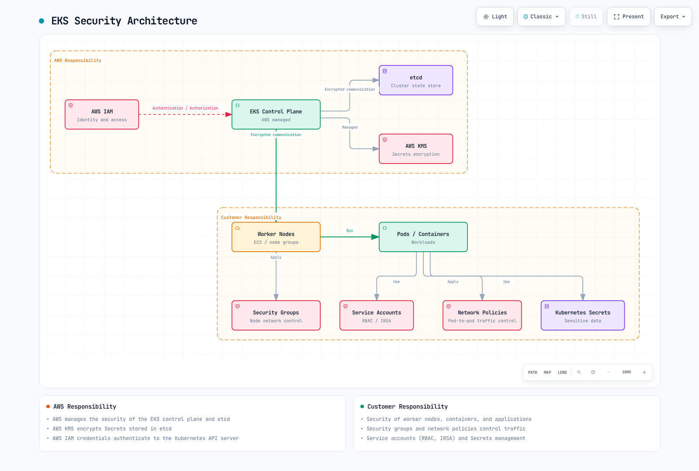
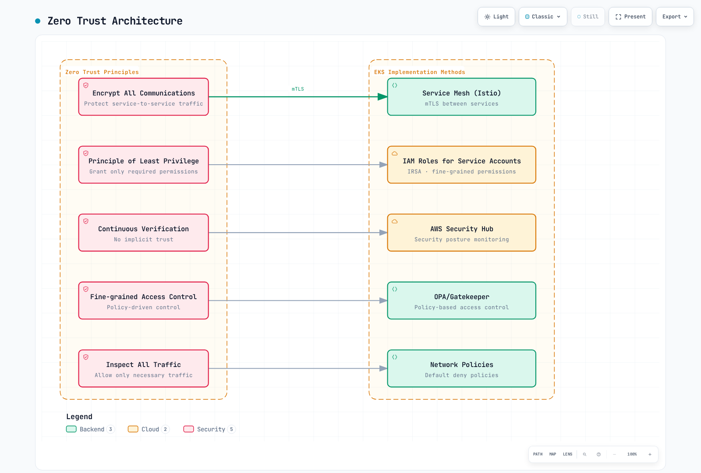
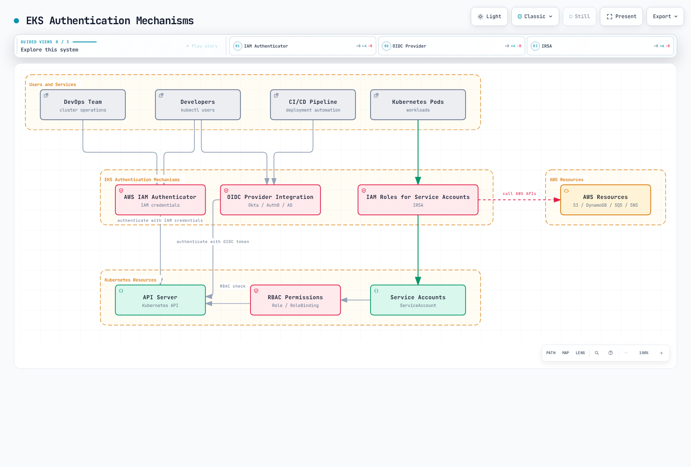
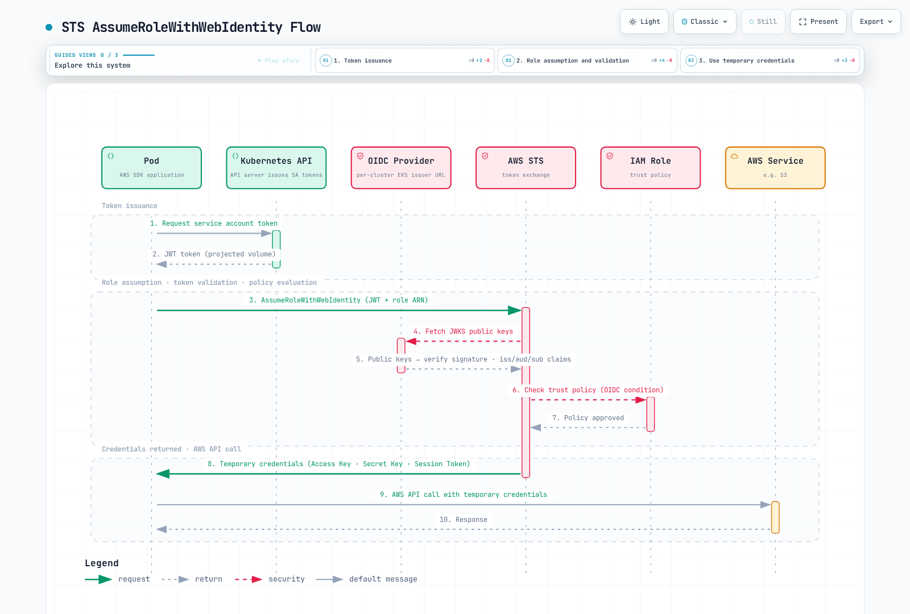
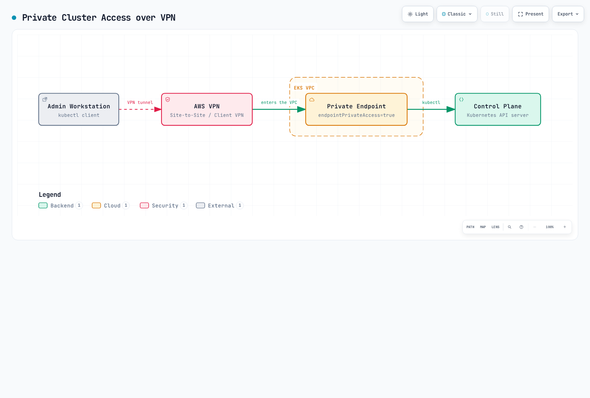
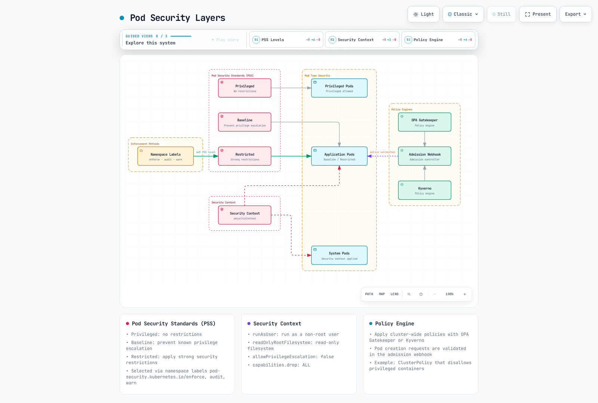
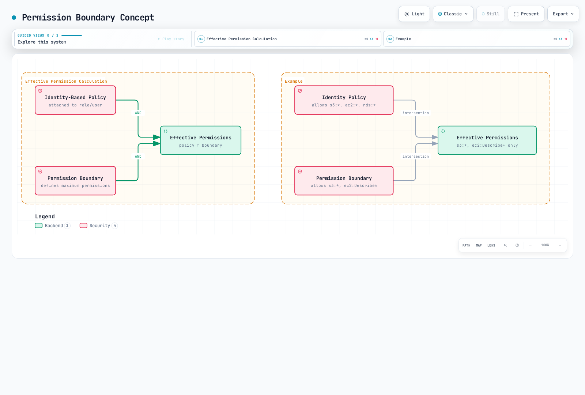
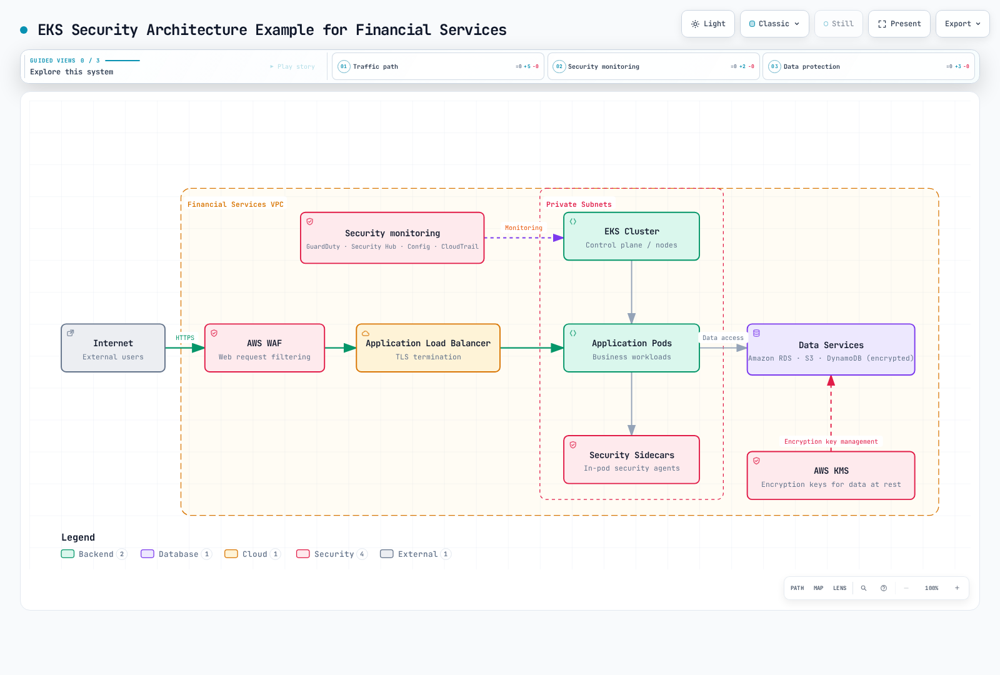

# Amazon EKS 安全

> **支持的版本**：EKS 标准支持 1.34–1.37；扩展支持 1.31–1.33（截至 2026 年 10 月 12 日检查）
> **最后更新**：2026 年 10 月 16 日

要在 Amazon EKS（Elastic Kubernetes Service）上安全地运行工作负载，需要了解并实施各种安全层和最佳实践。本文档介绍加强 EKS 集群安全性的关键概念、组件和最佳实践。

## 目录

1. [EKS 安全概述](#eks-security-overview)
2. [安全实践](#security-practices)
3. [IAM 与身份验证](#iam-and-authentication)
4. [深入了解 OIDC 提供程序](#oidc-provider-deep-dive)
5. [EKS Pod Identity](#eks-pod-identity)
6. [集群端点访问控制](#cluster-endpoint-access-control)
7. [网络安全](#network-security)
8. [Pod 安全](#pod-security)
9. [Bottlerocket 与只读操作系统](#bottlerocket-and-read-only-os)
10. [IAM 权限边界](#iam-permission-boundaries)
11. [加密与密钥管理](#encryption-and-secrets-management)
12. [合规与审计](#compliance-and-auditing)
13. [安全监控与检测](#security-monitoring-and-detection)
14. [EKS 安全最佳实践](#eks-security-best-practices)
15. [金融服务的 EKS 安全注意事项](#eks-security-considerations-for-financial-services)

## EKS 安全概述 {#eks-security-overview}

将基础设施、集群访问和工作负载控制分开管理。AWS 管理控制平面；节点/操作系统的责任取决于采用 EC2 自管理或托管节点、Fargate、Auto Mode 还是 Hybrid Nodes。客户仍负责应用镜像、身份、数据处理和工作负载策略。标准 EC2 节点示意图并不意味着客户需要为 Auto Mode/Fargate 主机操作系统打补丁。



[🔍 查看交互式图表](https://www.atomai.click/kubernetes-docs/archmaps/en-eks-05-eks-security-0.html)

## 安全实践 {#security-practices}

使用范围明确的多种控制；没有任何单一工具可以建立零信任或证明工作负载安全。验证调用方/工作负载身份，授权预期操作，限制网络路径，并收集符合威胁模型要求的证据。

<!-- Diagram repair pending: network policies filter traffic; posture findings are not continuous request authentication or complete zero-trust enforcement.


[🔍 View interactive diagram](https://www.atomai.click/kubernetes-docs/archmaps/en-eks-05-eks-security-1.html)
-->

### 身份与网络控制

IRSA 和 Pod Identity 提供工作负载的 AWS 凭证；NetworkPolicy 提供受支持的网络过滤；准入引擎会检查已配置的 Kubernetes 请求。兼容且持续维护的服务网格可以增加 mTLS 和应用流量策略。AWS App Mesh 将于 2026 年 9 月 30 日结束支持，因此现有部署需要制定迁移计划，而不是将其作为新的默认建议。

### 供应链安全

使用经过审查的构建/来源证明流程（例如 SLSA），使用 SBOM 清点组件，扫描相关漏洞，并根据预期签名者身份验证构件签名。Syft 是 SBOM 工具；Grype 是漏洞扫描器。ECR/Inspector 和其他扫描器各有特定的覆盖范围和更新要求。镜像经过签名或扫描，并不能证明其代码无害。还要保护构建身份、存储库和准入配置。

当前 ECR 支持通过 AWS Signer 进行托管镜像签名，也支持通过 Notation 手动签名。签名和准入验证是两个独立步骤；存储库筛选器、签名配置文件权限和验证器信任必须与预期流水线相匹配。

### 运行时检测与策略即代码

GuardDuty EKS Protection 会分析独立的 EKS 审计日志流。Runtime Monitoring 是单独的基于代理的功能；当前支持 EKS on EC2 和 Auto Mode，但有平台/代理要求，且不支持 EKS Fargate 和 Hybrid Nodes。CloudWatch 审计日志传输需要单独配置。Security Hub CSPM 会评估已配置的控制；Security Hub 可以关联调查结果。这些功能均不能替代应用授权，也不能代替对所有法规要求进行评估。

使用受支持的运行时工具和策略引擎，例如 Falco、Gatekeeper 或 Kyverno，并满足所需的内核、控制器、API 和元数据集成要求。gVisor/Kata 等额外沙箱运行时需要兼容的节点/运行时设计，并非适用于每种 EKS 计算路径。策略、镜像或操作系统强化可以降低特定风险，但不能保证所有逃逸或恶意操作都不可能发生。

策略即代码工具也处于不同阶段：Gatekeeper/Kyverno 可以评估 Kubernetes 准入，CloudFormation Guard 或 Sentinel 可以评估基础设施变更，AWS Config 可以评估受支持的已部署资源配置。Detective 等调查工具依赖其已配置的数据源。应区分这些职责与运行时预防。

## IAM 与身份验证 {#iam-and-authentication}

| 身份/控制 | 用途 |
|---|---|
| 人员/自动化 IAM 主体 | 通过配置的 IAM 映射/访问条目路径验证集群访问 |
| Kubernetes RBAC 和 EKS 访问策略 | 授权 Kubernetes 操作；允许权限会累加 |
| 外部 OIDC 身份提供程序 | 为 Kubernetes API 用户登录单独配置，并设置客户端/声明 |
| EKS 集群 IAM 角色 | 允许 EKS 服务为集群调用 AWS API |
| EC2 节点 IAM 角色 | 支持引导过程以及节点代理所需的 AWS 操作 |
| IRSA 或 EKS Pod Identity 角色 | 为应用提供临时 AWS 凭证 |
| Kubernetes ServiceAccount 令牌 | 根据其 RBAC 权限，对 Kubernetes API 进行 Pod 身份验证 |

用于 IRSA 的 IAM OIDC 提供程序，与用于 Kubernetes 用户登录的关联外部 OIDC 提供程序是不同的。应用的 AWS 权限不会自动授予 Kubernetes API 权限。

<!-- Diagram repair pending: IRSA/Pod Identity give workload AWS credentials; the ordinary Pod-to-Kubernetes API path uses its Kubernetes ServiceAccount token/RBAC.


[🔍 View interactive diagram](https://www.atomai.click/kubernetes-docs/archmaps/en-eks-05-eks-security-2.html)
-->

### 集群角色与预置调用方

标准 EKS 集群角色信任 EKS 服务。这是其信任关系，不是人类开发者的权限策略：

```json
{
  "Version": "2012-10-17",
  "Statement": [
    {
      "Effect": "Allow",
      "Principal": {
        "Service": "eks.amazonaws.com"
      },
      "Action": "sts:AssumeRole"
    }
  ]
}
```

该角色需要 AmazonEKSClusterPolicy 或受支持的自定义策略，才能执行其服务操作。Auto Mode 还有额外的角色/策略要求。预置调用方需要单独获得所选配置要求的操作权限，并且需要有权传递预期角色。当前授权参考中，CreateCluster 不支持按资源 ARN 进行范围限制，因此应在此处使用受支持的请求条件；对于支持资源 ARN 的操作/PassRole，应按范围限制。向开发者角色附加 AmazonEKSClusterPolicy 并不会授予 Kubernetes 应用访问权限。

### 访问条目与命名空间授权

优先使用受支持的访问条目 API 管理 IAM 集群访问。检查当前模式，并在迁移前保留现有管理员/节点映射。从 CONFIG_MAP 转为 API_AND_CONFIG_MAP/API 并非可以随意反向切换。不要用省略节点角色的简短示例覆盖 aws-auth。选择仅 API 模式前，请检查所有身份、策略、节点和恢复路径。

```bash
set -euo pipefail
: "${CLUSTER_NAME:?Set the existing cluster name}"
: "${AWS_REGION:?Set its Region}"
aws eks describe-cluster --name "$CLUSTER_NAME" --region "$AWS_REGION" \
  --query 'cluster.{Name:name,Status:status,Endpoint:endpoint,Access:accessConfig}' --output json
```

以下示例假设已准备好并获批的 IAM 开发者角色、已支持访问条目的集群，以及平台操作员权限。请由其所有者准备专用命名空间。其 Pod Security Admission 版本与经过审查的 EKS 1.36 示例一致；应为目标集群选择适当版本：

```yaml
apiVersion: v1
kind: Namespace
metadata:
  name: security-demo
  labels:
    pod-security.kubernetes.io/enforce: restricted
    pod-security.kubernetes.io/enforce-version: v1.36
```


```bash
set -euo pipefail
: "${CLUSTER_NAME:?Set the verified cluster name}"
: "${AWS_REGION:?Set its Region}"
: "${DEVELOPER_ROLE_ARN:?Set a prepared IAM role ARN, not an STS session ARN}"
MODE=$(aws eks describe-cluster --name "$CLUSTER_NAME" --region "$AWS_REGION" \
  --query cluster.accessConfig.authenticationMode --output text)
case "$MODE" in
  API|API_AND_CONFIG_MAP) ;;
  *) echo "Access entries are not enabled; review the migration first"; exit 1 ;;
esac
aws eks list-access-entries --cluster-name "$CLUSTER_NAME" --region "$AWS_REGION" \
  --output json > security-access-entries.json
python3 - "$DEVELOPER_ROLE_ARN" <<'PY'
import json, sys
with open("security-access-entries.json") as stream:
    existing = json.load(stream)["accessEntries"]
if sys.argv[1] in existing:
    raise SystemExit("Entry already exists; inspect its groups/policies instead of overwriting")
PY
aws eks create-access-entry --cluster-name "$CLUSTER_NAME" --region "$AWS_REGION" \
  --principal-arn "$DEVELOPER_ROLE_ARN" --type STANDARD \
  --kubernetes-groups security-demo-developers
```


```yaml
apiVersion: rbac.authorization.k8s.io/v1
kind: Role
metadata:
  name: developer
  namespace: security-demo
rules:
- apiGroups:
  - ''
  resources:
  - pods
  verbs:
  - get
  - list
  - watch
- apiGroups:
  - apps
  resources:
  - deployments
  verbs:
  - get
  - list
  - watch
  - create
  - update
  - patch
- apiGroups:
  - batch
  resources:
  - jobs
  verbs:
  - get
  - list
  - watch
  - create
  - update
  - patch
---
apiVersion: rbac.authorization.k8s.io/v1
kind: RoleBinding
metadata:
  name: developer
  namespace: security-demo
subjects:
- kind: Group
  name: security-demo-developers
  apiGroup: rbac.authorization.k8s.io
roleRef:
  kind: Role
  name: developer
  apiGroup: rbac.authorization.k8s.io
```

该条目将 IAM 主体映射到一个组，而 RoleBinding 会授予该组所示的命名空间权限。仅有组名并不能建立命名空间边界。创建工作负载控制器的权限可能会创建使用该命名空间中 ServiceAccount、Secret 和 PVC 的 Pod。应分隔不同租户，并通过适当的准入和所有权控制限制工作负载/ServiceAccount 的使用。

对于单独审查的查看者条目，EKS 访问策略可以替代自定义 RBAC。在添加此命名空间查看授权前，请检查该条目的当前组和关联策略：

```bash
set -euo pipefail
: "${CLUSTER_NAME:?Set the verified cluster name}"
: "${AWS_REGION:?Set its Region}"
: "${VIEWER_ROLE_ARN:?Set the IAM principal of a prepared, reviewed access entry}"
aws eks list-associated-access-policies --cluster-name "$CLUSTER_NAME" --region "$AWS_REGION" \
  --principal-arn "$VIEWER_ROLE_ARN"
aws eks associate-access-policy --cluster-name "$CLUSTER_NAME" --region "$AWS_REGION" \
  --principal-arn "$VIEWER_ROLE_ARN" \
  --policy-arn arn:aws:eks::aws:cluster-access-policy/AmazonEKSViewPolicy \
  --access-scope type=namespace,namespaces=security-demo
```

添加 View 不会撤销更广泛的 RBAC/访问策略授权。更新可能需要一段时间才能传播。请使用实际预期的 IAM 登录方式进行测试；kubectl --as 测试的是 Kubernetes 模拟/RBAC，而不能证明 IAM 访问策略路径有效。kubeconfig 会告知客户端集群和凭证机制；它本身不授予任何权限。

IAM eks:DescribeCluster/ListClusters 支持 AWS 管理/发现操作。eks:AccessKubernetesApi 是控制台查看权限。eks:namespaces 条件用于筛选访问策略关联请求；它不是对 kubectl API 调用的一般命名空间筛选条件。

## 深入了解 OIDC 提供程序 {#oidc-provider-deep-dive}

EKS 会发布集群 OIDC issuer 和公钥签名密钥。该端点本身不会创建 IAM OIDC 提供程序，也不会授权角色承担。对于 IRSA，角色所在账户必须具有预期的 IAM OIDC 提供程序；角色必须使用正确的 issuer/subject/audience 条件信任该提供程序；工作负载必须使用兼容的 SDK。



[🔍 查看交互式图表](https://www.atomai.click/kubernetes-docs/archmaps/en-eks-05-eks-security-3.html)

### IRSA 令牌与角色交换

IRSA webhook 会为符合条件的 Pod 添加投影令牌/角色配置。SDK 使用 AssumeRoleWithWebIdentity 通过 STS 交换 web identity 令牌。STS 会验证 issuer/签名/令牌和角色信任，然后返回临时 AWS 凭证。应用使用这些凭证执行获准的 AWS 操作。Kubernetes 会轮换投影令牌；SDK 会刷新 AWS 凭证。这两者的有效期不同。

以下是一个示意性的**解码后载荷结构**，其中故意使用较早/已过期的时间戳和占位身份。它不是已签名令牌，也不是身份验证测试。STS audience 用于 IRSA 路径；Pod Identity 使用不同的 audience：

```json
{
  "aud": [
    "sts.amazonaws.com"
  ],
  "exp": 1234567890,
  "iat": 1234567800,
  "iss": "https://oidc.eks.us-west-2.amazonaws.com/id/REPLACE_WITH_CLUSTER_ISSUER_ID",
  "kubernetes.io": {
    "namespace": "security-demo",
    "pod": {
      "name": "irsa-read-check-example",
      "uid": "example-pod-uid"
    },
    "serviceaccount": {
      "name": "irsa-reader",
      "uid": "example-serviceaccount-uid"
    }
  },
  "sub": "system:serviceaccount:security-demo:irsa-reader"
}
```

应验证 issuer、audience、过期时间和预期 subject，而不只是检查 JSON 是否可解码。不要在示例/日志中泄露原始令牌、AWS 秘密访问密钥和会话令牌。一个角色可以信任多个明确允许的 ServiceAccount 或 issuer；IRSA 并不要求每个 ServiceAccount 恰好对应一个角色。

### 发现和检查 JWKS

使用从实际集群返回的 issuer。此诊断会获取公开的发现/JWKS 文档，并检查发现文档中的 issuer/HTTPS scheme。它不会验证工作负载令牌或 IAM 权限：

```bash
set -euo pipefail
: "${CLUSTER_NAME:?Set the verified cluster}"
: "${AWS_REGION:?Set its Region}"
OIDC_URL=$(aws eks describe-cluster --name "$CLUSTER_NAME" --region "$AWS_REGION" \
  --query cluster.identity.oidc.issuer --output text)
case "$OIDC_URL" in https://*) ;; *) echo "Unexpected issuer URL"; exit 1 ;; esac
curl --fail --silent --show-error --proto '=https' --connect-timeout 5 --max-time 20 \
  "${OIDC_URL%/}/.well-known/openid-configuration" > oidc-discovery.json
JWKS_URI=$(python3 - "$OIDC_URL" <<'PY'
import json, sys, urllib.parse
with open("oidc-discovery.json") as stream:
    doc = json.load(stream)
if doc["issuer"] != sys.argv[1]:
    raise SystemExit("Discovery issuer does not match the cluster issuer")
uri = doc["jwks_uri"]
parsed = urllib.parse.urlparse(uri)
if parsed.scheme != "https" or not parsed.hostname or parsed.username or parsed.password:
    raise SystemExit("JWKS must be an HTTPS URL without embedded credentials")
print(uri)
PY
)
curl --fail --silent --show-error --proto '=https' --connect-timeout 5 --max-time 20 \
  "$JWKS_URI" > oidc-jwks.json
python3 - <<'PY'
import json
with open("oidc-jwks.json") as stream:
    keys = json.load(stream).get("keys")
if not isinstance(keys, list) or not keys or not all(isinstance(k, dict) and "kty" in k for k in keys):
    raise SystemExit("Unexpected JWKS response")
print("Fetched", len(keys), "public keys; no token signature was validated")
PY
```

自动化验证器必须根据 Cache-Control 缓存密钥，并使用经过审查的 JWT 库处理签名密钥轮换/未知 kid。EKS 每七天轮换一次 OIDC 签名密钥。当前 EKS 还支持用于集群 OIDC 发现/JWKS 的 PrivateLink 接口端点 `com.amazonaws.region-code.oidc-eks`，供无法访问互联网出口的验证器使用。请确认该端点的区域/DNS 要求；EKS 管理 API 端点是另一项服务。

### 范围受限的 IRSA 示例

请由相应所有者准备 IAM OIDC 提供程序、角色和存储桶。统一替换账户、完整 issuer 主机名/路径和角色 ARN；IPv6 集群可以使用双栈 issuer 主机名。此示例只绑定 security-demo/irsa-reader 和 STS audience；它是一个新角色信任示例，不用于替换现有角色的其他信任语句：

```json
{
  "Version": "2012-10-17",
  "Statement": [
    {
      "Effect": "Allow",
      "Principal": {
        "Federated": "arn:aws:iam::111122223333:oidc-provider/oidc.eks.us-west-2.amazonaws.com/id/REPLACE_WITH_CLUSTER_ISSUER_ID"
      },
      "Action": "sts:AssumeRoleWithWebIdentity",
      "Condition": {
        "StringEquals": {
          "oidc.eks.us-west-2.amazonaws.com/id/REPLACE_WITH_CLUSTER_ISSUER_ID:sub": "system:serviceaccount:security-demo:irsa-reader",
          "oidc.eks.us-west-2.amazonaws.com/id/REPLACE_WITH_CLUSTER_ISSUER_ID:aud": "sts.amazonaws.com"
        }
      }
    }
  ]
}
```

读取策略允许访问特定存储桶前缀。如果对象使用客户管理的加密密钥，则只添加必需的 KMS 权限，并审查存储桶/端点策略。此单前缀示例不需要账户范围的 AmazonS3ReadOnlyAccess 策略：

```json
{
  "Version": "2012-10-17",
  "Statement": [
    {
      "Effect": "Allow",
      "Action": [
        "s3:ListBucket"
      ],
      "Resource": "arn:aws:s3:::replace-with-owned-security-bucket",
      "Condition": {
        "StringLike": {
          "s3:prefix": [
            "security-demo/",
            "security-demo/*"
          ]
        }
      }
    },
    {
      "Effect": "Allow",
      "Action": [
        "s3:GetObject"
      ],
      "Resource": "arn:aws:s3:::replace-with-owned-security-bucket/security-demo/*"
    }
  ]
}
```

准备好 security-demo 命名空间和角色后，创建下面的 ServiceAccount 和范围受限的 listing Job。官方 AWS CLI 镜像包含客户端；任意 amazonlinux:2 镜像并不保证包含它。请替换存储桶/Region/角色值。此 Job 会列出前缀，但不会打印秘密值；此操作成功并不能证明应用的所有 GetObject/KMS 权限均有效。

```yaml
apiVersion: v1
kind: ServiceAccount
metadata:
  name: irsa-reader
  namespace: security-demo
  annotations:
    eks.amazonaws.com/role-arn: arn:aws:iam::111122223333:role/SecurityDemoIRSAReader
---
apiVersion: batch/v1
kind: Job
metadata:
  name: irsa-read-check
  namespace: security-demo
spec:
  backoffLimit: 0
  activeDeadlineSeconds: 120
  template:
    spec:
      serviceAccountName: irsa-reader
      restartPolicy: Never
      securityContext:
        runAsNonRoot: true
        runAsUser: 1000
        runAsGroup: 1000
        fsGroup: 1000
        seccompProfile:
          type: RuntimeDefault
      containers:
      - name: reader
        image: public.ecr.aws/aws-cli/aws-cli:2.36.43
        command:
        - aws
        args:
        - s3api
        - list-objects-v2
        - --bucket
        - replace-with-owned-security-bucket
        - --prefix
        - security-demo/
        - --max-items
        - '5'
        env:
        - name: AWS_REGION
          value: us-west-2
        - name: AWS_EC2_METADATA_DISABLED
          value: 'true'
        securityContext:
          allowPrivilegeEscalation: false
          readOnlyRootFilesystem: true
          capabilities:
            drop:
            - ALL
        resources:
          requests:
            cpu: 100m
            memory: 128Mi
          limits:
            cpu: 500m
            memory: 256Mi
        volumeMounts:
        - name: private-home
          mountPath: /root
        - name: tmp
          mountPath: /tmp
      volumes:
      - name: private-home
        emptyDir: {}
      - name: tmp
        emptyDir: {}
      nodeSelector:
        kubernetes.io/os: linux
```

## EKS Pod Identity

EKS Pod Identity 通过 SDK 的容器凭证提供程序和 EKS Auth 提供临时 AWS 凭证。Pod Identity 关联是集群/命名空间/ServiceAccount 到 IAM 角色的映射；它既不会创建 ServiceAccount，也不会授予 Kubernetes RBAC 权限。

### 与 IRSA 的比较

| 属性 | IRSA | EKS Pod Identity |
|---|---|---|
| 信任 | IAM OIDC 提供程序和 issuer/subject/audience 信任 | pods.eks.amazonaws.com 角色信任和关联 |
| 角色复用 | 在 IAM 策略限制范围内，可以允许多个 subject/issuer | 在具备适当关联/信任条件时可以复用 |
| 内置 Kubernetes 会话标签 | 标准 EKS IRSA 路径不会自动提供 | 默认启用；可以有意禁用 |
| 凭证提供程序 | 使用 STS 交换 web identity | 由 EKS Auth 支持的容器凭证端点 |
| 跨账户 | 在角色所在账户直接使用 OIDC 信任，或通过角色链式承担 | 同账户关联角色，可选链式承担目标角色 |
| 刷新 | Kubernetes 轮换令牌；SDK 刷新 AWS 凭证 | Kubernetes 轮换投影令牌；代理/服务缓存和 SDK 负责处理 AWS 凭证 |

会话标签用于标记承担的角色会话；它们不会自动标记应用创建的每个 AWS 资源。配置更简单并不意味着可以省略 IAM、网络、SDK 或应用验证要求。

### 代理和凭证流程

<!-- Diagram repair pending: SDK calls container credential endpoint; agent calls EKS Auth AssumeRoleForPodIdentity, not STS directly or arbitrary request interception.


[🔍 View interactive diagram](https://www.atomai.click/kubernetes-docs/archmaps/en-eks-05-eks-security-4.html)
-->

对于已建立关联的新建 Pod，EKS 会注入 audience 为 pods.eks.amazonaws.com 的令牌、令牌文件环境变量和容器凭证 URI。SDK 会调用代理端点（通常为 169.254.170.23/v1/credentials）。代理会调用 **EKS Auth 上的 AssumeRoleForPodIdentity**，并向 SDK 提供返回的凭证。它不会透明地拦截所有应用请求；应用仍会使用其凭证直接调用 AWS 服务。

标准受支持的 EC2 节点使用 Pod Identity Agent 附加组件/DaemonSet。Auto Mode 将此功能作为托管节点的一部分提供。Hybrid Nodes 在满足文档所述的操作系统、代理和节点凭证配置要求时支持此功能；不要不加区分地复用标准 EC2 代理配置。EKS Fargate 不支持此 Pod Identity 代理路径。请确认实际计算环境是否受支持，以及节点是否具有 EKS Auth 权限/网络访问。

### 已准备的角色与关联

对于标准托管代理安装，请通过所有者检查实际集群版本和兼容的附加组件目录。不要硬编码旧版 v1.0.0 构建，也不要在 Auto Mode/其他所有者管理的环境中重复安装代理：

```bash
set -euo pipefail
: "${CLUSTER_NAME:?Set the existing cluster}"
: "${AWS_REGION:?Set its Region}"
EKS_VERSION=$(aws eks describe-cluster --name "$CLUSTER_NAME" --region "$AWS_REGION" \
  --query cluster.version --output text)
aws eks describe-addon-versions --addon-name eks-pod-identity-agent \
  --kubernetes-version "$EKS_VERSION" --region "$AWS_REGION" --output json
```

准备一个同账户 IAM 角色，并配置前文范围受限的 S3 读取策略及以下信任关系。请同时替换账户/集群值。此示例依赖默认会话标签；若禁用标签，需要审查这些条件。调用方需要适当的关联权限，以及针对预期角色的 iam:PassRole 权限：

```json
{
  "Version": "2012-10-17",
  "Statement": [
    {
      "Effect": "Allow",
      "Principal": {
        "Service": "pods.eks.amazonaws.com"
      },
      "Action": [
        "sts:AssumeRole",
        "sts:TagSession"
      ],
      "Condition": {
        "StringEquals": {
          "aws:RequestTag/eks-cluster-arn": "arn:aws:eks:us-west-2:111122223333:cluster/my-cluster",
          "aws:RequestTag/kubernetes-namespace": "security-demo",
          "aws:RequestTag/kubernetes-service-account": "podid-reader"
        }
      }
    }
  ]
}
```

以下创建新关联的示例会拒绝覆盖现有关联。它不会创建 IAM 角色、安装代理或创建 Kubernetes 账户：

```bash
set -euo pipefail
: "${CLUSTER_NAME:?Set the verified cluster}"
: "${AWS_REGION:?Set its Region}"
: "${POD_ID_ROLE_ARN:?Set the prepared same-account role matching the trust example}"
aws eks list-pod-identity-associations --cluster-name "$CLUSTER_NAME" --region "$AWS_REGION" \
  --namespace security-demo --service-account podid-reader --output json > podid-associations-before.json
python3 - <<'PY'
import json
with open("podid-associations-before.json") as stream:
    existing = json.load(stream)["associations"]
if existing:
    raise SystemExit("Association exists; review its owner/configuration before changing it")
PY
aws eks create-pod-identity-association --cluster-name "$CLUSTER_NAME" --region "$AWS_REGION" \
  --namespace security-demo --service-account podid-reader --role-arn "$POD_ID_ROLE_ARN"
```

关联传播后，创建 ServiceAccount 和新的范围受限测试 Job。IAM 角色信任、命名空间、账户名和存储桶前缀必须相匹配。在关联建立前创建的 Pod 可能需要重新创建，才能接收注入的配置。检查实际选用的提供程序和代表性权限；不要打印凭证/令牌文件。

```yaml
apiVersion: v1
kind: ServiceAccount
metadata:
  name: podid-reader
  namespace: security-demo
---
apiVersion: batch/v1
kind: Job
metadata:
  name: podid-read-check
  namespace: security-demo
spec:
  backoffLimit: 0
  activeDeadlineSeconds: 120
  template:
    spec:
      serviceAccountName: podid-reader
      restartPolicy: Never
      securityContext:
        runAsNonRoot: true
        runAsUser: 1000
        runAsGroup: 1000
        fsGroup: 1000
        seccompProfile:
          type: RuntimeDefault
      containers:
      - name: reader
        image: public.ecr.aws/aws-cli/aws-cli:2.36.43
        command:
        - aws
        args:
        - s3api
        - list-objects-v2
        - --bucket
        - replace-with-owned-security-bucket
        - --prefix
        - security-demo/
        - --max-items
        - '5'
        env:
        - name: AWS_REGION
          value: us-west-2
        - name: AWS_EC2_METADATA_DISABLED
          value: 'true'
        securityContext:
          allowPrivilegeEscalation: false
          readOnlyRootFilesystem: true
          capabilities:
            drop:
            - ALL
        resources:
          requests:
            cpu: 100m
            memory: 128Mi
          limits:
            cpu: 500m
            memory: 256Mi
        volumeMounts:
        - name: private-home
          mountPath: /root
        - name: tmp
          mountPath: /tmp
      volumes:
      - name: private-home
        emptyDir: {}
      - name: tmp
        emptyDir: {}
      nodeSelector:
        kubernetes.io/os: linux
```


[🔍 查看交互式图表](https://www.atomai.click/kubernetes-docs/archmaps/en-eks-05-eks-security-5.html)

### 跨账户与缓存注意事项

关联角色必须位于 EKS 集群所在账户。可选的目标 IAM 角色可以位于其他账户；Pod Identity 会从同账户角色链式承担该目标角色，并且需要配置双方的信任和承担角色权限。这并不意味着可以直接将任意外部角色附加为关联角色。

当前目标角色指南说明：不使用目标角色时，缓存凭证有效期为 6 小时；使用目标角色时为 59 分钟。更改关联不会重置该缓存；重新创建 Pod 可以更快获得新配置。请在应用中检查实际刷新/撤销行为。较新的关联会话策略选项要求禁用会话标签；配置目标角色时，该选项会限制目标角色。不要未经审查就将其与要求这些标签的信任条件组合使用。

### 从 IRSA 迁移到 Pod Identity 的流程

准备迁移前，应保留现有 IRSA 信任和 ServiceAccount 配置。如果将角色信任替换为仅包含 Pod Identity 服务主体的配置，可能会在现有使用方刷新凭证时导致故障。以下命令仅记录配置：

```bash
set -euo pipefail
: "${IRSA_ROLE_NAME:?Set the existing role whose trust must be preserved}"
: "${WORKLOAD_NAMESPACE:?Set the workload namespace}"
: "${SERVICE_ACCOUNT:?Set the existing application ServiceAccount}"
aws iam get-role --role-name "$IRSA_ROLE_NAME" \
  --query Role.AssumeRolePolicyDocument --output json > irsa-trust-before.json
kubectl -n "$WORKLOAD_NAMESPACE" get serviceaccount "$SERVICE_ACCOUNT" \
  -o yaml > irsa-serviceaccount-before.yaml
```

1. 验证实际计算环境是否受支持、SDK/容器凭证提供程序是否兼容、Pod Identity 代理或内置功能是否可用，以及 IAM 角色权限是否已准备妥当。
2. 通过其所有者，将经过审查的 Pod Identity 信任语句合并到现有信任策略；在所有使用方完成迁移之前，保留 IRSA issuer、subject 和 audience 条件以及其他有效语句。
3. 创建范围受限的关联，并使用单独的 ServiceAccount 创建 Canary，该账户仅使用预期的 Pod Identity 凭证路径。完成此验证前，不要移除生产 IRSA 注解或重启生产 Deployment。
4. 验证实际使用的凭证提供程序和预期 AWS 访问权限，不要打印令牌或秘密值。创建关联后，SDK 凭证链中更靠前的凭证仍可能继续使用。调用 get-caller-identity 成功且显示相同 IAM 角色，并不能区分 IRSA 和 Pod Identity。
5. 通过受控滚动更新迁移预期工作负载，根据需要重新创建 Pod 以获取注入的配置，并验证应用行为和凭证刷新。ServiceAccount 注解变更不会改写现有 Pod 环境变量。
6. 为工作负载配置保留经过测试的回退路径。只有在清点所有剩余使用方并验证迁移完成后，才移除旧 IRSA 信任。

这是一个需要在目标环境中验证的迁移流程，并不表示本次文档审查期间已实际执行迁移。

## 集群端点访问控制 {#cluster-endpoint-access-control}

端点配置决定网络可达性；API 操作仍受身份验证和授权控制。应根据运维需求选择访问路径，并检查实际设置，而不是假定工具默认值符合要求。

| 公有端点 | 私有端点 | 网络行为 |
|---|---|---|
| 启用 | 禁用 | 客户端和节点需要能够路由到公有地址；受限 CIDR 必须包含实际公有出口源地址 |
| 禁用 | 启用 | 访问需要 VPC/私有路由、DNS 和安全组规则，包括经批准的互连网络 |
| 启用 | 启用 | 来自集群 VPC 的请求使用私有路径；获准的外部客户端可以使用公有访问 |

公有寻址本身不能证明 EC2 到 EKS 的流量离开了 AWS 网络。私有访问不会自动授权调用方、配置 VPN/DNS 或提供恢复路径。EKS 至少需要一种访问模式。

### 检查并保留现有配置

请在同一个 shell 中依次运行相关代码块，并保留新建的审查目录。使用有权检查/恢复端点设置的 AWS 管理身份，并与 Kubernetes 登录身份分开。此操作只记录可变的端点访问字段以供恢复；不会尝试恢复无关的 VPC 设置或下文所述的单向出口模式。

```bash
set -euo pipefail
umask 077
: "${CLUSTER_NAME:?Set the existing cluster name}"
: "${AWS_REGION:?Set its Region}"
ENDPOINT_REVIEW_DIR=$(mktemp -d -t eks-endpoint-review.XXXXXX)
printf 'Review records: %s\n' "$ENDPOINT_REVIEW_DIR"
aws eks describe-cluster --name "$CLUSTER_NAME" --region "$AWS_REGION" \
  --query cluster --output json > "$ENDPOINT_REVIEW_DIR/cluster-before.json"
python3 - "$ENDPOINT_REVIEW_DIR" "$CLUSTER_NAME" <<'PY'
import json, pathlib, sys, urllib.parse
root = pathlib.Path(sys.argv[1])
cluster = json.loads((root / "cluster-before.json").read_text())
if cluster["name"] != sys.argv[2] or cluster["status"] != "ACTIVE":
    raise SystemExit("Unexpected cluster or cluster is not ACTIVE")
endpoint = urllib.parse.urlparse(cluster["endpoint"])
if endpoint.scheme != "https" or not endpoint.hostname or endpoint.username or endpoint.password:
    raise SystemExit("Unexpected Kubernetes endpoint")
(root / "endpoint-host.txt").write_text(endpoint.hostname + "\n")
config = cluster["resourcesVpcConfig"]
before = {k: config[k] for k in ["endpointPublicAccess", "endpointPrivateAccess", "publicAccessCidrs"] if k in config}
(root / "endpoint-before.json").write_text(json.dumps(before, indent=2) + "\n")
(root / "endpoint-private.json").write_text(json.dumps({"endpointPublicAccess": False, "endpointPrivateAccess": True}, indent=2) + "\n")
(root / "ssm-remote-host.json").write_text(json.dumps({"host": [endpoint.hostname], "portNumber": ["443"], "localPortNumber": ["6443"]}, indent=2) + "\n")
print(json.dumps(before, indent=2))
PY
```

### 限制公有地址访问路径

公有允许列表必须包含经批准的 NAT/VPN/办公室实际公有出口地址。诸如 10.0.0.0/8 这样的私有范围不能表示公有源地址。诸如 203.0.113.0/24 这样的文档示例范围只是占位符，并不是可用的办公网络。

将 PUBLIC_EGRESS_CIDRS 设置为网络负责人提供的 JSON 数组。此范围受限的示例接受 IPv4 CIDR，并拒绝明显的私有/默认/文档范围；它无法证明地址归属，也不能证明当前客户端包含在其中。请检查范围、配额和集群的 IP 系列支持情况。双栈/IPv6 设置需要经过单独验证的允许列表。

```bash
set -euo pipefail
: "${ENDPOINT_REVIEW_DIR:?Run the inspection step in this shell first}"
: "${PUBLIC_EGRESS_CIDRS:?Set a JSON array of approved actual public IPv4 egress CIDRs}"
python3 - "$ENDPOINT_REVIEW_DIR" "$PUBLIC_EGRESS_CIDRS" <<'PY'
import ipaddress, json, pathlib, sys
values = json.loads(sys.argv[2])
if not isinstance(values, list) or not values:
    raise SystemExit("Provide a nonempty reviewed CIDR list")
cidrs = []
for value in values:
    network = ipaddress.ip_network(value, strict=True)
    if network.version != 4 or network.prefixlen == 0 or not network.is_global or network.is_multicast or network.is_reserved:
        raise SystemExit("This IPv4 example requires actual public egress CIDRs, not private/default/documentation ranges")
    cidrs.append(str(network))
if len(cidrs) != len(set(cidrs)):
    raise SystemExit("Remove duplicate CIDRs")
desired = {"endpointPublicAccess": True, "endpointPrivateAccess": True, "publicAccessCidrs": cidrs}
path = pathlib.Path(sys.argv[1]) / "endpoint-public-restricted.json"
path.write_text(json.dumps(desired, indent=2) + "\n")
print(json.dumps(desired, indent=2))
PY
```

计划中的公有端点受限配置也会启用私有访问。如果不启用私有访问，必须继续允许节点/Fargate 的公有出口地址，否则节点到 API 的通信可能会失败。选择 ENDPOINT_CHANGE=public-restricted 前，请审查生成的 JSON。

### 私有连接路径



[🔍 查看交互式图表](https://www.atomai.click/kubernetes-docs/archmaps/en-eks-05-eks-security-6.html)


[🔍 查看交互式图表](https://www.atomai.click/kubernetes-docs/archmaps/en-eks-05-eks-security-7.html)

VPN、Direct Connect/TGW 和经批准的管理主机都可以作为访问路径，前提是已配置路由、DNS、安全组和授权。仅运行一条 Client VPN 创建命令，不会自动设置子网关联、授权规则、路由、证书和连接日志。运行 AWS CLI 镜像的 Deployment 不会创建受 SSM 管理的堡垒主机，也不会安装 kubectl/SSM Agent。

对于 SSM 远程主机端口转发，需要准备安装了 SSM Agent 3.1.1374.0 或更高版本的受管主机、Session Manager IAM/网络访问、本地 Session Manager 插件，以及到私有 EKS 端点的 DNS/路由。确认已启用私有端点访问，并确认主机实际能够解析/访问其私有路径。在第一个终端中保持转发会话运行：

```bash
set -euo pipefail
: "${AWS_REGION:?Set the cluster/managed-instance Region for this example}"
: "${MANAGED_INSTANCE_ID:?Set the prepared SSM-managed instance with a private route to EKS}"
: "${ENDPOINT_REVIEW_DIR:?Use the endpoint inspection directory}"
aws ssm start-session --region "$AWS_REGION" --target "$MANAGED_INSTANCE_ID" \
  --document-name AWS-StartPortForwardingSessionToRemoteHost \
  --parameters "file://$ENDPOINT_REVIEW_DIR/ssm-remote-host.json"
```

在第二个终端中使用同一集群的 kubeconfig，并保留其 CA 和预期的 IAM exec 身份验证。通过本地连接时保留真实 TLS 服务器名称。不要通过禁用证书验证来掩盖主机名不匹配：

```bash
set -euo pipefail
: "${ENDPOINT_REVIEW_DIR:?Set the same review directory in this second terminal}"
: "${CLUSTER_KUBECONFIG:?Set the kubeconfig for this same EKS cluster and intended IAM identity}"
EKS_ENDPOINT_HOST=$(cat "$ENDPOINT_REVIEW_DIR/endpoint-host.txt")
kubectl --kubeconfig "$CLUSTER_KUBECONFIG" \
  --server https://127.0.0.1:6443 --tls-server-name "$EKS_ENDPOINT_HOST" \
  --request-timeout=10s -n security-demo get pods
```

远程主机文档会转发到指定的 EKS 主机。较旧的 AWS-StartPortForwardingSession 文档会转发受管实例本身的端口；转发该实例的 443 端口并不会让该实例成为 EKS API Server。隧道/运行状况检查成功，并不能证明授权或私有路由有效。移除公有访问前，请验证预期 API 操作、DNS/私有地址和实际路由。

### 应用经过审查的端点变更

启用私有访问并验证预期的私有客户端路径后，在选择 ENDPOINT_CHANGE=private 前重新执行检查并保存快照。以下操作会拒绝针对其他集群/账户的变更、已更改的端点设置，或在启用私有访问前切换为仅私有访问。读取/检查并非原子事务；请与所有者协调变更。

```bash
set -euo pipefail
: "${CLUSTER_NAME:?Use the inspected cluster}"
: "${AWS_REGION:?Use its Region}"
: "${ENDPOINT_REVIEW_DIR:?Use the review directory}"
: "${ENDPOINT_CHANGE:?Choose public-restricted or private after validating the intended route}"
case "$ENDPOINT_CHANGE" in
  public-restricted|private) ;;
  *) echo "Unexpected endpoint change"; exit 1 ;;
esac
test -f "$ENDPOINT_REVIEW_DIR/endpoint-$ENDPOINT_CHANGE.json"
aws eks describe-cluster --name "$CLUSTER_NAME" --region "$AWS_REGION" \
  --query cluster --output json > "$ENDPOINT_REVIEW_DIR/cluster-current.json"
python3 - "$ENDPOINT_REVIEW_DIR" "$CLUSTER_NAME" "$ENDPOINT_CHANGE" <<'PY'
import json, pathlib, sys
root = pathlib.Path(sys.argv[1])
before = json.loads((root / "cluster-before.json").read_text())
current = json.loads((root / "cluster-current.json").read_text())
keys = ["endpointPublicAccess", "endpointPrivateAccess", "publicAccessCidrs"]
if current["name"] != sys.argv[2] or current["arn"] != before["arn"] or current["status"] != "ACTIVE":
    raise SystemExit("Cluster identity/state differs from the reviewed target")
if any(current["resourcesVpcConfig"].get(k) != before["resourcesVpcConfig"].get(k) for k in keys):
    raise SystemExit("Endpoint configuration changed; inspect and review again")
if sys.argv[3] == "private" and current["resourcesVpcConfig"].get("endpointPrivateAccess") is not True:
    raise SystemExit("Enable and verify private access before disabling public access")
PY
aws eks update-cluster-config --name "$CLUSTER_NAME" --region "$AWS_REGION" \
  --resources-vpc-config "file://$ENDPOINT_REVIEW_DIR/endpoint-$ENDPOINT_CHANGE.json" \
  --output json > "$ENDPOINT_REVIEW_DIR/update-response.json"
EKS_UPDATE_ID=$(python3 - "$ENDPOINT_REVIEW_DIR/update-response.json" <<'PY'
import json, sys
with open(sys.argv[1]) as stream:
    print(json.load(stream)["update"]["id"])
PY
)
UPDATE_DONE=false
for ((attempt=0; attempt<60; attempt++)); do
  STATE=$(aws eks describe-update --name "$CLUSTER_NAME" --region "$AWS_REGION" \
    --update-id "$EKS_UPDATE_ID" --query update.status --output text)
  case "$STATE" in
    Successful) UPDATE_DONE=true; break ;;
    InProgress) sleep 10 ;;
    *) echo "Update $EKS_UPDATE_ID status: $STATE; inspect before further changes"; exit 1 ;;
  esac
done
test "$UPDATE_DONE" = true || { echo "Update still pending; inspect $EKS_UPDATE_ID"; exit 1; }
aws eks describe-cluster --name "$CLUSTER_NAME" --region "$AWS_REGION" \
  --query cluster.resourcesVpcConfig --output json
```

应根据返回的更新 ID 和 Successful 状态，而不只是集群 ACTIVE 状态，来确认更新。发生超时意味着需要检查现有操作；不要盲目提交另一次变更。之后应重新检查实际 API 路径。保留之前的端点字段以及 AWS 管理恢复访问权限；本次审查未执行实际端点变更。

### 私有 AWS 服务依赖项

| 路径 | 相关端点/依赖项 |
|---|---|
| Kubernetes API | 集群端点私有访问及其路由/DNS/安全组 |
| AWS EKS 管理 API | 需要私有管理访问时使用 eks 接口端点 |
| Pod Identity 代理 | 节点无法使用公有出口时使用 eks-auth 接口端点 |
| OIDC 发现/JWKS 工具 | oidc-eks 接口端点；匿名公钥数据，仅使用默认端点策略 |
| IRSA 凭证交换 | 区域 STS 端点，与 OIDC 密钥检索分开 |
| ECR 镜像拉取 | ecr.api/ecr.dkr 接口端点，以及可正常工作的 S3 层下载路径 |
| 其他控制器/应用 | 仅包括实际依赖的 EC2、Logs、Secrets Manager、SSM 或其他服务 |

EKS 接口端点不是 Kubernetes API 端点。S3 网关端点使用路由表；接口端点使用子网/安全组/私有 DNS。不要在省略端点类型的情况下通过一个循环创建所有服务。OIDC PrivateLink 不会改变 STS 令牌验证，也不会授权 IRSA 角色。应根据创建章节准备完整且由相关所有者管理的网络/身份/计算配置；这里的端点摘录并非可直接用于生产环境的集群部署方案。

### 客户路由的控制平面出口（2026 年 6 月）

CUSTOMER_ROUTED 于 2026 年 6 月 18 日公布，是受支持的 EKS 控制平面出口模式。它使用子网中现有的跨账户集群网络接口，而不是创建单独的出口 ENI。它适用于面向客户的 API Server 调用，例如准入 webhook、OIDC 发现和聚合 API Server。

**此切换是单向的：启用 CUSTOMER_ROUTED 后，集群无法恢复为 AWS_MANAGED。** 不要将保存的配置或 Kubernetes 版本回滚描述为撤销此模式的方法。如果新路径发生故障，应修复路由/连接。

```bash
set -euo pipefail
: "${CLUSTER_NAME:?Set the existing cluster}"
: "${AWS_REGION:?Set its Region}"
aws eks describe-cluster --name "$CLUSTER_NAME" --region "$AWS_REGION" \
  --query 'cluster.{Status:status,Vpc:resourcesVpcConfig,IPFamily:kubernetesNetworkConfig.ipFamily}' --output json
```

切换前，请清点 webhook/OIDC/聚合 API 目标和端口。验证来自集群 ENI 子网的路由、出站 SG 规则、NACL 返回流量和 DNS。VPC DHCP 选项必须包含 AmazonProvidedDNS；Route53 私有区/Resolver 转发以及外部 DNS 解析必须能解析实际目标。根据目标情况，出口路径可以使用 NAT、防火墙或集中式路由。IPv6 集群需要采用文档所述的 IPv4 和 IPv6 路径；纯 IPv4 依赖项仍需要可用的 IPv4 路径。

完成审查后，以下为实际 API 选项。本次审计仅对其进行了离线语法检查，并未在 AWS 集群上执行：

```bash
set -euo pipefail
: "${CLUSTER_NAME:?Set the reviewed cluster}"
: "${AWS_REGION:?Set its Region}"
# One-way change: complete subnet route/SG/NACL/DNS and dependency checks first.
aws eks update-cluster-config --name "$CLUSTER_NAME" --region "$AWS_REGION" \
  --resources-vpc-config controlPlaneEgressMode=CUSTOMER_ROUTED --output json
```

记录返回的更新 ID，并检查 DescribeUpdate，直到状态为 Successful；仅有 ACTIVE 状态并不足够。随后测试实际配置的 webhook、用户 OIDC 和聚合 API 路径。不要声称本地 CLI 解析器测试可以证明 VPC 连接正常。

| 流量 | 此设置的影响 |
|---|---|
| 面向客户的 API Server 出站流量 | 使用配置的客户 VPC 路径 |
| 10250 上的 Kubelet API | 使用集群 ENI/节点路径；不经过外部出口设备 |
| etcd、CloudWatch Logs、EKS 内部流量 | 继续使用 EKS 管理的路径 |
| EKS Capabilities 控制器，例如托管 ArgoCD/ACK/KRO | 在独立的托管基础设施中运行；此功能不会重新路由这些流量 |
| 应用对 STS/EKS Auth/S3 的调用 | 遵循工作负载/节点网络；不受此 API Server 模式控制 |

此功能在 EKS 区域不收取额外功能费用，但 NAT/防火墙/PrivateLink/日志资源仍会产生相应费用。如果需要网络流量证据，必须配置 Flow Logs；它们不会自动公开加密载荷，也不能证明应用授权有效。

#### 请求范围的 SCP 示例

eks:controlPlaneEgressMode 键会评估 CreateCluster/UpdateClusterConfig 请求中指定的模式。没有存在性条件的 StringNotEquals 拒绝语句也会匹配省略该键的请求。以下示例要求新集群指定此模式，并在更新时拒绝明确指定不同模式的请求，同时允许省略该模式的无关更新请求：

```json
{
  "Version": "2012-10-17",
  "Statement": [
    {
      "Sid": "RequireCustomerRoutedForNewClusters",
      "Effect": "Deny",
      "Action": "eks:CreateCluster",
      "Resource": "*",
      "Condition": {
        "StringNotEquals": {
          "eks:controlPlaneEgressMode": "CUSTOMER_ROUTED"
        }
      }
    },
    {
      "Sid": "RejectExplicitOtherEgressMode",
      "Effect": "Deny",
      "Action": "eks:UpdateClusterConfig",
      "Resource": "*",
      "Condition": {
        "Null": {
          "eks:controlPlaneEgressMode": "false"
        },
        "StringNotEquals": {
          "eks:controlPlaneEgressMode": "CUSTOMER_ROUTED"
        }
      }
    }
  ]
}
```

这是一项有意设置的请求限制，并不会自动迁移现有集群。根据此示例，现有 AWS_MANAGED 集群仍可以执行无关更新。若组织要求不同的推出策略，则必须单独建模。SCP 不会授予 IAM 权限，也不会配置路由/DNS。部署前，应与组织负责人一起审查策略继承，并测试具有代表性的允许/拒绝请求。

## 网络安全 {#network-security}

安全组、路由、NetworkPolicy 和应用身份验证分别用于各自的安全层。此图展示的是传统网络布局；公有堡垒主机和私有 AWS 端点都是可选组件，必须经过实际配置，并非每个 EKS 集群固有的属性。


[🔍 查看交互式图表](https://www.atomai.click/kubernetes-docs/archmaps/en-eks-05-eks-security-8.html)

### 安全组与必需路径

对于 API/节点路径，允许所需的节点到 API TCP 443 流量和控制平面到 kubelet TCP 10250 流量。DNS、webhook 和工作负载可能还需要其他实际目标端口。并不存在必须将 TCP 1025–65535 作为“节点间通信”开放的通用要求。安全组是有状态的；NACL 及其返回路径规则则需单独配置。

检查实际 ENI/节点关联的安全组。自定义启动模板的 SG 配置不会自动继承 EKS 的所有默认规则。Pod 安全组和 Auto Mode NodeClass pod-security-group 选择器是机制各异、支持/行为也不同的功能；SG 并不局限于抽象的实例层。请检查所选计算/CNI 以及实际源接口。

### NetworkPolicy 语义

NetworkPolicy 需要有受支持且已配置的强制执行机制。仅创建 YAML 并不会过滤数据包。使用现有网络负责方支持的 EKS VPC CNI policy 功能，或有意选择的兼容网络堆栈。不要在现有集群上安装随时变动的 Calico 清单或不相关的 Cilium 配置。Auto Mode 会自行管理网络，不适合随意替换 CNI。

策略是累加的。对于被隔离的连接，源端出站和目标端入站都必须允许该连接。规则顺序不是拒绝/允许优先级系统。单独的 podSelector 仅选择策略所在命名空间中的对等 Pod；同一对等项中的 namespaceSelector 与 podSelector 是 AND 条件。不同的对等项则相当于 OR。

### 隔离策略练习

此示例使用新建的演示命名空间、采用强制执行 CNI 的 Linux EC2 网络，以及在 kube-system 中标记为 k8s-app=kube-dns 的传统 CoreDNS Deployment。示例假定已准备好带有 app=frontend/api/database 标签的 frontend/API/database Pod；API 在 8080 上侦听并在 9090 上提供演示指标，数据库在 5432 上侦听。这些策略不会部署这些应用。默认拒绝策略同时包含两个方向。DNS 和每个预期的源/目标流量都已明确配置。在清点所有依赖项之前，不要将这些假设直接用于现有生产命名空间：

```yaml
apiVersion: v1
kind: Namespace
metadata:
  name: security-network-demo
  labels:
    pod-security.kubernetes.io/enforce: restricted
    pod-security.kubernetes.io/enforce-version: v1.36
---
apiVersion: v1
kind: Namespace
metadata:
  name: security-monitoring-demo
---
apiVersion: networking.k8s.io/v1
kind: NetworkPolicy
metadata:
  name: default-deny
  namespace: security-network-demo
spec:
  podSelector: {}
  policyTypes:
  - Ingress
  - Egress
---
apiVersion: networking.k8s.io/v1
kind: NetworkPolicy
metadata:
  name: allow-dns
  namespace: security-network-demo
spec:
  podSelector: {}
  policyTypes:
  - Egress
  egress:
  - to:
    - namespaceSelector:
        matchLabels:
          kubernetes.io/metadata.name: kube-system
      podSelector:
        matchLabels:
          k8s-app: kube-dns
    ports:
    - protocol: UDP
      port: 53
    - protocol: TCP
      port: 53
---
apiVersion: networking.k8s.io/v1
kind: NetworkPolicy
metadata:
  name: frontend-to-api
  namespace: security-network-demo
spec:
  podSelector:
    matchLabels:
      app: frontend
  policyTypes:
  - Egress
  egress:
  - to:
    - podSelector:
        matchLabels:
          app: api
    ports:
    - protocol: TCP
      port: 8080
---
apiVersion: networking.k8s.io/v1
kind: NetworkPolicy
metadata:
  name: api-ingress
  namespace: security-network-demo
spec:
  podSelector:
    matchLabels:
      app: api
  policyTypes:
  - Ingress
  ingress:
  - from:
    - podSelector:
        matchLabels:
          app: frontend
    ports:
    - protocol: TCP
      port: 8080
---
apiVersion: networking.k8s.io/v1
kind: NetworkPolicy
metadata:
  name: api-to-database
  namespace: security-network-demo
spec:
  podSelector:
    matchLabels:
      app: api
  policyTypes:
  - Egress
  egress:
  - to:
    - podSelector:
        matchLabels:
          app: database
    ports:
    - protocol: TCP
      port: 5432
---
apiVersion: networking.k8s.io/v1
kind: NetworkPolicy
metadata:
  name: database-ingress
  namespace: security-network-demo
spec:
  podSelector:
    matchLabels:
      app: database
  policyTypes:
  - Ingress
  ingress:
  - from:
    - podSelector:
        matchLabels:
          app: api
    ports:
    - protocol: TCP
      port: 5432
---
apiVersion: networking.k8s.io/v1
kind: NetworkPolicy
metadata:
  name: monitor-api
  namespace: security-network-demo
spec:
  podSelector:
    matchLabels:
      app: api
  policyTypes:
  - Ingress
  ingress:
  - from:
    - namespaceSelector:
        matchLabels:
          kubernetes.io/metadata.name: security-monitoring-demo
      podSelector:
        matchLabels:
          app: prometheus
    ports:
    - protocol: TCP
      port: 9090
```

监控 Pod 也需要出站权限。此独立演示策略会允许其访问 API 指标和传统 DNS 路径；它并非完整的生产 Prometheus 网络策略：

```yaml
apiVersion: networking.k8s.io/v1
kind: NetworkPolicy
metadata:
  name: prometheus-to-demo-api
  namespace: security-monitoring-demo
spec:
  podSelector:
    matchLabels:
      app: prometheus
  policyTypes:
  - Egress
  egress:
  - to:
    - namespaceSelector:
        matchLabels:
          kubernetes.io/metadata.name: security-network-demo
      podSelector:
        matchLabels:
          app: api
    ports:
    - protocol: TCP
      port: 9090
  - to:
    - namespaceSelector:
        matchLabels:
          kubernetes.io/metadata.name: kube-system
      podSelector:
        matchLabels:
          k8s-app: kube-dns
    ports:
    - protocol: UDP
      port: 53
    - protocol: TCP
      port: 53
```

纯 Auto Mode 使用节点本地 CoreDNS，而不是传统 Deployment；NodeLocal DNS/自定义解析器路径也可能不同。调整 DNS 规则前，请检查实际解析路径。标签是选择器，而非加密工作负载身份；请控制谁可以创建/重新标记工作负载，并在需要时使用应用授权。

### 外部目标与验证局限

以下仅供文档示例使用的地址在进行连接练习前必须替换为经批准的真实目标。它仅用于说明单个 IP/端口权限，并非 AWS 服务/FQDN 允许列表：

```yaml
apiVersion: networking.k8s.io/v1
kind: NetworkPolicy
metadata:
  name: approved-https-example
  namespace: security-network-demo
spec:
  podSelector:
    matchLabels:
      app: external-client
  policyTypes:
  - Egress
  egress:
  - to:
    - ipBlock:
        cidr: 203.0.113.10/32
    ports:
    - protocol: TCP
      port: 443
```

允许在 443 上访问 0.0.0.0/0 会放行范围很广的公有目标；排除私有/链路本地范围并不能识别受信任服务。原生 NetworkPolicy 不会将域名解析成持久有效的允许列表，也不提供 IAM 授权。节点/hostNetwork 例外、NAT 顺序和实现特定行为也意味着它不能单独作为 IMDS 隔离机制。

请在实际 CNI 上测试正向和负向新连接。策略变更可能会异步传播，现有连接的处理方式由具体实现决定。本次审查使用合成的选择器/端口案例检查了示例；未执行数据包过滤、DNS 解析或实际流量测试。

## Pod 安全 {#pod-security}

Pod Security Standards 定义配置文件；Pod Security Admission (PSA) 会强制执行所选命名空间策略。PSA 自 Kubernetes 1.25 起为稳定功能。PodSecurityPolicy 在 1.21 中已弃用，并且**已在 1.25 中移除**；当前 EKS 集群上不能部署此 API。名称中带有 PSP 的 Gatekeeper constraint 是单独的自定义资源，并非已移除的 API。



[🔍 查看交互式图表](https://www.atomai.click/kubernetes-docs/archmaps/en-eks-05-eks-security-9.html)

### 版本化配置文件与强制执行

| 配置文件 | 含义 |
|---|---|
| Privileged | 此 PSS 配置文件不施加限制；其他授权/准入控制仍然适用 |
| Baseline | 对已知会扩大权限的配置施加一组基线限制 |
| Restricted | 在此基础上增加更严格的限制，包括受支持的非 root/功能/seccomp 要求 |

命名空间的 enforce 会拒绝违反策略的 Pod 请求。Audit 和 warn 会记录/报告违规情况；它们不会将成功应用控制器配置视为 Pod 可以运行的证明。对于 Deployment/Job 模板，audit/warn 可能会报告问题，而 enforce 会作用于随后生成的 Pod。应检查 rollout/事件，而不只是检查 kubectl apply 是否成功。更改命名空间策略不会追溯驱逐现有 Pod。

### 完整的 Linux 安全上下文示例

以下是一个小型 Linux 身份/安全上下文演示，使用真实镜像且不包含可写应用运行时路径。它不是 nginx 应用部署。请使用适用于实际集群的 PSS 版本；此示例固定为经过审查的 EKS 1.36 策略。

```yaml
apiVersion: v1
kind: Namespace
metadata:
  name: security-demo
  labels:
    pod-security.kubernetes.io/enforce: restricted
    pod-security.kubernetes.io/enforce-version: v1.36
    pod-security.kubernetes.io/audit: restricted
    pod-security.kubernetes.io/audit-version: v1.36
    pod-security.kubernetes.io/warn: restricted
    pod-security.kubernetes.io/warn-version: v1.36
---
apiVersion: v1
kind: Pod
metadata:
  name: security-context-demo
  namespace: security-demo
spec:
  automountServiceAccountToken: false
  nodeSelector:
    kubernetes.io/os: linux
  securityContext:
    runAsNonRoot: true
    runAsUser: 1000
    runAsGroup: 1000
    seccompProfile:
      type: RuntimeDefault
  containers:
  - name: app
    image: busybox:1.38.0
    command:
    - sh
    - -c
    args:
    - id && sleep 3600
    securityContext:
      allowPrivilegeEscalation: false
      readOnlyRootFilesystem: true
      capabilities:
        drop:
        - ALL
    resources:
      requests:
        cpu: 10m
        memory: 16Mi
      limits:
        cpu: 100m
        memory: 64Mi
```

Pod 级别的 runAsUser/runAsGroup/runAsNonRoot/seccomp 设置不同于容器级别的 allowPrivilegeEscalation 和 capabilities。fsGroup 是 Pod 级别的卷所有权设置，其行为取决于驱动程序/文件系统；它不是容器功能。readOnlyRootFilesystem 是额外的、需与应用兼容的强化措施，并非通用的 PSS Restricted 要求，也不会使所有挂载的 PVC 都变成只读。

对于真实应用，请准备好镜像的 UID/GID、可写临时/缓存/套接字卷以及探测端口。不要假定面向 root 的 nginx 镜像可以在任意 UID 和只读根文件系统下启动，而不需要配置这些路径。标准控制可以降低风险，但不能证明所有内核/运行时逃逸都不可能发生。

### 准入策略示例

请使用兼容且由相关所有者管理的策略引擎安装，并使用其实际 CRD。Kyverno 1.19.1 提供 policies.kyverno.io/v1 ValidatingPolicy API；旧版 ClusterPolicy 格式在该版本中已弃用。以下范围较窄的示例仅适用于 security-demo，并检查常规、初始化和临时容器。省略 privileged 时默认为 false，且会被接受；privileged:true 则会被拒绝。

```yaml
apiVersion: policies.kyverno.io/v1
kind: ValidatingPolicy
metadata:
  name: demo-disallow-privileged
spec:
  validationActions:
  - Deny
  failurePolicy: Fail
  matchConstraints:
    resourceRules:
    - apiGroups:
      - ''
      apiVersions:
      - v1
      resources:
      - pods
      - pods/ephemeralcontainers
      operations:
      - CREATE
      - UPDATE
      scope: Namespaced
  matchConditions:
  - name: demo-namespace
    expression: has(object.metadata.namespace) && object.metadata.namespace == 'security-demo'
  validations:
  - expression: object.spec.containers.all(c, !has(c.securityContext) || !has(c.securityContext.privileged)
      || c.securityContext.privileged == false) && (!has(object.spec.initContainers)
      || object.spec.initContainers.all(c, !has(c.securityContext) || !has(c.securityContext.privileged)
      || c.securityContext.privileged == false)) && (!has(object.spec.ephemeralContainers)
      || object.spec.ephemeralContainers.all(c, !has(c.securityContext) || !has(c.securityContext.privileged)
      || c.securityContext.privileged == false))
    message: Privileged containers, including init and ephemeral containers, are not
      allowed in security-demo.
```

此单条规则不能完全替代 PSS 配置文件或镜像签名验证。应由单独审查过的所有者管理平台 CSI/监控代理和刻意设置的例外；不要将演示策略一概应用到 kube-system。Gatekeeper 替代方案也需要匹配的 ConstraintTemplate、constraint 架构和经过测试的行为，不能只使用猜测的 constraint 类型。

此 CEL 策略已通过已发布的 CRD 和实际 Kyverno CLI 检查，包括省略/false、常规/初始化/临时容器为 true，以及其他命名空间等案例。未执行实际准入 webhook、Pod 部署或策略强制执行。生产环境强制执行前，请审查现有资源和控制器 rollout。

## Bottlerocket 与只读操作系统 {#bottlerocket-and-read-only-os}

Bottlerocket 是一种 Linux 容器主机，主机软件面较小，通过 API 管理设置，并采用基于镜像的更新。其只读根文件系统并不意味着所有存储都不可变，也不会消除内核/运行时漏洞。

### 基于 API 的配置

主机通常通过其 API 管理，而不是通过已安装的 SSH 服务器或软件包管理器管理。控制容器/管理容器具有不同的访问权限和特权。应保护 SSM/SSH 访问路径、节点 IAM 以及本地 API 套接字的访问；访问该套接字可以更改主机配置。仅启用控制容器并不会配置 SSM 注册、权限或网络连接。

```bash
# Run inside an authorized Bottlerocket control container.
apiclient get settings.host-containers.admin
apiclient get settings.updates
apiclient get settings.motd
```

经批准的设置变更可以使用 `apiclient set motd="EKS Bottlerocket node"`。`set` 命令会**自动提交并应用**，并可能重启受影响的服务。不存在独立的 `apiclient commit` 命令。底层暂存事务则使用 API 的 commit-and-apply 操作。

用户数据使用 TOML，而不是 Bash。以下是一个设置片段，需要将其合并到为实际集群生成的引导配置中；它不包含集群端点、CA 或所有引导要求：

```toml
[settings]
motd = "EKS Bottlerocket node"

[settings.host-containers.admin]
enabled = false
```

### SELinux 和文件系统完整性

SELinux 以强制模式运行，并根据进程和文件标签限制访问。预期的主机服务仍需要特权访问，权限足够高的用户也可以更改某些标签。这些控制可以降低风险，但不能证明所有容器逃逸都不可能发生。

在 EKS Kubernetes 1.37 上，SELinux 卷挂载已稳定，并且在受支持的配置中默认启用。当 Pod 设置 `seLinuxOptions` 且 CSI 驱动程序声明 `seLinuxMount: true` 时，该行为才会生效。由于挂载仅携带一个 SELinux 标签，如果同一节点上的另一个 Pod 已使用该卷，但其 SELinux 标签、`seLinuxChangePolicy` 或特权级别不同，Pod 可能会停留在 `ContainerCreating` 状态；未启用 SELinux 的节点不受影响。升级前，请找出具有 `seLinuxMount: true` 的驱动程序，并使共享卷的 Pod 中的 `seLinuxOptions.level` 和 `seLinuxChangePolicy` 保持一致（`Recursive` 会保留之前的重新标记行为）。请参阅 [EKS 标准支持发行说明](https://docs.aws.amazon.com/eks/latest/userguide/kubernetes-versions-standard.html)中的 Kubernetes 1.37 部分。

根文件系统使用 dm-verity：读取时会根据哈希树验证受保护的数据块。这并不意味着系统启动时会扫描每个文件。日志、容器镜像、应用卷和设置都包含可变存储；`/etc` 的某些部分是临时的，必须通过受支持的机制配置。


[🔍 查看交互式图表](https://www.atomai.click/kubernetes-docs/archmaps/en-eks-05-eks-security-11.html)

### 更新：原地更新或替换节点

Bottlerocket **支持原地镜像更新**。`apiclient update check` 用于查找符合条件的更新；`apiclient update apply` 会写入备用分区，并将其设置为下次启动时使用。重启是一个单独的中断步骤，除非与更新明确合并执行。原始 apiclient/SSM 更新命令不会排空 Kubernetes 工作负载。

对于 Kubernetes，Bottlerocket 文档建议使用 Brupop 协调原地更新。EKS 托管节点组更新也可以通过替换实例完成。为整个节点群组选择一个协调的负责人，检查版本/变体兼容性、容量、PDB、本地数据和工作负载运行状况，并在继续前验证小规模 rollout。A/B 分区支持恢复机制，但不能保证从所有应用或引导失败中自动恢复。

`settings.updates.version-lock` 接受完整版本（例如 `1.64.0`）或 `latest`；`1.15.%` 不是受支持的通配符锁定值。锁定会控制更新选择，而不会决定自动更新的时间安排或是否成功完成。除非有意使用经过验证的自定义存储库，否则应保留该变体的更新存储库设置。不要替换为通用更新 URL。

### EKS 托管节点组示例

将以下内容保存为 `bottlerocket-nodegroup.yaml`，并替换现有自有集群的集群名称/Region/版本和容量设置。此示例使用 eksctl 托管节点组配置和生成的引导设置。创建资源前，请确认 Bottlerocket AMI 变体支持集群版本和实例架构、私有子网出口/端点、节点角色以及单独的工作负载/CNI 身份。上文提到的操作系统发行版本号只是语法示例，并非要求将所有节点升级到该版本。

```yaml
apiVersion: eksctl.io/v1alpha5
kind: ClusterConfig
metadata:
  name: secure-cluster
  region: us-west-2
  version: "1.36"
managedNodeGroups:
  - name: bottlerocket-ng
    amiFamily: Bottlerocket
    instanceType: m5.large
    privateNetworking: true
    minSize: 2
    desiredCapacity: 3
    maxSize: 5
    volumeSize: 100
    volumeType: gp3
    volumeEncrypted: true
    updateConfig:
      maxUnavailable: 1
    bottlerocket:
      enableAdminContainer: false
      settings:
        motd: "EKS Bottlerocket node"
        host-containers:
          control:
            enabled: true
```

经过审查的部署可以使用以下创建命令：`eksctl create nodegroup --config-file bottlerocket-nodegroup.yaml`。不要仅仅为了完成节点边界示例，就把应用 Secrets Manager 权限或 CSI 控制器卷管理权限授予每个节点。应为这些工作负载提供其专用的受支持身份。根据启用的功能，审查节点所需的 EKS Auth/注册表/SSM 权限。

更改节点组前，请检查其托管节点组配置以及节点实际报告的操作系统。确保 kubectl 上下文指向同一个自有集群：

```bash
set -euo pipefail
: "${CLUSTER_NAME:?Set the owned cluster name}"
: "${NODEGROUP_NAME:?Set the owned managed node group name}"
: "${AWS_REGION:?Set the cluster Region}"
aws eks describe-nodegroup --region "$AWS_REGION" \
  --cluster-name "$CLUSTER_NAME" --nodegroup-name "$NODEGROUP_NAME" \
  --query 'nodegroup.{Name:nodegroupName,Status:status,AMIType:amiType,Release:releaseVersion,Kubernetes:version,Role:nodeRole,Update:updateConfig,Health:health.issues}'
kubectl get nodes -l "eks.amazonaws.com/nodegroup=$NODEGROUP_NAME" \
  -o custom-columns='NAME:.metadata.name,OS:.status.nodeInfo.osImage,KUBELET:.status.nodeInfo.kubeletVersion'
```

AMI 发行版本并非后续 API 设置变更或原地操作系统更新的完整审计记录。请保留预期设置、更新结果和运行中节点清单。替换节点需要明确的运行状况/回滚计划；不要将未经检查的 drain 与 emptyDir 删除和节点组删除串联执行。

此处验证包括 TOML 语法、已发布的 eksctl 配置架构和 shell 语法。未创建或测试任何 Bottlerocket 节点、更新、SSM 会话或节点组。

主要参考资料：[Bottlerocket API 客户端](https://github.com/bottlerocket-os/bottlerocket-core-kit/tree/v15.0.0/sources/api/apiclient)、[原地更新](https://bottlerocket.dev/en/os/1.64.x/update/methods/in-place/)、[节点替换](https://bottlerocket.dev/en/os/1.64.x/update/methods/node-replacement/)、[版本锁定](https://bottlerocket.dev/en/os/1.64.x/update/locking-to-a-specific-release/)、[dm-verity](https://docs.kernel.org/admin-guide/device-mapper/verity.html)。

## IAM 权限边界 {#iam-permission-boundaries}

权限边界会限制基于身份的策略可以授予 IAM 用户或角色的权限；它本身不会授予权限。对于身份策略路径，允许的操作是身份策略与边界的交集，同时还受适用的会话/Organizations 策略和显式拒绝影响。



[🔍 查看交互式图表](https://www.atomai.click/kubernetes-docs/archmaps/en-eks-05-eks-security-12.html)

该图示例说明的是身份策略路径，而不是所有 IAM 授权情形。同一账户资源策略直接授予用户 ARN 或角色会话 ARN 权限时，对隐式拒绝的处理可能有所不同。显式拒绝仍然有效。请检查确切的主体和资源策略；不要假定权限边界会无条件限制每一种可能的基于资源的授权。避免对具有边界的主体使用资源策略 `NotPrincipal` 加 `Deny`；应改用文档所述的 principal ARN 条件模式。

### 范围受限的工作负载边界

此示意性边界仅允许列出一个存储桶并读取其中的对象。请将存储桶替换为自有资源，并提供单独的身份策略及正确的 IRSA/Pod Identity 信任。对于 SSE-KMS 对象，还要审查特定 KMS 密钥权限和密钥策略；此 S3 专用边界有意不授予或允许 KMS 操作。

```json
{
  "Version": "2012-10-17",
  "Statement": [
    {
      "Sid": "ListOwnedBucket",
      "Effect": "Allow",
      "Action": "s3:ListBucket",
      "Resource": "arn:aws:s3:::amzn-s3-demo-app-bucket"
    },
    {
      "Sid": "ReadOwnedObjects",
      "Effect": "Allow",
      "Action": "s3:GetObject",
      "Resource": "arn:aws:s3:::amzn-s3-demo-app-bucket/*"
    }
  ]
}
```

请通过角色现有的 IaC/所有权流程应用经过审查的边界，并验证允许和拒绝的用例。Pod 角色可以使用边界，但仍必须满足关联、信任和会话要求。应阻止委派的管理员替换/移除其必需边界或更改边界策略版本。

不要将此边界附加到 EKS 节点角色。节点要求取决于启用的功能，可能包括 EKS 节点发现、注册表拉取、`eks-auth:AssumeRoleForPodIdentity` 和 SSM 操作。手写的不完整允许列表可能会导致节点或凭证无法正常工作。在 Canary 上测试节点边界前，请清点实际节点策略和功能依赖项。应用密钥权限以及 CSI/CNI 控制器权限应保留在各自受支持的工作负载身份上，不要添加到每个节点。

### 最小权限模式

**Kubernetes 命名空间访问**：使用访问条目和范围受限于命名空间的 EKS 访问策略，或使用身份验证章节所示的 RBAC Role/RoleBinding。`eks:AccessKubernetesApi` 允许通过 EKS 控制台查看 Kubernetes 对象；它不是 kubectl 的通用命名空间 RBAC 权限。`eks:namespaces` 是作用于 `AssociateAccessPolicy`/`DisassociateAccessPolicy` 请求的 ArrayOfString 条件，而不是作用于 `AccessKubernetesApi`。仅有 IAM `DescribeCluster`/`ListClusters` 并不能授权 Kubernetes 操作。多个授权会累加；范围较窄的关联不会移除现有的集群范围授权。

**限定存储库范围的拉取**：镜像读取操作可以限制到获准的存储库 ARN。`GetAuthorizationToken` 需要 `Resource: "*"`；该身份验证权限本身不会授予镜像访问权限。

```json
{
  "Version": "2012-10-17",
  "Statement": [
    {
      "Sid": "PullApprovedRepository",
      "Effect": "Allow",
      "Action": [
        "ecr:GetDownloadUrlForLayer",
        "ecr:BatchGetImage",
        "ecr:BatchCheckLayerAvailability"
      ],
      "Resource": "arn:aws:ecr:us-west-2:123456789012:repository/approved-*"
    },
    {
      "Sid": "RegistryAuthentication",
      "Effect": "Allow",
      "Action": "ecr:GetAuthorizationToken",
      "Resource": "*"
    }
  ]
}
```

**S3 存储桶 ABAC**：当前的 S3 通用存储桶支持对包括 ListBucket/GetObject 在内的操作使用存储桶标签条件，但**必须先在该存储桶上启用 ABAC**。默认情况下该功能处于禁用状态。以下 IAM 策略使用存储桶的 Environment 标签，而非对象标签：

```json
{
  "Version": "2012-10-17",
  "Statement": [
    {
      "Sid": "ListMatchingEnvironment",
      "Effect": "Allow",
      "Action": "s3:ListBucket",
      "Resource": "arn:aws:s3:::amzn-s3-demo-app-bucket",
      "Condition": {
        "StringEquals": {
          "aws:ResourceTag/Environment": "${aws:PrincipalTag/Environment}"
        }
      }
    },
    {
      "Sid": "ReadMatchingEnvironment",
      "Effect": "Allow",
      "Action": "s3:GetObject",
      "Resource": "arn:aws:s3:::amzn-s3-demo-app-bucket/*",
      "Condition": {
        "StringEquals": {
          "aws:ResourceTag/Environment": "${aws:PrincipalTag/Environment}"
        }
      }
    }
  ]
}
```

受单独治理的主体/会话必须实际具有匹配的 Environment 标签。为 Kubernetes 对象或 Pod Identity 关联资源加标签，不会自动提供任意的主体标签。启用 ABAC 前，请审计现有存储桶策略，并限制谁可以更改标签或 ABAC 状态。启用后，使用 S3 `TagResource`/`UntagResource` 更改存储桶标签；`PutBucketTagging`/`DeleteBucketTagging` 将不再起作用。使用 `aws s3api get-bucket-abac --bucket YOUR_OWNED_BUCKET --region YOUR_REGION` 读取状态。此示例不会启用 ABAC 或修改存储桶。

### Organizations SCP 防护措施

SCP 会限制成员账户中适用主体的权限，但不会授予权限，也不适用于管理账户或服务关联角色。SCP 不能替代 Kubernetes RBAC 或网络控制。请先在有限的 OU/账户中测试，并在扩大附加范围前保留自有恢复路径。仅拒绝示例假设 Organizations 层级仍具有所需的 Allow 策略。

例如，以下删除防护措施会将一个明确命名的操作员角色排除在此 Deny 之外。请将账户/角色替换为经过审查的恢复主体；此例外本身不会授予删除权限：

```json
{
  "Version": "2012-10-17",
  "Statement": [
    {
      "Sid": "RestrictClusterDeletion",
      "Effect": "Deny",
      "Action": "eks:DeleteCluster",
      "Resource": "*",
      "Condition": {
        "ArnNotEquals": {
          "aws:PrincipalArn": "arn:aws:iam::123456789012:role/EKSDeletionOperator"
        }
      }
    }
  ]
}
```

### 七个新的 EKS IAM 条件键（2026 年 4 月）

2026 年 4 月 20 日的公告有效。仅将每个条件用于当前服务授权参考中明确支持该条件键的操作：

| 键 | 类型 | 支持的操作范围 |
|---|---|---|
| `eks:endpointPublicAccess`、`eks:endpointPrivateAccess` | Bool | CreateCluster、UpdateClusterConfig |
| `eks:encryptionConfigProviderKeyArns` | ArrayOfARN | CreateCluster、AssociateEncryptionConfig |
| `eks:kubernetesVersion` | String | CreateCluster、UpdateClusterVersion |
| `eks:controlPlaneScalingTier` | String | CreateCluster、UpdateClusterConfig |
| `eks:deletionProtection` | Bool | CreateCluster、UpdateClusterConfig |
| `eks:zonalShiftEnabled` | Bool | CreateCluster、UpdateClusterConfig |

以下是一个**请求防护措施示例**，不是完整的组织策略。它要求明确设置仅私有端点和创建时使用客户管理的密钥，拒绝在更新时明确弱化端点设置，并使用本次审查中示例性的批准版本列表。随着组织策略和支持期限变化，应维护该列表；它不是升级现有集群的命令。

```json
{
  "Version": "2012-10-17",
  "Statement": [
    {
      "Sid": "RequireExplicitPrivateOnlyCreation",
      "Effect": "Deny",
      "Action": "eks:CreateCluster",
      "Resource": "*",
      "Condition": {
        "BoolIfExists": {
          "eks:endpointPublicAccess": "true"
        }
      }
    },
    {
      "Sid": "RequireExplicitPrivateEndpointCreation",
      "Effect": "Deny",
      "Action": "eks:CreateCluster",
      "Resource": "*",
      "Condition": {
        "BoolIfExists": {
          "eks:endpointPrivateAccess": "false"
        }
      }
    },
    {
      "Sid": "DenyEnablingPublicEndpoint",
      "Effect": "Deny",
      "Action": "eks:UpdateClusterConfig",
      "Resource": "*",
      "Condition": {
        "Bool": {
          "eks:endpointPublicAccess": "true"
        }
      }
    },
    {
      "Sid": "DenyDisablingPrivateEndpoint",
      "Effect": "Deny",
      "Action": "eks:UpdateClusterConfig",
      "Resource": "*",
      "Condition": {
        "Bool": {
          "eks:endpointPrivateAccess": "false"
        }
      }
    },
    {
      "Sid": "RequireCustomerKeyAtCreation",
      "Effect": "Deny",
      "Action": "eks:CreateCluster",
      "Resource": "*",
      "Condition": {
        "Null": {
          "eks:encryptionConfigProviderKeyArns": "true"
        }
      }
    },
    {
      "Sid": "RequireReviewedVersion",
      "Effect": "Deny",
      "Action": [
        "eks:CreateCluster",
        "eks:UpdateClusterVersion"
      ],
      "Resource": "*",
      "Condition": {
        "StringNotEquals": {
          "eks:kubernetesVersion": [
            "1.34",
            "1.35",
            "1.36"
          ]
        }
      }
    }
  ]
}
```

创建语句会有意拒绝省略端点字段的请求，即使 API 默认值原本可以生效。更新语句使用 Bool 而非 IfExists，因此省略这些字段的无关更新不会被这些语句拒绝。这些条件检查的是请求，而非集群的完整当前状态，也不会修复现有集群。

客户密钥条件只检查是否提供了该值；若需创建获准密钥允许列表，必须针对 ArrayOfARN 键使用适当的集合/ARN 运算符并处理值缺失的情况。该条件对 UpdateClusterConfig 无效。要求客户密钥属于所有权/控制要求：EKS 1.28+ 默认已使用 AWS 拥有的 KMS v2 机制加密所有 Kubernetes API 数据。CreateCluster 不支持按集群资源 ARN 限定范围，因此其语句使用带请求条件的 `Resource: "*"`。

已在本地执行 JSON 和重点条件真值表检查。未执行 SCP 附加、IAM 角色变更或 AWS 策略授权模拟；推出前请验证完整的组织/资源策略上下文。

主要参考资料：[IAM 边界](https://docs.aws.amazon.com/IAM/latest/UserGuide/access_policies_boundaries.html)、[SCP 效果](https://docs.aws.amazon.com/organizations/latest/userguide/orgs_manage_policies_scps.html)、[EKS 授权参考](https://docs.aws.amazon.com/service-authorization/latest/reference/list_eks.html)、[EKS 条件键公告](https://aws.amazon.com/about-aws/whats-new/2026/04/amazon-eks-iam-condition-keys/)、[S3 ABAC 启用](https://docs.aws.amazon.com/AmazonS3/latest/userguide/buckets-tagging-enable-abac.html)、[存储桶标签条件](https://docs.aws.amazon.com/AmazonS3/latest/userguide/buckets-tagging.html)。

## 加密与密钥管理 {#encryption-and-secrets-management}

### 默认加密与客户密钥所有权

运行 Kubernetes 1.28+ 的 EKS 集群会使用默认 KMS v2 信封加密和 AWS 拥有的密钥，对**所有 Kubernetes API 数据**（包括 Secrets 和 ConfigMaps）进行加密。这与现有 etcd 磁盘加密是分开的。客户管理的 KMS 密钥会改变密钥所有权/控制方式，但不会将原本以明文存储的当前 EKS 集群转换为加密集群。选择客户密钥前，请检查授权、密钥可用性、轮换和删除保护。此控制不会加密节点上的应用数据、EBS/EFS 卷或网络连接。

Secret 清单中的 Base64 编码不是加密。API 授权、准入权限、备份、节点访问和工作负载访问仍然相关：被允许通过 API 读取 Secret 的主体，即使数据已静态加密，仍可获得其内容。

<!-- Audit: parent diagram repair needed: KMS v2 AWS-owned default versus customer key; ESO sync versus ASCP file mount are distinct paths.


[🔍 View interactive diagram](https://www.atomai.click/kubernetes-docs/archmaps/en-eks-05-eks-security-13.html)
-->

### 选择一种密钥交付路径

| 集成方式 | 结果和运维边界 |
|---|---|
| External Secrets Operator (ESO) | 从配置的后端读取数据并写入 Kubernetes Secret；随后应用使用常规 Secret 卷或环境变量引用 |
| ASCP 与 Secrets Store CSI Driver | 将后端值挂载为文件；可选的 Kubernetes Secret 同步是单独启用的驱动程序功能 |
| SOPS | 加密用于存储/审查的文件；受控部署流程必须先解密这些文件，然后才能应用可用的 Kubernetes Secret 数据 |

不要让 ESO 和 CSI 同步同时管理同一个目标 Secret。请验证所选提供程序/驱动程序当前的节点支持和身份机制；CSI 节点插件并非在 Fargate 或所有混合配置中都可用。

### 使用命名空间级 IRSA 身份的 ESO

对于**新的自有安装**，此示例固定使用 chart/application 2.10.0 及其 `external-secrets.io/v1` API。先检查现有 Helm release 和 CRD 所有权；对于现有安装，应审查迁移流程，而不是再运行一个控制器。该 chart 已针对 Kubernetes 1.36 在本地渲染，但未部署到 EKS。

```bash
helm repo add external-secrets https://charts.external-secrets.io
helm repo update external-secrets
helm install external-secrets external-secrets/external-secrets \
  --version 2.10.0 --namespace external-secrets --create-namespace \
  --set installCRDs=true --wait --timeout 5m
```

请通过获批的密钥输入流程准备包含 `username` 和 `password` 属性的 Secrets Manager JSON secret。在所有示例中统一替换其确切 ARN、账户、Region 和角色。角色的 IRSA 信任必须使用实际的 IAM OIDC 提供程序和精确的命名空间/service-account subject。请替换**整个 issuer 主机名/路径**，包括任何双栈 issuer 形式：

```json
{
  "Version": "2012-10-17",
  "Statement": [
    {
      "Effect": "Allow",
      "Principal": {
        "Federated": "arn:aws:iam::123456789012:oidc-provider/oidc.eks.us-west-2.amazonaws.com/id/EXAMPLEOIDCID"
      },
      "Action": "sts:AssumeRoleWithWebIdentity",
      "Condition": {
        "StringEquals": {
          "oidc.eks.us-west-2.amazonaws.com/id/EXAMPLEOIDCID:aud": "sts.amazonaws.com",
          "oidc.eks.us-west-2.amazonaws.com/id/EXAMPLEOIDCID:sub": "system:serviceaccount:security-secrets-demo:eso-reader"
        }
      }
    }
  ]
}
```

以下读取策略可以限定到下面明确指定的远程密钥。如果使用客户管理的 KMS 密钥，则需对该密钥添加适当的 `kms:Decrypt` 权限并满足密钥策略要求；以下示例不包含 KMS 授权：

```json
{
  "Version": "2012-10-17",
  "Statement": [
    {
      "Effect": "Allow",
      "Action": [
        "secretsmanager:GetSecretValue",
        "secretsmanager:DescribeSecret"
      ],
      "Resource": "arn:aws:secretsmanager:us-west-2:123456789012:secret:training/db-credentials-ABC123"
    }
  ]
}
```

ServiceAccount、SecretStore 和 ExternalSecret 位于同一个命名空间。ESO 会为所引用的 ServiceAccount 请求短时令牌；禁用该账户的自动令牌挂载并不会阻止 TokenRequest 操作。控制器需要 chart 所要求的 Kubernetes RBAC，以及访问 Kubernetes API、区域 STS 和 Secrets Manager 的网络权限。

```yaml
apiVersion: v1
kind: Namespace
metadata:
  name: security-secrets-demo
  labels:
    pod-security.kubernetes.io/enforce: restricted
    pod-security.kubernetes.io/enforce-version: v1.36
---
apiVersion: v1
kind: ServiceAccount
metadata:
  name: eso-reader
  namespace: security-secrets-demo
  annotations:
    eks.amazonaws.com/role-arn: arn:aws:iam::123456789012:role/EKSSecretReader
automountServiceAccountToken: false
---
apiVersion: external-secrets.io/v1
kind: SecretStore
metadata:
  name: aws-secretsmanager
  namespace: security-secrets-demo
spec:
  provider:
    aws:
      service: SecretsManager
      region: us-west-2
      auth:
        jwt:
          serviceAccountRef:
            name: eso-reader
---
apiVersion: external-secrets.io/v1
kind: ExternalSecret
metadata:
  name: db-credentials
  namespace: security-secrets-demo
spec:
  refreshPolicy: Periodic
  refreshInterval: 1h
  secretStoreRef:
    name: aws-secretsmanager
    kind: SecretStore
  target:
    name: eso-db-credentials
    creationPolicy: Owner
    deletionPolicy: Retain
  data:
    - secretKey: username
      remoteRef:
        key: arn:aws:secretsmanager:us-west-2:123456789012:secret:training/db-credentials-ABC123
        property: username
    - secretKey: password
      remoteRef:
        key: arn:aws:secretsmanager:us-west-2:123456789012:secret:training/db-credentials-ABC123
        property: password
```

这里的 `creationPolicy: Owner` 会使 ExternalSecret 拥有 `eso-db-credentials`；删除 ExternalSecret 可能会通过垃圾回收删除该 Secret。`deletionPolicy: Retain` 适用于后端密钥缺失的情况，并不能防止所有者垃圾回收。请检查 SecretStore/ExternalSecret Ready 状态条件和事件，但不要打印 Secret 数据。

**Pod Identity 替代方案**：将 ESO 控制器自身的 ServiceAccount 与其角色关联，并省略存储区中的 `auth` 块，从而使用控制器凭证链。不要保留 `auth.jwt.serviceAccountRef`，同时期望 ESO 冒用任意与 Pod Identity 关联的账户。按存储区配置的 IRSA 和控制器 Pod Identity 是不同的身份验证路径；请审查由此形成的控制器级信任边界。

### 轮换与应用重载

后端轮换、同步和应用重载是不同的步骤。Secrets Manager 支持为受支持的密钥配置轮换；Parameter Store 不提供相同的内置凭证轮换流程。此处 ESO 的一小时同步间隔不保证立即刷新。Secret 卷通常会最终更新，但 subPath 挂载不会收到这些更新，现有环境变量也不会改变。应用必须重新打开/重新加载文件，或通过受控 rollout 更新，并根据凭证情况安排重叠/回滚。

`aws secretsmanager rotate-secret` 默认会立即轮换。`--no-rotate-immediately` 仍会测试 Lambda 轮换配置，并可能创建/删除 AWSPENDING 版本；先前计划的基于速率/日期的轮换仍可能发生。它不是只读验证命令。调用前请检查已配置的轮换函数、权限、网络路径和时间表。本次审查未执行密钥轮换。

### 使用 SOPS 加密文件

SOPS 由 getsops 项目维护；“Mozilla SOPS”是其历史名称来源。请使用经过验证的版本/工具安装。以下 SOPS 3.13.3 语法使用经过审查的 AWS KMS 密钥加密 Kubernetes Secret 的 data/stringData 字段。明文应留在 Git 之外，不要将密钥值作为命令参数传递，也不要启用 shell 跟踪：

```bash
set -euo pipefail
umask 077
: "${SOPS_KMS_ARN:?Set the reviewed KMS key ARN}"
: "${PLAINTEXT_FILE:?Set a protected YAML file outside the Git working tree}"
: "${ENCRYPTED_FILE:?Set a new output path for the encrypted YAML}"
test -f "$PLAINTEXT_FILE"
test ! -e "$ENCRYPTED_FILE"
sops encrypt --kms "$SOPS_KMS_ARN" \
  --input-type yaml --output-type yaml \
  --encrypted-regex '^(data|stringData)$' \
  --output "$ENCRYPTED_FILE" "$PLAINTEXT_FILE"
```

此正则表达式会将元数据和其他字段保留为可见内容；它仅适用于 Kubernetes Secret 文件，不适用于任意 YAML。如果使用 `.sops.yaml` 创建规则，`path_regex` 匹配的是输入路径（或 `--filename-override`），而不是 shell 重定向目标。暂存文件前请检查加密输出。KMS 访问仍需要实际调用方具有相应权限，且密钥策略允许访问。

对于经授权的本地检查，请解密到权限受限的临时文件，并在退出时将其删除；不要将明文输出到 CI 日志：

```bash
set -euo pipefail
umask 077
: "${ENCRYPTED_FILE:?Set the reviewed encrypted YAML path}"
review_dir=$(mktemp -d "${TMPDIR:-/tmp}/eks-secret-review.XXXXXXXX")
trap 'rm -rf -- "$review_dir"' EXIT
sops decrypt --output "$review_dir/secret.yaml" "$ENCRYPTED_FILE"
# Use this private file only in an authorized local validation step.
# Do not print it, commit it, or enable shell tracing.
test -s "$review_dir/secret.yaml"
```

在所有文件系统上，删除临时文件都不保证安全擦除。请保护执行环境和备份。Terraform `sensitive` 会隐藏选定的显示输出，但本身不会让密钥值脱离状态文件；避免在示例 Terraform 资源或未受保护的 plan/state 文件中放入真实密钥值。

验证使用了已发布的 ESO CRD/chart、原生 Kubernetes 架构以及由 age 在本地生成的合成 SOPS 数据。AWS KMS 加密/解密、密钥检索、控制器协调和应用轮换仍需根据环境检查，本次未执行这些操作。

主要参考资料：[EKS 信封加密](https://docs.aws.amazon.com/eks/latest/userguide/envelope-encryption.html)、[ESO 2.10 AWS 身份验证](https://github.com/external-secrets/external-secrets/blob/v2.10.0/docs/provider/aws-access.md)、[ESO 发行版本](https://github.com/external-secrets/external-secrets/releases/tag/helm-chart-2.10.0)、[Kubernetes Secrets](https://kubernetes.io/docs/concepts/configuration/secret/)、[Secrets Manager 轮换 CLI](https://docs.aws.amazon.com/cli/latest/reference/secretsmanager/rotate-secret.html)、[SOPS](https://getsops.io/docs/)。

## 合规与审计 {#compliance-and-auditing}

### EKS 控制平面审计日志

Kubernetes 审计日志会记录审计策略和级别所选的请求；它们并非无条件记录每个请求正文或工作负载中的每项操作。CloudTrail 会记录 AWS API 活动，而应用数据访问可能需要应用/服务专用日志记录。这些来源可以相互补充。

请先检查实际集群日志配置。EKS 控制平面日志传输到 CloudWatch 采用尽力而为方式，通常会在数分钟内送达，并产生摄取/存储费用。应配置保留期、访问控制、下游传输以及日志缺失检测。启用导出不会追溯记录此前未导出的事件。

```bash
set -euo pipefail
: "${CLUSTER_NAME:?Set the owned cluster name}"
: "${AWS_REGION:?Set the cluster Region}"
aws eks describe-cluster --name "$CLUSTER_NAME" --region "$AWS_REGION" \
  --query 'cluster.{ARN:arn,Status:status,Logging:logging}'
```

<!-- Audit: parent diagram repair needed: Security Hub receives findings, not all raw logs; Config/Inspector checks do not certify CIS Kubernetes or regulatory compliance.


[🔍 View interactive diagram](https://www.atomai.click/kubernetes-docs/archmaps/en-eks-05-eks-security-14.html)
-->

对于经批准的日志变更，以下命令会启用五种日志类型并检查返回的更新。必须先检查子网 IP 要求、账户/集群身份和现有更新状态：

```bash
set -euo pipefail
: "${CLUSTER_NAME:?Set the reviewed cluster name}"
: "${AWS_REGION:?Set the cluster Region}"
UPDATE_ID=$(aws eks update-cluster-config \
  --name "$CLUSTER_NAME" --region "$AWS_REGION" \
  --logging '{"clusterLogging":[{"types":["api","audit","authenticator","controllerManager","scheduler"],"enabled":true}]}' \
  --query 'update.id' --output text)
if [[ -z "$UPDATE_ID" || "$UPDATE_ID" == None ]]; then
  printf '%s\n' 'No update ID returned; inspect the request result.' >&2
  exit 1
fi
aws eks describe-update --name "$CLUSTER_NAME" --region "$AWS_REGION" \
  --update-id "$UPDATE_ID" \
  --query 'update.{ID:id,Status:status,Errors:errors}'
```

最后的 DescribeUpdate 调用只是状态检查，并非 waiter。请重复检查，直到状态为 Successful 或出现终止失败，然后确认已配置的类型以及 `/aws/eks/CLUSTER_NAME/cluster` 中实际到达的日志。仅仅因为 UpdateClusterConfig 返回了 ID，并不意味着可以报告 rollout 已成功。

### AWS Config 和 Security Hub CSPM

请使用确切的托管规则及其参数/区域可用性。两个名称相似的日志规则均有效：

| 规则 | 检查内容 |
|---|---|
| `eks-cluster-logging-enabled` | 定期检查是否启用了所有控制平面日志类型；无参数 |
| `eks-cluster-log-enabled` | 配置变更检查；可选的 `logTypes` CSV 用于选择日志类型 |
| `eks-cluster-oldest-supported-version` | 与提供的 `oldestVersionSupported` 比较；应维护该参数，而不是使用自动更新的支持目录 |
| `eks-endpoint-no-public-access` | 检查端点是否可以从公有网络访问 |
| `eks-secrets-encrypted` | 检查显式 encryptionConfig/secrets 和可选的 `kmsKeyArns`；调查结果并不能证明当前 EKS API 数据以明文存储 |

Security Hub CSPM 会评估 AWS Foundational Security Best Practices (FSBP) 和受支持的 CIS AWS Foundations 标准等已启用标准中的受支持控制。FSBP 并非 CIS Kubernetes Benchmark。控制通过或评分并不构成应用认证、完整的 Kubernetes 强化审计，也不能证明符合 PCI DSS/HIPAA/隐私法律。AWS Config 记录、受支持的资源/区域范围、控制状态和集中管理的配置都会影响结果。

对于已在某账户/Region 启用且由相关方管理的 CSPM，请检查 `aws securityhub describe-hub --region YOUR_REGION` 和 `aws securityhub get-enabled-standards --region YOUR_REGION`。FSBP 订阅 ARN 以 `standards/aws-foundational-security-best-practices/v/1.0.0` 结尾；不要将该订阅称为 CIS。使用集中配置时，应与委派管理员协调启用和标准变更。

当前 Security Hub OCSF 调查结果工作流与 CSPM ASFF 事件采用不同架构。对于 EventBridge，CSPM 使用 `Security Hub Findings - Imported`；V2 事件为 `Findings Imported V2`。请匹配实际架构并测试具有代表性的事件。这两种集成方式都不意味着所有 CloudWatch 原始日志都会自动作为调查结果摄取。

## 安全监控与检测 {#security-monitoring-and-detection}

应分别使用基于审计的威胁检测、基于代理的运行时遥测、态势评估和事件响应控制。服务已启用并不代表集群/节点覆盖完整，也不代表通知已成功送达。


[🔍 查看交互式图表](https://www.atomai.click/kubernetes-docs/archmaps/en-eks-05-eks-security-15.html)

### GuardDuty 审计与运行时覆盖范围

**EKS Protection** 通过 GuardDuty 的独立日志流分析 Kubernetes 审计日志。启用客户 CloudWatch 审计日志导出有利于调查，但不是 GuardDuty 进行 EKS 审计分析的前提条件。

**Runtime Monitoring** 使用 GuardDuty 安全代理及其数据端点。当前 EKS 运行时覆盖范围支持基于 EC2 的节点和 EKS Auto Mode，但不支持 EKS Fargate 或 Hybrid Nodes。请验证已发布的代理/操作系统/Kubernetes 矩阵以及实际资源的覆盖状态。代理矩阵中较旧操作系统的技术条目并不会延长该操作系统的支持生命周期。

```bash
set -euo pipefail
: "${AWS_REGION:?Set the reviewed Region}"
: "${DETECTOR_ID:?Select the owned regional detector; do not pick an arbitrary first result}"
aws guardduty get-detector --region "$AWS_REGION" --detector-id "$DETECTOR_ID" \
  --query '{Status:Status,Features:Features}'
aws guardduty list-coverage --region "$AWS_REGION" --detector-id "$DETECTOR_ID"
```

对于经过审查的功能配置，当前名称是不同的：

```json
[
  {
    "Name": "EKS_AUDIT_LOGS",
    "Status": "ENABLED"
  },
  {
    "Name": "RUNTIME_MONITORING",
    "Status": "ENABLED"
  }
]
```

这是功能载荷示例，并非完整的账户 rollout。请先清点现有区域检测器和组织策略。如果已启用旧版 `EKS_RUNTIME_MONITORING`，请按照文档迁移到 `RUNTIME_MONITORING`；不要同时启用不兼容的新旧模式。

应有意选择手动或自动管理代理。自动管理可以部署代理并创建 GuardDuty 数据端点/安全组；包含/排除标签及其编辑权限会影响覆盖范围。手动管理则需要受支持的代理和可访问的数据端点。请测试覆盖范围以及受控的调查结果/通知路径；不要仅凭 API 成功响应就推断保护有效。

### Falco 运行时规则

Falco 会根据规则评估运行时事件。以下培训值使用稳定版 chart 9.2.0 / Falco 0.45.0、具备现代 eBPF 支持的兼容 Linux EC2 节点，以及 chart 的容器元数据插件。此配置并未针对 Fargate、Hybrid Nodes 或所有 Auto Mode 配置进行验证。安装前请检查渲染后的特权/主机访问、运行时套接字、内核/BTF 要求、调度以及命名空间准入例外。

将以下内容保存为 `falco-demo-values.yaml`。此配置会添加名称唯一的 shell 审计规则，而不是重新定义随附的 Terminal shell in container 规则。它会包含成功的 exec 事件和终端检查；合法管理 shell 也可能匹配。输出不包含命令行参数，也不假定已启用 Kubernetes 元数据增强：

```yaml
driver:
  kind: modern_ebpf
  loader:
    enabled: false
falcoctl:
  artifact:
    follow:
      enabled: false
customRules:
  eks-shell-demo.yaml: |
    - rule: Interactive shell in container - EKS demo
      desc: Audit successful shell execution with a terminal; tune expected administrative use.
      condition: evt.type in (execve, execveat) and evt.rawres=0 and container.id != host and proc.name in (bash,
        sh, dash, ash, zsh, ksh) and proc.tty != 0
      output: Interactive container shell | container_id=%container.id user_uid=%user.uid process=%proc.name parent=%proc.pname
        terminal=%proc.tty
      priority: NOTICE
      source: syscall
      tags:
      - container
      - audit
```

完成上述检查后，对于新的自有安装，请使用 `helm install falco falcosecurity/falco --version 9.2.0 --namespace falco --create-namespace -f falco-demo-values.yaml --wait --timeout 5m`，并将 `falcosecurity` 存储库配置为 `https://falcosecurity.github.io/charts`。现有 release 应遵循其所有者的升级流程。

禁用 artifact follow 会停止规则的定期更新；chart 仍会在 Pod 启动时安装其配置的规则/插件构件。其默认的 `falco-rules:5` 引用是主版本标签，因此仅固定 chart 版本并不能保证规则包不可变。生产 rollout 应审查/固定实际 OCI 构件。Pod/命名空间输出需要兼容的 Kubernetes 元数据收集器/插件和 RBAC；仅在规则中写入 `%k8s.pod.name` 并不会自动提供这些内容。

已使用实际 Falco 0.45.0 和容器插件 0.7.4 在 `--validate` 模式下检查自定义规则和未定义宏的负向控制，同时禁用了所有运行时收集器。解析器发出警告后，已移除过时的 `evt.dir` 条件。已检查 Helm 渲染；未执行系统调用捕获、内核驱动、BPF 附加、集群安装或真实告警。

主要参考资料：[EKS 日志](https://docs.aws.amazon.com/eks/latest/userguide/control-plane-logs.html)、[全类型 Config 规则](https://docs.aws.amazon.com/config/latest/developerguide/eks-cluster-logging-enabled.html)、[选定类型 Config 规则](https://docs.aws.amazon.com/config/latest/developerguide/eks-cluster-log-enabled.html)、[CSPM 标准](https://docs.aws.amazon.com/securityhub/latest/userguide/standards-view-manage.html)、[ASFF 事件](https://docs.aws.amazon.com/securityhub/latest/userguide/securityhub-cwe-event-formats.html)、[V2 事件](https://docs.aws.amazon.com/securityhub/latest/userguide/securityhub-v2-cwe-event-formats.html)、[GuardDuty EKS Protection](https://docs.aws.amazon.com/guardduty/latest/ug/kubernetes-protection.html)、[GuardDuty 运行时](https://docs.aws.amazon.com/guardduty/latest/ug/how-runtime-monitoring-works-eks.html)、[Falco chart 9.2.0](https://github.com/falcosecurity/charts/releases/tag/falco-9.2.0)。

## EKS 安全最佳实践 {#eks-security-best-practices}

### 集群安全强化

1. **维护受支持且兼容的版本**：检查工作负载、节点、CNI/CSI 和附加组件兼容性后，在 AWS 支持窗口内规划 EKS 升级；不要自动选择最新的上游 Kubernetes 版本
2. **使用私有 API 端点**：限制从公有互联网访问 API Server
3. **遵循最小权限原则**：对 IAM 角色和 RBAC 应用最小权限原则
4. **限制安全组**：将安全组配置为仅允许必需的端口
5. **实施网络策略**：应用网络策略以限制 Pod 之间的通信

### 节点和容器安全

1. **维护已修补的节点镜像**：为集群和架构选择受支持的操作系统/AMI，然后在 Canary 上验证更新
2. **扫描并验证镜像**：使用已配置的 ECR/Inspector 或其他扫描器，并在必需的关卡验证镜像来源/签名；任何扫描都不能证明不存在所有后门或漏洞
3. **协调节点更新**：使用受控的实例替换或受支持的 Bottlerocket 原地更新协调机制；淘汰旧容量前，请验证容量、PDB、本地数据和工作负载运行状况
4. **以非 root 用户运行容器**：以非 root 用户运行容器以限制权限
5. **使用只读文件系统**：尽可能将容器根文件系统挂载为只读

### 持续安全监控

1. **启用审计日志**：启用 EKS 控制平面审计日志
2. **验证 GuardDuty 覆盖范围**：区分 EKS Protection 审计分析与基于代理的 Runtime Monitoring，并验证实际节点覆盖范围
3. **集成 Security Hub**：检查 CSPM 控制和调查结果摄取/架构，然后测试事件路由和响应责任
4. **定期进行安全评估**：使用适用的 CIS/EKS 基准和版本，并记录托管服务例外和手动检查
5. **制定事件响应计划**：制定并测试 EKS 集群安全事件响应计划

## 金融服务的 EKS 安全注意事项 {#eks-security-considerations-for-financial-services}

以下是范围受限的金融工作负载设计注意事项，不是认证清单，也不表示此示例已通过生产环境测试。请与负责安全/合规的人员一起确定适用司法管辖区、数据类型、合同要求和控制证据。

### 法规遵从

1. **PCI DSS**：处理银行卡支付数据的工作负载需符合 PCI DSS 要求
2. **GDPR/CCPA**：个人身份信息 (PII) 的处理需遵守数据保护法规
3. **金融法规**：遵守国内金融监管要求（例如金融监督管理局指南）

### 数据安全

1. **传输中加密**：选择当前获批的 TLS 协议/密码套件并验证每一跳；仅在 ALB 侦听器上使用 TLS 并不能加密 ALB 到 Pod 之间的明文连接
2. **静态数据加密**：配置并验证每个数据存储、卷、备份和 API 数据路径的加密/密钥所有权
3. **数据分类**：根据敏感程度对数据分类并应用适当的安全控制
4. **数据访问日志**：定义所需的审计覆盖范围和保留期，验证日志传输，并保护日志，避免其暴露凭证或敏感载荷

### 高可用性与灾难恢复

1. **多 AZ 部署**：分布工作负载副本，并验证存储/数据库/AZ 故障行为；仅有托管的多 AZ 控制平面并不能保证每个应用都具有高可用性
2. **灾难恢复计划**：制定包含定期备份和恢复测试的灾难恢复计划
3. **业务连续性**：定义符合金融服务要求的 RTO（恢复时间目标）和 RPO（恢复点目标）

### 金融服务 EKS 安全架构示例



[🔍 查看交互式图表](https://www.atomai.click/kubernetes-docs/archmaps/en-eks-05-eks-security-16.html)

这是一张逻辑控制部署位置示意图：WAF 与受支持的 Ingress 资源关联，而不是单独的路由网络跳点。请定义实际的 TLS 终止/重新加密、网络路径、数据服务权限、调查结果覆盖范围和响应流程。该图并不能证明符合监管要求或已做好经过测试的生产部署准备。

## 结论

EKS 安全结合了 IAM 与 Kubernetes 授权、工作负载准入、网络控制、加密、持续维护的节点镜像和可观测的事件响应。每种控制都有自己的范围和失效模式；应验证已部署的行为和例外，而不是将启用某项功能或应用示例清单视为保护有效的证明。

在金融服务等受严格监管的行业中，还应考虑额外的安全控制和合规要求。定期进行安全评估、漏洞扫描和持续监控，对于维护 EKS 环境的安全态势至关重要。

## 参考资料

- [Amazon EKS 安全最佳实践](https://docs.aws.amazon.com/eks/latest/best-practices/security.html)
- [Kubernetes 安全最佳实践](https://kubernetes.io/docs/concepts/security/overview/)
- [CIS Kubernetes Benchmark](https://www.cisecurity.org/benchmark/kubernetes)
- [AWS Security Hub](https://aws.amazon.com/security-hub/)
- [Amazon GuardDuty](https://aws.amazon.com/guardduty/)
- [Amazon EKS 客户路由的控制平面出口（2026-06-18）](https://aws.amazon.com/about-aws/whats-new/2026/06/amazon-eks-customer-routed-control-plane-egress/)
- [Amazon EKS 新 IAM 条件键（2026-04-20）](https://aws.amazon.com/about-aws/whats-new/2026/04/amazon-eks-iam-condition-keys/)

## 测验

要检验你对本章内容的掌握情况，请尝试[主题测验](../quizzes/eks/05-eks-security-quiz.md)。
