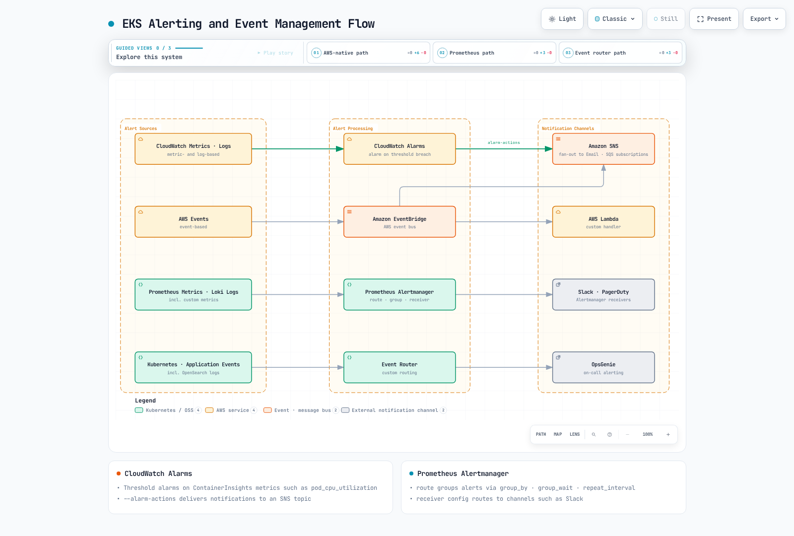

# Amazon EKS 监控与日志记录

> **最后更新**：2026年10月23日

有效的监控与日志记录对于维持 Amazon EKS 集群的可靠性、可用性和性能至关重要。本文介绍在 EKS 集群中实施监控和日志记录的各种工具、技术与最佳实践。

## 目录

1. [监控与日志记录概述](#monitoring-and-logging-overview)
2. [EKS 控制平面日志记录](#eks-control-plane-logging)
3. [容器日志记录](#container-logging)
4. [集群监控](#cluster-monitoring)
5. [告警与事件管理](#alerting-and-event-management)
6. [日志分析与可视化](#log-analysis-and-visualization)
7. [监控与日志记录最佳实践](#monitoring-and-logging-best-practices)
8. [故障排查与调试](#troubleshooting-and-debugging)

## 监控与日志记录概述

### 监控与日志记录的重要性

在 Amazon EKS 集群中进行监控和日志记录很重要，原因如下：

1. **可见性**：了解集群状态、性能和行为
2. **问题检测**：及早发现问题，避免问题演变为严重故障
3. **趋势分析**：识别随时间变化的性能和资源使用趋势
4. **容量规划**：预测并规划资源需求
5. **安全与审计**：支持调查，并为适用的控制措施提供所需证据
6. **故障排查**：在问题发生时快速诊断并解决

### 监控与日志记录架构

完整的 EKS 集群监控与日志记录架构由以下组件组成：

AWS 会将托管控制平面日志传送到 CloudWatch Logs。容器运行时会写入 CRI 日志文件；kubelet 负责管理轮转并提供日志访问，而节点采集器则读取这些文件。指标和跟踪数据使用各自配置的采集/导出路径。

<!-- Audit: parent diagram repair needed for direct control-plane delivery and runtime-versus-kubelet log responsibilities.


[🔍 查看交互式图表](https://www.atomai.click/kubernetes-docs/archmaps/en-eks-06-eks-monitoring-logging-0.html)
-->

### 监控与日志记录策略

按照以下步骤制定有效的监控与日志记录策略：

1. **定义目标**：明确监控与日志记录的目标和要求
2. **识别指标与日志**：确定需要收集的关键指标和日志
3. **选择工具**：选择满足要求的监控和日志记录工具
4. **建立基线**：建立正常行为基线
5. **配置告警**：为重要事件和阈值配置告警
6. **自动化**：尽可能自动化监控与日志记录流程
7. **定期审查**：定期审查并改进监控与日志记录策略

## EKS 控制平面日志记录

EKS 会将选定类型的托管控制平面日志导出到 CloudWatch Logs。节点端采集器不会抓取托管控制平面的文件系统。日志传送采用尽力而为的方式；请配置访问权限、保留期限和日志缺失检测，并验证日志是否实际到达。

### 控制平面日志类型

| 类型 | 用途 |
|---|---|
| `api` | API server 组件诊断信息 |
| `audit` | 根据审计策略和级别选取的 Kubernetes 请求 |
| `authenticator` | EKS IAM 身份验证诊断信息 |
| `controllerManager` | 核心 controller-manager 操作 |
| `scheduler` | 调度器决策和诊断信息 |

审计日志并不无条件记录每个请求的正文或每项应用操作。与 Secret 相关的记录可能只包含元数据，策略也会排除某些事件。CloudTrail 中的 AWS API 记录和应用数据访问日志是独立的证据来源。

### 检查并启用日志记录

进行更改前，请检查自有集群的 Region、ARN、当前日志记录设置和更新状态。日志记录更改需要满足文档规定的子网 IP 容量要求，并会产生 CloudWatch 摄取和存储费用。

```bash
set -euo pipefail
: "${CLUSTER_NAME:?Set the owned cluster name}"
: "${AWS_REGION:?Set the cluster Region}"
aws eks describe-cluster --name "$CLUSTER_NAME" --region "$AWS_REGION" \
  --query 'cluster.{ARN:arn,Status:status,Logging:logging}'
```

对于已批准的更改，以下命令会启用五种日志类型并检查返回的更新信息：

```bash
set -euo pipefail
: "${CLUSTER_NAME:?Set the reviewed cluster name}"
: "${AWS_REGION:?Set the cluster Region}"
UPDATE_ID=$(aws eks update-cluster-config \
  --name "$CLUSTER_NAME" --region "$AWS_REGION" \
  --logging '{"clusterLogging":[{"types":["api","audit","authenticator","controllerManager","scheduler"],"enabled":true}]}' \
  --query 'update.id' --output text)
if [[ -z "$UPDATE_ID" || "$UPDATE_ID" == None ]]; then
  printf '%s\n' 'No update ID returned; inspect the request result.' >&2
  exit 1
fi
aws eks describe-update --name "$CLUSTER_NAME" --region "$AWS_REGION" \
  --update-id "$UPDATE_ID" \
  --query 'update.{ID:id,Status:status,Errors:errors}'
```

最后一条命令用于检查状态，并非等待器。请重复运行 DescribeUpdate，直到状态为 Successful 或出现终止失败，然后确认实际生效的设置以及日志是否到达。获得更新 ID 并不能证明更新已完成。启用选定类型时，不一定需要禁用其他现有类型；任何明确禁用操作都属于单独的保留期限/可见性决策。

在经过审查的 eksctl CLI 中，省略 --approve 会预览更改。将 CLUSTER_NAME 和 AWS_REGION 设置为同一个已验证集群的信息，并检查预览结果：

```bash
set -euo pipefail
: "${CLUSTER_NAME:?Set the verified cluster name}"
: "${AWS_REGION:?Set the cluster Region}"
eksctl utils update-cluster-logging \
  --region "$AWS_REGION" --cluster "$CLUSTER_NAME" \
  --enable-types api,audit,authenticator,controllerManager,scheduler
```

审查计划后，使用单独的应用命令：

```bash
set -euo pipefail
: "${CLUSTER_NAME:?Set the verified cluster name}"
: "${AWS_REGION:?Set the cluster Region}"
eksctl utils update-cluster-logging \
  --region "$AWS_REGION" --cluster "$CLUSTER_NAME" \
  --enable-types api,audit,authenticator,controllerManager,scheduler --approve
```

### 查询控制平面日志

使用实际的 `/aws/eks/CLUSTER_NAME/cluster` 日志组。前两个示例是在选定组件日志流中进行文本搜索的启发式查询，并非完整的错误率测量。

**API 诊断信息：**

```text
fields @timestamp, @message
| filter @logStream like /kube-apiserver-/ and @logStream not like /audit/
| filter @message like /[Ee]rror/
| sort @timestamp desc
| limit 20
```

**IAM 身份验证诊断信息：**

```text
fields @timestamp, @message
| filter @logStream like /authenticator/
| filter @message like /[Ff]ailed|[Dd]enied|[Uu]nauthorized/
| sort @timestamp desc
| limit 20
```

**审计拒绝记录**：使用已发现的 JSON 字段，而不要在原始 JSON 文本中搜索字面字符串 responseStatus.code。请在样本事件中确认字段结构。

```text
fields @timestamp, user.username, verb, objectRef.resource, objectRef.namespace, responseStatus.code
| filter @logStream like /kube-apiserver-audit/
| filter responseStatus.code in [401, 403]
| sort @timestamp desc
| limit 20
```

### 保留期限与成本管理

检查返回的前缀搜索结果中的确切日志组条目：

```bash
set -euo pipefail
: "${CLUSTER_NAME:?Set the owned cluster name}"
: "${AWS_REGION:?Set the cluster Region}"
aws logs describe-log-groups --region "$AWS_REGION" \
  --log-group-name-prefix "/aws/eks/$CLUSTER_NAME/cluster" \
  --query 'logGroups[].{Name:logGroupName,RetentionDays:retentionInDays,KmsKey:kmsKeyId}'
```

如果已批准的策略要求保留 30 天，则变更命令为 `aws logs put-retention-policy --region "$AWS_REGION" --log-group-name "/aws/eks/$CLUSTER_NAME/cluster" --retention-in-days 30`。30 天只是策略示例，并非普遍适用的合规要求。缩短保留期限可能使较早的证据过期；延长保留期限无法恢复已删除的日志。仅设置保留期限并不能证明日志已归档、具备完整性或符合合规要求。

### EKS 功能日志记录（GitOps、ACK、kro）

2026 年 6 月 4 日推出的功能已受支持：ACK、kro 和 Argo CD 功能控制器运行在 AWS 托管基础设施中，**位于集群之外**，并可通过 CloudWatch Vended Logs 传送结构化控制器日志。此功能使用按功能配置的传送设置，与五种标准控制平面日志类型分开。

| 功能 | 日志类型 |
|---|---|
| ACK | `EKS_CAPABILITY_ACK_LOGS` |
| kro | `EKS_CAPABILITY_KRO_LOGS` |
| Argo CD | `EKS_CAPABILITY_ARGOCD_APPLICATION_LOGS`、`EKS_CAPABILITY_ARGOCD_APPLICATIONSET_LOGS`、`EKS_CAPABILITY_ARGOCD_COMMITSERVER_LOGS`、`EKS_CAPABILITY_ARGOCD_REPOSERVER_LOGS`、`EKS_CAPABILITY_ARGOCD_SERVER_LOGS` |

配置传送来源前，请先获取实际的功能 ARN：

```bash
set -euo pipefail
: "${CLUSTER_NAME:?Set the owned cluster name}"
: "${AWS_REGION:?Set the cluster Region}"
: "${CAPABILITY_NAME:?Set the actual capability name}"
aws eks describe-capability --region "$AWS_REGION" \
  --cluster-name "$CLUSTER_NAME" --capability-name "$CAPABILITY_NAME" \
  --query 'capability.capabilityArn' --output text
```

所有者使用该 ARN/日志类型配置 PutDeliverySource，使用已批准的目标配置 PutDeliveryDestination，并通过 CreateDelivery 将两者关联。启用传送前，请审查目标策略、加密、跨账户权限和保留期限。

CloudWatch Logs 目标支持 Logs Insights 查询。S3 目标会根据所选的 S3/Athena 工作流生成对象；Firehose 会将记录发送到其配置的目标。这些目标不会自动通过 CloudWatch Logs Insights 查询。ACK 记录包含用于按服务控制器筛选的 controllerGroup。请确认实际传送情况和查询字段，并将 Vended Logs 费用纳入考虑。

每添加一个传送来源，功能会进入 `UPDATING` 状态数秒，在此期间进一步更改会因 `ConflictException` 而失败（2026 年 10 月的测试中约为 6.6–7 秒）。请一次添加一个来源，并等待状态变为 `ACTIVE`。有关功能的总体介绍，请参阅 [EKS 功能](./13-eks-capabilities.md)。

参考资料：[EKS 控制平面日志记录](https://docs.aws.amazon.com/eks/latest/userguide/control-plane-logs.html)、[审计策略与查询示例](https://docs.aws.amazon.com/eks/latest/best-practices/auditing-and-logging.html)、[功能控制器日志](https://docs.aws.amazon.com/eks/latest/userguide/capabilities-controller-logs.html)。

## 容器日志记录

容器运行时会将 stdout/stderr 写入节点的 CRI 日志文件。Kubelet 管理轮转并提供 Pod 日志访问；采集器会跟踪这些文件并将记录转发到所选后端。JSON 格式的应用消息仍然位于 CRI 封装内，不能把整行容器日志当作 Docker JSON 来解析。

<!-- Audit: parent diagram repair needed for direct control-plane delivery and runtime-versus-kubelet log responsibilities.


[🔍 查看交互式图表](https://www.atomai.click/kubernetes-docs/archmaps/en-eks-06-eks-monitoring-logging-1.html)
-->

### 选择采集器的管理方

CloudWatch Observability add-on 包含容器日志采集器；如果选择该技术栈，请使用其自身管理的配置。下面的独立 Fluent Bit 示例是另一种方案，适用于独立管理的日志管道。除非有明确的重复采集和成本计划，否则不要在同一文件/目标上安装相互重叠的采集器。

### 已连接的 Fluent Bit 示例

此示例使用 AWS Chart 0.2.0 和映像 3.4.14（Fluent Bit 5.0.9），并已核对其发布版本和配置。目标是自有的 Linux/containerd EC2 节点；此示例中的亲和性设置会有意排除带有 Fargate、Auto Mode 和 Hybrid 标签的节点。这些模式需要各自受支持的采集/身份设计。采集器会容忍所选节点上的污点，因此请审查其调度位置和平台代理的准入权限。

请预先准备命名空间 logging、具有最小权限的 IRSA 角色 EKSLogWriter（供 ServiceAccount logging/eks-log-collector 使用），以及自有的 CloudWatch 日志组。请一致地替换账户、角色、Region 和集群专属日志组。按照安全章节中的说明配置 IAM OIDC provider/信任策略受众/主体。采集器需要 CloudWatch 流/写入权限，以及到区域性 STS/后端的网络连接。这些 IAM 前置条件与 Kubernetes 元数据 RBAC 是分开的。

保存为 fluent-bit-values.yaml：

```yaml
fullnameOverride: eks-log-collector
image:
  tag: 3.4.14
serviceAccount:
  create: true
  name: eks-log-collector
  annotations:
    eks.amazonaws.com/role-arn: arn:aws:iam::123456789012:role/EKSLogWriter
nodeSelector:
  kubernetes.io/os: linux
affinity:
  nodeAffinity:
    requiredDuringSchedulingIgnoredDuringExecution:
      nodeSelectorTerms:
      - matchExpressions:
        - key: eks.amazonaws.com/compute-type
          operator: NotIn
          values:
          - fargate
          - auto
          - hybrid
tolerations:
- operator: Exists
service:
  extraService: 'Flush 5

    Log_Level info

    Daemon Off

    HTTP_Server On

    HTTP_Listen 0.0.0.0

    HTTP_Port 2020

    Health_Check On

    storage.path /var/fluent-bit/state/storage

    storage.sync normal

    storage.checksum On

    storage.backlog.mem_limit 20M

    '
input:
  path: /var/log/containers/*.log
  db: /var/fluent-bit/state/tail.db
  multilineParser: cri
  skipLongLines: 'On'
  extraInputs: 'storage.type filesystem

    Read_from_Head On

    '
filter:
  kubeURL: https://kubernetes.default.svc:443
  mergeLog: 'On'
  mergeLogKey: data
  keepLog: 'On'
  k8sLoggingParser: 'Off'
  k8sLoggingExclude: 'Off'
  extraFilters: 'Use_Kubelet Off

    '
cloudWatch:
  enabled: false
cloudWatchLogs:
  enabled: true
  region: us-west-2
  logGroupName: /aws/eks/my-cluster/application
  logStreamPrefix: unmatched-
  logStreamTemplate: $kubernetes['namespace_name'].$kubernetes['pod_name'].$kubernetes['container_name']
  autoCreateGroup: false
  extraOutputs: 'auto_create_group false

    storage.total_limit_size 512M

    '
volumes:
- name: varlog
  hostPath:
    path: /var/log
    type: Directory
- name: state
  hostPath:
    path: /var/lib/eks-log-collector
    type: DirectoryOrCreate
volumeMounts:
- name: varlog
  mountPath: /var/log
  readOnly: true
- name: state
  mountPath: /var/fluent-bit/state
```

Chart 0.2.0 默认启用原生 cloudWatchLogs 输出，并禁用较旧的 cloudWatch 输出。因此，仅设置 cloudWatch.region 并不能配置实际启用的原生输出。上述值设置了实际输出的 Region/日志组，并保留完整记录；log_key 只会发送选定的值，可能移除 Kubernetes 上下文信息。

logStreamTemplate 使用记录访问器语法，并带有回退前缀。logStreamPrefix 是字面前缀，不是按记录求值的 Kubernetes 表达式。CRI 多行解析器用于处理容器封装，而 Merge_Log 会将 JSON 应用字段放到 data 下，并保留 log。工作负载注解不能为此示例选择解析器或退出其采集流程。

### 渲染时限制元数据 RBAC

已发布 Chart 中宽泛的 ClusterRole 包含 nodes/proxy 和旧版 PodSecurityPolicy 规则。此 API server 元数据模式明确设置 Use_Kubelet Off，只需要读取所选 Pod/Namespace 的权限，不需要 kubelet 代理访问权限。将此 Python 3 + PyYAML 后置渲染器保存为 fluent-bit-rbac.py。若 Chart 身份不符合预期，渲染器会拒绝继续，而不会悄悄保留另一个宽泛角色：

```python
#!/usr/bin/env python3
"""Helm post-renderer for this pinned, owned metadata-only Fluent Bit setup."""
import sys
import yaml

objects = [obj for obj in yaml.safe_load_all(sys.stdin) if obj is not None]
roles = [obj for obj in objects if obj.get("kind") == "ClusterRole"]
bindings = [obj for obj in objects if obj.get("kind") == "ClusterRoleBinding"]
if len(roles) != 1 or roles[0].get("metadata", {}).get("name") != "eks-log-collector":
    raise SystemExit("Unexpected chart RBAC; review this renderer before proceeding")
if len(bindings) != 1 or bindings[0].get("roleRef", {}).get("name") != "eks-log-collector":
    raise SystemExit("Unexpected chart role binding")
subjects = bindings[0].get("subjects", [])
if len(subjects) != 1 or any(
    subjects[0].get(key) != value
    for key, value in {
        "kind": "ServiceAccount", "name": "eks-log-collector", "namespace": "logging"
    }.items()
):
    raise SystemExit("Unexpected collector identity")
if any(obj.get("kind") == "PodSecurityPolicy" for obj in objects):
    raise SystemExit("Obsolete PodSecurityPolicy output is not supported by this example")
roles[0]["rules"] = [{
    "apiGroups": [""],
    "resources": ["namespaces", "pods"],
    "verbs": ["get", "list", "watch"],
}]
yaml.safe_dump_all(objects, sys.stdout, sort_keys=False)
```

对于新的自有版本，请同时使用这些值和渲染器进行安装：

```bash
helm repo add eks https://aws.github.io/eks-charts
helm repo update eks
chmod +x fluent-bit-rbac.py
helm install eks-log-collector eks/aws-for-fluent-bit \
  --version 0.2.0 --namespace logging --create-namespace \
  -f fluent-bit-values.yaml --post-renderer ./fluent-bit-rbac.py \
  --wait --timeout 5m
```

每次升级都应继续使用同一个经过审查的后置渲染器；更改 Chart 版本、release 身份、命名空间或元数据模式时，请重新验证渲染器。实际 DaemonSet 会挂载渲染后的 ConfigMap；仅应用无关的 ConfigMap 不会更改其配置。账户/IRSA 角色和日志组是前置条件，并非此 Chart 示例创建的资源。

### 缓冲、轮转和故障行为

主机日志以只读方式读取；检查点和文件系统缓冲状态使用单独的节点本地目录。tail 数据库记录读取偏移量，本身并不是持久的后端归档。节点替换可能会删除该状态。如果不存在检查点，Read_from_Head On 会读取文件中保留的内容，因此请规划回补和重复记录的处理方式。

512M 输出队列限制和积压内存设置都是示例分配。当输出队列达到 storage.total_limit_size 时，Fluent Bit 可能丢弃最旧的数据块。Skip_Long_Lines On 也会有意跳过超大记录。有限的缓冲区、重试和节点本地状态不能保证无损或恰好一次的传送。请监控重试、丢弃记录、磁盘容量和目标故障，并根据实际日志速率和故障持续时间验证限制。

### 可选的 OpenSearch 分发

准备好自有 VPC 域以及采集器的 IAM/FGAC 映射后，将此覆盖配置保存为 fluent-bit-opensearch-values.yaml，并替换端点主机名。在同一项经过审查的 Helm 操作中添加 `-f fluent-bit-opensearch-values.yaml`。启用 CloudWatch 时会向两个目标发送副本；仅在有意选择只使用 OpenSearch 时，才将 cloudWatchLogs.enabled=false。

```yaml
opensearch:
  enabled: true
  host: vpc-eks-logs-EXAMPLE.us-west-2.es.amazonaws.com
  port: '443'
  tls: 'On'
  awsAuth: 'On'
  awsRegion: us-west-2
  index: eks-logs
  generateId: 'On'
  suppressTypeName: 'On'
  extraOutputs: 'tls.verify On

    storage.total_limit_size 512M

    '
```

请使用 TLS 证书/主机名验证，并采用固定且受治理的索引/滚动设计。按 Pod 创建索引的模式可能会产生过多索引/分片。Generate_ID 可减少重试时的重复索引；独立输出和故障恢复仍需验证。向一个目标成功写入并不能证明另一个目标也收到了数据。

### 其他日志技术栈

如果自有部署提供所需的解析器/输出插件、主机挂载、身份和 TLS 配置，Fluentd 仍是可选方案。通用 JSON 解析器不会解码 CRI 封装，禁用 ssl_verify 也无法解决证书错误。旧版 Elastic Helm Chart 仓库已归档；Elastic 部署应使用受维护的产品/Operator 安装路径。

loki-stack Chart 已标记为弃用，Promtail 代理于 2026 年 3 月 2 日结束生命周期。对于 Loki，请使用当前受支持的部署和受支持的客户端（例如 Alloy），并明确配置存储、访问控制和保留期限。有关专门的设置说明，请参阅 [Loki 指南](../observability/logging/01-loki.md)和[采集器指南](../observability/logging/05-collectors.md)。Promtail 代理退役不包括单独维护的 lambda-promtail 客户端。

### 结构化应用日志

下面保留的示例是合成的应用数据，并非新测量结果，也不是本次审计的记录。其时间戳仍为原始示例值：

```json
{
  "timestamp": "2025-07-11T13:00:00Z",
  "level": "INFO",
  "message": "Request processed successfully",
  "request_id": "12345",
  "user_id": "user-789",
  "duration_ms": 45,
  "status_code": 200
}
```

在已配置的管道中，CRI 记录提供传输时间戳，应用 JSON 位于 data 下。使用应用字段覆盖时间戳前，请验证时区和时钟行为。用户/会话标识符仍可能属于敏感数据，或可用于关联身份；请尽量减少此类数据，绝不要记录凭据或原始会话令牌。

下面的示例假设采集器使用此记录结构。其他采集器可能采用不同字段路径：

```text
fields @timestamp, kubernetes.namespace_name, kubernetes.pod_name, data.level, log
| filter kubernetes.namespace_name = "production"
| filter data.level in ["ERROR", "error"]
| sort @timestamp desc
| limit 100
```

验证工作涵盖已发布的 Chart/映像元数据、实际 Helm ConfigMap/DaemonSet 接线、原生 Kubernetes Schema 和后置渲染器失败场景。没有安装映像、启动采集器进程、发送 AWS 日志或测试对生产文件系统的访问。上线前请验证实际节点权限、IRSA 凭据和端到端传送。

参考资料：[AWS 映像版本 3.4.14](https://github.com/aws/aws-for-fluent-bit/releases/tag/v3.4.14)、[CloudWatch 输出](https://docs.fluentbit.io/manual/data-pipeline/outputs/cloudwatch)、[Fluent Bit 缓冲](https://docs.fluentbit.io/manual/data-pipeline/buffering)、[Promtail 生命周期](https://grafana.com/docs/loki/latest/send-data/promtail/)。

## 集群监控

有效的集群监控对于跟踪 EKS 集群的状态、性能和资源使用情况至关重要。本节介绍用于监控 EKS 集群的各种工具和技术。


[🔍 查看交互式图表](https://www.atomai.click/kubernetes-docs/archmaps/en-eks-06-eks-monitoring-logging-2.html)

### CloudWatch Container Insights

CloudWatch Observability add-on 集成了 Container Insights、容器日志采集和 Application Signals 功能。请使用一套由明确所有者管理的安装，并避免让其 Fluent Bit 采集器与其他采集器同时读取相同文件。请先配置身份、受支持的节点访问和后端连接，再期待出现数据。

#### 检查集群及兼容的 add-on 构建版本

对于此标准 Linux EC2 示例，请准备合适的 EKS Pod Identity agent 和专用 CloudWatch 角色，并将信任范围限制为此集群及 amazon-cloudwatch/cloudwatch-agent。操作人员需要具备所需的 add-on/关联权限，并有权传递已批准的角色。除 EKS add-on 列表外，还要检查现有 Helm release、ServiceAccount 注解和关联；现有采集器应遵循其所有者的迁移/升级流程。

```bash
set -euo pipefail
: "${CLUSTER_NAME:?Set the owned cluster name}"
: "${AWS_REGION:?Set the cluster Region}"
CLUSTER_VERSION=$(aws eks describe-cluster --name "$CLUSTER_NAME" --region "$AWS_REGION" \
  --query cluster.version --output text)
aws eks list-addons --cluster-name "$CLUSTER_NAME" --region "$AWS_REGION"
aws eks describe-addon-versions --region "$AWS_REGION" \
  --addon-name amazon-cloudwatch-observability --kubernetes-version "$CLUSTER_VERSION"
```

请从目录中选择兼容且经过审查的构建版本，而不是降级到硬编码的 v5.0.0 示例。add-on 配置 Schema 与版本有关。此处的本地参考渲染使用 Helm Chart 6.6.0；其 Fluent Bit DaemonSet 使用与 agent 身份路径相同的 cloudwatch-agent ServiceAccount。

#### 明确配置 Auto Monitor

对于新安装示例，请将以下内容保存为 cloudwatch-config.json。它保留默认容器日志配置，同时禁用广泛的自动工作负载选择和自动重启，直至审查完应用 rollout：

```json
{
  "manager": {
    "applicationSignals": {
      "autoMonitor": {
        "monitorAllServices": false,
        "restartPods": false
      }
    }
  }
}
```

此设置控制 Auto Monitor 的选择/重启行为，并不涵盖所有可能的遥测来源。现有注解、自定义选择器或手动插桩的应用需要单独审查。在本地具备 Python 3 和 jsonschema 的情况下，获取所选构建版本的 Schema 并检查配置：

```bash
set -euo pipefail
: "${AWS_REGION:?Set the cluster Region}"
: "${CLOUDWATCH_ADDON_VERSION:?Choose a reviewed compatible add-on build}"
aws eks describe-addon-configuration --region "$AWS_REGION" \
  --addon-name amazon-cloudwatch-observability --addon-version "$CLOUDWATCH_ADDON_VERSION" \
  --output json > cloudwatch-addon-review.json
python3 - "$CLOUDWATCH_ADDON_VERSION" <<'PY'
import json
import sys
import jsonschema
with open("cloudwatch-addon-review.json") as stream:
    review = json.load(stream)
if review["addonName"] != "amazon-cloudwatch-observability" or review["addonVersion"] != sys.argv[1]:
    raise SystemExit("Returned schema does not match the selected add-on build")
schema = json.loads(review["configurationSchema"])
with open("cloudwatch-config.json") as stream:
    config = json.load(stream)
validator = jsonschema.validators.validator_for(schema)
validator.check_schema(schema)
validator(schema).validate(config)
PY
```

#### 创建新的自有安装

CloudWatch 角色必须已具备所选功能所需的 CloudWatch/跟踪权限。以下步骤会重新检查已审查的 Schema/构建版本，拒绝已有的 add-on 或采集器关联，并避免接管冲突资源：

```bash
set -euo pipefail
: "${CLUSTER_NAME:?Set the reviewed cluster name}"
: "${AWS_REGION:?Set the cluster Region}"
: "${CLOUDWATCH_ADDON_VERSION:?Set the reviewed, schema-checked compatible build}"
: "${CLOUDWATCH_ROLE_ARN:?Set the prepared CloudWatch Pod Identity role ARN}"
python3 - "$CLOUDWATCH_ADDON_VERSION" <<'PY'
import json
import sys
import jsonschema
with open("cloudwatch-addon-review.json") as stream:
    review = json.load(stream)
if review["addonName"] != "amazon-cloudwatch-observability" or review["addonVersion"] != sys.argv[1]:
    raise SystemExit("Selected add-on build changed; review its schema again")
schema = json.loads(review["configurationSchema"])
with open("cloudwatch-config.json") as stream:
    config = json.load(stream)
jsonschema.validators.validator_for(schema)(schema).validate(config)
PY
EXISTING_ADDONS=$(aws eks list-addons --cluster-name "$CLUSTER_NAME" --region "$AWS_REGION" --output json)
python3 - "$EXISTING_ADDONS" <<'PY'
import json, sys
if "amazon-cloudwatch-observability" in json.loads(sys.argv[1])["addons"]:
    raise SystemExit("Add-on already exists; use its owner's reviewed upgrade procedure")
PY
EXISTING_ASSOCIATIONS=$(aws eks list-pod-identity-associations \
  --cluster-name "$CLUSTER_NAME" --region "$AWS_REGION" \
  --namespace amazon-cloudwatch --service-account cloudwatch-agent --output json)
python3 - "$EXISTING_ASSOCIATIONS" <<'PY'
import json, sys
if json.loads(sys.argv[1])["associations"]:
    raise SystemExit("Collector association already exists; inspect its owner before installation")
PY
ASSOCIATIONS=$(python3 - "$CLOUDWATCH_ROLE_ARN" <<'PY'
import json, sys
print(json.dumps([{"serviceAccount": "cloudwatch-agent", "roleArn": sys.argv[1]}]))
PY
)
aws eks create-addon --cluster-name "$CLUSTER_NAME" --region "$AWS_REGION" \
  --addon-name amazon-cloudwatch-observability --addon-version "$CLOUDWATCH_ADDON_VERSION" \
  --pod-identity-associations "$ASSOCIATIONS" \
  --configuration-values file://cloudwatch-config.json --resolve-conflicts NONE
aws eks describe-addon --cluster-name "$CLUSTER_NAME" --region "$AWS_REGION" \
  --addon-name amazon-cloudwatch-observability \
  --query 'addon.{Status:status,Version:addonVersion,Health:health.issues}'
```

CreateAddon 是异步操作。请检查状态/运行状况，直至 add-on 变为 ACTIVE，然后验证 agent/采集器 Pod、实际 ContainerInsights 数据点和预期日志组。请求成功、状态为 ACTIVE 或存在仪表板，都不能证明数据已完整摄取。上面的最后一条 DescribeAddon 命令用于检查状态，并非等待器。重试前请验证故障和权限；不要使用未经审查的覆盖操作或清除现有配置来强行安装。

#### 版本 5.0.0 的变化

2026 年 2 月 26 日的默认 APM 更改确实存在：5.0.0 及更高版本在新安装和升级时默认启用 Application Signals Auto Monitor。monitorAllServices 默认为 true；restartPods 默认为 false。其范围包括受支持的服务映射型 Deployments、DaemonSets 和 StatefulSets，默认排除 kube-system 和 amazon-cloudwatch。范围内的新工作负载或重启后的工作负载可以在没有逐工作负载注解的情况下进行插桩；但不能保证已运行的 Pod 会立即重新插桩。

请选择受支持的语言/工作负载，审查现有 OpenTelemetry/APM 集成、采样和成本，并控制任何重启 rollout。明确配置的排除项优先。Container Insights 支持 Linux 和 Windows 配置，但 Application Signals 不支持 EKS Windows 节点。Fargate 和 Hybrid 节点采集/身份需要遵循其平台专属文档路径；不要根据通用 DaemonSet 示例推断其受支持。

#### 指标、仪表板和告警

在 Container Insights 控制台视图中选择实际集群，并检查已发布的指标名称、维度和近期数据。节点 CPU/内存/文件系统指标描述节点使用情况。Pod CPU/内存利用率使用节点限制作为分母，而不是 Pod 请求量。文档中定义的指标可按命名空间/服务/集群进行汇总，但异构集群的汇总百分比并不会自动成为按容量加权的利用率值。

仪表板有助于检查数据，但不会自动创建所有告警，也不保证通知一定送达。后面的 CloudWatch Alarms 示例使用节点指标和 Maximum，并明确指定维度。请验证指标是否可用，并针对工作负载配置适当的告警和通知路径。

验证工作使用了现有已发布 Chart、其渲染后的默认日志配置和 Auto Monitor 参数，以及九种模拟的 Schema/所有权/故障流程场景。合成测试 Schema 仅用于检查辅助程序的行为，不能替代上述针对实际构建版本的 Schema。此次审计没有运行 add-on、工作负载插桩、遥测导出或 AWS 资源操作。

参考资料：[CloudWatch add-on 安装和 Auto Monitor](https://docs.aws.amazon.com/AmazonCloudWatch/latest/monitoring/install-CloudWatch-Observability-EKS-addon.html)、[默认 APM 公告](https://aws.amazon.com/about-aws/whats-new/2026/02/application-performance-monitoring-cloudwatch-eks/)、[Container Insights 指标](https://docs.aws.amazon.com/AmazonCloudWatch/latest/monitoring/Container-Insights-metrics-EKS.html)。

### EKS Node Monitoring Agent

EKS Node Monitoring Agent 会发布节点级系统、存储、网络和加速器运行状况条件。它于 2026 年 2 月 24 日开放源代码，并已包含在 EKS Auto Mode 中。若要单独管理 add-on 安装，请在选择版本前检查集群的实际版本、现有 add-on 和兼容的 agent 版本：

```bash
set -euo pipefail
: "${CLUSTER_NAME:?Set the owned cluster name}"
: "${AWS_REGION:?Set the cluster Region}"
KUBERNETES_VERSION=$(aws eks describe-cluster --name "$CLUSTER_NAME" --region "$AWS_REGION" \
  --query cluster.version --output text)
aws eks list-addons --cluster-name "$CLUSTER_NAME" --region "$AWS_REGION"
aws eks describe-addon-versions --addon-name eks-node-monitoring-agent \
  --kubernetes-version "$KUBERNETES_VERSION" --region "$AWS_REGION"
```

请由现有 add-on 所有者使用经过审查的版本和受支持的节点配置进行安装或更新。add-on 创建命令并非现有安装的升级流程。

仅凭条件名称无法判断节点是否不健康。应阅读状态和原因，并结合每项条件的含义进行解释：Ready=False 与 MemoryPressure=False 的含义不同。

```bash
kubectl get nodes -o jsonpath='{range .items[*]}{.metadata.name}{"\n"}{range .status.conditions[*]}{"  "}{.type}{"="}{.status}{" reason="}{.reason}{"\n"}{end}{end}'
```

监控和启用修复是两回事。Auto Mode 默认启用自动节点修复；托管节点组使用 nodeRepairConfig，Karpenter 使用其 NodeRepair 功能门控。将修复行为归因于 agent 前，请检查实际托管节点组：

```bash
set -euo pipefail
: "${CLUSTER_NAME:?Set the owned cluster name}"
: "${NODEGROUP_NAME:?Set an actual managed node group name}"
: "${AWS_REGION:?Set the cluster Region}"
aws eks describe-nodegroup --region "$AWS_REGION" \
  --cluster-name "$CLUSTER_NAME" --nodegroup-name "$NODEGROUP_NAME" \
  --query 'nodegroup.{Name:nodegroupName,Repair:nodeRepairConfig,Health:health.issues}'
```

是否符合修复条件取决于具体条件、原因、等待时间和适用的保护措施。文档所述的默认设置中，MemoryPressure 和 DiskPressure 没有自动修复操作。不要将每个已报告的条件或 agent 安装都视为节点一定会被替换的证明。自定义开源 agent 时，也必须根据所选修复配置测试其条件语义。

参考资料：[开源公告](https://aws.amazon.com/about-aws/whats-new/2026/02/amazon-eks-node-monitoring-agent-open-source/)、[自动节点修复](https://docs.aws.amazon.com/eks/latest/userguide/node-repair.html)。

### Prometheus 和 Grafana

Prometheus 是时序数据库和监控系统，Grafana 是用于可视化指标的仪表板工具。你可以将这两种工具结合使用，全面监控 EKS 集群。

#### Amazon Managed Service for Prometheus 和 Grafana

AMP 存储并查询已摄取的 Prometheus 指标；AMG 查询已配置的数据源并展示仪表板。创建任一工作区都不会自动部署抓取器、授予 AWS 身份权限或连接数据源。此示例检查现有自有工作区，并扩展下面的 kube-prometheus-stack release，避免安装第二个 Prometheus。

**AMP 摄取身份和配置值**

请为 ServiceAccount monitoring/amp-writer 准备一个 IRSA 角色。其信任策略必须使用此集群的 OIDC provider，并精确设置 sub=system:serviceaccount:monitoring:amp-writer 和 aud=sts.amazonaws.com 条件。授予其对目标工作区 ARN 执行 aps:RemoteWrite 的权限。Prometheus 进程必须能够获得投影令牌并连接 STS 和 AMP 端点；Kubernetes RBAC 是另一条独立权限路径。不要在此示例中再附加无关的 Pod Identity 关联或静态 AWS 密钥。

以下命令读取工作区并为经过审查的 Chart 92.9.0 写入覆盖配置。它接受带或不带 /api/v1/ 的文档端点格式，并且只追加一次 remote_write。需要 Python 3；不会创建工作区：

```bash
set -euo pipefail
: "${AWS_REGION:?Set the AMP workspace Region}"
: "${AMP_WORKSPACE_ID:?Set the owned AMP workspace ID}"
: "${AMP_WRITE_ROLE_ARN:?Set the prepared IRSA writer role ARN}"
: "${CLUSTER_NAME:?Set the source cluster name}"
aws amp describe-workspace --region "$AWS_REGION" \
  --workspace-id "$AMP_WORKSPACE_ID" --output json > amp-workspace.json
python3 - "$AWS_REGION" "$AMP_WORKSPACE_ID" "$AMP_WRITE_ROLE_ARN" "$CLUSTER_NAME" <<'PY'
import json
import sys
from urllib.parse import urlsplit, urlunsplit

region, workspace_id, role_arn, cluster = sys.argv[1:]
with open("amp-workspace.json") as stream:
    workspace = json.load(stream)["workspace"]
if workspace["workspaceId"] != workspace_id or workspace["status"]["statusCode"] != "ACTIVE":
    raise SystemExit("Review the workspace identity and ACTIVE status")
arn = workspace["arn"].split(":", 5)
if len(arn) != 6 or arn[2] != "aps" or arn[3] != region or arn[5] != "workspace/" + workspace_id:
    raise SystemExit("Workspace ARN does not match the selected Region/ID")
endpoint = urlsplit(workspace["prometheusEndpoint"])
path = endpoint.path.rstrip("/")
if path.endswith("/api/v1"):
    path = path[:-7]
if (endpoint.scheme != "https" or not endpoint.hostname or endpoint.username
        or endpoint.password or endpoint.query or endpoint.fragment
        or path != "/workspaces/" + workspace_id):
    raise SystemExit("Inspect the workspace endpoint before configuring remote write")
remote_write = urlunsplit((endpoint.scheme, endpoint.netloc, path + "/api/v1/remote_write", "", ""))
values = {
    "prometheus": {
        "serviceAccount": {
            "create": True, "name": "amp-writer", "createTokenSecret": True,
            "annotations": {"eks.amazonaws.com/role-arn": role_arn},
        },
        "prometheusSpec": {
            "externalLabels": {"cluster": cluster},
            "remoteWrite": [{"url": remote_write, "sigv4": {"region": region}}],
        },
    },
}
with open("amp-values.json", "w") as stream:
    json.dump(values, stream, indent=2)
    stream.write("\n")
print("Wrote amp-values.json; review it with all existing release values")
PY
```

请将 amp-values.json 与 monitoring-values.yaml 合并到所有者审查过的安装/升级配置值中。该覆盖配置会替换 remoteWrite 列表；请有意保留所有现有目标和外部标签。对于新 release，请在下面的安装命令中添加 -f amp-values.json。对于现有 release，请保留所有当前设置，并在应用所有者的升级流程前审查渲染差异和 rollout。更改 ServiceAccount 会改变 Prometheus Pod 的身份。Chart 92.9.0 使用显式的 ServiceAccount 令牌 Secret，为其默认 API server/kubelet ServiceMonitor 授权。请保护该 Secret，并遵循轮换/撤销流程；它与短期、受 audience 限制的 IRSA 令牌不同。若禁用 createTokenSecret，却不替换所有依赖的监控凭据，则会导致渲染或身份验证失败。

如果有多个副本，请配置 AMP 文档所述的 HA 去重标签和副本拓扑，不要假设重复抓取无需成本。根据实际工作负载设置基数、保留期限和摄取预算。请检查 remote-write 故障/积压，并在目标工作区查询近期数据；Helm rollout 成功并不能证明数据已摄取。

**AMG 身份验证和数据源连接**

```bash
set -euo pipefail
: "${AMG_REGION:?Set the Grafana workspace Region}"
: "${AMG_WORKSPACE_ID:?Set the owned Grafana workspace ID}"
aws grafana describe-workspace --region "$AMG_REGION" \
  --workspace-id "$AMG_WORKSPACE_ID" \
  --query 'workspace.{ID:id,Status:status,Version:grafanaVersion,Endpoint:endpoint,Role:workspaceRoleArn,Authentication:authentication,PermissionType:permissionType}'
```

工作区用户身份验证（IAM Identity Center/SAML）、Grafana 用户权限和工作区 AWS 数据源 IAM 角色是不同的控制项。Grafana ServiceAccount 是 Grafana HTTP API 的身份；创建 ADMIN ServiceAccount 不会创建 AMP 数据源，也不会授予 aps:QueryMetrics 权限。不要仅为了查看指标而配置权限过宽的 API 身份。

在 AMG 12 及更高版本中，请选择 Amazon Managed Service for Prometheus 数据源插件。在该 AMG 版本中，SigV4 支持已从 Core Prometheus 插件移除，现有 AMP 数据源会迁移到 AMP 插件。请使用与工作区实际版本相匹配的文档。通过已批准的工作区配置，选择目标账户/Region/工作区，配置其查询身份，并测试一个已知时序。文档中的 AWS 数据源配置流程使用服务托管权限；客户托管工作区需要单独审查其 IAM 配置，不会自动变更所有权。

查询角色通常需要限定到工作区的 aps:QueryMetrics、aps:GetSeries、aps:GetLabels 和 aps:GetMetricMetadata 权限；发现或其他已启用功能可能还需要额外操作。其查询端点并非 remote_write 摄取 URL。如果单独使用 CLI 配置工作区，则需要使用 --workspace-name，并要求设置 --account-access-type、身份验证和权限配置；服务托管 IAM 自动化与文档所述的控制台工作流绑定。将工作区视为可用之前，请完成身份、用户分配和网络访问设置。

参考资料：[AMP remote write](https://docs.aws.amazon.com/prometheus/latest/userguide/AMP-onboard-ingest-metrics-existing-Prometheus.html)、[AMG AMP 插件](https://docs.aws.amazon.com/grafana/latest/userguide/amazon-prometheus-data-source.html)、[AWS 数据源配置](https://docs.aws.amazon.com/grafana/latest/userguide/amazon-AMP-adding-AWS-config.html)。此次审计没有实际使用工作区、身份验证流程或遥测摄取。

#### 自行管理 Prometheus 和 Grafana

此示例使用一个自有的 kube-prometheus-stack release，其中包含 ServiceMonitor 和 PrometheusRule 示例所需的 Prometheus Operator。独立的 Prometheus Chart 不会自动提供这些 CRD/控制器。安装前请检查现有 Operator、release 和 CRD 所有权；对于现有技术栈，请遵循所有者的升级流程。

经过审查的基线为 Chart 92.9.0 / Operator 0.94.1，针对 EKS 1.36 渲染。该配置假设使用标准 Linux EC2 节点，并已准备可用的加密 ebs-gp3 StorageClass 和正常工作的 EBS CSI 权限。对于 Auto Mode 或其他存储实现，请选择实际受支持的类别和节点调度位置。以下保留期限和 PVC 大小均为示例分配值，并非容量测量或保证。

请通过已批准的 Secret 管理流程，准备命名空间 monitoring 和 Secret grafana-admin，其中包含 admin-user/admin-password 键。配置值会引用该 Secret，而不是将共享密码写入 Helm 配置值或命令参数。将以下内容保存为 monitoring-values.yaml：

```yaml
grafana:
  admin:
    existingSecret: grafana-admin
    userKey: admin-user
    passwordKey: admin-password
  service:
    type: ClusterIP
  rbac:
    namespaced: true
  sidecar:
    dashboards:
      searchNamespace: monitoring
    datasources:
      searchNamespace: monitoring
  persistence:
    enabled: true
    storageClassName: ebs-gp3
    size: 10Gi
    accessModes:
    - ReadWriteOnce
  deploymentStrategy:
    type: Recreate
prometheus:
  prometheusSpec:
    retention: 14d
    storageSpec:
      volumeClaimTemplate:
        spec:
          storageClassName: ebs-gp3
          accessModes:
          - ReadWriteOnce
          resources:
            requests:
              storage: 20Gi
kubeEtcd:
  enabled: false
kubeControllerManager:
  enabled: false
kubeScheduler:
  enabled: false
kubeProxy:
  enabled: false
kubelet:
  serviceMonitor:
    tlsConfig:
      insecureSkipVerify: false
      ca:
        configMap:
          name: kubelet-serving-ca
          key: ca.crt
```

Grafana 的仪表板/数据源 sidecar 只监视 monitoring，并使用命名空间级角色。其 ClusterIP Service 通过本地端口转发访问。单副本 PVC 示例使用 Recreate，以避免 rollout 期间出现写入者重叠，因此在替换时需要规划 UI 停机时间；这不是高可用 Grafana 设计。

Chart 默认会跳过 kubelet 服务端证书验证。此配置改为要求预先准备 monitoring/kubelet-serving-ca ConfigMap，其中 ca.crt 包含受信任的 kubelet 服务端 CA 证书链，且证书 SAN 与被抓取的端点匹配。请通过节点所有者的证书管理流程验证该信任关系；EKS API server CA 并不会自动成为 kubelet 服务端 CA。如果无法满足此项前置条件，请先解决证书配置问题，再启用采集。不要为了让失败的目标看起来正常而悄悄将 insecureSkipVerify 恢复为启用。此次审计未测试 kubelet TLS 握手。

此示例禁用了 etcd/controller-manager/scheduler/kube-proxy 抓取任务，因为设置中没有提供其直接端点。只有在配置好实际可访问且已授权的端点后，才启用对应任务；API server 或 CloudWatch 指标属于独立来源，不能让缺失的组件 ServiceMonitor 目标正常工作。

对于新的自有 release：

```bash
helm repo add prometheus-community https://prometheus-community.github.io/helm-charts
helm repo update prometheus-community
helm install monitoring prometheus-community/kube-prometheus-stack \
  --version 92.9.0 --namespace monitoring --create-namespace \
  -f monitoring-values.yaml --wait --timeout 10m
```

Helm 等待完成并不证明所有由 Operator 创建的资源、目标和通知路由均可正常工作。请检查生成的资源、PVC 绑定情况、Prometheus 目标健康状态和指标数据：

```bash
kubectl get pods,svc,pvc -n monitoring
kubectl get prometheus,alertmanager -n monitoring
```

在以下命令运行期间，使用已批准 Secret 存储中的凭据访问 Grafana：`http://127.0.0.1:3000`

```bash
kubectl port-forward --address 127.0.0.1 -n monitoring \
  svc/monitoring-grafana 3000:80
```

请保护 Grafana 数据库/PVC 和导出的仪表板定义。使用 Grafana 支持的凭据轮换流程；仅修改引导 Secret 并不能证明现有数据库用户的密码已更改。不要使用共享的示例密码公开 UI。

Chart 渲染结果确认了实际 Prometheus Service monitoring-kube-prometheus-prometheus、Grafana Service monitoring-grafana 和数据源 UID prometheus。自定义 ServiceMonitor/PrometheusRule 必须匹配此 release 使用的 release=monitoring 选择器。渲染后的清单和 Schema 检查属于本地证据；此次审计未在实时集群中运行技术栈、PVC 或登录操作。

参考资料：[kube-prometheus-stack Chart 和升级指南](https://github.com/prometheus-community/helm-charts/tree/kube-prometheus-stack-92.9.0/charts/kube-prometheus-stack)。

#### 关键 Prometheus 指标

指标是否可用取决于实际抓取目标和权限，而不仅是仪表板名称：

- Node exporter 会在受支持的节点上提供节点 CPU、内存、文件系统和网络时序。
- Kubelet/cAdvisor 提供容器资源指标；kube-state-metrics 提供重启和就绪情况等 Kubernetes 对象状态。
- API server 会公开经授权的 API 指标。etcd/controller-manager/scheduler 的直接指标需要各自可访问的端点；上述设置没有启用这些目标。

缺少某个时序可能表示 exporter 缺失、抓取失败、平台不受支持或指标已更改。不能自动将其视为使用量为零或系统健康。

#### 实用 Grafana 仪表板

可以从经过审查的 kube-prometheus-stack release 附带的 Kubernetes、node-exporter 和 API server 仪表板入手，并选择其 prometheus 数据源 UID。仅凭社区仪表板 ID 无法确认指标/标签约定兼容。请检查每个导入仪表板的查询、单位、所需 recording rule 和数据源引用。图表没有数据并不能证明受监控组件正常。

之前列出的社区 ID 仍然存在，但其中几个标题和暗示用途并不准确。目录核验得到以下参考信息；未测试导入/运行时兼容性：

| ID | 目录中的实际标题 | 范围说明 |
| --- | --- | --- |
| [15661](https://grafana.com/grafana/dashboards/15661-k8s-dashboard-en-20250125/) | K8S Dashboard | 通用 K8S 资源概览 |
| [1860](https://grafana.com/grafana/dashboards/1860-node-exporter-full/) | Node Exporter Full | 需要匹配的 node-exporter 时序 |
| [6417](https://grafana.com/grafana/dashboards/6417-kubernetes-cluster-prometheus/) | Kubernetes Cluster (Prometheus) | 集群/容器概览；目录最后更新于 2018 年 |
| [12006](https://grafana.com/grafana/dashboards/12006-kubernetes-apiserver/) | Kubernetes apiserver | API server 延迟/缓存仪表板；目录最后更新于 2020 年 |
| [13770](https://grafana.com/grafana/dashboards/13770-1-kubernetes-all-in-one-cluster-monitoring-kr/) | 1 Kubernetes All-in-one Cluster Monitoring KR | 韩文一体化仪表板，针对其书籍中的 VM 环境优化 |

#### PromQL 查询示例

这些示例与经过审查的技术栈中的 job 和 metrics_path 标签匹配。请为 Pod 保留命名空间身份，并在存在 cluster 标签时保留该标签，尤其是在共享 AMP 工作区中。发送到外部时会附加 Prometheus 外部标签；这些标签不会自动出现在本地存储的每个时序上。max 聚合会合并同一已识别对象的重复观测，不会合并不同工作负载。根据实际标签进行审查后再改用此模式。

节点 CPU 非空闲百分比，按 CPU 平均：

```promql
100 * (1 - avg by (cluster, instance) (max by (cluster, instance, cpu) (rate(node_cpu_seconds_total{job="node-exporter",mode="idle"}[5m]))))
```

按容器工作集字节数排序的前十个 Pod：

```promql
topk(10, sum by (cluster, namespace, pod) (max by (cluster, namespace, pod, container) (container_memory_working_set_bytes{job="kubelet",metrics_path="/metrics/cadvisor",container!="",container!="POD"})))
```

按 Pod UID 列出的当前重启计数器；这不是 CrashLoopBackOff 检测器：

```promql
sum by (cluster, namespace, pod, uid) (max by (cluster, namespace, pod, uid, container) (kube_pod_container_status_restarts_total{job="kube-state-metrics"}))
```

根文件系统不可用百分比，排除大小为零的文件系统：

```promql
(100 * (1 - max by (cluster, instance, device, mountpoint, fstype) (node_filesystem_avail_bytes{job="node-exporter",mountpoint="/"}) / max by (cluster, instance, device, mountpoint, fstype) (node_filesystem_size_bytes{job="node-exporter",mountpoint="/"}))) and on (cluster, instance, device, mountpoint, fstype) (max by (cluster, instance, device, mountpoint, fstype) (node_filesystem_size_bytes{job="node-exporter",mountpoint="/"}) > 0)
```

这里的 CPU 百分比描述非空闲时间，内存以字节计量，重启数则是当前 Pod/容器生命周期内的计数器。若要查看计数器变化，请在选定时间窗口内使用 rate/increase。文件系统计算使用可用空间，可能包含普通用户不可用的预留空间。这些示例用于调查，并非通用告警阈值。

### 使用 AWS X-Ray 进行分布式跟踪

X-Ray 仍是受支持的跟踪后端。其 SDK 和 daemon 于 2026 年 2 月 25 日进入仅提供安全修复的维护阶段；AWS 当前时间表未公布该阶段的结束日期。新的插桩应使用受支持的 OpenTelemetry/ADOT 集成。X-Ray daemon 或采集器无需 Kubernetes cluster-admin 权限即可提交跟踪数据，而该 Kubernetes 角色也不会授予 AWS 写入权限。

#### 采集器所有权与前置条件

请选择一个插桩/采集所有者。上文的 CloudWatch add-on Application Signals 路径是另一种方案；如果进程已经完成插桩，请勿在未审查重复 span 和冲突的情况下再添加 SDK agent。下面的明确示例使用 OpenTelemetry Operator 0.158.0 和 ADOT Collector 0.50.0，并且仅配置跟踪管道。

应用采集器前，请由相应所有者准备以下依赖项：

- 一个可正常工作的 Operator，以及匹配的 CRD/webhook。上游已发布清单使用 cert-manager；请遵循其文档中的安装/升级路径。EKS ADOT add-on 是另一条所有权路径，具有针对具体构建版本的 Schema。Collector 发布版本不包含 Operator 安装清单。
- 专用的 tracing-demo 命名空间和 ServiceAccount adot-traces，并为此集群准备 IRSA 信任策略，设置 sub=system:serviceaccount:tracing-demo:adot-traces 和 aud=sts.amazonaws.com。授予所需的 X-Ray 写入操作（此管道使用 PutTraceSegments），并提供 STS/X-Ray 网络连接。此仅使用 OTLP 的采集器不会发现 Kubernetes 对象，也不需要集群范围 RBAC。
- Secret tracing-demo/otel-receiver-tls，其中包含 tls.crt/tls.key，且服务端证书对 adot-traces-collector.tracing-demo.svc 有效。在应用中挂载其受信任的 CA。证书签发、续订和采集器重新加载/重启仍是运维职责。
- 会强制执行 NetworkPolicy 的 CNI，以及经过审查的应用出口流量。此示例允许来自带有 app=my-app 标签的 default Pod 的入口流量；该策略适用于专用 tracing-demo 命名空间中的每个 Pod。标签仅用于选择流量，不会验证工作负载身份，也不能替代对 Pod 创建者的 RBAC 控制。

请审查已发布的 [Operator 版本](https://github.com/open-telemetry/opentelemetry-operator/releases/tag/v0.158.0)和 [ADOT 版本](https://github.com/aws-observability/aws-otel-collector/releases/tag/v0.50.0)，不要将 Collector URL 当作 Operator 清单应用。v1beta1 CRD 使用对象类型的 spec.config。请在 env/exporter 两个字段中同时修改示例 Region：

```yaml
apiVersion: opentelemetry.io/v1beta1
kind: OpenTelemetryCollector
metadata:
  name: adot-traces
  namespace: tracing-demo
spec:
  mode: deployment
  replicas: 1
  image: public.ecr.aws/aws-observability/aws-otel-collector:v0.50.0
  serviceAccount: adot-traces
  env:
  - name: AWS_REGION
    value: us-west-2
  - name: AWS_EC2_METADATA_DISABLED
    value: "true"
  resources:
    requests:
      cpu: 100m
      memory: 128Mi
    limits:
      cpu: "1"
      memory: 512Mi
  volumes:
  - name: receiver-tls
    secret:
      secretName: otel-receiver-tls
  volumeMounts:
  - name: receiver-tls
    mountPath: /etc/otel/tls
    readOnly: true
  config:
    receivers:
      otlp:
        protocols:
          http:
            endpoint: 0.0.0.0:4318
            tls:
              cert_file: /etc/otel/tls/tls.crt
              key_file: /etc/otel/tls/tls.key
    processors:
      memory_limiter:
        check_interval: 1s
        limit_percentage: 75
        spike_limit_percentage: 15
      batch: {}
    exporters:
      awsxray:
        region: us-west-2
        local_mode: true
        no_verify_ssl: false
        index_all_attributes: false
        telemetry:
          enabled: false
    extensions:
      health_check:
        endpoint: 0.0.0.0:13133
    service:
      extensions: [health_check]
      pipelines:
        traces:
          receivers: [otlp]
          processors: [memory_limiter, batch]
          exporters: [awsxray]
---
apiVersion: networking.k8s.io/v1
kind: NetworkPolicy
metadata:
  name: tracing-ingress
  namespace: tracing-demo
spec:
  podSelector: {}
  policyTypes: [Ingress]
  ingress:
  - from:
    - namespaceSelector:
        matchLabels:
          kubernetes.io/metadata.name: default
      podSelector:
        matchLabels:
          app: my-app
    ports:
    - protocol: TCP
      port: 4318
```

Operator 会根据 OTLP/HTTP 端口生成 ClusterIP 接收器 Service：tracing-demo 中的 adot-traces-collector，TCP 4318。接收器不会验证用户身份或业务授权声明；此示例使用服务端 TLS 和所选网络边界。更强的隔离方式可以要求 mTLS 或受支持的接收器认证器。在扩大访问范围前，请确保两端配置一致。

采集器接受数据并不代表数据已存储。请检查生成的 Deployment/Service、TLS 握手、AWS 凭据选择、exporter 故障以及 X-Ray 中的已知跟踪。单副本、内存缓冲示例并非无损或高可用管道；请根据工作负载对缓冲、背压、重试行为和故障处理进行容量规划和测试。CRD Schema 检查无法验证所有组件配置，也不能证明采集器能启动。

#### 为应用添加插桩并传播上下文

对于 Python 3.10 及更高版本的应用，请在应用依赖锁文件中对齐 opentelemetry-sdk==1.44.0 和 opentelemetry-exporter-otlp-proto-http==1.44.0。请分别配置每项服务；共享采集器不得用一个全局值覆盖所有传入的 service.name。HTTP exporter 端点包含 /v1/traces；使用 4317 的 gRPC 端点则是另一种协议/配置。

```bash
export OTEL_SERVICE_NAME=my-app
export CLUSTER_NAME=my-owned-cluster
export OTEL_EXPORTER_OTLP_TRACES_ENDPOINT=https://adot-traces-collector.tracing-demo.svc:4318/v1/traces
export OTEL_EXPORTER_OTLP_TRACES_CERTIFICATE=/etc/otel/ca.crt
```

CA 文件必须挂载到应用容器中。请在应用启动时创建一个 RequestTracing 实例；在真实 server handler 中使用经过规范化的传入标头名称和一个会使用所提供传出标头的操作来调用 handle_request，并在优雅关闭时调用 close。框架/客户端自动插桩也可以处理这些边界；避免对同一操作重复插桩：

```python
import os
from urllib.parse import urlsplit

from opentelemetry.exporter.otlp.proto.http.trace_exporter import OTLPSpanExporter
from opentelemetry.sdk.resources import Resource
from opentelemetry.sdk.trace import TracerProvider
from opentelemetry.sdk.trace.export import BatchSpanProcessor
from opentelemetry.sdk.trace.sampling import ParentBased, TraceIdRatioBased
from opentelemetry.trace import SpanKind
from opentelemetry.trace.propagation.tracecontext import TraceContextTextMapPropagator


class RequestTracing:
    def __init__(self):
        endpoint = os.environ["OTEL_EXPORTER_OTLP_TRACES_ENDPOINT"]
        parsed = urlsplit(endpoint)
        if parsed.scheme != "https" or parsed.path != "/v1/traces":
            raise ValueError("Set the HTTPS OTLP/HTTP traces endpoint including /v1/traces")
        self.provider = TracerProvider(
            resource=Resource.create({
                "service.name": os.environ["OTEL_SERVICE_NAME"],
                "k8s.cluster.name": os.environ["CLUSTER_NAME"],
            }),
            sampler=ParentBased(TraceIdRatioBased(0.1)),
        )
        exporter = OTLPSpanExporter(
            endpoint=endpoint,
            certificate_file=os.environ["OTEL_EXPORTER_OTLP_TRACES_CERTIFICATE"],
            timeout=10,
        )
        self.provider.add_span_processor(BatchSpanProcessor(exporter))
        self.tracer = self.provider.get_tracer("example.request-handler")
        self.propagator = TraceContextTextMapPropagator()

    def handle_request(self, incoming_headers, operation):
        parent = self.propagator.extract(incoming_headers)
        with self.tracer.start_as_current_span("request", context=parent, kind=SpanKind.SERVER):
            outgoing_headers = {}
            self.propagator.inject(outgoing_headers)
            return operation(outgoing_headers)

    def close(self):
        self.provider.shutdown()
```

此适配器展示 W3C tracecontext 传播和一个 server span；它没有实现 HTTP server 或所有 client span。使用 X-Amzn-Trace-Id 的 AWS 边缘集成需要受支持的 propagator/桥接器，不能假设仅支持 W3C 的提取器会读取该标头。10% 的头部采样是针对新根 span 的示例，并保留父级决策；它不能保证之后发生的每个错误或慢请求都会被保留。尾部采样需要单独设计，以便将某条跟踪的所有 span 路由到一起，并提供充足的缓冲。

#### 跟踪映射和调查

请在账户可用的 X-Ray/CloudWatch 跟踪视图中检查跟踪映射、延迟分布和错误/故障详情。映射仅反映已插桩、已采样并成功传送的 span；缺少连线并不能证明服务之间从未通信。请将跟踪 ID 与保留期限适当的日志和指标关联，同时排除凭据、个人数据和不受限制的请求属性。

本次审计仅验证了已发布的 API/Schema 和本地合成行为，并不声称部署了采集器、启用了实时插桩、导出了跟踪数据或进行了生产容量测试。参考资料：[X-Ray 维护时间表](https://aws.amazon.com/blogs/mt/aws-x-ray-sdks-daemon-migration-to-opentelemetry/)、[EKS ADOT 所有权](https://docs.aws.amazon.com/eks/latest/userguide/opentelemetry.html)、[AWS X-Ray exporter](https://github.com/open-telemetry/opentelemetry-collector-contrib/tree/v0.158.0/exporter/awsxrayexporter)。

### Kubernetes Dashboard

[Kubernetes Dashboard 项目](https://github.com/kubernetes-retired/dashboard)已归档，不再维护。其维护者建议当前 UI 需求使用 Kubernetes SIG UI 下的 Headlamp。不应再将旧版 Dashboard v2.7 的原始清单和 cluster-admin 令牌方案用作当前安装路径。

请选择受维护的 UI，并审查其实际身份验证、TLS、授权和升级要求。请使用预期的 IAM/RBAC 身份和命名空间范围，并遵循安全章节中的 access-entry/RBAC 示例。UI 默认用户不需要不受限制的 cluster-admin ServiceAccount；公开管理员 bearer token 不能替代访问设计。

### 自定义指标与监控

你可以实施自定义方案，收集并监控特定于应用的指标：

#### 集成 Prometheus 客户端库

对于 Prometheus Java 客户端 1.8.0 API，请使用当前的 io.prometheus.metrics 包和相互匹配的依赖。在现有 Gradle Java 项目中：

```groovy
dependencies {
    implementation(platform("io.prometheus:prometheus-metrics-bom:1.8.0"))
    implementation("io.prometheus:prometheus-metrics-core")
    implementation("io.prometheus:prometheus-metrics-exporter-httpserver")
}
```

将示例保存为 App.java。main 方法会在端口 9400 暴露指标并等待；应用的真实请求处理程序必须使用其操作调用 processRequest。仅启动指标端点并不代表已统计业务请求。本文不会将合成请求数呈现为实测流量：

```java
import io.prometheus.metrics.core.metrics.Counter;
import io.prometheus.metrics.core.metrics.Histogram;
import io.prometheus.metrics.exporter.httpserver.HTTPServer;
import java.io.IOException;

public class App {
    private static final Counter requests = Counter.builder()
        .name("app_requests_total").help("Requests processed by this application.")
        .register();
    private static final Histogram latency = Histogram.builder()
        .name("app_request_latency_seconds").help("Request processing time in seconds.")
        .register();

    public static void processRequest(Runnable operation) {
        requests.inc();
        long started = System.nanoTime();
        try {
            operation.run();
        } finally {
            latency.observe((System.nanoTime() - started) / 1_000_000_000.0);
        }
    }

    public static void main(String[] args) throws IOException, InterruptedException {
        HTTPServer server = HTTPServer.builder().port(9400).buildAndStart();
        Runtime.getRuntime().addShutdownHook(new Thread(server::close));
        Thread.currentThread().join();
    }
}
```

已根据发布的客户端检查源 API 和依赖坐标；本次审计环境没有 Java 编译器/运行时，因此未编译或执行此示例。部署前请将其集成到应用构建、生命周期和请求路径中。请限制标签取值范围；请求 ID、用户 ID 和原始 URL 不适合作为默认指标维度。

#### 收集自定义指标

假设自有应用 Pod 位于 default 命名空间、带有 app=my-app 标签，并且实际在 TCP 9400 上提供 /metrics。Service 会选择 Pod；ServiceMonitor 会选择带有指定标签且具有命名端口的 Service。其 release=monitoring 标签和 namespaceSelector 会将它连接到上面的技术栈：

```yaml
apiVersion: v1
kind: Service
metadata:
  name: my-app-metrics
  namespace: default
  labels:
    app: my-app
spec:
  type: ClusterIP
  selector:
    app: my-app
  ports:
  - name: metrics
    port: 9400
    targetPort: 9400
---
apiVersion: monitoring.coreos.com/v1
kind: ServiceMonitor
metadata:
  name: app-monitor
  namespace: monitoring
  labels:
    release: monitoring
spec:
  namespaceSelector:
    matchNames:
    - default
  selector:
    matchLabels:
      app: my-app
  endpoints:
  - port: metrics
    interval: 30s
    path: /metrics
```

请验证 Service 的 EndpointSlice 和 Prometheus 目标状态，并通过适用的网络策略/安全控制，仅允许预期的采集器访问。此集群内 HTTP 指标示例需要经过审查的网络边界；如果指标端点有要求，请配置 TLS/身份验证。ServiceMonitor 不会为应用添加插桩，也不会创建缺失的指标服务器。

参考资料：[Java 客户端快速入门](https://prometheus.github.io/client_java/getting-started/quickstart/)、[Prometheus 配置](https://prometheus.io/docs/prometheus/latest/configuration/configuration/)。

#### 自定义仪表板

在 Grafana 中创建自定义仪表板以可视化应用指标：

1. 登录 Grafana
2. 点击“+”图标并选择“仪表板”
3. 点击“添加面板”
4. 选择“Prometheus”作为数据源
5. 编写 PromQL 查询（例如 `rate(app_requests_total[5m])`）
6. 配置面板标题、说明和可视化类型
7. 点击“保存”

## 告警与事件管理

有效的告警和事件管理对于快速发现并响应 EKS 集群中的问题至关重要。本节介绍在 EKS 集群中管理告警和事件的各种工具与技术。



[🔍 查看交互式图表](https://www.atomai.click/kubernetes-docs/archmaps/en-eks-06-eks-monitoring-logging-3.html)

### CloudWatch Alarms

创建告警前，请确认近期数据点以及确切的指标命名空间、名称和维度集合。这些示例使用文档规定的、仅包含 ClusterName 维度的 ContainerInsights 节点聚合指标，并使用 Maximum。这有助于发现节点热点，但并不是整个集群按容量加权的利用率指标。请使用特定节点维度识别受影响的节点。

80/80/85% 阈值和两个五分钟评估周期都是说明性策略选择。连续两个周期的 Maximum 超过阈值，并不意味着十分钟内每一秒都持续饱和。缺失数据仍然只是缺失数据，并不能证明利用率正常。重用告警名称前，请检查现有告警定义，因为 PutMetricAlarm 会更新已有告警。通知权限、订阅和传送测试是单独的前置条件。

#### 节点 CPU


```bash
set -euo pipefail
: "${CLUSTER_NAME:?Set the verified cluster name}"
: "${AWS_REGION:?Set the metric Region}"
: "${ALARM_PREFIX:?Set a reviewed alarm-name prefix owned by this workflow}"
: "${SNS_TOPIC_ARN:?Set the approved notification topic ARN}"
aws cloudwatch put-metric-alarm --region "$AWS_REGION" \
  --alarm-name "${ALARM_PREFIX}-node-cpu" \
  --alarm-description "Example: maximum reported node cpu utilization exceeds 80 percent" \
  --metric-name node_cpu_utilization --namespace ContainerInsights \
  --statistic Maximum --period 300 --threshold 80 \
  --comparison-operator GreaterThanThreshold \
  --dimensions "Name=ClusterName,Value=$CLUSTER_NAME" \
  --evaluation-periods 2 --datapoints-to-alarm 2 --treat-missing-data missing \
  --alarm-actions "$SNS_TOPIC_ARN"
```

#### 节点内存


```bash
set -euo pipefail
: "${CLUSTER_NAME:?Set the verified cluster name}"
: "${AWS_REGION:?Set the metric Region}"
: "${ALARM_PREFIX:?Set a reviewed alarm-name prefix owned by this workflow}"
: "${SNS_TOPIC_ARN:?Set the approved notification topic ARN}"
aws cloudwatch put-metric-alarm --region "$AWS_REGION" \
  --alarm-name "${ALARM_PREFIX}-node-memory" \
  --alarm-description "Example: maximum reported node memory utilization exceeds 80 percent" \
  --metric-name node_memory_utilization --namespace ContainerInsights \
  --statistic Maximum --period 300 --threshold 80 \
  --comparison-operator GreaterThanThreshold \
  --dimensions "Name=ClusterName,Value=$CLUSTER_NAME" \
  --evaluation-periods 2 --datapoints-to-alarm 2 --treat-missing-data missing \
  --alarm-actions "$SNS_TOPIC_ARN"
```

#### 节点文件系统


```bash
set -euo pipefail
: "${CLUSTER_NAME:?Set the verified cluster name}"
: "${AWS_REGION:?Set the metric Region}"
: "${ALARM_PREFIX:?Set a reviewed alarm-name prefix owned by this workflow}"
: "${SNS_TOPIC_ARN:?Set the approved notification topic ARN}"
aws cloudwatch put-metric-alarm --region "$AWS_REGION" \
  --alarm-name "${ALARM_PREFIX}-node-disk" \
  --alarm-description "Example: maximum reported node disk utilization exceeds 85 percent" \
  --metric-name node_filesystem_utilization --namespace ContainerInsights \
  --statistic Maximum --period 300 --threshold 85 \
  --comparison-operator GreaterThanThreshold \
  --dimensions "Name=ClusterName,Value=$CLUSTER_NAME" \
  --evaluation-periods 2 --datapoints-to-alarm 2 --treat-missing-data missing \
  --alarm-actions "$SNS_TOPIC_ARN"
```

这些告警命令未在 AWS 中执行。参考资料：[Container Insights 指标和维度](https://docs.aws.amazon.com/AmazonCloudWatch/latest/monitoring/Container-Insights-metrics-EKS.html)。

### Prometheus Alertmanager

Prometheus 负责评估告警规则；Alertmanager 负责对生成的告警进行分组、去重和路由。随意命名的 ConfigMap 不会自动被 Operator 管理的 Alertmanager 使用。经过审查的技术栈使用 Alertmanager 0.34.0；请明确连接其配置和凭据文件。

#### Alertmanager 配置

对于 Slack 示例，请通过已批准的 Secret 管理流程准备 monitoring/notification-credentials，其中 slack-url 键包含实际 webhook URL。不要将凭据放入 ConfigMap、仓库文本或 Helm 命令参数。将以下非机密路由定义保存为 alertmanager-config.yaml：

```yaml
global:
  resolve_timeout: 5m
route:
  group_by: [cluster, namespace, alertname]
  group_wait: 30s
  group_interval: 5m
  repeat_interval: 4h
  receiver: slack-notifications
  routes:
  - matchers:
    - alertname="Watchdog"
    receiver: discard
receivers:
- name: discard
- name: slack-notifications
  slack_configs:
  - api_url_file: /etc/alertmanager/secrets/notification-credentials/slack-url
    channel: "#eks-alerts"
    send_resolved: true
    title: '[{{ .Status | toUpper }}] {{ .CommonLabels.alertname }}'
    text: '{{ range .Alerts }}{{ .Annotations.summary }} — {{ .Annotations.description }}{{ "\n" }}{{ end }}'
```

Webhook 必须获得发往预期 Slack 目标的授权；channel 字段不能覆盖 Slack 应用的权限。此示例会丢弃附带的、持续触发的 Watchdog 告警，避免向 Slack 定期发送消息。真正的 dead-man/heartbeat 监控需要单独配置接收器并在外部检测缺失情况；丢弃 Watchdog 并不能测试告警传送。

请使用匹配的 amtool 在本地验证文件，然后仅在新建的自有安装中创建配置 Secret。现有 Secret/release 需要遵循其所有者审查过的更新流程：

```bash
amtool --no-version-check check-config alertmanager-config.yaml
kubectl create secret generic alertmanager-routing -n monitoring \
  --from-file=alertmanager.yaml=alertmanager-config.yaml
```

将以下内容保存为 alertmanager-values.yaml，并与 monitoring release 的所有已审查配置值合并。configSecret 用于选择 Secret，Operator 要求其中包含 alertmanager.yaml 键；secrets 会将 notification-credentials 挂载到 /etc/alertmanager/secrets/notification-credentials。部署前，请审查 monitoring 中由 release=monitoring 选中的其他 AlertmanagerConfig 资源：

```yaml
alertmanager:
  alertmanagerSpec:
    useExistingSecret: true
    configSecret: alertmanager-routing
    secrets:
    - notification-credentials
    alertmanagerConfigSelector:
      matchLabels:
        release: monitoring
    alertmanagerConfigNamespaceSelector:
      matchLabels:
        kubernetes.io/metadata.name: monitoring
```

请检查生成的配置/重新加载状态和通知故障，并通过已批准的测试目标发送带标签的测试告警，然后再依赖其执行寻呼。通过本地解析和路由测试并不能证明 Secret 可用、webhook 有权限、SMTP 可连接或通知确实送达。此单副本 Chart 示例还需要单独设计可用性方案。

#### 告警规则配置

规则中的 release 标签与 Prometheus 选择器匹配。请检查是否有等效的内置规则，避免重复告警。CrashLoopBackOff 是 Kubernetes waiting reason；仅依靠重启速率阈值无法确定该状态。这些示例要求存在所示的 kube-state-metrics 时序，并使用命名空间/Pod UID/容器或节点身份：

```yaml
apiVersion: monitoring.coreos.com/v1
kind: PrometheusRule
metadata:
  name: kubernetes-alerts
  namespace: monitoring
  labels:
    release: monitoring
spec:
  groups:
  - name: kubernetes-example
    rules:
    - alert: KubernetesPodCrashLooping
      expr: max by (cluster, namespace, pod, uid, container) (max_over_time(kube_pod_container_status_waiting_reason{job="kube-state-metrics",reason="CrashLoopBackOff"}[5m])) >= 1
      for: 5m
      labels:
        severity: critical
      annotations:
        summary: "CrashLoopBackOff observed for {{ $labels.namespace }}/{{ $labels.pod }}"
        description: "Inspect container {{ $labels.container }} logs and events; the rule tracks recent waiting reasons, not a restart-count guarantee."
    - alert: KubernetesNodeMemoryPressure
      expr: max by (cluster, node) (kube_node_status_condition{job="kube-state-metrics",condition="MemoryPressure",status="true"}) == 1
      for: 5m
      labels:
        severity: warning
      annotations:
        summary: "Node {{ $labels.node }} reports MemoryPressure"
        description: "Inspect node capacity and workloads; the observed condition has matched for five minutes."
    - alert: KubernetesNodeDiskPressure
      expr: max by (cluster, node) (kube_node_status_condition{job="kube-state-metrics",condition="DiskPressure",status="true"}) == 1
      for: 5m
      labels:
        severity: warning
      annotations:
        summary: "Node {{ $labels.node }} reports DiskPressure"
        description: "Inspect disk space and inodes; the observed condition has matched for five minutes."
```

CrashLoopBackOff 规则检查近期连续五分钟窗口；它不是重启次数统计。节点压力表示观测到的 kubelet 条件，与一般利用率百分比不同。缺失/过期时序可能导致告警无法触发，因此请单独监控抓取健康状态和指标可用性。阈值和持续时间示例并不保证事件响应效果。

### EventBridge 事件规则

请使用事件发出服务发布的事件名称和有效载荷字段。EKS 直接事件目录包括 add-on 创建/更新/删除结果、add-on 运行状况恶化/恢复事件和 Fargate 计划终止事件。它不发布旧示例中使用的通用 EKS Cluster State Change 或 EKS Node Group State Change 名称。通过 CloudTrail 传送的 EKS API 活动使用不同的 detail-type 和有效载荷。

#### 直接 add-on 运行状况事件和 CloudTrail API 活动

以下内容会为所选账户和 Region 写入两个备选规则。它们涵盖该账户/Region 中匹配的活动，而非单个集群。若要进一步缩小规则范围，请检查该特定事件类型的捕获事件并测试其文档字段；不要假定每个事件都包含 detail.clusterName。

```bash
set -euo pipefail
: "${AWS_REGION:?Set the owned Region}"
: "${ACCOUNT_ID:?Set the owned 12-digit AWS account ID}"
python3 - "$AWS_REGION" "$ACCOUNT_ID" <<'PY'
import json
import re
import sys
region, account = sys.argv[1:]
if not re.fullmatch(r"[0-9]{12}", account):
    raise SystemExit("ACCOUNT_ID must contain 12 digits")
base = {"source": ["aws.eks"], "account": [account], "region": [region]}
patterns = {
    "eks-addon-health-pattern.json": dict(base, **{
        "detail-type": ["EKS Addon Health Degraded", "EKS Addon Health Restored"],
    }),
    "eks-update-api-pattern.json": dict(base, **{
        "detail-type": ["AWS API Call via CloudTrail"],
        "detail": {
            "eventSource": ["eks.amazonaws.com"],
            "eventName": ["UpdateClusterVersion", "UpdateNodegroupVersion"],
        },
    }),
}
for filename, pattern in patterns.items():
    with open(filename, "w") as stream:
        json.dump(pattern, stream, indent=2)
        stream.write("\n")
PY
```

CloudTrail 模式会匹配 UpdateClusterVersion 和 UpdateNodegroupVersion API 事件，包括适用的升级/回滚请求。API 调用事件记录的是一次尝试或已接受的请求，而不是异步更新已完成。请检查错误字段，并将成功请求与更新 ID 和 DescribeUpdate 状态关联。请确保已配置相关 CloudTrail 管理事件的传送。直接传送和基于 CloudTrail 的传送都采用尽力而为的方式，因此还应使用服务状态检查和故障监控。

#### 连接自有 SNS 目标

请在同一账户/Region 中准备标准 SNS 主题、已确认的订阅，以及 EventBridge 目标执行角色。该角色必须信任 EventBridge，并允许对目标主题执行 sns:Publish；如主题已加密，还需要适用的 KMS 权限。操作人员需要相应的规则/目标权限，并有权传递已批准的角色。目前 EventBridge 支持 SNS 目标的执行角色；资源型策略是另一种方案，添加目标不会自动产生该策略。

选择一个已生成的模式文件和新的自有规则名称。预检查会拒绝已存在的名称，但 PutRule 是 upsert 操作，因此请协调所有权和并发更改。规则会以禁用状态创建；如果 PutTargets 部分失败，工作流会停止：

```bash
set -euo pipefail
: "${AWS_REGION:?Set the reviewed Region}"
: "${ACCOUNT_ID:?Set the reviewed account ID}"
: "${RULE_NAME:?Set a new owned rule name}"
: "${PATTERN_FILE:?Select one reviewed pattern JSON file}"
: "${SNS_TOPIC_ARN:?Set the prepared standard SNS topic ARN}"
: "${EVENTBRIDGE_ROLE_ARN:?Set the prepared EventBridge target execution role ARN}"
python3 - "$AWS_REGION" "$ACCOUNT_ID" "$RULE_NAME" "$PATTERN_FILE" \
  "$SNS_TOPIC_ARN" "$EVENTBRIDGE_ROLE_ARN" <<'PY'
import json
import re
import sys
region, account, name, path, topic, role = sys.argv[1:]
if not re.fullmatch(r"[0-9]{12}", account) or not re.fullmatch(r"[A-Za-z0-9._-]{1,64}", name):
    raise SystemExit("Review the account ID and rule name")
with open(path) as stream:
    pattern = json.load(stream)
if pattern.get("account") != [account] or pattern.get("region") != [region] or pattern.get("source") != ["aws.eks"]:
    raise SystemExit("Pattern scope differs from the selected account/Region/service")
t, r = topic.split(":", 5), role.split(":", 5)
if (len(t) != 6 or len(r) != 6 or t[0] != "arn" or r[0] != "arn"
        or t[1] != r[1] or t[2:5] != ["sns", region, account]
        or r[2:5] != ["iam", "", account] or not r[5].startswith("role/")
        or not t[5] or t[5].endswith(".fifo")):
    raise SystemExit("Use the reviewed same-account standard topic and target role")
with open("eks-event-targets.json", "w") as stream:
    json.dump([{"Id": "ops-sns", "Arn": topic, "RoleArn": role}], stream)
PY
EXISTING=$(aws events list-rules --region "$AWS_REGION" --event-bus-name default \
  --name-prefix "$RULE_NAME" --query 'Rules[].Name' --output json)
python3 - "$RULE_NAME" "$EXISTING" <<'PY'
import json
import sys
if sys.argv[1] in json.loads(sys.argv[2]):
    raise SystemExit("Rule already exists; use its owner's reviewed update procedure")
PY
aws events put-rule --region "$AWS_REGION" --event-bus-name default \
  --name "$RULE_NAME" --state DISABLED --event-pattern "file://$PATTERN_FILE"
aws events put-targets --region "$AWS_REGION" --event-bus-name default \
  --rule "$RULE_NAME" --targets file://eks-event-targets.json \
  --output json > eks-event-targets-result.json
python3 - <<'PY'
import json
with open("eks-event-targets-result.json") as stream:
    result = json.load(stream)
if result["FailedEntryCount"] != 0:
    raise SystemExit("Target configuration failed; inspect FailedEntries before retrying")
print("Rule remains DISABLED; review the target and pattern before enabling")
PY
```

请审查完整目标响应、角色、订阅、传送重试/死信策略和代表性捕获事件。可以使用 TestEventPattern 检查模式匹配，但它不会测试目标权限或传送。审查完毕后再启用：

```bash
aws events enable-rule --region "$AWS_REGION" --event-bus-name default --name "$RULE_NAME"
```

启用后请监控匹配/调用失败，并通过已批准的端到端事件验证。仅有规则、目标或成功的 API 响应并不能保证告警送达。本次审计没有创建任何 EventBridge/SNS 资源、事件或通知。

参考资料：[EKS EventBridge 事件目录](https://docs.aws.amazon.com/eventbridge/latest/ref/events-ref-eks.html)、[目标权限](https://docs.aws.amazon.com/eventbridge/latest/userguide/eb-use-resource-based.html)。

### Kubernetes 事件监控

Kubernetes Events 有助于调查调度、映像拉取、重启和其他对象活动。它们是短期存在、尽力而为的观测，并可能汇总重复发生的情况；它们并非完整、持久的审计记录。请先检查目标命名空间：

```bash
kubectl events -n default --types=Warning
kubectl events -n default --types=Warning --watch
```

#### 采集器版本与所有权

最初的 Opsgenie exporter 已无人维护。其活跃分支从 resmoio 移至 mustafaakin/kubernetes-event-exporter。此处检查到的最新已发布版本为 v1.7，发布于 2024 年 2 月，但仓库后来仍有开发活动。仓库仍在活动或存在较旧的最新标签，都不能证明生产映像是当前已修补版本。

以下参考内容已根据 v1.7 配置/watcher 源码核查。需要使用由你方构建流程审查并修补、同时保留此配置/CLI 约定的自有映像；该映像以 UID 65532 运行，并能在只读根文件系统下读取挂载配置。渲染时请设置其不可变摘要；本文未提供公开 latest 映像或杜撰的摘要。本次审计未执行映像构建、漏洞审查或运行时兼容性测试。

#### 命名空间范围、RBAC 和配置

此示例在现有 monitoring 命名空间中运行，但只监视 default 中的 core/v1 Events。omitLookup=true 会禁用用于补充 involved-object 标签/注解的独立 GET 请求，因此 Role 只授予读取 default 中事件的权限，不授予读取所有 Secret 或每种 API 资源的通配权限。对于单副本，此处禁用了 Leader election，因此未授予 Lease 写入权限。调整范围时，请保持命名空间、Role 和 RoleBinding 一致。

将以下内容保存为 event-exporter-template.yaml。它包含映像占位标记，使用前必须渲染。匹配规则指向具名接收器；该接收器将 JSON 写入 stdout，现有自有容器日志管道可以采集这些输出。此配置仅导出 Warning 事件：

```yaml
apiVersion: v1
kind: ServiceAccount
metadata:
  name: event-exporter
  namespace: monitoring
---
apiVersion: rbac.authorization.k8s.io/v1
kind: Role
metadata:
  name: event-exporter-read
  namespace: default
rules:
- apiGroups: [""]
  resources: [events]
  verbs: [get, list, watch]
---
apiVersion: rbac.authorization.k8s.io/v1
kind: RoleBinding
metadata:
  name: event-exporter-read
  namespace: default
subjects:
- kind: ServiceAccount
  name: event-exporter
  namespace: monitoring
roleRef:
  apiGroup: rbac.authorization.k8s.io
  kind: Role
  name: event-exporter-read
---
apiVersion: v1
kind: ConfigMap
metadata:
  name: event-exporter-config
  namespace: monitoring
data:
  config.yaml: |
    logLevel: warn
    logFormat: json
    namespace: default
    omitLookup: true
    maxEventAgeSeconds: 60
    metricsNamePrefix: event_exporter_
    leaderElection:
      enabled: false
    route:
      routes:
      - match:
        - type: Warning
          receiver: event-log
    receivers:
    - name: event-log
      stdout:
        deDot: false
---
apiVersion: apps/v1
kind: Deployment
metadata:
  name: event-exporter
  namespace: monitoring
spec:
  replicas: 1
  strategy:
    type: Recreate
  selector:
    matchLabels:
      app: event-exporter
  template:
    metadata:
      labels:
        app: event-exporter
    spec:
      serviceAccountName: event-exporter
      securityContext:
        runAsNonRoot: true
        runAsUser: 65532
        runAsGroup: 65532
        seccompProfile:
          type: RuntimeDefault
      containers:
      - name: event-exporter
        image: REVIEWED_EVENT_EXPORTER_IMAGE
        args:
        - -conf=/etc/event-exporter/config.yaml
        - -metrics-address=127.0.0.1:2112
        resources:
          requests:
            cpu: 50m
            memory: 64Mi
          limits:
            cpu: 250m
            memory: 128Mi
        securityContext:
          allowPrivilegeEscalation: false
          readOnlyRootFilesystem: true
          capabilities:
            drop: [ALL]
        volumeMounts:
        - name: config
          mountPath: /etc/event-exporter
          readOnly: true
      volumes:
      - name: config
        configMap:
          name: event-exporter-config
```

渲染需要 Python 3 和 PyYAML。请先检查现有 event-exporter 资源及其所有者；对于现有安装，请使用所有者的升级流程：

```bash
set -euo pipefail
: "${EVENT_EXPORTER_IMAGE:?Set the reviewed, patched image reference including @sha256 digest}"
python3 - "$EVENT_EXPORTER_IMAGE" <<'PY'
import re
import sys
import yaml
image = sys.argv[1]
if not re.fullmatch(r"[A-Za-z0-9][A-Za-z0-9._:/-]*@sha256:[a-f0-9]{64}", image):
    raise SystemExit("Use a reviewed image pinned by SHA256 digest")
with open("event-exporter-template.yaml") as stream:
    objects = list(yaml.safe_load_all(stream))
deployment = next(obj for obj in objects if obj["kind"] == "Deployment")
container = deployment["spec"]["template"]["spec"]["containers"][0]
if container["image"] != "REVIEWED_EVENT_EXPORTER_IMAGE":
    raise SystemExit("Review the template before replacing its image")
container["image"] = image
with open("event-exporter-rendered.yaml", "w") as stream:
    yaml.safe_dump_all(objects, stream, sort_keys=False)
PY
```

对于新的自有安装，请在应用清单前审查渲染后的内容、映像拉取身份和 API 连接。Recreate 可避免 rollout 期间副本重叠，但会引入停机时间；这不是高可用采集器：

```bash
kubectl apply -f event-exporter-rendered.yaml
kubectl rollout status deployment/event-exporter -n monitoring --timeout=120s
kubectl logs -n monitoring deployment/event-exporter --tail=100
```

#### 丢失、重复事件和告警有效载荷

经检查的 v1.7 watcher 会处理添加通知，并忽略更新/删除回调。因此，重复 Event 的计数/系列更新不能可靠地作为已导出事件次数的计数器。maxEventAgeSeconds=60 是示例准入时间界限，不是后端保留期限：启动、限流或停机期间，较旧事件可能被丢弃。重新列出事件或重启也可能导致重复观测。使用事件计数进行运维决策前，请选择并测试所需的更新处理、缓冲和持久目标。

除日志外，还应检查 watch/discard 计数器。此示例将 exporter 的指标监听器绑定到 loopback；经授权的操作人员可以通过本地端口转发检查指标。它不会自动将此端点加入 Prometheus：

```bash
kubectl port-forward --address 127.0.0.1 -n monitoring \
  deployment/event-exporter 2112:2112
```

转发期间，请访问 `http://127.0.0.1:2112/metrics` 查看 /metrics。rollout 或 stdout 记录本身不能确认数据已存入 CloudWatch/OpenSearch；请验证现有日志采集器和预期目标。事件消息可能包含敏感运维细节，因此请审查访问权限、筛选和保留期限。

不要仅仅更改 webhook URL，就将原始 Kubernetes Event 对象发送到 Alertmanager。Alertmanager 当前的 /api/v2/alerts 端点需要符合其告警数组 Schema 的内容；旧版 /api/v1/alerts 路径并非当前 API。必须使用专门的适配器转换身份、标签、注解和解除语义。上面的 stdout/日志路径并未假装实现此适配器。

参考资料：[受维护的 exporter 仓库](https://github.com/mustafaakin/kubernetes-event-exporter)、[v1.7 watcher](https://github.com/mustafaakin/kubernetes-event-exporter/blob/v1.7/pkg/kube/watcher.go)、[Alertmanager v2 API](https://github.com/prometheus/alertmanager/blob/v0.34.0/api/v2/openapi.yaml)。

### 通知渠道集成

请使用实际 Alertmanager 版本支持的接收器。以下片段是 alertmanager-config.yaml 中 receivers 下的条目，不是 Kubernetes 资源。若要选择某个接收器，请添加该接收器，并将 route.receiver 或匹配的子路由更改为其准确名称，然后验证完整配置并更新所选 Secret。仅添加未使用的接收器条目不会路由任何告警。

#### Slack 集成

上面已连接的 Slack 示例使用挂载的 webhook 文件。请确认允许的频道，并审查敏感数据，避免公开完整的告警标签/注解。不要将真实 Slack token 或 webhook 放入提交到仓库的 Provider/ConfigMap 示例中。

#### PagerDuty 集成

对于 Events API v2 集成，请在 notification-credentials 中准备 pagerduty-routing-key 键。routing_key_file 指向该集成密钥，而非通用 PagerDuty REST API token。如果只有 critical 告警应触发寻呼，请通过经过审查的子路由连接这些告警：

```yaml
name: pagerduty-notifications
pagerduty_configs:
- routing_key_file: /etc/alertmanager/secrets/notification-credentials/pagerduty-routing-key
  send_resolved: true
  severity: '{{ if eq .CommonLabels.severity "critical" }}critical{{ else }}warning{{ end }}'
  description: '{{ .CommonLabels.alertname }}'
```

#### 电子邮件集成

请将保留用作示例的 SMTP 主机/地址/用户替换为已批准的邮件服务设置，并在同一凭据 Secret 中准备 smtp-password。保持 TLS 为必需，并验证服务器信任、发件人授权和邮件传送。这是 Alertmanager 电子邮件接收器，不是 Flux Provider：

```yaml
name: email-notifications
email_configs:
- to: oncall@example.com
  from: alerts@example.com
  smarthost: smtp.example.com:587
  auth_username: alerting-user
  auth_password_file: /etc/alertmanager/secrets/notification-credentials/smtp-password
  require_tls: true
  send_resolved: true
```

#### Amazon SNS 原生集成

Alertmanager 0.34.0 具有原生 SNS 接收器，此路径不需要未定义的 sns-forwarder webhook 服务。请将示例 Region/账户/主题替换为自有标准主题。请为实际 Alertmanager ServiceAccount 配置受支持的 AWS 身份，授予其对该主题执行 sns:Publish 的权限；若主题加密，还需授予适用的 KMS 权限并确保网络连通。Prometheus 或应用角色不会自动成为 Alertmanager 角色。这里没有嵌入静态 AWS 访问密钥：

```yaml
name: sns-notifications
sns_configs:
- sigv4:
    region: us-west-2
  topic_arn: arn:aws:sns:us-west-2:123456789012:eks-alerts
  send_resolved: true
  subject: 'EKS {{ .CommonLabels.alertname }}'
```

请确认主题订阅和目标策略，并单独测试传送。FIFO 主题需要考虑额外的去重/分组问题；此片段针对标准主题。接收器解析成功并不代表 IAM 或 SNS 发布操作已实际执行。

Flux notification Provider 会结合 Flux Alert 资源和选定事件源转发 Flux reconciliation 事件。仅仅创建 Provider，并不会使其接收任意 Prometheus 告警或 Kubernetes Events。请将该工作流与此处所示的 Alertmanager 接收器配置分开。

参考资料：[Alertmanager 配置和接收器](https://prometheus.io/docs/alerting/latest/configuration/)。

### 告警管理和升级

实施有效管理和升级告警的策略：

#### 告警严重级别

将告警分为以下严重级别：

- **Critical**：需要立即处理的严重问题
- **Warning**：需要关注但无需立即处理的问题
- **Info**：信息性告警

#### 告警升级策略

使用 PagerDuty 等工具实施告警升级策略：

1. **首次响应**：通知值班工程师
2. **升级 1**：如果 15 分钟内未响应，则通知备用工程师
3. **升级 2**：如果 30 分钟内未响应，则通知团队负责人
4. **升级 3**：如果 45 分钟内未响应，则通知经理

#### 减少告警疲劳

实施以下策略以减少告警疲劳：

1. **告警分组**：将相关告警分组，减少重复通知
2. **告警筛选**：仅传送重要告警
3. **告警限流**：限制重复告警的频率
4. **告警时间窗口**：仅在工作时间传送非业务关键告警

## 日志分析与可视化

日志分析与可视化对于诊断和解决 EKS 集群中的问题发挥着重要作用。本节介绍在 EKS 集群中分析和可视化日志的各种工具与技术。


[🔍 查看交互式图表](https://www.atomai.click/kubernetes-docs/archmaps/en-eks-06-eks-monitoring-logging-4.html)

### CloudWatch Logs Insights

查询前，请选择实际日志组和有界时间窗口。容器、API/审计和 authenticator 日志流具有不同的 Schema。使用上面的独立 Fluent Bit 配置值时，已解析的应用 JSON 位于 data 下，Kubernetes 元数据位于 kubernetes 下，原始 log 字段也会保留。其他采集器/配置可能使用不同字段路径；请先检查已存储的事件。

#### 容器日志查询

对于 level 字段为字符串的结构化应用记录：

```
fields @timestamp, @log, kubernetes.pod_name, data.level, data.message, log
| filter kubernetes.namespace_name = "default"
| filter kubernetes.container_name = "app"
| filter toupper(data.level) = "ERROR"
| sort @timestamp desc
| limit 20
```

纯文本或 JSON 解析失败的记录不会包含 data.level。请单独检查其 log 字段，不要将空结果解释为“没有错误”。

#### 审计日志中的 API 错误响应

启用审计日志且记录包含 responseStatus 时，请使用数字响应代码，而不要在所有 API server 文本中搜索单词 Error：

```
fields @timestamp, verb, objectRef.resource, responseStatus.code, user.username
| filter @logStream like /kube-apiserver-audit/
| filter responseStatus.code >= 400
| sort @timestamp desc
| limit 20
```

此查询只会查找所选审计日志流/时间窗口中记录的响应，并非每个尝试的 API 请求。4xx 响应可能是调用方/授权问题，并不自动表示控制平面中断。审计策略、阶段、摄取和保留期限都会影响覆盖范围。

#### 检查 Authenticator 事件

添加失败筛选器前，请先检查当前 authenticator 消息格式：

```
fields @timestamp, @message
| filter @logStream like /authenticator/
| sort @timestamp desc
| limit 50
```

固定的“authentication failed”子字符串可能漏掉真实失败，也可能匹配无关文本。请比较实际观察到的消息/状态字段，并与审计 401/403 响应关联。身份验证和 Kubernetes 授权是不同的检查；单个日志流无法为两者提供完整证据。

#### 按级别统计日志数量

对于相同的结构化应用 Schema：

```
fields toupper(data.level) as level, kubernetes.namespace_name
| filter ispresent(data.level)
| stats count(*) as log_records by @log, level, kubernetes.namespace_name
| sort log_records desc
```

这些统计的是日志记录数，而非唯一请求数或错误率。重试、重复消息和采集器重复记录都会改变计数。对任意 JSON/容器/控制平面日志使用假定的空格分隔格式进行解析，无法可靠分类。

参考资料：[JSON 字段发现](https://docs.aws.amazon.com/AmazonCloudWatch/latest/logs/CWL_AnalyzeLogData-discoverable-fields.html)、[查询函数](https://docs.aws.amazon.com/AmazonCloudWatch/latest/logs/CWL_QuerySyntax-operations-functions.html)。

### Amazon OpenSearch Service

使用 Amazon OpenSearch Service（前称 Amazon Elasticsearch Service）存储、分析和可视化 EKS 集群日志：

#### 准备自有 OpenSearch 域

请通过平台所有者审查过的预置流程准备域。根据工作负载选择受支持的引擎/版本、容量和保留策略。对此日志示例，请使用 VPC 域，并配置经批准的网络路径、HTTPS、静态加密、节点间加密和精细访问控制（FGAC）。配置采集器前，请检查实际域：

```bash
set -euo pipefail
: "${AWS_REGION:?Set the owned domain Region}"
: "${OPENSEARCH_DOMAIN:?Set the owned domain name}"
aws opensearch describe-domain --region "$AWS_REGION" \
  --domain-name "$OPENSEARCH_DOMAIN" \
  --query 'DomainStatus.{ARN:ARN,Engine:EngineVersion,Endpoint:Endpoint,EndpointV2:EndpointV2,Endpoints:Endpoints,VPC:VPCOptions,HTTPS:DomainEndpointOptions.EnforceHTTPS,AtRest:EncryptionAtRestOptions.Enabled,NodeToNode:NodeToNodeEncryptionOptions.Enabled,FGAC:AdvancedSecurityOptions.Enabled}'
```

网络可达性、域访问策略和 FGAC 是相互独立的层。SigV4 采集器身份必须获得域/IAM 策略允许，并映射到权限受限的 OpenSearch 摄取角色。请将管理权限与摄取权限分开。内部用户数据库配置也可以映射 IAM 身份；不要在同一个请求中同时使用 HTTP basic 凭据和 SigV4 凭据。

请通过已批准的身份/Secret 管理路径提供凭据。公开共享的管理员密码和通配符公共访问策略都不适合作为日志配置。将现有公共域迁移到 VPC 需要创建新域并迁移数据，而不是原地切换端点。更改现有 Terraform 资源类型/地址也需要制定所有权/状态迁移计划。

在采集器配置中使用返回的端点主机名，并验证其 CA/主机名以及已授权的摄取。检查域本身并不能证明数据已摄取或已达到生产就绪状态。

参考资料：[OpenSearch FGAC](https://docs.aws.amazon.com/opensearch-service/latest/developerguide/fgac.html)、[VPC 域和迁移](https://docs.aws.amazon.com/opensearch-service/latest/developerguide/vpc.html)。

#### 使用 Fluent Bit 将日志发送到 OpenSearch

请使用容器日志记录一节中已接线的 Fluent Bit 配置值、RBAC 后置渲染器和 OpenSearch 覆盖配置。提供实际的自有端点、SigV4 权限和 FGAC 摄取映射。应用无关的 fluent-bit-config ConfigMap 不会更改挂载了其他名称 ConfigMap 的 Helm release。

#### 使用 OpenSearch Dashboards 可视化日志

在 OpenSearch Dashboards 中创建以下可视化内容：

1. **日志浏览器**：搜索和筛选日志
2. **仪表板**：根据日志数据创建仪表板
3. **可视化图表**：根据日志数据创建图表
4. **告警**：根据日志模式配置告警

### Grafana Loki

Grafana Loki 是一种日志聚合系统，采用类似 Prometheus 的基于标签的方法：

#### 安装 Loki

请使用[当前 Loki 设置指南](../observability/logging/01-loki.md)，部署自有实例并搭配 Alloy 等受支持的客户端。已弃用的 loki-stack/Promtail 组合不是当前安装路径。发送生产日志前，请配置存储、身份验证以及标签/保留策略。

#### LogQL 查询示例

以下查询假设采集器会创建 namespace 和 pod 流标签，并将应用 JSON 保存为顶层 level 字段。标签和 JSON 提取方式并不自动与 CloudWatch/Fluent Bit 数据封装一致：

```logql
{namespace="default"} |= "ERROR"

{namespace="default", pod=~"app-.*"} | json | __error__=""

sum by (level) (
  count_over_time(
    {namespace="default"} | json | __error__="" | level=~"INFO|WARN|ERROR" [5m]
  )
)
```

JSON 解析器错误筛选器应放在解析之后。指标查询必须排除管道错误；请单独调查被拒绝/格式错误的记录，避免筛选过程掩盖采集问题。示例级别与大写结构化日志示例相匹配；请根据实际数据调整字段/大小写。流标签的取值范围应当有限；请求 ID 和用户 ID 应放在受控的日志字段中，而不是默认的高基数流标签中。

#### 创建 Grafana 仪表板

使用 Loki 数据源在 Grafana 中创建日志仪表板：

1. 登录 Grafana
2. 点击“+”图标并选择“仪表板”
3. 点击“添加面板”
4. 选择“Loki”作为数据源
5. 编写 LogQL 查询
6. 配置面板标题、说明和可视化类型
7. 点击“保存”

### AWS CloudTrail

CloudTrail 会记录受支持的 AWS API 活动，例如 EKS 集群/add-on/节点组管理活动。它不能替代 Kubernetes API 审计日志或应用请求日志。创建重复 trail 前，请先检查账户中现有的组织/账户 trails，而不要针对尚未准备好的存储桶创建重复 trail：

```bash
set -euo pipefail
: "${AWS_REGION:?Set the Region to inspect}"
aws cloudtrail describe-trails --region "$AWS_REGION" --include-shadow-trails \
  --query 'trailList[].{Name:Name,ARN:TrailARN,HomeRegion:HomeRegion,Organization:IsOrganizationTrail,MultiRegion:IsMultiRegionTrail}'
```

选择自有 trail 及其主 Region 后：

```bash
set -euo pipefail
: "${TRAIL_ARN:?Choose the existing owned trail ARN}"
: "${TRAIL_HOME_REGION:?Use the home Region of the selected trail}"
aws cloudtrail get-trail-status --region "$TRAIL_HOME_REGION" --name "$TRAIL_ARN"
aws cloudtrail get-event-selectors --region "$TRAIL_HOME_REGION" --trail-name "$TRAIL_ARN"
```

检查日志记录/传送错误和事件选择器。新建 trail 需要单独审查其存储桶/传送策略、加密/密钥权限、保留期限和所有权配置。仅有 trail 资源并不能证明日志已到达存储；创建 trail 和启动日志记录是两个不同的操作。

#### 最近的管理事件

CloudTrail Event history 无需创建 trail 即可使用，涵盖所选 Region 过去 90 天的管理事件。这个只读示例查询最近一小时，并将显示的批次数量限制为 50：

```bash
set -euo pipefail
: "${AWS_REGION:?Set the Region to query}"
python3 - <<'PY'
import datetime
import json
end = datetime.datetime.now(datetime.timezone.utc)
request = {
    "LookupAttributes": [{"AttributeKey": "EventSource", "AttributeValue": "eks.amazonaws.com"}],
    "StartTime": (end - datetime.timedelta(hours=1)).isoformat(),
    "EndTime": end.isoformat(),
}
with open("cloudtrail-lookup.json", "w") as stream:
    json.dump(request, stream, indent=2)
PY
aws cloudtrail lookup-events --region "$AWS_REGION" \
  --cli-input-json file://cloudtrail-lookup.json --max-items 50 --output json
```

如果 CLI 返回 NextToken，请使用 --starting-token 和相同请求/时间窗口继续检查其余内容。请解析 CloudTrailEvent JSON 字符串以查看完整身份/请求/错误字段；仅凭 Username 无法完整归因调用方。Event history 不是长期保留方案，也不包含所有数据事件类别。

#### 适用于符合条件的现有客户的 CloudTrail Lake

CloudTrail Lake 于 2026 年 5 月 31 日停止接受新客户，目前仅接收关键错误/安全更新。现有客户可在文档规定的条件下继续使用。组织事件数据存储可以涵盖新的成员账户；现有账户级数据存储不会自动将 Lake 摄取扩展到新加入的账户。CloudTrail Trails、Insights 和 Aggregated Events 仍受支持。对于新的分析设计，请先审查 AWS 当前的 CloudWatch 迁移/摄取指南，而不要要求新注册 Lake。

对于符合条件的现有数据存储，请将 EVENT_DATA_STORE_ID 替换为 Lake 查询编辑器中实际选定的 ID。它不是名为 eks_events 这类任意的表别名。以下示例保留原始说明性时间窗口 2025 年 7 月 1 日至 11 日；这不是本次审计期间执行的查询，而且数据存储必须实际保留该时段：

```sql
SELECT eventTime, eventName, userIdentity.arn, requestParameters
FROM EVENT_DATA_STORE_ID
WHERE eventSource = 'eks.amazonaws.com'
  AND eventTime >= '2025-07-01 00:00:00'
  AND eventTime < '2025-07-12 00:00:00'
ORDER BY eventTime DESC
```

使用不包含上界，可以纳入最后一整天，同时无需假设时间戳精度仅为整秒。查询会返回可用的 EKS AWS 管理活动；各个身份字段可能因调用方类型而异。查询执行可能产生服务费用。

参考资料：[CloudTrail Event history](https://aws.amazon.com/cloudtrail/features/)、[Lake 可用性变更](https://docs.aws.amazon.com/awscloudtrail/latest/userguide/cloudtrail-lake-service-availability-change.html)、[选择事件数据存储](https://docs.aws.amazon.com/help-panel/awscloudtrail/latest/console/query-editor-eds.html)。

### 日志分析最佳实践

有效分析 EKS 集群日志的最佳实践：

#### 结构化日志

在应用中使用结构化日志格式（例如 JSON）：

```json
{
  "timestamp": "2025-07-11T13:00:00Z",
  "level": "INFO",
  "message": "Request processed successfully",
  "request_id": "12345",
  "user_id": "user-789",
  "duration_ms": 45,
  "status_code": 200
}
```

#### 关联 ID

上面的 2025 年 JSON 示例仅供说明，包括其持续时间和虚构标识符；它不是新的测量结果。即使是化名，用户/会话标识符仍可能属于敏感数据。请仅包含必要字段，并设置适当的访问和保留期限。

对于使用 SLF4J 和支持 MDC 的日志后端的 Java 应用，请使用取值范围有限的标识符，并在嵌套调用时恢复之前的上下文。此框架无关辅助程序移除了未定义的 Request 类型，并包含 UUID 导入：

```java
import java.util.UUID;
import java.util.regex.Pattern;
import org.slf4j.MDC;

public final class CorrelationContext {
    private static final Pattern SAFE_ID = Pattern.compile("[A-Za-z0-9._-]{1,128}");

    public static void run(String suppliedId, Runnable operation) {
        String correlationId = suppliedId != null && SAFE_ID.matcher(suppliedId).matches()
            ? suppliedId : UUID.randomUUID().toString();
        String previous = MDC.get("correlation_id");
        MDC.put("correlation_id", correlationId);
        try {
            operation.run();
        } finally {
            if (previous == null) {
                MDC.remove("correlation_id");
            } else {
                MDC.put("correlation_id", previous);
            }
        }
    }
}
```

使用提取到的请求标头和实际操作调用 CorrelationContext.run。请配置 encoder/pattern，使其包含 correlation_id；将值放入 MDC 不会自动改变日志格式。调用方提供的关联 ID 是跟踪元数据，不是身份验证信息。MDC 上下文与线程绑定：请使用后端/框架支持的机制，在 executor/reactive 边界之间传播并恢复上下文。该辅助程序已进行源码审查；此处没有 Java 编译器/运行时。

参考资料：[SLF4J MDC API](https://www.slf4j.org/apidocs/org/slf4j/MDC.html)、[Logback MDC 和线程池](https://logback.qos.ch/manual/mdc.html)。

#### 使用日志级别

使用适当的日志级别表示日志的重要性：

- **ERROR**：应用错误和异常
- **WARN**：潜在问题或意外情况
- **INFO**：一般应用事件
- **DEBUG**：用于调试的详细信息
- **TRACE**：非常详细的调试信息

#### 日志保留策略

请根据已批准的运维、数据访问和保全要求选择保留期限。缩短保留期限可能使已存储的数据过期；期限本身并不能保证合规或实现不可变保留。对于自有 CloudWatch 日志组，以下命令会更改保留期限，而不仅仅是检查日志：

```bash
set -euo pipefail
: "${AWS_REGION:?Set the log group Region}"
: "${LOG_GROUP:?Set the reviewed owned log group}"
: "${RETENTION_DAYS:?Choose a supported approved retention value such as 30}"
aws logs put-retention-policy --region "$AWS_REGION" \
  --log-group-name "$LOG_GROUP" --retention-in-days "$RETENTION_DAYS"
```

对于 S3 通用存储桶，PutBucketLifecycleConfiguration 会替换整个生命周期配置。检查并保留所有无关规则、版本控制/Object Lock 要求以及转换最小对象大小设置。使用预期账户所有者可以减少误操作到错误存储桶的情况：

```bash
set -euo pipefail
: "${LOG_BUCKET:?Set the owned general purpose S3 bucket}"
: "${ACCOUNT_ID:?Set its expected AWS account ID}"
aws s3api get-bucket-versioning --bucket "$LOG_BUCKET" --expected-bucket-owner "$ACCOUNT_ID"
aws s3api get-bucket-lifecycle-configuration --bucket "$LOG_BUCKET" \
  --expected-bucket-owner "$ACCOUNT_ID" --output json > current-lifecycle.json
```

如果服务明确返回 NoSuchLifecycleConfiguration，请确认当前确实不存在配置，并在新策略场景中用 {"Rules":[]} 初始化 current-lifecycle.json。不要将 AccessDenied 或其他查询失败误当成空策略。添加以下示例前，请审查现有规则。

将此说明性的、针对当前对象的 90 天策略保存为 log-lifecycle-example.json。它会在 30 天后将符合条件的日志转为 Standard-IA，并在 90 天后过期。原先“第 60 天转为 Glacier、第 90 天过期”的组合在 Glacier Flexible Retrieval 中只有名义上的 30 天存储时间，而其最低存储计费期限为 90 天；因此本示例省略此转换。

```json
{
  "Rules": [
    {
      "ID": "example-logs-expiry-90d",
      "Status": "Enabled",
      "Filter": {
        "Prefix": "logs/"
      },
      "Expiration": {
        "Days": 90
      }
    },
    {
      "ID": "example-logs-standard-ia-30d",
      "Status": "Enabled",
      "Filter": {
        "Prefix": "logs/"
      },
      "Transitions": [
        {
          "Days": 30,
          "StorageClass": "STANDARD_IA"
        }
      ]
    }
  ]
}
```

这些规则依据对象的存续时间，也适用于已存在的对象，且相关操作是异步的。实际转换时间、提前手动删除或覆盖仍可能产生最低期限费用。Standard-IA 的最低计费期限为 30 天；Glacier Flexible Retrieval 为 90 天，Deep Archive 为 180 天。选择更长的归档计划时，请考虑这些限制以及实际访问/检索成本；这些数字是服务规则，并非测得的节省金额。

对于经过审查的新增规则，请将以下内容保存为 merge-log-lifecycle.py 并运行。它会保留现有 Rules 并拒绝与示例 ID 冲突的规则；但不会解决筛选器重叠问题，也不会批准合并后的保留策略：

```python
import json

with open("current-lifecycle.json") as stream:
    current = json.load(stream)
with open("log-lifecycle-example.json") as stream:
    example = json.load(stream)
if not isinstance(current.get("Rules"), list) or not isinstance(example.get("Rules"), list):
    raise SystemExit("Both files must contain an explicitly reviewed Rules array")
existing_ids = {rule.get("ID") for rule in current["Rules"] if rule.get("ID")}
new_ids = [rule.get("ID") for rule in example["Rules"]]
if any(not name for name in new_ids) or len(new_ids) != len(set(new_ids)):
    raise SystemExit("Example rules need distinct nonempty IDs")
if existing_ids.intersection(new_ids):
    raise SystemExit("A rule ID already exists; review its owner and changes instead of replacing it")
merged = {"Rules": current["Rules"] + example["Rules"]}
if len(merged["Rules"]) > 1000:
    raise SystemExit("The merged configuration exceeds the lifecycle rule limit")
with open("reviewed-full-lifecycle.json", "w") as stream:
    json.dump(merged, stream, indent=2)
    stream.write("\n")
print("Wrote a candidate preserving existing Rules; review overlaps, retention impact and minimum-size setting")
```


```bash
python3 merge-log-lifecycle.py
```

请检查完整候选配置，并将其与最新获取的存储桶配置进行比较；由于此 API 会替换配置，请协调其他写入方。自 2024 年 9 月起，新建/修改的配置默认会阻止转换小于 128 KB 的对象。未修改的旧配置可能保留之前的行为。大小筛选器可以覆盖默认值，而且此设置也可能影响其他被保留的规则。请明确选择经过审查的 all_storage_classes_128K 或 varies_by_storage_class 值；如果可用，GET 响应会公开 TransitionDefaultMinimumObjectSize。

只有在审查完整配置及其对现有数据的影响后，才能提交完整文件：

```bash
set -euo pipefail
: "${LOG_BUCKET:?Set the reviewed owned bucket}"
: "${ACCOUNT_ID:?Set its expected AWS account ID}"
: "${TRANSITION_MINIMUM_OBJECT_SIZE:?Choose the reviewed minimum-size behavior}"
aws s3api put-bucket-lifecycle-configuration --bucket "$LOG_BUCKET" \
  --expected-bucket-owner "$ACCOUNT_ID" \
  --transition-default-minimum-object-size "$TRANSITION_MINIMUM_OBJECT_SIZE" \
  --lifecycle-configuration file://reviewed-full-lifecycle.json
```

在启用了版本控制的存储桶中，当前版本过期通常会创建删除标记，并保留非当前版本。非当前版本过期、删除标记清理以及 Object Lock/复制限制都需要单独审查；此示例并未声称会删除每个版本或清空存储桶。无法转换的小对象仍可能符合过期规则。

本次审计没有应用任何保留策略或对象生命周期操作。参考资料：[生命周期替换 API](https://docs.aws.amazon.com/AmazonS3/latest/API/API_PutBucketLifecycleConfiguration.html)、[转换限制](https://docs.aws.amazon.com/AmazonS3/latest/userguide/lifecycle-transition-general-considerations.html)、[过期/版本控制/最低期限](https://docs.aws.amazon.com/AmazonS3/latest/userguide/lifecycle-expire-general-considerations.html)。

## 监控与日志记录最佳实践

下面介绍在 EKS 集群中有效实施监控和日志记录的最佳实践。

### 监控最佳实践

#### 多层监控

监控 EKS 集群的所有层：

1. **基础设施层**：EC2 实例、VPC、子网、安全组
2. **集群层**：控制平面、节点、Pod、Service
3. **应用层**：应用性能、用户体验

#### 黄金信号监控

重点关注 Google SRE 手册建议的“4 个黄金信号”：

1. **延迟**：处理请求所需的时间
2. **流量**：系统接收的请求数
3. **错误**：失败请求的比率
4. **饱和度**：系统的“满载”程度（例如内存使用率）

#### 主动监控

使用趋势和异常发现正在形成的风险。预测结果只是估算，不能保证一定能预测到事件：

1. **趋势分析**：分析随时间变化的资源使用趋势
2. **异常检测**：检测异常模式
3. **预测分析**：预测未来资源需求

#### 自动扩缩

此说明性 HPA 假设自有的 default/my-app Deployment、正常工作的资源指标 API，以及适当的 CPU/内存请求。利用率目标是请求量的百分比，而非节点容量或容器限制。使用多个指标时，HPA 会选择建议副本数最大的指标；指标故障可能阻止缩容。请检查 HPA 条件，并测试工作负载是否确实适合水平扩缩：

```yaml
apiVersion: autoscaling/v2
kind: HorizontalPodAutoscaler
metadata:
  name: app-hpa
  namespace: default
spec:
  scaleTargetRef:
    apiVersion: apps/v1
    kind: Deployment
    name: my-app
  minReplicas: 2
  maxReplicas: 10
  metrics:
  - type: Resource
    resource:
      name: cpu
      target:
        type: Utilization
        averageUtilization: 70
  - type: Resource
    resource:
      name: memory
      target:
        type: Utilization
        averageUtilization: 80
```

#### 业务指标监控

除了技术指标，也要监控业务指标：

1. **用户活动**：活跃用户数、会话时长
2. **交易**：交易数量、交易价值
3. **转化率**：用户转化率、流失率
4. **SLI/SLO 达成情况**：衡量指标及其定义的目标。SLA 是可能包含后果条款的协议；仅达到内部 SLO 并不能证明符合合同要求。

### 日志记录最佳实践

#### 集中式日志记录

将所需日志收集到已批准的目标位置，并明确配置访问权限、保留期限和摄取故障监控：

1. **格式一致**：所有应用使用一致的日志格式
2. **中央存储库**：使用 CloudWatch Logs、OpenSearch 或 Loki 等中央日志存储库
3. **日志转发**：使用 Fluent Bit 或 Fluentd 等日志转发代理

#### 包含上下文信息

在日志中包含足够的上下文信息：

1. **时间戳**：准确的时间戳（建议使用 ISO 8601 格式）
2. **请求 ID**：用于在分布式系统中跟踪请求的唯一 ID
3. **已批准的标识符**：用户/会话 ID 仍可能属于敏感或可识别身份的信息。仅包含必要的标识符，并设置适当的访问和保留期限。
4. **服务信息**：服务名称、版本、实例 ID
5. **错误详情**：错误代码、错误消息、堆栈跟踪

#### 按日志级别筛选

根据环境设置适当的日志级别：

1. **开发环境**：仅在调查期间有意使用 DEBUG/TRACE，即使是测试也要筛选 Secret。
2. **预发布环境**：INFO 级别
3. **生产环境**：选择有用的 INFO/WARN 覆盖范围；任何临时 DEBUG 阶段都需要限制日志量/持续时间并筛选敏感数据。

#### 保护敏感信息

保护日志中的敏感信息：

1. **PII 脱敏**：对个人身份信息（PII）进行脱敏
2. **排除凭据**：排除密码、令牌、API 密钥等凭据
3. **加密**：对静态和传输中的日志进行加密

### 告警最佳实践

#### 告警优先级

为告警确定优先级，以减少告警疲劳：

1. **P1（严重）**：需要立即处理的严重问题
2. **P2（高）**：应在服务约定的响应窗口内处理的重要问题；高紧迫性并不意味着自动等到工作时间。
3. **P3（中）**：需要在计划维护期间处理的问题
4. **P4（低）**：信息性告警

#### 告警分组

将以下路由字段合并到上方的完整 Alertmanager 配置中，并保留其接收器和子路由。请按服务上下文分组，而不要自动为每个实例创建单独的组：

```yaml
route:
  group_by: ['cluster', 'namespace', 'alertname']
  group_wait: 30s
  group_interval: 5m
  repeat_interval: 4h
```

#### 可操作的告警

在告警中包含足够的故障排查信息：

1. **明确标题**：清楚描述问题的标题
2. **证据和影响**：描述观测到的症状和影响；未经验证前，应将疑似原因标明为假设。
3. **故障排查步骤**：提供故障排查步骤或链接
4. **相关指标和日志**：提供有助于诊断的指标和日志链接

#### 告警测试

定期测试告警系统：

1. **告警模拟**：生成测试告警
2. **升级测试**：测试升级路径
3. **故障注入**：在受控环境中注入故障

### 成本优化最佳实践

#### 优化日志量

优化日志量以降低成本：

1. **采样**：仅在所需覆盖范围允许时进行采样，并记录覆盖缺口；保留要求保留的审计/错误证据。
2. **筛选**：筛除不必要的日志
3. **压缩**：压缩日志

#### 管理指标基数

管理指标基数以降低成本：

1. **限制标签值**：控制不同标签值及其组合，而不仅仅是标签名称的数量。
2. **聚合**：将详细指标聚合到更高层级
3. **采集分辨率**：选择抓取间隔和聚合方式，以保留所需信号；过于粗略的采集可能掩盖峰值。

#### 存储分层

实施经济高效的存储分层：

1. **热存储**：近期日志和经常访问的日志
2. **温存储**：访问频率较低的日志
3. **冷存储**：归档日志

## 故障排查与调试

下面介绍在 EKS 集群中排查和调试问题的各种技术。


[🔍 查看交互式图表](https://www.atomai.click/kubernetes-docs/archmaps/en-eks-06-eks-monitoring-logging-5.html)

### 集群故障排查

#### 检查集群状态

```bash
set -euo pipefail
: "${CLUSTER_NAME:?Set the owned cluster name}"
: "${AWS_REGION:?Set the cluster Region}"
LOG_GROUP="/aws/eks/$CLUSTER_NAME/cluster"
aws eks describe-cluster --name "$CLUSTER_NAME" --region "$AWS_REGION" \
  --query 'cluster.{ARN:arn,Status:status,Endpoint:endpoint,Logging:logging}'
aws logs describe-log-streams --region "$AWS_REGION" \
  --log-group-name "$LOG_GROUP" --order-by LastEventTime --descending \
  --max-items 10 --query 'logStreams[].{Name:logStreamName,LastEvent:lastEventTimestamp}'
```

选择实际返回的日志流，以便在限定范围内调用 GetLogEvents 读取日志，或使用上面的查询。此检查不会启用或禁用日志记录。如果没有日志，请使用单独审查过的配置流程，并确认更新已完成。

#### 节点故障排查

解释节点条件前，请确认 Kubernetes 上下文并选择实际节点。Node Ready、是否符合调度条件和应用健康状况是不同的信号：

```bash
kubectl config current-context
kubectl get nodes
: "${NODE_NAME:?Choose the node to inspect}"
kubectl describe node "$NODE_NAME"
kubectl get node "$NODE_NAME" -o jsonpath='{.spec.providerID}{"\n"}{.status.nodeInfo.kubeletVersion}{"\n"}{.status.nodeInfo.containerRuntimeVersion}{"\n"}'
```

对于托管节点组，请选择其实际名称并检查状态/健康情况。此操作不适用于所有 Auto Mode、Fargate 或自主管理节点：

```bash
set -euo pipefail
: "${CLUSTER_NAME:?Set the owned cluster}"
: "${AWS_REGION:?Set its Region}"
: "${NODEGROUP_NAME:?Choose the actual managed node group}"
aws eks describe-nodegroup --region "$AWS_REGION" --cluster-name "$CLUSTER_NAME" \
  --nodegroup-name "$NODEGROUP_NAME" \
  --query 'nodegroup.{Status:status,Version:version,Health:health.issues,Resources:resources}'
```

请使用节点所有者批准的访问/诊断路径。SSH 是否可用、登录用户和 systemd 工具都取决于节点操作系统和配置，并非 EKS 的通用功能。Auto Mode、Fargate 和 Bottlerocket 需要遵循适用的托管/平台流程。对于已经通过授权访问的标准 Linux EC2 节点 systemd 会话，请检查有界范围内的 kubelet 日志、磁盘空间和 inode：

```bash
sudo journalctl -u kubelet --since "30 minutes ago" --no-pager
df -h
df -i
```

对于可访问的自有实例，EC2 控制台输出有助于排查启动问题，但它不是完整的 kubelet/应用日志流。请使用报告中的运行时及其文档诊断工具，不要假设每个节点都运行 Docker。

#### Pod 故障排查

```bash
set -euo pipefail
: "${NAMESPACE:?Set the owned namespace}"
: "${POD_NAME:?Choose the actual Pod}"
: "${CONTAINER_NAME:?Choose its application container}"
kubectl get pod "$POD_NAME" -n "$NAMESPACE" -o wide
kubectl describe pod "$POD_NAME" -n "$NAMESPACE"
kubectl events -n "$NAMESPACE" --for="pod/$POD_NAME"
kubectl logs "$POD_NAME" -n "$NAMESPACE" -c "$CONTAINER_NAME" --tail=100
```

如果可以访问该容器先前已终止的实例，也请检查其日志：

```bash
kubectl logs "$POD_NAME" -n "$NAMESPACE" -c "$CONTAINER_NAME" --previous --tail=100
```

previous 日志命令仅适用于存在先前已终止容器实例的情况。它无法恢复任意更早的 Pod，也无法恢复随节点丢失的日志。请结合检查退出代码、上次终止原因、探针和资源事件；仅凭重启计数无法证明发生了 OOM 或确定具体根因。并非每个应用映像都包含 /bin/bash 等 shell 命令。

### 网络故障排查

#### Service 故障排查

```bash
set -euo pipefail
: "${NAMESPACE:?Set the service namespace}"
: "${SERVICE_NAME:?Choose the actual Service}"
kubectl get service "$SERVICE_NAME" -n "$NAMESPACE" -o yaml
kubectl get endpointslices.discovery.k8s.io -n "$NAMESPACE" \
  -l "kubernetes.io/service-name=$SERVICE_NAME" -o yaml
kubectl get pods -n "$NAMESPACE" --show-labels
kubectl get networkpolicies -n "$NAMESPACE"
```

请使用 EndpointSlice 检查当前端点；旧版 Endpoints API 已弃用，但并非普遍移除。检查选择器、就绪端点地址、Service 端口/targetPort 和协议。DNS 解析、端点就绪状态和网络可达性是不同的检查项。

本地端口转发可以检查所选 Service 端口，但它走的是诊断路径，不能证明普通 Pod 到 Service 的流量或负载均衡器正常工作。请设置实际的 Service 端口：

```bash
set -euo pipefail
: "${NAMESPACE:?Set the service namespace}"
: "${SERVICE_NAME:?Choose the Service}"
: "${SERVICE_PORT:?Choose its service port number}"
kubectl port-forward --address 127.0.0.1 -n "$NAMESPACE" \
  "svc/$SERVICE_NAME" "8080:$SERVICE_PORT"
```

#### 网络策略和诊断上下文

请检查源端出口和目标端入口、命名空间/Pod 选择器、DNS 访问以及执行策略的 CNI。安全组、路由、网络 ACL、服务网格策略和 TLS 也可能是额外的控制层。从任意临时 Pod 发起的探测，其标签、ServiceAccount、安全组或 sidecar 可能与发生故障的工作负载不同。

若需进行经授权的调查，请使用经过审查、兼容受限配置文件的非 root 映像，在所选 Pod 中添加临时诊断容器。请将 DEBUG_IMAGE 设置为已批准的摘要，而不要使用旧 BusyBox 标签或未经审查的 latest 映像：

```bash
set -euo pipefail
: "${NAMESPACE:?Set the owned Pod namespace}"
: "${POD_NAME:?Choose the Pod}"
: "${CONTAINER_NAME:?Choose the target container}"
: "${DEBUG_IMAGE:?Set the reviewed non-root diagnostic image digest}"
kubectl debug "$POD_NAME" -n "$NAMESPACE" -it \
  --image="$DEBUG_IMAGE" --profile=restricted --target="$CONTAINER_NAME" -- sh
```

此操作会通过添加临时容器来修改 Pod，并需要相应的 RBAC/准入权限。记录会一直保留到 Pod 被移除；退出 shell 并不会删除临时容器条目。进程命名空间目标取决于运行时支持。映像必须包含预期工具，并且不能使用配置文件禁止的能力。不要为了绕过诊断被拒绝的问题而悄悄切换到 privileged 配置文件。

在诊断 shell 中也要在那里设置目标值；主机 shell 的变量不会自动继承。在所选映像具备相应工具的情况下：

```bash
: "${SERVICE_DNS:?Set the intended service DNS name inside this shell}"
: "${SERVICE_PORT:?Set its port inside this shell}"
nslookup "$SERVICE_DNS"
nc -zv "$SERVICE_DNS" "$SERVICE_PORT"
```

需要使用 FQDN 时，请使用真实的集群 DNS 后缀。TCP 连接成功并不能验证 HTTP、应用身份验证或 TLS。数据包捕获和节点调试需要单独审查权限/上下文，并限制捕获筛选器、持续时间和存储；通用的非特权 tcpdump 命令并非处处可用。即使捕获数据经过截断，也可能包含凭据或用户数据。本次审计没有启动诊断 Pod、临时容器、数据包捕获或节点会话。

### 日志记录和监控故障排查

#### Fluent Bit 故障排查

对于本章安装的独立采集器，渲染后的 DaemonSet 和 ConfigMap 在 logging 命名空间中的名称均为 eks-log-collector：

```bash
kubectl get daemonset eks-log-collector -n logging
kubectl get pods -n logging -l app.kubernetes.io/instance=eks-log-collector
kubectl logs -n logging -l app.kubernetes.io/instance=eks-log-collector \
  -c aws-for-fluent-bit --prefix --tail=100
kubectl get configmap eks-log-collector -n logging -o yaml
```

如果由 CloudWatch add-on 管理采集，请检查 amazon-cloudwatch 命名空间和其中的实际资源。验证挂载的配置、节点文件访问、IRSA/Pod Identity 选择、RBAC、输出连接以及缓冲/积压/丢弃指标。不要创建无关的 kube-system/fluent-bit-config，并假设采集器会读取它。分享前请检查配置/日志输出中是否包含敏感数据。

#### Prometheus 故障排查

```bash
kubectl get prometheus,alertmanager -n monitoring
kubectl get pods,pvc -n monitoring
kubectl get servicemonitors,prometheusrules -n monitoring
kubectl port-forward --address 127.0.0.1 -n monitoring \
  svc/monitoring-kube-prometheus-prometheus 9090:9090
```

转发期间请检查 `http://127.0.0.1:9090/targets`。检查实际 Pod 日志、目标错误、证书信任、命名 Service 端口、命名空间/标签选择器、规则和近期样本。仅有 ServiceMonitor 对象并不能证明 Prometheus 已选择它或端点可访问。对于 AMP，请单独检查 remote-write 故障/积压和目标工作区。

#### Grafana 故障排查

```bash
kubectl get deployment monitoring-grafana -n monitoring
kubectl logs deployment/monitoring-grafana -n monitoring -c grafana --tail=100
kubectl port-forward --address 127.0.0.1 -n monitoring \
  svc/monitoring-grafana 3000:80
```

打开 `http://127.0.0.1:3000`，检查已配置的数据源、凭据、时间范围和查询。本地技术栈的 Prometheus 数据源 UID 为 prometheus；AMG/AMP 有其单独的插件和 IAM 要求。仪表板空白可能由数据源/标签/时间范围错误或摄取失败导致，并不代表使用量为零。

### 常见问题和解决方案

#### ImagePullBackOff 错误

检查拉取错误、映像仓库/摘要、架构、仓库授权和节点网络路径。如果有适当的私有端点/路由，则不一定需要互联网访问。对于 ECR，请验证 EC2 节点或 Fargate Pod 执行身份及仓库策略；应用 IRSA/Pod Identity 并不是 kubelet 的映像拉取身份。

对于使用拉取 Secret 的私有仓库，请通过已批准的凭据流程准备受保护且内容完整的 Docker auth JSON 文件。仅包含凭据辅助程序引用的文件不足以用作 Kubernetes imagePullSecret。对于新的自有 Secret，请传入文件路径，不要在命令参数中传递密码：

```bash
set -euo pipefail
: "${NAMESPACE:?Set the owned workload namespace}"
: "${DOCKER_CONFIG_JSON:?Set the protected self-contained registry auth JSON file}"
kubectl create secret generic regcred -n "$NAMESPACE" \
  --type=kubernetes.io/dockerconfigjson \
  --from-file=".dockerconfigjson=$DOCKER_CONFIG_JSON"
```

仅将其附加到目标自有工作负载。对于 Deployment，此战略合并 patch 会将具名 imagePullSecrets 条目合并到现有条目中。它会更改 Pod 模板并触发 rollout；请先检查所有者的部署流程：

```bash
set -euo pipefail
: "${NAMESPACE:?Set the owned workload namespace}"
: "${DEPLOYMENT:?Set the owned Deployment name}"
kubectl patch deployment "$DEPLOYMENT" -n "$NAMESPACE" --type=strategic \
  -p '{"spec":{"template":{"spec":{"imagePullSecrets":[{"name":"regcred"}]}}}}'
```

对于现有 Secret，请遵循所有者的轮换流程，并保留其他仓库引用。不要将 Secret 一概添加到命名空间的 default ServiceAccount。仅创建 Secret 并不能验证仓库登录、映像是否存在或拉取是否成功。

#### CrashLoopBackOff 错误

结合所选容器当前/之前的日志、退出代码、终止原因、启动/存活探针、配置和资源事件进行分析。OOMKilled、探针失败和应用退出是不同原因。依赖项缺失或命令错误也可能导致容器重启。如果常规映像缺少工具，请使用上面的限定范围诊断流程；收集证据前不要重启/删除对象。

#### Node NotReady 状态

通过适用的平台访问路径，检查 Ready 状态/原因、节点/Lease 新鲜度、压力条件以及实际运行时/kubelet 诊断信息。磁盘字节数、inode 耗尽、网络/API 可达性和运行时故障需要不同的补救措施。不要仅凭 NotReady 状态显示就推断会触发自动修复，或断定可以安全地驱逐节点。

#### Service 连接问题

按照上面的 Service-to-EndpointSlice-to-Pod 路径进行检查，然后查看源端/目标端网络控制以及应用监听端口/协议。从具有代表性的工作负载上下文发起测试。仅端口转发成功、DNS 查询成功或 TCP 握手成功，都不足以证明端到端 Service 健康。

### 调试工具

使用 kubectl 检查 Kubernetes 状态/事件，使用 AWS CLI 检查相应托管服务状态，并使用经批准的上下文网络工具检查连通性。保留证据，并区分只读检查与创建 Pod、更改模板、排空节点或修改日志记录等操作。

#### 获取 CloudWatch Logs Insights 查询结果

StartQuery 会返回异步查询 ID，而不是最终结果。此 Bash/Python 示例使用 UTC epoch 秒，不依赖 macOS 专用的 date -v 选项；它会在有界次数内轮询，并且只会在查询状态为 Complete 后输出结果：

```bash
set -euo pipefail
: "${AWS_REGION:?Set the log group Region}"
: "${LOG_GROUP:?Set the owned log group to query}"
python3 - "$LOG_GROUP" <<'PY'
import datetime
import json
import sys
end = datetime.datetime.now(datetime.timezone.utc)
request = {
    "logGroupName": sys.argv[1],
    "startTime": int((end - datetime.timedelta(hours=1)).timestamp()),
    "endTime": int(end.timestamp()),
    "queryString": "fields @timestamp, @message | sort @timestamp desc | limit 50",
}
with open("logs-query-request.json", "w") as stream:
    json.dump(request, stream, indent=2)
PY
STARTED=$(aws logs start-query --region "$AWS_REGION" \
  --cli-input-json file://logs-query-request.json --output json)
QUERY_ID=$(python3 - "$STARTED" <<'PY'
import json
import sys
value = json.loads(sys.argv[1]).get("queryId")
if not isinstance(value, str) or not value:
    raise SystemExit("StartQuery did not return a query ID")
print(value)
PY
)
printf 'Started query %s\n' "$QUERY_ID" >&2
for ((query_attempt = 1; query_attempt <= 20; query_attempt++)); do
  aws logs get-query-results --region "$AWS_REGION" --query-id "$QUERY_ID" \
    --output json > logs-query-result.json
  QUERY_STATE=$(python3 - <<'PY'
import json
with open("logs-query-result.json") as stream:
    print(json.load(stream)["status"])
PY
)
  case "$QUERY_STATE" in
    Complete)
      cat logs-query-result.json
      exit 0
      ;;
    Scheduled|Running)
      if (( query_attempt < 20 )); then sleep 3; fi
      ;;
    *)
      printf 'Query %s ended with status %s; inspect logs-query-result.json\n' "$QUERY_ID" "$QUERY_STATE" >&2
      exit 1
      ;;
  esac
done
printf 'Query %s is still %s; inspect it again or stop it explicitly if no longer needed\n' "$QUERY_ID" "$QUERY_STATE" >&2
exit 2
```

轮询次数限制并不是服务超时。仍在运行的查询会继续处于活动状态；请再次检查，或在不再需要时明确调用 StopQuery 停止。请限定日志组/时间范围和所需 IAM 权限，并考虑查询成本。本次审计没有执行 CloudWatch 查询或集群调试操作。

## 结论

本文介绍了在 Amazon EKS 集群中实施监控和日志记录的各种工具、技术与最佳实践。实施有效的监控与日志记录策略，可持续了解集群状态、及早发现问题，并在问题发生时快速响应。

涵盖的关键主题：

1. **监控与日志记录概述**：监控与日志记录的重要性和架构
2. **EKS 控制平面日志记录**：控制平面日志类型及其启用方法
3. **容器日志记录**：使用 Fluent Bit 和 CloudWatch Container Insights 收集容器日志
4. **集群监控**：使用 CloudWatch、Prometheus 和 Grafana 监控集群
5. **告警与事件管理**：使用 CloudWatch 告警和 Prometheus Alertmanager 配置告警
6. **日志分析与可视化**：使用 CloudWatch Logs Insights、OpenSearch 和 Grafana Loki 分析日志
7. **监控与日志记录最佳实践**：有效监控与日志记录的最佳实践
8. **故障排查与调试**：常见问题及其解决方案

EKS 集群的监控和日志记录是持续进行的工作，应不断改进，以满足集群和应用的要求。

## 参考资料

- [Amazon EKS 监控最佳实践](https://docs.aws.amazon.com/eks/latest/userguide/eks-observe.html)
- [Amazon EKS 日志记录最佳实践](https://docs.aws.amazon.com/prescriptive-guidance/latest/amazon-eks-observability-best-practices/logging-best-practices.html)
- [Kubernetes 监控架构](https://kubernetes.io/docs/tasks/debug-application-cluster/resource-usage-monitoring/)
- [Prometheus 文档](https://prometheus.io/docs/introduction/overview/)
- [Grafana 文档](https://grafana.com/docs/grafana/latest/)
- [Fluent Bit 文档](https://docs.fluentbit.io/manual/)
- [Amazon CloudWatch 文档](https://docs.aws.amazon.com/cloudwatch/)
- [Amazon OpenSearch Service 文档](https://docs.aws.amazon.com/opensearch-service/)

## 测验

要测试你在本章中学到的内容，请尝试[主题测验](../quizzes/eks/06-eks-monitoring-logging-quiz.md)。
