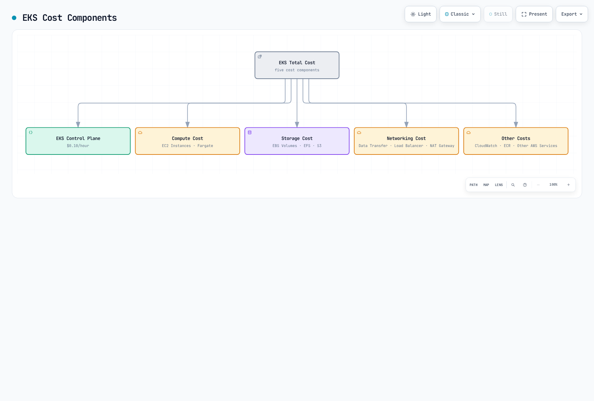
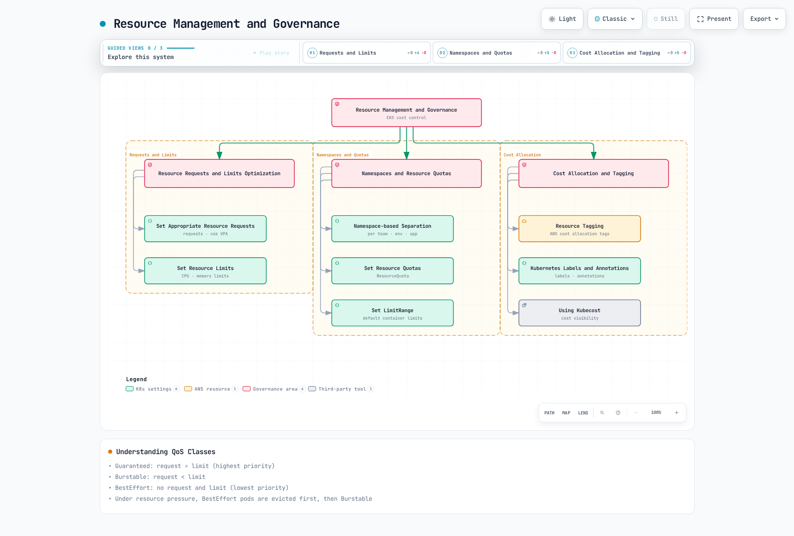
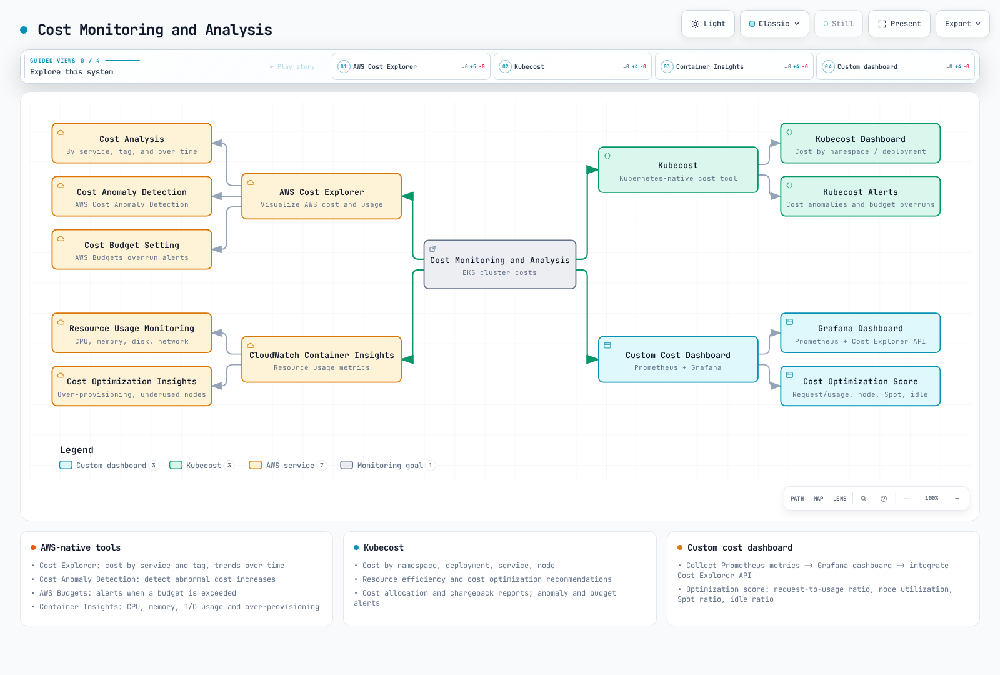
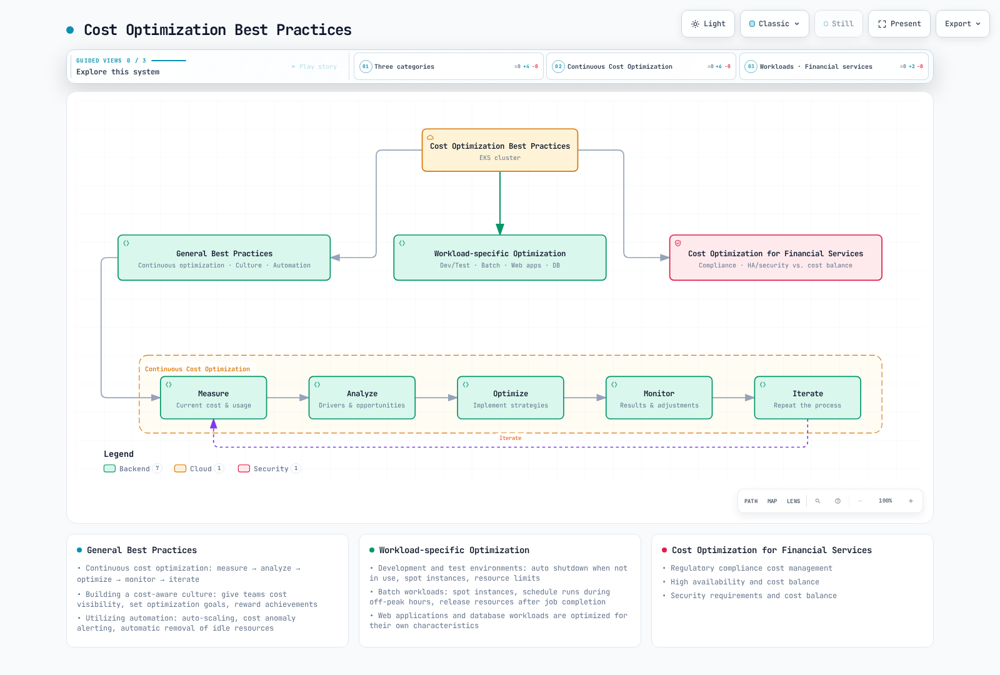

# Amazon EKS 成本优化

> **验证范围**：当前 AWS 定价/支持文档；Kubernetes 清单已根据 1.36 进行检查。请从 AWS 支持目录中选择实际的 EKS 版本和附加组件。
> **最后更新**：October 16, 2026

Amazon EKS（Elastic Kubernetes Service）让部署、管理和扩展容器化应用变得简单，但有效管理成本也很重要。本文介绍优化 EKS 集群成本的各种策略和最佳实践。

这些命令是配置示例，并非实际部署记录或测得的节省金额。应用前，请核实账户、Region、现有资源的所有者、工作负载需求以及受支持的工具版本。下文中的历史价格假设已明确与当前服务行为区分开来。

## 目录

1. [EKS 成本组成](#eks-cost-components)
2. [FinOps 原则与 EKS](#finops-principles-and-eks)
3. [计算成本优化](#compute-cost-optimization)
4. [存储成本优化](#storage-cost-optimization)
5. [网络成本优化](#networking-cost-optimization)
6. [资源管理与治理](#resource-management-and-governance)
7. [成本监控与分析](#cost-monitoring-and-analysis)
8. [成本优化最佳实践](#cost-optimization-best-practices)

## EKS 成本组成 {#eks-cost-components}

使用 Amazon EKS 所产生的成本由以下部分组成：



[🔍 查看交互式示意图](https://www.atomai.click/kubernetes-docs/archmaps/en-eks-07-eks-cost-optimization-0.html)

## FinOps 原则与 EKS {#finops-principles-and-eks}

FinOps 是一种旨在最大化技术业务价值的运营框架和文化实践。工程、财务和业务团队通过及时、数据驱动的决策和财务责任机制开展协作；本章将这种方法应用于 EKS。

### FinOps 框架的核心原则

FinOps Foundation 强调跨团队协作、在决策中体现业务价值、对使用情况负责、提供及时准确且易于访问的数据、集中赋能，以及有意识地利用云的可变成本模式。以下 EKS 实践应用了这些原则；它们并非独立的官方六原则框架。

<!-- Pending parent diagram repair: see /tmp/eks-cost-optimization-audit/diagram-review.json


[🔍 View interactive diagram](https://www.atomai.click/kubernetes-docs/archmaps/en-eks-07-eks-cost-optimization-1.html)
-->

### 在 EKS 中应用 FinOps

1. **实现成本可见性**
   - 使用 Kubernetes 命名空间、标签和注释进行成本分配
   - 集成 AWS Cost Explorer 和 Kubecost 等工具，进行详细的成本分析
   - 按团队、应用和环境分析成本

2. **实施共同责任模式**
   - 按团队分配和报告成本
   - 制定并跟踪成本优化目标
   - 为节省成本提供激励

3. **实现持续优化自动化**
   - 实施自动扩缩策略
   - 自动化 Spot 实例的使用
   - 发现潜在浪费资源；只有经过所有者/保留审查后才移除资源

4. **成本预测与规划**
   - 通过分析工作负载模式预测成本
   - 使用 Reserved Instances 和 Savings Plans
   - 检测成本异常并发出警报

### 最新 FinOps 工具和技术

1. **Kubecost**：Kubernetes 成本监控和优化工具
2. **AWS Cost Anomaly Detection**：检测异常成本增长
3. **Karpenter**：高效的节点预置和成本优化
4. **Goldilocks**：优化资源请求和限制
5. **Vertical Pod Autoscaler**：自动调整 Pod 资源请求

### EKS 集群成本

已公布的版本支持费用如下：

- **标准支持**：每个集群每小时 $0.10。
- **扩展支持**：**每个集群每小时总计 $0.60**（$0.10 基础费用 + $0.50 扩展支持费用），而不是另有一个每小时收费 $0.10 的“扩展集群”。

标准支持从 EKS 版本发布起持续 14 个月，之后进入 12 个月的扩展支持期。请查看 [EKS 发布日历](https://docs.aws.amazon.com/eks/latest/userguide/kubernetes-versions.html)，了解确切的版本日期和支持政策。Provisioned Control Plane 层级、Auto Mode、Hybrid Nodes 和 EKS Capabilities 可能产生单独费用；EC2/Fargate、存储、网络和可观测性费用仍单独计算。概览示意图中的 $0.10 标签仅表示版本标准支持费用。请参阅[当前 EKS 定价](https://aws.amazon.com/eks/pricing/)。

### 计算成本

EKS 集群中运行的工作节点的成本：

- **EC2 实例**：节点组所用 EC2 实例的成本
- **Fargate**：根据预置的 Pod vCPU/内存配置和持续时间收费，而非按抽样得到的利用率收费；还需计入适用的存储费用

### 存储成本

EKS 集群中使用的存储成本：

- **EBS 卷**：持久卷所用 EBS 卷的成本
- **EFS**：共享文件系统所用 EFS 的成本
- **S3**：对象存储所用 S3 的成本

### 网络成本

EKS 集群相关的网络成本：

- **数据传输**：适用的跨 AZ、跨 Region 和互联网传输费用；具体费用取决于传输方向和服务路径
- **负载均衡器**：Service 使用的负载均衡器成本
- **NAT 网关**：私有子网出站流量所用 NAT 网关的成本

### 其他成本

- **CloudWatch**：监控和日志记录所用 CloudWatch 的成本
- **ECR**：容器映像存储所用 ECR 的成本
- **其他 AWS 服务**：EKS 集群使用的其他 AWS 服务的成本

## 计算成本优化 {#compute-cost-optimization}

计算成本通常是 EKS 集群成本中占比最大的一项。你可以使用以下策略优化计算成本。


[🔍 查看交互式示意图](https://www.atomai.click/kubernetes-docs/archmaps/en-eks-07-eks-cost-optimization-2.html)

### 选择合适的实例类型

为工作负载选择合适的实例类型很重要：

#### 选择实例系列

根据工作负载特征进行选择。以下系列只是旧代实例的示例，并非对当前代实例的推荐；请检查 Region 可用性、处理器架构、AMI 和定价。

- **通用型（T3、M5、M6）**：需要均衡计算、内存和网络资源的工作负载
- **计算优化型（C5、C6）**：需要高性能处理器的计算密集型工作负载
- **内存优化型（R5、R6、X1）**：大型内存数据库、缓存等内存密集型工作负载
- **存储优化型（I3、D2）**：需要高磁盘 I/O 的工作负载
- **加速计算型（P3、G4、Inf1）**：需要 GPU 或机器学习加速器的工作负载

#### 优化实例大小

根据工作负载需求选择合适的实例大小：

- 实例过大可能导致资源浪费。
- 实例过小可能导致性能问题。
- 使用 CloudWatch Container Insights 或 Kubernetes 指标监控实际资源使用情况，并选择合适的大小。

#### 考虑实例代际

结合自身工作负载测量数据和区域价格，对比新代实例。以下是较早期的迁移路径示例；从 x86（`i`）迁移到 Graviton（`g`）还需要兼容的 arm64 镜像和依赖项：

- 使用 M6i 或 M6g 替代 M5
- 使用 C6i 或 C6g 替代 C5
- 使用 R6i 或 R6g 替代 R5

### 使用 Spot 实例

AWS 宣称 Spot 相较于 On-Demand 最高可优惠 90%；实际价格、可用容量和中断风险各不相同。仅凭无状态这一点，无法判定工作负载能够容忍中断：

#### 适合使用 Spot 实例的工作负载

- **无状态应用**：不存储状态的应用
- **容错应用**：能够处理实例中断的应用
- **批处理作业**：中断后可以重新启动的作业
- **CI/CD 流水线**：构建和测试作业

#### 在托管节点组中使用 Spot 实例

此命令会在现有集群中创建托管节点组；它不会安装 Cluster Autoscaler。请检查所属配置中的私有子网、IAM 角色、AMI 和实例多样性。应通过控制器所有者添加明确的扩缩/IAM 配置，而不是授予节点角色宽泛的附加组件权限。

```bash
eksctl create nodegroup \
  --cluster my-cluster \
  --name my-spot-ng \
  --managed \
  --node-type m5.large \
  --nodes-min 2 \
  --nodes-max 5 \
  --spot
```

#### 使用 Karpenter 预置 Spot 实例

前提条件：已安装 Karpenter/CRD、范围受限的控制器 IAM、获授权的节点角色、带有发现标签的子网/安全组，以及中断队列。对于 EKS 1.36，当前兼容性矩阵要求 Karpenter >=1.13。这些资源不会安装控制器。实例列表和限制仅为示例，并非成本上限。请检查解析后的 AMI：`al2023@latest` 是会不断变化的选择器，可能造成偏移/替换；生产环境变更应固定到经过测试的别名版本或 AMI ID。

```yaml
apiVersion: karpenter.sh/v1
kind: NodePool
metadata:
  name: spot
spec:
  template:
    spec:
      requirements:
      - key: karpenter.sh/capacity-type
        operator: In
        values: ["spot"]
      - key: kubernetes.io/arch
        operator: In
        values: ["amd64"]
      - key: node.kubernetes.io/instance-type
        operator: In
        values: ["m5.large", "m5.xlarge", "m5.2xlarge"]
      nodeClassRef:
        group: karpenter.k8s.aws
        kind: EC2NodeClass
        name: spot-class
  limits:
    cpu: 1000
    memory: 1000Gi
  disruption:
    consolidationPolicy: WhenEmpty
    consolidateAfter: 30s
---
apiVersion: karpenter.k8s.aws/v1
kind: EC2NodeClass
metadata:
  name: spot-class
spec:
  role: KarpenterNodeRole-my-cluster
  amiSelectorTerms:
    - alias: al2023@latest
  subnetSelectorTerms:
    - tags:
        karpenter.sh/discovery: my-cluster
  securityGroupSelectorTerms:
    - tags:
        karpenter.sh/discovery: my-cluster
```

#### 处理 Spot 实例中断

处理 Spot 实例中断的最佳实践：

1. **使用多种实例类型**：使用不同的实例类型分散中断风险
2. **使用多个可用区**：在多个可用区部署实例
3. **为每组节点选择一个中断处理方**：托管节点组已负责处理 Spot 中断/再平衡。为 Karpenter 节点配置 Karpenter 原生中断队列；不要在同一批节点上安装 Node Termination Handler。自行管理的 ASG 可以使用 [AWS Node Termination Handler](https://github.com/aws/aws-node-termination-handler)，并明确选择 IMDS 或队列模式，同时配置相应权限/事件连线。
4. **设计应用恢复机制**：无法保证一定有替代容量。优雅终止、重试/检查点，以及跨故障域的副本都必须符合可用的中断窗口。PDB 无法阻止 EC2 回收 Spot 实例。

### Savings Plans 和 Reserved Instances

对于可预测的工作负载，可以使用 Savings Plans 或 Reserved Instances 降低成本：

#### Compute Savings Plans

Compute Savings Plans 需要承诺 1 年或 3 年，最高可比按需费率优惠 66%：

- **灵活性**：不受实例系列、大小、操作系统、租用方式和 Region 的限制
- **涵盖 EC2、Fargate 和 Lambda**：适用于多种计算服务

#### EC2 Instance Savings Plans

EC2 Instance Savings Plans 对特定 Region 中的实例系列最高可优惠 72%：

- **中等灵活性**：在特定 Region 的同一实例系列内适用于不同大小和操作系统
- **折扣率更高**：折扣率高于 Compute Savings Plans

#### Reserved Instances

AWS 当前宣称 RI 最高可优惠 **72%**。Standard 和 Convertible RI 的修改/兑换规则不同；Regional 和 Zonal 的适用范围也不同。Zonal RI 包含其 AZ 中的容量预留，而 Regional RI 不包含。RI 是应用于匹配使用量的计费优惠，不是 Kubernetes 调度器，也不保证获得最高折扣。

Savings Plans 承诺在一年或三年内每小时产生符合条件的支出；RI 承诺使用符合条件的实例。完成适当调整后，应根据稳定基线确定承诺规模，并审查未使用承诺的风险。两者都不会对 Spot 使用额外提供折扣，宣传中的最高优惠也不代表此集群实际测得的节省金额。

### Fargate 与 EC2 成本比较

在选择 Fargate 和 EC2 时，请考虑成本：

#### Fargate 的优势

- **降低运维开销**：无需管理节点
- **精确预置资源**：在 Pod 级别分配资源
- **无需单独管理空闲工作节点**：费用仍按预置的 Pod 容量和持续时间计算，包括取整和最低计费时长

#### EC2 的优势

- **大型工作负载更具成本效益**：适用于资源利用率较高的情况
- **实例类型选择更多**：可针对不同工作负载选择实例类型
- **支持 Spot 实例**：使用 Spot 实例可能进一步节省成本

#### 成本比较示例

**旧版示例假设（未记录价格来源/Region；不是当前报价或基准测试）**：应用请求 2 vCPU 和 4 GB 内存。下方保留了原始单价和算术结果；其中未计入 EKS 特有的预留资源和节点开销。

**Fargate 成本**：
- vCPU：每 vCPU-小时 $0.04048 × 2 = 每小时 $0.08096
- 内存：每 GB-小时 $0.004445 × 4 = 每小时 $0.01778
- 总成本：每小时 $0.09874

**EC2 成本（t3.medium）**：
- 按需：每小时 $0.0416
- Spot：约每小时 $0.0125（假设优惠 70%）

**分配修正：**EKS Fargate 会为 Kubernetes 组件增加 256 MB，并向上取整至受支持的配置。在这些假设下，申请 2 vCPU/4 GB 需要预置 **2 vCPU/5 GB** 容量：按照相同的历史费率，`2 × 0.04048 + 5 × 0.004445 = 0.103185 USD/hour`。这是算术计算，不是新的价格报价。Linux Fargate 从镜像下载开始计费，最低计费时长为一分钟。EC2 `t3.medium` 的标称容量为 2 vCPU/4 GiB，但扣除 OS/Kubernetes/DaemonSet 预留资源后，可分配资源会更少；不能假设它能够容纳此 Pod，而且持续使用 CPU 可能产生 T3 积分费用。请对确实能够调度该工作负载的容量方案进行比较，并计入 EBS、网络、集群费用、利用率和运维成本。此表不能证明哪种等效服务更优。

### 自动扩缩优化

实施有效的自动扩缩策略可以优化成本：

#### Cluster Autoscaler

Cluster Autoscaler 会为无法调度的 Pod 扩展 ASG，并根据请求的资源以及重新调度/干扰检查移除符合条件的节点，而不是简单地依据测得的 CPU 使用率较低来操作。其 Kubernetes 次版本应与集群匹配；在实际 ASG 上配置发现标签，并使用专用工作负载 IAM 角色。EKS/节点组标签不会自动传播到每个底层资源。请参阅[上游 AWS 设置](https://github.com/kubernetes/autoscaler/tree/master/cluster-autoscaler/cloudprovider/aws)和 [EKS 建议](https://docs.aws.amazon.com/eks/latest/best-practices/cas.html)，准备由你负责管理的版本。

这些 chart 值会转换为 CLI 参数。设置虚构的 `CLUSTER_AUTOSCALER_*` 环境变量并不能配置这些参数；应用未经修改的 `master` 示例也不会提供集群特有的 IAM/发现设置。以下时长仅为示例调优输入；缩短延迟可能增加资源波动。

```yaml
# Values fragment for the upstream cluster-autoscaler Helm chart.
# Merge into the existing release's reviewed values, including workload IAM.
autoDiscovery:
  clusterName: my-cluster
awsRegion: us-west-2
extraArgs:
  expander: least-waste
  scale-down-delay-after-add: 10m
  scale-down-unneeded-time: 10m
  max-node-provision-time: 15m
```

#### Karpenter

Karpenter 根据 NodePool/EC2NodeClass 约束进行预置，而不是调整固定 ASG 的大小。预置延迟和成本取决于工作负载及可用容量；前面提到的控制器/IAM/AMI 前提条件也适用于此处。其节点应与 Cluster Autoscaler 管理的 ASG 分开管理：

```yaml
apiVersion: karpenter.sh/v1
kind: NodePool
metadata:
  name: default
spec:
  template:
    spec:
      requirements:
      - key: kubernetes.io/arch
        operator: In
        values: ["amd64"]
      - key: node.kubernetes.io/instance-type
        operator: In
        values: ["m5.large", "m5.xlarge", "m5.2xlarge"]
      nodeClassRef:
        group: karpenter.k8s.aws
        kind: EC2NodeClass
        name: default-class
  limits:
    cpu: 1000
    memory: 1000Gi
  disruption:
    consolidationPolicy: WhenEmpty
    consolidateAfter: 30s
---
apiVersion: karpenter.k8s.aws/v1
kind: EC2NodeClass
metadata:
  name: default-class
spec:
  role: KarpenterNodeRole-my-cluster
  amiSelectorTerms:
    - alias: al2023@latest
  subnetSelectorTerms:
    - tags:
        karpenter.sh/discovery: my-cluster
  securityGroupSelectorTerms:
    - tags:
        karpenter.sh/discovery: my-cluster
```

Karpenter 成本优化设置：

- **disruption.consolidateAfter**：在 Pod 添加/移除后，等待一段时间再考虑合并，并受策略和干扰检查限制（例如 `30s`；替代旧版 `ttlSecondsAfterEmpty`）
- **disruption.consolidationPolicy**：节点合并策略，可设为 `WhenEmpty`（仅移除空节点）或 `WhenEmptyOrUnderutilized`（也合并利用不足的节点；相当于旧版 `consolidation.enabled: true`）
- **template.spec.requirements**（`node.kubernetes.io/instance-type`）：指定具备成本效益的实例类型

#### Horizontal Pod Autoscaler（HPA）

HPA 根据 CPU 利用率或自定义指标自动调整 Pod 数量：

```yaml
apiVersion: autoscaling/v2
kind: HorizontalPodAutoscaler
metadata:
  name: app-hpa
spec:
  scaleTargetRef:
    apiVersion: apps/v1
    kind: Deployment
    name: app
  minReplicas: 2
  maxReplicas: 10
  metrics:
  - type: Resource
    resource:
      name: cpu
      target:
        type: Utilization
        averageUtilization: 70
  - type: Resource
    resource:
      name: memory
      target:
        type: Utilization
        averageUtilization: 80
```

CPU/内存利用率目标是相对于 requests 的百分比，因此需要资源指标 API，并且相关容器必须设置 requests。使用多个指标时，HPA 会选择所需副本数最多的指标；指标不可用可能导致无法缩容。添加副本后，内存使用量可能不会下降，因此应验证应用行为。控制器管理器标志由 EKS 管理；请配置每个 HPA 的 `spec.behavior.scaleDown.stabilizationWindowSeconds`，而不要假设可以编辑其全局标志。当 HPA 使用 CPU/内存 requests 作为利用率分母时，不要让 VPA 同时自动更改这些 requests。

#### Vertical Pod Autoscaler（VPA）

VPA 会自动调整 Pod 的 CPU 和内存 requests，以优化资源利用率：

```yaml
apiVersion: autoscaling.k8s.io/v1
kind: VerticalPodAutoscaler
metadata:
  name: app-vpa
spec:
  targetRef:
    apiVersion: apps/v1
    kind: Deployment
    name: app
  updatePolicy:
    updateMode: "Off"
  resourcePolicy:
    containerPolicies:
    - containerName: '*'
      minAllowed:
        cpu: 50m
        memory: 100Mi
      maxAllowed:
        cpu: 1
        memory: 1Gi
```

此示例使用 **Off** 模式收集建议，避免与上方的 HPA 相互竞争。请先安装 VPA 组件/CRD 和指标依赖项。

- **Off**：仅提供建议。
- **Initial**：通过准入控制为新创建的 Pod 设置 requests。
- **Recreate**：updater 可能会驱逐 Pod，使控制器使用建议的资源重新创建 Pod，但需遵循驱逐策略/PDB。
- **Auto**：Recreate 的弃用别名；新配置应选择明确的模式。
- 就地模式需要兼容的 VPA/Kubernetes 版本和相应的文档化功能门控。请阅读所选模式的具体行为：`InPlaceOrRecreate` 可在必要时回退到驱逐，而 `InPlace` 不会使用这种重新创建回退。启用自动更新前，请检查边界、干扰和峰值需求。

## 存储成本优化 {#storage-cost-optimization}

存储是 EKS 集群成本的重要组成部分。你可以使用以下策略优化存储成本。


[🔍 查看交互式示意图](https://www.atomai.click/kubernetes-docs/archmaps/en-eks-07-eks-cost-optimization-3.html)

### EBS 卷优化

EKS 集群中的持久存储主要使用 EBS 卷：

#### 选择合适的卷类型

为工作负载选择合适的 EBS 卷类型：

- **gp3**：通用型 SSD，适合大多数工作负载
- **gp2**：上一代通用型 SSD，建议迁移到 gp3
- **io1/io2**：为高性能工作负载预置 IOPS 的 SSD
- **st1**：面向吞吐量密集型工作负载的吞吐量优化 HDD
- **sc1**：适合不常访问数据的冷 HDD

gp3 将容量、IOPS 和吞吐量的定价分开；其 3,000 IOPS 基准并不高于所有 gp2 卷。以下限制适用于当前一般 AWS Region 的卷，但仍受容量/IOPS 比率和实例限制约束。Outposts 的限制有所不同。$0.08/$0.10 存储费率是保留的示例假设，未记录 Region/日期；请获取包含预置 IOPS/吞吐量的当前报价。

| 卷类型 | 基准 IOPS | 最大 IOPS | 基准吞吐量 | 最大吞吐量 | 每 GB 价格 |
|------------|--------------|----------|---------------------|----------------|--------------|
| gp3 | 3,000 | 80,000 | 125 MiB/s | 2,000 MiB/s | $0.08/GB-month（示例） |
| gp2 | 3 IOPS/GiB，最低 100；符合条件的小型卷可突增 | 16,000 | 取决于容量/I/O | 250 MiB/s | $0.10/GB-month（示例） |

#### 迁移到 gp3

此 StorageClass 会通过标准 EBS CSI driver（`ebs.csi.aws.com`）创建新的 gp3 卷；它不会迁移现有卷，也不会更改集群默认值。Auto Mode 使用不同的 provisioner（`ebs.csi.eks.amazonaws.com`）以及适当的节点/存储迁移路径。请确认已安装的 driver、IAM/KMS 权限、现有 StorageClass 的所有者和拓扑。`Retain` 会将已释放的存储保留以供所有者审查，并且可能继续产生费用：

```yaml
apiVersion: storage.k8s.io/v1
kind: StorageClass
metadata:
  name: gp3
provisioner: ebs.csi.aws.com
parameters:
  type: gp3
  encrypted: "true"
volumeBindingMode: WaitForFirstConsumer
reclaimPolicy: Retain
allowVolumeExpansion: true
```

将现有 PVC 迁移到 gp3：

1. 使用已安装的 CSI snapshot 组件创建应用一致性备份/快照，并验证其就绪状态和恢复访问权限。
2. 使用 gp3 StorageClass 恢复到一个**新的** PVC；已绑定的 PVC 无法原地切换 StorageClass。
3. 测试恢复结果，并在经过审核的切换过程中切换工作负载；确认恢复已验证前，请保留原有数据。

对于受支持的配置，也可以考虑原地更改 EBS Elastic Volumes 类型。请与 CSI/IaC 所有者协调，避免产生配置偏差。请参阅[存储指南](04-eks-storage-part1.md)。

#### 优化卷大小

仅预置所需的卷容量：

- 过度预置的卷会产生不必要的成本。
- 监控文件系统使用情况，并在需要时扩展支持的卷。EBS 卷和 Kubernetes PVC 均无法原地缩小；要减少容量，必须新建较小的卷，并进行与应用相适应的数据迁移。
- `allowVolumeExpansion` 允许发出受支持的扩容请求；它不会监控使用情况，也不会自动调整大小。任何自动扩容程序都需要单独配置控制器、边界和故障处理机制。

#### 管理卷生命周期

识别并移除不需要的卷：

- 定期检查未使用的 PVC 和 PV
- Pod 终止并不意味着其 PVC/PV 可以丢弃。删除声明或卷之前，请检查 StatefulSet 保留策略、等待中的消费者、备份和所有权
- 设置合适的 PV 回收策略（Delete 或 Retain）

### EFS 成本优化

EFS 适用于需要在多个节点之间共享访问的工作负载：

#### 选择合适的吞吐量模式

为工作负载选择合适的 EFS 吞吐量模式：

- **Bursting Throughput**：适用于间歇性访问模式
- **Provisioned Throughput**：适用于需要可预测性能的工作负载
- **Elastic Throughput**：适用于变化较大的工作负载

#### 生命周期管理

EFS 生命周期策略可以将符合条件且不常访问的文件移至 IA/Archive，并可选择在访问时将文件移回主存储。访问费用、最低计费容量/时长、吞吐量模式和访问模式都会影响节省金额。以下示例导出当前策略数组供审查。请在该数组中编辑 IA 规则，并在提交完整的目标配置前保留必要的 Archive/返回主存储条目：

```bash
aws efs describe-lifecycle-configuration \
  --file-system-id fs-1234567890abcdef0 \
  --query LifecyclePolicies --output json > efs-lifecycle-policies.json
# Edit the exported array; an IA rule is {"TransitionToIA":"AFTER_30_DAYS"}.
# Preserve required Archive/return-to-primary rules and review the complete array.
aws efs put-lifecycle-configuration \
  --file-system-id fs-1234567890abcdef0 \
  --lifecycle-policies file://efs-lifecycle-policies.json
```

#### 优化访问模式

优化 EFS 访问模式以降低成本：

- 使用较大的文件，减少小文件
- 尽量减少元数据操作
- 使用顺序访问模式

### S3 成本优化

S3 是一种具有成本效益的存储选项，可用于存储日志、备份、静态内容等：

#### 优化存储类别

为工作负载选择合适的 S3 存储类别：

- **S3 Standard**：频繁访问的数据
- **S3 Intelligent-Tiering**：访问模式不断变化的数据
- **S3 Standard-IA**：不常访问的数据
- **S3 One Zone-IA**：不常访问的非关键数据
- **S3 Glacier**：归档数据

#### 生命周期策略

此示例规则会在 30/90 天后转移当前对象，并在 365 天后使其过期。请验证恢复延迟、保留/Object Lock 要求、转换/请求费用、最低存储时长，以及新建/修改配置时默认排除小于 128 KB 对象的转换规则。启用版本控制的存储桶需要单独管理非当前版本；当前版本过期可能会创建删除标记，而旧数据仍会继续计费。`put-bucket-lifecycle-configuration` 调用会替换存储桶生命周期配置，因此请合并/保留其他无关规则：

```json
{
  "Rules": [
    {
      "ID": "Move to IA after 30 days, Glacier after 90 days",
      "Status": "Enabled",
      "Filter": {"Prefix": "logs/"},
      "Transitions": [
        {
          "Days": 30,
          "StorageClass": "STANDARD_IA"
        },
        {
          "Days": 90,
          "StorageClass": "GLACIER"
        }
      ],
      "Expiration": {
        "Days": 365
      }
    }
  ]
}
```

#### 优化 S3 请求

优化 S3 请求成本：

- 将小对象合并为较大的对象
- 尽量减少不必要的 LIST 操作
- 分段上传可以改善传输/重试行为，但会增加请求费用和未完成分段的存储费用；应配置中止/清理机制来处理已放弃的上传。Transfer Acceleration 可能增加费用，它是延迟/吞吐量选项，并不会自动降低请求成本

## 网络成本优化 {#networking-cost-optimization}

网络成本可能相当可观，尤其是在数据传输量较大时。你可以使用以下策略优化网络成本。

<!-- Pending parent diagram repair: see /tmp/eks-cost-optimization-audit/diagram-review.json


[🔍 View interactive diagram](https://www.atomai.click/kubernetes-docs/archmaps/en-eks-07-eks-cost-optimization-4.html)
-->

### 优化数据传输

#### 使用 Region 内通信

尽可能在同一 Region 内通信，以降低跨 Region 数据传输成本：

- 在同一 Region 中部署 EKS 集群和相关 AWS 服务
- 跨多个 Region 时，尽量减少跨 Region 数据传输

#### 基于可用区的路由

实施基于可用区的路由，降低跨 AZ 数据传输成本：

- 使用拓扑感知的 Service 路由
- 在支持的情况下优先使用本地端点，同时保持多 AZ 可用性。`trafficDistribution: PreferSameZone` 在 Kubernetes 1.35+ 中已稳定；请验证集群/代理实现。它只是优先选择本地端点；本地端点不可用时会回退，并不能保证跨 AZ 流量为零。仅设置亲和性不会对 Service 流量进行路由

```yaml
apiVersion: v1
kind: Service
metadata:
  name: my-service
spec:
  trafficDistribution: PreferSameZone
  selector:
    app: my-app
  ports:
  - port: 80
    targetPort: 8080
  type: ClusterIP
```

#### 使用压缩

在传输数据前进行压缩，减少传输数据量：

- API 响应压缩
- 日志和指标压缩
- 优化镜像和静态资源

### 负载均衡器优化

#### 选择合适的负载均衡器类型

为工作负载选择合适的负载均衡器类型：

- **Network Load Balancer（NLB）**：TCP/UDP 流量，以及需要低延迟的场景
- **Application Load Balancer（ALB）**：HTTP/HTTPS 流量，以及需要基于路径进行路由的场景
- **Classic Load Balancer（CLB）**：旧版工作负载

#### 共享负载均衡器

通过多个 Service 共享负载均衡器来降低成本：

- 使用 AWS Load Balancer Controller
- 使用 Ingress 资源公开多个 Service

请参阅[网络指南](03-eks-networking-part1.md)，使用正确的 chart、IAM/ServiceAccount、子网和安全组安装标准 AWS Load Balancer Controller。沿用现有控制器所有者。Auto Mode 具有不同的内置集成；不要假设这些安装/类设置适用于它。以下两个后端 Service 必须存在于 Ingress 命名空间中，并公开端口 80；IP 目标模式要求能够访问 Pod IP。这是一个 HTTP 路由示例；要在生产环境中公开使用，还需审查 TLS、DNS 和访问控制。

```yaml
apiVersion: networking.k8s.io/v1
kind: Ingress
metadata:
  name: shared-ingress
  annotations:
    alb.ingress.kubernetes.io/scheme: internet-facing
    alb.ingress.kubernetes.io/target-type: ip
spec:
  ingressClassName: alb
  rules:
  - host: service1.example.com
    http:
      paths:
      - path: /
        pathType: Prefix
        backend:
          service:
            name: service1
            port:
              number: 80
  - host: service2.example.com
    http:
      paths:
      - path: /
        pathType: Prefix
        backend:
          service:
            name: service2
            port:
              number: 80
```

#### 移除闲置负载均衡器

识别并移除未使用的负载均衡器：

- 监控无流量的负载均衡器
- 移除测试或开发环境中不需要的负载均衡器

### NAT 网关优化

NAT 网关会产生按小时计费和数据处理费用：

#### 共享 NAT 网关

通过在多个子网之间共享 NAT 网关来降低成本：

- 使用分区 NAT 网关时，同一 AZ 中的私有子网可以共享本地网关。请评估每个 AZ 的可用性和固定小时费用。
- 在多个 AZ 之间共享单个分区网关会产生跨 AZ 依赖，并可能产生传输费用；这是有意的权衡，并非普遍更便宜的 HA 设计。请根据其文档化的可用性/定价模式，单独评估当前的区域 NAT 选项。

#### 使用 VPC 端点

根据实际流量，将端点费用与 NAT 路径进行比较。S3/DynamoDB 网关端点无需额外的端点小时费/数据处理费；接口端点（例如 ECR/Logs/STS）有自己的费用，并且需要 DNS/安全组配置。以下命令会在现有且经过审查的路由表中创建网关端点；请应用适当的端点策略。ECR 镜像拉取通常需要 `ecr.api`/`ecr.dkr` 接口端点以及 S3 访问权限，而不只是 ECR API 端点：

```bash
# Create S3 VPC Endpoint
aws ec2 create-vpc-endpoint \
  --vpc-id vpc-1234567890abcdef0 \
  --service-name com.amazonaws.us-west-2.s3 \
  --route-table-ids rtb-1234567890abcdef0

# Create DynamoDB VPC Endpoint
aws ec2 create-vpc-endpoint \
  --vpc-id vpc-1234567890abcdef0 \
  --service-name com.amazonaws.us-west-2.dynamodb \
  --route-table-ids rtb-1234567890abcdef0
```

常用 VPC 端点：

- S3
- DynamoDB
- ECR
- CloudWatch Logs
- STS

#### 优化出站流量

优化经过 NAT 网关的出站流量：

- 尽量减少不必要的外部 API 调用
- 调度可以减少争用，但常规 NAT/数据传输价格并无通用的非高峰时段折扣；应减少计费字节数或预置时长
- 使用数据压缩

## 资源管理与治理 {#resource-management-and-governance}

有效的资源管理和治理对于控制 EKS 集群成本很重要。你可以使用以下策略有效地管理资源。



[🔍 查看交互式示意图](https://www.atomai.click/kubernetes-docs/archmaps/en-eks-07-eks-cost-optimization-5.html)

### 优化资源请求和限制

#### 设置合适的资源请求

设置与应用实际资源需求相匹配的资源 requests：

- requests 过高会导致资源浪费。
- requests 过低可能导致性能问题。
- 使用 VPA（Vertical Pod Autoscaler）优化资源 requests

```yaml
apiVersion: v1
kind: Pod
metadata:
  name: app
spec:
  containers:
  - name: app
    image: app:latest
    resources:
      requests:
        cpu: 100m
        memory: 256Mi
      limits:
        cpu: 500m
        memory: 512Mi
```

#### 设置资源限制

设置资源限制，防止容器使用过多资源：

- CPU 限制通常通过节流强制执行；即使节点有剩余 CPU，限制过低也会影响延迟。
- 内存限制以响应式方式强制执行，并可能导致 OOM 终止；它并不保证使用量不会短暂超出某个值。应根据测得的工作负载行为设置 requests/limits，而不是采用通用比例。

#### 了解 QoS 类别

了解并使用 Kubernetes QoS（服务质量）类别：

对于此处显示的容器级资源配置：

- **Guaranteed**：每个容器都设置了非零 CPU 和内存 requests，且分别等于对应的 limits。
- **Burstable**：设置了某些 CPU/内存 request 或 limit，但未满足 Guaranteed 条件。
- **BestEffort**：没有任何容器设置 CPU/内存 requests 或 limits。

QoS 不是 Pod Priority，也不会提供绝对的驱逐顺序。在节点压力下，kubelet 会考虑使用量是否超过 requests、Pod Priority，以及相对超额使用量。磁盘压力下的驱逐也有所不同，因为 CPU/内存 QoS 不会对临时存储 requests 进行分类。使用 Pod 级资源时，请查看[当前 QoS 规则](https://kubernetes.io/docs/concepts/workloads/pods/pod-qos/)。

### 命名空间和资源配额

#### 基于命名空间进行隔离

使用命名空间对资源进行逻辑隔离：

- 按团队、环境或应用创建命名空间
- 按命名空间监控资源使用情况

#### 设置 ResourceQuota

ResourceQuota 会限制现有命名空间中获准资源的 requests/limits 和对象数量；它不是支出上限，也不是运行时 CPU 计量器。请先创建 `team-a` 命名空间。CPU/内存配额可能要求传入的容器设置 requests/limits，因此应协调 LimitRange 默认值与工作负载：

```yaml
apiVersion: v1
kind: ResourceQuota
metadata:
  name: team-quota
  namespace: team-a
spec:
  hard:
    requests.cpu: "10"
    requests.memory: 20Gi
    limits.cpu: "20"
    limits.memory: 40Gi
    pods: "20"
    services: "10"
    persistentvolumeclaims: "5"
```

#### 设置 LimitRange

使用 LimitRange 为命名空间中的容器设置默认资源限制：

```yaml
apiVersion: v1
kind: LimitRange
metadata:
  name: default-limits
  namespace: team-a
spec:
  limits:
  - default:
      cpu: 500m
      memory: 512Mi
    defaultRequest:
      cpu: 100m
      memory: 256Mi
    type: Container
```

### 成本分配和标记

#### 资源标记

应用 AWS 资源标签，并通过计费负责人激活符合条件的计费键。EKS 集群标签不会自动传播到 EC2 实例、ASG、EBS 卷或负载均衡器。请验证实际标签覆盖范围和账单处理延迟；这些明确的标记示例并不能证明已实现完整的集群成本归因：

- 按团队、项目、环境、成本中心等标记
- 实施一致的标记策略

```bash
# Tag EKS cluster
aws eks tag-resource \
  --resource-arn arn:aws:eks:us-west-2:123456789012:cluster/my-cluster \
  --tags Team=DevOps,Environment=Production,CostCenter=123456

# Tag EC2 instance
aws ec2 create-tags \
  --resources i-1234567890abcdef0 \
  --tags Key=Team,Value=DevOps Key=Environment,Value=Production Key=CostCenter,Value=123456
```

#### Kubernetes 标签和注释

Kubernetes 标签/注释属于单独的元数据系统。成本工具可以按所选工作负载标签分组；如果希望按 Pod 级别分组，Deployment 标签也必须出现在其 Pod 模板中。命名空间标签不会自动继承到 Pod 或 AWS 资源。AWS 分割成本分配和生成的 EKS Pod 成本属性需要单独配置计费：

```yaml
apiVersion: apps/v1
kind: Deployment
metadata:
  name: app
  labels:
    app: app
    team: team-a
    environment: production
    cost-center: "123456"
spec:
  replicas: 3
  selector:
    matchLabels:
      app: app
  template:
    metadata:
      labels:
        app: app
        team: team-a
        environment: production
        cost-center: "123456"
    spec:
      containers:
      - name: app
        image: app:latest
```

#### 使用 Kubecost

使用 Kubecost 跟踪和优化 Kubernetes 资源成本：

请按下文的安装部分操作；选择一个由你负责管理的 Kubecost/OpenCost 部署，不要安装重复的收集器。基于资源的分配仍是估算值，需与账单数据集及约定的共享成本策略核对后才能确认。

Kubecost 提供以下功能：

- 按命名空间、Deployment、Service、标签分析成本
- 提供成本优化建议
- 提供成本分配和分摊报告

## 成本监控与分析 {#cost-monitoring-and-analysis}

要有效优化成本，需要持续监控和分析成本。你可以使用以下工具和策略监控并分析 EKS 集群成本。



[🔍 查看交互式示意图](https://www.atomai.click/kubernetes-docs/archmaps/en-eks-07-eks-cost-optimization-6.html)

### AWS Cost Explorer

AWS Cost Explorer 是一款帮助可视化、了解和管理 AWS 成本及使用情况的工具：

#### 成本分析

使用 AWS Cost Explorer 分析 EKS 集群成本：

- 按服务分析成本
- 按标签分析成本
- 分析成本随时间变化的趋势

```bash
# Get cost data using AWS CLI
aws ce get-cost-and-usage \
  --time-period Start=2025-06-01,End=2025-07-01 \
  --granularity MONTHLY \
  --metrics "UnblendedCost" "AmortizedCost" \
  --group-by Type=DIMENSION,Key=SERVICE Type=TAG,Key=Environment
```

2025 年的日期是历史语法示例，并非当前成本报告；请选择一个可用的 UTC 账单周期，并使用不包含结束日期的结束时间。请处理任何 `NextPageToken`，不要将第一个响应当作完整结果。应分别比较不同成本口径；不要将不同口径相加，也不要跨不兼容的单位汇总 `UsageQuantity`。按服务/标签分组会包含未标记的值，并不会自动限定为特定集群。

#### 成本异常检测

使用 AWS Cost Anomaly Detection 检测异常成本增长：

1. 登录 AWS Management Console
2. 导航至 AWS Cost Management 服务
3. 选择“Cost Anomaly Detection”
4. 点击“Create anomaly monitor”
5. 配置监控器类型和通知首选项

#### 设置成本预算

此示例会创建一项真实的月度预算通知，预算金额为 1,000 USD、阈值为 80%；请将账户和电子邮件替换为已获批准的值。请根据你的计费配置验证 Budgets 规范的标签筛选器（例如 `user:Environment$Production`）。该筛选器会选择跨服务的已标记成本；如果将 Service 限定为 EKS，就会遗漏 EC2、存储和其他集群成本。未标记/共享成本仍需单独分配。Budgets 使用延迟到账的账单数据处理，并非硬性支出上限。现有预算必须与其所有者核对；此处未设置此前固定的到期时间：

```bash
# Create budget using AWS CLI
aws budgets create-budget \
  --account-id 123456789012 \
  --budget file://budget.json \
  --notifications-with-subscribers file://notifications.json
```

budget.json：
```json
{
  "BudgetName": "Tagged Production Workloads",
  "BudgetLimit": {
    "Amount": "1000",
    "Unit": "USD"
  },
  "BudgetType": "COST",
  "CostFilters": {
    "TagKeyValue": [
      "user:Environment$Production"
    ]
  },
  "TimeUnit": "MONTHLY"
}
```

notifications.json：
```json
[
  {
    "Notification": {
      "ComparisonOperator": "GREATER_THAN",
      "NotificationType": "ACTUAL",
      "Threshold": 80,
      "ThresholdType": "PERCENTAGE"
    },
    "Subscribers": [
      {
        "Address": "email@example.com",
        "SubscriptionType": "EMAIL"
      }
    ]
  }
]
```

### Kubecost

Kubecost 是一款专门用于监控和优化 Kubernetes 集群成本的工具：

#### 安装 Kubecost

根据当前仓库，已检查的 chart/应用版本为 **3.3.1**。Kubecost 3.x 使用 ClickHouse 和直接的 finops-agent 收集；不要重复使用 2.x `cost-analyzer` 安装方式或其捆绑的 Prometheus/node-exporter 值。应用前，请根据[chart 文档](https://github.com/kubecost/cost-analyzer-helm-chart)审查许可、Kubernetes 兼容性、存储类/PVC 大小、集群 ID、网络收集和访问控制。对于现有 2.x 版本，请遵循文档化的迁移流程；这不是原地升级步骤。本文不声称已进行实际安装或已做好生产环境部署准备。[FinOps 平台指南](../ops/13-finops-cost-platform.md)也介绍了 OpenCost 和账单核对。

```bash
helm repo add kubecost https://kubecost.github.io/kubecost/
helm repo update kubecost
helm show values kubecost/kubecost --version 3.3.1 > kubecost-values.yaml
# Edit this file for the reviewed cluster ID, storage, license, and collection settings.
helm template kubecost kubecost/kubecost --version 3.3.1 \
  --namespace kubecost -f kubecost-values.yaml > kubecost-rendered.yaml
# Install a NEW release only after reviewing the rendered resources and prerequisites.
helm install kubecost kubecost/kubecost --version 3.3.1 \
  --namespace kubecost --create-namespace -f kubecost-values.yaml
```

#### Kubecost 仪表板

Kubecost 仪表板提供以下信息：

- 按命名空间、Deployment、Service、节点查看成本
- 资源效率和利用率
- 成本优化建议
- 成本分配和分摊报告

#### Kubecost 警报

请使用已安装的 Kubecost 版本/版本类型所记录的警报机制，并明确配置接收者、凭据、预算周期、聚合方式和投递方式。随意创建的 `cost-analyzer-alerts` ConfigMap 和 `alerts.json` 不会自动被使用，而且原示例也没有提供有效的架构或挂载配置。上方 AWS Budgets 示例是独立且具体的账单警报；[FinOps 指南](../ops/13-finops-cost-platform.md)提供了明确的分配报告工作流。在依赖警报之前，请使用合成测试验证投递，并监控数据缺失/过期情况以及超过阈值的情况。

### CloudWatch Container Insights

使用 CloudWatch Container Insights 监控 EKS 集群资源使用情况：

#### 启用 Container Insights

Container Insights 是由 CloudWatch agent/observability add-on 收集的节点/工作负载遥测数据；`containerinsights` 并不是供 `eksctl utils update-cluster-logging` 使用的 EKS 控制面板日志类型。请参阅[监控指南](06-eks-monitoring-logging.md)，选择兼容的附加组件、IAM 关联、配置和特定平台的收集路径。确保只有一个收集器所有者，并验证指标/日志是否实际传送。附加组件/agent 遥测本身也可能产生费用。

#### 资源使用情况监控

CloudWatch 仪表板可监控以下指标：

- CPU 和内存使用情况
- 磁盘和网络 I/O
- 容器重启次数
- 节点状态

#### 成本优化洞察

分析 CloudWatch Container Insights 数据，寻找成本优化机会：

- 识别过度预置的资源
- 识别资源利用率较低的节点
- 分析资源 requests 与实际使用量之间的差异

### 自定义成本仪表板

你可以创建自定义成本仪表板，全面监控 EKS 集群成本：

#### Grafana 仪表板

使用 Prometheus 和 Grafana 创建自定义成本仪表板：

1. 在 Prometheus 中收集资源使用指标
2. 在 Grafana 中创建成本仪表板
3. 使用单独实现的、经过身份验证的账单数据管道，或使用受支持的数据源获取 Cost Explorer/CUR 结果；仅仅添加一个面板，并不会让 Prometheus 使用指标变成实际账单数据。不要在浏览器仪表板 JSON 中暴露账单凭据

#### 成本优化评分

应将以下指标作为相互独立的指标进行跟踪，并记录其公式、覆盖范围和时间窗口。不存在通用的成本优化评分，而且这些比率本身都不能证明存在浪费或产生了金钱方面的节省：

- 资源请求量与使用量之比
- 节点利用率
- Spot 实例使用率
- 闲置资源比例

## 成本优化最佳实践 {#cost-optimization-best-practices}

下面来看优化 EKS 集群成本的最佳实践。



[🔍 查看交互式示意图](https://www.atomai.click/kubernetes-docs/archmaps/en-eks-07-eks-cost-optimization-7.html)

### 一般最佳实践

#### 持续优化成本

成本优化是一个持续的过程，而不是一次性任务：

1. **度量**：测量当前成本和资源使用情况
2. **分析**：分析成本驱动因素和优化机会
3. **优化**：实施成本优化策略
4. **监控**：监控结果，并根据需要进行调整
5. **迭代**：重复这一过程

#### 建立成本意识文化

在组织内部建立成本意识文化：

- 向团队提供成本可见性
- 设定成本优化目标
- 认可并奖励成本优化成果
- 分享成本优化最佳实践

#### 利用自动化

利用自动化优化成本：

- 实施自动扩缩
- 根据使用情况预置资源
- 自动化成本异常检测和警报
- 自动识别候选资源；只有经过所有权、保留、依赖关系和恢复检查后才予以移除

### 特定工作负载优化

#### 开发和测试环境

优化开发和测试环境的成本：

- 在环境不使用时自动关闭
- 使用 Spot 实例
- 设置资源限制
- 考虑使用共享环境

```yaml
apiVersion: v1
kind: ServiceAccount
metadata:
  name: dev-app-scaler
  namespace: dev
---
apiVersion: rbac.authorization.k8s.io/v1
kind: Role
metadata:
  name: dev-app-scaler
  namespace: dev
rules:
- apiGroups: ["apps"]
  resources: ["deployments"]
  resourceNames: ["dev-app"]
  verbs: ["get"]
- apiGroups: ["apps"]
  resources: ["deployments/scale"]
  resourceNames: ["dev-app"]
  verbs: ["get", "patch", "update"]
---
apiVersion: rbac.authorization.k8s.io/v1
kind: RoleBinding
metadata:
  name: dev-app-scaler
  namespace: dev
subjects:
- kind: ServiceAccount
  name: dev-app-scaler
  namespace: dev
roleRef:
  apiGroup: rbac.authorization.k8s.io
  kind: Role
  name: dev-app-scaler
---
apiVersion: batch/v1
kind: CronJob
metadata:
  name: dev-app-shutdown
  namespace: dev
spec:
  suspend: true
  schedule: "0 20 * * 1-5"
  timeZone: Etc/UTC
  concurrencyPolicy: Forbid
  startingDeadlineSeconds: 1800
  successfulJobsHistoryLimit: 1
  failedJobsHistoryLimit: 2
  jobTemplate:
    spec:
      backoffLimit: 0
      activeDeadlineSeconds: 120
      template:
        spec:
          serviceAccountName: dev-app-scaler
          restartPolicy: Never
          securityContext:
            runAsNonRoot: true
            runAsUser: 65532
            seccompProfile:
              type: RuntimeDefault
          containers:
          - name: kubectl
            image: registry.k8s.io/kubectl:v1.36.2
            command: ["kubectl"]
            args: ["scale", "deployment/dev-app", "--namespace=dev", "--current-replicas=3", "--replicas=0"]
            env:
            - name: HOME
              value: /tmp
            securityContext:
              allowPrivilegeEscalation: false
              readOnlyRootFilesystem: true
              capabilities:
                drop: ["ALL"]
            resources:
              requests:
                cpu: 10m
                memory: 32Mi
              limits:
                memory: 128Mi
            volumeMounts:
            - name: tmp
              mountPath: /tmp
          volumes:
          - name: tmp
            emptyDir: {}
```

此 CronJob **默认处于暂停状态**，只针对现有的 `dev/dev-app` Deployment，并且预期该 Deployment 有三个副本。请使用处于受支持服务器版本偏差范围内的 kubectl 版本。启用前，应就 UTC 时间安排和恢复流程达成一致；谨慎调整名称和前置条件。如果 HPA 或 GitOps 负责管理副本数，应通过该所有者协调时间安排，而不是与其争抢管理权。直接缩容 Deployment 不会经过 PDB 驱逐准入；请仅将此方法用于经批准的开发环境关闭流程。停止 Pod 并不会停止 EKS 控制面板费用、保留存储的费用，也不会停止无法缩容的节点。

#### 批处理工作负载

优化批处理工作负载的成本：

- 使用 Spot 实例
- 根据作业截止时间和容量情况安排时间；按需计算并无通用的非高峰时段折扣
- 优化资源 requests
- 作业完成后释放资源

```yaml
apiVersion: batch/v1
kind: Job
metadata:
  name: batch-job
spec:
  template:
    spec:
      nodeSelector:
        eks.amazonaws.com/capacityType: SPOT
      containers:
      - name: batch-processor
        image: batch-processor:latest
        resources:
          requests:
            cpu: 2
            memory: 4Gi
          limits:
            cpu: 4
            memory: 8Gi
      restartPolicy: Never
  backoffLimit: 4
```

此 Job 选择的是**托管节点组的 Spot 节点**。Karpenter 使用 `karpenter.sh/capacity-type: spot`；请根据目标节点实际具有的标签进行选择。应用镜像是占位符。应实现幂等重试/检查点机制，并确保能够容忍任何节点污点。Job 完成/TTL 清理的是 Kubernetes 对象，不一定会清理 PVC、卷或仍需付费的节点。

#### Web 应用

优化 Web 应用的成本：

- 实施自动扩缩
- 使用 CDN 减少流量
- 实施缓存策略
- 考虑采用无服务器架构

```yaml
apiVersion: autoscaling/v2
kind: HorizontalPodAutoscaler
metadata:
  name: web-app-hpa
spec:
  scaleTargetRef:
    apiVersion: apps/v1
    kind: Deployment
    name: web-app
  minReplicas: 2
  maxReplicas: 10
  metrics:
  - type: Resource
    resource:
      name: cpu
      target:
        type: Utilization
        averageUtilization: 70
  - type: Resource
    resource:
      name: memory
      target:
        type: Utilization
        averageUtilization: 80
```

#### 数据库工作负载

优化数据库工作负载的成本：

- 选择合适的实例类型
- 配置存储自动扩缩
- 考虑使用只读副本
- 考虑添加缓存层

### 金融服务行业的成本优化

在金融服务行业使用 EKS 时，可考虑以下额外的成本优化策略：

#### 管理合规成本

在满足监管合规要求的同时优化成本：

- 预置满足监管要求所需的最低资源
- 通过合规自动化降低运营成本
- 隔离受监管和不受监管的环境

#### 平衡高可用性与成本

在高可用性要求和成本之间保持平衡：

- 为关键工作负载部署到多个 AZ
- 考虑对非关键工作负载采用单 AZ 部署
- 为灾难恢复环境实施具备成本效益的方法

#### 平衡安全要求与成本

在安全要求和成本之间保持平衡：

- 采用基于风险的方法实施安全控制
- 通过安全自动化降低运营成本
- 选择具备成本效益的安全工具和服务

## 总结

有效优化 Amazon EKS 集群成本需要采取综合方法，涵盖计算、存储、网络和运营成本。应根据测得的账单数据和工作负载 SLO 评估每项变更；不能保证一定节省成本，也不能保证性能/稳定性保持不变。

要点：

1. **EKS 成本组成**：EKS 集群成本、计算成本、存储成本、网络成本和其他成本
2. **计算成本优化**：选择合适的实例类型、使用 Spot 实例、使用 Savings Plans 和 Reserved Instances、优化自动扩缩
3. **存储成本优化**：EBS 卷优化、EFS 成本优化、S3 成本优化
4. **网络成本优化**：数据传输优化、负载均衡器优化、NAT 网关优化
5. **资源管理与治理**：优化资源 requests 和 limits、使用命名空间和资源配额、成本分配和标记
6. **成本监控与分析**：AWS Cost Explorer、Kubecost、CloudWatch Container Insights、自定义成本仪表板
7. **成本优化最佳实践**：一般最佳实践、特定工作负载优化、金融服务成本优化

成本优化是一个持续的过程；随着集群和工作负载不断变化，应定期审查并调整成本优化策略。

## 参考资料

- [Amazon EKS 定价](https://aws.amazon.com/eks/pricing/)
- [AWS 成本优化资源](https://aws.amazon.com/aws-cost-management/)
- [Kubernetes 资源管理](https://kubernetes.io/docs/concepts/configuration/manage-resources-containers/)
- [AWS Well-Architected Framework - 成本优化支柱](https://docs.aws.amazon.com/wellarchitected/latest/cost-optimization-pillar/welcome.html)
- [Kubecost 文档](https://www.kubecost.com/kubernetes-cost-optimization/kubernetes-cost-optimization-best-practices/)
- [EKS 最佳实践 - 成本优化](https://docs.aws.amazon.com/eks/latest/best-practices/cost-opt.html)

- [FinOps 原则](https://www.finops.org/framework/principles/)
- [Karpenter 兼容性](https://karpenter.sh/docs/upgrading/compatibility/)
- [EKS Fargate 资源分配](https://docs.aws.amazon.com/eks/latest/userguide/fargate-pod-configuration.html)
- [EBS gp3 限制](https://docs.aws.amazon.com/ebs/latest/userguide/general-purpose.html)
- [区域 NAT 网关](https://docs.aws.amazon.com/vpc/latest/userguide/nat-gateways-regional.html)

## 测验

要检验你对本章内容的掌握情况，请尝试[主题测验](../quizzes/eks/07-eks-cost-optimization-quiz.md)。
