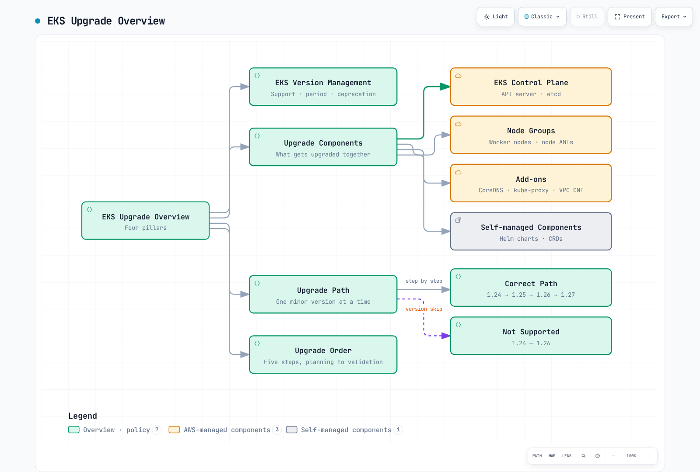
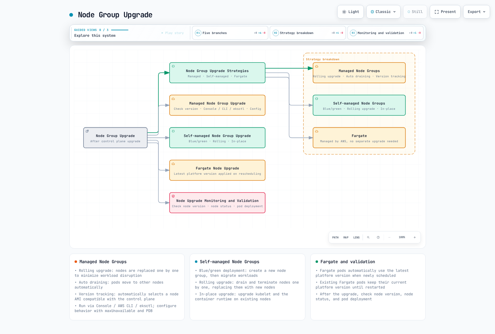
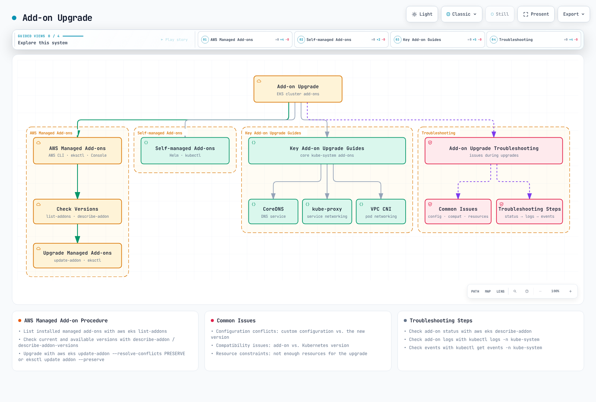
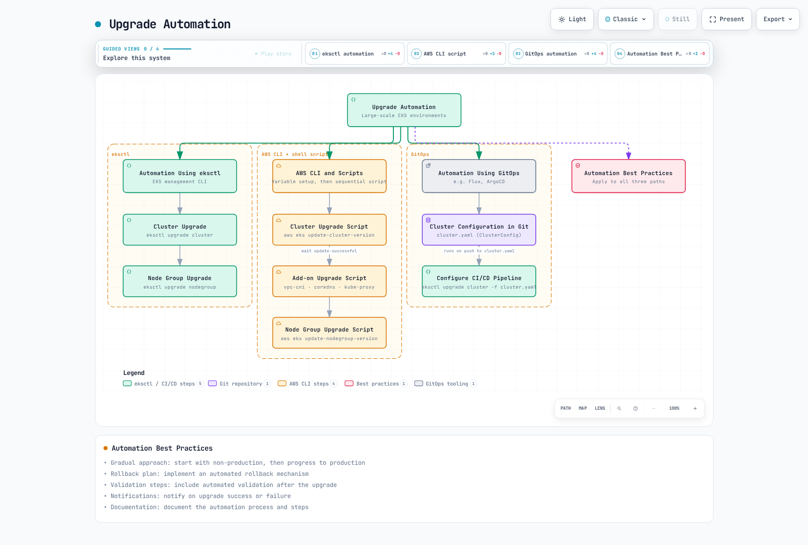

# Amazon EKS 升级

> **最后更新**：2026年10月12日

让 Amazon EKS 集群保持最新状态，对于安全性、稳定性以及利用新功能都很重要。本文档介绍了安全升级 EKS 集群的策略、最佳实践和分步指南。

这些是经过负责人审核的操作流程，并非本次审计中实际执行的升级。请明确指定账户、Region 和 Kubernetes context，记录已批准的源版本/目标版本及更新 ID，并验证应用程序行为。不要对同一组资源连续运行所有替代示例。本地解析/模拟无法证明生产环境已做好准备。

## 目录

1. [EKS 升级概述](#eks-upgrade-overview)
2. [升级规划与准备](#upgrade-planning-and-preparation)
3. [EKS 控制平面升级](#eks-control-plane-upgrade)
4. [节点组升级](#node-group-upgrade)
5. [附加组件升级](#add-on-upgrade)
6. [升级验证与故障排除](#upgrade-validation-and-troubleshooting)
7. [升级自动化](#upgrade-automation)
8. [升级最佳实践](#upgrade-best-practices)

## EKS 升级概述 {#eks-upgrade-overview}



[🔍 查看交互式图表](https://www.atomai.click/kubernetes-docs/archmaps/en-eks-08-eks-upgrades-0.html)

### EKS 版本管理

EKS 使用 Kubernetes 版本编号，并有自己的发布/支持日历。每个次要版本会获得 **14 个月的标准支持**，随后是 **12 个月的延长支持**，需额外付费。AWS 至少会提前 60 天公告标准支持结束时间。请参阅[当前 EKS 版本目录/日历](https://docs.aws.amazon.com/eks/latest/userguide/kubernetes-versions.html)；上游 Kubernetes 的某个版本并不会自动在 EKS 上提供。不要假设“至少相差四个版本”，也不要把 14 个月视为整个支持生命周期。

### 近期 EKS 升级公告（2026）

- **Kubernetes 1.37 已推出（2026 年 10 月 1 日）**：EKS 1.37 现已成为受支持的目标版本。在 Auto Mode 上，新建且未指定整合策略的自定义 NodePool 默认使用 `Balanced`；内置的 `general-purpose` 和 `system` 池也使用 `Balanced`。对于受支持的 CSI 和 Pod 配置，SELinux 卷挂载已稳定并默认启用。升级前，请检查预期的 NodePool 行为，以及在不同标签下共享卷的工作负载对 SELinux/CSI 的要求。请参阅 [EKS 标准支持发行说明](https://docs.aws.amazon.com/eks/latest/userguide/kubernetes-versions-standard.html)中的 Kubernetes 1.37 部分和[支持日历](https://docs.aws.amazon.com/eks/latest/userguide/kubernetes-versions.html)。
- **支持回滚 Kubernetes 版本（2026 年 7 月 1 日）**：如果升级导致问题，现在可以在 7 天内将控制平面回滚到先前的次要版本。EKS 会事先运行自动回滚就绪检查，涵盖 API 兼容性、版本偏差、附加组件兼容性和集群运行状况。对于用户发起的回滚，Auto Mode 会先替换符合条件的工作节点，再回退控制平面；这并非针对应用程序故障的自动响应。仍需满足资格条件和中断控制要求。在提供 EKS 的 Region 中，此功能不额外收费；节点/存储费用以及适用的版本支持费用仍需支付。详情请参阅下文的[回滚流程](#rollback-procedure)。（来源：[Amazon EKS 宣布支持回滚 Kubernetes 版本](https://aws.amazon.com/about-aws/whats-new/2026/07/amazon-eks-version-rollback)）
- **99.99% SLA 和 8XL 控制平面层级（2026 年 3 月 20 日）**：Provisioned Control Plane 集群的 SLA 从 99.95% 提高到 99.99%，按一分钟粒度测量。新增的 8XL 扩展层级将 API 请求处理能力提升至原 4XL 层级的两倍，面向超大型集群以及 AI/ML/HPC 工作负载。（来源：[Amazon EKS 宣布 SLA 和 8XL 扩展层级](https://aws.amazon.com/about-aws/whats-new/2026/03/amazon-eks-announces-sla-8xl-scaling-tier/)）

### 升级组件

EKS 集群升级包括以下组件：

1. **EKS 控制平面**：Kubernetes API server、etcd、controller manager 等。
2. **节点组**：工作节点和节点 AMI
3. **附加组件**：AWS 托管的附加组件（例如 CoreDNS、kube-proxy、VPC CNI）
4. **自行管理的组件**：Helm charts、自定义资源等

### 升级路径

EKS 集群必须一次升级一个次要版本：

- 历史示例：1.24 → 1.25 → 1.26 → 1.27 展示了一次一个次要版本的模式；这些并非当前部署目标。
- 直接从 1.24 → 1.26 跳转，展示了不受支持的跳过次要版本的情形。
- 对于实际变更，请选择 EKS 在你的 Region 和支持策略下实际提供的下一个次要版本。

### 升级顺序

1. 清点/测试/备份，处理正在进行的更新，并按照保守的准备流程使节点与**当前**控制平面次要版本保持一致。
2. 应用任何与当前和目标 Kubernetes 版本都兼容的必需附加组件/控制器过渡版本；验证各组件特定的前置条件。
3. 将控制平面升级一个受支持的次要版本，并等待该更新 ID 成功。
4. 按照已验证的依赖顺序升级节点、客户端/控制器和剩余附加组件，每一步都要检查。Auto Mode 自主管理其内置功能，并在控制平面升级后启动节点更新。
5. 验证实际节点版本、工作负载就绪状态、流量、存储和 SLO。

对于 kubelet 1.25 及更高版本，上游允许其最多落后 API server 三个次要版本，但不能高于 API server；API server 版本混合时，允许的范围会缩小。EKS 文档既说明了升级前节点版本对齐建议，也说明了支持的版本偏差范围。本操作手册选择对齐作为准备策略；它并不声称 EKS API 一律拒绝所有受支持的版本偏差。附加组件并非一律都要“在控制平面升级之前”或“之后”升级。回滚采用不同的先升级节点顺序，详见下文。

## 升级规划与准备 {#upgrade-planning-and-preparation}

<!-- Pending parent diagram repair: see core-audit/eks-upgrades/diagram-review.json


[🔍 View interactive diagram](https://www.atomai.click/kubernetes-docs/archmaps/en-eks-08-eks-upgrades-1.html)
-->

### 升级评估

开始升级之前，应评估以下事项：

#### 版本兼容性检查

检查与目标 Kubernetes 版本的兼容性：

- **API 弃用**：找出使用已弃用 API 的工作负载
- **功能变更**：检查新版本中的功能变更
- **附加组件兼容性**：验证附加组件与目标版本兼容

镜像列表或 `kubectl get … .apiVersion` 并不是客户端/API 弃用审计：API server 返回的是协商后的/当前表示形式。Beta API 并不自动意味着已弃用。请根据目标版本审查源代码/Helm manifests、客户端、CRD、webhook 和 EKS 升级洞察。单次抓取 API server 指标只能作为观测到的证据；没有数据/出现错误并不能证明不存在已弃用用法。

将以下只读收集器保存为 `eks-upgrade-preflight.py`。导出 `CLUSTER_NAME`、`AWS_REGION`、`EXPECTED_ACCOUNT_ID`、`KUBE_CONTEXT` 和 `TARGET_VERSION`；使用受限的本地权限保存其 JSON。程序成功退出仅表示收集成功，并不意味着升级已获批准或所有工作负载都兼容。

```python
import json
import os
import re
import subprocess


def run_json(args):
    result = subprocess.run(args, check=True, capture_output=True, text=True, timeout=60)
    return json.loads(result.stdout)


def run_text(args):
    return subprocess.run(args, check=True, capture_output=True, text=True, timeout=30).stdout.strip()


def inspect_upgrade(cluster_name, region, expected_account, context, target, query=run_json, text=run_text):
    if not re.fullmatch(r"[0-9]{12}", expected_account):
        raise ValueError("Set the reviewed 12-digit AWS account ID")
    if not re.fullmatch(r"[0-9]+\.[0-9]+", target):
        raise ValueError("Target must be an EKS major.minor version")
    aws = [os.environ.get("AWS_CLI", "aws")]
    suffix = ["--region", region, "--output", "json", "--no-cli-pager"]
    identity = query(aws + ["sts", "get-caller-identity"] + suffix)
    if identity["Account"] != expected_account:
        raise RuntimeError("AWS account mismatch")
    cluster = query(aws + ["eks", "describe-cluster", "--name", cluster_name] + suffix)["cluster"]
    if cluster["status"] != "ACTIVE":
        raise RuntimeError("Cluster must be ACTIVE; inspect any in-progress updates")
    if cluster["arn"].split(":")[4] != expected_account:
        raise RuntimeError("Cluster/account mismatch")
    current = cluster["version"]
    current_parts = tuple(map(int, current.split(".")))
    target_parts = tuple(map(int, target.split(".")))
    if target_parts != (current_parts[0], current_parts[1] + 1):
        raise ValueError("This upgrade example requires exactly the next minor version")
    server = text(["kubectl", "--context", context, "config", "view", "--minify",
                   "--output", "jsonpath={.clusters[0].cluster.server}"])
    if server != cluster["endpoint"]:
        raise RuntimeError("Kubernetes context does not match the EKS API endpoint")
    catalog = query(aws + ["eks", "describe-cluster-versions", "--cluster-versions", target,
                         "--include-all", "--no-default-only"] + suffix)["clusterVersions"]
    if not any(item["clusterVersion"] == target and item.get("versionStatus") in
               ["STANDARD_SUPPORT", "EXTENDED_SUPPORT"] for item in catalog):
        raise ValueError("Target is not offered as a supported EKS version in this Region")
    insights = query(aws + [
        "eks", "list-insights", "--cluster-name", cluster_name,
        "--filter", json.dumps({"categories": ["UPGRADE_READINESS"], "kubernetesVersions": [target]}),
    ] + suffix)["insights"]
    nodes = query(["kubectl", "--context", context, "get", "nodes", "--output", "json"])["items"]
    update_ids = query(aws + ["eks", "list-updates", "--name", cluster_name] + suffix)["updateIds"]
    addon_names = query(aws + ["eks", "list-addons", "--cluster-name", cluster_name] + suffix)["addons"]
    addons = []
    for name in addon_names:
        addon = query(aws + ["eks", "describe-addon", "--cluster-name", cluster_name,
                             "--addon-name", name] + suffix)["addon"]
        addons.append({"name": name, "version": addon["addonVersion"], "status": addon["status"]})
    return {
        "cluster": cluster_name, "region": region, "account": expected_account,
        "currentVersion": current, "targetVersion": target, "targetCatalog": catalog,
        "insights": insights,
        "clusterUpdateIds": update_ids,
        "nodes": [{"name": node["metadata"]["name"],
                   "kubeletVersion": node["status"]["nodeInfo"]["kubeletVersion"],
                   "ready": next((condition.get("status") for condition in node["status"].get("conditions", [])
                                  if condition.get("type") == "Ready"), None),
                   "computeType": node["metadata"].get("labels", {}).get("eks.amazonaws.com/compute-type"),
                   "nodegroup": node["metadata"].get("labels", {}).get("eks.amazonaws.com/nodegroup")}
                  for node in nodes],
        "managedAddons": addons,
        "decision": "Inventory collected only; active-update review, owner approval, node alignment, API/client scans, "
                    "backups/restore tests, add-on bridge versions, capacity, and workload tests remain required.",
    }


if __name__ == "__main__":
    report = inspect_upgrade(
        os.environ["CLUSTER_NAME"], os.environ["AWS_REGION"],
        os.environ["EXPECTED_ACCOUNT_ID"], os.environ["KUBE_CONTEXT"],
        os.environ["TARGET_VERSION"],
    )
    print(json.dumps(report, indent=2))
```

#### 资源需求评估

评估升级所需的资源：

- **集群容量**：容量足以在升级期间容纳额外节点
- **停机容忍度**：工作负载是否能够容忍停机
- **回滚计划**：出现问题时的回滚计划

#### 升级计划安排

规划升级时间表：

- **维护窗口**：安排在低流量时段进行升级
- **分阶段方法**：从非生产环境开始，再逐步推进到生产环境
- **回滚窗口**：规划出现问题时回滚所需的时间

### 升级前准备

#### 检查集群状态

升级前检查集群状态：

```bash
# Check node status
kubectl --context "$KUBE_CONTEXT" get nodes

# Check pod status
kubectl --context "$KUBE_CONTEXT" get pods --all-namespaces

# Check component status
kubectl --context "$KUBE_CONTEXT" get --raw /readyz

# Check events
kubectl --context "$KUBE_CONTEXT" get events --all-namespaces
```

#### 创建备份

升级前备份重要数据：

托管控制平面的 etcd 由 EKS 管理；在你的命名空间中运行 `etcd-pod`/`etcdctl snapshot` 命令无法备份它。`kubectl get all` 也会遗漏重要资源和卷数据，因此并非完整备份。

[AWS Backup for EKS](https://docs.aws.amazon.com/eks/latest/userguide/integration-backup.html) 可以通过复合恢复点保护集群状态以及由 PVC 支持的 EBS/EFS/S3 资源，但需满足文档所述的 IAM、API/API_AND_CONFIG_MAP 访问模式、存储和还原前置条件。或者，使用由你负责的 Velero/应用程序备份设置，并验证卷覆盖范围。检查命名空间/集群范围的覆盖、数据库一致性、保留期限和还原测试。备份请求返回 ID 并不能证明备份已完成或可恢复。

#### 测试升级

在非生产环境中测试升级：

1. 创建与生产环境相似的测试集群
2. 在测试集群上执行升级
3. 测试工作负载和功能
4. 找出并解决问题

#### 创建升级文档

记录升级流程：

- 升级步骤
- 负责人和联系人
- 回滚流程
- 故障排除指南

## EKS 控制平面升级 {#eks-control-plane-upgrade}

<!-- Pending parent diagram repair: see core-audit/eks-upgrades/diagram-review.json


[🔍 View interactive diagram](https://www.atomai.click/kubernetes-docs/archmaps/en-eks-08-eks-upgrades-2.html)
-->

### 控制平面升级准备

#### 检查当前版本

检查当前 EKS 集群版本：

```bash
aws eks describe-cluster --name "$CLUSTER_NAME" --region "$AWS_REGION" --query "cluster.version"
```

#### 检查可用版本

检查可用的 Kubernetes 版本：

```bash
aws eks describe-cluster-versions --region "$AWS_REGION" \
  --no-default-only --output json --no-cli-pager
```

#### 制定升级计划

提交常规升级之前，请查阅当前 [EKS 指南](https://docs.aws.amazon.com/eks/latest/userguide/update-cluster.html)：要求针对升级洞察结果使用 `--force` 的强制规则已暂时回退。这与版本回滚的阻断性 `ROLLBACK_READINESS` 规则不同。请解决或明确评估相关发现；即使问题已修复，滚动 30 天的已弃用 API 证据仍可能保留。确保集群子网存在、有足够的可用地址（EKS 最多可能需要五个），并允许控制平面通信。控制平面升级一旦启动，就无法暂停/停止；客户端必须能够处理重新连接。

制定控制平面升级计划：

- 升级时间：选择低流量时段
- 监控设置：升级期间监控集群状态
- 回滚计划：出现问题时的回滚流程

### 控制平面升级执行

#### 使用 AWS Management Console 升级

1. 登录 AWS Management Console
2. 前往 Amazon EKS 服务
3. 在集群列表中选择要升级的集群
4. 选择“Cluster configuration”选项卡
5. 点击“Update Kubernetes version”
6. 选择目标版本并点击“Update”

#### 使用 AWS CLI 升级

只有在记录的计划和前置条件获批后才能运行。将下一节中的轮询辅助程序保存为 `eks-wait-update.py`。此操作只请求控制平面更新；它不会升级节点/附加组件，也不能证明工作负载已就绪。

```bash
set -euo pipefail
: "${CLUSTER_NAME:?Set the reviewed cluster}"
: "${AWS_REGION:?Set the reviewed Region}"
: "${TARGET_VERSION:?Set the next supported EKS minor version}"
umask 077
aws eks update-cluster-version \
  --name "$CLUSTER_NAME" --region "$AWS_REGION" \
  --kubernetes-version "$TARGET_VERSION" --output json --no-cli-pager \
  > control-plane-update.json
UPDATE_ID=$(jq -er '.update.id | select(type == "string" and length > 0)' control-plane-update.json)
export CLUSTER_NAME AWS_REGION UPDATE_ID
unset NODEGROUP_NAME ADDON_NAME
python3 eks-wait-update.py
```

#### 使用 eksctl 升级

```bash
eksctl upgrade cluster \
  --name "$CLUSTER_NAME" --region "$AWS_REGION" \
  --version "$TARGET_VERSION" \
  --approve
```

### 控制平面升级监控

#### 检查升级状态

检查升级状态：

针对确切的更新 ID 跟踪 `DescribeUpdate`。`cluster-active`/`nodegroup-active` 不能证明此请求已成功；AWS CLI 2.36.44 没有 `eks wait update-successful` waiter。将以下代码保存为 `eks-wait-update.py`；对于节点组/附加组件请求，设置 `NODEGROUP_NAME` 或 `ADDON_NAME` 中的一个，且只能设置一个；否则将两者都留空。如果 API 出错、请求失败/取消、状态未知，或超过客户端截止时间，该程序会报错退出。客户端超时不会取消 AWS 操作。默认两小时的客户端等待时间应根据获批的操作进行调整，尤其是耗时较长的 Auto Mode 回滚。

```python
import json
import os
import subprocess
import time
from pathlib import Path


def wait_update(lookup, timeout_seconds, interval_seconds=15, clock=time.monotonic, sleep=time.sleep):
    if timeout_seconds <= 0 or interval_seconds < 0:
        raise ValueError("Use a positive timeout and nonnegative polling interval")
    deadline = clock() + timeout_seconds
    while True:
        update = lookup()["update"]
        status = update["status"]
        print(json.dumps({"id": update["id"], "status": status, "errors": update.get("errors", [])}), flush=True)
        if status == "Successful":
            return update
        if status in ["Failed", "Cancelled"]:
            raise RuntimeError(f"EKS update ended with {status}; inspect its error details")
        if status not in ["InProgress", "Cancelling"]:
            raise RuntimeError(f"Unexpected update status: {status}")
        if clock() >= deadline:
            raise TimeoutError("Client wait expired; the AWS operation may still be running. Preserve its update ID.")
        sleep(interval_seconds)


if __name__ == "__main__":
    cluster = os.environ["CLUSTER_NAME"]
    region = os.environ["AWS_REGION"]
    update_id = os.environ["UPDATE_ID"]
    nodegroup = os.environ.get("NODEGROUP_NAME")
    addon = os.environ.get("ADDON_NAME")
    if nodegroup and addon:
        raise ValueError("Set only NODEGROUP_NAME or ADDON_NAME for a scoped update")
    command = [
        os.environ.get("AWS_CLI", "aws"), "eks", "describe-update",
        "--name", cluster, "--region", region, "--update-id", update_id,
        "--output", "json", "--no-cli-pager",
    ]
    if nodegroup:
        command += ["--nodegroup-name", nodegroup]
    if addon:
        command += ["--addon-name", addon]
    status_file = Path(os.environ.get("UPDATE_STATUS_FILE", "eks-update-status.json"))

    def lookup():
        completed = subprocess.run(command, check=True, capture_output=True, text=True, timeout=60)
        response = json.loads(completed.stdout)
        status_file.write_text(json.dumps(response, indent=2) + "\n")
        return response

    wait_update(lookup, int(os.environ.get("WAIT_TIMEOUT_SECONDS", "7200")))
```

#### 监控集群状态

升级期间监控集群状态：

```bash
# Check node status
kubectl --context "$KUBE_CONTEXT" get nodes

# Check pod status
kubectl --context "$KUBE_CONTEXT" get pods --all-namespaces

# Check events
kubectl --context "$KUBE_CONTEXT" get events --all-namespaces --sort-by='.lastTimestamp'
```

#### 监控 CloudWatch 指标

监控针对你的 EKS 版本/层级实际发布的控制平面指标，以及已配置的遥测数据：API 请求速率/延迟/错误、API 就绪状态和客户端重新连接、调度、节点/工作负载运行状况以及应用程序 SLO。不要假设能够直接访问 etcd/controller-manager 端点，或所有组件指标都会公开。`/readyz` 检查的是 API 就绪状态，而不是所有应用程序或历史可用性条件。

### 控制平面升级故障排除

#### 常见问题

控制平面升级期间可能出现的常见问题：

- **升级失败**：升级过程失败或中断
- **API Server 可用性**：API server 可用性问题
- **兼容性问题**：工作负载与新版本之间的兼容性问题

#### 故障排除步骤

1. 检查升级状态
2. 查看 CloudTrail 日志
3. 查看 EKS 控制平面日志
4. 联系 AWS Support

## 节点组升级 {#node-group-upgrade}

升级控制平面后，需要升级节点组。节点组升级有多种策略，各有优缺点。

<!-- Pending parent diagram repair: see core-audit/eks-upgrades/diagram-review.json


[🔍 View interactive diagram](https://www.atomai.click/kubernetes-docs/archmaps/en-eks-08-eks-upgrades-3.html)
-->

### 节点组升级策略

#### 托管节点组升级

托管节点组是 AWS 提供的一项节点组管理功能，可自动执行节点升级：

- **替换策略**：`maxUnavailable`/百分比允许并行替换。API `updateStrategy=DEFAULT` 会先启动新容量再移除旧容量；`MINIMAL` 会先移除旧容量，在可用性/容量方面有不同的权衡。
- **驱逐**：常规更新使用 Pod 驱逐/PDB 检查；控制器会重新创建 Pod，而不是实时迁移 Pod。节点组的强制选项可以绕过与 PDB 相关的排空失败，这与集群回滚的 force 标志不同。
- **版本/AMI 选择**：选择经过审核的 Kubernetes 和 AMI 发行版本，或者为自定义 AMI 选择原始启动模板的新版本。更新失败并不能证明集群会自动回滚；请检查节点/AMI 混合状态和更新错误。

#### 自行管理的节点组升级

对于自行管理的节点组，必须手动升级节点：

- **蓝绿部署**：创建新的节点组并迁移工作负载
- **滚动升级**：逐个排空并终止节点，然后替换为新节点
- **就地升级**：升级现有节点上的 kubelet 和容器运行时

#### Fargate 节点升级

AWS 负责 Fargate 节点基础设施，但工作负载负责人必须协调 Pod 替换。新启动的 Fargate Pod 使用与控制平面匹配的 kubelet 版本；控制平面操作不会升级现有 Pod。请规划控制器滚动发布、可用性和验证，而不要把 Fargate 当作无需任何升级工作的服务。Auto Mode 则有所不同：控制平面升级后，它会在自身中断控制约束下启动增量节点替换。

### 托管节点组升级

#### 检查托管节点组版本

检查当前托管节点组版本：

```bash
aws eks describe-nodegroup \
  --cluster-name "$CLUSTER_NAME" --region "$AWS_REGION" \
  --nodegroup-name "$NODEGROUP_NAME" \
  --query "nodegroup.version"
```

#### 使用 AWS Management Console 升级

1. 登录 AWS Management Console
2. 前往 Amazon EKS 服务
3. 在集群列表中选择要升级的集群
4. 选择“Compute”选项卡
5. 选择要升级的节点组
6. 点击“Update node group”
7. 选择目标版本并点击“Update”

#### 使用 AWS CLI 升级

对于 EKS 优化 AMI，请使用经过审核的发行版本和目标版本。此操作有自己的更新 ID；轮询时请保留节点组范围。检查平台/AMI 系列支持情况；仅更改 Kubernetes 版本并不会将 AL2 节点组迁移到 AL2023。

```bash
set -euo pipefail
: "${CLUSTER_NAME:?}"; : "${AWS_REGION:?}"; : "${NODEGROUP_NAME:?}"
: "${TARGET_VERSION:?Set the reviewed target, no newer than the control plane}"
: "${TARGET_AMI_RELEASE:?Set the reviewed EKS-optimized AMI release}"
umask 077
aws eks describe-nodegroup --cluster-name "$CLUSTER_NAME" --nodegroup-name "$NODEGROUP_NAME" \
  --region "$AWS_REGION" --output json > nodegroup-before.json
if jq -e '.nodegroup.amiType == "CUSTOM"' nodegroup-before.json >/dev/null; then
  echo "Use the custom launch-template path for this node group" >&2
  exit 1
fi
aws eks update-nodegroup-version \
  --cluster-name "$CLUSTER_NAME" --nodegroup-name "$NODEGROUP_NAME" --region "$AWS_REGION" \
  --kubernetes-version "$TARGET_VERSION" --release-version "$TARGET_AMI_RELEASE" \
  --output json > nodegroup-update.json
UPDATE_ID=$(jq -er '.update.id | select(type == "string" and length > 0)' nodegroup-update.json)
export CLUSTER_NAME AWS_REGION UPDATE_ID NODEGROUP_NAME
unset ADDON_NAME
python3 eks-wait-update.py
```

对于**自定义 AMI**，请将原始启动模板更新到经过审核的新版本。使用自定义 AMI 请求时，不要传入 Kubernetes `version` 或 `releaseVersion`；请验证替换节点上的实际 kubelet/运行时/AMI。

```bash
set -euo pipefail
: "${CLUSTER_NAME:?}"; : "${AWS_REGION:?}"; : "${NODEGROUP_NAME:?}"
: "${LAUNCH_TEMPLATE_ID:?Set the same launch template originally used by the group}"
: "${LAUNCH_TEMPLATE_VERSION:?Set the reviewed version containing the updated custom AMI}"
aws eks update-nodegroup-version \
  --cluster-name "$CLUSTER_NAME" --nodegroup-name "$NODEGROUP_NAME" --region "$AWS_REGION" \
  --launch-template "id=$LAUNCH_TEMPLATE_ID,version=$LAUNCH_TEMPLATE_VERSION" \
  --output json > nodegroup-update.json
UPDATE_ID=$(jq -er '.update.id | select(type == "string" and length > 0)' nodegroup-update.json)
export CLUSTER_NAME AWS_REGION UPDATE_ID NODEGROUP_NAME
unset ADDON_NAME
python3 eks-wait-update.py
```

#### 使用 eksctl 升级

```bash
eksctl upgrade nodegroup \
  --cluster "$CLUSTER_NAME" --region "$AWS_REGION" \
  --name "$NODEGROUP_NAME" \
  --kubernetes-version "$TARGET_VERSION"
```

#### 托管节点组升级配置

可以配置托管节点组的升级行为：

- **最大不可用数**：升级期间不可用的节点数上限
- **PDB**：约束符合条件的自愿驱逐，但不约束所有故障或应用程序结果。强制节点组更新可以忽略 PDB 问题。更改托管节点组的期望/最小/最大扩缩容配置属于 ASG 扩缩容操作，**不会**提供升级排空/PDB 保障；不要把缩容至零当作安全迁移方式。

```bash
aws eks update-nodegroup-config \
  --cluster-name "$CLUSTER_NAME" --region "$AWS_REGION" \
  --nodegroup-name "$NODEGROUP_NAME" \
  --update-config maxUnavailable=1
```

### 自行管理的节点组升级

#### 蓝绿部署

根据所属配置准备一个名称不同的新节点组，保留经过审核的子网/可用区、IAM、AMI 架构/引导配置、标签、污点、存储和网络要求。请参阅[集群创建指南](02-eks-cluster-creation.md)。`eksctl create nodegroup` 默认创建托管组；自行管理的配置必须显式选择 `--managed=false` 或相应的 `nodeGroups` 配置段。创建时使用 `--version`，而 `eksctl upgrade nodegroup` 使用 `--kubernetes-version`。

1. 根据经过审核的配置创建绿色容量，然后验证节点数量、目标 kubelet/AMI、Ready 状态、CNI/DNS 以及应用程序调度。仅仅列出节点并不能完成这些验证。
2. 按照负责人控制的阶段迁移工作负载。首选亲和性并不能保证工作负载会放置到绿色节点上；请检查实际 Pod 节点分配情况和存储拓扑。
3. 每次排空一个已识别的旧节点，并设置有限超时时间；如果驱逐或运行状况检查失败，则停止。继续之前，重新验证工作负载/替换容量。
4. 只有在已记录迁移、运行状况、数据保留和恢复验收之后，才退役旧节点组。不要在未经检查的循环或固定等待之后自动删除它。

```bash
set -euo pipefail
: "${KUBE_CONTEXT:?Set the reviewed cluster context}"
: "${NODE_NAME:?Set one reviewed old node}"
kubectl --context "$KUBE_CONTEXT" get node "$NODE_NAME" -o wide
kubectl --context "$KUBE_CONTEXT" get node "$NODE_NAME" \
  -o jsonpath='{.spec.providerID}{"\n"}'
kubectl --context "$KUBE_CONTEXT" get pods --all-namespaces \
  --field-selector "spec.nodeName=$NODE_NAME" -o wide
# Stop on failure. Do not terminate the instance or delete the node group here.
kubectl --context "$KUBE_CONTEXT" drain "$NODE_NAME" --ignore-daemonsets --timeout=10m
```

此默认排空操作会拒绝处理需要另行决策的非托管 Pod/本地数据情形。`--delete-emptydir-data` 明确允许丢失 emptyDir 数据；不要盲目添加它。`kubectl drain --force` 允许非托管 Pod 存在，这与绕过驱逐/PDB 检查不同。请由相应负责人协调 DaemonSet、静态 Pod、控制器和持久数据。

#### 滚动升级

对于自行管理的 ASG，首先将所属启动配置/模板更新为已验证的 AMI；否则替换节点可能再次启动旧镜像。使用上述单节点排空关卡，并在任何终止操作之前验证节点 provider ID、EC2 实例和 ASG 所属关系。不要把 Kubernetes 节点映射到第一个通过 EC2 私有 DNS 名称搜索到的结果。由 ASG 负责人替换已排空的实例，等待一个**新的**、配置正确且 Ready 的节点以及工作负载恢复，然后再继续。等待 60 秒并不能证明替换节点已就绪。直接执行 ASG 扩缩容/实例刷新需要相应的 Kubernetes 排空集成；它不会自动强制执行 PDB。

#### 就地升级

仅对支持此操作的自行管理主机使用经过单独测试、适用于特定 OS/镜像的流程。对于 EKS 优化的托管集群，优先使用不可变且经过验证的 AMI 替换路径；Auto Mode/Fargate 基础设施由服务负责。通用的 `yum update kubelet kubectl` 既不会选择经过审核的 Kubernetes/运行时版本，也不能算作 EKS 节点升级。SSM 请求是异步的：在调用、所需的服务重启、实际版本、节点就绪状态和工作负载测试全部成功之前，不要解除节点隔离。发生错误时应保留故障证据，而不是自动解除隔离或终止节点。

### 节点升级监控与验证

#### 检查节点版本

检查节点 Kubernetes 版本：

```bash
kubectl --context "$KUBE_CONTEXT" get nodes -o custom-columns=NAME:.metadata.name,VERSION:.status.nodeInfo.kubeletVersion
```

#### 检查节点状态

检查节点状态：

```bash
kubectl --context "$KUBE_CONTEXT" get nodes
kubectl --context "$KUBE_CONTEXT" describe nodes
```

#### 检查 Pod 部署

验证 Pod 是否正常部署：

```bash
kubectl --context "$KUBE_CONTEXT" get pods --all-namespaces -o wide
kubectl --context "$KUBE_CONTEXT" get pods --all-namespaces -o custom-columns=NAMESPACE:.metadata.namespace,NAME:.metadata.name,PHASE:.status.phase,READY:'.status.conditions[?(@.type=="Ready")].status'
```

## 附加组件升级 {#add-on-upgrade}

清点实际组件负责人和升级路径。控制平面升级不会自动升级 EKS 托管的附加组件；负责人需选择并发起兼容的更新。必需的过渡版本可以先于控制平面变更安装。Auto Mode 内置功能由 AWS 单独管理；不要像所有集群都使用相同的 DaemonSet/Deployment 一样，安装或更新重复的节点网络/存储/DNS 组件。



[🔍 查看交互式图表](https://www.atomai.click/kubernetes-docs/archmaps/en-eks-08-eks-upgrades-4.html)

### AWS 托管附加组件

#### 检查托管附加组件列表

检查集群中安装的托管附加组件：

```bash
aws eks list-addons --cluster-name "$CLUSTER_NAME" --region "$AWS_REGION"
```

#### 检查托管附加组件版本

检查托管附加组件的当前版本：

```bash
aws eks describe-addon \
  --cluster-name "$CLUSTER_NAME" --region "$AWS_REGION" \
  --addon-name vpc-cni \
  --query "addon.addonVersion"
```

#### 检查可用的附加组件版本

检查可用的附加组件版本：

数组的第一个元素并不保证是“最新”或正确的版本。请检查 `compatibilities`、默认版本标记、平台/计算类型/架构支持、发行说明、IAM 变更和中间版本要求。更改附加组件之前，保存其配置和身份关联。请使用受限权限保存文件；配置可能包含敏感值。

```bash
set -euo pipefail
: "${CLUSTER_NAME:?}"; : "${AWS_REGION:?}"; : "${ADDON_NAME:?}"
: "${TARGET_VERSION:?Set the Kubernetes version for this stage}"
umask 077
aws eks describe-addon --cluster-name "$CLUSTER_NAME" --addon-name "$ADDON_NAME" \
  --region "$AWS_REGION" --output json > addon-before.json
aws eks describe-addon-versions --addon-name "$ADDON_NAME" \
  --kubernetes-version "$TARGET_VERSION" --region "$AWS_REGION" \
  --output json > addon-candidates.json
# Select ADDON_VERSION after reviewing compatibility, architecture, compute type, and upgrade path.
: "${ADDON_VERSION:?Set the reviewed add-on version}"
aws eks describe-addon-configuration --addon-name "$ADDON_NAME" \
  --addon-version "$ADDON_VERSION" --region "$AWS_REGION" \
  --output json > addon-schema.json
jq -r '.addon.configurationValues // "{}"' addon-before.json > addon-config-candidate.json
```

#### 升级托管附加组件

可以使用 AWS Management Console、AWS CLI 或 eksctl 升级托管附加组件：

根据目标 schema 验证候选 JSON，并保留预期的配置/身份语义。`PRESERVE` 用于处理托管字段中的冲突；它不会验证所有自定义值、保证应用程序行为，也不会将显式的部分配置合并到旧 JSON 中。传入 `{}` 可能会重置配置。一次只更新一个由你负责的附加组件，并检查其更新 ID、运行状况、版本和工作负载行为。

```bash
set -euo pipefail
: "${CLUSTER_NAME:?}"; : "${AWS_REGION:?}"; : "${ADDON_NAME:?}"; : "${ADDON_VERSION:?}"
: "${REVIEWED_ADDON_CONFIG_FILE:?Provide the complete reviewed target configuration JSON}"
aws eks update-addon --cluster-name "$CLUSTER_NAME" --addon-name "$ADDON_NAME" \
  --addon-version "$ADDON_VERSION" --region "$AWS_REGION" \
  --configuration-values "file://$REVIEWED_ADDON_CONFIG_FILE" \
  --resolve-conflicts PRESERVE --output json > addon-update.json
UPDATE_ID=$(jq -er '.update.id | select(type == "string" and length > 0)' addon-update.json)
export CLUSTER_NAME AWS_REGION UPDATE_ID ADDON_NAME
unset NODEGROUP_NAME
python3 eks-wait-update.py
aws eks describe-addon --cluster-name "$CLUSTER_NAME" --addon-name "$ADDON_NAME" \
  --region "$AWS_REGION" --output json
```

对于 eksctl 0.229，`update addon` 有 `--wait` 和 `--config-file`，但没有 `--preserve` 标志。请在经过审核的 eksctl 配置中指定预期的冲突策略，或使用上述明确的 AWS CLI 流程。`eksctl --force` 会将所有权从自行管理的附加组件迁移过来，并非通用的冲突保留选项。

### 自行管理的附加组件

#### 升级自行管理的附加组件

使用 Helm 或 kubectl 升级自行管理的附加组件：

使用现有 Helm/manifests 负责人。以下示例假设已审核 chart 仓库/OCI 引用和现有 release；当 release 缺失时，示例会刻意避免使用 `--install` 创建第二个管理者。请检查新 chart 的 CRD 和 IAM 迁移要求；单独运行 `helm upgrade` 不会升级 chart 的 `crds/` 目录中的 CRD。Helm 和原始 manifest 部署是替代方案，而不是连续执行的更新步骤。此前的 Metrics Server 0.6.1/3.8.2 示例不是目标版本兼容性选择。

```bash
set -euo pipefail
: "${KUBE_CONTEXT:?}"; : "${RELEASE:?}"; : "${ADDON_NAMESPACE:?}"
: "${CHART_REF:?Set the verified repository/chart or OCI reference}"
: "${CHART_VERSION:?Set a reviewed compatible chart version}"
: "${REVIEWED_VALUES_FILE:?Set the complete reviewed target values file}"
umask 077
helm get values "$RELEASE" --namespace "$ADDON_NAMESPACE" --kube-context "$KUBE_CONTEXT" \
  --all > addon-values-before.yaml
helm show values "$CHART_REF" --version "$CHART_VERSION" > addon-values-defaults.yaml
# Merge/migrate values and handle CRDs/IAM through the owner before this step.
helm upgrade "$RELEASE" "$CHART_REF" --version "$CHART_VERSION" \
  --namespace "$ADDON_NAMESPACE" --kube-context "$KUBE_CONTEXT" \
  -f "$REVIEWED_VALUES_FILE" --wait --timeout 15m
```

### 主要附加组件升级指南

#### CoreDNS 升级

对于标准节点，确定 CoreDNS Deployment 由 EKS 还是其他工具管理，保留 Corefile/PDB/自定义设置，并遵循所选版本的迁移说明。Auto Mode 节点以节点系统服务的形式运行 CoreDNS：纯 Auto Mode 集群不需要 Deployment 附加组件，而混合集群必须为非 Auto 节点保留 DNS。不要把纯 Auto Mode 中缺少 Deployment 理解为升级失败。

#### kube-proxy 升级

确保 kube-proxy 与 API server 以及它所运行的节点兼容；其版本不能高于 API server。使用目标版本支持的附加组件构建版本，并遵循已验证的升级顺序。Auto Mode 管理其服务网络；不要假设其中存在自行管理的 kube-proxy DaemonSet。

#### VPC CNI 升级

对于标准 EC2 节点，请验证 CNI 版本路径、IP/前缀模式、IAM、网络策略设置和工作负载连接情况。不要假设单个 `aws-node` ConfigMap 包含所有设置：在适用情况下，还要检查 EKS `configurationValues`、DaemonSet/容器配置、服务账户身份和所属的 Helm/GitOps 配置。Auto Mode 的内置网络遵循其自身的管理路径。

对每个由 EKS 管理的附加组件，使用上述通用的捕获/选择/更新/等待流程。仅在实际安装标准节点代理的地方检查它们：

```bash
kubectl --context "$KUBE_CONTEXT" -n kube-system get deployment coredns -o wide
kubectl --context "$KUBE_CONTEXT" -n kube-system get daemonset kube-proxy aws-node -o wide
```

### 附加组件升级故障排除

#### 常见问题

附加组件升级期间可能出现的常见问题：

- **配置冲突**：自定义配置与新版本之间存在冲突
- **兼容性问题**：附加组件与 Kubernetes 版本之间存在兼容性问题
- **资源限制**：升级所需资源不足

#### 故障排除步骤

1. 检查附加组件状态：

```bash
aws eks describe-addon \
  --cluster-name "$CLUSTER_NAME" --region "$AWS_REGION" \
  --addon-name vpc-cni
```

2. 检查附加组件日志：

```bash
kubectl --context "$KUBE_CONTEXT" logs -n kube-system -l k8s-app=kube-dns
kubectl --context "$KUBE_CONTEXT" logs -n kube-system -l k8s-app=kube-proxy
kubectl --context "$KUBE_CONTEXT" logs -n kube-system -l k8s-app=aws-node
```

3. 检查附加组件事件：

```bash
kubectl --context "$KUBE_CONTEXT" get events -n kube-system --sort-by='.lastTimestamp'
```

## 升级验证与故障排除 {#upgrade-validation-and-troubleshooting}

升级完成后，需要验证集群是否正常运行，并解决可能出现的任何问题。


[🔍 查看交互式图表](https://www.atomai.click/kubernetes-docs/archmaps/en-eks-08-eks-upgrades-5.html)

### 升级验证

#### 检查集群版本

检查集群和节点版本：

```bash
# Check cluster version
kubectl --context "$KUBE_CONTEXT" version --output=yaml

# Check node version
kubectl --context "$KUBE_CONTEXT" get nodes -o custom-columns=NAME:.metadata.name,VERSION:.status.nodeInfo.kubeletVersion
```

#### 检查集群状态

检查集群组件的状态：

```bash
# Check node status
kubectl --context "$KUBE_CONTEXT" get nodes

# Check pod status
kubectl --context "$KUBE_CONTEXT" get pods --all-namespaces

# Check namespace status
kubectl --context "$KUBE_CONTEXT" get namespaces

# Check service status
kubectl --context "$KUBE_CONTEXT" get services --all-namespaces
```

#### 工作负载验证

验证应用程序工作负载是否正常运行：

```bash
# Check deployment status
kubectl --context "$KUBE_CONTEXT" get deployments --all-namespaces

# Check statefulset status
kubectl --context "$KUBE_CONTEXT" get statefulsets --all-namespaces

# Check daemonset status
kubectl --context "$KUBE_CONTEXT" get daemonsets --all-namespaces

# Check service endpoints
kubectl --context "$KUBE_CONTEXT" get endpointslices.discovery.k8s.io --all-namespaces
```

#### 功能测试

使用隔离且由你负责的测试资源，并明确验收标准。以下 **Linux EC2 节点烟雾测试**通过多个独立的 Job 覆盖 Deployment 滚动发布/扩缩容、Service/DNS 请求以及 PVC 数据。它不是负载基准测试，不会测试每个节点/AZ，也不能证明应用程序/高可用性/安全性正确。请添加针对工作负载的测试、入口/出口测试、控制器/webhook 测试和恢复测试。Fargate/混合/其他平台路径需要各自兼容的测试计划。

将代码保存为 `eks-upgrade-smoke.py`。它使用本次审计已检查的固定官方 BusyBox 镜像清单；此处未执行镜像或集群测试。运行前，请验证镜像策略、准入/网络规则、可用容量，以及所选节点上兼容的文件系统 StorageClass。设置 `KUBE_CONTEXT`、`TEST_STORAGE_CLASS`、`RUN_SMOKE_TEST=yes`，如果要测试特定替换节点，还要设置经过审核的 `SMOKE_NODE_SELECTOR` JSON 映射。脚本会创建唯一命名空间，绝不会接管现有命名空间，遇到失败会停止，并记录实际放置情况和 PV 回收详情。对于 `WaitForFirstConsumer` 卷，会先创建写入者使用者，再等待操作完成。

默认情况下会保留资源以供检查。只有在检查成功后设置 `CLEANUP_ON_SUCCESS=yes`，才会删除本次运行创建的命名空间 UID。若 StorageClass 使用 Retain，删除命名空间后可能仍会留下产生费用的 PV/存储；请检查记录的 PV，并且只清理由本测试拥有的存储。发生失败时会保留现场以供诊断，不会报告为成功。短时间的当前指标和 20 个顺序 HTTP 请求无法证明性能等效。

```python
import json
import os
import subprocess
import uuid
from pathlib import Path

IMAGE = "docker.io/library/busybox@sha256:73aaf090f3d85aa34ee199857f03fa3a95c8ede2ffd4cc2cdb5b94e566b11662"


def manifests(namespace, storage_class, marker, node_selector):
    if node_selector.get("kubernetes.io/os", "linux") != "linux":
        raise ValueError("This BusyBox example requires Linux nodes")
    node_selector = {"kubernetes.io/os": "linux", **node_selector}
    security = {"runAsNonRoot": True, "runAsUser": 65532, "fsGroup": 65532,
                "seccompProfile": {"type": "RuntimeDefault"}}
    container_security = {"allowPrivilegeEscalation": False, "readOnlyRootFilesystem": True,
                          "capabilities": {"drop": ["ALL"]}}
    resources = {"requests": {"cpu": "50m", "memory": "32Mi"},
                 "limits": {"cpu": "200m", "memory": "128Mi"}}

    def job(name, command, with_volume=False):
        container = {"name": "check", "image": IMAGE, "command": ["sh", "-ec", command],
                     "resources": resources, "securityContext": container_security}
        pod = {"restartPolicy": "Never", "automountServiceAccountToken": False,
               "securityContext": security, "nodeSelector": node_selector, "containers": [container]}
        if with_volume:
            container["volumeMounts"] = [{"name": "data", "mountPath": "/data"}]
            pod["volumes"] = [{"name": "data", "persistentVolumeClaim": {"claimName": "smoke-data"}}]
        return {"apiVersion": "batch/v1", "kind": "Job", "metadata": {"name": name, "namespace": namespace},
                "spec": {"backoffLimit": 0, "activeDeadlineSeconds": 120,
                         "template": {"spec": pod}}}

    config = {"apiVersion": "v1", "kind": "ConfigMap",
              "metadata": {"name": "smoke-content", "namespace": namespace},
              "data": {"index.html": marker + "\n"}}
    deployment = {
        "apiVersion": "apps/v1", "kind": "Deployment",
        "metadata": {"name": "smoke-http", "namespace": namespace},
        "spec": {"replicas": 2, "selector": {"matchLabels": {"app": "smoke-http"}},
                 "template": {"metadata": {"labels": {"app": "smoke-http"}}, "spec": {
                     "automountServiceAccountToken": False, "securityContext": security,
                     "nodeSelector": node_selector,
                     "containers": [{"name": "http", "image": IMAGE,
                                     "command": ["httpd", "-f", "-p", "8080", "-h", "/www"],
                                     "securityContext": container_security, "resources": resources,
                                     "ports": [{"name": "http", "containerPort": 8080}],
                                     "readinessProbe": {"httpGet": {"path": "/", "port": "http"}},
                                     "volumeMounts": [{"name": "content", "mountPath": "/www", "readOnly": True}]}],
                     "volumes": [{"name": "content", "configMap": {"name": "smoke-content"}}],
                 }}},
    }
    service = {"apiVersion": "v1", "kind": "Service",
               "metadata": {"name": "smoke-http", "namespace": namespace},
               "spec": {"selector": {"app": "smoke-http"}, "ports": [{"port": 80, "targetPort": "http"}]}}
    pvc = {"apiVersion": "v1", "kind": "PersistentVolumeClaim",
           "metadata": {"name": "smoke-data", "namespace": namespace},
           "spec": {"storageClassName": storage_class, "accessModes": ["ReadWriteOnce"],
                    "resources": {"requests": {"storage": "1Gi"}}}}
    writer = job("smoke-write", f"printf '%s\\n' '{marker}' > /data/marker; sync", True)
    reader = job("smoke-read", f"test \"$(cat /data/marker)\" = '{marker}'", True)
    http = job("smoke-request", f"i=0; while [ \"$i\" -lt 20 ]; do "
               f"test \"$(wget -T 5 -q -O - http://smoke-http)\" = '{marker}'; "
               "i=$((i + 1)); sleep 1; done")
    return [config, deployment, service, pvc, writer], reader, http


def run_smoke(context, storage_class, node_selector, call=subprocess.run):
    if not context or not storage_class or not isinstance(node_selector, dict):
        raise ValueError("Set the reviewed context, StorageClass, and node selector map")
    namespace = "eks-upgrade-smoke-" + uuid.uuid4().hex[:12]
    marker = uuid.uuid4().hex
    evidence = Path(namespace)
    evidence.mkdir()
    prefix = ["kubectl", "--context", context]

    def kubectl(*args, payload=None):
        completed = call(prefix + list(args), input=json.dumps(payload) if payload else None,
                         check=True, capture_output=True, text=True, timeout=240)
        return completed.stdout

    # Create, never apply/adopt, the namespace. A failed creation must not lead to deletion.
    created = json.loads(kubectl("create", "namespace", namespace, "--output", "json"))
    namespace_uid = created["metadata"]["uid"]
    (evidence / "namespace.json").write_text(json.dumps(created, indent=2) + "\n")
    print(f"Owned smoke namespace: {namespace}; preserve evidence and inspect PV reclamation before cleanup.", flush=True)
    try:
        initial, reader, http = manifests(namespace, storage_class, marker, node_selector)
        kubectl("create", "-f", "-", payload={"apiVersion": "v1", "kind": "List", "items": initial})
        # The writer is a PVC consumer, so WaitForFirstConsumer provisioning can proceed.
        kubectl("-n", namespace, "wait", "--for=condition=Complete", "job/smoke-write", "--timeout=180s")
        kubectl("-n", namespace, "delete", "job", "smoke-write", "--cascade=foreground",
                "--wait=true", "--timeout=60s")
        kubectl("create", "-f", "-", payload=reader)
        kubectl("-n", namespace, "wait", "--for=condition=Complete", "job/smoke-read", "--timeout=180s")
        kubectl("-n", namespace, "rollout", "status", "deployment/smoke-http", "--timeout=180s")
        kubectl("-n", namespace, "scale", "deployment/smoke-http", "--replicas=3")
        kubectl("-n", namespace, "rollout", "status", "deployment/smoke-http", "--timeout=180s")
        kubectl("create", "-f", "-", payload=http)
        kubectl("-n", namespace, "wait", "--for=condition=Complete", "job/smoke-request", "--timeout=180s")
        pods = json.loads(kubectl("-n", namespace, "get", "pods", "--output", "json"))
        claim = json.loads(kubectl("-n", namespace, "get", "pvc", "smoke-data", "--output", "json"))
        volume = json.loads(kubectl("get", "pv", claim["spec"]["volumeName"], "--output", "json"))
        result = {"namespace": namespace, "namespaceUID": namespace_uid, "nodeSelector": node_selector,
                  "checks": ["PVC write/read across Jobs", "Deployment rollout/scale", "20 HTTP/DNS requests"],
                  "pods": pods, "pvc": claim, "pv": volume,
                  "limits": "A bounded smoke test, not a load benchmark, HA proof, or full application validation."}
        (evidence / "result.json").write_text(json.dumps(result, indent=2) + "\n")
    except Exception:
        print(f"Smoke test failed; namespace {namespace} retained for diagnosis.", flush=True)
        raise
    print(f"Smoke checks completed. Evidence: {evidence}/result.json", flush=True)
    if os.environ.get("CLEANUP_ON_SUCCESS") == "yes":
        current = json.loads(kubectl("get", "namespace", namespace, "--output", "json"))
        if current["metadata"]["uid"] != namespace_uid:
            raise RuntimeError("Namespace identity changed; refusing cleanup")
        kubectl("delete", "namespace", namespace, "--wait=true", "--timeout=180s")
        print("Namespace deleted; inspect the recorded PV reclaim policy for retained billable storage.", flush=True)
    return namespace


if __name__ == "__main__":
    if os.environ.get("RUN_SMOKE_TEST") != "yes":
        raise SystemExit("Set RUN_SMOKE_TEST=yes only for the approved test scope")
    os.umask(0o077)
    run_smoke(os.environ["KUBE_CONTEXT"], os.environ["TEST_STORAGE_CLASS"],
              json.loads(os.environ.get("SMOKE_NODE_SELECTOR", "{}")))
```

### 升级故障排除

#### 常见升级问题

升级期间可能出现的常见问题：

1. **控制平面升级失败**：
   - API server 可用性问题
   - etcd 数据库问题
   - IAM 权限问题

2. **节点升级问题**：
   - 节点排空失败
   - 新节点启动失败
   - kubelet 版本不匹配

3. **附加组件升级问题**：
   - 配置冲突
   - 兼容性问题
   - 资源限制

4. **工作负载问题**：
   - 工作负载因 API 弃用而失败
   - Pod 因资源限制而调度失败
   - 网络问题

#### 故障排除步骤

1. **检查日志**：

```bash
set -euo pipefail
: "${CLUSTER_NAME:?}"; : "${AWS_REGION:?}"; : "${KUBE_CONTEXT:?}"
: "${START_TIME_MS:?Set the reviewed start timestamp in epoch milliseconds}"
: "${END_TIME_MS:?Set the reviewed analysis-window end timestamp}"
aws eks describe-cluster --name "$CLUSTER_NAME" --region "$AWS_REGION" \
  --query 'cluster.logging' --output json --no-cli-pager
# Read existing logs; enabling logging is a separate change and does not backfill history.
aws logs filter-log-events --region "$AWS_REGION" \
  --log-group-name "/aws/eks/$CLUSTER_NAME/cluster" \
  --start-time "$START_TIME_MS" --end-time "$END_TIME_MS" \
  --max-items 200 --output json --no-cli-pager
# Standard EC2-node agents only, where installed; these are Pod logs, not all host journals.
kubectl --context "$KUBE_CONTEXT" -n kube-system logs -l k8s-app=kube-proxy \
  --all-containers=true --prefix=true --since=15m --tail=100
kubectl --context "$KUBE_CONTEXT" -n kube-system logs -l k8s-app=aws-node \
  --all-containers=true --prefix=true --since=15m --tail=100
```

2. **检查事件**：

```bash
kubectl --context "$KUBE_CONTEXT" get events --all-namespaces --sort-by='.lastTimestamp'
```

3. **检查资源状态**：

```bash
kubectl --context "$KUBE_CONTEXT" describe nodes
kubectl --context "$KUBE_CONTEXT" -n "$WORKLOAD_NAMESPACE" get deployments,statefulsets,daemonsets,pods -o wide
```

4. **检查 API 版本**：

```bash
kubectl --context "$KUBE_CONTEXT" api-versions
```

#### 回滚流程 {#rollback-procedure}

EKS 版本回滚是一项真实存在、由用户发起的操作，于 2026 年 7 月推出。请使用[当前回滚指南](https://docs.aws.amazon.com/eks/latest/userguide/rollback-cluster.html)，不要笼统沿用较早的“不能降级”说法。此操作会更改 Kubernetes 次要版本；它**不会**还原先前的 etcd/应用程序/PV 数据快照，也不会自动回退附加组件。平台版本会变为先前次要版本的最新平台版本。

**资格条件和准备**

- 必须在就地升级完成后的 **7 天内**发起。以当前版本创建的集群不符合条件。只允许回滚到紧邻的上一个次要版本；不能连续回滚到更早的次要版本。
- 目标版本必须受支持。若目标版本处于延长支持阶段，需先采用 `EXTENDED` 支持策略，并考虑相关费用。延长支持结束时触发的自动升级无法撤销；标准支持自动升级受文档所述的延长策略条件约束。
- 集群必须处于 ACTIVE 状态且不存在冲突更新。在新版本上启用的向后不兼容 EKS 功能可能阻止回滚。`--force` 不能绕过这些前置条件。
- 检查回滚洞察、应用程序/客户端/CRD/webhook 兼容性、节点版本偏差和附加组件兼容性。这些检查基于某一时点，且尽力而为；回滚期间应避免引入不兼容变更。

`ROLLBACK_READINESS` 的 ERROR/UNKNOWN 发现会阻止回滚；WARNING 仅供参考。这与常规升级洞察中已暂时撤销的强制规则不同。回滚的 `--force` 标志会绕过洞察检查（ERROR/WARNING/UNKNOWN），但不能让不安全的计划变安全，也不能绕过资格条件和 Auto Mode 中断控制。尽可能解决相关发现，并将任何覆盖操作视为明确的风险决策；常规示例中省略了此标志。

```bash
aws eks list-insights --cluster-name "$CLUSTER_NAME" --region "$AWS_REGION" \
  --filter '{"categories":["ROLLBACK_READINESS"]}' --output json --no-cli-pager
# Set INSIGHT_ID from the response to inspect one finding.
aws eks describe-insight --cluster-name "$CLUSTER_NAME" --region "$AWS_REGION" \
  --id "$INSIGHT_ID" --output json --no-cli-pager
kubectl --context "$KUBE_CONTEXT" get nodes -o wide
```

**在控制平面之前准备节点和附加组件**

如当前[托管节点组指南](https://docs.aws.amazon.com/eks/latest/userguide/update-managed-node-group.html)所述，可以使用 `UpdateNodegroupVersion` 回滚托管节点组。在降低控制平面版本之前执行此操作，并验证最终节点/AMI 版本。较旧的 API 概述文本仍包含不支持回滚的说法；当前回滚指南明确介绍了此版本回滚流程。这并不表示可以随意回退到任意历史 AMI 版本。自定义 AMI 节点组需要使用经过审核的原始启动模板路径。

```bash
set -euo pipefail
: "${CLUSTER_NAME:?}"; : "${AWS_REGION:?}"; : "${NODEGROUP_NAME:?}"
: "${ROLLBACK_VERSION:?Set the reviewed previous minor for the eligible rollback}"
aws eks update-nodegroup-version \
  --cluster-name "$CLUSTER_NAME" --nodegroup-name "$NODEGROUP_NAME" --region "$AWS_REGION" \
  --kubernetes-version "$ROLLBACK_VERSION" --output json --no-cli-pager > node-rollback-update.json
UPDATE_ID=$(jq -er '.update.id | select(type == "string" and length > 0)' node-rollback-update.json)
export CLUSTER_NAME AWS_REGION UPDATE_ID NODEGROUP_NAME
unset ADDON_NAME
python3 eks-wait-update.py
```

自行管理/混合节点由负责人负责。Auto Mode 会在控制平面之前自动处理其自身节点。Fargate kubelet 无法就地回滚：请协调可用性和控制器（包括 HPA/GitOps/Jobs），避免不兼容的 Fargate Pod 立即以更新版本重新创建。使用经过测试的迁移/维护计划，然后在控制平面回退后重新创建 Pod。简单的 Pod 删除循环并不足够。强行绕过 Fargate 版本偏差洞察，并不能让更新的 kubelet 变为旧版 API server 支持的版本。

EKS 不会回退附加组件版本。请选择兼容的过渡/先前附加组件版本和经过审核的配置，并使用各自的更新 ID 和功能检查。自行管理的控制器/CRD 需要单独评估。不要将一律使用 OVERWRITE 或猜测一个旧 AL2 节点组作为回滚计划。

**请求并监控控制平面回滚**

使用 `update-cluster-version` 指定获批的先前次要版本；没有单独的 `rollback-cluster` 命令。这是升级请求的替代操作，不是每次更新后自动执行的步骤。请明确设置适当的客户端等待时间，并保留返回的更新 ID：

```bash
set -euo pipefail
: "${CLUSTER_NAME:?}"; : "${AWS_REGION:?}"; : "${ROLLBACK_VERSION:?}"
: "${WAIT_TIMEOUT_SECONDS:?Set an explicit client wait for the approved rollback}"
aws eks update-cluster-version --name "$CLUSTER_NAME" --region "$AWS_REGION" \
  --kubernetes-version "$ROLLBACK_VERSION" --output json --no-cli-pager > rollback-update.json
UPDATE_ID=$(jq -er '.update.id | select(type == "string" and length > 0)' rollback-update.json)
export CLUSTER_NAME AWS_REGION UPDATE_ID WAIT_TIMEOUT_SECONDS
unset NODEGROUP_NAME ADDON_NAME
python3 eks-wait-update.py
```

**Auto Mode 时间安排与取消**

Auto Mode 节点回滚期间，集群可能一直保持 **ACTIVE**，之后才在控制平面阶段变为 UPDATING。整个过程中都要跟踪更新 ID。NodePool 漂移预算和节点 do-not-disrupt 注释可能阻止节点替换；PDB 和 Pod do-not-disrupt 注释会在 `terminationGracePeriod` 限制下延迟替换。它们并不能绝对保证应用程序可用性。`--force` 不会覆盖这些控制。

Auto Mode 的 `rollbackConfig.timeoutMinutes` 默认值为 **720**，可接受范围为 **120–10080**。这是一项最小边界超时，而不是精确截止时间。如果超时，更新会失败，控制平面仍保持当前版本，节点会向当前版本漂移。重试时仍需考虑原始的七天发起窗口。CLI 2.36.44 已在本地对以下选项进行了解析器检查：

```bash
# Alternative Auto Mode request: do not run this as a second request after the preceding one.
# Select a reviewed timeout from 120 to 10080 minutes; default is 720 when omitted.
aws eks update-cluster-version --name "$CLUSTER_NAME" --region "$AWS_REGION" \
  --kubernetes-version "$ROLLBACK_VERSION" --rollback-config timeoutMinutes=720 \
  --output json --no-cli-pager > rollback-update.json
```

Auto Mode 请求后，请使用返回的 ID 和同一个 waiter；辅助程序默认等待两小时，短于服务默认的十二小时超时，因此应谨慎选择客户端截止时间。CI/IaC/凭证超时不会取消 AWS 操作。只有在 Auto Mode 节点阶段、控制平面回滚开始之前，才能使用 CancelUpdate；它是尽力而为的操作，已开始中断的节点会完成其操作。监控 Cancelling → Cancelled 以及之后的节点收敛。常规控制平面升级或已开始的控制平面回滚无法通过此方式取消。

```bash
# Only during the cancellable Auto Mode node phase, before control-plane rollback starts.
aws eks cancel-update --name "$CLUSTER_NAME" --region "$AWS_REGION" \
  --update-id "$UPDATE_ID" --output json --no-cli-pager
```

CloudFormation 堆栈回滚或 Git 撤销不会自动发起 EKS 版本回滚。显式恢复后，请根据观测到的版本协调 IaC 状态/计划。如果不符合回滚条件，请评估向前修复，或在受支持的版本上新建集群并采用经过测试的迁移/恢复方案。这些机制都不会自动撤销数据库迁移或应用程序数据变更。

## 升级自动化 {#upgrade-automation}

在大规模环境中，自动化升级流程很重要。可以使用以下工具和方法自动升级 EKS。

<!-- Pending parent diagram repair: see core-audit/eks-upgrades/diagram-review.json


[🔍 View interactive diagram](https://www.atomai.click/kubernetes-docs/archmaps/en-eks-08-eks-upgrades-6.html)
-->

### 使用 eksctl 自动化

使用经过审核的 eksctl 配置和正确的操作标志。`upgrade cluster --approve` 会请求控制平面变更；不带 `--approve` 时，该命令会预览变更。创建节点组时使用 `--version`，而 `upgrade nodegroup` 使用 `--kubernetes-version`。为每项操作选择一个负责人/工具，然后验证实际 EKS 更新和工作负载状态。不要先后运行 AWS CLI 更新和 eksctl 更新，重复发起同一请求。

### 使用 AWS CLI 和脚本自动化

上述只读预检、针对确切更新的轮询器和各组件请求示例都是构建模块。编排器必须保留这些结果，并在出现失败、超时或验证未完成时停止。它必须使用已批准的附加组件/AMI/配置版本，而不能依赖数组顺序；必须处理自定义 AMI 和 Auto/Fargate 差异；并在客户端失败后通过更新 ID 恢复。不能因为某个资源变为 ACTIVE 就宣称整个升级成功。此检查入口不会启动升级：

```bash
set -euo pipefail
: "${CLUSTER_NAME:?}"; : "${AWS_REGION:?}"; : "${EXPECTED_ACCOUNT_ID:?}"
: "${KUBE_CONTEXT:?}"; : "${TARGET_VERSION:?}"
export CLUSTER_NAME AWS_REGION EXPECTED_ACCOUNT_ID KUBE_CONTEXT TARGET_VERSION
umask 077
python3 eks-upgrade-preflight.py > preflight.json
# Review this evidence and the workload/backup/capacity plan before a separate change step.
```

### 使用 GitOps 自动化

Git 可以存放期望版本、兼容性证据和经过审核的操作手册。Argo CD/Flux 无法原生地将 eksctl `ClusterConfig` 文件转换为 EKS 控制平面变更；需要适当授权且了解 AWS 的控制器或运行器。Git/CloudFormation 回滚不会自动撤销 EKS 版本升级。

以下工作流有意设计为**只读就绪情况收集**。使用前，请将上文完整的 `eks-upgrade-preflight.py` 提交到 `runbooks/eks-upgrade-preflight.py`。请单独配置可信的私有网络运行器，以及经过审核的 AWS CLI/kubectl/Python 工具链。固定版本的 Actions 使用 Node.js 24；自托管运行器必须支持该运行时。配置仓库变量和受保护的 `eks-upgrade-review` 环境，并将 OIDC 信任绑定到此仓库/环境和 `sts.amazonaws.com`。仅仅命名一个环境并不会创建审核者保护机制。使用仅具备所需 EKS/STS 读取权限和 Kubernetes 节点列表访问权限的检查角色；此示例不需要修改集群版本的权限。

使用应用程序/API/备份/容量测试来审核产物，然后通过单独获批的变更阶段使用上述各组件流程。此工作流不会声称收集成功就等于已做好准备，也不会声称已测试生产环境升级。产物访问权限必须符合基础设施/洞察元数据的敏感程度；不会上传隔离的 kubeconfig。

```yaml
name: Inspect EKS upgrade readiness
'on':
  workflow_dispatch:
    inputs:
      target_version:
        description: Reviewed next EKS minor version; inspection only
        required: true
        type: string
permissions:
  contents: read
  id-token: write
concurrency:
  group: eks-readiness-${{ vars.AWS_REGION }}-${{ vars.EKS_CLUSTER_NAME }}
  cancel-in-progress: false
jobs:
  inspect:
    runs-on:
    - self-hosted
    - linux
    - eks-upgrade
    environment: eks-upgrade-review
    timeout-minutes: 20
    env:
      CLUSTER_NAME: ${{ vars.EKS_CLUSTER_NAME }}
      AWS_REGION: ${{ vars.AWS_REGION }}
      EXPECTED_ACCOUNT_ID: ${{ vars.AWS_ACCOUNT_ID }}
      KUBE_CONTEXT: eks-upgrade-review
      TARGET_VERSION: ${{ inputs.target_version }}
    steps:
    - uses: actions/checkout@3d3c42e5aac5ba805825da76410c181273ba90b1
      with:
        persist-credentials: false
    - name: Assume the scoped review role
      uses: aws-actions/configure-aws-credentials@cbe3b392738ccf3f987d68400dafcf4b0624a56c
      with:
        role-to-assume: ${{ vars.EKS_REVIEW_ROLE_ARN }}
        aws-region: ${{ env.AWS_REGION }}
        allowed-account-ids: ${{ env.EXPECTED_ACCOUNT_ID }}
        unset-current-credentials: true
    - name: Prepare isolated context
      shell: bash
      run: "set -euo pipefail\numask 077\nEVIDENCE_DIR=\"$RUNNER_TEMP/eks-readiness-$GITHUB_RUN_ID-$GITHUB_RUN_ATTEMPT\"\
        \nKUBECONFIG=\"$EVIDENCE_DIR/kubeconfig\"\nexport EVIDENCE_DIR KUBECONFIG\n\
        mkdir -m 700 -p \"$EVIDENCE_DIR\"\nprintf 'EVIDENCE_DIR=%s\\nKUBECONFIG=%s\\\
        n' \"$EVIDENCE_DIR\" \"$KUBECONFIG\" >> \"$GITHUB_ENV\"\naws eks update-kubeconfig\
        \ --name \"$CLUSTER_NAME\" --region \"$AWS_REGION\" \\\n  --kubeconfig \"\
        $KUBECONFIG\" --alias \"$KUBE_CONTEXT\"\naws --version\nkubectl version --client\
        \ --output=json\npython3 --version"
      id: prepare
    - name: Collect review evidence
      shell: bash
      run: 'set -euo pipefail

        umask 077

        python3 runbooks/eks-upgrade-preflight.py > "$EVIDENCE_DIR/preflight.json"'
    - name: Preserve the review artifact
      if: ${{ always() && steps.prepare.outcome == 'success' }}
      uses: actions/upload-artifact@043fb46d1a93c77aae656e7c1c64a875d1fc6a0a
      with:
        name: eks-readiness-${{ github.run_id }}-${{ github.run_attempt }}
        path: ${{ env.EVIDENCE_DIR }}/preflight.json
        if-no-files-found: warn
        retention-days: 14
```

### 自动化最佳实践

EKS 升级自动化的最佳实践：

1. **渐进式方法**：从非生产环境开始，再逐步推进到生产环境
2. **恢复计划**：使用经过测试且考虑资格条件的恢复流程；不要盲目回退版本或数据变更
3. **验证步骤**：在升级后加入自动验证步骤
4. **通知**：配置升级成功或失败时的通知
5. **文档**：记录自动化流程和步骤

## 升级最佳实践 {#upgrade-best-practices}

下面来看看 EKS 集群升级的最佳实践。

<!-- Pending parent diagram repair: see core-audit/eks-upgrades/diagram-review.json


[🔍 View interactive diagram](https://www.atomai.click/kubernetes-docs/archmaps/en-eks-08-eks-upgrades-7.html)
-->

### 一般最佳实践

#### 升级规划

1. **版本选择**：选择稳定版本并查阅发行说明
2. **升级时间安排**：安排在低流量时段进行升级
3. **分阶段方法**：从非生产环境开始，再逐步推进到生产环境
4. **回滚规划**：制定出现问题时的回滚计划

#### 升级准备

1. **备份**：备份重要数据
2. **资源分配**：确保升级所需资源充足
3. **兼容性检查**：验证工作负载和附加组件的兼容性
4. **识别已弃用 API**：找出并更新使用已弃用 API 的工作负载

#### 升级执行

1. **准备**：在目标变更之前，使当前节点版本保持一致，并更新任何必需的过渡附加组件/控制器
2. **控制平面目标版本**：请求下一个受支持的次要版本并验证更新 ID
3. **依赖组件**：按照经过审核的兼容性顺序升级节点、剩余附加组件/控制器和客户端
4. **渐进式节点升级**：逐步升级节点，以尽量减少工作负载中断

#### 升级后

1. **验证**：验证集群和工作负载状态
2. **监控**：升级后监控集群
3. **文档**：记录升级流程和结果
4. **总结经验**：从升级中遇到的问题及其解决方案中吸取经验

### 大型集群的最佳实践

大型 EKS 集群升级的其他最佳实践：

1. **金丝雀部署**：从部分节点或工作负载开始，然后逐步扩大范围
2. **自动化**：自动执行升级流程
3. **增强监控**：在升级期间持续监控集群状态
4. **沟通计划**：定期向利益相关者通报升级状态
5. **受控恢复**：自动执行证据/资格检查并采用经过审核的恢复路径；回滚需要满足条件

### 金融服务行业的最佳实践

金融服务行业中 EKS 集群升级的其他最佳实践：

1. **法规遵从**：确保升级符合监管要求
2. **风险评估**：升级前进行风险评估
3. **变更管理**：遵循严格的变更管理流程
4. **增强测试**：升级前进行全面测试
5. **完善文档**：详细记录升级流程和结果

## 结论

成功升级 Amazon EKS 集群需要充分的规划、准备和验证。本文档介绍了安全升级 EKS 集群控制平面、节点组和附加组件的策略、步骤和最佳实践。

要点：

1. **EKS 升级概述**：EKS 版本管理、升级组件和升级路径
2. **升级规划与准备**：升级评估、准备和测试
3. **EKS 控制平面升级**：控制平面升级方法和监控
4. **节点组升级**：托管和自行管理节点组的升级策略
5. **附加组件升级**：AWS 托管和自行管理附加组件的升级
6. **升级验证与故障排除**：升级验证和常见问题解决
7. **升级自动化**：使用 eksctl、AWS CLI 和 GitOps 自动化升级
8. **升级最佳实践**：一般最佳实践和行业特定最佳实践

让 EKS 集群保持最新状态，可以利用安全补丁、错误修复和新功能，从而提升集群的整体安全性、稳定性和性能。

## 参考资料

- [Amazon EKS 升级文档](https://docs.aws.amazon.com/eks/latest/userguide/update-cluster.html)
- [Kubernetes 版本与版本偏差](https://kubernetes.io/docs/setup/release/version-skew-policy/)
- [EKS 托管节点组升级](https://docs.aws.amazon.com/eks/latest/userguide/update-managed-node-group.html)
- [EKS 附加组件升级](https://docs.aws.amazon.com/eks/latest/userguide/managing-add-ons.html)
- [eksctl 文档](https://eksctl.io/usage/cluster-upgrade/)
- [Kubernetes 升级最佳实践](https://kubernetes.io/docs/tasks/administer-cluster/cluster-upgrade/)

## 测验

要测试你对本章内容的掌握情况，请尝试[主题测验](../quizzes/eks/08-eks-upgrades-quiz.md)。
