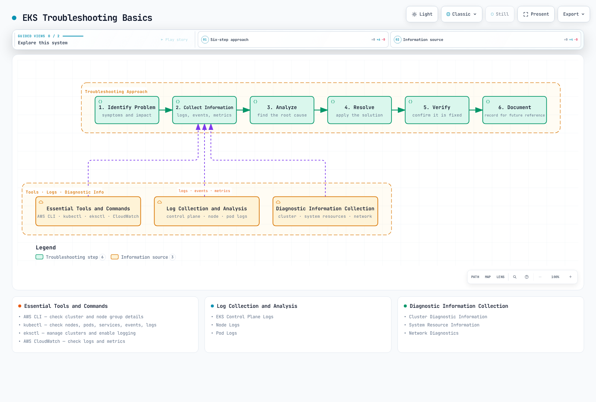
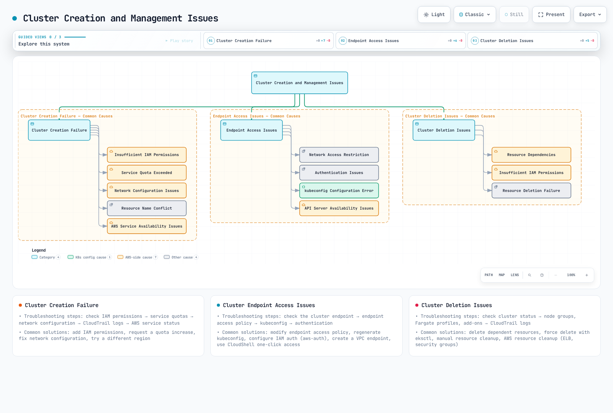
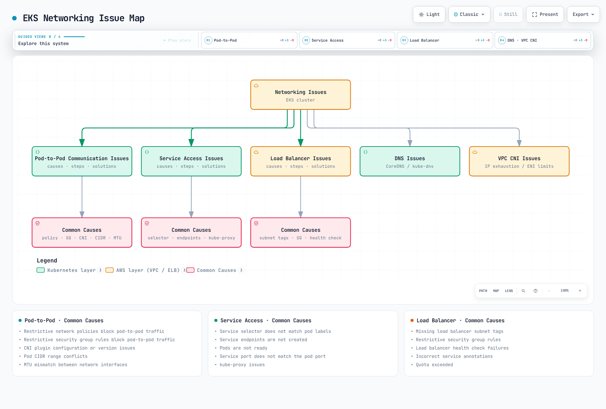
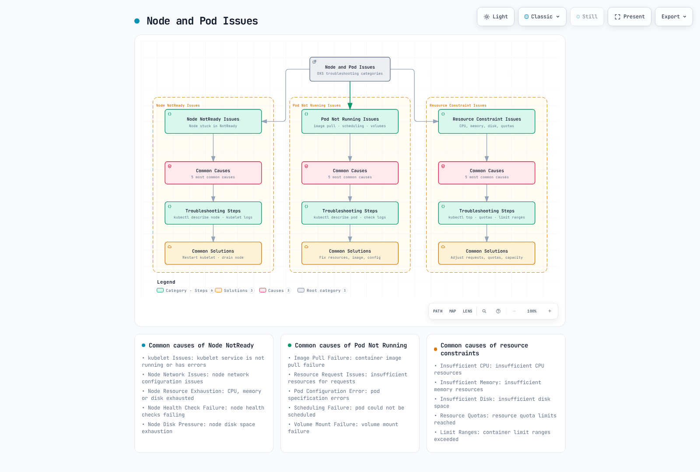
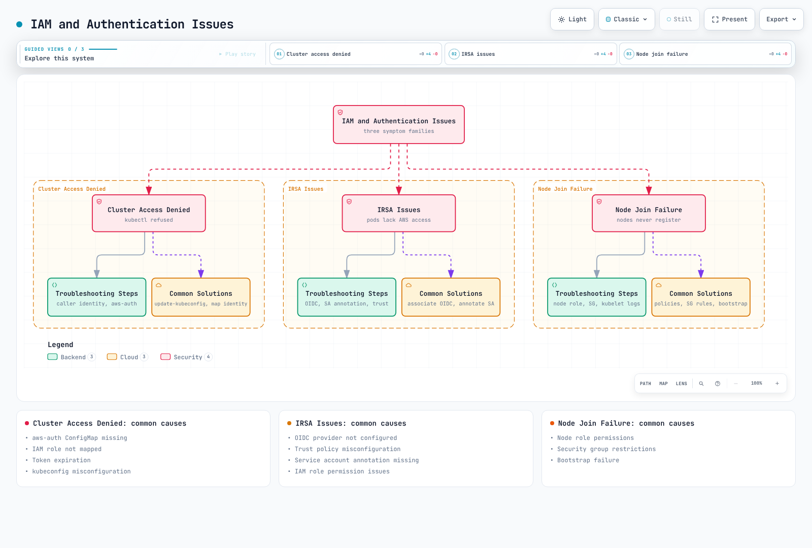

# Amazon EKS 故障排查

> **最后更新**：2026年9月12日

运行 Amazon EKS 集群时，可能会遇到各种问题。本文档介绍 EKS 集群中可能出现的常见问题及其解决方案。

## 目录

1. [故障排查基础](#troubleshooting-basics)
2. [集群创建和管理问题](#cluster-creation-and-management-issues)
3. [网络问题](#networking-issues)
4. [节点和 Pod 问题](#node-and-pod-issues)
5. [IAM 和身份验证问题](#iam-and-authentication-issues)
6. [存储问题](#storage-issues)
7. [日志记录和监控问题](#logging-and-monitoring-issues)
8. [性能问题](#performance-issues)
9. [升级问题](#upgrade-issues)
10. [常见错误消息和解决方案](#common-error-messages-and-solutions)

## 故障排查基础



[🔍 查看交互式图表](https://www.atomai.click/kubernetes-docs/archmaps/en-eks-09-eks-troubleshooting-0.html)

### 故障排查方法

1. 确定症状、受影响的用户/工作负载以及事件发生时间段。
2. 在更改资源之前，收集相关状态、日志、事件和指标。
3. 根据证据比较各种可能的假设；不要把通用错误当作已证实的原因。
4. 实施有明确负责人的针对性修正，并了解其对数据/可用性的影响。
5. 根据应用行为和指标验证是否恢复，而不只是看命令是否成功退出。
6. 记录原因、变更、结果、仍未排除的不确定因素以及预防措施。

本章中的命令是经过审核的环境所用的模板，并非从头到尾运行的单一脚本。查询资源、创建调试工作负载、重启组件和删除基础设施会产生不同影响。本次审核未执行任何实际 AWS/Kubernetes 操作。

### 必备工具和命令

对于**现有**集群，请设置预期的账户、区域、集群和 kubectl 上下文，然后确认它们相互匹配。不要根据任意上下文别名推导集群名称。如果在创建过程中失败，尚未有可用集群，请改用创建部分中的账户/区域以及原始请求/堆栈证据。

```bash
set -euo pipefail
: "${AWS_REGION:?Set the intended Region}"
: "${CLUSTER_NAME:?Set the existing cluster name}"
: "${EXPECTED_ACCOUNT_ID:?Set the intended 12-digit account ID}"
: "${KUBE_CONTEXT:?Set the explicit kubectl context}"
ACTUAL_ACCOUNT_ID=$(aws sts get-caller-identity --query Account --output text)
if [ "$ACTUAL_ACCOUNT_ID" != "$EXPECTED_ACCOUNT_ID" ]; then
  echo "Account mismatch" >&2; exit 1
fi
CLUSTER_ENDPOINT=$(aws eks describe-cluster --name "$CLUSTER_NAME" --region "$AWS_REGION" \
  --query cluster.endpoint --output text)
KUBE_ENDPOINT=$(kubectl config view --context "$KUBE_CONTEXT" --minify \
  -o jsonpath='{.clusters[0].cluster.server}')
if [ "$CLUSTER_ENDPOINT" != "$KUBE_ENDPOINT" ]; then
  echo "kubectl context does not match the selected EKS cluster" >&2; exit 1
fi
export AWS_REGION CLUSTER_NAME EXPECTED_ACCOUNT_ID KUBE_CONTEXT
```

#### AWS CLI 和 eksctl

```bash
aws eks describe-cluster --name "$CLUSTER_NAME" --region "$AWS_REGION" \
  --query 'cluster.{arn:arn,status:status,version:version,health:health,access:accessConfig}'
aws eks list-nodegroups --cluster-name "$CLUSTER_NAME" --region "$AWS_REGION"
aws eks list-addons --cluster-name "$CLUSTER_NAME" --region "$AWS_REGION"
eksctl get nodegroup --cluster "$CLUSTER_NAME" --region "$AWS_REGION"
```

这些命令列出托管节点组和已安装的 EKS 附加组件，并不会列出所有自管理控制器或计算资源。选择操作步骤之前，请记录资源的实际所有者和计算类型。

#### kubectl

```bash
kubectl --context "$KUBE_CONTEXT" get nodes -o wide
kubectl --context "$KUBE_CONTEXT" get pods -A -o wide
kubectl --context "$KUBE_CONTEXT" get services -A
kubectl --context "$KUBE_CONTEXT" get events -A --sort-by='.metadata.creationTimestamp'
: "${NAMESPACE:?}"; : "${POD_NAME:?}"
kubectl --context "$KUBE_CONTEXT" -n "$NAMESPACE" describe pod "$POD_NAME"
```

请明确指定受影响的命名空间、Pod、容器和节点。`describe` 输出和应用日志可能包含敏感的运维信息。`kubectl auth can-i` 检查特定操作的授权情况；`aws sts get-caller-identity` 用于识别 AWS 凭证。两者单独使用都不能证明网络可访问，也不能证明拥有所有 Kubernetes 权限。

### 日志收集和分析

#### EKS 控制平面日志

检查现有日志配置，并指定范围有限的事件时间段：

```bash
set -euo pipefail
: "${CLUSTER_NAME:?}"; : "${AWS_REGION:?}"
: "${START_TIME_MS:?Set the incident-window start in epoch milliseconds}"
: "${END_TIME_MS:?Set the incident-window end in epoch milliseconds}"
aws eks describe-cluster --name "$CLUSTER_NAME" --region "$AWS_REGION" \
  --query cluster.logging --output json
aws logs filter-log-events --region "$AWS_REGION" \
  --log-group-name "/aws/eks/$CLUSTER_NAME/cluster" \
  --start-time "$START_TIME_MS" --end-time "$END_TIME_MS" \
  --max-items 200 --output json --no-cli-pager
```

启用控制平面日志是一项独立的 `UpdateClusterConfig` 变更，有自己的更新 ID、权限和 CloudWatch 费用。它无法恢复更早的日志，也不会启用应用/主机日志收集。日志组不存在、请求被拒绝或时间段内没有日志，都说明可见性存在限制。应用/主机日志请使用 `/aws/containerinsights/<cluster>/...` 或实际的收集器目标位置。

#### 节点日志

在操作人员能够访问的标准 Linux EC2 节点上，启动会话之前，请核实节点的 `spec.providerID`、账户/区域以及 SSM 前提条件：

```bash
: "${INSTANCE_ID:?Verify the node EC2 ProviderID and account/Region first}"
aws ssm start-session --target "$INSTANCE_ID" --region "$AWS_REGION"
```

请在该节点会话中运行以下命令，**而不是**在本地终端运行。这些 systemd/containerd 示例假定节点映像提供了相应工具；Bottlerocket、Fargate 和 Auto Mode 需要使用其支持的诊断途径。

```bash
sudo journalctl -u kubelet --since "15 minutes ago" --no-pager
sudo journalctl -u containerd --since "15 minutes ago" --no-pager
df -h
df -i
free -m
```

当前 EKS 优化型 Linux 节点使用 containerd。在这些节点上，Docker 守护进程日志不是 kubelet 运行时日志。清理映像、清空日志或重启任何组件之前，请保留日志以及磁盘/索引节点证据。不健康节点上缺少 `kubectl top` 指标，本身不能证明 CPU/内存耗尽。

#### Pod 日志

```bash
set -euo pipefail
: "${KUBE_CONTEXT:?}"; : "${NAMESPACE:?}"; : "${POD_NAME:?}"; : "${CONTAINER_NAME:?}"
kubectl --context "$KUBE_CONTEXT" -n "$NAMESPACE" logs "$POD_NAME" \
  -c "$CONTAINER_NAME" --since=15m --tail=200 --timestamps=true
# Run only when a previous container instance exists in this same Pod.
kubectl --context "$KUBE_CONTEXT" -n "$NAMESPACE" logs "$POD_NAME" \
  -c "$CONTAINER_NAME" --previous --tail=200 --timestamps=true
```

`--previous` 指同一个 **Pod** 中指定容器的上一个已终止实例。它不会获取已删除的前任 Pod 的日志；如需查看保留的历史记录，请使用日志后端。请检查常规容器和 init 容器的状态、就绪情况及退出原因。

### 收集诊断信息

```bash
set -euo pipefail
: "${EVIDENCE_PARENT:?Set an existing private directory}"
: "${KUBE_CONTEXT:?}"; : "${NAMESPACE:?}"
umask 077
EVIDENCE_DIR=$(mktemp -d "$EVIDENCE_PARENT/eks-diagnosis.XXXXXXXX")
kubectl --context "$KUBE_CONTEXT" get nodes -o wide > "$EVIDENCE_DIR/nodes.txt"
kubectl --context "$KUBE_CONTEXT" -n "$NAMESPACE" get pods -o wide > "$EVIDENCE_DIR/pods.txt"
kubectl --context "$KUBE_CONTEXT" -n "$NAMESPACE" get services -o wide > "$EVIDENCE_DIR/services.txt"
kubectl --context "$KUBE_CONTEXT" -n "$NAMESPACE" get events \
  --sort-by='.metadata.creationTimestamp' > "$EVIDENCE_DIR/events.txt"
printf 'Evidence saved to %s; assess the findings before remediation.\n' "$EVIDENCE_DIR"
```

如果查询失败，此示例会停止；已经生成的文件仅包含部分证据。如果有范围明确的资源清单就足够，不要无差别地运行 `cluster-info dump` 或获取所有 Pod 的详细信息；分享证据之前，请先审核并遮盖敏感信息。

要诊断资源压力，请比较 requests/limits、节点可分配资源，以及 Metrics Server 可用时的 `kubectl top` 输出。在可访问的节点上，同时检查 `df -h` 和 `df -i`；有可用字节数并不能排除索引节点耗尽。节点调试 Pod 有自己的根文件系统，主机根文件系统则挂载在 `/host`；如果 `df -h` 未指定预期路径，检查的可能是错误的文件系统。创建此类 Pod 需要审核其命名空间、映像、调试配置文件、权限和清理方式。

要诊断网络，请确定源 Pod/命名空间/节点、目标、协议和端口。先检查适用的策略和源端解析器。新建的调试 Pod 可能与受影响的工作负载使用不同的标签、身份、DNS 或路由。ICMP ping 不能证明 TCP/UDP 应用连接可达。请在实际允许的路径上进行范围受限的测试；通过资源所有者准备工具并安排清理，不要反复创建名称常见且映像未固定的 `dnsutils`/`netshoot` Pod。

资料来源：[EKS 故障排查](https://docs.aws.amazon.com/eks/latest/userguide/troubleshooting.html)、[Kubernetes 日志](https://kubernetes.io/docs/reference/kubectl/generated/kubectl_logs/)、[节点调试](https://kubernetes.io/docs/tasks/debug/debug-cluster/kubectl-node-debug/)。

## 集群创建和管理问题



[🔍 查看交互式图表](https://www.atomai.click/kubernetes-docs/archmaps/en-eks-09-eks-troubleshooting-1.html)

### 集群创建失败

#### 常见原因

请检查确切的失败请求或 CloudFormation 事件，核实调用方权限、集群服务角色信任/策略、服务配额、受支持的子网/AZ 选择、IP 容量、名称冲突或服务可用性。这些只是待验证的假设；其可能性取决于实际错误。

#### 故障排查步骤

```bash
set -euo pipefail
: "${AWS_REGION:?}"; : "${CLUSTER_ROLE_NAME:?}"; : "${VPC_ID:?}"
aws sts get-caller-identity
aws iam get-role --role-name "$CLUSTER_ROLE_NAME" \
  --query 'Role.{Arn:Arn,Trust:AssumeRolePolicyDocument}'
aws iam list-attached-role-policies --role-name "$CLUSTER_ROLE_NAME"
aws iam list-role-policies --role-name "$CLUSTER_ROLE_NAME"
aws ec2 describe-subnets --region "$AWS_REGION" --filters "Name=vpc-id,Values=$VPC_ID" \
  --query 'Subnets[].{Id:SubnetId,AZ:AvailabilityZone,AZId:AvailabilityZoneId,AvailableIPs:AvailableIpAddressCount,CIDR:CidrBlock}'
aws service-quotas list-service-quotas --service-code eks --region "$AWS_REGION"
aws cloudtrail lookup-events --region "$AWS_REGION" \
  --lookup-attributes AttributeKey=EventName,AttributeValue=CreateCluster \
  --max-items 20 --output json
```

仅查看附加策略无法得知调用方的有效权限；还需考虑内联策略、权限边界、会话策略和 Organizations 控制。`AmazonEKSClusterPolicy` 属于 EKS 集群服务角色；将其附加给人工用户，不会授予所需的 `eks:CreateCluster`/`iam:PassRole` 权限或 Kubernetes 访问权限。创建服务相关角色也有其独立的权限和生命周期。

进行网络检查时，请使用所选集群子网以及准确的路由/安全组/NACL 配置。集群子网要求与节点/Pod/LB 地址容量是不同的规划事项。私有集群可以使用所需的服务端点，而无需 NAT 网关或通用互联网访问。`kubernetes.io/cluster/...` 子网标签并非解决控制平面创建问题的通用方法。

对于配额错误，请根据错误识别服务/配额，并在申请提高配额之前查询当前已应用的值。EKS 集群配额、EC2 vCPU/实例系列配额和 VPC 限制各不相同。“限额为 5”之类的历史消息只是示例，并非当前账户限额。

#### 常见解决方案

通过基础设施所有者修正具体的权限、服务角色信任关系、子网选择、IP 分配或配额问题，然后审核是否重试。`UnsupportedAvailabilityZoneException` 表示指定的集群子网位于该账户不支持 EKS 的 AZ 中；请使用错误消息报告的受支持 AZ。不能仅凭 EC2 实例类型的供应情况诊断此错误。

检查 AWS Health 是否有服务事件。切换区域会产生单独的部署位置/数据/网络设计，且可能需要另一个集群；这不是默认的故障排查重试方式。`eksctl create cluster --verbose ...` 和 AWS CLI 调试标志仍会执行创建操作。发起新的预置请求之前，请先查看现有堆栈事件和请求 ID。

### 集群端点访问问题

#### 分别诊断 DNS、传输、TLS、身份验证和授权

检查端点模式、允许的公有 CIDR 和集群安全组，然后使用集群 CA 和超时设置进行测试：

```bash
set -euo pipefail
: "${CLUSTER_NAME:?}"; : "${AWS_REGION:?}"; : "${EVIDENCE_PARENT:?}"
umask 077
ENDPOINT_DIR=$(mktemp -d "$EVIDENCE_PARENT/eks-endpoint.XXXXXXXX")
aws eks describe-cluster --name "$CLUSTER_NAME" --region "$AWS_REGION" \
  --output json > "$ENDPOINT_DIR/cluster.json"
jq -er '.cluster.certificateAuthority.data' "$ENDPOINT_DIR/cluster.json" \
  | base64 --decode > "$ENDPOINT_DIR/cluster-ca.crt"
ENDPOINT=$(jq -er '.cluster.endpoint' "$ENDPOINT_DIR/cluster.json")
jq '.cluster.resourcesVpcConfig | {endpointPublicAccess,endpointPrivateAccess,publicAccessCidrs,clusterSecurityGroupId,vpcId}' \
  "$ENDPOINT_DIR/cluster.json"
curl --silent --show-error --connect-timeout 5 --max-time 10 \
  --cacert "$ENDPOINT_DIR/cluster-ca.crt" --output /dev/null \
  --write-out 'HTTP status: %{http_code}\n' "$ENDPOINT"
```

此操作不会发送 Kubernetes bearer token。401/403 响应可以证明 DNS/TCP/TLS 通信成功，但访问被拒绝；HTTP 响应成功并不能证明应用运行正常。`curl -k` 会掩盖证书验证失败。如果需要进行 DNS 查询，请使用端点 URL 中的主机名，而不要将 `https://` URL 传给 `nslookup`。

对于公有端点，请检查客户端实际的出站/NAT 地址是否属于允许的 CIDR。对于私有端点，请检查 VPC/互联网络路径、DNS 解析和安全组访问。接口端点 `com.amazonaws.<region>.eks` 提供的是 **EKS 管理 API**，而不是 Kubernetes API 服务器。仅启用该端点无法修复 kubectl 访问问题。集群的 Kubernetes 私有端点是独立的。

#### kubeconfig 和权限

检查上下文名称/服务器，但不要输出原始凭证。要创建单独的诊断 kubeconfig，请指定明确的路径和别名；将 `NAMESPACE` 设为预期的授权范围：

```bash
set -euo pipefail
: "${CLUSTER_NAME:?}"; : "${AWS_REGION:?}"
: "${NAMESPACE:?Set the namespace for the authorization check}"
: "${DIAGNOSTIC_KUBECONFIG:?Set a separate writable kubeconfig path}"
: "${KUBE_CONTEXT:?Choose an explicit alias for this cluster}"
umask 077
aws eks update-kubeconfig --name "$CLUSTER_NAME" --region "$AWS_REGION" \
  --kubeconfig "$DIAGNOSTIC_KUBECONFIG" --alias "$KUBE_CONTEXT"
export KUBECONFIG="$DIAGNOSTIC_KUBECONFIG"
kubectl --context "$KUBE_CONTEXT" auth can-i get pods --namespace "$NAMESPACE"
```

创建 kubeconfig 需要 `eks:DescribeCluster`；Kubernetes 身份验证/授权是另一项要求。如果需要代入角色，请使用经过审核的 `--role-arn`，并确认其信任关系/STS 权限。请通过实际凭证提供方（例如已配置的 SSO 会话）续期凭证，不要输出会话令牌。

```bash
set -euo pipefail
: "${CLUSTER_NAME:?}"; : "${AWS_REGION:?}"
aws eks describe-cluster --name "$CLUSTER_NAME" --region "$AWS_REGION" \
  --query 'cluster.accessConfig'
# Use the next command when API or API_AND_CONFIG_MAP authentication is enabled.
aws eks list-access-entries --cluster-name "$CLUSTER_NAME" --region "$AWS_REGION"
```

启用基于访问条目的身份验证时，请检查相关条目及关联策略的范围。传统 `CONFIG_MAP` 模式或混合模式的集群也可能使用 `aws-auth`；请保留现有节点映射，并按计划迁移。不要将 `system:masters` 作为通用访问修复方法，也不要覆盖整个 ConfigMap。IRSA 的 IAM OIDC 提供商用于工作负载 AWS 凭证，并不是授权人工 IAM 主体访问 Kubernetes 的身份映射。

#### 修正访问路径

使用已连接的私有管理路径，或根据端点模式配置经过审核的公有 CIDR 允许列表。不要仅为使诊断命令运行而开放 `0.0.0.0/0`。移除公有访问之前，请先测试私有路径，保留当前不相关的 VPC 设置，并记录配置更新 ID。计划变更时，请遵循[安全章节中的端点操作流程](./05-eks-security.md)。

#### 一键 CloudShell 访问

2026年4月30日推出的一键功能受支持。在集群详细信息页面选择 **连接**，即可打开已配置 kubectl 的 CloudShell。该功能同时支持公有和私有 API 端点；对于私有端点，会自动启动 CloudShell VPC 环境并提示输入其名称。此功能在 EKS 区域内不收取额外功能费用。

控制台访问仍需要相应的 IAM/CloudShell/VPC 环境权限、Kubernetes 访问权限以及正常工作的网络配置。此功能省去了本地设置步骤，但不会免除授权检查。运行命令之前，请检查适用的资源/数据传输费用以及会话身份。

资料来源：[kubeconfig 和 CloudShell](https://docs.aws.amazon.com/eks/latest/userguide/create-kubeconfig.html)、[一键功能公告](https://aws.amazon.com/about-aws/whats-new/2026/04/amazon-eks-one-click-cluster-access/)、[EKS PrivateLink 区别](https://docs.aws.amazon.com/eks/latest/userguide/vpc-interface-endpoints.html)、[集群故障排查](https://docs.aws.amazon.com/eks/latest/userguide/troubleshooting.html)。

### 集群删除问题

#### 确定阻塞依赖项

删除集群是有意执行的拆除操作，不是通用的故障排查补救措施。请查看准确的 EKS/CloudFormation 错误、集群 ARN/账户/区域、更新状态和删除保护设置。除了托管节点组和 Fargate 配置文件之外，删除保护和已安装的 EKS Capabilities 也可能阻止删除。集群删除完成之前，请保留其 IAM/服务角色。

清点所选集群，并将其端点与明确指定的 kubectl 上下文进行比较。以下命令为只读操作，不会自动选择要删除的资源：

```bash
set -euo pipefail
: "${CLUSTER_NAME:?Set the cluster being deliberately retired}"
: "${AWS_REGION:?}"; : "${KUBE_CONTEXT:?}"; : "${EXPECTED_ACCOUNT_ID:?}"
ACTUAL_ACCOUNT_ID=$(aws sts get-caller-identity --query Account --output text)
if [ "$ACTUAL_ACCOUNT_ID" != "$EXPECTED_ACCOUNT_ID" ]; then
  echo "Account mismatch; stop" >&2
  exit 1
fi
aws eks describe-cluster --name "$CLUSTER_NAME" --region "$AWS_REGION" \
  --query 'cluster.{arn:arn,status:status,deletionProtection:deletionProtection,endpoint:endpoint}'
kubectl config view --context "$KUBE_CONTEXT" --minify \
  -o jsonpath='{.clusters[0].cluster.server}{"\n"}'
# Compare the endpoints before inspecting Kubernetes resources.
kubectl --context "$KUBE_CONTEXT" get services -A \
  -o custom-columns='NAMESPACE:.metadata.namespace,NAME:.metadata.name,TYPE:.spec.type,CLASS:.spec.loadBalancerClass,ADDRESS:.status.loadBalancer.ingress'
kubectl --context "$KUBE_CONTEXT" get ingress -A
kubectl --context "$KUBE_CONTEXT" get pvc -A
kubectl --context "$KUBE_CONTEXT" get pv \
  -o custom-columns='NAME:.metadata.name,CLAIM_NS:.spec.claimRef.namespace,CLAIM:.spec.claimRef.name,RECLAIM:.spec.persistentVolumeReclaimPolicy,DRIVER:.spec.csi.driver,HANDLE:.spec.csi.volumeHandle'
aws eks list-nodegroups --cluster-name "$CLUSTER_NAME" --region "$AWS_REGION"
aws eks list-fargate-profiles --cluster-name "$CLUSTER_NAME" --region "$AWS_REGION"
aws eks list-capabilities --cluster-name "$CLUSTER_NAME" --region "$AWS_REGION"
aws eks list-addons --cluster-name "$CLUSTER_NAME" --region "$AWS_REGION"
```

Service 的 `EXTERNAL-IP` 输出本身不能证明资源归属：请区分由控制器管理的 `LoadBalancer` Service、手动配置的外部 IP 和其他 Service 类型。记录命名空间/名称/UID、控制器所有权、AWS 资源 ARN 和相关标签。还要包括已安装相应控制器时的 Ingress、Gateway/TargetGroupBinding 资源，并确定目标或负载均衡器是否为共享资源。

#### 按资源所有者的顺序退役资源

1. 迁移流量和工作负载，并验证应用一致性备份/恢复以及数据保留要求。保存 PVC YAML 并不是数据备份。删除 claim 时，`Delete` 回收策略可能会删除底层存储；`Retain` 则需要单独决定如何处置数据/存储。
2. 所需的负载均衡器控制器仍在运行时，仅删除经过审核、且确实拥有负载均衡器的 Kubernetes 资源。等待 finalizer 完成，并确认相应 AWS 资源已释放。删除节点之前，先解决控制器 IAM 或依赖项故障。不要仅为掩盖清理失败而删除 finalizer。
3. 按照 EKS Capabilities 的文档中规定的所有权/资源删除语义移除它们。按审核后的顺序删除托管节点组和 Fargate 配置文件，并等待操作完成。自管理节点/堆栈需要单独拆除。删除附加组件也可能移除 Kubernetes 组件；依赖资源清理完成之前，请保留网络/存储控制器。
4. 只有在明确决定拆除时，才禁用删除保护；然后通过原始基础设施所有者删除集群。Auto Mode 集群删除操作也会删除其托管节点和负载均衡器；请考虑此操作范围以及内置 TargetGroupBinding 的目标组生命周期。
5. 根据确切的所有权审核剩余资源：专用堆栈/VPC、卷/快照、负载均衡器、IAM 资源、日志和 Prometheus 抓取器。共享资源和保留的数据有各自独立的生命周期，也可能继续产生费用。

例如，经过前述流量/数据审核后，以下命令会删除**一个**明确选定的 Service。这不是循环发现并删除资源的操作：

```bash
set -euo pipefail
: "${KUBE_CONTEXT:?}"; : "${SERVICE_NAMESPACE:?}"; : "${SERVICE_NAME:?}"
# Separate approved teardown step after traffic/data migration and owner review.
kubectl --context "$KUBE_CONTEXT" -n "$SERVICE_NAMESPACE" get service "$SERVICE_NAME" -o yaml
kubectl --context "$KUBE_CONTEXT" -n "$SERVICE_NAMESPACE" delete service "$SERVICE_NAME" \
  --wait=true --timeout=10m
```

超时并不能证明 AWS 负载均衡器已保留或已删除；请检查 finalizer、控制器事件和确切的 AWS ARN。Kubernetes 和 AWS 资源清理可能在不同时间完成。

#### 删除错误和强制行为

使用 EKS 更新详情和 CloudFormation 堆栈事件，识别依赖、授权和操作进行中等故障。在 eksctl 0.229 中，`delete cluster --force` 是有效选项，发生错误时允许继续删除。但这不能证明清理已完成，也不能安全地确定孤立资源的所有者。`--disable-nodegroup-eviction` 是通过删除绕过 PDB 检查的独立选项。这两者都不是默认的事件响应方式。

不要将账户/区域范围的 ELB/ELBv2 列表通过管道传给删除命令，也不要为清除依赖错误而删除所有 Service、PVC 或命名空间。如果必须手动删除孤立资源，请先确定其确切的集群/堆栈所有者以及对数据/流量的影响，再按照相应服务经过审核的拆除流程操作。

资料来源：[删除 EKS 集群](https://docs.aws.amazon.com/eks/latest/userguide/delete-cluster.html)、[删除故障排查](https://repost.aws/knowledge-center/eks-delete-cluster-issues)、[持久卷生命周期](https://kubernetes.io/docs/concepts/storage/persistent-volumes/)。

## 网络问题



[🔍 查看交互式图表](https://www.atomai.click/kubernetes-docs/archmaps/en-eks-09-eks-troubleshooting-2.html)

首先确定实际的计算/数据平面。使用开源 VPC CNI 的标准 EC2 节点、Fargate 和 Auto Mode，其代理或配置并不完全相同。对于 Auto Mode，请使用其 `NodeClass` 网络控制项；更改 `aws-node` DaemonSet 或 `ENIConfig` 并不能配置 Auto Mode 节点。

### Pod 间通信问题

#### 跟踪故障路径

记录源/目标 Pod、命名空间、节点/AZ、IP 地址族、协议和目标端口。在经批准的测试能够隔离差异时，比较同节点和跨节点的行为。根据该路径检查策略、安全组、路由/NACL、CNI 状态、IP 分配和路径 MTU。

```bash
set -euo pipefail
: "${KUBE_CONTEXT:?}"; : "${NAMESPACE:?}"; : "${POD_NAME:?}"
kubectl --context "$KUBE_CONTEXT" -n "$NAMESPACE" get pod "$POD_NAME" -o wide
kubectl --context "$KUBE_CONTEXT" -n "$NAMESPACE" get pod "$POD_NAME" \
  -o jsonpath='{.metadata.labels}{"\n"}{.spec.nodeName}{"\n"}{.spec.hostNetwork}{"\n"}'
kubectl --context "$KUBE_CONTEXT" get namespace "$NAMESPACE" --show-labels
kubectl --context "$KUBE_CONTEXT" -n "$NAMESPACE" get networkpolicies
kubectl --context "$KUBE_CONTEXT" -n "$NAMESPACE" get events \
  --sort-by='.metadata.creationTimestamp'
```

标准 `networking.k8s.io/v1` NetworkPolicy 会累加允许的流量；它们没有规则优先级，也不存在“最后一个策略生效”的机制。如果两端都处于隔离状态，源端出站和目标端入站都必须允许该流量。管理员/集群范围的策略 API 和特定供应商的策略引擎有各自的语义。检查命名空间标签，并确认 `namespaceSelector` 和 `podSelector` 是同一个 peer 内的条件（AND），还是两个独立 peer（OR）。

VPC CNI 支持原生网络策略实施；不能仅因为没有第三方策略 Pod，就安装 Calico/Cilium。请核实受支持的 CNI/平台/内核以及已启用的策略代理配置。标准启动模式下，新 Pod 在配置好策略之前会暂时允许流量；严格模式则从拒绝流量开始，因此需要配置所需的 DNS/依赖策略。主机网络行为及其他覆盖范围限制，请参阅适用实现的文档。

对于标准 VPC CNI 安装，请检查实际 `aws-node` Pod 中 `aws-network-policy-agent` 容器（如果存在）的日志。执行 `kubectl get pods -l ...` 成功但返回空列表，并不能证明已安装插件。Auto Mode 使用其内置策略控制。

#### 只修正预期的流量

请审核完整的允许流量矩阵，而不是添加命名空间范围的全允许入站/出站规则或删除策略。以下示例选择后端 API Pod，并且只允许前端 web Pod 通过 TCP 8080 访问：

```yaml
# Example ingress policy only: review both peers and the complete allowed-flow matrix.
apiVersion: networking.k8s.io/v1
kind: NetworkPolicy
metadata:
  name: api-from-web
  namespace: backend
spec:
  podSelector:
    matchLabels:
      app: api
  policyTypes:
    - Ingress
  ingress:
    - from:
        - namespaceSelector:
            matchLabels:
              kubernetes.io/metadata.name: frontend
          podSelector:
            matchLabels:
              app: web
      ports:
        - protocol: TCP
          port: 8080
```

应用此策略可能会隔离所选后端 Pod 的其他入站流量，除非其他策略允许这些流量。它不会配置客户端出站、DNS 或所有依赖项。请通过正向和负向测试分别验证这些配置。请使用实际工作负载的命名空间/标签，而不是照搬示例中的名称。

对于安全组，请检查源和目标 ENI 的安全组，并在适用时包括 Pod 安全组/自定义 Pod 子网。通过资源所有者放行所需的源/端口；不要将所有协议或宽泛 CIDR 作为通用修复方法。1500 或 9001 等 MTU 值取决于路径；更改 CNI 配置或替换 Pod 之前，请先测量故障并考虑封装因素。

### Service 访问问题

请同时检查 Service selector、实际 Pod 就绪状态、端点条件和端口映射：

```bash
set -euo pipefail
: "${KUBE_CONTEXT:?}"; : "${NAMESPACE:?}"; : "${SERVICE_NAME:?}"
SERVICE_JSON=$(kubectl --context "$KUBE_CONTEXT" -n "$NAMESPACE" get service "$SERVICE_NAME" -o json)
printf '%s\n' "$SERVICE_JSON" | jq '{metadata: {name: .metadata.name, namespace: .metadata.namespace}, spec: .spec, status: .status}'
SELECTOR=$(printf '%s\n' "$SERVICE_JSON" | jq -r '(.spec.selector // {}) | to_entries | map("\(.key)=\(.value)") | join(",")')
if [ -n "$SELECTOR" ]; then
  kubectl --context "$KUBE_CONTEXT" -n "$NAMESPACE" get pods -l "$SELECTOR" -o wide
  kubectl --context "$KUBE_CONTEXT" -n "$NAMESPACE" get pods -l "$SELECTOR" -o json \
    | jq '.items[] | {name:.metadata.name,phase:.status.phase,ready:[.status.conditions[]? | select(.type=="Ready")],containers:.status.containerStatuses}'
else
  printf 'No selector: inspect ExternalName or explicitly managed EndpointSlices as applicable.\n'
fi
kubectl --context "$KUBE_CONTEXT" -n "$NAMESPACE" get endpointslices \
  -l "kubernetes.io/service-name=$SERVICE_NAME" -o yaml
```

请使用 EndpointSlices，不要依赖已弃用的 Endpoints API。检查 `ready`、`serving` 和 `terminating` 条件，以及 `publishNotReadyAddresses`、`externalTrafficPolicy` 和 `internalTrafficPolicy` 等 Service 选项。Pod 处于 Running 状态并不代表它已就绪。

对于 `ExternalName` Service，请诊断 DNS 别名，而不是期待它选择 Pod。对于无头 Service，`clusterIP: None` 是有意设置的。无 selector 的 Service 可能使用由资源所有者管理的 EndpointSlices。Service 的 `port` 可能与 `targetPort` 不同；声明容器端口并不会让应用自动在该端口监听。

如果标签或端口有误，请通过其发布配置更新资源所有者管理的 Service/Pod 模板。更改某个由控制器管理的 Pod 标签并非持久修复。修补前请检查完整端口列表和不可变字段。不要在未诊断原因时删除并重新创建 Service、更改 ClusterIP 或重启所有 kube-proxy Pod。

仅在策略允许时，使用相同源和协议比较直接 Pod 连接与 Service 连接。检查数据平面究竟是 kube-proxy、替代实现还是 Auto Mode，然后再调查 iptables/nftables/eBPF 行为。kube-proxy Pod 缺失并不一定是故障。

### 负载均衡器问题

根据 Service/Ingress class、注释和所有权确定控制器。标准 AWS Load Balancer Controller 和 EKS Auto Mode 使用不同的 class/API 和生命周期规则。请针对相应所有者检查控制器事件、子网选择、IAM、安全组、目标注册和运行状况检查。

使用与工作负载关联的确切负载均衡器和目标组 ARN：

```bash
set -euo pipefail
: "${AWS_REGION:?}"; : "${LOAD_BALANCER_ARN:?}"; : "${TARGET_GROUP_ARN:?}"
aws elbv2 describe-load-balancers --region "$AWS_REGION" \
  --load-balancer-arns "$LOAD_BALANCER_ARN"
aws elbv2 describe-tags --region "$AWS_REGION" \
  --resource-arns "$LOAD_BALANCER_ARN" "$TARGET_GROUP_ARN"
aws elbv2 describe-load-balancer-attributes --region "$AWS_REGION" \
  --load-balancer-arn "$LOAD_BALANCER_ARN"
aws elbv2 describe-target-groups --region "$AWS_REGION" \
  --target-group-arns "$TARGET_GROUP_ARN"
aws elbv2 describe-target-health --region "$AWS_REGION" \
  --target-group-arn "$TARGET_GROUP_ARN"
```

`describe-load-balancer-attributes` 显示的是属性，而不是运行状态；`describe-load-balancers` 会包含状态。检查目标运行状况原因代码、运行状况检查协议/端口/路径、监听器/规则路由以及应用响应。实例目标通常到达节点/NodePort；IP 目标则到达 Pod 目标端口。安全组规则必须与实际路径相符。

子网角色标签会影响自动发现；请检查公有/内部方案、路由表、可用 IP 和 AZ 覆盖范围。在同一子网上同时添加公有和私有角色标签并不能解决问题。明确选择子网以及控制器版本可能会改变标签要求。不要为了绕过运行状况检查失败而将前端/后端安全组开放给 `0.0.0.0/0`。

请使用资源所有者当前的方案/类型配置。旧版 `aws-load-balancer-internal` 或 `aws-load-balancer-type: nlb` 示例不能与当前控制器 class 互换。更改控制器所有权或 LB 方案可能需要计划替换并迁移流量；编辑注释并不能保证原位转换。Auto Mode 不会接管已由自管理控制器管理的负载均衡器。

删除 Service 可能会删除其负载均衡器，而原样导出的 Service YAML 不是完整的流量/数据回滚方案。手动创建 ALB 不会自动将其连接到 Kubernetes Service。变更之前，请查阅针对所选所有者的[网络指南](./03-eks-networking-part2.md)。

### DNS 问题

#### 检查受影响 Pod 使用的解析器

```bash
set -euo pipefail
: "${KUBE_CONTEXT:?}"; : "${NAMESPACE:?}"; : "${POD_NAME:?}"; : "${CONTAINER_NAME:?}"
kubectl --context "$KUBE_CONTEXT" -n "$NAMESPACE" get pod "$POD_NAME" \
  -o jsonpath='{.spec.dnsPolicy}{"\n"}{.spec.dnsConfig}{"\n"}{.spec.hostNetwork}{"\n"}'
kubectl --context "$KUBE_CONTEXT" -n "$NAMESPACE" exec "$POD_NAME" \
  -c "$CONTAINER_NAME" -- cat /etc/resolv.conf
# Where this container actually includes nslookup, test the intended name.
: "${DNS_TEST_NAME:?Set the intended Service FQDN or reviewed external hostname}"
kubectl --context "$KUBE_CONTEXT" -n "$NAMESPACE" exec "$POD_NAME" \
  -c "$CONTAINER_NAME" -- nslookup "$DNS_TEST_NAME"
```

如果映像不包含 shell 或 DNS 工具，这是工具限制，并不代表 DNS 查询失败。请准备经过审核的调试方法，以保留相关网络/身份上下文。新的调试 Pod 可能使用不同的 DNS/策略设置。

对于标准的非 Auto 节点，请检查已安装的 CoreDNS Deployment/Service、配置和 EndpointSlices：

```bash
kubectl --context "$KUBE_CONTEXT" -n kube-system get deployment coredns
kubectl --context "$KUBE_CONTEXT" -n kube-system get pods -l k8s-app=kube-dns -o wide
kubectl --context "$KUBE_CONTEXT" -n kube-system get service kube-dns
kubectl --context "$KUBE_CONTEXT" -n kube-system get endpointslices \
  -l kubernetes.io/service-name=kube-dns
kubectl --context "$KUBE_CONTEXT" -n kube-system get configmap coredns -o yaml
kubectl --context "$KUBE_CONTEXT" -n kube-system logs -l k8s-app=kube-dns \
  --all-containers=true --prefix=true --since=15m --tail=100
```

对于 **Auto Mode 节点**，CoreDNS 作为节点系统服务运行。纯 Auto Mode 集群可以在没有传统 CoreDNS Deployment 的情况下运行。混合 Auto/非 Auto 集群必须为非 Auto 节点保留该 Deployment。不要把 NodeLocal DNSCache 安装到 Auto Mode 节点上，也不要将重启不存在的 Deployment 作为 Auto Mode 的补救措施。

区分 Pod 的 nameserver、CoreDNS/NodeLocal 上游和 VPC 解析器。`169.254.20.10` 是常见的 NodeLocal DNSCache 地址，并非通用的 VPC DNS 服务器。诸如 `8.8.8.8` 的公有解析器不能作为 Kubernetes Service 区域或私有 AWS DNS 的备用解析器。

```bash
set -euo pipefail
: "${AWS_REGION:?}"; : "${VPC_ID:?}"
aws ec2 describe-vpc-attribute --region "$AWS_REGION" --vpc-id "$VPC_ID" \
  --attribute enableDnsSupport
aws ec2 describe-vpc-attribute --region "$AWS_REGION" --vpc-id "$VPC_ID" \
  --attribute enableDnsHostnames
aws ec2 describe-vpcs --region "$AWS_REGION" --vpc-ids "$VPC_ID" \
  --query 'Vpcs[].{VpcId:VpcId,DhcpOptionsId:DhcpOptionsId}'
```

DNS 属性应使用 `describe-vpc-attribute` 查询；这些属性不会作为字段由 `describe-vpcs` 返回。请根据返回的 ID 查询 DHCP 选项。更改共享 VPC 的 DHCP 设置之前，请先审核其他工作负载。

#### 应用有针对性的 DNS 修正

根据需要检查 UDP 和 TCP 53 端口、实际 CoreDNS 就绪状态/配置、上游可达性、DNS 策略和自定义搜索设置。若需要使用集群 DNS，`hostNetwork` Pod 通常需要 `ClusterFirstWithHostNet`；`dnsPolicy: None` 则需要完整且有意配置的解析器设置。仅允许 DNS 的出站策略也会隔离所选 Pod 的其他出站流量，除非其他策略允许这些流量。

保留资源所有者的 Corefile 自定义项，并使用附加组件支持的配置 Schema。扩缩容或重启 CoreDNS 之前，请审核副本/资源/PDB/调度设置以及任何自动扩缩容资源所有者。保留更新 ID 并执行功能性 DNS 检查；不要删除所有 DNS Pod，也不要将猜测的“latest”映像作为第一步。

### VPC CNI 问题

以下检查适用于**使用开源 VPC CNI 的标准 EC2 节点**。请明确选择受影响节点上的 Pod；`kubectl exec` 不接受标签选择器。

```bash
set -euo pipefail
: "${KUBE_CONTEXT:?}"; : "${NODE_NAME:?}"
kubectl --context "$KUBE_CONTEXT" get node "$NODE_NAME" \
  -o jsonpath='{.spec.providerID}{"\n"}{.status.nodeInfo}{"\n"}{.status.allocatable.pods}{"\n"}'
kubectl --context "$KUBE_CONTEXT" -n kube-system get daemonset aws-node -o json \
  | jq '.spec.template.spec | {containers:[.containers[] | {name,image,args,env}],initContainers:[.initContainers[]? | {name,image,args,env}]}'
kubectl --context "$KUBE_CONTEXT" -n kube-system get pods \
  -l k8s-app=aws-node --field-selector "spec.nodeName=$NODE_NAME" -o wide
kubectl --context "$KUBE_CONTEXT" get pods -A \
  --field-selector "spec.nodeName=$NODE_NAME" -o wide
: "${AWS_NODE_POD:?Select the aws-node Pod on that exact node}"
kubectl --context "$KUBE_CONTEXT" -n kube-system logs "$AWS_NODE_POD" \
  -c aws-node --since=15m --tail=200
```

请检查附加组件的 `configurationValues`、DaemonSet 环境变量和相关自定义资源。不要假定 `aws-node` ConfigMap 包含所有设置。节点的 `.spec.podCIDR` 不是可靠的 VPC CNI Pod 地址清单；请检查实际 Pod IP、EC2 ENI、前缀和子网。

```bash
set -euo pipefail
: "${AWS_REGION:?}"; : "${INSTANCE_ID:?Verify it from the selected node ProviderID}"
aws ec2 describe-instances --region "$AWS_REGION" --instance-ids "$INSTANCE_ID" \
  --query 'Reservations[].Instances[].{Id:InstanceId,Type:InstanceType,Subnet:SubnetId,SGs:SecurityGroups,ENIs:NetworkInterfaces}'
: "${SUBNET_ID:?Set the actual node or custom Pod subnet being investigated}"
aws ec2 describe-subnets --region "$AWS_REGION" --subnet-ids "$SUBNET_ID" \
  --query 'Subnets[].{Id:SubnetId,CIDR:CidrBlock,AvailableIPs:AvailableIpAddressCount}'
: "${INSTANCE_TYPE:?Set the selected instance type}"
aws ec2 describe-instance-types --region "$AWS_REGION" --instance-types "$INSTANCE_TYPE" \
  --query 'InstanceTypes[].{Type:InstanceType,Network:NetworkInfo}'
```

启用 IPAMD 内省时，可通过节点已配置的内省端点（通常为 loopback 端口 61679）进行访问。请使用允许的节点/代理诊断方法，并确保有必要的工具；CNI 映像中没有 curl 并不是 IPAM 故障。

#### 区分分配限制

- **子网耗尽/碎片化：** 比较可用地址和前缀。前缀委派需要受支持的实例/配置以及可用的连续前缀块；仅凭空闲 IP 数量无法证明可以分配 /28。
- **实例 ENI/IP 限制：** 检查 `NetworkInfo` 和现有 ENI。调整节点组期望/最小/最大值会改变节点数，不会改变实例类型或单实例限制。请使用经过审核的新节点组，或通过受支持的原始启动模板更新路径更改实例配置。
- **自定义网络：** 启用之前，请准备匹配的 `ENIConfig`、Pod 子网/安全组和节点选择设置。此项配置会改变辅助 ENI/Pod IP 的来源，但不会创造无限容量。
- **预留目标：** `WARM_IP_TARGET` 控制空闲 IP 余量；`MINIMUM_IP_TARGET` 为已分配 IP 总数设定下限。根据文档，这些设置会覆盖预留 ENI 行为；在前缀模式下，IP/最小目标也会影响预留前缀行为。如果最小值设置为正数却没有正的预留余量，可能会阻止后续分配。请根据工作负载/IP 预算推导数值，而不是照搬任意的 1/2/5 设置。
- **身份/所有权：** 检查实际 CNI IRSA/Pod Identity 或适用的节点角色，以及 IPv4/IPv6 策略。将 IPv4 CNI 策略附加到所有节点角色并非通用修复方法。

Auto Mode 使用 `NodeClass` 子网/安全组/策略控制，不接受这些预留 IP/ENI 或 `ENIConfig` 设置。请保留其托管网络模型。

通过资源所有者应用经过审核的 CNI 版本/配置，并遵循受支持的中间版本及配置 Schema。使用[升级指南](./08-eks-upgrades.md)监控确切的附加组件更新，并在之后验证网络。不要只替换一个容器映像、盲目覆盖配置，或重启所有工作负载来掩盖分配故障。

资料来源：[VPC CNI 策略配置](https://docs.aws.amazon.com/eks/latest/userguide/cni-network-policy-configure.html)、[Auto Mode 网络](https://docs.aws.amazon.com/eks/latest/userguide/auto-networking.html)、[自定义网络](https://docs.aws.amazon.com/eks/latest/best-practices/custom-networking.html)、[CNI 配置](https://github.com/aws/amazon-vpc-cni-k8s)、[Kubernetes NetworkPolicy](https://kubernetes.io/docs/concepts/services-networking/network-policies/)、[EndpointSlices](https://kubernetes.io/docs/concepts/services-networking/endpoint-slices/)。

## 节点和 Pod 问题



[🔍 查看交互式图表](https://www.atomai.click/kubernetes-docs/archmaps/en-eks-09-eks-troubleshooting-3.html)

### 节点 NotReady 问题

#### 检查状态条件和实际节点

`Ready=False` 和 `Ready=Unknown` 需要不同的证据：运行状况异常的 kubelet/运行时可能会报告故障，而心跳缺失可能与连接中断或节点已停止有关。内存、磁盘和 PID 压力是不同的状态条件，并不总是意味着节点为 `NotReady`。请检查状态条件原因/时间以及租约/事件，不要仅根据一个标签推断原因。

```bash
set -euo pipefail
: "${KUBE_CONTEXT:?}"; : "${NODE_NAME:?}"
NODE_JSON=$(kubectl --context "$KUBE_CONTEXT" get node "$NODE_NAME" -o json)
printf '%s\n' "$NODE_JSON" | jq '{name:.metadata.name,uid:.metadata.uid,labels:.metadata.labels,providerID:.spec.providerID,taints:.spec.taints,unschedulable:.spec.unschedulable,nodeInfo:.status.nodeInfo,conditions:.status.conditions,capacity:.status.capacity,allocatable:.status.allocatable}'
NODE_UID=$(printf '%s\n' "$NODE_JSON" | jq -er '.metadata.uid')
kubectl --context "$KUBE_CONTEXT" get events -A --field-selector "involvedObject.uid=$NODE_UID" \
  --sort-by='.metadata.creationTimestamp'
kubectl --context "$KUBE_CONTEXT" get pods -A --field-selector "spec.nodeName=$NODE_NAME" -o wide
```

执行 EC2 检查时，请使用确切的 ProviderID；使用 `grep` 匹配节点 IP 可能会选错资源。对于托管节点组，请检查运行状况、映像/发行版本和修复配置：

```bash
set -euo pipefail
: "${CLUSTER_NAME:?}"; : "${AWS_REGION:?}"; : "${NODEGROUP_NAME:?}"
aws eks describe-nodegroup --cluster-name "$CLUSTER_NAME" --nodegroup-name "$NODEGROUP_NAME" \
  --region "$AWS_REGION" \
  --query 'nodegroup.{status:status,health:health,version:version,releaseVersion:releaseVersion,amiType:amiType,nodeRepairConfig:nodeRepairConfig,updateConfig:updateConfig,scalingConfig:scalingConfig}'
```

在支持节点访问的环境中，请按照基础部分的远程会话流程检查 kubelet/containerd 日志、网络、磁盘字节/索引节点以及内存。检查实际配置的证书/kubeconfig 路径，但不要输出私钥。`kubeadm certs renew` 并不是修复 EKS 托管控制平面的方式，`eksctl replace nodegroup` 也不是受支持的 eksctl 命令。AL2023 使用 nodeadm 配置；不要在所有映像上重新运行 AL2 的 `/etc/eks/bootstrap.sh` 配方。

#### 恢复和自动修复

保留证据后，根据资源所有者选择恢复操作。重启 kubelet/containerd、重启节点或替换节点会影响工作负载，而且可能无法解决持续存在的 IAM/网络/引导问题。重启 API 返回成功并不表示实例或 kubelet已就绪；解除节点隔离之前，请验证同一节点/实例及其工作负载。

计划替换节点时，请检查容量、有状态数据、PDB 和替换操作的所有者，然后使用超时设置排空一个选定节点：

```bash
set -euo pipefail
: "${KUBE_CONTEXT:?Set the reviewed cluster context}"
: "${NODE_NAME:?Set one reviewed old node}"
kubectl --context "$KUBE_CONTEXT" get node "$NODE_NAME" -o wide
kubectl --context "$KUBE_CONTEXT" get node "$NODE_NAME" \
  -o jsonpath='{.spec.providerID}{"\n"}'
kubectl --context "$KUBE_CONTEXT" get pods --all-namespaces \
  --field-selector "spec.nodeName=$NODE_NAME" -o wide
# Stop on failure. Do not terminate the instance or delete the node group here.
kubectl --context "$KUBE_CONTEXT" drain "$NODE_NAME" --ignore-daemonsets --timeout=10m
```

如果排空失败，不要继续终止 EC2，也不要默认丢弃 `emptyDir` 数据。部分排空的节点可能仍处于隔离状态。PDB 保护的是驱逐路径，不涵盖所有基础设施故障、终止或控制器缩容情形。请遵循[节点升级流程](./08-eks-upgrades.md)执行托管替换，而不是原地更改软件包。

EKS 自动节点修复是一项真实且独立的机制。Auto Mode 默认启用；托管节点组可以启用 `nodeRepairConfig`，Karpenter 则有其自己的功能/配置要求。节点监控可报告更多状态条件，但仅检测并不会启用修复。当前默认表格包括对持续存在的 `Ready`、运行时、内核、网络和存储故障执行替换；`MemoryPressure` 和 `DiskPressure` **没有默认修复操作**。修复阈值/并行度以及不健康实例群/ARC 控制可以停止新操作，但不会停止正在进行的操作。不要声称自定义 Lambda、ASG 标签或 `maxUnavailable` 会自动提供这种行为。

### Pod 未运行问题

#### 读取状态、事件和所属控制器

```bash
set -euo pipefail
: "${KUBE_CONTEXT:?}"; : "${NAMESPACE:?}"; : "${POD_NAME:?}"
POD_JSON=$(kubectl --context "$KUBE_CONTEXT" -n "$NAMESPACE" get pod "$POD_NAME" -o json)
printf '%s\n' "$POD_JSON" | jq '{
  name:.metadata.name,uid:.metadata.uid,owners:.metadata.ownerReferences,
  node:.spec.nodeName,serviceAccount:.spec.serviceAccountName,
  imagePullSecrets:.spec.imagePullSecrets,
  containers:[.spec.containers[] | {name,image,imagePullPolicy,resources}],
  initContainers:[.spec.initContainers[]? | {name,image,resources}],
  phase:.status.phase,reason:.status.reason,message:.status.message,
  conditions:.status.conditions,containerStatuses:.status.containerStatuses,
  initContainerStatuses:.status.initContainerStatuses
}'
POD_UID=$(printf '%s\n' "$POD_JSON" | jq -er '.metadata.uid')
kubectl --context "$KUBE_CONTEXT" -n "$NAMESPACE" get events \
  --field-selector "involvedObject.uid=$POD_UID" --sort-by='.metadata.creationTimestamp'
```

请使用基础部分中针对特定容器的日志流程。`Pending`、`ContainerCreating`、映像拉取等待、init 容器失败、就绪检查失败、`OOMKilled` 和重启退避对应不同问题。`CrashLoopBackOff` 表示容器反复失败后进入退避状态；它不是根因。

| 证据 | 后续检查 |
| --- | --- |
| 映像拉取错误 | 仓库/名称/标签/摘要/架构、节点侧 DNS/TLS/路由、速率限制以及实际拉取身份 |
| FailedScheduling | requests 与可分配容量的比较、Pod 数量、污点/亲和性/拓扑、配额和 PVC 使用者约束 |
| FailedMount / attach | PVC/PV/StorageClass、CSI/身份、AZ 和当前挂载情况；请参阅存储部分 |
| OOMKilled / Evicted | 容器终止状态、限制、节点压力和使用历史；不要想当然地认为是内存泄漏 |
| Forbidden / admission failure | 确切的 API 操作者、RBAC 或准入策略；添加 Pod 列表权限不能修复无关的仓库/文件系统访问问题 |

将 `imagePullPolicy` 改为 `Always` 并不能修复映像不存在或凭证无效的问题。在笔记本电脑上使用 Docker 拉取映像，不能验证节点的网络路径/身份；将映像加载到 Docker 中也不会自动将其提供给 containerd 运行时。

#### 仓库凭证和工作负载变更

对于私有 ECR，请检查实际的节点/Fargate 执行身份和仓库策略。应用的 IRSA/Pod Identity 并不是启动前拉取映像所用的身份。私有 ECR 网络访问可能需要 ECR API/DKR 和 S3 访问权限；ECR 端点无法提供对任意仓库的私有访问。

对于需要映像拉取 Secret 的其他仓库，请使用受保护且独立完整的 Docker auth JSON 文件，并提供正确的仓库凭证。不要在日志/命令参数中输出 `.dockerconfigjson` 或密码；单独的桌面凭证助手引用并不是 kubelet 可用的凭证。

```bash
set -euo pipefail
: "${KUBE_CONTEXT:?}"; : "${NAMESPACE:?}"; : "${DEPLOYMENT_NAME:?}"
: "${PULL_SECRET_NAME:?Choose an application-specific secret name}"
: "${DOCKER_CONFIG_JSON:?Provide a protected registry auth JSON file}"
# Separate reviewed change; an existing Secret causes create to fail rather than replacing it.
kubectl --context "$KUBE_CONTEXT" -n "$NAMESPACE" create secret generic "$PULL_SECRET_NAME" \
  --type=kubernetes.io/dockerconfigjson \
  --from-file=".dockerconfigjson=$DOCKER_CONFIG_JSON"
PATCH=$(jq -n --arg name "$PULL_SECRET_NAME" \
  '{spec:{template:{spec:{imagePullSecrets:[{name:$name}]}}}}')
kubectl --context "$KUBE_CONTEXT" -n "$NAMESPACE" patch deployment "$DEPLOYMENT_NAME" \
  --type=strategic --patch "$PATCH"
kubectl --context "$KUBE_CONTEXT" -n "$NAMESPACE" rollout status \
  "deployment/$DEPLOYMENT_NAME" --timeout=5m
```

Secret 必须与 Pod 位于同一命名空间。战略性 Pod 模板补丁会按名称合并拉取 Secret 条目，并启动受控的 Deployment 滚动更新；请保留发布资源所有权和其他设置。现有 Pod 的 `imagePullSecrets` 通常不是可编辑字段。ServiceAccount 默认设置会影响新获准创建的 Pod；更改整个命名空间的默认 ServiceAccount 可能影响无关工作负载。请通过资源所有者续期即将过期的凭证，不要定期删除并重新创建共享 Secret。

对于其他配置变更，请修正控制器声明的模板，并观察滚动更新/就绪状态。只有存在相应控制器时，删除 Pod 才会使其重新创建，而且还可能丢失有用证据。调试用的 `--copy-to` Pod 可能会复制应用的副作用；请使用经过审核的诊断方法和映像，并明确权限和清理方式，不要在运行中的应用中安装软件包。

### 资源约束问题

```bash
kubectl --context "$KUBE_CONTEXT" -n "$NAMESPACE" get resourcequotas,limitranges
kubectl --context "$KUBE_CONTEXT" -n "$NAMESPACE" get pods -o wide
kubectl --context "$KUBE_CONTEXT" -n "$NAMESPACE" top pods --containers
kubectl --context "$KUBE_CONTEXT" top nodes
```

指标命令需要 Metrics Server 和正常工作的 kubelet 访问。调度使用资源 requests 和节点可分配容量，而不是当前 `kubectl top` 利用率。根据情况计入 init 容器、Pod 开销、临时存储、扩展资源和 Pod 数量限制。命名空间配额和 LimitRange 是不同的约束。

只有测得的工作负载需求确实支持时才降低 requests；降低内存 request 不能修复 `Insufficient pods`，也不能保证容器满足其 limit。提高 limit 可能会将压力转移到节点。删除日志或缓存之前，请先解决磁盘/索引节点和映像/文件系统使用问题，并保留事件证据。

增加节点数不会改变单实例容量。对于托管节点组，请与其自动扩缩容资源协调 desired/min/max；缩小扩缩配置不会遵循 PDB。要更改实例类型，请使用合适的新节点组，或采用原始启动模板/版本的受支持路径。不要仅为使 Pod 能够调度而移除污点、亲和性或拓扑限制。

### 自动扩缩容问题

区分副本扩缩容（HPA）、资源建议/更新（VPA）、节点预置（CA、Karpenter 或 Auto Mode）以及应用瓶颈。如果由其他节点预置器管理容量，那么没有 CA Pod 是正常现象。

```bash
set -euo pipefail
: "${KUBE_CONTEXT:?}"; : "${NAMESPACE:?}"
kubectl --context "$KUBE_CONTEXT" -n "$NAMESPACE" get hpa -o json \
  | jq '.items[] | {name:.metadata.name,target:.spec.scaleTargetRef,min:.spec.minReplicas,max:.spec.maxReplicas,current:.status.currentReplicas,desired:.status.desiredReplicas,metrics:.status.currentMetrics,conditions:.status.conditions}'
kubectl --context "$KUBE_CONTEXT" get apiservice v1beta1.metrics.k8s.io
kubectl --context "$KUBE_CONTEXT" get --raw "/apis/metrics.k8s.io/v1beta1/namespaces/$NAMESPACE/pods"
kubectl --context "$KUBE_CONTEXT" -n "$NAMESPACE" get events \
  --sort-by='.metadata.creationTimestamp'
```

检查 HPA 条件，例如 `AbleToScale`、`ScalingActive` 和 `ScalingLimited`，以及当前指标和行为。期望副本数与当前副本数短暂不一致，并不一定是故障。CPU/内存利用率目标需要设置资源 requests；自定义/外部指标使用各自的 API 适配器或 KEDA 集成。指标错误可能会阻止缩容。

对于 CA，请检查已安装的发行版本、受支持的 Kubernetes 次版本、身份、发现标签、不可调度 Pod 的约束以及节点组上限/配额。CA 不会仅因为节点平均 CPU 使用率较高就增加节点。对于 Karpenter/Auto Mode，请检查相应的 NodePool/NodeClaim/提供程序限制和事件；不要把安装 CA 当作通用修复方法。

对于 VPA，请区分仅提供建议的 `Off`、创建时生效的 `Initial` 和有意启用的更新模式。`Auto` 已弃用，应使用 `Recreate` 替代；更改模式可能中断工作负载，并与使用相同 CPU/内存信号的 HPA 冲突。API 查询失败不能证明 VPA CRD 不存在。

这是**资源指标** HPA 示例，并非自定义指标配置：

```yaml
# Resource metrics example, not a custom/external-metrics adapter configuration.
apiVersion: autoscaling/v2
kind: HorizontalPodAutoscaler
metadata:
  name: app-hpa
  namespace: applications
spec:
  scaleTargetRef:
    apiVersion: apps/v1
    kind: Deployment
    name: app
  minReplicas: 2
  maxReplicas: 10
  metrics:
    - type: Resource
      resource:
        name: cpu
        target:
          type: Utilization
          averageUtilization: 70
    - type: Resource
      resource:
        name: memory
        target:
          type: Utilization
          averageUtilization: 80
  behavior:
    scaleDown:
      stabilizationWindowSeconds: 300
```

70%/80%、副本数量范围和稳定窗口均为示例设置，并非基于测量得出的建议。目标 Deployment 必须存在，并配置合适的 requests 和容量。HPA 会选择多个指标中建议的最大副本数；内存行为和适配器故障需要结合具体工作负载进行测试。保留单一副本扩缩容所有者，并避免 Terraform/GitOps 持续重置 `.spec.replicas`。

请参阅[自动扩缩容概念](../core/09-cluster-administration.md)和已安装控制器的配置文档。验证实际 Helm values/身份以及经过签名/固定版本的发行版；不要应用未经审核的 `master` 清单，也不要向节点角色授予 `AutoScalingFullAccess`。

资料来源：[EKS 节点修复](https://docs.aws.amazon.com/eks/latest/userguide/node-repair.html)、[Pod 生命周期](https://kubernetes.io/docs/concepts/workloads/pods/pod-lifecycle/)、[私有映像拉取](https://kubernetes.io/docs/tasks/configure-pod-container/pull-image-private-registry/)、[HPA](https://kubernetes.io/docs/tasks/run-application/horizontal-pod-autoscale/)、[VPA](https://github.com/kubernetes/autoscaler/tree/master/vertical-pod-autoscaler)。

## IAM 和身份验证问题

<!-- Audit 2026-09-11: parent diagram repair pending; see core-audit/eks-troubleshooting/diagram-review.json.


[🔍 View interactive diagram](https://www.atomai.click/kubernetes-docs/archmaps/en-eks-09-eks-troubleshooting-4.html)
-->

### 集群访问被拒绝

区分 AWS 调用方、EKS API 权限、kubeconfig/STS 身份验证、集群身份映射和 Kubernetes 授权。EKS 控制平面使用的 IAM 角色并不是人工操作者的角色。成功执行 AWS `DescribeCluster` 并不会授予 Kubernetes 访问权限。

```bash
set -euo pipefail
: "${CLUSTER_NAME:?}"; : "${AWS_REGION:?}"; : "${KUBE_CONTEXT:?}"; : "${NAMESPACE:?}"
aws sts get-caller-identity
aws eks describe-cluster --name "$CLUSTER_NAME" --region "$AWS_REGION" \
  --query 'cluster.{arn:arn,endpoint:endpoint,access:accessConfig}'
kubectl config view --context "$KUBE_CONTEXT" --minify \
  -o jsonpath='{.contexts[0].name}{"\n"}{.clusters[0].cluster.server}{"\n"}'
kubectl --context "$KUBE_CONTEXT" auth can-i get pods -n "$NAMESPACE"
```

遇到传输错误时，请使用访问部分中的端点/CA 检查。凭证过期时，请续期已配置的 SSO/联合身份/代入角色会话，并确认所选配置文件/角色。`sts get-session-token` 并不是通用的凭证刷新命令，输出内容还可能泄露凭证。

决定身份映射方式之前，请检查集群的身份验证模式：

```bash
set -euo pipefail
: "${CLUSTER_NAME:?}"; : "${AWS_REGION:?}"; : "${PRINCIPAL_ARN:?Set the exact IAM principal}"
# These APIs apply to clusters with API or API_AND_CONFIG_MAP authentication.
aws eks list-access-entries --cluster-name "$CLUSTER_NAME" --region "$AWS_REGION"
aws eks describe-access-entry --cluster-name "$CLUSTER_NAME" --region "$AWS_REGION" \
  --principal-arn "$PRINCIPAL_ARN"
aws eks list-associated-access-policies --cluster-name "$CLUSTER_NAME" --region "$AWS_REGION" \
  --principal-arn "$PRINCIPAL_ARN"
```

对于基于 API 的访问，请检查确切的主体、条目类型、Kubernetes 组以及关联访问策略的命名空间/集群范围。`aws-auth` 适用于 `CONFIG_MAP` 模式以及混合模式中的传统部分；不要假定它不存在就意味着所有访问都已失效。保留节点映射，并在更改身份验证模式之前遵循文档中的迁移方向。

不要用简短示例替换 `aws-auth`，也不要将 `system:masters` 作为通用修复方法。命名空间范围的授权不会撤销通过其他绑定/访问策略授予的更广泛权限。请通过访问资源所有者修正预期的访问路径。

### RBAC 问题

身份验证失败、Kubernetes `Forbidden` 响应和模拟请求失败是不同的证据。请检查确切的 API 动词、资源/子资源、命名空间和主体类型。

```bash
set -euo pipefail
: "${KUBE_CONTEXT:?}"; : "${NAMESPACE:?}"
kubectl --context "$KUBE_CONTEXT" -n "$NAMESPACE" get roles,rolebindings
kubectl --context "$KUBE_CONTEXT" get clusterroles,clusterrolebindings
: "${SUBJECT_NAME:?Set the exact subject name}"
kubectl --context "$KUBE_CONTEXT" get rolebindings -A -o json \
  | jq --arg name "$SUBJECT_NAME" '.items[] | select(any(.subjects[]?; .name == $name)) | {namespace:.metadata.namespace,name:.metadata.name,roleRef,subjects}'
kubectl --context "$KUBE_CONTEXT" get clusterrolebindings -o json \
  | jq --arg name "$SUBJECT_NAME" '.items[] | select(any(.subjects[]?; .name == $name)) | {name:.metadata.name,roleRef,subjects}'
```

这些查询会找到可能的主体名称；请检查 `kind`、ServiceAccount 命名空间和 `roleRef`，因为同一个字符串可能表示不同主体。`kubectl auth can-i --as=...` 需要模拟权限。模拟 RBAC 检查和 `--list` 输出无法体现 EKS 访问策略授予的所有权限；还应使用预期的已身份验证主体进行测试。

例如，在有意将标准 IAM 访问条目映射到 `eks-troubleshoot-readers` 后，以下 Role 仅授予对命名空间内 Pod/Service/事件/EndpointSlice 的读取权限，以及读取 Pod 日志的权限：

```yaml
# Example for a deliberately mapped Kubernetes group in an existing namespace.
apiVersion: rbac.authorization.k8s.io/v1
kind: Role
metadata:
  name: troubleshooting-reader
  namespace: applications
rules:
  - apiGroups: [""]
    resources: [pods, services, events]
    verbs: [get, list, watch]
  - apiGroups: [""]
    resources: [pods/log]
    verbs: [get]
  - apiGroups: [discovery.k8s.io]
    resources: [endpointslices]
    verbs: [get, list, watch]
---
apiVersion: rbac.authorization.k8s.io/v1
kind: RoleBinding
metadata:
  name: troubleshooting-readers
  namespace: applications
subjects:
  - kind: Group
    name: eks-troubleshoot-readers
    apiGroup: rbac.authorization.k8s.io
roleRef:
  kind: Role
  name: troubleshooting-reader
  apiGroup: rbac.authorization.k8s.io
```

命名空间必须已存在，且组映射必须单独审核。对于应用 ServiceAccount，请使用独立绑定，并将 `kind` 设为 `ServiceAccount`，且使用其确切名称和命名空间。读取节点/命名空间属于集群范围的权限，需要经过明确审核的 ClusterRole；不要向每个诊断用户授予 cluster-admin 权限。尽管此 Role 不授予读取 Secret 的权限，日志访问仍可能泄露应用数据。

### IRSA 和 Pod Identity 问题

IRSA 提供的是**工作负载 AWS 凭证**；集群 IAM OIDC 提供商并不是人工 IAM 主体获取 Kubernetes RBAC 访问权限的途径。请检查实际 Pod ServiceAccount、信任和权限策略、SDK 凭证链以及服务端点的可达性：

```bash
set -euo pipefail
: "${CLUSTER_NAME:?}"; : "${AWS_REGION:?}"; : "${KUBE_CONTEXT:?}"
: "${NAMESPACE:?}"; : "${SERVICE_ACCOUNT:?}"; : "${POD_NAME:?}"; : "${ROLE_NAME:?}"
aws eks describe-cluster --name "$CLUSTER_NAME" --region "$AWS_REGION" \
  --query cluster.identity.oidc.issuer --output text
aws iam get-role --role-name "$ROLE_NAME" --query 'Role.{Arn:Arn,Trust:AssumeRolePolicyDocument}'
aws iam list-attached-role-policies --role-name "$ROLE_NAME"
aws iam list-role-policies --role-name "$ROLE_NAME"
kubectl --context "$KUBE_CONTEXT" -n "$NAMESPACE" get serviceaccount "$SERVICE_ACCOUNT" -o json \
  | jq '{name:.metadata.name,namespace:.metadata.namespace,annotations:.metadata.annotations}'
kubectl --context "$KUBE_CONTEXT" -n "$NAMESPACE" get pod "$POD_NAME" -o json \
  | jq '{serviceAccount:.spec.serviceAccountName,containers:[.spec.containers[] | {name,awsEnvironmentNames:[.env[]? | select(.name | startswith("AWS_")) | .name]}]}'
```

此处只显示 AWS 环境变量名称。不要为了排查身份问题而转储所有 Pod 环境变量或投射的令牌。使用 IRSA 时，请确认受支持的 SDK 使用了投射的 web-identity 令牌和已配置的角色；较早的静态/默认凭证源可能具有更高优先级。

以下示例信任声明仅绑定一个 ServiceAccount 主体和 STS audience。请将账户、分区、区域、发行者 ID 和主体替换为已核实的值；不要用此策略覆盖共享角色：

```json
{
  "Version": "2012-10-17",
  "Statement": [
    {
      "Effect": "Allow",
      "Principal": {
        "Federated": "arn:aws:iam::123456789012:oidc-provider/oidc.eks.us-west-2.amazonaws.com/id/EXAMPLE"
      },
      "Action": "sts:AssumeRoleWithWebIdentity",
      "Condition": {
        "StringEquals": {
          "oidc.eks.us-west-2.amazonaws.com/id/EXAMPLE:aud": "sts.amazonaws.com",
          "oidc.eks.us-west-2.amazonaws.com/id/EXAMPLE:sub": "system:serviceaccount:applications:app"
        }
      }
    }
  ]
}
```

更改所管理的角色时，请保留其他合法的信任声明。成功代入角色后，IAM 权限策略、资源策略、KMS 授权和组织控制仍可能拒绝 AWS 操作。更新 ServiceAccount 注释不会追溯性地向现有 Pod 注入环境变量/卷配置；请与工作负载所有者协调滚动更新。

当前 EKS 指南支持单独的 `com.amazonaws.<region>.oidc-eks` PrivateLink 端点，用于 OIDC 发现/JWKS。它与 EKS 管理端点、Pod Identity 使用的 `eks-auth` 以及 STS 不同。私有 OIDC 访问本身不会创建 IAM 提供商、授予角色信任或确保 STS 可达。

对于 EKS Pod Identity，请检查确切命名空间/ServiceAccount 的关联：

```bash
set -euo pipefail
: "${CLUSTER_NAME:?}"; : "${AWS_REGION:?}"; : "${NAMESPACE:?}"; : "${SERVICE_ACCOUNT:?}"
aws eks list-pod-identity-associations --cluster-name "$CLUSTER_NAME" --region "$AWS_REGION" \
  --namespace "$NAMESPACE" --service-account "$SERVICE_ACCOUNT"
```

然后检查返回的关联 ID、角色信任/权限以及受支持的代理/SDK/计算要求。缺少 IRSA 注释并不意味着 Pod Identity 出现故障。关联更新、凭证缓存和更早执行的 SDK 凭证提供程序都会产生影响；验证所有使用方之前，不要切换身份机制或移除现有 IRSA 信任。有关当前设置，请参阅 [EKS Pod Identity](./05-eks-security-pod-identity.md)；有关迁移，请参阅 [IRSA 和 Pod Identity 迁移手册](../security/17-eks-workload-identity-migration.md)。

### 节点加入失败

```bash
set -euo pipefail
: "${CLUSTER_NAME:?}"; : "${AWS_REGION:?}"; : "${NODEGROUP_NAME:?}"
aws eks describe-nodegroup --cluster-name "$CLUSTER_NAME" --nodegroup-name "$NODEGROUP_NAME" \
  --region "$AWS_REGION" \
  --query 'nodegroup.{name:nodegroupName,status:status,health:health,nodeRole:nodeRole,subnets:subnets,amiType:amiType,release:releaseVersion,launchTemplate:launchTemplate}'
aws eks describe-cluster --name "$CLUSTER_NAME" --region "$AWS_REGION" \
  --query 'cluster.{endpoint:endpoint,access:accessConfig,vpc:resourcesVpcConfig}'
```

对于托管节点组，请查看 `health.issues`、启动模板/AMI/引导详情以及实际 EC2 实例状态。对于自管理/混合节点，请检查其自身的引导和注册机制，不要假定托管节点 API 能够说明这些节点的情况。

请确认使用的是 IAM **角色 ARN**，而不是实例配置文件 ARN，并核实相应的节点身份验证映射/访问条目。托管节点组和 Fargate 具有由服务管理的身份行为；不要覆盖其映射。节点访问条目与标准人工用户条目具有不同类型/语义。还需参考相关身份验证模式指南，了解角色路径和传统 `aws-auth` 的限制。

请检查所需的节点策略和 ECR 拉取权限，并在支持的情况下将 CNI/CSI/应用程序权限保留在其实际使用的身份上。将 `AmazonEKSClusterPolicy` 或所有 CNI/存储权限添加到节点角色，并非通用的节点注册修复方法。

请检查节点到 API 服务器的 HTTPS、API 服务器到 kubelet 的端口 10250，以及所有实际的 webhook/依赖路径，包括 DNS、路由/NACL 和安全组方向。后端 webhook 的规则并不意味着每个节点都需要接受来自所有位置的入站 443 流量。

使用 AMI 对应的引导模型：AL2023/nodeadm、Bottlerocket 设置和自定义 AMI 有不同的前提条件。重新运行 AL2 脚本或只替换 kubelet 无法修复所有映像问题。保留证据，并在处理已证实原因后遵循相应资源所有者的节点替换流程。

资料来源：[EKS 访问条目](https://docs.aws.amazon.com/eks/latest/userguide/access-entries.html)、[RBAC](https://kubernetes.io/docs/reference/access-authn-authz/rbac/)、[IRSA](https://docs.aws.amazon.com/eks/latest/userguide/iam-roles-for-service-accounts.html)、[OIDC PrivateLink](https://docs.aws.amazon.com/eks/latest/userguide/irsa-fetch-keys.html)、[EKS Pod Identity](https://docs.aws.amazon.com/eks/latest/userguide/pod-identities.html)。

## 存储问题

### PVC、PV 和使用者诊断

请从确切的命名空间/claim/UID、配置程序和使用者入手。对于 `WaitForFirstConsumer`，在合适的使用 Pod 已安排调度之前，`Pending` 可能是预期状态。除存储控制器外，也要检查该 Pod 的调度/区域/容量约束。

```bash
set -euo pipefail
: "${KUBE_CONTEXT:?}"; : "${NAMESPACE:?}"; : "${PVC_NAME:?}"
PVC_JSON=$(kubectl --context "$KUBE_CONTEXT" -n "$NAMESPACE" get pvc "$PVC_NAME" -o json)
printf '%s\n' "$PVC_JSON" | jq '{name:.metadata.name,uid:.metadata.uid,status:.status,spec:.spec,storageClassFieldPresent:(.spec | has("storageClassName"))}'
PVC_UID=$(printf '%s\n' "$PVC_JSON" | jq -er '.metadata.uid')
kubectl --context "$KUBE_CONTEXT" -n "$NAMESPACE" get events \
  --field-selector "involvedObject.uid=$PVC_UID" --sort-by='.metadata.creationTimestamp'
SC_NAME=$(printf '%s\n' "$PVC_JSON" | jq -r '.spec.storageClassName // empty')
if [ -n "$SC_NAME" ]; then
  kubectl --context "$KUBE_CONTEXT" get storageclass "$SC_NAME" -o yaml
else
  printf 'Inspect absent versus explicitly empty storageClassName and default/static binding intent.\n'
fi
PV_NAME=$(printf '%s\n' "$PVC_JSON" | jq -r '.spec.volumeName // empty')
if [ -n "$PV_NAME" ]; then
  kubectl --context "$KUBE_CONTEXT" get pv "$PV_NAME" -o yaml
  kubectl --context "$KUBE_CONTEXT" get volumeattachments -o json \
    | jq --arg pv "$PV_NAME" '.items[] | select(.spec.source.persistentVolumeName == $pv) | {name:.metadata.name,spec,status}'
fi
kubectl --context "$KUBE_CONTEXT" -n "$NAMESPACE" get pods -o json \
  | jq --arg pvc "$PVC_NAME" '.items[] | select(any(.spec.volumes[]?; .persistentVolumeClaim.claimName == $pvc)) | {name:.metadata.name,node:.spec.nodeName,phase:.status.phase,conditions:.status.conditions}'
```

`spec.volumes.persistentVolumeClaim.claimName` 不存在受支持的 Pod 字段选择器；上面的 JSON 查询会在不使用无效 API 过滤器的情况下选出使用该卷的 Pod。未设置 `storageClassName` 和将其明确设为空字符串，具有不同的默认/静态绑定意图。不要查询字面值 `<default>` 的 StorageClass。

PVC YAML 是对象配置，并非卷内容备份。删除并重新创建 claim 时，`Delete` 回收策略可能会删除底层存储；`Retain` 则可能留下一个需要有意重新绑定的保留 PV。不要把这种操作当作解决 Pending/FailedMount 的通用方法。任何生命周期变更之前，请检查回收策略、快照/备份以及工作负载/数据所有权。Claim 处于 Bound 状态并不能证明应用能够挂载或读取它。

### EBS 卷问题

#### 检查驱动程序和实际卷

区分标准 `ebs.csi.aws.com`、Auto Mode 的 `ebs.csi.eks.amazonaws.com`、传统/已迁移卷以及它们的所有者。标准 EBS CSI 控制器权限通常来自其配置的 IAM 身份；仅检查节点 IAM 角色是不够的。还要考虑实际密钥所需的 KMS 权限以及控制器/节点组件运行状况。

Auto Mode 节点根卷/数据卷的加密状态，不能证明每个工作负载 PVC 都已加密。当前 [Auto Mode StorageClass 参考](https://docs.aws.amazon.com/eks/latest/userguide/create-storage-class.html)中，`encrypted` 的默认值为 `false`；对于任一 EBS 配置程序，请明确设置 `encrypted: "true"`，并验证实际 EBS 卷/密钥。账户加密默认值和快照属性也可能影响结果。

Auto Mode 的自有卷不需要单独安装标准 EBS CSI 控制器。EBS 卷无法挂载到 Fargate Pod，且 EBS CSI 驱动程序/卷不支持 EKS Hybrid Nodes。在 Fargate 上运行控制器不会使 Fargate 工作负载能够挂载 EBS。

```bash
set -euo pipefail
: "${AWS_REGION:?}"; : "${VOLUME_ID:?Verify it from the selected PV CSI volumeHandle}"
aws ec2 describe-volumes --region "$AWS_REGION" --volume-ids "$VOLUME_ID" \
  --query 'Volumes[].{Id:VolumeId,State:State,AZ:AvailabilityZone,Type:VolumeType,Size:Size,Encrypted:Encrypted,KmsKey:KmsKeyId,Attachments:Attachments}'
aws ec2 describe-volume-status --region "$AWS_REGION" --volume-ids "$VOLUME_ID"
```

请确认所选 Pod/节点与 EBS 卷位于可相互兼容的 AZ，并检查挂载限制、CSI 错误及当前 VolumeAttachment/EC2 状态。PVC 名称在不同命名空间或旧卷之间并不唯一；请通过 PV 确认确切的卷。

#### 附加和挂载恢复

遇到 Multi-Attach 时，请确定旧使用者是否仍在运行或写入、其节点是否可达/已隔离，以及滚动更新是否在另一节点上放置了第二个使用者。`ReadWriteOnce` 表示单节点访问模式，并不是单 Pod 锁。请协调工作负载关闭和 CSI 卸载/分离；不要只删除 Pod 对象就以为其进程已经停止。

手动挂载/分离不能替代 CSI 协调。如果恢复需要手动介入，请先确认写入程序已停止、保护好数据，并遵循 EBS 恢复流程；分离已挂载的卷可能造成数据损坏。不要通过反复重启节点或强制分离来绕过挂载错误。

#### StorageClass 和预置

对于标准驱动程序的**新建** class，以下示例明确启用加密、延迟绑定和保留：

```yaml
# New, explicitly selected StorageClass for standard EBS CSI, not an in-place edit.
apiVersion: storage.k8s.io/v1
kind: StorageClass
metadata:
  name: diagnostic-ebs-gp3
provisioner: ebs.csi.aws.com
parameters:
  type: gp3
  encrypted: "true"
  csi.storage.k8s.io/fstype: ext4
volumeBindingMode: WaitForFirstConsumer
allowVolumeExpansion: true
reclaimPolicy: Retain
```

这不会更改现有 PVC 的 class。现有 StorageClass 的配置程序/参数/绑定模式不能随意更改；切换默认 class 也会影响其他 claim。`Retain` 会有意保留存储，需要另行决定如何清理，并可能持续产生费用。扩容需要驱动程序/class/文件系统支持；编辑请求大小并不能缩小 PVC。

请通过现有资源所有者选择并配置兼容的 CSI 附加组件，包括其实际 IRSA/Pod Identity 和完整配置。`eksctl create iamserviceaccount --role-only` 只会创建角色，并不会自动将该角色关联到附加组件。请检查附加组件的身份并使用其更新流程，不要使用 `--force` 重新安装。

对于迁移到 Auto Mode，[EBS 指南](https://docs.aws.amazon.com/eks/latest/userguide/ebs-csi.html)记录了快照迁移方式，而 [Auto Mode 迁移指南](https://docs.aws.amazon.com/eks/latest/userguide/migrate-auto.html)还介绍了停止工作负载后使用 Retain/静态 PV 的路径。选择路径之前，请验证适用的驱动程序、标签/IAM、claim/finalizer 生命周期和恢复计划。更改已绑定 claim 的配置程序字符串并不构成迁移。使用快照还需要 CSI snapshot controller/CRD 以及相应的 class/权限。

### EFS 卷问题

#### 分别跟踪预置和挂载访问

根据 PV 检查文件系统/访问点、使用者节点/AZ、挂载目标可用性、DNS 和 NFS 路径。用于创建访问点的控制器 API 权限，与用于挂载/访问文件的客户端权限不同。请检查文件系统策略、TLS/IAM 要求、访问点 POSIX 身份/根目录所有权以及应用 UID/GID。

```bash
set -euo pipefail
: "${AWS_REGION:?}"; : "${FILE_SYSTEM_ID:?Verify the filesystem from the PV}"
aws efs describe-file-systems --region "$AWS_REGION" --file-system-id "$FILE_SYSTEM_ID"
aws efs describe-mount-targets --region "$AWS_REGION" --file-system-id "$FILE_SYSTEM_ID"
aws efs describe-access-points --region "$AWS_REGION" --file-system-id "$FILE_SYSTEM_ID"
: "${MOUNT_TARGET_ID:?Choose the mount target on the affected path}"
aws efs describe-mount-target-security-groups --region "$AWS_REGION" \
  --mount-target-id "$MOUNT_TARGET_ID"
```

检查实际客户端网络身份与挂载目标之间的 NFS TCP 2049 通信，包括路由/NACL 和安全组。不要根据控制平面子网推断节点子网。请使用适合工作负载 AZ/拓扑的挂载目标；新建挂载目标是单独的基础设施变更。

在受支持的 EC2 环境中，请检查已安装的 EFS CSI 控制器/节点插件及其当前兼容版本。Fargate 内置 EFS 挂载，并支持文档规定的静态预置路径；当前 EKS 指南不支持在 Fargate 节点上动态预置。EFS CSI 驱动程序不支持 Windows 容器或 EKS Hybrid Nodes。不要盲目安装旧的 `release-1.5` 清单，也不要重复安装托管附加组件。

#### 动态和静态预置是两种不同选择

动态预置会在**现有** EFS 文件系统中创建访问点；它不会创建该文件系统或其挂载目标。替换示例 ID，并审核访问点的所有权/权限、配额和保留策略：

```yaml
# Dynamic EFS access-point provisioning example for a supported EC2-node setup.
apiVersion: storage.k8s.io/v1
kind: StorageClass
metadata:
  name: diagnostic-efs-ap
provisioner: efs.csi.aws.com
parameters:
  provisioningMode: efs-ap
  fileSystemId: fs-0123456789abcdef0
  directoryPerms: "700"
mountOptions:
  - tls
reclaimPolicy: Retain
```

或者，可以通过静态 PV 引用有意准备好的现有访问点：

```yaml
# Alternative static provisioning: replace the filesystem/access-point IDs.
apiVersion: v1
kind: PersistentVolume
metadata:
  name: diagnostic-efs-static
spec:
  capacity:
    storage: 5Gi
  volumeMode: Filesystem
  accessModes:
    - ReadWriteMany
  persistentVolumeReclaimPolicy: Retain
  storageClassName: ""
  mountOptions:
    - tls
  csi:
    driver: efs.csi.aws.com
    volumeHandle: fs-0123456789abcdef0::fsap-0123456789abcdef0
```

将静态 PV 与经过审核的 claim 配对，指定 `storageClassName: ""` 和预期的 `volumeName`；保留绑定/claimRef 语义。不要将此方式与动态 class 混用，以免新 claim 意外绑定到文件系统根目录。`5Gi` capacity 字段是 Kubernetes 绑定元数据，并非强制执行的 EFS 目录或文件系统大小配额。

挂载诊断应首先使用现有 Pod/CSI 事件和日志。诊断 Pod 必须与 claim 位于同一命名空间，并使用兼容的节点/身份；仅为运行 `df` 而以读写方式挂载应用 PVC，可能会引入另一个写入程序。如确实需要探测，请使用明确审核过的只读挂载、预先准备的映像、有限的运行时间以及充分考虑资源所有权的清理方式。不要创建无关 EBS 卷或手动挂载设备来进行存储“测试”。

资料来源：[EBS CSI](https://docs.aws.amazon.com/eks/latest/userguide/ebs-csi.html)、[EFS CSI](https://docs.aws.amazon.com/eks/latest/userguide/efs-csi.html)、[持久卷](https://kubernetes.io/docs/concepts/storage/persistent-volumes/)、[StorageClass](https://kubernetes.io/docs/concepts/storage/storage-classes/)。

## 日志记录和监控问题

### CloudWatch Logs 和 Container Insights

区分 EKS 控制平面日志传送、Fluent Bit 或其他收集器收集的应用/主机日志、CloudWatch Agent 指标以及应用埋点。启用集群日志并不会安装应用日志收集器，而收集器正在运行也不能证明数据已到达预期账户/区域/日志组。

```bash
set -euo pipefail
: "${CLUSTER_NAME:?}"; : "${AWS_REGION:?}"; : "${KUBE_CONTEXT:?}"
aws eks describe-cluster --name "$CLUSTER_NAME" --region "$AWS_REGION" \
  --query cluster.logging
aws logs describe-log-groups --region "$AWS_REGION" \
  --log-group-name-prefix "/aws/eks/$CLUSTER_NAME/"
aws logs describe-log-groups --region "$AWS_REGION" \
  --log-group-name-prefix "/aws/containerinsights/$CLUSTER_NAME/"
: "${COLLECTOR_NAMESPACE:?}"; : "${COLLECTOR_POD:?}"; : "${COLLECTOR_CONTAINER:?}"
kubectl --context "$KUBE_CONTEXT" -n "$COLLECTOR_NAMESPACE" get pod "$COLLECTOR_POD" -o wide
kubectl --context "$KUBE_CONTEXT" -n "$COLLECTOR_NAMESPACE" logs "$COLLECTOR_POD" \
  -c "$COLLECTOR_CONTAINER" --since=15m --tail=200 --timestamps=true
```

请使用已安装收集器的命名空间、Pod、容器、配置和目标位置，不要假定标签/名称约定。检查输入路径、解析器、过滤器、缓冲/背压、文件系统容量、时间戳、输出错误、DNS/TLS/端点和配额。日志组不存在可能表示没有日志传送、目标位置不同或查询权限不足；盲目创建日志组并不能修复数据生产方。

检查实际 IRSA/Pod Identity 或其他受支持的身份。节点策略或 ServiceAccount 注释本身不能证明收集器使用了相应凭证。对于已安装的 CloudWatch Observability EKS 附加组件，请检查其自身身份/运行状况：

```bash
set -euo pipefail
: "${CLUSTER_NAME:?}"; : "${AWS_REGION:?}"
# Only for an installation actually owned by this EKS add-on.
aws eks describe-addon --cluster-name "$CLUSTER_NAME" --region "$AWS_REGION" \
  --addon-name amazon-cloudwatch-observability \
  --query 'addon.{status:status,version:addonVersion,health:health,role:serviceAccountRoleArn,podIdentity:podIdentityAssociations}'
```

API 错误不能证明附加组件不存在；请检查错误以及实际的 Helm/附加组件所有者。更新时请保留该所有者及其自定义配置。不要将旧版 Fluentd/Fluent Bit 快速入门直接应用到未渲染的配置上，也不要把覆盖现有 ServiceAccount 作为通用恢复步骤。Windows、Fargate、Auto Mode 和 EC2 的收集路径各不相同。

对于 Container Insights，请查询实际指标命名空间、维度和时间范围。指标列表是元数据，不是当前数据点，也不能证明警报/通知正常工作。请使用范围明确的数据查询，并与收集器日志比较。保护好配置和日志证据；只有通过日志组所有者才能应用保留/KMS 变更。

### Metrics Server 和资源指标

```bash
set -euo pipefail
: "${KUBE_CONTEXT:?}"; : "${NAMESPACE:?}"
kubectl --context "$KUBE_CONTEXT" get apiservice v1beta1.metrics.k8s.io -o yaml
kubectl --context "$KUBE_CONTEXT" get --raw "/apis/metrics.k8s.io/v1beta1/namespaces/$NAMESPACE/pods"
kubectl --context "$KUBE_CONTEXT" -n "$NAMESPACE" top pods --containers
kubectl --context "$KUBE_CONTEXT" top nodes
```

资源 Metrics API、kube-state-metrics 对象指标以及 Prometheus/cAdvisor 样本是不同的数据源。请检查 APIService 条件、聚合器/RBAC 访问权限、Metrics Server 日志以及它到各 kubelet 的连接。

如果出现 `Unauthorized`，请确定哪个调用方和端点拒绝了凭证。如果出现 `Forbidden`，请检查确切的 RBAC 动词/资源。抓取失败可能由路由、kubelet 地址/端口、证书验证、身份验证或 kubelet 不健康造成。不要启用旧版未身份验证的端口 10255，也不要将 `--kubelet-insecure-tls` 作为通用修复方法。

`v1.Pod` 资源不存在错误本身并不能证明 EKS API 服务器配置有问题。请确认 kubeconfig/URL、API 发现信息、客户端兼容性和代理响应。收集证据之前重装最新 Metrics Server 或重启其所有 Pod，可能会掩盖问题。

### Prometheus 和 Grafana

```bash
set -euo pipefail
: "${KUBE_CONTEXT:?}"; : "${MONITORING_NAMESPACE:?}"; : "${MONITORING_RELEASE:?}"
helm status "$MONITORING_RELEASE" --namespace "$MONITORING_NAMESPACE" --kube-context "$KUBE_CONTEXT"
helm history "$MONITORING_RELEASE" --namespace "$MONITORING_NAMESPACE" --kube-context "$KUBE_CONTEXT"
kubectl --context "$KUBE_CONTEXT" -n "$MONITORING_NAMESPACE" get pods,services,pvc
kubectl --context "$KUBE_CONTEXT" -n "$MONITORING_NAMESPACE" get events \
  --sort-by='.metadata.creationTimestamp'
```

确定实际的 Chart/Operator、发布命名空间、服务端口、存储和选择器。`prometheus-community/prometheus` 是独立 Chart；安装它不会提供对 ServiceMonitor 资源进行协调的 Prometheus Operator。基于 Operator 的堆栈还需要 CRD、Prometheus 自定义资源以及选择器/RBAC 设置。

要检查现有 Prometheus 端点，请在一个终端中保持此仅绑定 loopback 的端口转发处于运行状态：

```bash
: "${KUBE_CONTEXT:?}"; : "${MONITORING_NAMESPACE:?}"
: "${PROMETHEUS_SERVICE:?Select the actual Prometheus Service}"
: "${PROMETHEUS_SERVICE_PORT:?Select its Service port}"
kubectl --context "$KUBE_CONTEXT" -n "$MONITORING_NAMESPACE" port-forward \
  --address 127.0.0.1 "service/$PROMETHEUS_SERVICE" "9090:$PROMETHEUS_SERVICE_PORT"
```

在第二个本地终端中，对于允许此类访问的端点：

```bash
set -euo pipefail
curl --fail --silent --show-error --max-time 10 \
  http://127.0.0.1:9090/api/v1/targets \
  | jq '.data.activeTargets[] | {scrapePool,health,lastError,lastScrape}'
```

请根据实际端点调整方案和身份验证方式；不要绕过访问控制。检查抓取错误、重标记、目标发现、查询时间范围和保留期。查询结果为空可能表示标签/数据缺失，而非资源使用量正常为零。

#### ServiceMonitor 选择

此示例将现有应用的命名 metrics 端口与 Operator ServiceMonitor 关联：

```yaml
# Requires an existing application exporting metrics on a named container port "metrics".
apiVersion: v1
kind: Service
metadata:
  name: app-metrics
  namespace: applications
  labels:
    app: metrics-demo
spec:
  selector:
    app: metrics-demo
  ports:
    - name: metrics
      port: 9090
      targetPort: metrics
---
# Requires Prometheus Operator and a Prometheus CR selecting this namespace/label.
apiVersion: monitoring.coreos.com/v1
kind: ServiceMonitor
metadata:
  name: app-metrics
  namespace: monitoring
  labels:
    release: observability
spec:
  namespaceSelector:
    matchNames:
      - applications
  selector:
    matchLabels:
      app: metrics-demo
  endpoints:
    - port: metrics
      path: /metrics
      interval: 30s
```

请根据实际安装替换命名空间、标签和发布选择器。需要关注三处选择关系：Prometheus 选择 ServiceMonitor 所在命名空间；其 `serviceMonitorSelector` 选择监控器标签；监控器的 `namespaceSelector` 和 `selector` 选择 Service。`endpoints.port` 指定的是 **Service 端口**，不是任意容器端口。应用必须确实在预期的 metrics 路径上监听并提供指标。Prometheus 还需要发现权限以及网络/TLS/身份验证访问权限。

#### 保留配置并验证变更

```bash
set -euo pipefail
: "${KUBE_CONTEXT:?}"; : "${MONITORING_NAMESPACE:?}"; : "${MONITORING_RELEASE:?}"
: "${EVIDENCE_PARENT:?Set an existing private directory}"
umask 077
MONITORING_EVIDENCE=$(mktemp -d "$EVIDENCE_PARENT/monitoring-config.XXXXXXXX")
helm get values "$MONITORING_RELEASE" --namespace "$MONITORING_NAMESPACE" \
  --kube-context "$KUBE_CONTEXT" --all > "$MONITORING_EVIDENCE/values.yaml"
printf 'Protected configuration snapshot: %s\n' "$MONITORING_EVIDENCE"
```

即使写入受保护文件，values 也可能包含敏感数据；分享之前请先遮盖。请审核目标 Chart/版本默认值、CRD 迁移、自定义 values、工作负载资源和 PVC 容量。通过现有所有者应用更新，并在之后验证抓取/警报行为。安装第二套堆栈或盲目修补资源限制并不能构成诊断。

对于 Grafana，请验证数据源 UID/URL/身份验证、网络访问、查询标签/时间范围以及仪表板预置/sidecar 选择器。缺少预期 sidecar 标签/命名空间的 ConfigMap 不会自动成为仪表板。请使用现有登录/SSO 流程；避免在故障排查日志中输出管理员密码。

有关经过审核的安装、查询和警报流程，请参阅 [EKS 监控和日志记录](./06-eks-monitoring-logging.md)。以上示例是诊断/配置模板；它们并未声称实际日志已传送、监控覆盖范围完整或已通过生产就绪性测试。

资料来源：[CloudWatch EKS 附加组件](https://docs.aws.amazon.com/AmazonCloudWatch/latest/monitoring/Container-Insights-setup-EKS-addon.html)、[Metrics Server](https://github.com/kubernetes-sigs/metrics-server)、[Prometheus Operator 故障排查](https://prometheus-operator.dev/docs/platform/troubleshooting/)。

## 性能问题

### 建立可比基准

记录受影响的工作负载、请求速率、延迟/错误分布、资源 requests/limits、节点/AMI/运行时、部署位置和时间范围。当前使用量不同于预留容量或饱和度，仅凭内存上升不能证明存在泄漏。请分别确定节点、Pod、存储、网络和应用瓶颈。

```bash
set -euo pipefail
: "${KUBE_CONTEXT:?}"; : "${NAMESPACE:?}"; : "${POD_NAME:?}"; : "${NODE_NAME:?}"
kubectl --context "$KUBE_CONTEXT" top nodes
kubectl --context "$KUBE_CONTEXT" -n "$NAMESPACE" top pods --containers
kubectl --context "$KUBE_CONTEXT" get node "$NODE_NAME" -o json \
  | jq '{nodeInfo:.status.nodeInfo,allocatable:.status.allocatable,conditions:.status.conditions}'
kubectl --context "$KUBE_CONTEXT" -n "$NAMESPACE" get pod "$POD_NAME" -o json \
  | jq '{containers:[.spec.containers[] | {name,resources}],status:.status}'
```

指标需要其收集路径正常工作。根据情况纳入 CPU 限流、工作集/RSS/堆行为、OOM 终止状态、磁盘延迟/队列和网络丢包等信息。请结合应用负载进行关联分析；不要为无关工作负载一律建议相同的 100m/128Mi 资源值。

### 节点性能问题

在已验证的远程 Linux 节点会话中，使用相关工具收集有范围限制的观测数据：

```bash
top -b -n 1
free -m
df -h
df -i
iostat -x 1 5
ip -s link
ss -s
```

不要仅为运行这些命令而在生产应用容器中安装工具。请使用预先准备的诊断映像或受支持的节点访问方式，并在更改主机之前保留证据。

增加节点有助于提高可调度容量，但不会改变每个节点的网络/ENI/EBS 限制。更改实例类型需要使用节点组支持的替换/启动模板路径；`update-nodegroup-config --launch-template` 不是有效命令。请与自动扩缩容和工作负载部署位置协调，而不是绕过资源所有者调整大小。

#### 内核设置

考虑调优之前，请在预期的主机或 Pod 命名空间中检查相关设置：

```bash
sysctl net.ipv4.ip_local_port_range net.ipv4.tcp_fin_timeout
sysctl net.core.somaxconn net.ipv4.tcp_max_syn_backlog fs.file-max
```

许多网络 sysctl 都属于命名空间。仅设置 `hostPID: true` 不会使容器进入主机网络命名空间；因此，特权 DaemonSet 可能更改的是另一个网络命名空间，同时也会更改节点全局设置。允许的命名空间设置应使用受支持的 Pod `securityContext.sysctls`，节点级设置则应通过资源所有者管理的节点配置进行。更改前请检查内核/Kubernetes 策略支持、隔离和影响。任意地在整个集群范围调优特权 sysctl 并不构成性能诊断。

#### EBS 性能变更

更改之前，请检查实际卷的类型/IOPS/吞吐量以及实例的 EBS 带宽。EC2 `modify-instance-attribute` 块设备映射不接受卷类型/IOPS/吞吐量作为 EBS 调优接口；EBS 操作是 `ModifyVolume`。对于 CSI 管理的存储，请通过受支持的存储所有者流程操作并协调配置，而不要造成配置漂移。

以下可选的**变更操作**假设卷所有者已审核受支持的限制/比率、实例能力、费用、当前修改状态以及应用/数据影响：

```bash
set -euo pipefail
: "${AWS_REGION:?}"; : "${VOLUME_ID:?Verify the owned EBS volume}"
: "${TARGET_IOPS:?Set a reviewed supported gp3 IOPS value}"
: "${TARGET_THROUGHPUT:?Set a reviewed supported gp3 MiB/s value}"
: "${EVIDENCE_PARENT:?Set an existing private directory}"
umask 077
EBS_CHANGE_DIR=$(mktemp -d "$EVIDENCE_PARENT/ebs-performance.XXXXXXXX")
aws ec2 describe-volumes --region "$AWS_REGION" --volume-ids "$VOLUME_ID" \
  --output json > "$EBS_CHANGE_DIR/before.json"
# Separate approved volume change; this is not a diagnostic read.
aws ec2 modify-volume --region "$AWS_REGION" --volume-id "$VOLUME_ID" \
  --volume-type gp3 --iops "$TARGET_IOPS" --throughput "$TARGET_THROUGHPUT" \
  --output json > "$EBS_CHANGE_DIR/request.json"
aws ec2 describe-volumes-modifications --region "$AWS_REGION" --volume-ids "$VOLUME_ID" \
  --output json
```

此请求为异步操作。请跟踪 `modifying`、`optimizing`、`completed` 或 `failed` 状态；第一个响应并不表示操作完成。请遵守适用的修改频率限制，并在上一次修改完成后再提交新请求。如果增加容量，还需单独考虑文件系统扩容。旧版示例中的 16000 IOPS/1000 MiB/s 只是配置示例，并非根据测量得出的通用最佳值；本次审核没有执行 EBS 变更。

### Pod 性能和内存问题

请将每个容器的使用量/限制以及重启/终止原因与请求负载关联起来。`OOMKilled` 出现在容器状态中，可能不会以字面上的 Event 原因显示。即使节点仍有空闲内存，cgroup 限制也可能导致 OOM。缓存增长、分配器行为、工作负载突发以及仍可访问的保留对象需要采用不同的调查方式；定期垃圾回收或重启节点并非通用的内存泄漏修复方法。

请根据实际运行时/版本选择分析器，并通过经过审核的流程连接到预期进程。启动 `node --inspect` 会启动新进程，并不会自动连接到现有应用。JVM/Python/Go 分析器各自有工具、符号、代码或端点前提条件。堆转储可能暂停工作负载、耗尽磁盘并包含机密信息；请限制其收集范围并妥善保护文件。本章未执行任何性能分析或基准测试。

请根据测得的需求调整 requests/limits，并考虑运行时开销。检查资源配额、滚动更新以及 HPA/VPA 所有权。优选的反亲和性和 `ScheduleAnyway` 拓扑分布约束只是偏好，并不能保证调度成功；如果符合条件的节点不足，严格规则可能导致 Pod 处于 Pending。副本扩缩容未必能解决单线程、存储或下游服务瓶颈。

### 网络性能问题

检查实际 CNI/策略/安全组路径、实例带宽/PPS/连接限制、MTU、DNS 行为以及源/目标部署位置。将 MTU 更改为 9001、启用 ENA 或替换启动模板版本并非通用的在线修复方法；请遵循平台/状态前提条件，并通过相应资源所有者执行滚动更新。Auto Mode 已提供节点 DNS 和自身的网络配置。

计划测试时，请准备兼容的客户端/服务器映像、资源、节点/AZ 部署位置，并在隔离测试范围内允许 TCP 5201 访问。记录映像/版本、方向和拓扑。以下范围受限的示例保留原有的 30 秒时长，并限制单个流的目标比特率：

```bash
set -euo pipefail
: "${KUBE_CONTEXT:?Set the approved test context}"
: "${TEST_NAMESPACE:?}"; : "${CLIENT_POD:?}"; : "${CLIENT_CONTAINER:?}"
: "${SERVER_IP:?Set the prepared test server IP}"
# Existing prepared test client/server only: one stream, 30 seconds, 10 Mbit/s target.
kubectl --context "$KUBE_CONTEXT" -n "$TEST_NAMESPACE" exec "$CLIENT_POD" \
  -c "$CLIENT_CONTAINER" -- iperf3 -c "$SERVER_IP" -P 1 -t 30 -b 10M -J
```

10 Mbit/s 是测试速率控制值，不是预期性能，也不能证明网络上限。多个流各自都会受到该比特率限制。运行命令之前，请等待服务器/客户端就绪；之后只清理预先准备的测试资源。DNS 计时应区分缓存命中、上游查询和命令/exec 开销。没有实际证据时，不要声称生产吞吐量、延迟或基准测试成功。

资料来源：[Kubernetes sysctl](https://kubernetes.io/docs/tasks/administer-cluster/sysctl-cluster/)、[EBS ModifyVolume](https://docs.aws.amazon.com/botocore/latest/reference/services/ec2/client/modify_volume.html)、[iperf 手册](https://software.es.net/iperf/invoking.html)。

## 升级问题

### 确认确切操作

集群/节点组处于 `ACTIVE` 状态，并不能代替特定请求的结果。请记录更新 ID、操作范围、预期版本/配置、上次成功阶段和错误：

```bash
set -euo pipefail
: "${CLUSTER_NAME:?}"; : "${AWS_REGION:?}"; : "${UPDATE_ID:?}"
: "${UPDATE_KIND:?Set control-plane, nodegroup, or addon}"
args=(--name "$CLUSTER_NAME" --region "$AWS_REGION" --update-id "$UPDATE_ID")
case "$UPDATE_KIND" in
  control-plane) ;;
  nodegroup) : "${NODEGROUP_NAME:?}"; args+=(--nodegroup-name "$NODEGROUP_NAME") ;;
  addon) : "${ADDON_NAME:?}"; args+=(--addon-name "$ADDON_NAME") ;;
  *) echo "Invalid UPDATE_KIND" >&2; exit 2 ;;
esac
aws eks describe-update "${args[@]}" --output json --no-cli-pager
```

对于进行中的操作，请使用 [EKS 升级](./08-eks-upgrades.md)中的范围明确的精确 ID 轮询器。只有 `Successful` 才表示成功；失败/取消/未知状态或查询错误都需要调查。本地超时不会取消 AWS 操作。

### 控制平面和 API 兼容性

```bash
set -euo pipefail
: "${CLUSTER_NAME:?}"; : "${AWS_REGION:?}"; : "${TARGET_VERSION:?}"
FILTER=$(jq -n --arg target "$TARGET_VERSION" \
  '{categories:["UPGRADE_READINESS"],kubernetesVersions:[$target]}')
aws eks list-insights --cluster-name "$CLUSTER_NAME" --region "$AWS_REGION" \
  --filter "$FILTER" --output json
aws eks describe-addon-versions --kubernetes-version "$TARGET_VERSION" --region "$AWS_REGION" \
  --output json
```

附加组件目录并不是集群版本目录。请根据集群目录和实际当前版本选择下一个受支持的 EKS 次版本；不要根据上游发行版本推断 EKS 支持情况。作为保守的准备措施，请使节点与当前控制平面版本一致，并将此措施与受支持的版本偏差范围区分开。有些附加组件需要在更改控制平面之前先升级到过渡版本。

请检查原始清单/Helm 元数据、运行时 API 调用方、升级洞察以及准入/转换 webhook。容器映像列表或当前返回对象的 `.apiVersion` 表示形式，无法证明客户端不再使用已移除的 API。请使用迁移指南以及源升级章节中已验证的 Pluto 命令；`kubectl convert` 是单独的插件，并非通用内置迁移/测试命令。

当前 EKS 指南已暂时回退普通升级洞察的 `--force` 强制执行机制；这与 `ROLLBACK_READINESS` 阻塞条件不同。不要仅因之前的命令超时就重新提交升级，也不要假定已开始的普通控制平面升级可以取消。

### 节点组和附加组件恢复

请检查 PDB 允许的中断数、副本/就绪状态、替换 EC2/IP 容量、AMI/引导设置以及实际托管节点更新错误。`kubectl drain --force` 允许移除不受管理的 Pod；它**不会**绕过 PDB 驱逐检查。`--disable-eviction` 和托管节点强制更新具有不同的中断语义。不要仅为清除错误而将 `minAvailable: 0`，或丢弃 `emptyDir` 数据。

对于 EKS 优化型 AMI，请同时检查 Kubernetes 版本和 AMI 发行版本。使用自定义 AMI 的节点组应基于其原始启动模板，采用经过审核的新版本，并配置正确的 API/选项。更新失败并不保证自动回滚整个实例群。请使用当前节点/Pod 部分和分阶段升级流程，不要立即创建并删除节点组。

对于附加组件，请保留版本/配置/Schema、IAM/Pod Identity 和资源所有者。`PRESERVE` 并不意味着完整配置合并或功能正常；`OVERWRITE` 可能会丢弃自定义配置。删除并重新创建网络/存储附加组件可能会中断依赖项清理和工作负载访问。通用的 `{"key":"value"}` 负载，或将 VPC CNI 清单误标为 CoreDNS，都不是有效的修复方法。

### 回滚是单独的决策

当前 EKS 支持在原位升级完成后七天内，有条件地回滚到紧邻的前一个次版本。仍需满足资格、支持策略、功能前提条件、计算类型顺序和 `ROLLBACK_READINESS` 要求。托管节点回滚先于控制平面；Auto Mode 会先协调节点。其超时/取消/中断规则与普通升级不同。

`--force` 会绕过回滚洞察，但不会绕过前提条件验证或 Auto Mode 中断控制。版本回滚会保留工作负载/数据状态，而不是恢复备份，也不会自动回滚附加组件。对于 Fargate、混合/自定义节点、支持策略和恢复条件，请使用[完整回滚流程](./08-eks-upgrades.md)；Git/CloudFormation 回滚并不是该服务操作。

资料来源：[EKS 更新](https://docs.aws.amazon.com/eks/latest/userguide/update-cluster.html)、[托管节点更新](https://docs.aws.amazon.com/eks/latest/userguide/update-managed-node-group.html)、[EKS 回滚](https://docs.aws.amazon.com/eks/latest/userguide/rollback-cluster.html)、[Auto Mode 回滚](https://docs.aws.amazon.com/eks/latest/userguide/rollback-automode.html)。

## 常见错误消息和解决方案

以下均为示例消息或模式，并不表示所有当前控制器都会发出完全相同的字符串。请使用实际错误代码、资源 UID、请求 ID 和状态条件。提出的原因在得到证据支持之前都只是待验证的假设。

| 消息 / 模式 | 证据和适当的后续步骤 |
| --- | --- |
| `UnsupportedAvailabilityZoneException` | 所选集群子网/AZ 不受该账户的 EKS 支持；请检查错误中列出的受支持 AZ，而不只是查看 EC2 实例供应情况 |
| `ResourceLimitExceeded` / 配额错误 | 确认具体服务/配额及当前已应用的限额；历史消息中的“限额 5”不是当前限额 |
| `InvalidParameterException: Error in role params` | 检查角色是否存在/信任关系、调用方的 `iam:PassRole`、所需权限和确切请求；不要盲目创建新的共享角色 |
| `ClusterUnreachable` | 检查端点 DNS、路由、安全组/NACL 和 TLS；仅重新生成 kubeconfig 无法修复传输问题 |
| `You must be logged in ... (Unauthorized)` / `the server has asked for the client to provide credentials` | 检查凭证提供程序、角色/配置文件、exec 身份验证以及集群身份验证模式/访问条目或传统映射 |
| `Forbidden` | 检查已身份验证主体、动词/资源/子资源/命名空间以及所有适用授权；并区分模拟失败 |
| `error loading ... .kube/config ... permission denied` | 检查所选文件、所有者和父目录权限；只有所有权/路径正确时，模式 600 才有帮助 |
| `dial tcp: lookup ... no such host` | 解析端点主机名并检查实际解析器/私有路径；不要将完整 HTTPS URL 传给 DNS 查询工具 |
| `FailedScheduling ... Insufficient memory` | 比较 requests/开销与符合条件节点的可分配容量、部署位置和配额；当前空闲内存/top 数据本身并不是调度器的计算依据 |
| `Insufficient pods` | 检查节点可分配 Pod 槽位和当前分配情况；降低内存 requests 不会增加 Pod 槽位 |
| `CrashLoopBackOff` | 检查容器/init 容器当前和上次终止状态、前一实例日志、配置及探针 |
| `ImagePullBackOff` | 根据拉取错误检查映像/摘要/平台、节点侧仓库路由/TLS/速率限制和实际拉取身份；切勿为调试而暴露凭证 |
| `Evicted` | 读取 Pod 原因/消息以及节点压力/发生时间；使用相关的数据/可用性恢复路径 |
| `FailedCreateServiceEndpoints` / EndpointSlice 更新错误 | 检查 Service selector/类型、Pod Ready/端点条件、命名端口和控制器事件 |
| `EniLimitExceeded` / IPAM 分配错误 | 检查实际 ENI/IP/子网/前缀约束以及配额/错误上下文；前缀/自定义网络并不能消除所有限制 |
| `FailedLoadBalancerCreation` / 控制器预置错误 | 检查确切控制器所有权、子网选择、IAM、目标运行状况和安全组路径；不要对所有子网添加标签或开放所有流量 |
| `FailedAttachVolume: Multi-Attach ...` | 确认实际使用者和挂载/隔离状态；协调 CSI 卸载/分离及数据安全，而不是强制分离 |
| `FailedMount ... timeout ...` | 检查 CSI 控制器/节点插件、身份/KMS、拓扑、文件系统和挂载事件；重启节点并非自动修复方法 |
| `PersistentVolumeClaim is not bound` | 区分预期的延迟绑定与 class/配置程序/身份/使用者调度问题；不要删除 claim |
| `Failed to list *v1.Pod: Unauthorized` | 确认拒绝请求的端点/调用方以及令牌/身份；重启 Metrics Server 无法恢复缺失的凭证 |
| `Failed to scrape node` | 检查已身份验证的 kubelet 抓取路径、证书、地址/端口、网络和节点运行状况 |
| `Failed to list *v1.Pod: the server could not find the requested resource` | 在将问题归因于 EKS 控制平面配置之前，请验证 API URL/上下文/发现信息以及客户端/代理响应 |

请使用上述相关部分收集范围明确的证据，并选择由明确资源所有者负责的修正方式。请保留结果和未解决的假设；这些示例消息都不能证明诊断正确或恢复措施已经过测试。

## 测验

请通过[主题测验](../quizzes/eks/09-eks-troubleshooting-quiz.md)检验你的理解。
