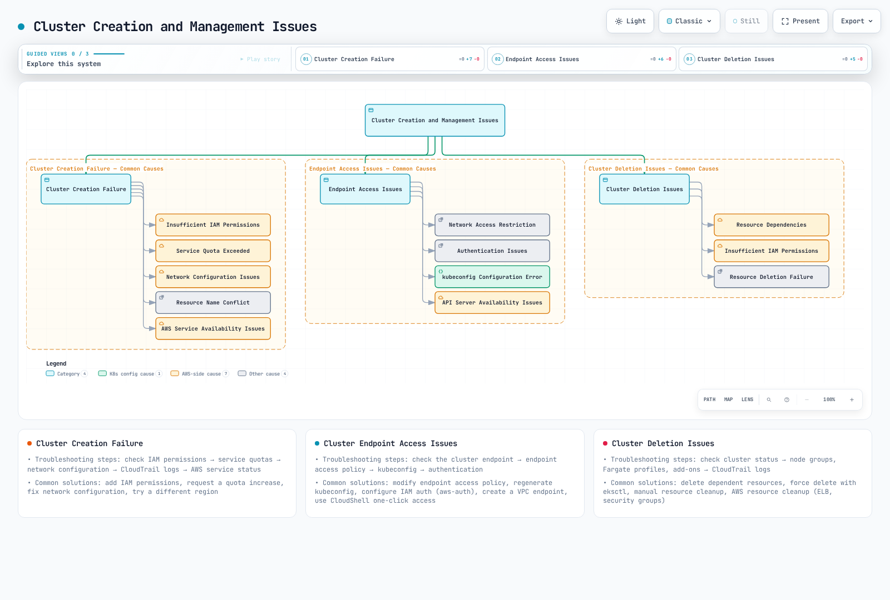
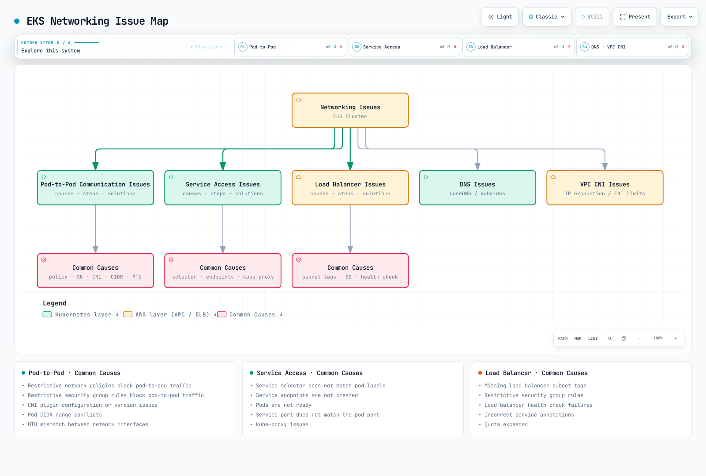
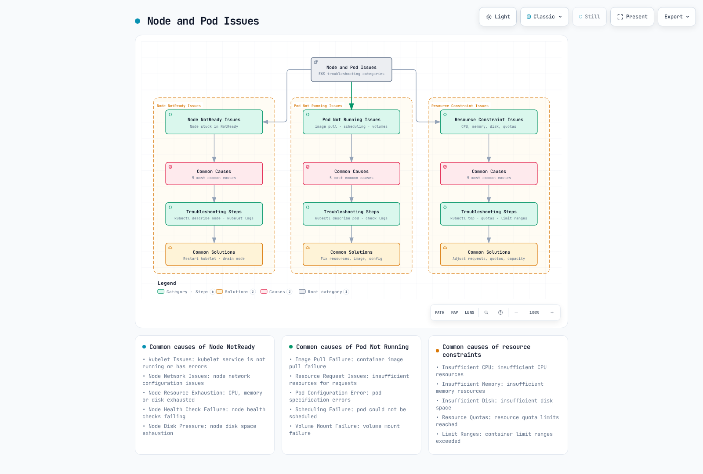

# Amazon EKS 故障排查

> **最后更新**：2026 年 9 月 12 日

运行 Amazon EKS 集群时可能遇到各种问题。本文介绍 EKS 集群常见问题及处理方式。

## 目录

1. [故障排查基础](#troubleshooting-basics)
2. [集群创建与管理问题](#cluster-creation-and-management-issues)
3. [网络问题](#networking-issues)
4. [节点与 Pod 问题](#node-and-pod-issues)
5. [IAM 与身份验证问题](#iam-and-authentication-issues)
6. [存储问题](#storage-issues)
7. [日志与监控问题](#logging-and-monitoring-issues)
8. [性能问题](#performance-issues)
9. [升级问题](#upgrade-issues)
10. [常见错误消息与解决方案](#common-error-messages-and-solutions)

## 故障排查基础 {#troubleshooting-basics}


[🔍 查看交互式图表](https://www.atomai.click/kubernetes-docs/archmaps/en-eks-09-eks-troubleshooting-0.html)

### 故障排查方法

1. 确认症状、受影响用户/工作负载及事故时间范围。
2. 更改资源前收集相关状态、日志、事件和指标。
3. 用证据比较不同假设；不要把通用错误当成已证实的原因。
4. 通过明确的所有者实施有针对性的修正，并了解其对数据/可用性的影响。
5. 根据应用行为和指标确认恢复，不能只看命令退出状态。
6. 记录原因、变更、结果、剩余不确定性和预防措施。

本章命令是供经过审查的环境使用的模板，不是应从头到尾一次性执行的脚本。查询资源、创建调试工作负载、重启组件和删除基础设施的影响各不相同。本次审查未执行实时 AWS/Kubernetes 操作。

### 基本工具与命令

对于**现有**集群，应设置预期的账号、Region、集群及 kubectl context，并确认彼此一致。不要从任意 context alias 推导集群名称。如果创建失败导致没有可用集群，应改用集群创建章节中的账号/Region 和原始请求/堆栈证据。

```bash
set -euo pipefail
: "${AWS_REGION:?Set the intended Region}"
: "${CLUSTER_NAME:?Set the existing cluster name}"
: "${EXPECTED_ACCOUNT_ID:?Set the intended 12-digit account ID}"
: "${KUBE_CONTEXT:?Set the explicit kubectl context}"
ACTUAL_ACCOUNT_ID=$(aws sts get-caller-identity --query Account --output text)
if [ "$ACTUAL_ACCOUNT_ID" != "$EXPECTED_ACCOUNT_ID" ]; then
  echo "Account mismatch" >&2; exit 1
fi
CLUSTER_ENDPOINT=$(aws eks describe-cluster --name "$CLUSTER_NAME" --region "$AWS_REGION" \
  --query cluster.endpoint --output text)
KUBE_ENDPOINT=$(kubectl config view --context "$KUBE_CONTEXT" --minify \
  -o jsonpath='{.clusters[0].cluster.server}')
if [ "$CLUSTER_ENDPOINT" != "$KUBE_ENDPOINT" ]; then
  echo "kubectl context does not match the selected EKS cluster" >&2; exit 1
fi
export AWS_REGION CLUSTER_NAME EXPECTED_ACCOUNT_ID KUBE_CONTEXT
```

#### AWS CLI 和 eksctl

```bash
aws eks describe-cluster --name "$CLUSTER_NAME" --region "$AWS_REGION" \
  --query 'cluster.{arn:arn,status:status,version:version,health:health,access:accessConfig}'
aws eks list-nodegroups --cluster-name "$CLUSTER_NAME" --region "$AWS_REGION"
aws eks list-addons --cluster-name "$CLUSTER_NAME" --region "$AWS_REGION"
eksctl get nodegroup --cluster "$CLUSTER_NAME" --region "$AWS_REGION"
```

这些命令列出托管节点组和已安装的 EKS add-on，但不代表列出了所有自主管理的 controller 或计算资源。选择操作步骤前，先记录实际所有者及计算类型。

#### kubectl

```bash
kubectl --context "$KUBE_CONTEXT" get nodes -o wide
kubectl --context "$KUBE_CONTEXT" get pods -A -o wide
kubectl --context "$KUBE_CONTEXT" get services -A
kubectl --context "$KUBE_CONTEXT" get events -A --sort-by='.metadata.creationTimestamp'
: "${NAMESPACE:?}"; : "${POD_NAME:?}"
kubectl --context "$KUBE_CONTEXT" -n "$NAMESPACE" describe pod "$POD_NAME"
```

明确指定受影响的命名空间、Pod、容器和节点。`describe` 输出和应用日志可能包含敏感运维信息。`kubectl auth can-i` 检查某项具体操作的授权；`aws sts get-caller-identity` 用来识别 AWS 凭证；二者都不能单独证明网络可达，也不能覆盖全部 Kubernetes 权限。

### 日志收集与分析

#### EKS 控制平面日志

检查现有日志配置和范围受限的事故时间窗口：

```bash
set -euo pipefail
: "${CLUSTER_NAME:?}"; : "${AWS_REGION:?}"
: "${START_TIME_MS:?Set the incident-window start in epoch milliseconds}"
: "${END_TIME_MS:?Set the incident-window end in epoch milliseconds}"
aws eks describe-cluster --name "$CLUSTER_NAME" --region "$AWS_REGION" \
  --query cluster.logging --output json
aws logs filter-log-events --region "$AWS_REGION" \
  --log-group-name "/aws/eks/$CLUSTER_NAME/cluster" \
  --start-time "$START_TIME_MS" --end-time "$END_TIME_MS" \
  --max-items 200 --output json --no-cli-pager
```

启用控制平面日志是单独的 `UpdateClusterConfig` 变更，有自己的 update ID、权限要求和 CloudWatch 费用。它不能恢复过去的日志，也不会启用应用/主机日志采集。日志组不存在、请求被拒绝或查询窗口为空，都属于可见性限制。应用/主机日志应查看 `/aws/containerinsights/<cluster>/...` 或实际采集器的目标位置。

#### 节点日志

在运维人员可访问的标准 Linux EC2 节点上，打开会话前核实节点的 `spec.providerID`、账号/Region 和 SSM 前提：

```bash
: "${INSTANCE_ID:?Verify the node EC2 ProviderID and account/Region first}"
aws ssm start-session --target "$INSTANCE_ID" --region "$AWS_REGION"
```

以下命令应在**节点会话中**运行，而非本地终端。这些 systemd/containerd 示例假设节点镜像包含相应工具；Bottlerocket、Fargate 和 Auto Mode 必须使用各自受支持的诊断路径。

```bash
sudo journalctl -u kubelet --since "15 minutes ago" --no-pager
sudo journalctl -u containerd --since "15 minutes ago" --no-pager
df -h
df -i
free -m
```

当前 EKS 优化版 Linux 节点使用 containerd。在这些节点上，Docker 守护进程日志不是 kubelet runtime 日志。清理镜像、清理 journal 或重启前，先保留日志和磁盘/inode 证据。不健康节点缺少 `kubectl top` 指标，本身不能证明 CPU/内存耗尽。

#### Pod 日志

```bash
set -euo pipefail
: "${KUBE_CONTEXT:?}"; : "${NAMESPACE:?}"; : "${POD_NAME:?}"; : "${CONTAINER_NAME:?}"
kubectl --context "$KUBE_CONTEXT" -n "$NAMESPACE" logs "$POD_NAME" \
  -c "$CONTAINER_NAME" --since=15m --tail=200 --timestamps=true
# Run only when a previous container instance exists in this same Pod.
kubectl --context "$KUBE_CONTEXT" -n "$NAMESPACE" logs "$POD_NAME" \
  -c "$CONTAINER_NAME" --previous --tail=200 --timestamps=true
```

`--previous` 指同一个 **Pod** 中指定容器上一个已终止实例的日志。它不能取回已删除前身 Pod 的日志；需要保留历史记录时应查询日志后端。检查普通容器和 init 容器状态、就绪状态及退出原因。

### 诊断信息收集

```bash
set -euo pipefail
: "${EVIDENCE_PARENT:?Set an existing private directory}"
: "${KUBE_CONTEXT:?}"; : "${NAMESPACE:?}"
umask 077
EVIDENCE_DIR=$(mktemp -d "$EVIDENCE_PARENT/eks-diagnosis.XXXXXXXX")
kubectl --context "$KUBE_CONTEXT" get nodes -o wide > "$EVIDENCE_DIR/nodes.txt"
kubectl --context "$KUBE_CONTEXT" -n "$NAMESPACE" get pods -o wide > "$EVIDENCE_DIR/pods.txt"
kubectl --context "$KUBE_CONTEXT" -n "$NAMESPACE" get services -o wide > "$EVIDENCE_DIR/services.txt"
kubectl --context "$KUBE_CONTEXT" -n "$NAMESPACE" get events \
  --sort-by='.metadata.creationTimestamp' > "$EVIDENCE_DIR/events.txt"
printf 'Evidence saved to %s; assess the findings before remediation.\n' "$EVIDENCE_DIR"
```

查询失败会使示例停止；已有文件只是部分证据。如果范围受限的清单已经足够，就不要执行不加筛选的 `cluster-info dump` 或收集所有 Pod 的描述信息。分享之前先检查并脱敏证据。

排查资源压力时，对比 requests/limits、节点可分配资源，以及 Metrics Server 可用时的 `kubectl top`。可访问节点上同时检查 `df -h` 和 `df -i`；字节数充足不能排除 inode 耗尽。节点 debug Pod 有自己的根文件系统，主机根目录挂载于 `/host`；不带预期路径运行 `df -h` 可能检查错文件系统。创建此类 Pod 前要审查命名空间、镜像、debug profile、权限和清理方案。

排查网络时，确定源 Pod/命名空间/节点、目的地、协议和端口。先检查适用策略及源端 resolver。新建 debug Pod 的标签、身份、DNS 或路由可能与受影响工作负载不同。ICMP ping 不能证明应用 TCP/UDP 可达。应在实际允许路径上做范围受限测试；通过所有者准备工具和清理步骤，不要反复创建未固定版本且名称通用的 `dnsutils`/`netshoot` Pod。

来源：[EKS 故障排查](https://docs.aws.amazon.com/eks/latest/userguide/troubleshooting.html)、[Kubernetes 日志](https://kubernetes.io/docs/reference/kubectl/generated/kubectl_logs/)、[节点调试](https://kubernetes.io/docs/tasks/debug/debug-cluster/kubectl-node-debug/)。

## 集群创建与管理问题 {#cluster-creation-and-management-issues}



[🔍 查看交互式图表](https://www.atomai.click/kubernetes-docs/archmaps/en-eks-09-eks-troubleshooting-1.html)

### 集群创建失败

#### 常见原因

根据准确的失败请求或 CloudFormation 事件，检查调用方权限、集群服务角色信任关系/策略、服务配额、受支持的子网/AZ、IP 容量、名称冲突或服务可用性。这些都是待验证的假设；可能性取决于实际错误。

#### 故障排查步骤

```bash
set -euo pipefail
: "${AWS_REGION:?}"; : "${CLUSTER_ROLE_NAME:?}"; : "${VPC_ID:?}"
aws sts get-caller-identity
aws iam get-role --role-name "$CLUSTER_ROLE_NAME" \
  --query 'Role.{Arn:Arn,Trust:AssumeRolePolicyDocument}'
aws iam list-attached-role-policies --role-name "$CLUSTER_ROLE_NAME"
aws iam list-role-policies --role-name "$CLUSTER_ROLE_NAME"
aws ec2 describe-subnets --region "$AWS_REGION" --filters "Name=vpc-id,Values=$VPC_ID" \
  --query 'Subnets[].{Id:SubnetId,AZ:AvailabilityZone,AZId:AvailabilityZoneId,AvailableIPs:AvailableIpAddressCount,CIDR:CidrBlock}'
aws service-quotas list-service-quotas --service-code eks --region "$AWS_REGION"
aws cloudtrail lookup-events --region "$AWS_REGION" \
  --lookup-attributes AttributeKey=EventName,AttributeValue=CreateCluster \
  --max-items 20 --output json
```

只有附加策略不足以判断调用方的有效权限：还要考虑内联策略、权限边界、会话策略和 Organizations 控制。`AmazonEKSClusterPolicy` 属于 EKS 集群服务角色；附加给人工用户并不会授予所需的 `eks:CreateCluster`/`iam:PassRole` 权限或 Kubernetes 访问权。创建服务关联角色也有各自的权限和生命周期要求。

网络检查应使用选定的集群子网和准确的路由/安全组/NACL 配置。集群子网要求与节点/Pod/负载均衡器地址容量是不同的规划问题。私有集群可以通过所需服务端点访问，不需要 NAT gateway 或普通互联网访问。`kubernetes.io/cluster/...` 子网标签不是控制平面创建失败的通用修复。

遇到配额错误时，根据错误确定服务/配额，并在申请提高限额前查询当前已应用值。EKS 集群配额、EC2 vCPU/实例系列配额和 VPC 限制并不相同。历史消息中的 “limit is 5” 是示例，不是当前账号限额。

#### 常见解决方案

通过基础设施所有者修正具体的权限、服务角色信任、子网选择、IP 分配或配额问题，再审查是否重试。`UnsupportedAvailabilityZoneException` 表示指定的集群子网位于该账号不支持 EKS 的 AZ；应使用异常中报告的受支持 AZ。仅检查 EC2 实例类型供给不足以诊断此错误。

检查 AWS Health 是否有服务事件。切换 Region 会形成另一套放置/数据/网络设计，也可能意味着新建集群；它不是默认的故障排查重试方案。`eksctl create cluster --verbose ...` 和 AWS CLI debug 标志仍会执行创建。提交新的配置请求前，应检查现有堆栈事件和 request ID。

### 集群端点访问问题

#### 分别诊断 DNS、传输、TLS、身份验证和授权

检查端点模式、允许的公有 CIDR 和集群安全组，然后使用集群 CA 和超时进行测试：

```bash
set -euo pipefail
: "${CLUSTER_NAME:?}"; : "${AWS_REGION:?}"; : "${EVIDENCE_PARENT:?}"
umask 077
ENDPOINT_DIR=$(mktemp -d "$EVIDENCE_PARENT/eks-endpoint.XXXXXXXX")
aws eks describe-cluster --name "$CLUSTER_NAME" --region "$AWS_REGION" \
  --output json > "$ENDPOINT_DIR/cluster.json"
jq -er '.cluster.certificateAuthority.data' "$ENDPOINT_DIR/cluster.json" \
  | base64 --decode > "$ENDPOINT_DIR/cluster-ca.crt"
ENDPOINT=$(jq -er '.cluster.endpoint' "$ENDPOINT_DIR/cluster.json")
jq '.cluster.resourcesVpcConfig | {endpointPublicAccess,endpointPrivateAccess,publicAccessCidrs,clusterSecurityGroupId,vpcId}' \
  "$ENDPOINT_DIR/cluster.json"
curl --silent --show-error --connect-timeout 5 --max-time 10 \
  --cacert "$ENDPOINT_DIR/cluster-ca.crt" --output /dev/null \
  --write-out 'HTTP status: %{http_code}\n' "$ENDPOINT"
```

此操作不会发送 Kubernetes bearer token。401/403 响应可能说明 DNS/TCP/TLS 已成功连通，但访问被拒；HTTP 请求成功也不能证明应用健康。`curl -k` 会隐藏证书验证失败。如果要查 DNS，应使用端点 URL 中的主机名，而不是把 `https://` URL 传给 `nslookup`。

对于公有端点，应将客户端实际的出口/NAT 地址与允许 CIDR 对照。私有端点则要检查 VPC/互联网络路径、DNS 解析和安全组访问。接口端点 `com.amazonaws.<region>.eks` 服务的是 **EKS 管理 API**，不是 Kubernetes API 服务器。单独启用它无法修复 kubectl 访问；集群 Kubernetes 私有端点是另一项配置。

#### kubeconfig 和权限

检查 context 名称/server，但不要打印原始凭证。要创建单独的诊断 kubeconfig，应指定文件路径和 alias，并将 `NAMESPACE` 设置为预期授权范围：

```bash
set -euo pipefail
: "${CLUSTER_NAME:?}"; : "${AWS_REGION:?}"
: "${NAMESPACE:?Set the namespace for the authorization check}"
: "${DIAGNOSTIC_KUBECONFIG:?Set a separate writable kubeconfig path}"
: "${KUBE_CONTEXT:?Choose an explicit alias for this cluster}"
umask 077
aws eks update-kubeconfig --name "$CLUSTER_NAME" --region "$AWS_REGION" \
  --kubeconfig "$DIAGNOSTIC_KUBECONFIG" --alias "$KUBE_CONTEXT"
export KUBECONFIG="$DIAGNOSTIC_KUBECONFIG"
kubectl --context "$KUBE_CONTEXT" auth can-i get pods --namespace "$NAMESPACE"
```

创建 kubeconfig 需要 `eks:DescribeCluster`；Kubernetes 身份验证/授权是另一项要求。假设角色时，使用经审查的 `--role-arn` 并具备相应信任/STS 权限。应通过实际凭证提供方（例如已配置的 SSO session）续期凭证，而不是打印 session token。

```bash
set -euo pipefail
: "${CLUSTER_NAME:?}"; : "${AWS_REGION:?}"
aws eks describe-cluster --name "$CLUSTER_NAME" --region "$AWS_REGION" \
  --query 'cluster.accessConfig'
# Use the next command when API or API_AND_CONFIG_MAP authentication is enabled.
aws eks list-access-entries --cluster-name "$CLUSTER_NAME" --region "$AWS_REGION"
```

启用 access-entry 身份验证时，检查对应 entry 和关联策略范围。旧式 `CONFIG_MAP` 或混合模式集群也可能使用 `aws-auth`；应保留现有节点映射并计划迁移。不要授予 `system:masters`，也不要为了修复访问而一概覆盖整个 ConfigMap。IRSA 的 IAM OIDC provider 用于工作负载 AWS 凭证，不用于将人工 IAM 主体映射到 Kubernetes 授权。

#### 修正访问路径

根据端点模式，使用已连接的私有管理路径，或经过审查的公有 CIDR 允许列表。不要只为跑通诊断命令就开放 `0.0.0.0/0`。移除公有访问前先测试私有路径，保留无关的现有 VPC 设置，并跟踪配置更新 ID。计划变更时遵循[安全章节的端点步骤](./05-eks-security.md)。

#### 一键 CloudShell 访问

2026 年 4 月 30 日的一键功能已受支持。在集群详情页选择 **Connect**，即可打开已配置 kubectl 的 CloudShell。它支持公有和私有 API 端点；私有端点会自动启动 CloudShell VPC 环境，并提示输入环境名称。该功能在 EKS Regions 内不另收功能费用。

控制台路径仍需要相关 IAM/CloudShell/VPC 环境权限、Kubernetes 访问权和可用网络配置。它省去本地设置，不会取消授权检查。运行命令前，检查适用的资源/数据传输费用和 session 身份。

来源：[kubeconfig 与 CloudShell](https://docs.aws.amazon.com/eks/latest/userguide/create-kubeconfig.html)、[一键功能公告](https://aws.amazon.com/about-aws/whats-new/2026/04/amazon-eks-one-click-cluster-access/)、[EKS PrivateLink 区别](https://docs.aws.amazon.com/eks/latest/userguide/vpc-interface-endpoints.html)、[集群故障排查](https://docs.aws.amazon.com/eks/latest/userguide/troubleshooting.html)。

### 集群删除问题

#### 找出阻塞依赖

删除集群是有计划的拆除操作，不是通用故障排查手段。读取准确的 EKS/CloudFormation 错误、集群 ARN/账号/Region、更新状态和 deletion-protection 设置。除了托管节点组和 Fargate profile，deletion protection 与已安装的 EKS Capabilities 也会阻止删除。删除完成前应保留集群 IAM/服务角色。

清点选定集群，并将其端点与明确指定的 kubectl context 对照。以下命令只读，不会自动选择待删除资源：

```bash
set -euo pipefail
: "${CLUSTER_NAME:?Set the cluster being deliberately retired}"
: "${AWS_REGION:?}"; : "${KUBE_CONTEXT:?}"; : "${EXPECTED_ACCOUNT_ID:?}"
ACTUAL_ACCOUNT_ID=$(aws sts get-caller-identity --query Account --output text)
if [ "$ACTUAL_ACCOUNT_ID" != "$EXPECTED_ACCOUNT_ID" ]; then
  echo "Account mismatch; stop" >&2
  exit 1
fi
aws eks describe-cluster --name "$CLUSTER_NAME" --region "$AWS_REGION" \
  --query 'cluster.{arn:arn,status:status,deletionProtection:deletionProtection,endpoint:endpoint}'
kubectl config view --context "$KUBE_CONTEXT" --minify \
  -o jsonpath='{.clusters[0].cluster.server}{"\n"}'
# Compare the endpoints before inspecting Kubernetes resources.
kubectl --context "$KUBE_CONTEXT" get services -A \
  -o custom-columns='NAMESPACE:.metadata.namespace,NAME:.metadata.name,TYPE:.spec.type,CLASS:.spec.loadBalancerClass,ADDRESS:.status.loadBalancer.ingress'
kubectl --context "$KUBE_CONTEXT" get ingress -A
kubectl --context "$KUBE_CONTEXT" get pvc -A
kubectl --context "$KUBE_CONTEXT" get pv \
  -o custom-columns='NAME:.metadata.name,CLAIM_NS:.spec.claimRef.namespace,CLAIM:.spec.claimRef.name,RECLAIM:.spec.persistentVolumeReclaimPolicy,DRIVER:.spec.csi.driver,HANDLE:.spec.csi.volumeHandle'
aws eks list-nodegroups --cluster-name "$CLUSTER_NAME" --region "$AWS_REGION"
aws eks list-fargate-profiles --cluster-name "$CLUSTER_NAME" --region "$AWS_REGION"
aws eks list-capabilities --cluster-name "$CLUSTER_NAME" --region "$AWS_REGION"
aws eks list-addons --cluster-name "$CLUSTER_NAME" --region "$AWS_REGION"
```

仅凭 Service 的 `EXTERNAL-IP` 输出不能证明资源归属：应区分 controller 管理的 `LoadBalancer` Service、手动配置的外部 IP 和其他 Service 类型。记录 namespace/name/UID、controller 所有权、AWS 资源 ARN 和相关标签。若安装了相应 controller，还要检查 Ingress、Gateway/TargetGroupBinding 资源，并确认 target 或 load balancer 是否共享。

#### 按所有者顺序退役资源

1. 迁移流量和工作负载，并确认应用一致性备份/恢复及数据保留要求。保存 PVC YAML 不等于备份数据。删除 claim 时，`Delete` reclaim policy 可能删除底层存储；`Retain` 则需另外处理数据/存储去向。
2. 必需的负载均衡器 controller 仍运行时，只删除经过审查且拥有负载均衡器的 Kubernetes 资源。等待 finalizer 完成，并核实相应 AWS 资源已释放。删除节点前解决 controller IAM 或依赖失败。不要仅为隐藏清理失败而移除 finalizer。
3. 根据文档中的所有权/资源删除语义移除 EKS Capabilities。经审查后按顺序删除托管节点组和 Fargate profile，并等待完成。自主管理节点/堆栈需单独拆除。删除 add-on 也可能移除 Kubernetes 组件；其依赖清理完成前，应保留网络/存储 controller。
4. 仅在明确决定拆除时禁用 deletion protection，然后通过原始基础设施所有者删除集群。删除 Auto Mode 集群还会删除其托管节点和负载均衡器；应将这些范围及内置 TargetGroupBinding 的 target-group 生命周期纳入考虑。
5. 按准确所有权检查剩余资源：专用堆栈/VPC、卷/快照、负载均衡器、IAM 资源、日志和 Prometheus scraper。共享资源和保留数据各有独立生命周期，可能继续产生费用。

例如，只有完成前述流量/数据审查后，才执行下面这**一项**明确指定的 Service 删除操作。它不是自动发现并批量删除的循环：

```bash
set -euo pipefail
: "${KUBE_CONTEXT:?}"; : "${SERVICE_NAMESPACE:?}"; : "${SERVICE_NAME:?}"
# Separate approved teardown step after traffic/data migration and owner review.
kubectl --context "$KUBE_CONTEXT" -n "$SERVICE_NAMESPACE" get service "$SERVICE_NAME" -o yaml
kubectl --context "$KUBE_CONTEXT" -n "$SERVICE_NAMESPACE" delete service "$SERVICE_NAME" \
  --wait=true --timeout=10m
```

超时不代表 AWS 负载均衡器一定保留或已删除；检查 finalizer、controller 事件及准确 AWS ARN。Kubernetes 与 AWS 资源清理可能在不同时间完成。

#### 删除错误和强制行为

使用 EKS update 详情与 CloudFormation 堆栈事件识别依赖、授权和进行中操作造成的失败。在 eksctl 0.229 中，`delete cluster --force` 是有效选项，允许错误存在时继续删除；但它不能证明清理完整，也不能安全识别孤立资源归属。`--disable-nodegroup-eviction` 则通过删除绕过 PDB 检查。二者都不是默认事故响应。

不要将账号/Region 范围的 ELB/ELBv2 列表直接 pipe 给删除命令，也不要为了清除依赖错误而删除所有 Service、PVC 或命名空间。如果必须手动清理孤立资源，应先确认其具体集群/堆栈所有者及数据/流量影响，再采用相应服务经过审查的拆除步骤。

来源：[EKS 集群删除](https://docs.aws.amazon.com/eks/latest/userguide/delete-cluster.html)、[删除故障排查](https://repost.aws/knowledge-center/eks-delete-cluster-issues)、[PV 生命周期](https://kubernetes.io/docs/concepts/storage/persistent-volumes/)。

## 网络问题 {#networking-issues}



[🔍 查看交互式图表](https://www.atomai.click/kubernetes-docs/archmaps/en-eks-09-eks-troubleshooting-2.html)

首先识别实际计算/数据平面。使用开源 VPC CNI 的标准 EC2 节点、Fargate 和 Auto Mode 的 agent/配置并不相同。Auto Mode 应使用其 `NodeClass` 网络控制；修改 `aws-node` DaemonSet 或 `ENIConfig` 不会配置 Auto Mode 节点。

### Pod 间通信问题

#### 追踪失败路径

记录源/目的 Pod、命名空间、节点/AZ、IP family、协议和目标端口。经批准的测试如果能够隔离差异，可比较同节点与跨节点行为。针对实际路径检查策略、安全组、路由/NACL、CNI 状态、IP 分配和路径 MTU。

```bash
set -euo pipefail
: "${KUBE_CONTEXT:?}"; : "${NAMESPACE:?}"; : "${POD_NAME:?}"
kubectl --context "$KUBE_CONTEXT" -n "$NAMESPACE" get pod "$POD_NAME" -o wide
kubectl --context "$KUBE_CONTEXT" -n "$NAMESPACE" get pod "$POD_NAME" \
  -o jsonpath='{.metadata.labels}{"\n"}{.spec.nodeName}{"\n"}{.spec.hostNetwork}{"\n"}'
kubectl --context "$KUBE_CONTEXT" get namespace "$NAMESPACE" --show-labels
kubectl --context "$KUBE_CONTEXT" -n "$NAMESPACE" get networkpolicies
kubectl --context "$KUBE_CONTEXT" -n "$NAMESPACE" get events \
  --sort-by='.metadata.creationTimestamp'
```

标准的 `networking.k8s.io/v1` NetworkPolicy 对允许流量采用累加语义；没有规则优先级，也没有“最后策略生效”。如果源端与目标端都处于隔离状态，源端 egress 和目标端 ingress 都必须允许该流量。Admin/集群范围策略 API 和厂商策略引擎有各自语义。检查命名空间标签，并确认 `namespaceSelector` 与 `podSelector` 位于同一个 peer（AND）还是不同 peer（OR）。

VPC CNI 支持原生 NetworkPolicy enforcement；不能只因没有第三方策略 Pod 就安装 Calico/Cilium。应验证受支持的 CNI/platform/kernel 和已启用的 policy-agent 配置。标准启动模式下，新 Pod 在策略配置完成前初始允许流量；严格模式则初始拒绝，必须配置所需 DNS/依赖策略。Host-network 行为及覆盖范围限制应查阅相应实现文档。

在标准 VPC CNI 安装中，如果实际 `aws-node` Pod 存在 `aws-network-policy-agent` 容器，应查看其日志。`kubectl get pods -l ...` 成功但结果为空，不能证明已安装插件。Auto Mode 使用内置策略控制。

#### 仅修复目标流量

审查完整的允许流量矩阵，不要添加命名空间级 allow-all ingress/egress 或删除策略。下面示例选中后端 API Pod，只允许前端 web Pod 通过 TCP 8080 访问：

```yaml
# Example ingress policy only: review both peers and the complete allowed-flow matrix.
apiVersion: networking.k8s.io/v1
kind: NetworkPolicy
metadata:
  name: api-from-web
  namespace: backend
spec:
  podSelector:
    matchLabels:
      app: api
  policyTypes:
    - Ingress
  ingress:
    - from:
        - namespaceSelector:
            matchLabels:
              kubernetes.io/metadata.name: frontend
          podSelector:
            matchLabels:
              app: web
      ports:
        - protocol: TCP
          port: 8080
```

应用后，除非其他策略允许，所选后端 Pod 的其他入口也可能被隔离。它没有配置客户端 egress、DNS 或所有依赖项；需通过正向和负向测试分别验证。应使用实际工作负载命名空间/标签，不要照抄示例名称。

安全组方面，应检查源和目标 ENI 的安全组；适用时还要检查 Pod 安全组/自定义 Pod 子网。通过资源所有者开放所需源/端口；不要把所有协议或宽泛 CIDR 当作通用修复。1500 或 9001 等 MTU 值取决于路径；改 CNI 配置或替换 Pod 前，先测量失败并考虑封装开销。

### Service 访问问题

同时检查 Service selector、实际 Pod 就绪状态、endpoint condition 和端口映射：

```bash
set -euo pipefail
: "${KUBE_CONTEXT:?}"; : "${NAMESPACE:?}"; : "${SERVICE_NAME:?}"
SERVICE_JSON=$(kubectl --context "$KUBE_CONTEXT" -n "$NAMESPACE" get service "$SERVICE_NAME" -o json)
printf '%s\n' "$SERVICE_JSON" | jq '{metadata: {name: .metadata.name, namespace: .metadata.namespace}, spec: .spec, status: .status}'
SELECTOR=$(printf '%s\n' "$SERVICE_JSON" | jq -r '(.spec.selector // {}) | to_entries | map("\(.key)=\(.value)") | join(",")')
if [ -n "$SELECTOR" ]; then
  kubectl --context "$KUBE_CONTEXT" -n "$NAMESPACE" get pods -l "$SELECTOR" -o wide
  kubectl --context "$KUBE_CONTEXT" -n "$NAMESPACE" get pods -l "$SELECTOR" -o json \
    | jq '.items[] | {name:.metadata.name,phase:.status.phase,ready:[.status.conditions[]? | select(.type=="Ready")],containers:.status.containerStatuses}'
else
  printf 'No selector: inspect ExternalName or explicitly managed EndpointSlices as applicable.\n'
fi
kubectl --context "$KUBE_CONTEXT" -n "$NAMESPACE" get endpointslices \
  -l "kubernetes.io/service-name=$SERVICE_NAME" -o yaml
```

使用 EndpointSlices，不要依赖已弃用的 Endpoints API。检查 `ready`、`serving`、`terminating` 状态以及 `publishNotReadyAddresses`、`externalTrafficPolicy` 和 `internalTrafficPolicy` 等 Service 选项。Pod 为 Running 不代表 Ready。

对于 `ExternalName` Service，应诊断 DNS 别名，而不是期待它选中 Pod。无头 Service 的 `clusterIP: None` 是有意配置。无 selector 的 Service 可能使用所有者管理的 EndpointSlices。Service 的 `port` 可以不同于 `targetPort`；声明 container port 不会让应用实际监听该端口。

标签或端口有误时，应通过其 release 配置更新所属 Service/Pod 模板。重新给一个由 controller 管理的 Pod 打标签不是持久修复。Patch 前审查完整端口列表和不可变字段。未诊断前不要删除/重建 Service、更改 ClusterIP 或重启所有 kube-proxy Pod。

仅在策略允许的情况下，使用同一来源和协议比较直接 Pod 与 Service 连通性。确认实际数据平面是 kube-proxy、其他实现还是 Auto Mode，然后再检查 iptables/nftables/eBPF 行为。缺少 kube-proxy Pod 并不总是故障。

### 负载均衡器问题

根据 Service/Ingress class、annotation 和所有权识别 controller。标准 AWS Load Balancer Controller 与 EKS Auto Mode 使用不同 class/API 和生命周期规则。针对对应所有者检查 controller 事件、子网选择、IAM、安全组、target 注册和健康检查。

使用与工作负载关联的准确负载均衡器和 target group ARN：

```bash
set -euo pipefail
: "${AWS_REGION:?}"; : "${LOAD_BALANCER_ARN:?}"; : "${TARGET_GROUP_ARN:?}"
aws elbv2 describe-load-balancers --region "$AWS_REGION" \
  --load-balancer-arns "$LOAD_BALANCER_ARN"
aws elbv2 describe-tags --region "$AWS_REGION" \
  --resource-arns "$LOAD_BALANCER_ARN" "$TARGET_GROUP_ARN"
aws elbv2 describe-load-balancer-attributes --region "$AWS_REGION" \
  --load-balancer-arn "$LOAD_BALANCER_ARN"
aws elbv2 describe-target-groups --region "$AWS_REGION" \
  --target-group-arns "$TARGET_GROUP_ARN"
aws elbv2 describe-target-health --region "$AWS_REGION" \
  --target-group-arn "$TARGET_GROUP_ARN"
```

`describe-load-balancer-attributes` 显示属性而非运行状态；`describe-load-balancers` 才包括状态。检查 target health 原因码、健康检查协议/端口/路径、listener/rule 路由和应用响应。Instance target 通常到达节点/NodePort；IP target 则到达 Pod target port。安全组规则必须匹配实际路径。

子网 role 标签会影响自动发现；检查 public/internal scheme、路由表、剩余 IP 和 AZ 覆盖。给同一子网同时加 public 和 private role 标签不是修复办法。显式子网选择与 controller 版本可能改变标签要求。不要为了绕过健康检查错误而将前端/后端安全组对 `0.0.0.0/0` 开放。

应采用所有者当前支持的 scheme/type 配置。旧式 `aws-load-balancer-internal` 或 `aws-load-balancer-type: nlb` 示例不能与当前 controller class 互换。变更 controller 所有权或 LB scheme 可能需要计划替换和迁移流量；改 annotation 不保证原地转换。Auto Mode 不会接管已由自主管理 controller 管理的负载均衡器。

删除 Service 可能删除其负载均衡器；导出的 Service YAML 不是完整的流量/数据回滚方案。手工创建 ALB 不会自动连接到 Kubernetes Service。变更前应查阅所选所有者的[网络指南](./03-eks-networking-part2.md)。

### DNS 问题

#### 检查受影响 Pod 实际使用的 resolver

```bash
set -euo pipefail
: "${KUBE_CONTEXT:?}"; : "${NAMESPACE:?}"; : "${POD_NAME:?}"; : "${CONTAINER_NAME:?}"
kubectl --context "$KUBE_CONTEXT" -n "$NAMESPACE" get pod "$POD_NAME" \
  -o jsonpath='{.spec.dnsPolicy}{"\n"}{.spec.dnsConfig}{"\n"}{.spec.hostNetwork}{"\n"}'
kubectl --context "$KUBE_CONTEXT" -n "$NAMESPACE" exec "$POD_NAME" \
  -c "$CONTAINER_NAME" -- cat /etc/resolv.conf
# Where this container actually includes nslookup, test the intended name.
: "${DNS_TEST_NAME:?Set the intended Service FQDN or reviewed external hostname}"
kubectl --context "$KUBE_CONTEXT" -n "$NAMESPACE" exec "$POD_NAME" \
  -c "$CONTAINER_NAME" -- nslookup "$DNS_TEST_NAME"
```

如果镜像没有 shell 或 DNS 工具，那是工具限制，并非 DNS 查询失败。准备经过审查且保留相关网络/身份上下文的 debug 方法；新建 debug Pod 可能采用不同 DNS/策略配置。

标准非 Auto 节点上，检查已安装的 CoreDNS Deployment/Service、配置和 EndpointSlices：

```bash
kubectl --context "$KUBE_CONTEXT" -n kube-system get deployment coredns
kubectl --context "$KUBE_CONTEXT" -n kube-system get pods -l k8s-app=kube-dns -o wide
kubectl --context "$KUBE_CONTEXT" -n kube-system get service kube-dns
kubectl --context "$KUBE_CONTEXT" -n kube-system get endpointslices \
  -l kubernetes.io/service-name=kube-dns
kubectl --context "$KUBE_CONTEXT" -n kube-system get configmap coredns -o yaml
kubectl --context "$KUBE_CONTEXT" -n kube-system logs -l k8s-app=kube-dns \
  --all-containers=true --prefix=true --since=15m --tail=100
```

在 **Auto Mode 节点上**，CoreDNS 以节点系统服务方式运行。纯 Auto Mode 集群可以没有传统 CoreDNS Deployment；混合 Auto/非 Auto 集群必须为非 Auto 节点保留 Deployment。不要把安装 NodeLocal DNSCache 或重启不存在的 Deployment 当作 Auto Mode 修复。

区分 Pod nameserver、CoreDNS/NodeLocal 上游和 VPC resolver。`169.254.20.10` 是常见的 NodeLocal DNSCache 地址，不是通用 VPC DNS 服务器。像 `8.8.8.8` 这样的公共 resolver 不能解析 Kubernetes Service zone 或私有 AWS DNS。

```bash
set -euo pipefail
: "${AWS_REGION:?}"; : "${VPC_ID:?}"
aws ec2 describe-vpc-attribute --region "$AWS_REGION" --vpc-id "$VPC_ID" \
  --attribute enableDnsSupport
aws ec2 describe-vpc-attribute --region "$AWS_REGION" --vpc-id "$VPC_ID" \
  --attribute enableDnsHostnames
aws ec2 describe-vpcs --region "$AWS_REGION" --vpc-ids "$VPC_ID" \
  --query 'Vpcs[].{VpcId:VpcId,DhcpOptionsId:DhcpOptionsId}'
```

DNS 属性应使用 `describe-vpc-attribute` 查询；它们不是 `describe-vpcs` 返回的字段。通过返回的 ID 查询 DHCP options。更改共享 VPC 的 DHCP 设置前，先审查其他工作负载。

#### 实施有针对性的 DNS 修复

按需检查 UDP 和 TCP 53、实际 CoreDNS 就绪/配置、上游可达性、DNS policy 和自定义搜索设置。若需要集群 DNS，使用 `hostNetwork` 的 Pod 通常应配置 `ClusterFirstWithHostNet`；`dnsPolicy: None` 则要求有意配置完整 resolver。只允许 DNS 的 egress policy 也会隔离所选 Pod 的其他 egress，除非另有策略放行。

保留自有 Corefile 定制，并使用 add-on 支持的配置 schema。扩缩或重启 CoreDNS 前检查副本/资源/PDB/调度和自动扩缩所有者。保留 update ID 和功能性 DNS 检查；不要首先删除所有 DNS Pod 或安装猜测的 “latest” 镜像。

### VPC CNI 问题

以下检查适用于使用开源 VPC CNI 的**标准 EC2 节点**。应显式选择受影响节点上的 Pod；`kubectl exec` 不接受 label selector。

```bash
set -euo pipefail
: "${KUBE_CONTEXT:?}"; : "${NODE_NAME:?}"
kubectl --context "$KUBE_CONTEXT" get node "$NODE_NAME" \
  -o jsonpath='{.spec.providerID}{"\n"}{.status.nodeInfo}{"\n"}{.status.allocatable.pods}{"\n"}'
kubectl --context "$KUBE_CONTEXT" -n kube-system get daemonset aws-node -o json \
  | jq '.spec.template.spec | {containers:[.containers[] | {name,image,args,env}],initContainers:[.initContainers[]? | {name,image,args,env}]}'
kubectl --context "$KUBE_CONTEXT" -n kube-system get pods \
  -l k8s-app=aws-node --field-selector "spec.nodeName=$NODE_NAME" -o wide
kubectl --context "$KUBE_CONTEXT" get pods -A \
  --field-selector "spec.nodeName=$NODE_NAME" -o wide
: "${AWS_NODE_POD:?Select the aws-node Pod on that exact node}"
kubectl --context "$KUBE_CONTEXT" -n kube-system logs "$AWS_NODE_POD" \
  -c aws-node --since=15m --tail=200
```

检查 add-on 的 `configurationValues`、DaemonSet 环境变量和相关自定义资源。不要假设所有设置都存放在 `aws-node` ConfigMap 中。节点 `.spec.podCIDR` 不是 VPC CNI Pod 地址的可靠清单；应检查实际 Pod IP、EC2 ENI、prefix 和子网。

```bash
set -euo pipefail
: "${AWS_REGION:?}"; : "${INSTANCE_ID:?Verify it from the selected node ProviderID}"
aws ec2 describe-instances --region "$AWS_REGION" --instance-ids "$INSTANCE_ID" \
  --query 'Reservations[].Instances[].{Id:InstanceId,Type:InstanceType,Subnet:SubnetId,SGs:SecurityGroups,ENIs:NetworkInterfaces}'
: "${SUBNET_ID:?Set the actual node or custom Pod subnet being investigated}"
aws ec2 describe-subnets --region "$AWS_REGION" --subnet-ids "$SUBNET_ID" \
  --query 'Subnets[].{Id:SubnetId,CIDR:CidrBlock,AvailableIPs:AvailableIpAddressCount}'
: "${INSTANCE_TYPE:?Set the selected instance type}"
aws ec2 describe-instance-types --region "$AWS_REGION" --instance-types "$INSTANCE_TYPE" \
  --query 'InstanceTypes[].{Type:InstanceType,Network:NetworkInfo}'
```

若已启用 IPAMD introspection，它位于节点配置的 introspection endpoint（通常为 loopback 端口 61679）。使用允许的节点/agent 诊断方法，并确保所需工具可用；CNI 镜像缺少 curl 不代表 IPAM 故障。

#### 区分地址分配约束

- **子网耗尽/碎片化**：对照剩余地址和 prefix。Prefix delegation 需要受支持的实例/配置及连续 prefix block；仅有剩余 IP 数量不能证明可以分配 /28。
- **实例 ENI/IP 限制**：检查 `NetworkInfo` 和现有 ENI。调整节点组 desired/min/max 会改变节点数，不会改变实例类型或每实例限制。改实例配置应使用经审查的新节点组，或受支持的原始 launch-template 更新路径。
- **自定义网络**：启用前准备匹配的 `ENIConfig`、Pod 子网/安全组和节点选择。它会改变 secondary ENI/Pod IP 的来源，并不会创造无限容量。
- **预留目标：**`WARM_IP_TARGET` 控制空闲 IP 余量；`MINIMUM_IP_TARGET` 是已分配 IP 总数下限。按文档它们会覆盖 warm-ENI 行为，prefix 模式下 IP/minimum target 也影响 warm-prefix 行为。只有 minimum、没有正数 warm headroom 可能妨碍后续分配。根据工作负载/IP 预算计算，不要照抄 1/2/5 等任意值。
- **身份/所有权**：检查实际 CNI IRSA/Pod Identity 或适用的节点角色，以及 IPv4/IPv6 policy。把 IPv4 CNI policy 附加到每个节点角色不是通用修复。

Auto Mode 使用 `NodeClass` 子网/安全组/policy 控制，不接受这些 warm-IP/ENI 或 `ENIConfig` 设置。应保留它的托管网络模型。

通过所有者应用经过审查的 CNI 版本/配置，按支持的中间版本和配置 schema 操作。参阅[升级指南](./08-eks-upgrades.md)，监控准确 add-on 更新，并在之后验证网络。不要只替换一个容器镜像、盲目覆盖配置或重启所有工作负载来掩盖地址分配故障。

来源：[VPC CNI policy 配置](https://docs.aws.amazon.com/eks/latest/userguide/cni-network-policy-configure.html)、[Auto Mode 网络](https://docs.aws.amazon.com/eks/latest/userguide/auto-networking.html)、[自定义网络](https://docs.aws.amazon.com/eks/latest/best-practices/custom-networking.html)、[CNI 配置](https://github.com/aws/amazon-vpc-cni-k8s)、[Kubernetes NetworkPolicy](https://kubernetes.io/docs/concepts/services-networking/network-policies/)、[EndpointSlices](https://kubernetes.io/docs/concepts/services-networking/endpoint-slices/)。

## 节点与 Pod 问题 {#node-and-pod-issues}



[🔍 查看交互式图表](https://www.atomai.click/kubernetes-docs/archmaps/en-eks-09-eks-troubleshooting-3.html)

### 节点 NotReady 问题

#### 检查状态与实际节点

`Ready=False` 和 `Ready=Unknown` 需要不同证据：不健康的 kubelet/runtime 可能报告失败，而心跳缺失可能来自连接丢失或节点停止。内存、磁盘和 PID 压力是不同条件，也不一定导致 `NotReady`。检查 condition 原因/时间以及 lease/event，不要从一个标签推断根因。

```bash
set -euo pipefail
: "${KUBE_CONTEXT:?}"; : "${NODE_NAME:?}"
NODE_JSON=$(kubectl --context "$KUBE_CONTEXT" get node "$NODE_NAME" -o json)
printf '%s\n' "$NODE_JSON" | jq '{name:.metadata.name,uid:.metadata.uid,labels:.metadata.labels,providerID:.spec.providerID,taints:.spec.taints,unschedulable:.spec.unschedulable,nodeInfo:.status.nodeInfo,conditions:.status.conditions,capacity:.status.capacity,allocatable:.status.allocatable}'
NODE_UID=$(printf '%s\n' "$NODE_JSON" | jq -er '.metadata.uid')
kubectl --context "$KUBE_CONTEXT" get events -A --field-selector "involvedObject.uid=$NODE_UID" \
  --sort-by='.metadata.creationTimestamp'
kubectl --context "$KUBE_CONTEXT" get pods -A --field-selector "spec.nodeName=$NODE_NAME" -o wide
```

EC2 检查应使用准确 ProviderID；用 `grep` 匹配节点 IP 可能会选错资源。托管节点组应检查健康状态、镜像/release 和修复配置：

```bash
set -euo pipefail
: "${CLUSTER_NAME:?}"; : "${AWS_REGION:?}"; : "${NODEGROUP_NAME:?}"
aws eks describe-nodegroup --cluster-name "$CLUSTER_NAME" --nodegroup-name "$NODEGROUP_NAME" \
  --region "$AWS_REGION" \
  --query 'nodegroup.{status:status,health:health,version:version,releaseVersion:releaseVersion,amiType:amiType,nodeRepairConfig:nodeRepairConfig,updateConfig:updateConfig,scalingConfig:scalingConfig}'
```

支持节点访问时，使用基础章节的远程会话步骤检查 kubelet/containerd journal、网络、磁盘字节数/inode 和内存。检查实际配置的证书/kubeconfig 路径，但不要打印私钥。`kubeadm certs renew` 不是 EKS 托管控制平面修复方式，`eksctl replace nodegroup` 不是受支持的 eksctl 命令。AL2023 使用 nodeadm 配置；不能对所有镜像重新运行 AL2 `/etc/eks/bootstrap.sh` 配方。

#### 恢复与自动修复

保留证据后再选择有明确所有者的恢复操作。重启 kubelet/containerd、重启或替换节点会影响工作负载，也可能无法修复持久的 IAM/网络/bootstrap 问题。重启 API 返回成功不代表实例或 kubelet 已就绪；取消 cordon 前要确认同一节点/实例和工作负载。

计划替换时先检查容量、有状态数据、PDB 和替换资源所有者，再对选定节点执行带超时的 drain：

```bash
set -euo pipefail
: "${KUBE_CONTEXT:?Set the reviewed cluster context}"
: "${NODE_NAME:?Set one reviewed old node}"
kubectl --context "$KUBE_CONTEXT" get node "$NODE_NAME" -o wide
kubectl --context "$KUBE_CONTEXT" get node "$NODE_NAME" \
  -o jsonpath='{.spec.providerID}{"\n"}'
kubectl --context "$KUBE_CONTEXT" get pods --all-namespaces \
  --field-selector "spec.nodeName=$NODE_NAME" -o wide
# Stop on failure. Do not terminate the instance or delete the node group here.
kubectl --context "$KUBE_CONTEXT" drain "$NODE_NAME" --ignore-daemonsets --timeout=10m
```

drain 失败后不要继续终止 EC2，也不要默认丢弃 `emptyDir` 数据。部分驱逐的节点可能仍处于 cordon 状态。PDB 保护 eviction 路径，不覆盖所有基础设施故障、终止或 controller scale-down。托管替换应遵循[节点升级步骤](./08-eks-upgrades.md)，不要原地更改软件包。

EKS 自动节点修复是一项独立且真实存在的机制。Auto Mode 默认启用；托管节点组可启用 `nodeRepairConfig`；Karpenter 有自己的功能/配置要求。节点监控可报告额外状态，但检测问题并不等于启用修复。当前默认表会替换持续存在的 `Ready`、runtime、kernel、networking 和 storage 故障；`MemoryPressure` 与 `DiskPressure` **没有默认修复操作**。修复阈值/并行度及 unhealthy-fleet/ARC 控制可能停止新操作，而已开始操作仍会继续。不要承诺自定义 Lambda、ASG 标签或 `maxUnavailable` 会自动实现这些行为。

### Pod 未运行问题

#### 读取状态、事件和所属 controller

```bash
set -euo pipefail
: "${KUBE_CONTEXT:?}"; : "${NAMESPACE:?}"; : "${POD_NAME:?}"
POD_JSON=$(kubectl --context "$KUBE_CONTEXT" -n "$NAMESPACE" get pod "$POD_NAME" -o json)
printf '%s\n' "$POD_JSON" | jq '{
  name:.metadata.name,uid:.metadata.uid,owners:.metadata.ownerReferences,
  node:.spec.nodeName,serviceAccount:.spec.serviceAccountName,
  imagePullSecrets:.spec.imagePullSecrets,
  containers:[.spec.containers[] | {name,image,imagePullPolicy,resources}],
  initContainers:[.spec.initContainers[]? | {name,image,resources}],
  phase:.status.phase,reason:.status.reason,message:.status.message,
  conditions:.status.conditions,containerStatuses:.status.containerStatuses,
  initContainerStatuses:.status.initContainerStatuses
}'
POD_UID=$(printf '%s\n' "$POD_JSON" | jq -er '.metadata.uid')
kubectl --context "$KUBE_CONTEXT" -n "$NAMESPACE" get events \
  --field-selector "involvedObject.uid=$POD_UID" --sort-by='.metadata.creationTimestamp'
```

使用基础章节针对容器的日志步骤。`Pending`、`ContainerCreating`、等待拉取镜像、init-container 失败、就绪失败、`OOMKilled` 和 restart backoff 是不同问题。`CrashLoopBackOff` 表示容器反复失败后的退避，不是根因。

| 证据 | 后续检查 |
| --- | --- |
| 镜像拉取错误 | Registry/名称/tag/digest/架构、节点 DNS/TLS/路由、限流和实际拉取身份 |
| FailedScheduling | requests 与可分配容量、Pod 数、taint/affinity/topology、配额及 PVC 消费者约束 |
| FailedMount / attach | PVC/PV/StorageClass、CSI/身份、AZ 和当前 attachment；参见存储章节 |
| OOMKilled / Evicted | 容器终止状态、限制、节点压力和用量历史；不要预设为内存泄漏 |
| Forbidden / admission failure | 准确 API actor、RBAC 或 admission policy；增加列举 Pod 权限不能修复无关 registry/文件系统访问 |

将 `imagePullPolicy` 改为 `Always` 不能修复不存在的镜像或无效凭证。在笔记本用 Docker 拉取成功不能验证节点路径/身份，把镜像加载到 Docker 也不会自动装入 containerd runtime。

#### Registry 凭证和工作负载更改

对于私有 ECR，检查实际 node/Fargate execution identity 及仓库策略。应用的 IRSA/Pod Identity 不是启动前拉取自身镜像所用身份。私有 ECR 网络可能需要 ECR API/DKR 和 S3 访问；ECR endpoint 不能提供对任意 private registry 的私有访问。

需要 image-pull Secret 的 registry 应使用受保护、自包含且凭证正确的 Docker auth JSON 文件。不要把 `.dockerconfigjson` 或密码打印到日志/命令参数中；桌面 credential-helper 引用并不是 kubelet 可用凭证。

```bash
set -euo pipefail
: "${KUBE_CONTEXT:?}"; : "${NAMESPACE:?}"; : "${DEPLOYMENT_NAME:?}"
: "${PULL_SECRET_NAME:?Choose an application-specific secret name}"
: "${DOCKER_CONFIG_JSON:?Provide a protected registry auth JSON file}"
# Separate reviewed change; an existing Secret causes create to fail rather than replacing it.
kubectl --context "$KUBE_CONTEXT" -n "$NAMESPACE" create secret generic "$PULL_SECRET_NAME" \
  --type=kubernetes.io/dockerconfigjson \
  --from-file=".dockerconfigjson=$DOCKER_CONFIG_JSON"
PATCH=$(jq -n --arg name "$PULL_SECRET_NAME" \
  '{spec:{template:{spec:{imagePullSecrets:[{name:$name}]}}}}')
kubectl --context "$KUBE_CONTEXT" -n "$NAMESPACE" patch deployment "$DEPLOYMENT_NAME" \
  --type=strategic --patch "$PATCH"
kubectl --context "$KUBE_CONTEXT" -n "$NAMESPACE" rollout status \
  "deployment/$DEPLOYMENT_NAME" --timeout=5m
```

Secret 必须位于 Pod 所在命名空间。strategic Pod-template patch 会按名称合并拉取 Secret 条目，并启动受控 Deployment rollout；应保留 release 所有权及其他设置。现有 Pod 的 `imagePullSecrets` 通常不是可编辑字段。ServiceAccount 默认值影响新准入的 Pod；更改整个命名空间的默认 ServiceAccount 可能影响无关工作负载。过期凭证应由所有者续期，不要定时删除/重建共享 Secret。

其他配置应修改 controller 声明的模板，并观察 rollout/就绪状态。删除 Pod 仅在有相应 controller 时才会重建它，也可能丢失有用证据。debug `--copy-to` Pod 可能重复应用副作用；应使用经审查的诊断方法和镜像，并明确权限与清理方式，不要在运行中的应用内安装软件包。

### 资源约束问题

```bash
kubectl --context "$KUBE_CONTEXT" -n "$NAMESPACE" get resourcequotas,limitranges
kubectl --context "$KUBE_CONTEXT" -n "$NAMESPACE" get pods -o wide
kubectl --context "$KUBE_CONTEXT" -n "$NAMESPACE" top pods --containers
kubectl --context "$KUBE_CONTEXT" top nodes
```

这些 metrics 命令依赖 Metrics Server 和可用的 kubelet 访问。调度依据资源 requests 和节点可分配容量，不是当前 `kubectl top` 利用率。按需计入 init container、Pod overhead、ephemeral storage、extended resources 和 Pod 数限制。Namespace quota 与 LimitRange 是其他独立约束。

只有测量工作负载需求后才能降低 requests；降低内存 request 不能修复 `Insufficient pods`，也不能保证容器能放入 limit。提高 limit 可能把压力转移到节点。删除日志/cache 前先解决磁盘/inode 和镜像/文件系统使用问题，并保留事故证据。

增加节点数不会改变单实例容量。托管组的 desired/min/max 应与其 autoscaler 协调；缩小扩缩配置不遵守 PDB。改变实例类型应使用适当的新节点组或原有、受支持的 launch-template/version 路径。不要为了让 Pod 调度而随意删除 taint、affinity 或拓扑限制。

### 自动扩缩问题

区分副本扩缩（HPA）、资源建议/更新（VPA）、节点供给（CA、Karpenter 或 Auto Mode）和应用瓶颈。若容量由其他节点供给方负责，CA Pod 不存在也可能正常。

```bash
set -euo pipefail
: "${KUBE_CONTEXT:?}"; : "${NAMESPACE:?}"
kubectl --context "$KUBE_CONTEXT" -n "$NAMESPACE" get hpa -o json \
  | jq '.items[] | {name:.metadata.name,target:.spec.scaleTargetRef,min:.spec.minReplicas,max:.spec.maxReplicas,current:.status.currentReplicas,desired:.status.desiredReplicas,metrics:.status.currentMetrics,conditions:.status.conditions}'
kubectl --context "$KUBE_CONTEXT" get apiservice v1beta1.metrics.k8s.io
kubectl --context "$KUBE_CONTEXT" get --raw "/apis/metrics.k8s.io/v1beta1/namespaces/$NAMESPACE/pods"
kubectl --context "$KUBE_CONTEXT" -n "$NAMESPACE" get events \
  --sort-by='.metadata.creationTimestamp'
```

检查 HPA 的 `AbleToScale`、`ScalingActive`、`ScalingLimited` 等 condition、当前指标和行为。期望/当前副本数暂时不同不一定是故障。CPU/内存利用率目标需要资源 requests；自定义/外部指标使用自己的 API adapter 或 KEDA integration。指标错误可能阻止缩容。

对于 CA，应检查已安装 release、支持的 Kubernetes 次版本、身份、发现标签、无法调度的 Pod 约束和节点组最大值/配额。CA 不会只因节点平均 CPU 高就添加节点。对于 Karpenter/Auto Mode，应检查相应 NodePool/NodeClaim/provider 限制与事件；不要把安装 CA 当作通用修复。

对于 VPA，应区分仅提供建议的 `Off`、创建时应用的 `Initial` 及有意设置的更新模式。`Auto` 已弃用，建议使用 `Recreate`；改模式可能中断工作负载，并与使用相同 CPU/内存指标的 HPA 冲突。API 查询失败不证明 VPA CRD 不存在。

这是**资源指标** HPA 示例，不是自定义指标配置：

```yaml
# Resource metrics example, not a custom/external-metrics adapter configuration.
apiVersion: autoscaling/v2
kind: HorizontalPodAutoscaler
metadata:
  name: app-hpa
  namespace: applications
spec:
  scaleTargetRef:
    apiVersion: apps/v1
    kind: Deployment
    name: app
  minReplicas: 2
  maxReplicas: 10
  metrics:
    - type: Resource
      resource:
        name: cpu
        target:
          type: Utilization
          averageUtilization: 70
    - type: Resource
      resource:
        name: memory
        target:
          type: Utilization
          averageUtilization: 80
  behavior:
    scaleDown:
      stabilizationWindowSeconds: 300
```

70%/80%、副本界限和稳定窗口都是示例设置，不是实测建议。目标 Deployment 必须存在并有适当 requests 和容量。HPA 选择各指标给出的最大副本建议；内存行为和 adapter 故障需针对工作负载测试。每个副本数只保留一个控制所有者，避免 Terraform/GitOps 不断重置 `.spec.replicas`。

使用[自动扩缩概念](../core/09-cluster-administration.md)以及已安装 controller 的配置文档。应验证实际 Helm values/身份及签名/固定版本的 release；不要应用未经审查的 `master` manifest，也不要给节点角色 `AutoScalingFullAccess`。

来源：[EKS 节点修复](https://docs.aws.amazon.com/eks/latest/userguide/node-repair.html)、[Pod 生命周期](https://kubernetes.io/docs/concepts/workloads/pods/pod-lifecycle/)、[私有镜像拉取](https://kubernetes.io/docs/tasks/configure-pod-container/pull-image-private-registry/)、[HPA](https://kubernetes.io/docs/tasks/run-application/horizontal-pod-autoscale/)、[VPA](https://github.com/kubernetes/autoscaler/tree/master/vertical-pod-autoscaler)。

## IAM 与身份验证问题 {#iam-and-authentication-issues}

<!-- Audit 2026-09-11: parent diagram repair pending; see core-audit/eks-troubleshooting/diagram-review.json.


[🔍 View interactive diagram](https://www.atomai.click/kubernetes-docs/archmaps/en-eks-09-eks-troubleshooting-4.html)
-->

### 集群访问被拒

分别检查 AWS caller、EKS API 权限、kubeconfig/STS 身份验证、集群身份映射和 Kubernetes 授权。EKS 控制平面使用的 IAM role 不是人工操作员的 role。AWS `DescribeCluster` 成功并不等于有 Kubernetes 访问权。

```bash
set -euo pipefail
: "${CLUSTER_NAME:?}"; : "${AWS_REGION:?}"; : "${KUBE_CONTEXT:?}"; : "${NAMESPACE:?}"
aws sts get-caller-identity
aws eks describe-cluster --name "$CLUSTER_NAME" --region "$AWS_REGION" \
  --query 'cluster.{arn:arn,endpoint:endpoint,access:accessConfig}'
kubectl config view --context "$KUBE_CONTEXT" --minify \
  -o jsonpath='{.contexts[0].name}{"\n"}{.clusters[0].cluster.server}{"\n"}'
kubectl --context "$KUBE_CONTEXT" auth can-i get pods -n "$NAMESPACE"
```

传输错误应使用访问章节的 endpoint/CA 检查。凭证过期时，通过实际配置的 SSO/federated/assumed-role session 续期，并确认选定 profile/role。`sts get-session-token` 不是通用刷新命令；打印其输出可能暴露凭证。

作出身份映射判断前，先检查集群认证模式：

```bash
set -euo pipefail
: "${CLUSTER_NAME:?}"; : "${AWS_REGION:?}"; : "${PRINCIPAL_ARN:?Set the exact IAM principal}"
# These APIs apply to clusters with API or API_AND_CONFIG_MAP authentication.
aws eks list-access-entries --cluster-name "$CLUSTER_NAME" --region "$AWS_REGION"
aws eks describe-access-entry --cluster-name "$CLUSTER_NAME" --region "$AWS_REGION" \
  --principal-arn "$PRINCIPAL_ARN"
aws eks list-associated-access-policies --cluster-name "$CLUSTER_NAME" --region "$AWS_REGION" \
  --principal-arn "$PRINCIPAL_ARN"
```

对于 API-based 访问，应检查准确主体、entry 类型、Kubernetes group，以及关联 access policy 的命名空间/集群范围。`aws-auth` 只适用于 `CONFIG_MAP` 及混合模式的旧侧；它不存在不代表全部访问都失效。保留节点映射，改认证模式前遵循文档化迁移方向。

不要用简化示例替换 `aws-auth`，也不要把授予 `system:masters` 当作通用修复。命名空间范围授权不会撤销其他 binding/access policy 已授予的更宽权限。通过访问所有者修复预期路径。

### RBAC 问题

身份验证失败、Kubernetes `Forbidden` 响应和 impersonation 请求失败是不同证据。检查准确的 API verb、resource/subresource、namespace 和 subject 类型。

```bash
set -euo pipefail
: "${KUBE_CONTEXT:?}"; : "${NAMESPACE:?}"
kubectl --context "$KUBE_CONTEXT" -n "$NAMESPACE" get roles,rolebindings
kubectl --context "$KUBE_CONTEXT" get clusterroles,clusterrolebindings
: "${SUBJECT_NAME:?Set the exact subject name}"
kubectl --context "$KUBE_CONTEXT" get rolebindings -A -o json \
  | jq --arg name "$SUBJECT_NAME" '.items[] | select(any(.subjects[]?; .name == $name)) | {namespace:.metadata.namespace,name:.metadata.name,roleRef,subjects}'
kubectl --context "$KUBE_CONTEXT" get clusterrolebindings -o json \
  | jq --arg name "$SUBJECT_NAME" '.items[] | select(any(.subjects[]?; .name == $name)) | {name:.metadata.name,roleRef,subjects}'
```

这些查询用于查找候选 subject 名称；仍须检查 `kind`、ServiceAccount 命名空间和 `roleRef`，因为相同字符串可能代表不同主体。`kubectl auth can-i --as=...` 需要 impersonation 权限。模拟 RBAC 检查及 `--list` 输出不能重现 EKS access policy 的所有授权；还应使用预期的已认证主体进行测试。

例如，在有意将标准 IAM access entry 映射到 `eks-troubleshoot-readers` 后，以下 Role 仅授予命名空间内读取 Pod/Service/event/EndpointSlice 及 Pod log 的权限：

```yaml
# Example for a deliberately mapped Kubernetes group in an existing namespace.
apiVersion: rbac.authorization.k8s.io/v1
kind: Role
metadata:
  name: troubleshooting-reader
  namespace: applications
rules:
  - apiGroups: [""]
    resources: [pods, services, events]
    verbs: [get, list, watch]
  - apiGroups: [""]
    resources: [pods/log]
    verbs: [get]
  - apiGroups: [discovery.k8s.io]
    resources: [endpointslices]
    verbs: [get, list, watch]
---
apiVersion: rbac.authorization.k8s.io/v1
kind: RoleBinding
metadata:
  name: troubleshooting-readers
  namespace: applications
subjects:
  - kind: Group
    name: eks-troubleshoot-readers
    apiGroup: rbac.authorization.k8s.io
roleRef:
  kind: Role
  name: troubleshooting-reader
  apiGroup: rbac.authorization.k8s.io
```

该 namespace 必须预先存在，且 group 映射需单独审查。应用的 ServiceAccount 应使用不同 binding，准确指定 `kind: ServiceAccount`、名称和 namespace。节点/namespace 读取是集群范围权限，需单独审查 ClusterRole；不要授予所有诊断用户 cluster-admin。即使此 Role 不授予读取 Secret 的权限，日志仍可能泄露应用数据。

### IRSA 与 Pod Identity 问题

IRSA 提供**工作负载 AWS 凭证**；集群 IAM OIDC provider 不是人工 IAM 主体获得 Kubernetes RBAC 访问的方式。检查实际 Pod ServiceAccount、信任/权限策略、SDK 凭证链和服务 endpoint 可达性：

```bash
set -euo pipefail
: "${CLUSTER_NAME:?}"; : "${AWS_REGION:?}"; : "${KUBE_CONTEXT:?}"
: "${NAMESPACE:?}"; : "${SERVICE_ACCOUNT:?}"; : "${POD_NAME:?}"; : "${ROLE_NAME:?}"
aws eks describe-cluster --name "$CLUSTER_NAME" --region "$AWS_REGION" \
  --query cluster.identity.oidc.issuer --output text
aws iam get-role --role-name "$ROLE_NAME" --query 'Role.{Arn:Arn,Trust:AssumeRolePolicyDocument}'
aws iam list-attached-role-policies --role-name "$ROLE_NAME"
aws iam list-role-policies --role-name "$ROLE_NAME"
kubectl --context "$KUBE_CONTEXT" -n "$NAMESPACE" get serviceaccount "$SERVICE_ACCOUNT" -o json \
  | jq '{name:.metadata.name,namespace:.metadata.namespace,annotations:.metadata.annotations}'
kubectl --context "$KUBE_CONTEXT" -n "$NAMESPACE" get pod "$POD_NAME" -o json \
  | jq '{serviceAccount:.spec.serviceAccountName,containers:[.spec.containers[] | {name,awsEnvironmentNames:[.env[]? | select(.name | startswith("AWS_")) | .name]}]}'
```

这里只列出了 AWS 环境变量名称。不要为排查身份问题转储所有 Pod 环境变量或投影 token。使用 IRSA 时，应确认受支持的 SDK 使用投影的 web-identity token 和配置角色；更早的静态/默认凭证来源可能优先。

以下示例信任语句绑定一个 ServiceAccount subject 和 STS audience。将账号、分区、Region、issuer ID 和 subject 替换为已核实的值；不要用它覆盖共享 role 的其他设置：

```json
{
  "Version": "2012-10-17",
  "Statement": [
    {
      "Effect": "Allow",
      "Principal": {
        "Federated": "arn:aws:iam::123456789012:oidc-provider/oidc.eks.us-west-2.amazonaws.com/id/EXAMPLE"
      },
      "Action": "sts:AssumeRoleWithWebIdentity",
      "Condition": {
        "StringEquals": {
          "oidc.eks.us-west-2.amazonaws.com/id/EXAMPLE:aud": "sts.amazonaws.com",
          "oidc.eks.us-west-2.amazonaws.com/id/EXAMPLE:sub": "system:serviceaccount:applications:app"
        }
      }
    }
  ]
}
```

更改自有 role 时保留其他合法信任语句。成功 assume role 后，IAM permission policy、resource policy、KMS grant 和组织控制仍可能拒绝 AWS 操作。更新 ServiceAccount annotation 不会追溯性地为现有 Pod 注入环境变量/卷；应与工作负载所有者协调 rollout。

当前 EKS 指南支持独立的 `com.amazonaws.<region>.oidc-eks` PrivateLink endpoint，用于 OIDC discovery/JWKS。它不同于 EKS management endpoint、Pod Identity 的 `eks-auth` 和 STS。私有 OIDC 访问本身既不会创建 IAM provider、授予 role trust，也不会确保 STS 可达。

使用 EKS Pod Identity 时，检查准确 namespace/ServiceAccount 的关联：

```bash
set -euo pipefail
: "${CLUSTER_NAME:?}"; : "${AWS_REGION:?}"; : "${NAMESPACE:?}"; : "${SERVICE_ACCOUNT:?}"
aws eks list-pod-identity-associations --cluster-name "$CLUSTER_NAME" --region "$AWS_REGION" \
  --namespace "$NAMESPACE" --service-account "$SERVICE_ACCOUNT"
```

然后检查返回的 association ID、role trust/权限，以及受支持 agent/SDK/计算环境要求。缺少 IRSA annotation 不等于 Pod Identity 故障。关联更新、凭证缓存和更早的 SDK 凭证来源都会影响结果；在验证所有使用方前，不要切换身份机制或删除现有 IRSA trust。当前设置/迁移路径见[安全章节](./05-eks-security.md)。

### 节点加入失败

```bash
set -euo pipefail
: "${CLUSTER_NAME:?}"; : "${AWS_REGION:?}"; : "${NODEGROUP_NAME:?}"
aws eks describe-nodegroup --cluster-name "$CLUSTER_NAME" --nodegroup-name "$NODEGROUP_NAME" \
  --region "$AWS_REGION" \
  --query 'nodegroup.{name:nodegroupName,status:status,health:health,nodeRole:nodeRole,subnets:subnets,amiType:amiType,release:releaseVersion,launchTemplate:launchTemplate}'
aws eks describe-cluster --name "$CLUSTER_NAME" --region "$AWS_REGION" \
  --query 'cluster.{endpoint:endpoint,access:accessConfig,vpc:resourcesVpcConfig}'
```

对于托管节点组，检查 `health.issues`、launch-template/AMI/bootstrap 详情和实际 EC2 实例状态。自主管理/混合节点应检查其自身 bootstrap 和注册机制，不要假设托管节点 API 能描述它们。

确认 IAM **role ARN**，不是 instance-profile ARN，以及正确的节点身份验证映射/access entry。托管节点组和 Fargate 有 AWS 管理的身份行为；不要覆盖其映射。节点 access entry 与普通人工用户 entry 类型/语义不同。Role path 和旧式 `aws-auth` 限制也需遵循相应认证模式文档。

检查所需节点策略和 ECR 拉取权限，并在受支持时将 CNI/CSI/应用权限放到各自实际身份上。把 `AmazonEKSClusterPolicy` 或全部 CNI/存储权限附加到节点角色不是通用注册修复。

检查节点到 API server 的 HTTPS、API server 到 kubelet 的 10250 端口及实际 webhook/依赖路径，包括 DNS、路由/NACL 和安全组方向。后端 webhook 的规则不代表每个节点都需要来自任意来源的入站 443。

根据 AMI 的 bootstrap 模型检查前提：AL2023/nodeadm、Bottlerocket 设置和自定义 AMI 各不相同。重跑 AL2 脚本或只替换 kubelet 无法修复所有镜像问题。保留证据，确认原因后遵循所有者的节点替换流程。

来源：[EKS access entry](https://docs.aws.amazon.com/eks/latest/userguide/access-entries.html)、[RBAC](https://kubernetes.io/docs/reference/access-authn-authz/rbac/)、[IRSA](https://docs.aws.amazon.com/eks/latest/userguide/iam-roles-for-service-accounts.html)、[OIDC PrivateLink](https://docs.aws.amazon.com/eks/latest/userguide/irsa-fetch-keys.html)、[EKS Pod Identity](https://docs.aws.amazon.com/eks/latest/userguide/pod-identities.html)。

## 存储问题 {#storage-issues}

### PVC、PV 与消费者诊断

从准确的 namespace/claim/UID、provisioner 和消费者开始。`WaitForFirstConsumer` 下的 `Pending` 可能是正常状态，直到合适的消费者 Pod 被调度。除存储 controller 外，也检查该 Pod 的调度/AZ/容量约束。

```bash
set -euo pipefail
: "${KUBE_CONTEXT:?}"; : "${NAMESPACE:?}"; : "${PVC_NAME:?}"
PVC_JSON=$(kubectl --context "$KUBE_CONTEXT" -n "$NAMESPACE" get pvc "$PVC_NAME" -o json)
printf '%s\n' "$PVC_JSON" | jq '{name:.metadata.name,uid:.metadata.uid,status:.status,spec:.spec,storageClassFieldPresent:(.spec | has("storageClassName"))}'
PVC_UID=$(printf '%s\n' "$PVC_JSON" | jq -er '.metadata.uid')
kubectl --context "$KUBE_CONTEXT" -n "$NAMESPACE" get events \
  --field-selector "involvedObject.uid=$PVC_UID" --sort-by='.metadata.creationTimestamp'
SC_NAME=$(printf '%s\n' "$PVC_JSON" | jq -r '.spec.storageClassName // empty')
if [ -n "$SC_NAME" ]; then
  kubectl --context "$KUBE_CONTEXT" get storageclass "$SC_NAME" -o yaml
else
  printf 'Inspect absent versus explicitly empty storageClassName and default/static binding intent.\n'
fi
PV_NAME=$(printf '%s\n' "$PVC_JSON" | jq -r '.spec.volumeName // empty')
if [ -n "$PV_NAME" ]; then
  kubectl --context "$KUBE_CONTEXT" get pv "$PV_NAME" -o yaml
  kubectl --context "$KUBE_CONTEXT" get volumeattachments -o json \
    | jq --arg pv "$PV_NAME" '.items[] | select(.spec.source.persistentVolumeName == $pv) | {name:.metadata.name,spec,status}'
fi
kubectl --context "$KUBE_CONTEXT" -n "$NAMESPACE" get pods -o json \
  | jq --arg pvc "$PVC_NAME" '.items[] | select(any(.spec.volumes[]?; .persistentVolumeClaim.claimName == $pvc)) | {name:.metadata.name,node:.spec.nodeName,phase:.status.phase,conditions:.status.conditions}'
```

Kubernetes 没有受支持的 `spec.volumes.persistentVolumeClaim.claimName` Pod 字段选择器；上面的 JSON 查询会选择消费者，避免使用无效 API filter。未设置 `storageClassName` 与显式设置空字符串表达不同的默认/静态绑定意图。不要查询字面值 `<default>` class。

PVC YAML 是对象配置，不是其中数据的备份。删除/重建 claim 在 `Delete` 策略下可能删除底层存储，或在 Retain 下留下需要有意重新绑定的 PV。不要把它作为修复 Pending/FailedMount 的通用操作。改变生命周期前检查 reclaim policy、快照/备份和工作负载/数据所有权。claim 为 Bound 也不能证明应用能挂载/读取。

### EBS 卷问题

#### 检查 driver 和实际卷

区分标准 `ebs.csi.aws.com`、Auto Mode `ebs.csi.eks.amazonaws.com`、旧版/已迁移卷及其所有者。标准 EBS CSI controller 权限通常来自其配置的 IAM 身份；只检查节点 IAM role 不够。还应检查实际密钥所需的 KMS 权限，以及 controller/node 组件健康。

Auto Mode 节点根卷/数据卷的加密状态不能证明每个工作负载 PVC 都已加密。当前 [Auto Mode StorageClass 参考](https://docs.aws.amazon.com/eks/latest/userguide/create-storage-class.html)列出 `encrypted`，默认值为 `false`；两种 EBS provisioner 都应显式请求 `encrypted: "true"`，并验证实际 EBS 卷/密钥。账号加密默认值和快照属性也可能影响结果。

Auto Mode 不需要另外安装标准 EBS CSI controller 来管理自己的卷。EBS 卷无法挂载进 Fargate Pod；EBS CSI driver/卷不支持 EKS Hybrid Nodes。在 Fargate 上运行 controller 也不会让 Fargate 工作负载可以挂载 EBS。

```bash
set -euo pipefail
: "${AWS_REGION:?}"; : "${VOLUME_ID:?Verify it from the selected PV CSI volumeHandle}"
aws ec2 describe-volumes --region "$AWS_REGION" --volume-ids "$VOLUME_ID" \
  --query 'Volumes[].{Id:VolumeId,State:State,AZ:AvailabilityZone,Type:VolumeType,Size:Size,Encrypted:Encrypted,KmsKey:KmsKeyId,Attachments:Attachments}'
aws ec2 describe-volume-status --region "$AWS_REGION" --volume-ids "$VOLUME_ID"
```

验证选定 Pod/节点和 EBS 卷位于同一 AZ，并检查 attachment 限制、CSI 错误及当前 VolumeAttachment/EC2 状态。不同命名空间的 PVC 名称可能相同，旧卷名也可能复用；应通过 PV 确定准确卷。

#### Attachment 与挂载恢复

对于 Multi-Attach，先查旧消费者是否仍运行/写入、其节点是否可访问/已 fencing，以及 rollout 是否把第二个消费者放到另一节点。`ReadWriteOnce` 是单节点访问模式，不是单 Pod 锁。应协调工作负载关闭及 CSI unmount/detach；仅删除 Pod 对象不能证明进程已停止。

手动 attach/detach 不能替代 CSI reconcile。若必须人工介入，先确认写入者已停止、保护数据并遵循 EBS 恢复流程；卸载中的卷可能因 detach 而损坏。不要反复重启节点或强制 detach 来绕过 attachment 错误。

#### StorageClass 与配置

新的标准 driver class 可采用如下显式加密、延迟绑定和保留配置：

```yaml
# New, explicitly selected StorageClass for standard EBS CSI, not an in-place edit.
apiVersion: storage.k8s.io/v1
kind: StorageClass
metadata:
  name: diagnostic-ebs-gp3
provisioner: ebs.csi.aws.com
parameters:
  type: gp3
  encrypted: "true"
  csi.storage.k8s.io/fstype: ext4
volumeBindingMode: WaitForFirstConsumer
allowVolumeExpansion: true
reclaimPolicy: Retain
```

这不会修改现有 PVC 的 class。现有 StorageClass 的 provisioner/参数/绑定模式不能随意修改；切换默认 class 会影响其他 claim。`Retain` 有意保留存储，需另行决定清理方式，并可能持续计费。扩容需要 driver/class/文件系统支持；修改请求值不能缩小 PVC。

通过现有所有者选择并配置兼容 CSI add-on，包括实际 IRSA/Pod Identity 和完整配置。`eksctl create iamserviceaccount --role-only` 只创建 role，本身不会把它关联到 add-on。应检查 add-on 实际身份和更新步骤，不要用 `--force` 重装。

Auto Mode 迁移时，[EBS 指南](https://docs.aws.amazon.com/eks/latest/userguide/ebs-csi.html)介绍快照迁移，[Auto Mode 迁移指南](https://docs.aws.amazon.com/eks/latest/userguide/migrate-auto.html)也介绍先停止工作负载、再以 Retain/静态 PV 迁移的路径。选择路径前验证适用 driver、标签/IAM、claim/finalizer 生命周期和恢复计划。修改已绑定 claim 的 provisioner 字符串不等于完成迁移。快照还需要 CSI snapshot controller/CRD 及适当 class/权限。

### EFS 卷问题

#### 分别追踪配置和挂载访问

从 PV 检查文件系统/access point、消费者节点/AZ、挂载目标可用性、DNS 和 NFS 路径。创建 access point 的 controller API 权限与客户端挂载/访问权限不同。检查文件系统 policy、TLS/IAM 要求、access point POSIX identity/root-directory 所有权及应用 UID/GID。

```bash
set -euo pipefail
: "${AWS_REGION:?}"; : "${FILE_SYSTEM_ID:?Verify the filesystem from the PV}"
aws efs describe-file-systems --region "$AWS_REGION" --file-system-id "$FILE_SYSTEM_ID"
aws efs describe-mount-targets --region "$AWS_REGION" --file-system-id "$FILE_SYSTEM_ID"
aws efs describe-access-points --region "$AWS_REGION" --file-system-id "$FILE_SYSTEM_ID"
: "${MOUNT_TARGET_ID:?Choose the mount target on the affected path}"
aws efs describe-mount-target-security-groups --region "$AWS_REGION" \
  --mount-target-id "$MOUNT_TARGET_ID"
```

检查实际客户端网络身份到 mount target 之间的 NFS TCP 2049，以及路由/NACL/安全组。不要根据控制平面子网推断节点子网。应根据工作负载 AZ/拓扑使用适当 mount target；新建 mount target 是单独的基础设施变更。

在受支持的 EC2 环境中，检查已安装的 EFS CSI controller/node plugin 及其当前兼容版本。Fargate 内置 EFS mount 使用文档化的静态配置路径；当前 EKS 指南不支持在 Fargate 节点上动态配置。EFS CSI driver 不支持 Windows 容器或 EKS Hybrid Nodes。不要盲目安装旧的 `release-1.5` manifest，也不要重复安装已由 add-on 管理的组件。

#### 动态配置与静态配置二选一

动态配置会在**现有** EFS 文件系统中创建 access point；它不会创建文件系统或 mount target。替换示例 ID，并审查 access point 所有权/权限、配额和保留：

```yaml
# Dynamic EFS access-point provisioning example for a supported EC2-node setup.
apiVersion: storage.k8s.io/v1
kind: StorageClass
metadata:
  name: diagnostic-efs-ap
provisioner: efs.csi.aws.com
parameters:
  provisioningMode: efs-ap
  fileSystemId: fs-0123456789abcdef0
  directoryPerms: "700"
mountOptions:
  - tls
reclaimPolicy: Retain
```

另一种方式是引用有意准备好的现有 access point 创建静态 PV：

```yaml
# Alternative static provisioning: replace the filesystem/access-point IDs.
apiVersion: v1
kind: PersistentVolume
metadata:
  name: diagnostic-efs-static
spec:
  capacity:
    storage: 5Gi
  volumeMode: Filesystem
  accessModes:
    - ReadWriteMany
  persistentVolumeReclaimPolicy: Retain
  storageClassName: ""
  mountOptions:
    - tls
  csi:
    driver: efs.csi.aws.com
    volumeHandle: fs-0123456789abcdef0::fsap-0123456789abcdef0
```

静态 PV 应配套经过审查的 claim，并设定 `storageClassName: ""` 和预期 `volumeName`；保留 binding/claimRef 语义。不要与动态 class 混用，否则新 claim 可能意外绑定到文件系统根目录。`5Gi` 容量字段只是 Kubernetes 绑定元数据，不是 EFS 目录或文件系统实际强制执行的大小配额。

挂载诊断应先使用已有 Pod/CSI 事件和日志。诊断 Pod 必须位于 claim 的 namespace，并使用兼容节点/身份；为运行 `df` 而以读写方式挂载应用 PVC 可能引入另一个写入者。如需探测，应使用明确审查过的只读挂载、预备镜像、有限生命周期和考虑所有权的清理方式。不要创建无关 EBS 卷或手动 attach 设备来“测试”存储。

来源：[EBS CSI](https://docs.aws.amazon.com/eks/latest/userguide/ebs-csi.html)、[EFS CSI](https://docs.aws.amazon.com/eks/latest/userguide/efs-csi.html)、[Persistent Volumes](https://kubernetes.io/docs/concepts/storage/persistent-volumes/)、[StorageClasses](https://kubernetes.io/docs/concepts/storage/storage-classes/)。

## 日志与监控问题 {#logging-and-monitoring-issues}

### CloudWatch Logs 与 Container Insights

区分 EKS 控制平面日志投递、Fluent Bit 等采集器收集的应用/主机日志、CloudWatch agent 指标和应用 instrumentation。启用集群日志不会安装应用采集器；采集器正在运行，也不能证明数据已送达目标账号/Region/log group。

```bash
set -euo pipefail
: "${CLUSTER_NAME:?}"; : "${AWS_REGION:?}"; : "${KUBE_CONTEXT:?}"
aws eks describe-cluster --name "$CLUSTER_NAME" --region "$AWS_REGION" \
  --query cluster.logging
aws logs describe-log-groups --region "$AWS_REGION" \
  --log-group-name-prefix "/aws/eks/$CLUSTER_NAME/"
aws logs describe-log-groups --region "$AWS_REGION" \
  --log-group-name-prefix "/aws/containerinsights/$CLUSTER_NAME/"
: "${COLLECTOR_NAMESPACE:?}"; : "${COLLECTOR_POD:?}"; : "${COLLECTOR_CONTAINER:?}"
kubectl --context "$KUBE_CONTEXT" -n "$COLLECTOR_NAMESPACE" get pod "$COLLECTOR_POD" -o wide
kubectl --context "$KUBE_CONTEXT" -n "$COLLECTOR_NAMESPACE" logs "$COLLECTOR_POD" \
  -c "$COLLECTOR_CONTAINER" --since=15m --tail=200 --timestamps=true
```

依据已安装采集器的命名空间、Pod、容器、配置和目标位置检查，不要假定标签/名称惯例。检查输入路径、parser、filter、缓冲/backpressure、文件系统容量、时间戳、输出错误、DNS/TLS/endpoint 和配额。日志组不存在可能表示没有投递、目的地不同或查询权限不足；盲目创建日志组修复不了 producer。

检查实际使用的 IRSA/Pod Identity 或其他受支持身份。节点策略或 ServiceAccount annotation 本身不能证明采集器实际使用了哪些凭证。如果安装了 CloudWatch Observability EKS add-on，应检查其自身身份/健康：

```bash
set -euo pipefail
: "${CLUSTER_NAME:?}"; : "${AWS_REGION:?}"
# Only for an installation actually owned by this EKS add-on.
aws eks describe-addon --cluster-name "$CLUSTER_NAME" --region "$AWS_REGION" \
  --addon-name amazon-cloudwatch-observability \
  --query 'addon.{status:status,version:addonVersion,health:health,role:serviceAccountRoleArn,podIdentity:podIdentityAssociations}'
```

API 错误不能证明 add-on 不存在；检查错误及实际 Helm/add-on 所有者。更新时保留现有所有者和自定义配置。不要应用未渲染的旧 Fluentd/Fluent Bit quickstart，也不要把覆盖现有 ServiceAccount 当作通用恢复方法。Windows、Fargate、Auto Mode 和 EC2 的采集路径不同。

Container Insights 查询应使用实际指标 namespace、维度和时间窗口。指标列表是元数据，不是当前 datapoint，也不证明 alarm/通知正常。使用范围受限的数据查询，并与采集器日志对照。保护配置和日志证据；通过 log group 所有者管理保留期/KMS 更改。

### Metrics Server 与资源指标

```bash
set -euo pipefail
: "${KUBE_CONTEXT:?}"; : "${NAMESPACE:?}"
kubectl --context "$KUBE_CONTEXT" get apiservice v1beta1.metrics.k8s.io -o yaml
kubectl --context "$KUBE_CONTEXT" get --raw "/apis/metrics.k8s.io/v1beta1/namespaces/$NAMESPACE/pods"
kubectl --context "$KUBE_CONTEXT" -n "$NAMESPACE" top pods --containers
kubectl --context "$KUBE_CONTEXT" top nodes
```

Resource Metrics API、kube-state-metrics 对象指标以及 Prometheus/cAdvisor 样本是不同数据源。检查 APIService condition、aggregator/RBAC 访问、Metrics Server 日志及其到每个 kubelet 的连接。

遇到 `Unauthorized` 时，确定哪个调用方/endpoint 拒绝了凭证。遇到 `Forbidden` 时，检查准确 RBAC verb/resource。抓取失败可能来自路由、kubelet 地址/端口、证书验证、身份验证或 kubelet 不健康。不要启用旧的未认证端口 10255，也不要一概使用 `--kubelet-insecure-tls`。

`v1.Pod` resource-not-found 错误本身不能证明 EKS API server 配置缺陷。确认 kubeconfig/URL、API discovery、客户端兼容性和 proxy 响应。未收集证据前重装最新版 Metrics Server 或重启其所有 Pod，可能掩盖问题。

### Prometheus 与 Grafana

```bash
set -euo pipefail
: "${KUBE_CONTEXT:?}"; : "${MONITORING_NAMESPACE:?}"; : "${MONITORING_RELEASE:?}"
helm status "$MONITORING_RELEASE" --namespace "$MONITORING_NAMESPACE" --kube-context "$KUBE_CONTEXT"
helm history "$MONITORING_RELEASE" --namespace "$MONITORING_NAMESPACE" --kube-context "$KUBE_CONTEXT"
kubectl --context "$KUBE_CONTEXT" -n "$MONITORING_NAMESPACE" get pods,services,pvc
kubectl --context "$KUBE_CONTEXT" -n "$MONITORING_NAMESPACE" get events \
  --sort-by='.metadata.creationTimestamp'
```

识别实际 chart/operator、release 命名空间、Service 端口、存储和 selector。`prometheus-community/prometheus` 是独立 chart；安装它不会提供 Prometheus Operator 对 ServiceMonitor 的 reconcile。Operator 栈还依赖 CRD、Prometheus 自定义资源和 selector/RBAC 要求。

检查现有 Prometheus endpoint 时，在一个终端保持仅 loopback 可用的 port-forward：

```bash
: "${KUBE_CONTEXT:?}"; : "${MONITORING_NAMESPACE:?}"
: "${PROMETHEUS_SERVICE:?Select the actual Prometheus Service}"
: "${PROMETHEUS_SERVICE_PORT:?Select its Service port}"
kubectl --context "$KUBE_CONTEXT" -n "$MONITORING_NAMESPACE" port-forward \
  --address 127.0.0.1 "service/$PROMETHEUS_SERVICE" "9090:$PROMETHEUS_SERVICE_PORT"
```

在第二个本地终端，对允许此类访问的 endpoint 执行：

```bash
set -euo pipefail
curl --fail --silent --show-error --max-time 10 \
  http://127.0.0.1:9090/api/v1/targets \
  | jq '.data.activeTargets[] | {scrapePool,health,lastError,lastScrape}'
```

根据实际 endpoint 调整 scheme 和身份验证；不要绕过访问控制。检查 scrape 错误、relabel、target discovery、查询窗口和保留期。查询结果为空可能表示标签/数据缺失，不代表用量健康为零。

#### ServiceMonitor 选择

以下示例把现有应用的命名 metrics 端口连接到 Operator ServiceMonitor：

```yaml
# Requires an existing application exporting metrics on a named container port "metrics".
apiVersion: v1
kind: Service
metadata:
  name: app-metrics
  namespace: applications
  labels:
    app: metrics-demo
spec:
  selector:
    app: metrics-demo
  ports:
    - name: metrics
      port: 9090
      targetPort: metrics
---
# Requires Prometheus Operator and a Prometheus CR selecting this namespace/label.
apiVersion: monitoring.coreos.com/v1
kind: ServiceMonitor
metadata:
  name: app-metrics
  namespace: monitoring
  labels:
    release: observability
spec:
  namespaceSelector:
    matchNames:
      - applications
  selector:
    matchLabels:
      app: metrics-demo
  endpoints:
    - port: metrics
      path: /metrics
      interval: 30s
```

将 namespace、标签和 release selector 替换成实际安装值。涉及三个选择步骤：Prometheus 选择 ServiceMonitor 命名空间；其 `serviceMonitorSelector` 选择 monitor 标签；monitor 的 `namespaceSelector` 和 `selector` 再选择 Service。`endpoints.port` 指 **Service 端口**，不是任意容器端口。应用必须实际监听并公开预期 metrics path。Prometheus 还需要 discovery 权限和网络/TLS/auth 访问。

#### 保留配置并验证变更

```bash
set -euo pipefail
: "${KUBE_CONTEXT:?}"; : "${MONITORING_NAMESPACE:?}"; : "${MONITORING_RELEASE:?}"
: "${EVIDENCE_PARENT:?Set an existing private directory}"
umask 077
MONITORING_EVIDENCE=$(mktemp -d "$EVIDENCE_PARENT/monitoring-config.XXXXXXXX")
helm get values "$MONITORING_RELEASE" --namespace "$MONITORING_NAMESPACE" \
  --kube-context "$KUBE_CONTEXT" --all > "$MONITORING_EVIDENCE/values.yaml"
printf 'Protected configuration snapshot: %s\n' "$MONITORING_EVIDENCE"
```

即使写入受保护文件，values 也可能含有敏感数据；分享前应脱敏。审查目标 chart/version 默认值、CRD 迁移、自定义值、工作负载资源和 PVC 容量。通过现有所有者应用更新，之后验证 scrape/alert 行为。再安装一套栈或盲目 patch resource limit 都不是诊断。

Grafana 应检查 datasource UID/URL/authentication、网络访问、查询标签/时间范围及 dashboard provisioning/sidecar 选择。ConfigMap 缺少预期 sidecar 标签/namespace 时不会自动成为 dashboard。使用现有 login/SSO 流程；不要把管理员密码打印到故障排查日志中。

安装、查询和告警步骤见[EKS 监控与日志](./06-eks-monitoring-logging.md)。以上为诊断/配置模板，不代表日志实时投递、监控覆盖完整或已测试生产就绪。

来源：[CloudWatch EKS add-on](https://docs.aws.amazon.com/AmazonCloudWatch/latest/monitoring/Container-Insights-setup-EKS-addon.html)、[Metrics Server](https://github.com/kubernetes-sigs/metrics-server)、[Prometheus Operator 故障排查](https://prometheus-operator.dev/docs/platform/troubleshooting/)。

## 性能问题 {#performance-issues}

### 建立可比较的基线

记录受影响工作负载、请求速率、延迟/错误分布、资源 requests/limits、节点/AMI/runtime、放置位置和时间窗口。当前用量不等同于预留容量或饱和；内存上升本身不能证明泄漏。分别调查节点、Pod、存储、网络和应用瓶颈。

```bash
set -euo pipefail
: "${KUBE_CONTEXT:?}"; : "${NAMESPACE:?}"; : "${POD_NAME:?}"; : "${NODE_NAME:?}"
kubectl --context "$KUBE_CONTEXT" top nodes
kubectl --context "$KUBE_CONTEXT" -n "$NAMESPACE" top pods --containers
kubectl --context "$KUBE_CONTEXT" get node "$NODE_NAME" -o json \
  | jq '{nodeInfo:.status.nodeInfo,allocatable:.status.allocatable,conditions:.status.conditions}'
kubectl --context "$KUBE_CONTEXT" -n "$NAMESPACE" get pod "$POD_NAME" -o json \
  | jq '{containers:[.spec.containers[] | {name,resources}],status:.status}'
```

指标是否有效取决于其采集路径。按需检查 CPU throttling、working set/RSS/heap 行为、OOM 终止状态、磁盘延迟/排队及网络丢包。结合应用负载分析；不要对无关工作负载统一规定 100m/128Mi 资源值。

### 节点性能问题

在经核实的远程 Linux 节点会话中，使用可用工具收集范围受限的观测：

```bash
top -b -n 1
free -m
df -h
df -i
iostat -x 1 5
ip -s link
ss -s
```

不要为了运行这些命令而往生产应用容器中装工具。应使用预备好的诊断镜像或受支持节点访问方式，并在更改主机前保留证据。

增加节点有助于可调度容量，但不会改变单节点网络/ENI/EBS 限制。更改实例类型应使用节点组支持的替换/launch-template 路径；`update-nodegroup-config --launch-template` 不是有效命令。应与自动扩缩和工作负载放置协调，而不是绕过所有者直接调整。

#### Kernel 设置

考虑调优前，在预期 host 或 Pod namespace 中检查相关设置：

```bash
sysctl net.ipv4.ip_local_port_range net.ipv4.tcp_fin_timeout
sysctl net.core.somaxconn net.ipv4.tcp_max_syn_backlog fs.file-max
```

很多网络 sysctl 是 namespace 范围。单独设置 `hostPID: true` 不会让容器进入 host 网络 namespace；因此特权 DaemonSet 可能修改了另一个网络 namespace，同时也更改节点级设置。允许的 namespace 级设置应通过受支持的 Pod `securityContext.sysctls` 配置；节点级设置则通过所属节点配置管理。更改前应检查 kernel/Kubernetes policy 支持、隔离和影响。任意的集群级特权 sysctl 调优不是性能诊断。

#### EBS 性能变更

变更前检查实际卷类型/IOPS/throughput 和实例 EBS bandwidth。EC2 `modify-instance-attribute` block-device mapping 不能作为更改 EBS 卷类型/IOPS/throughput 的接口；EBS 操作应使用 `ModifyVolume`。CSI 管理的存储应使用受支持的所有者流程并 reconcile 配置，避免产生漂移。

以下可选**变更操作**要求卷所有者已审查支持限值/比例、实例能力、成本、当前修改状态以及应用/数据影响：

```bash
set -euo pipefail
: "${AWS_REGION:?}"; : "${VOLUME_ID:?Verify the owned EBS volume}"
: "${TARGET_IOPS:?Set a reviewed supported gp3 IOPS value}"
: "${TARGET_THROUGHPUT:?Set a reviewed supported gp3 MiB/s value}"
: "${EVIDENCE_PARENT:?Set an existing private directory}"
umask 077
EBS_CHANGE_DIR=$(mktemp -d "$EVIDENCE_PARENT/ebs-performance.XXXXXXXX")
aws ec2 describe-volumes --region "$AWS_REGION" --volume-ids "$VOLUME_ID" \
  --output json > "$EBS_CHANGE_DIR/before.json"
# Separate approved volume change; this is not a diagnostic read.
aws ec2 modify-volume --region "$AWS_REGION" --volume-id "$VOLUME_ID" \
  --volume-type gp3 --iops "$TARGET_IOPS" --throughput "$TARGET_THROUGHPUT" \
  --output json > "$EBS_CHANGE_DIR/request.json"
aws ec2 describe-volumes-modifications --region "$AWS_REGION" --volume-ids "$VOLUME_ID" \
  --output json
```

请求是异步的。跟踪 `modifying`、`optimizing`、`completed` 或 `failed`；首次响应不表示完成。注意适用修改频率限制，等待先前修改结束后再提交新请求。若增加容量，还需单独考虑文件系统扩容。旧的 16000 IOPS/1000 MiB/s 只是配置示例，并非通用实测最优值；本次审查未执行 EBS 更改。

### Pod 性能与内存问题

将容器级用量/限制、重启/终止原因与请求负载关联分析。`OOMKilled` 可在容器状态中找到，可能不会作为 Event 原因的原文出现。即使节点仍有空闲内存，cgroup 限制也可能导致 OOM。缓存增长、allocator 行为、工作负载突发以及仍可达的保留对象需要不同调查；周期性垃圾回收或重启节点不是通用的泄漏修复。

应针对实际 runtime/version 选择 profiler，并通过经审查的流程连接目标进程。启动 `node --inspect` 会启动新进程，不会自动附加现有应用。JVM/Python/Go profiler 也有各自的工具、符号、代码或 endpoint 前提。Heap dump 可能暂停工作负载、耗尽磁盘并包含 Secret；采集需限范围且安全保护文件。本章未执行 profile 或 benchmark。

根据测量需求调整 requests/limits，并计入 runtime 开销。检查资源 quota、rollout 和 HPA/VPA 所有权。Preferred anti-affinity 和 `ScheduleAnyway` topology spread 是偏好，不是保证；严格规则可能因合格节点不足使 Pod Pending。副本扩缩也不一定能修复单线程、存储或下游服务瓶颈。

### 网络性能问题

检查实际 CNI/policy/SG 路径、实例 bandwidth/PPS/连接限制、MTU、DNS 行为和源/目标放置。把 MTU 改为 9001、启用 ENA 或替换 launch-template version 都不是通用在线修复；应遵循平台/状态前提并通过所属者 rollout。Auto Mode 已提供节点 DNS 和自己的网络配置。

计划测试时，在隔离范围准备兼容的 client/server 镜像、资源、节点/AZ 放置及允许的 TCP 5201 访问。记录镜像/version、方向和拓扑。下面有范围限制的示例保留原有 30 秒时长，并限制单条 stream 的目标 bitrate：

```bash
set -euo pipefail
: "${KUBE_CONTEXT:?Set the approved test context}"
: "${TEST_NAMESPACE:?}"; : "${CLIENT_POD:?}"; : "${CLIENT_CONTAINER:?}"
: "${SERVER_IP:?Set the prepared test server IP}"
# Existing prepared test client/server only: one stream, 30 seconds, 10 Mbit/s target.
kubectl --context "$KUBE_CONTEXT" -n "$TEST_NAMESPACE" exec "$CLIENT_POD" \
  -c "$CLIENT_CONTAINER" -- iperf3 -c "$SERVER_IP" -P 1 -t 30 -b 10M -J
```

10 Mbit/s 是测试节流目标，不代表预期性能或网络上限。多条 stream 会各自获得这一 bitrate 限制。命令执行前等待 server/client 就绪，之后只清理准备好的测试资源。DNS 计时应区分缓存命中、上游查询和命令/exec 开销。没有实际证据时，不要声称生产吞吐、延迟或 benchmark 成功。

来源：[Kubernetes sysctl](https://kubernetes.io/docs/tasks/administer-cluster/sysctl-cluster/)、[EBS ModifyVolume](https://docs.aws.amazon.com/botocore/latest/reference/services/ec2/client/modify_volume.html)、[iperf 手册](https://software.es.net/iperf/invoking.html)。

## 升级问题 {#upgrade-issues}

### 确认准确的操作

集群/节点组处于 `ACTIVE` 不能替代某个请求的执行结果。记录 update ID、操作范围、预期版本/配置、最后成功阶段及错误：

```bash
set -euo pipefail
: "${CLUSTER_NAME:?}"; : "${AWS_REGION:?}"; : "${UPDATE_ID:?}"
: "${UPDATE_KIND:?Set control-plane, nodegroup, or addon}"
args=(--name "$CLUSTER_NAME" --region "$AWS_REGION" --update-id "$UPDATE_ID")
case "$UPDATE_KIND" in
  control-plane) ;;
  nodegroup) : "${NODEGROUP_NAME:?}"; args+=(--nodegroup-name "$NODEGROUP_NAME") ;;
  addon) : "${ADDON_NAME:?}"; args+=(--addon-name "$ADDON_NAME") ;;
  *) echo "Invalid UPDATE_KIND" >&2; exit 2 ;;
esac
aws eks describe-update "${args[@]}" --output json --no-cli-pager
```

进行中的操作应使用 [EKS 升级](./08-eks-upgrades.md)中的范围受限、按准确 ID 查询的 poller。只有 `Successful` 才表示成功；失败/取消/未知状态或查询错误都要调查。本地等待超时不会取消 AWS 操作。

### 控制平面与 API 兼容性

```bash
set -euo pipefail
: "${CLUSTER_NAME:?}"; : "${AWS_REGION:?}"; : "${TARGET_VERSION:?}"
FILTER=$(jq -n --arg target "$TARGET_VERSION" \
  '{categories:["UPGRADE_READINESS"],kubernetesVersions:[$target]}')
aws eks list-insights --cluster-name "$CLUSTER_NAME" --region "$AWS_REGION" \
  --filter "$FILTER" --output json
aws eks describe-addon-versions --kubernetes-version "$TARGET_VERSION" --region "$AWS_REGION" \
  --output json
```

Add-on 目录不是集群版本目录。应从集群目录以及实际当前版本选择下一个受支持的 EKS 次版本；不能根据上游 release 推断 EKS 支持情况。保守准备方式是先让节点与当前控制平面版本对齐，并将这与受支持的版本偏差界限区分开。有些 add-on 要求在控制平面变更前使用中间版本。

检查原始 manifest/Helm 元数据、runtime API 调用方、upgrade insight 及 admission/conversion webhook。容器镜像清单或当前返回对象的 `.apiVersion` 表示形式，不能证明客户端已不再使用已删除 API。应使用迁移指南和源升级章节中已核实的 Pluto 命令；`kubectl convert` 是独立 plugin，不是通用内置迁移/测试工具。

当前 EKS 指南已暂时回退普通 upgrade insight 的 `--force` enforcement；这与 `ROLLBACK_READINESS` 阻断条件不同。不要仅因先前命令超时就重新提交升级；也不要假定普通控制平面升级一旦开始就可以取消。

### 节点组与 add-on 恢复

检查 PDB allowed disruptions、副本/就绪状态、替换 EC2/IP 容量、AMI/bootstrap 和实际托管节点更新错误。`kubectl drain --force` 允许移除非托管 Pod；它**不会**绕过 PDB eviction 检查。`--disable-eviction` 与托管节点 force update 的中断语义不同。不要为清除错误而把 `minAvailable: 0`，也不要丢弃 `emptyDir` 数据。

对于 EKS 优化 AMI，同时审查 Kubernetes 版本和 AMI release。自定义 AMI 节点组应使用原始 launch template 的经审查新版本，并配置正确 API/选项。更新失败不保证自动回滚机群。应使用当前节点/Pod 章节和分阶段升级步骤，不要立刻新建再删除节点组。

对于 add-on，应保留其版本/配置/schema、IAM/Pod Identity 和所有者。`PRESERVE` 不是完整配置合并，也不保证功能正常；`OVERWRITE` 可能丢弃自定义设置。删除/重建网络或存储 add-on 会中断依赖清理和工作负载访问。通用 `{"key":"value"}` payload，或把 VPC CNI manifest 误当成 CoreDNS，都不是有效修复。

### 回滚是单独的决定

当前 EKS 支持在就地升级完成后 7 天内，有条件地回滚到紧邻的上一个次版本。仍须满足资格、支持策略、功能前提、计算类型顺序和 `ROLLBACK_READINESS`。托管节点的回滚先于控制平面；Auto Mode 先协调节点。超时/取消/中断规则与普通升级不同。

`--force` 会绕过 rollback insight，不会绕过前提验证或 Auto Mode 中断控制。版本回滚保留工作负载/数据状态，不等于恢复备份，也不会自动回退 add-on。Fargate、混合/自定义节点、支持策略和恢复条件请使用[完整回滚步骤](./08-eks-upgrades.md)；Git/CloudFormation rollback 不是 EKS 服务回滚操作。

来源：[EKS updates](https://docs.aws.amazon.com/eks/latest/userguide/update-cluster.html)、[托管节点更新](https://docs.aws.amazon.com/eks/latest/userguide/update-managed-node-group.html)、[EKS 回滚](https://docs.aws.amazon.com/eks/latest/userguide/rollback-cluster.html)、[Auto Mode 回滚](https://docs.aws.amazon.com/eks/latest/userguide/rollback-automode.html)。

## 常见错误消息与解决方案 {#common-error-messages-and-solutions}

以下是示例消息或模式，不表示每个当前 controller 都会返回完全相同的字符串。使用实际 error code、resource UID、request ID 和 condition。证据支持前，拟议原因仍是待验证假设。

| 消息/模式 | 证据与适当的下一步 |
| --- | --- |
| `UnsupportedAvailabilityZoneException` | 选定的集群子网/AZ 对该账号的 EKS 不受支持；查看错误中报告的支持 AZ，不要只看 EC2 实例供给 |
| `ResourceLimitExceeded` / 配额错误 | 找出具体服务/配额和当前已应用限额；历史 “limit 5” 不是当前限额 |
| `InvalidParameterException: Error in role params` | 检查 role 存在性/trust、调用方 `iam:PassRole`、所需权限及准确请求；不要盲目新建共享 role |
| `ClusterUnreachable` | 检查端点 DNS、路由、安全组/NACL 和 TLS；重新生成 kubeconfig 不会修复传输 |
| `You must be logged in ... (Unauthorized)` / `the server has asked for the client to provide credentials` | 检查 credential provider、role/profile、exec 身份验证和集群认证模式/access entry 或旧式映射 |
| `Forbidden` | 检查已认证主体、verb/resource/subresource/namespace 和所有相关授权；区分 impersonation 失败 |
| `error loading ... .kube/config ... permission denied` | 检查所选文件、所有者和父目录权限；仅当所有权/路径正确时 mode 600 才有帮助 |
| `dial tcp: lookup ... no such host` | 解析 endpoint 主机名并检查实际 resolver/私有路径；不要把完整 HTTPS URL 传给 DNS 查询工具 |
| `FailedScheduling ... Insufficient memory` | 对比 requests/overhead、合格节点的可分配容量、放置和配额；当前剩余内存/top 数据不是 scheduler 的计算依据 |
| `Insufficient pods` | 检查节点可分配 Pod slot 和已分配数量；降低内存 request 不会增加 Pod slot |
| `CrashLoopBackOff` | 检查容器/init-container 当前及上次终止状态、前一实例日志、配置和 probe |
| `ImagePullBackOff` | 根据拉取错误检查 image/digest/platform、节点 registry 路由/TLS/限流及实际拉取身份；排查时不要暴露凭证 |
| `Evicted` | 读取 Pod reason/message 和节点压力/时间；按相关数据/可用性恢复路径处理 |
| `FailedCreateServiceEndpoints` / EndpointSlice 更新错误 | 检查 Service selector/type、Pod Ready/endpoint 条件、命名端口和 controller 事件 |
| `EniLimitExceeded` / IPAM 分配错误 | 检查实际 ENI/IP/子网/prefix 约束和配额/错误上下文；prefix/custom networking 并不会消除所有限制 |
| `FailedLoadBalancerCreation` / controller 配置错误 | 检查准确 controller 所有权、子网选择、IAM、target 健康及安全组路径；不要给子网批量打标签或开放所有流量 |
| `FailedAttachVolume: Multi-Attach ...` | 确认实际消费者和 attachment/fencing 状态；协调 CSI unmount/detach 及数据安全，不要强制 detach |
| `FailedMount ... timeout ...` | 检查 CSI controller/node plugin、身份/KMS、拓扑、文件系统和 attachment 事件；重启节点不是自动修复 |
| `PersistentVolumeClaim is not bound` | 区分预期延迟绑定与 class/provisioner/身份/消费者调度问题；不要删除 claim |
| `Failed to list *v1.Pod: Unauthorized` | 确认拒绝请求的 endpoint/caller 及 token/身份；重启 Metrics Server 不会恢复缺失凭证 |
| `Failed to scrape node` | 检查已认证的 kubelet scrape 路径、证书、地址/端口、网络和节点健康 |
| `Failed to list *v1.Pod: the server could not find the requested resource` | 在认定为 EKS 控制平面配置问题前，先核实 API URL/context/discovery 和 client/proxy 响应 |

使用上方相关章节收集有范围的证据，并选择有明确所有者的修正方案。保留结果和未解决假设；这些示例消息都不能单独证明诊断或恢复成功。

## 测验

请完成[本主题测验](../quizzes/eks/09-eks-troubleshooting-quiz.md)。
