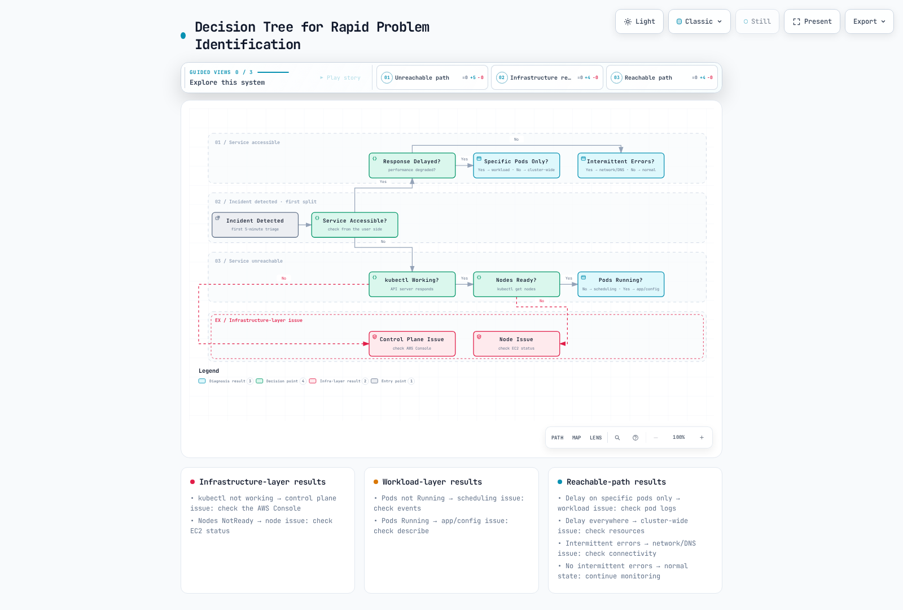
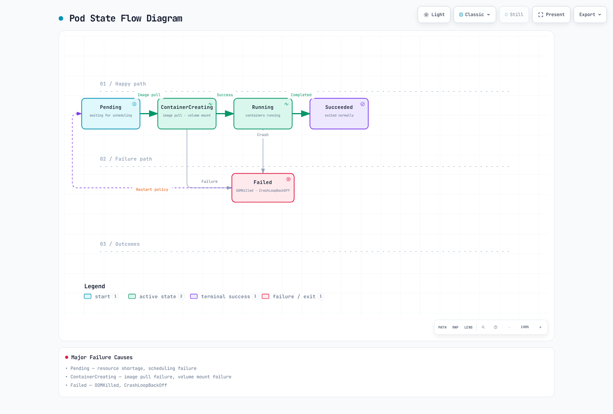

# EKS 高级调试与事件响应

> **审查基线**：Kubernetes 1.36 schemas 和 kubectl 1.36.2；选择当前受支持的 EKS 版本和兼容的组件版本
> **最后更新**：September 12, 2026

要确保 Amazon EKS 集群稳定运行，系统化的事件响应框架和高级调试技能必不可少。本文档提供实用指南，帮助快速诊断和解决生产环境中出现的复杂问题。

## 目录

1. [事件响应框架](#1-incident-response-framework)
2. [控制平面调试](#2-control-plane-debugging)
3. [节点级故障排查](#3-node-level-troubleshooting)
4. [工作负载调试](#4-workload-debugging)
5. [网络诊断](#5-networking-diagnostics)
6. [存储故障排查](#6-storage-troubleshooting)
7. [可观测性架构](#7-observability-architecture)
8. [故障检测架构](#8-failure-detection-architecture)
9. [快速参考](#9-quick-reference)
10. [后续步骤](#10-next-steps)

---

<span id="1-incident-response-framework"></span>

## 1. 事件响应框架

### 前 5 分钟检查清单（初始分类）

将最初的 30 秒步骤、两分钟范围检查和五分钟总时长视为计划目标，而不是实测完成时间。首先确认客户影响，以及确切的账户、集群/上下文、命名空间和近期变更。API 客户端不可用可能是凭证、授权、DNS/网络或控制平面问题导致的；仅凭这一点不能证明所有正在运行的应用都已宕机。

同时检查节点条件、Pod/容器状态、控制器 rollout 状态、近期事件和资源采样。`phase!=Running` 会漏掉 Running 但 NotReady/CrashLooping 的 Pod，也会包含已成功完成的 Job。Pod 处于 Running 阶段并不能证明其已就绪。对于 Deployment，应比较期望、已更新、就绪/可用副本数和已观测到的 generation，而不要通过 grep `1/1` 之类的显示字符串来判断。

标准 VPC CNI `aws-node` DaemonSet 通常运行在 `kube-system` 中；名为 `amazon-vpc-cni-system` 的命名空间不是 EKS 的前提条件。纯 Auto Mode 对网络和节点系统 DNS 的管理方式有所不同，因此应结合节点/控制器模式解读标准插件 Pod 是否存在。Metrics Server 数据只是采样的资源视图，并非客户可用性信号。

### 初始诊断脚本

此脚本针对一个选定的工作负载命名空间以及集群节点/系统 Pod 状态，执行有界 API 请求并保存私有证据。它不会收集 Secret 数据，也不会转储每个 Pod 的环境变量/配置。日志、事件和错误消息仍可能包含敏感应用数据：分享前请检查并遮盖证据。运行前，请检查账户/上下文输入和现有的私有证据目录。

```bash
set -euo pipefail
: "${AWS_REGION:?Set the intended Region}"
: "${CLUSTER_NAME:?Set the existing cluster name}"
: "${EXPECTED_ACCOUNT_ID:?Set the intended account ID}"
: "${KUBE_CONTEXT:?Set the explicit kubectl context}"
: "${NAMESPACE:?Set the owned workload namespace}"
: "${EVIDENCE_PARENT:?Set an existing private evidence directory}"
test -d "$EVIDENCE_PARENT"
ACTUAL_ACCOUNT_ID=$(aws sts get-caller-identity --query Account --output text)
test "$ACTUAL_ACCOUNT_ID" = "$EXPECTED_ACCOUNT_ID" || { echo "Account mismatch" >&2; exit 1; }
CLUSTER_ENDPOINT=$(aws eks describe-cluster --name "$CLUSTER_NAME" --region "$AWS_REGION" \
  --query cluster.endpoint --output text)
KUBE_ENDPOINT=$(kubectl config view --context "$KUBE_CONTEXT" --minify \
  -o jsonpath='{.clusters[0].cluster.server}')
test "$CLUSTER_ENDPOINT" = "$KUBE_ENDPOINT" || { echo "Context/cluster mismatch" >&2; exit 1; }

umask 077
TRIAGE_DIR=$(mktemp -d "$EVIDENCE_PARENT/eks-triage.XXXXXXXX")
TRIAGE_FAILED=0
k() { kubectl --context "$KUBE_CONTEXT" --request-timeout=15s "$@"; }
collect() {
  local name=$1
  shift
  if "$@" > "$TRIAGE_DIR/$name.txt" 2> "$TRIAGE_DIR/$name.stderr"; then
    printf '%s\tok\n' "$name" >> "$TRIAGE_DIR/status.tsv"
  else
    local rc=$?
    TRIAGE_FAILED=$((TRIAGE_FAILED + 1))
    printf '%s\tfailed:%s\n' "$name" "$rc" >> "$TRIAGE_DIR/status.tsv"
  fi
}
node_health() {
  k get nodes -o json | jq '[.items[] | {
    name:.metadata.name,uid:.metadata.uid,providerID:.spec.providerID,
    unschedulable:.spec.unschedulable,taints:.spec.taints,conditions:.status.conditions
  }]'
}
pod_health() {
  k -n "$NAMESPACE" get pods -o json | jq '[.items[] | {
    name:.metadata.name,uid:.metadata.uid,node:.spec.nodeName,owners:.metadata.ownerReferences,
    deleting:.metadata.deletionTimestamp,phase:.status.phase,conditions:.status.conditions,
    containers:[.status.containerStatuses[]? | {name,ready,restartCount,state,lastState}],
    initContainers:[.status.initContainerStatuses[]? | {name,ready,restartCount,state,lastState}]
  }]'
}
deployment_health() {
  k -n "$NAMESPACE" get deployments -o json | jq '[.items[] | {
    name:.metadata.name,generation:.metadata.generation,observed:.status.observedGeneration,
    desired:(.spec.replicas // 1),updated:(.status.updatedReplicas // 0),
    ready:(.status.readyReplicas // 0),available:(.status.availableReplicas // 0),
    conditions:.status.conditions
  }]'
}
load_balancers() {
  k -n "$NAMESPACE" get services -o json | jq '[.items[] | select(.spec.type=="LoadBalancer") | {
    name:.metadata.name,class:.spec.loadBalancerClass,selector:.spec.selector,
    ports:.spec.ports,status:.status.loadBalancer
  }]'
}
collect nodes node_health
collect pods pod_health
collect deployments deployment_health
collect load-balancers load_balancers
collect events k -n "$NAMESPACE" get events --sort-by='.metadata.creationTimestamp'
collect system-pods k -n kube-system get pods -o wide
collect node-resources k top nodes
collect pod-resources k -n "$NAMESPACE" top pods --sort-by=memory
printf 'Private evidence: %s; failed collections: %s\n' "$TRIAGE_DIR" "$TRIAGE_FAILED"
test "$TRIAGE_FAILED" -eq 0
```

检查 `status.tsv` 和每个失败输出。权限不足、指标不可用和 API 超时都属于失败的采集；若任一采集失败，脚本会以非零状态退出，并不会声称事件已解决。脚本有意保留已完成、Pending 和 Running 的 Pod 状态，供后续解读。选择性补充日志时，应指定确切的命名空间、Pod UID 和容器，并限制时间/行数范围。

LoadBalancer 列表会在本地筛选 Service JSON：`spec.type` 不是受支持的内置 Service 字段选择器。此次初始采集不包含宽泛的 `cluster-info dump`、自动上传归档、资源重启或删除。

### 严重级别矩阵

| 严重级别 | 分类 | 影响范围 | 响应时间 | 示例 |
|----------|---------------|--------------|--------------|----------|
| **P1** | 严重 | 服务完全中断 | 15 分钟内 | 控制平面故障、所有节点 NotReady |
| **P2** | 高 | 主要功能故障 | 1 小时内 | 特定工作负载完全故障、网络连接问题 |
| **P3** | 中 | 部分影响 | 4 小时内 | 部分 Pod 重启、性能下降 |
| **P4** | 低 | 轻微问题 | 24 小时内 | 日志采集延迟、非关键监控告警 |

此严重级别表中的响应时间是组织目标示例。请根据实际客户影响进行分类；即使只有控制平面中断，现有工作负载流量也可能仍在运行。

### 快速识别问题的决策树

<!-- 内容审查：图表文案需要上级修复；请参阅 eks-advanced-debugging/diagram-review.json。


[🔍 查看交互式图表](https://www.atomai.click/kubernetes-docs/archmaps/en-eks-11-eks-advanced-debugging-0.html)
-->

---

<span id="2-control-plane-debugging"></span>

## 2. 控制平面调试

### EKS 控制平面日志类型

EKS 提供五种控制平面日志类型。只有启用后，这些日志才会发送到区域级 CloudWatch 日志组；启用日志记录不会补回缺失的历史日志。请合理限制日志访问权限和保留期，并考虑 CloudWatch 摄取/存储/查询费用。日志组/流不存在，可能是因为日志记录已禁用、尚无数据送达、区域不正确或访问被拒绝，并不一定意味着控制平面故障。

| 类型 | 证据 |
| --- | --- |
| api | API server 操作和错误消息 |
| audit | API 请求身份、动词、资源和响应状态 |
| authenticator | IAM 到 Kubernetes 的身份验证证据 |
| controllerManager | 控制器协调消息 |
| scheduler | 调度决策/错误 |

```bash
set -euo pipefail
: "${AWS_REGION:?}"; : "${CLUSTER_NAME:?}"
LOG_GROUP="/aws/eks/$CLUSTER_NAME/cluster"
aws eks describe-cluster --region "$AWS_REGION" --name "$CLUSTER_NAME" \
  --query 'cluster.{ARN:arn,Status:status,Logging:logging}'
aws logs describe-log-streams --region "$AWS_REGION" --log-group-name "$LOG_GROUP" \
  --order-by LastEventTime --descending --max-items 10 \
  --query 'logStreams[].{Name:logStreamName,LastEvent:lastEventTimestamp}'
```
```bash
# MUTATION: review cost, retention, access and available subnet IPs first.
set -euo pipefail
UPDATE_ID=$(aws eks update-cluster-config --region "$AWS_REGION" --name "$CLUSTER_NAME" \
  --logging '{"clusterLogging":[{"types":["api","audit","authenticator","controllerManager","scheduler"],"enabled":true}]}' \
  --query update.id --output text)
test -n "$UPDATE_ID" && test "$UPDATE_ID" != None
aws eks describe-update --region "$AWS_REGION" --name "$CLUSTER_NAME" \
  --update-id "$UPDATE_ID" --query update
```
此变更是异步的。持续跟踪返回的 update ID，直至状态为 Successful；Failed/Cancelled 或客户端超时都不代表成功。随后验证 describe-cluster 和新的日志是否送达。集群处于 ACTIVE 状态本身不能证明此更新已经完成。此更新可能要求在每个已配置集群子网中有多达五个可用 IP；请查看当前 EKS 日志记录前提条件。

### CloudWatch Logs Insights 查询

每个代码块都应作为**独立的 Logs Insights QL 查询**运行，而不是作为 Bash 或 SQL。在控制台或 StartQuery 请求中选择确切的日志组和时间范围。这些查询使用 CloudWatch 发现的 EKS JSON audit 字段；如果处理管道改变了格式，请检查代表性记录和嵌套日志解析方式。查询没有匹配到事件，并不能证明服务正常或日志已送达。

#### API 错误消息

```text
fields @timestamp, @message
| filter @logStream like /kube-apiserver/ and @logStream not like /audit/
| filter @message like /error|Error|ERROR/
| sort @timestamp desc
| limit 100
```

#### 所选时间范围内的错误计数

```text
fields @timestamp, @message
| filter @logStream like /kube-apiserver/ and @logStream not like /audit/
| filter @message like /error|Error|ERROR/
| stats count(*) as error_count by bin(5m)
```

#### 需要检查的 Authenticator 消息

```text
fields @timestamp, @message
| filter @logStream like /authenticator/
| filter @message like /access denied|Unauthorized|unauthorized/
| sort @timestamp desc
| limit 50
```

#### 结构化 audit 身份验证/授权拒绝

```text
fields @timestamp, user.username, verb, objectRef.resource, objectRef.namespace, responseStatus.code
| filter @logStream like /kube-apiserver-audit/
| filter responseStatus.code in [401, 403]
| sort @timestamp desc
| limit 100
```

#### 特定已审查身份的结构化 audit 活动

```text
fields @timestamp, user.username, verb, objectRef.resource, objectRef.namespace, responseStatus.code
| filter @logStream like /kube-apiserver-audit/
| filter user.username = "REPLACE_WITH_OBSERVED_KUBERNETES_USERNAME"
| sort @timestamp desc
| limit 50
```

#### 按身份和资源统计 audit 429 事件

```text
fields user.username, verb, objectRef.resource, responseStatus.code
| filter @logStream like /kube-apiserver-audit/
| filter responseStatus.code = 429
| stats count(*) as request_count by user.username, verb, objectRef.resource
| sort request_count desc
| limit 50
```

#### API 请求量，不一定代表限流

```text
fields user.username, verb, objectRef.resource
| filter @logStream like /kube-apiserver-audit/
| stats count(*) as request_count by user.username, verb, objectRef.resource
| sort request_count desc
| limit 50
```

Audit 401/403 可用于区分请求级拒绝与 authenticator 消息搜索。API 调用计数不等于被限流调用数；聚合后的时间分桶结果也不再包含每个事件的 @timestamp，因而无法按该字段排序。StartQuery 会返回 query ID：轮询 GetQueryResults 直至 Complete，并保留 Failed/Cancelled/Timeout/数据缺失等状态。[监控章节](06-eks-monitoring-logging.md)包含有界查询/轮询工作流。本次审查没有运行实时 CloudWatch 查询。

[EKS 控制平面日志记录](https://docs.aws.amazon.com/eks/latest/userguide/control-plane-logs.html) · [AWS audit 字段示例](https://docs.aws.amazon.com/eks/latest/best-practices/auditing-and-logging.html)

### IAM 身份验证故障排查

首先运行初始分类中的账户/上下文保护检查。区分 kubectl 使用的人类/自动化 IAM 身份、节点 bootstrap 身份，以及应用 Pod 内使用的 AWS 身份。成功生成令牌并不能证明 Kubernetes 身份验证或授权成功。

以 k8s-aws-v1 开头的 EKS IAM 令牌是经过 base64url 编码的预签名 STS 请求，**不是由三部分组成的 JWT**。不要将其解码/打印为 JSON，也不要将其粘贴到日志中。Kubernetes 投射的 ServiceAccount 令牌是另一种 JWT 凭证。

```bash
set -euo pipefail
: "${AWS_REGION:?}"; : "${CLUSTER_NAME:?}"; : "${KUBE_CONTEXT:?}"; : "${NAMESPACE:?}"
aws sts get-caller-identity
aws eks describe-cluster --region "$AWS_REGION" --name "$CLUSTER_NAME" \
  --query 'cluster.{ARN:arn,AuthenticationMode:accessConfig.authenticationMode}'
# Print only the credential expiry, not the bearer token.
aws eks get-token --region "$AWS_REGION" --cluster-name "$CLUSTER_NAME" \
  --query status.expirationTimestamp --output text
kubectl --context "$KUBE_CONTEXT" auth whoami
kubectl --context "$KUBE_CONTEXT" -n "$NAMESPACE" auth can-i get pods
```
AuthenticationMode 决定了应检查的位置。在 API/API_AND_CONFIG_MAP 模式下，检查主体的 access entry、关联的策略范围和 RBAC 绑定；在 CONFIG_MAP 模式下，检查现有的旧版映射。不要为了修复尚未分类的 401/403 而切换身份验证模式或替换 aws-auth。迁移访问模式有独立的前提条件和不可逆的转换。不要通过字符串替换来猜测 IAM role 路径和 STS session ARN。

```bash
# Run for API or API_AND_CONFIG_MAP authentication mode.
aws eks list-access-entries --region "$AWS_REGION" --cluster-name "$CLUSTER_NAME"
: "${PRINCIPAL_ARN:?Use a reviewed IAM role/user ARN, not an STS assumed-role session ARN}"
aws eks describe-access-entry --region "$AWS_REGION" --cluster-name "$CLUSTER_NAME" \
  --principal-arn "$PRINCIPAL_ARN"
aws eks list-associated-access-policies --region "$AWS_REGION" --cluster-name "$CLUSTER_NAME" \
  --principal-arn "$PRINCIPAL_ARN"
```
```bash
# Read-only legacy mapping inspection for CONFIG_MAP/API_AND_CONFIG_MAP clusters.
kubectl --context "$KUBE_CONTEXT" -n kube-system get configmap aws-auth -o yaml
```
保留现有节点 bootstrap 映射。仅有组名并不会授予任何权限，还需要相关绑定；应使用经过审查的最小权限访问，而不要把 system:masters 作为诊断步骤添加。403 表示授权被拒绝，而 401 可能表示凭证无效/过期。网络/TLS 故障属于其他类型的证据。

### IRSA 故障排查

IRSA 需要正确的 OIDC issuer/provider、信任策略（与命名空间/ServiceAccount subject 和 sts.amazonaws.com audience 匹配），以及能够使用并刷新 web-identity 凭证的工作负载 SDK。下面的 annotation 只是此配置的一部分。其命名空间/role 均为占位符；此 YAML 不会创建 role、provider 或 bucket 权限。

```yaml
apiVersion: v1
kind: ServiceAccount
metadata:
  name: s3-access-sa
  namespace: diagnostics-example
  annotations:
    eks.amazonaws.com/role-arn: arn:aws:iam::123456789012:role/owned-s3-access-role
```
```bash
set -euo pipefail
: "${SERVICE_ACCOUNT:?Set the actual ServiceAccount on the Pod}"
: "${POD_NAME:?Set an owned Pod}"; : "${CONTAINER_NAME:?Set its application container}"
: "${IRSA_ROLE_NAME:?Set the reviewed IAM role name}"
kubectl --context "$KUBE_CONTEXT" -n "$NAMESPACE" get serviceaccount "$SERVICE_ACCOUNT" \
  -o jsonpath='{.metadata.annotations.eks\.amazonaws\.com/role-arn}{"\n"}'
aws eks describe-cluster --name "$CLUSTER_NAME" --region "$AWS_REGION" \
  --query cluster.identity.oidc.issuer --output text
aws iam get-role --role-name "$IRSA_ROLE_NAME" --query Role.AssumeRolePolicyDocument
kubectl --context "$KUBE_CONTEXT" -n "$NAMESPACE" get pod "$POD_NAME" -o json | jq '{
  uid:.metadata.uid,serviceAccount:.spec.serviceAccountName,
  envNames:[.spec.containers[] | {name,envNames:[.env[]?.name]}],
  projectedVolumes:[.spec.volumes[]? | select(.projected) | {name,projected}]
}'
```
检查环境变量**名称**、令牌文件路径/挂载元数据和 SDK 凭证链，但不要打印 Secret 值或令牌字节。SDK 凭证链中更靠前的静态凭证或其他 provider 可能会覆盖预期身份。应使用实际的应用容器；新建的 debug Pod 或容器可能具有不同的身份/配置。

```bash
# Optional read-only identity request, only if AWS CLI is already in this container.
kubectl --context "$KUBE_CONTEXT" -n "$NAMESPACE" exec "$POD_NAME" -c "$CONTAINER_NAME" \
  -- aws sts get-caller-identity
```
STS 身份响应可标识正在使用的 role，但不能证明其有权列出所有 bucket 或访问特定对象。不要仅为测试身份而运行 aws s3 ls 并遍历整个账户。

### Pod Identity 故障排查

```bash
aws eks list-pod-identity-associations --region "$AWS_REGION" \
  --cluster-name "$CLUSTER_NAME" --namespace "$NAMESPACE" --service-account "$SERVICE_ACCOUNT"
: "${ASSOCIATION_ID:?Use the exact matching association ID}"
aws eks describe-pod-identity-association --region "$AWS_REGION" \
  --cluster-name "$CLUSTER_NAME" --association-id "$ASSOCIATION_ID"
# Standard EC2-node setup only; Auto Mode provides the integration itself.
kubectl --context "$KUBE_CONTEXT" -n kube-system get pods \
  -l app.kubernetes.io/name=eks-pod-identity-agent
```
检查 association、role 信任/权限、受支持的 SDK 凭证 provider，以及 agent/节点可达性。Auto Mode 内置支持，不需要安装重复的 agent；Fargate 不支持 EKS Pod Identity。将创建/更改 association 与这些诊断步骤分开。IRSA 和 Pod Identity 的令牌 audience 与凭证传递路径不同；默认情况下，操作员的 AWS CLI 身份两者都不是。

### ServiceAccount 令牌有效期和轮换

投射令牌没有统一的“最长 24 小时”限制：请求的有效期与 API server 配置的限制是两个不同概念。当令牌超过其 TTL 的 80% 或超过 24 小时时，kubelet 会请求轮换；应用必须重新加载轮换后的文件。EKS 记录了在 Kubernetes API ServiceAccount 令牌迁移和过期令牌 audit annotation 期间提供 90 天兼容性扩展；这并不是安全的缓存时长，也不是对 IRSA、Pod Identity 或任意依赖方令牌有效期的保证。

下面的示例为 STS audience 请求一个一小时的自定义令牌。它不会延长默认 API 令牌的有效期，也不会自动配置 IRSA。现有命名空间/ServiceAccount、经过审查的镜像、role 信任策略以及应用 SDK/令牌文件配置都必须另行准备。不能假定 STS audience 令牌可用于 Kubernetes API。

```yaml
apiVersion: v1
kind: Pod
metadata:
  name: audience-token-example
  namespace: diagnostics-example
spec:
  serviceAccountName: owned-app
  automountServiceAccountToken: false
  containers:
  - name: app
    image: registry.example.com/owned/app:replace-with-reviewed-digest
    volumeMounts:
    - name: token
      mountPath: /var/run/secrets/tokens
      readOnly: true
  volumes:
  - name: token
    projected:
      sources:
      - serviceAccountToken:
          path: token
          expirationSeconds: 3600
          audience: sts.amazonaws.com
```
[EKS access entries](https://docs.aws.amazon.com/eks/latest/userguide/access-entries.html) · [EKS 令牌迁移/轮换](https://docs.aws.amazon.com/eks/latest/userguide/service-accounts.html) · [Kubernetes 投射令牌](https://kubernetes.io/docs/tasks/configure-pod-container/configure-service-account/) · [IRSA](https://docs.aws.amazon.com/eks/latest/userguide/iam-roles-for-service-accounts.html) · [Pod Identity](https://docs.aws.amazon.com/eks/latest/userguide/pod-identities.html)

### EKS 插件错误模式

更改插件前，请读取已安装版本、所有权、配置/身份设置以及 health.issues。ACTIVE 是插件状态，不代表所有客户流量都正常；DEGRADED 表示存在运行状况问题，而不只是性能变慢。CREATE_FAILED/UPDATE_FAILED/DELETE_FAILED 需要检查实际问题详情。Auto Mode 管理的功能可能会导致标准插件缺失，这可能是预期行为。

```bash
set -euo pipefail
: "${AWS_REGION:?}"; : "${CLUSTER_NAME:?}"; : "${ADDON_NAME:?Set the existing owned add-on}"
aws eks describe-addon --region "$AWS_REGION" --cluster-name "$CLUSTER_NAME" \
  --addon-name "$ADDON_NAME" \
  --query 'addon.{Version:addonVersion,Status:status,Issues:health.issues,Configuration:configurationValues,Role:serviceAccountRoleArn,PodIdentity:podIdentityAssociations}'
CLUSTER_VERSION=$(aws eks describe-cluster --region "$AWS_REGION" --name "$CLUSTER_NAME" \
  --query cluster.version --output text)
aws eks describe-addon-versions --region "$AWS_REGION" --addon-name "$ADDON_NAME" \
  --kubernetes-version "$CLUSTER_VERSION" \
  --query 'addons[].addonVersions[].{Version:addonVersion,Architectures:architecture,ComputeTypes:computeTypes,Compatibility:compatibilities}'
```
不要把响应中的第一个版本当成“最新版本”，也不要假定它与每种节点类型都兼容。请检查架构、计算类型、默认版本标记、配置 schema、IAM/Pod Identity 和组件迁移顺序。配置输出可能包含敏感信息；请妥善保管。版本更新属于有意实施的变更，不是初始诊断步骤。

```bash
# MUTATION: use a reviewed compatible version and configuration/identity plan.
set -euo pipefail
: "${REVIEWED_ADDON_VERSION:?Choose from the compatible versions after review}"
: "${REVIEWED_ADDON_CONFIG:?Set the path to the reviewed JSON configuration file}"
test -f "$REVIEWED_ADDON_CONFIG"
aws eks describe-addon-configuration --region "$AWS_REGION" --addon-name "$ADDON_NAME" \
  --addon-version "$REVIEWED_ADDON_VERSION" --query configurationSchema --output text
# The configuration file must be checked against this version's schema before this request.
UPDATE_ID=$(aws eks update-addon --region "$AWS_REGION" --cluster-name "$CLUSTER_NAME" \
  --addon-name "$ADDON_NAME" --addon-version "$REVIEWED_ADDON_VERSION" \
  --configuration-values "file://$REVIEWED_ADDON_CONFIG" \
  --resolve-conflicts PRESERVE --query update.id --output text)
test -n "$UPDATE_ID" && test "$UPDATE_ID" != None
aws eks describe-update --region "$AWS_REGION" --name "$CLUSTER_NAME" \
  --addon-name "$ADDON_NAME" --update-id "$UPDATE_ID" --query update
```
PRESERVE 要求 EKS 在解决冲突时保留现有自定义设置；它不是备份，也不保证任意旧设置都适用于新版本。OVERWRITE 可能重置冲突的自定义内容，必须单独审查。持续跟踪此确切 update ID 直至完成，检查更新错误并验证最终插件运行状况。请明确审查 configurationValues 和身份变更，不要悄悄省略或覆盖它们。

[更新 EKS 插件](https://docs.aws.amazon.com/eks/latest/userguide/updating-an-add-on.html)

---

<span id="3-node-level-troubleshooting"></span>

## 3. 节点级故障排查

<a id="node-join-diagnosis"></a>

### 节点加入失败诊断

以下是需要结合实例/NodeClaim、bootstrap 日志、endpoint 可达性和身份验证模式进行验证的假设，并非八个保证的根因。

| 范围 | 验证内容 |
| --- | --- |
| Bootstrap 和 AMI | 正确的集群名称/endpoint/CA、特定操作系统的 bootstrap、架构以及兼容的 kubelet/AMI；这并不是要求版本必须完全相等的通用规则 |
| 网络/安全 | 节点→API TCP 443、API→kubelet TCP 10250、DNS 和特定工作负载路径；验证方向、安全组成员关系和路由 |
| VPC DNS | DNS support/hostnames、DHCP resolver/domain 配置以及实际使用的 endpoint |
| 身份 | 节点 IAM role 和 Kubernetes 节点 access entry/旧版映射，使用 role ARN 而不是 instance-profile ARN |
| 所有权/发现标签 | Provisioner 专用节点所有权标签；不要与用于负载均衡器发现的子网标签混淆 |
| 私有访问 | 通过经过审查的 endpoint 或出口访问所需的 EKS/ECR/S3/STS 和其他服务；并非每种私有集群设计都必须使用 NAT gateway |
| 启动配置 | 针对实际 provisioner 正确处理 role/profile、launch-template 版本、容量和子网 IP 可用性 |
| 初始化 | 检查适用于所选 AMI 的 nodeadm/cloud-init/bootstrap 证据；AL2023、Bottlerocket、Windows 或 Auto Mode 的路径并不通用 |

```bash
set -euo pipefail
: "${KUBE_CONTEXT:?}"; : "${NODE_NAME:?Set the exact owned node name}"
NODE_JSON=$(kubectl --context "$KUBE_CONTEXT" get node "$NODE_NAME" -o json)
printf '%s\n' "$NODE_JSON" | jq '{
  name:.metadata.name,uid:.metadata.uid,providerID:.spec.providerID,
  os:.status.nodeInfo.osImage,kernel:.status.nodeInfo.kernelVersion,
  kubelet:.status.nodeInfo.kubeletVersion,runtime:.status.nodeInfo.containerRuntimeVersion,
  labels:.metadata.labels,taints:.spec.taints,conditions:.status.conditions
}'
NODE_UID=$(printf '%s\n' "$NODE_JSON" | jq -er '.metadata.uid')
kubectl --context "$KUBE_CONTEXT" get events -A \
  --field-selector "involvedObject.uid=$NODE_UID" --sort-by='.metadata.creationTimestamp'
```
```bash
# EC2-backed nodes only: map the Node providerID to an inspected instance ID/Region.
: "${AWS_REGION:?}"; : "${INSTANCE_ID:?Use the verified EC2 ID, not a guessed node-name conversion}"
aws ec2 describe-instances --region "$AWS_REGION" --instance-ids "$INSTANCE_ID" \
  --query 'Reservations[].Instances[].{ID:InstanceId,State:State.Name,AZ:Placement.AvailabilityZone,Subnet:SubnetId,Profile:IamInstanceProfile,Groups:SecurityGroups,Image:ImageId}'
aws ec2 describe-instance-status --region "$AWS_REGION" --instance-ids "$INSTANCE_ID" \
  --include-all-instances
```
尚未注册的实例没有 Node 对象：请改用其所属的 managed node group/NodeClaim/实例证据。Ready=False 与因缺少心跳而变为 Ready=Unknown 需要不同的证据。节点压力可以与 Ready 并存；不要根据一个显示字符串推断原因。默认情况下，通用 EC2 列表视图可能会隐藏新建的 Auto Mode EC2 托管实例；直接查询实例 ID 或显式包含托管资源，与更改账户级可见性设置是两回事。

### NotReady 节点决策树

<!-- 内容审查：图表文案需要上级修复；请参阅 eks-advanced-debugging/diagram-review.json。


[🔍 查看交互式图表](https://www.atomai.click/kubernetes-docs/archmaps/en-eks-11-eks-advanced-debugging-1.html)
-->

### 主机和托管节点诊断

对于客户可访问的 Linux 节点，SSM 需要节点 agent、role/网络前提条件以及对确切实例的授权访问。它会打开一个会话。EKS Auto Mode 托管实例不支持直接 SSH 访问；请使用其文档说明的 NodeDiagnostic/控制台输出路径或受支持的 kubectl debug node 工作流。当前 Auto Mode 指南明确支持用于实时日志的**显式 sysadmin debug profile**；这会创建特权 Pod，而不是 SSH 会话，也不是默认的调试权限。NodeDiagnostic 采集可能会将敏感日志/捕获内容上传到 S3，需要单独审查其范围和存储权限。

```bash
# Interactive host access: an operational session, not an automatic triage step.
: "${AWS_REGION:?}"; : "${INSTANCE_ID:?Use the reviewed self-managed or managed-node-group instance}"
aws ssm start-session --region "$AWS_REGION" --target "$INSTANCE_ID"
```
```bash
# Read-only Linux/systemd host checks after authorized access.
sudo systemctl show kubelet containerd --no-pager \
  -p Id -p LoadState -p ActiveState -p SubState -p ExecMainStatus
sudo journalctl -u kubelet --since "15 minutes ago" -n 200 --no-pager
sudo journalctl -u containerd --since "15 minutes ago" -n 100 --no-pager
sudo crictl info
sudo crictl ps
sudo crictl ps -a
sudo crictl images
df -h
df -i
sudo journalctl --disk-usage
```
```bash
# Exact container ID only; log content may be sensitive.
: "${CONTAINER_ID:?Use an inspected CRI container ID}"
sudo crictl logs --tail=100 "$CONTAINER_ID"
```
这些 systemd/CRI 命令假定所选主机上存在相应组件/工具。请为 crictl 配置正确的 CRI endpoint。使用有界 journal 读取；将 journalctl -f 管道传给 tail 可能永远不会结束。避免打印 kubeconfig/client key，或不加区分地删除日志、已退出容器或镜像缓存。这些内容可能包含所需证据，也可能由 kubelet 垃圾回收管理。重启、drain、替换或更改保留策略，都需要先诊断具体状况，并另行审查恢复步骤。

### 资源压力

DiskPressure 与可用字节数/inode 数以及配置的驱逐阈值有关，不只与 df 容量有关。检查 df -h 和 df -i、挂载标识及 kubelet 事件。如果批准了保留清理操作，旧的 journalctl --vacuum-size=500M 值也只是策略示例；应先收集所需证据，不要删除 /var/log 通配路径。MemoryPressure 与容器 OOM 是不同的信号：应关联内存限制、节点可用内存、工作集、日志和压力指标。提高限制或增加节点并不能证明根因已经修复。

```bash
# Read-only host evidence, not remediation.
free -h
awk '/MemTotal|MemFree|MemAvailable|Buffers|Cached/ {print}' /proc/meminfo
cat /proc/sys/kernel/pid_max
cat /proc/sys/kernel/threads-max
ps -eLf --no-headers | wc -l
ps -eo pid,comm,nlwp --sort=-nlwp | head -20
if [ -r /proc/pressure/memory ]; then cat /proc/pressure/memory; fi
if [ -r /proc/pressure/cpu ]; then cat /proc/pressure/cpu; fi
```
进程目录计数不等于所有线程/task 的数量。ps NLWP 和内核限制只是线索；kubelet PID 压力计算和 cgroup PID 限制需要单独解读。不要把一般性的高内存百分比称作 Kubernetes MemoryPressure 条件。缺失指标应视为不可用证据。

### Karpenter 预置问题

```bash
# Self-managed Karpenter; use the actual release namespace and selected objects.
: "${KARPENTER_NAMESPACE:?Set the existing controller namespace}"
: "${NODEPOOL_NAME:?}"; : "${NODECLAIM_NAME:?}"
kubectl --context "$KUBE_CONTEXT" -n "$KARPENTER_NAMESPACE" logs \
  -l app.kubernetes.io/name=karpenter -c controller --since=15m --tail=200 --prefix
kubectl --context "$KUBE_CONTEXT" get nodepool "$NODEPOOL_NAME" -o yaml
kubectl --context "$KUBE_CONTEXT" get nodeclaim "$NODECLAIM_NAME" -o yaml
kubectl --context "$KUBE_CONTEXT" get events -A \
  --field-selector "involvedObject.name=$NODECLAIM_NAME" --sort-by='.metadata.creationTimestamp'
```
检查 NodePool/NodeClass 就绪状态、NodeClaim 条件/事件、约束、限制、子网 IP、IAM 和 EC2 容量。对于 Auto Mode，应使用内置控制器的 NodeClaim/NodeClass/事件和 audit 日志证据；不要期待存在自行管理的 karpenter Deployment/命名空间。以下自行管理的 Karpenter v1 schema 模式仅供说明，必须使用兼容版本和经过审查的现有 EC2NodeClass。它不是替换集群默认 pool 的命令。CPU/内存限制是上限，而非预留容量；capacity-type 列表不能证明仅使用 Spot 或实现 AZ 均衡。

```yaml
apiVersion: karpenter.sh/v1
kind: NodePool
metadata:
  name: reviewed-capacity-example
spec:
  template:
    spec:
      requirements:
      - key: kubernetes.io/arch
        operator: In
        values:
        - amd64
      - key: karpenter.sh/capacity-type
        operator: In
        values:
        - spot
        - on-demand
      - key: karpenter.k8s.aws/instance-category
        operator: In
        values:
        - c
        - m
        - r
      nodeClassRef:
        group: karpenter.k8s.aws
        kind: EC2NodeClass
        name: reviewed-existing-class
  limits:
    cpu: 1000
    memory: 1000Gi
  disruption:
    consolidationPolicy: WhenEmptyOrUnderutilized
    consolidateAfter: 30s
```
### Managed Node Group 错误代码

| 问题 | 含义和证据 |
| --- | --- |
| AccessDenied | Kubernetes API 身份验证/授权失败；应检查节点访问权限和 EKS node-manager RBAC，以及 IAM |
| AsgInstanceLaunchFailures | ASG 启动失败；检查实际 activity 消息、模板、容量和权限 |
| ClusterUnreachable | Kubernetes API 连接或请求处理超时，不应自动判定为缺少 VPC endpoint |
| InsufficientFreeAddresses | 所选节点子网缺少可用 IP；现有子网 IPv4 CIDR 无法原地扩展 |
| NodeCreationFailure | 已启动的实例注册失败；常见检查项包括 bootstrap、访问权限和所需网络路径 |

```bash
set -euo pipefail
: "${AWS_REGION:?}"; : "${CLUSTER_NAME:?}"; : "${NODEGROUP_NAME:?Set the exact managed node group}"
aws eks describe-nodegroup --region "$AWS_REGION" --cluster-name "$CLUSTER_NAME" \
  --nodegroup-name "$NODEGROUP_NAME" \
  --query 'nodegroup.{Status:status,Issues:health.issues,Version:version,Release:releaseVersion,Subnets:subnets,Role:nodeRole,LaunchTemplate:launchTemplate,Repair:nodeRepairConfig}'
# For a Kubernetes authorization issue, inspect rather than blindly replace EKS-managed RBAC.
kubectl --context "$KUBE_CONTEXT" get clusterrole eks:node-manager -o yaml
kubectl --context "$KUBE_CONTEXT" get clusterrolebinding eks:node-manager -o yaml
```
根据每个问题的 message/resourceIds 和当前 AWS 修复流程进行处理。故障排查指南指出，在托管节点 15 分钟内未能加入集群后会出现 NodeCreationFailure；这并不保证每次启动都能在此时间内完成。如果子网需要更多空间，请规划新的地址空间/子网和特定 provisioner 的迁移，而不是修改现有 CIDR。EKS 管理的 RBAC 结构可能会演进：不要仅因出现 AccessDenied 就粘贴旧版替换 ClusterRole。节点修复/驱逐与检查是不同操作，必须考虑工作负载、预算、数据和当前节点管理模式。

[EKS 故障排查](https://docs.aws.amazon.com/eks/latest/userguide/troubleshooting.html) · [Auto Mode 诊断路径](https://docs.aws.amazon.com/eks/latest/userguide/auto-troubleshoot.html) · [安全组路径](https://docs.aws.amazon.com/eks/latest/userguide/sec-group-reqs.html) · [私有集群](https://docs.aws.amazon.com/eks/latest/userguide/private-clusters.html) · [Karpenter 兼容性](https://karpenter.sh/docs/upgrading/compatibility/)

### Node Readiness Controller（分阶段启动验证）

Kubernetes SIGs Node Readiness Controller 是真正的带外控制器。经过审查的 v0.5.0 版本使用集群级 `readiness.node.x-k8s.io/v1alpha1` `NodeReadinessRule`；它不是内置的 EKS ConfigMap 处理器，也不是 Node API 上的 GA 字段。

该控制器读取 Node 条件并管理 taint。它**不会**执行 ConfigMap 中任意的 `checks[].probe.exec` 条目。原有的文件存在性/containerd 检查需要通过单独实现的、经过授权的 reporter 或 NPD custom monitor 来发布相应条件。CNI 配置文件存在本身并不能证明 CNI 已就绪。项目捆绑的 reporter 使用 `CHECK_ENDPOINT`、`CONDITION_TYPE` 和 `NODE_NAME` 轮询 HTTP endpoint；其配置并非先前的 exec-probe 格式。

此规则是明确限定测试范围的**taint 预览**。应用它仍会创建集群资源，控制器也会更新状态，但 `dryRun: true` 不会添加/移除节点 taint。示例条件名称和节点标签属于自定义前提条件，不是 EKS 自动提供的标签/条件。

```yaml
apiVersion: readiness.node.x-k8s.io/v1alpha1
kind: NodeReadinessRule
metadata:
  name: reviewed-bootstrap-readiness
spec:
  dryRun: true
  enforcementMode: bootstrap-only
  nodeSelector:
    matchLabels:
      audit.example.com/readiness-demo: 'true'
  conditions:
  - type: audit.example.com/CNIReady
    requiredStatus: 'True'
  - type: audit.example.com/ContainerRuntimeReady
    requiredStatus: 'True'
  taint:
    key: readiness.k8s.io/bootstrap-not-ready
    value: pending
    effect: NoSchedule
```

启用 enforcement 前，请检查 `status.dryRunResults`、`status.nodeEvaluations`、失败节点以及实际选定的 Node 条件。

```bash
# Read-only: the controller and released CRD must already be installed.
: "${KUBE_CONTEXT:?Set the verified context}"
kubectl --context "$KUBE_CONTEXT" get nodereadinessrule reviewed-bootstrap-readiness -o yaml
kubectl --context "$KUBE_CONTEXT" get nodes \
  -l audit.example.com/readiness-demo=true -o json
```

要建立 bootstrap gate，应在新节点注册时添加匹配的 startup taint，避免在控制器运行前发生调度竞争。Reporter 和所需的系统 DaemonSet 必须容忍该 taint，且能够访问 API。满足所有要求后，bootstrap-only 模式会移除 taint 并记录完成状态；如果这些条件后来失效，它不会重新施加 gate。Continuous 模式是另一种策略选择。

`NoSchedule` 会阻止不容忍该 taint 的新 Pod，但不会驱逐现有 Pod。不要在 bootstrap-only 规则上设置 `defaultStatus`：此版本会拒绝这种组合。此处原生 CRD 验证不能证明 reporter 运行状况、admission-webhook 行为或其在每种 EKS 节点类型上的运行情况。本次审查未更改任何节点标签、taint、控制器或条件。

[版本 v0.5.0](https://github.com/kubernetes-sigs/node-readiness-controller/releases/tag/v0.5.0) · [Enforcement 和 dry-run 语义](https://github.com/kubernetes-sigs/node-readiness-controller/blob/v0.5.0/docs/book/src/user-guide/concepts.md) · [Reporter 配置](https://github.com/kubernetes-sigs/node-readiness-controller/blob/v0.5.0/docs/book/src/reference/reporter-configuration.md)

---

<span id="4-workload-debugging"></span>

## 4. 工作负载调试

### Pod 和容器状态

Pod 阶段包括 Pending、Running、Succeeded、Failed 和 Unknown。容器状态包括 Waiting、Running 和 Terminated；ContainerCreating 和 CrashLoopBackOff 是 reason/显示信息，而非额外的 Pod 阶段。Running 不等于 Ready。restart policy 可以在 Pod 内重启容器，但不会把已进入终态的 Failed Pod 变回 Pending。控制器创建的替代 Pod 是具有新 UID 的新 Pod。

<!-- 内容审查：图表文案需要上级修复；请参阅 eks-advanced-debugging/diagram-review.json。


[🔍 查看交互式图表](https://www.atomai.click/kubernetes-docs/archmaps/en-eks-11-eks-advanced-debugging-2.html)
-->

```bash
set -euo pipefail
: "${KUBE_CONTEXT:?}"; : "${NAMESPACE:?}"; : "${POD_NAME:?}"; : "${CONTAINER_NAME:?}"
POD_JSON=$(kubectl --context "$KUBE_CONTEXT" -n "$NAMESPACE" get pod "$POD_NAME" -o json)
printf '%s\n' "$POD_JSON" | jq '{
  name:.metadata.name,uid:.metadata.uid,owners:.metadata.ownerReferences,node:.spec.nodeName,
  phase:.status.phase,reason:.status.reason,conditions:.status.conditions,
  containers:.status.containerStatuses,initContainers:.status.initContainerStatuses,
  ephemeralContainers:.status.ephemeralContainerStatuses
}'
POD_UID=$(printf '%s\n' "$POD_JSON" | jq -er '.metadata.uid')
kubectl --context "$KUBE_CONTEXT" -n "$NAMESPACE" get events \
  --field-selector "involvedObject.uid=$POD_UID" --sort-by='.metadata.creationTimestamp'
kubectl --context "$KUBE_CONTEXT" -n "$NAMESPACE" logs "$POD_NAME" -c "$CONTAINER_NAME" \
  --since=15m --tail=200
```
```bash
# Separate read: this can fail when no previous container log exists.
kubectl --context "$KUBE_CONTEXT" -n "$NAMESPACE" logs "$POD_NAME" -c "$CONTAINER_NAME" \
  --previous --tail=200
```
previous 日志针对所选容器最近一次已终止实例，并非完整的重启历史。日志轮转或 Pod 删除可能导致日志不可用。记录 Pod UID/时间，并在采集期间检查是否已被替换；init/sidecar/ephemeral 容器可能有不同的故障。日志和状态消息可能包含敏感数据，因此请妥善保管采集到的证据。不要把打印所有环境变量或应用配置文件当作诊断捷径。

### kubectl debug：三种不同操作

Ephemeral container 会修改现有 Pod；`--copy-to` 会创建另一个 Pod；`node/` 会在节点上创建诊断 Pod。它们都是变更操作，需要相应的 RBAC/admission 权限。经检查的 kubectl 1.36.2 默认使用 general profile。这不自动意味着特权模式；访问主机 namespace/文件系统与 `privileged=true` 是不同的。

#### Ephemeral container

```bash
# MUTATION: adds a permanent-to-this-Pod-spec ephemeral-container entry.
: "${DEBUG_IMAGE:?Use a reviewed non-root diagnostic image with a compatible shell}"
: "${DEBUG_CONTAINER_NAME:?Choose an unused container name}"
kubectl --context "$KUBE_CONTEXT" -n "$NAMESPACE" debug "$POD_NAME" -it \
  --container="$DEBUG_CONTAINER_NAME" --target="$CONTAINER_NAME" \
  --image="$DEBUG_IMAGE" --profile=restricted -- sh
```
restricted profile 会移除 capabilities、防止权限提升，并请求以非 root 身份运行/使用 RuntimeDefault seccomp。镜像/用户/shell 必须支持这些设置；不保证任意仅限 root 的 BusyBox 镜像都能启动。只有 runtime 支持时，`--target` 才会请求目标进程 namespace。它不会复制应用文件系统/环境变量，也不会绕过权限。退出会结束 debug 进程，但无法从现有 Pod spec 中删除 ephemeral-container 条目。

#### Pod 副本

```bash
# MUTATION: copy only a reviewed reproduction Pod; inspect all side effects first.
: "${DEBUG_POD_NAME:?Choose a new owned Pod name in the same namespace}"
: "${DEBUG_IMAGE:?Use a reviewed diagnostic image that provides sleep}"
kubectl --context "$KUBE_CONTEXT" -n "$NAMESPACE" debug "$POD_NAME" \
  --copy-to="$DEBUG_POD_NAME" --container="$CONTAINER_NAME" --image="$DEBUG_IMAGE" \
  --keep-init-containers=false --keep-labels=false --keep-annotations=false \
  --share-processes=true --profile=general -- sleep 3600
```
原生 CLI 检查确认，此操作会替换所选容器的 image/command 并移除 init 容器，同时保留 ServiceAccount 并启用共享进程 namespace。其他常规容器、环境变量/Secret 引用和卷可能仍会保留并执行或访问同一数据。副本仍处于同一命名空间，可能调度到其他节点，也不是隔离的数据克隆。使用前请审查 admission mutation、副作用、身份、persistent volume 和清理方式。命名空间策略可能会拒绝 general profile capabilities；不要悄悄放宽策略。

#### 节点诊断

```bash
# MUTATION: privileged host diagnostic Pod, only where this access is authorized.
: "${NODE_NAME:?Use the exact reviewed Node}"
: "${NODE_DEBUG_IMAGE:?Use a reviewed image with nsenter}"
kubectl --context "$KUBE_CONTEXT" -n "$NAMESPACE" debug "node/$NODE_NAME" -it \
  --image="$NODE_DEBUG_IMAGE" --profile=sysadmin \
  -- nsenter -t 1 -m -- journalctl -u kubelet --since "15 minutes ago" -n 200 --no-pager
```
节点调试会将主机 root 挂载到 /host 并使用主机 namespace；显式指定 sysadmin profile 会启用特权执行。即使所选命令只读取日志，这也会授予广泛的主机访问权限。镜像必须已包含所需诊断工具。Auto Mode 用户指南记录了此路径；在那里仍无法进行常规 SSH 访问。其他 OS/节点类别应使用其受支持的访问方式。如果 kubelet/runtime/网络发生故障，不能假定新的 debug Pod 一定能启动。

记录实际操作创建的 debug Pod 名称/UID。审查证据后，只删除该独立 Pod；不要为了“清理”ephemeral container 而删除应用 Pod。

```bash
# MUTATION: remove only the separately created debug Pod after checking its identity.
: "${DEBUG_POD_NAME:?}"; : "${EXPECTED_DEBUG_UID:?Use the UID recorded at creation}"
ACTUAL_DEBUG_UID=$(kubectl --context "$KUBE_CONTEXT" -n "$NAMESPACE" get pod "$DEBUG_POD_NAME" \
  -o jsonpath='{.metadata.uid}')
test "$ACTUAL_DEBUG_UID" = "$EXPECTED_DEBUG_UID" || { echo "Debug Pod changed; stop" >&2; exit 1; }
kubectl --context "$KUBE_CONTEXT" -n "$NAMESPACE" delete pod "$DEBUG_POD_NAME" --timeout=2m
```
UID 检查只是安全检查，并不是原子删除前提条件；应协调操作，避免在检查和删除之间复用名称。本次审查未运行任何 debug 容器、特权工作负载或节点命令。原生 CLI 测试仅使用合成的 loopback API 响应。

### Deployment rollout 管理

```bash
# Read-only rollout evidence.
: "${DEPLOYMENT_NAME:?Set the owned Deployment}"
kubectl --context "$KUBE_CONTEXT" -n "$NAMESPACE" rollout status \
  "deployment/$DEPLOYMENT_NAME" --timeout=2m
kubectl --context "$KUBE_CONTEXT" -n "$NAMESPACE" rollout history "deployment/$DEPLOYMENT_NAME"
```
```bash
# MUTATION: workload revision rollback, not database/PVC/control-plane rollback.
set -euo pipefail
: "${REVIEWED_REVISION:?Set an inspected compatible revision}"
[[ "$REVIEWED_REVISION" =~ ^[1-9][0-9]*$ ]]
kubectl --context "$KUBE_CONTEXT" -n "$NAMESPACE" rollout undo \
  "deployment/$DEPLOYMENT_NAME" --to-revision="$REVIEWED_REVISION"
kubectl --context "$KUBE_CONTEXT" -n "$NAMESPACE" rollout status \
  "deployment/$DEPLOYMENT_NAME" --timeout=5m
```
超时/失败是需要检查的证据，不代表成功。与 GitOps 和其他协调控制器做好协调；rollback 不会恢复数据库或撤销 schema 变更。暂停/恢复 Deployment 控制的是 rollout 进度，不是 HPA 或所有 Pod 创建。rollout restart 会有意更改 Pod template 并创建替代项，即使 image 引用相同；未固定的 image 可能解析到不同版本。应使用确切的命名空间/Deployment 和经过审查的更新计划，不要在分类过程中将 restart/undo/scale 命令混在一起。

### HPA/VPA 扩缩容问题

```bash
# Read-only: use the actual scaler names and workload namespace.
: "${HPA_NAME:?}"
kubectl --context "$KUBE_CONTEXT" -n "$NAMESPACE" get hpa "$HPA_NAME" -o yaml
kubectl --context "$KUBE_CONTEXT" -n "$NAMESPACE" describe hpa "$HPA_NAME"
kubectl --context "$KUBE_CONTEXT" -n "$NAMESPACE" top pods --containers
```
```yaml
apiVersion: autoscaling/v2
kind: HorizontalPodAutoscaler
metadata:
  name: app-hpa
  namespace: diagnostics-example
spec:
  scaleTargetRef:
    apiVersion: apps/v1
    kind: Deployment
    name: app
  minReplicas: 2
  maxReplicas: 10
  metrics:
  - type: Resource
    resource:
      name: cpu
      target:
        type: Utilization
        averageUtilization: 70
  - type: Resource
    resource:
      name: memory
      target:
        type: Utilization
        averageUtilization: 80
  behavior:
    scaleDown:
      stabilizationWindowSeconds: 300
      policies:
      - type: Percent
        value: 10
        periodSeconds: 60
    scaleUp:
      stabilizationWindowSeconds: 0
      policies:
      - type: Percent
        value: 100
        periodSeconds: 15
```
```bash
# VPA is a separately installed controller/CRD, not built into EKS.
: "${VPA_NAME:?}"
kubectl --context "$KUBE_CONTEXT" -n "$NAMESPACE" get vpa "$VPA_NAME" -o json | jq '{
  target:.spec.targetRef,updatePolicy:.spec.updatePolicy,resourcePolicy:.spec.resourcePolicy,
  recommendation:.status.recommendation,conditions:.status.conditions
}'
```
HPA 示例需要现有 Deployment 和资源指标 provider，且目标容器需设置相关 CPU/内存 requests。Utilization 目标是相对于 requests，而非 limits。多个指标会选择建议副本数中的最大值；缺失/错误指标会影响决策。内存利用率不是通用的内存泄漏/OOM 修复方法。缩容稳定窗口和速率策略不是暂停开关。

VPA 需要单独安装。检查实际建议、条件、更新模式和受支持版本。当前指南已弃用旧版 Auto 更新模式名称；应选择文档说明的模式，例如仅提供建议的 Off 模式或经过审查的更新模式。避免 VPA 更改 HPA 所用的同一个 request 分母，却没有进行协调。

### Probe 配置

```yaml
apiVersion: v1
kind: Pod
metadata:
  name: app-probe-example
  namespace: diagnostics-example
spec:
  containers:
  - name: app
    image: registry.example.com/owned/app:replace-with-reviewed-digest
    ports:
    - name: http
      containerPort: 8080
    startupProbe:
      httpGet:
        path: /healthz
        port: http
      initialDelaySeconds: 10
      periodSeconds: 5
      failureThreshold: 30
    livenessProbe:
      httpGet:
        path: /healthz
        port: http
      periodSeconds: 10
      timeoutSeconds: 5
      failureThreshold: 3
    readinessProbe:
      httpGet:
        path: /ready
        port: http
      periodSeconds: 5
      timeoutSeconds: 3
      successThreshold: 1
      failureThreshold: 3
    resources:
      requests:
        cpu: 250m
        memory: 256Mi
      limits:
        cpu: 500m
        memory: 512Mi
```
替换占位镜像并实现实际健康 endpoint；此独立 Pod 只是 schema 示例，不是可复制的生产工作负载。Startup Probe 成功前会阻止 liveness/readiness 检查。按五秒周期尝试 30 次，再加上初始延迟，构成近似启动预算，而不是严格的 150 秒截止时间。Readiness 失败会使 Pod 不再处于 service routing 的就绪状态；它不会重启容器。不要仅因外部依赖速度变慢，就让 liveness 重启健康进程。应分别验证关闭流程、资源压力和实际响应时间。

[Pod 生命周期](https://kubernetes.io/docs/concepts/workloads/pods/pod-lifecycle/) · [调试正在运行的 Pod](https://kubernetes.io/docs/tasks/debug/debug-application/debug-running-pod/) · [HPA 行为](https://kubernetes.io/docs/tasks/run-application/horizontal-pod-autoscale/) · [VPA 模式](https://github.com/kubernetes/autoscaler/tree/master/vertical-pod-autoscaler)

---

<span id="5-networking-diagnostics"></span>

## 5. 网络诊断

### VPC CNI 和 IP 分配

首先确定节点/网络实现。以下 aws-node 设置适用于标准 Amazon VPC CNI 路径。Auto Mode 有自己的托管网络/NodeClass 控制项；更改 aws-node DaemonSet 不会配置 Auto Mode 节点。Windows、Fargate 和 Hybrid Nodes 的适用范围和诊断路径各不相同。保留初始账户/上下文检查，并严格限定节点/命名空间范围。

```bash
# Standard Amazon VPC CNI on applicable nodes, not an Auto Mode control interface.
: "${KUBE_CONTEXT:?}"; : "${AWS_REGION:?}"; : "${INSTANCE_ID:?Use the inspected EC2 node ID}"
kubectl --context "$KUBE_CONTEXT" -n kube-system get daemonset aws-node -o json | jq '{
  containers:[.spec.template.spec.containers[] | {name,image,settings:[
    .env[]? | select(.name | IN("ENABLE_PREFIX_DELEGATION","WARM_PREFIX_TARGET","WARM_IP_TARGET",
      "MINIMUM_IP_TARGET","AWS_VPC_K8S_CNI_CUSTOM_NETWORK_CFG","ENI_CONFIG_LABEL_DEF"))
  ]}]
}'
kubectl --context "$KUBE_CONTEXT" -n kube-system get pods -l k8s-app=aws-node -o wide
kubectl --context "$KUBE_CONTEXT" -n kube-system logs -l k8s-app=aws-node \
  -c aws-node --since=15m --tail=100 --prefix
aws ec2 describe-network-interfaces --region "$AWS_REGION" \
  --filters "Name=attachment.instance-id,Values=$INSTANCE_ID" \
  --query 'NetworkInterfaces[].{ID:NetworkInterfaceId,Subnet:SubnetId,Description:Description,IPv4:PrivateIpAddresses[].PrivateIpAddress,IPv4Prefixes:Ipv4Prefixes,IPv6Prefixes:Ipv6Prefixes,Groups:Groups}'
```
```bash
# Read-only: use subnets actually selected by the node/provisioner, not all account subnets.
: "${SUBNET_ID:?Set an inspected subnet ID}"
aws ec2 describe-subnets --region "$AWS_REGION" --subnet-ids "$SUBNET_ID" \
  --query 'Subnets[].{ID:SubnetId,VPC:VpcId,AZ:AvailabilityZone,CIDR:CidrBlock,AvailableIPv4:AvailableIpAddressCount}'
```
ENI 描述信息不能作为所有权边界。请使用已检查的实例/子网 ID，并纳入相关 custom networking 或 Pod ENI。子网可用地址数并不能证明有可用的连续 prefix；添加 VPC CIDR 本身也不会配置 Pod 网络。

### Prefix delegation

在受支持的 Linux/Nitro/CNI 配置中，prefix delegation 可提高 IP 密度并改善分配行为。请验证连续 prefix 空间/保留、ENI/prefix 限制、节点 maxPods/可分配 Pod 数以及迁移准备情况。不要在运行中的节点上盲目启用，也不要仅根据可用 IPv4 数推断可用容量。

以下是供审查的**配置片段**，应与实际受支持的插件/chart 配置合并，而不是完整替换现有设置：

```json
{
  "env": {
    "ENABLE_PREFIX_DELEGATION": "true",
    "WARM_PREFIX_TARGET": "1"
  }
}
```
已配置的 WARM_IP_TARGET/MINIMUM_IP_TARGET 会覆盖 WARM_PREFIX_TARGET。Warm target 会保留备用地址/prefix；它不会预留节点容量，也不能修复耗尽/碎片化的子网。请在受控 rollout 前检查已存储的配置和所有权；之后验证新 Pod 和实际 IPAM 状态。

### Custom networking

更改 CNI 模式前，应准备不重叠的 VPC 地址空间、实际的各 AZ Pod 子网、路由/出口、安全组以及充足的迁移容量。原先仅有两行的 CIDR/子网创建加环境变量切换，并不是完整的操作指南。现有子网 IPv4 CIDR 无法原地扩展。以下标准 ENIConfig 方式不同于 Auto Mode 网络控制项。

```json
{
  "env": {
    "AWS_VPC_K8S_CNI_CUSTOM_NETWORK_CFG": "true",
    "ENI_CONFIG_LABEL_DEF": "topology.kubernetes.io/zone"
  }
}
```
```yaml
apiVersion: crd.k8s.amazonaws.com/v1alpha1
kind: ENIConfig
metadata:
  name: ap-northeast-2a
spec:
  securityGroups:
  - sg-0123456789abcdef0
  subnet: subnet-0123456789abcdef0
```
ENIConfig 示例仅涵盖一个 AZ，并使用占位 ID。使用基于 zone 的选择时，应为每个符合条件的 zone 创建正确配置，并确保节点具有匹配的标签。每个 AZ 有多个 Pod 子网时，需要刻意设计自定义选择方案。Security-group-for-Pod 设置可能会改变适用的安全组；请检查已安装 CNI 的优先级。退役旧容量前，应验证控制器配置、新节点 rollout 和 Pod 放置。更全面的设置请参阅[网络指南](03-eks-networking-part1.md)。

### CoreDNS 和 Resolver 上下文

纯 Auto Mode 节点将 CoreDNS 作为节点系统服务运行。混合集群必须为非 Auto 节点保留 Deployment。纯 Auto 集群中没有该 Deployment 本身并不意味着 DNS 中断。对于基于 Deployment 的 DNS：

```bash
# CoreDNS Deployment on standard/mixed clusters; Auto Mode node-system DNS differs.
kubectl --context "$KUBE_CONTEXT" -n kube-system get pods -l k8s-app=kube-dns -o wide
kubectl --context "$KUBE_CONTEXT" -n kube-system logs -l k8s-app=kube-dns \
  --since=15m --tail=100 --prefix
kubectl --context "$KUBE_CONTEXT" -n kube-system get configmap coredns -o yaml
# Inspect the actual resolver context in an owned application container with these tools.
kubectl --context "$KUBE_CONTEXT" -n "$NAMESPACE" exec "$POD_NAME" -c "$CONTAINER_NAME" \
  -- cat /etc/resolv.conf
kubectl --context "$KUBE_CONTEXT" -n "$NAMESPACE" exec "$POD_NAME" -c "$CONTAINER_NAME" \
  -- nslookup kubernetes.default.svc.cluster.local.
```
除非启用了相关日志配置，否则 CoreDNS 不会记录每个 DNS 查询。新的测试 Pod 可能使用与故障工作负载不同的命名空间/节点/DNS/身份/策略路径。应使用工作负载实际的 resolver 上下文进行测试；测试绝对解析时，请使用末尾带点的 FQDN。

以下 ndots=2 值是一种实验，并非延迟问题的通用修复方法。它会改变搜索行为，并可能影响部分限定名称。libc、语言 resolver 和应用缓存行为各不相同；不能假定 glibc 专有选项（例如 single-request-reopen）具有可移植性。

```yaml
apiVersion: v1
kind: Pod
metadata:
  name: dns-options-example
  namespace: diagnostics-example
spec:
  dnsPolicy: ClusterFirst
  dnsConfig:
    options:
    - name: ndots
      value: '2'
    - name: timeout
      value: '2'
    - name: attempts
      value: '3'
  containers:
  - name: app
    image: registry.example.com/owned/app:replace-with-reviewed-digest
```
以下是 Corefile 示例。请对照已安装版本、所需插件、自定义 zone/forwarder 和托管插件配置进行比较；不要整体覆盖在线 ConfigMap。cache、max_concurrent 和 lameduck 值需要通过流量/健康验证。`pods insecure` 是 Kubernetes 插件的 Pod 记录模式，并不是禁用 Kubernetes API TLS/身份验证的开关。

```text
.:53 {
    errors
    health {
        lameduck 5s
    }
    ready
    kubernetes cluster.local in-addr.arpa ip6.arpa {
        pods insecure
        fallthrough in-addr.arpa ip6.arpa
        ttl 30
    }
    prometheus :9153
    forward . /etc/resolv.conf {
        max_concurrent 1000
    }
    cache 30
    loop
    reload
    loadbalance
}
```
### Service 和 EndpointSlice 验证

```bash
set -euo pipefail
: "${KUBE_CONTEXT:?}"; : "${NAMESPACE:?}"; : "${SERVICE_NAME:?}"
kubectl --context "$KUBE_CONTEXT" -n "$NAMESPACE" get service "$SERVICE_NAME" -o json | jq '{
  name:.metadata.name,type:.spec.type,clusterIP:.spec.clusterIP,ipFamilies:.spec.ipFamilies,
  externalName:.spec.externalName,selector:.spec.selector,ports:.spec.ports,
  trafficDistribution:.spec.trafficDistribution,externalTrafficPolicy:.spec.externalTrafficPolicy
}'
kubectl --context "$KUBE_CONTEXT" -n "$NAMESPACE" get endpointslices \
  -l "kubernetes.io/service-name=$SERVICE_NAME" -o json | jq '[.items[] | {
    name:.metadata.name,addressType,ports,
    endpoints:[.endpoints[]? | {addresses,conditions,nodeName,zone,targetRef}]
  }]'
```
请使用 EndpointSlices 检查当前 endpoint；较旧的 Endpoints API 已弃用。检查 Service selector/port/targetPort、地址族以及 endpoint 的 ready/serving/terminating 条件。Headless、ExternalName 和 selectorless Service 的行为各不相同。endpoint 地址存在并不能证明它可以接收预期流量；Service port 也不一定是应用的容器端口。

### NetworkPolicy 的 AND/OR 逻辑

同一 peer 中的 namespaceSelector 和 podSelector 是 AND 关系；不同 peer/rule 则互为备选。只有 podSelector 的 peer 会选择策略所在命名空间中的 Pod。所有适用 NetworkPolicy 的允许规则会累加；一个限制性策略不会覆盖另一个策略中的更宽泛允许规则。将 manifest 当作防火墙之前，请确认实际 CNI/node 类型支持并启用了 enforcement。

```yaml
apiVersion: networking.k8s.io/v1
kind: NetworkPolicy
metadata:
  name: reviewed-api-policy
  namespace: diagnostics-example
spec:
  podSelector:
    matchLabels:
      app: api-server
  policyTypes:
  - Ingress
  - Egress
  ingress:
  - from:
    - podSelector:
        matchLabels:
          app: frontend
    ports:
    - protocol: TCP
      port: 8080
  - from:
    - namespaceSelector:
        matchLabels:
          kubernetes.io/metadata.name: monitoring
      podSelector:
        matchLabels:
          app.kubernetes.io/name: prometheus
    ports:
    - protocol: TCP
      port: 9090
  egress:
  - to:
    - podSelector:
        matchLabels:
          app: database
    ports:
    - protocol: TCP
      port: 5432
  - to:
    - namespaceSelector:
        matchLabels:
          kubernetes.io/metadata.name: kube-system
      podSelector:
        matchLabels:
          k8s-app: kube-dns
    ports:
    - protocol: UDP
      port: 53
    - protocol: TCP
      port: 53
```
```bash
kubectl --context "$KUBE_CONTEXT" -n "$NAMESPACE" get networkpolicies -o yaml
kubectl --context "$KUBE_CONTEXT" -n "$NAMESPACE" get pods --show-labels
kubectl --context "$KUBE_CONTEXT" get namespaces --show-labels
```
此示例为匹配的 CoreDNS Pod 添加 TCP/UDP DNS 流量；否则仅允许访问数据库的 egress 规则会遗漏 DNS。Node-local/Auto Mode DNS 的路径不同，需要按模式进行验证。请匹配实际的监控/数据库标签和端口，并仅添加经过审查的外部依赖。此策略只是示例变更，并非经过验证的生产允许列表。

### 有界网络测试

```bash
# An intentional, bounded request from the actual workload context with curl installed.
: "${HEALTH_URL:?Set the owned safe health-check URL}"
kubectl --context "$KUBE_CONTEXT" -n "$NAMESPACE" exec "$POD_NAME" -c "$CONTAINER_NAME" \
  -- curl --silent --show-error --connect-timeout 5 --max-time 10 \
  --output /dev/null --write-out 'HTTP status: %{http_code}\n' "$HEALTH_URL"
```
```bash
# In an approved diagnostic context with the named tools.
: "${SERVICE_FQDN:?Set the exact owned service DNS name}"
dig +time=2 +tries=1 "$SERVICE_FQDN"
# Packet capture needs the appropriate capabilities/privileges and an owned target.
: "${TARGET_IP:?Set one reviewed peer IP}"
umask 077
timeout 30 tcpdump -i any -nn -c 100 -s 96 "host $TARGET_IP and port 443" -w owned-capture.pcap
# Separate deliberate load test: only against an agreed iperf3 server.
: "${IPERF_SERVER:?Set the owned test server}"
iperf3 -c "$IPERF_SERVER" -p 5201 -t 10 -P 1 -b 10M
```
按照前述 debug 工作流选择经过审查的诊断镜像/工具；创建 netshoot Pod 属于变更，不是被动观测。数据包捕获需要 capabilities/特权，而不仅仅是 root 用户身份；即使有界捕获也可能包含敏感 header/数据。请私下保存并在分享前检查。dig +trace 测试的是直接迭代 DNS 路径，而不只是工作负载配置的 resolver。iperf3 会主动生成流量：其吞吐量不是网络延迟，也不是本次审查的实测结果。

[Prefix 模式](https://docs.aws.amazon.com/eks/latest/best-practices/prefix-mode-linux.html) · [Custom networking](https://docs.aws.amazon.com/eks/latest/best-practices/custom-networking.html) · [NetworkPolicy 语义](https://kubernetes.io/docs/concepts/services-networking/network-policies/) · [EndpointSlices](https://kubernetes.io/docs/concepts/services-networking/endpoint-slices/)

---

<span id="6-storage-troubleshooting"></span>

## 6. 存储故障排查

### 确定驱动和权限

读取已绑定 PV 的 spec.csi.driver 和 volumeHandle，以及 StorageClass provisioner。标准 EBS 驱动为 ebs.csi.aws.com；Auto Mode 使用 ebs.csi.eks.amazonaws.com 及其托管控制器，因此标准控制器 Deployment 不存在可能是预期行为。以下标准驱动日志命令要求已安装该驱动。Fargate Pod 和 EKS Hybrid Nodes 无法挂载 EBS；将标准控制器放在 Fargate 上不会改变数据平面限制。

```bash
# Read-only: identify the actual installed driver and workload owner first.
kubectl --context "$KUBE_CONTEXT" get csidrivers
: "${CSI_NAMESPACE:?Set the namespace of the installed standard CSI controller}"
kubectl --context "$KUBE_CONTEXT" -n "$CSI_NAMESPACE" get deployments,daemonsets,pods -o wide
: "${CSI_CONTROLLER_NAME:?Use an observed controller Deployment name}"
: "${CSI_CONTAINER_NAME:?Use the CSI plugin container name}"
kubectl --context "$KUBE_CONTEXT" -n "$CSI_NAMESPACE" logs "deployment/$CSI_CONTROLLER_NAME" \
  -c "$CSI_CONTAINER_NAME" --since=15m --tail=100
```
```bash
# Inspect only the role actually used by the standard EBS CSI controller.
: "${CSI_ROLE_NAME:?Set the reviewed role name}"
aws iam get-role --role-name "$CSI_ROLE_NAME" --query Role.AssumeRolePolicyDocument
aws iam list-attached-role-policies --role-name "$CSI_ROLE_NAME"
aws iam list-role-policies --role-name "$CSI_ROLE_NAME"
```
当前 EKS 指南建议审查标准驱动权限所需的 AmazonEBSCSIDriverPolicyV2。该策略通过驱动所有权标签限定卷/快照管理范围，并支持 CSI 迁移卷标签。替换旧版策略前，请审查迁移和现有资源标签；不要通过附加包含所有变更权限、Resource:* 的不受限制策略来笼统修复问题。部分 AWS 读取/列表操作需要通配资源，这与宽泛的变更权限不同。

应使用实际的 Pod Identity 或 IRSA role/信任策略，而不是假定使用节点身份。客户自有 KMS key 需要相关 key policy/grant/encrypt/decrypt 权限；文档中的 CreateGrant 条件包含 kms:GrantIsForAWSResource。拥有预置卷的权限，并不能单独证明有权使用所选 KMS key 或将其挂载到预期节点。上述诊断命令不会执行 IAM 变更。

### EFS Mount Target 和 Access Point

```bash
set -euo pipefail
: "${AWS_REGION:?}"; : "${FILE_SYSTEM_ID:?Use the owned EFS filesystem}"
aws efs describe-file-systems --region "$AWS_REGION" --file-system-id "$FILE_SYSTEM_ID"
aws efs describe-mount-targets --region "$AWS_REGION" --file-system-id "$FILE_SYSTEM_ID"
: "${MOUNT_TARGET_ID:?Use the relevant mount target}"
aws efs describe-mount-target-security-groups --region "$AWS_REGION" --mount-target-id "$MOUNT_TARGET_ID"
: "${EFS_SECURITY_GROUP_ID:?Use an observed mount-target security group}"
aws ec2 describe-security-groups --region "$AWS_REGION" --group-ids "$EFS_SECURITY_GROUP_ID"
```
检查文件系统类型/Region、可达的 mount target、DNS、TCP 2049 规则以及两个方向的网络。Regional EFS 和 One Zone 的故障域行为不同。IAM 授权、access point POSIX identity/directory 权限以及 Pod security context 是不同层面。以下配置示例使用现有文件系统和占位 ID，并非完整的文件系统/role/网络预置指南。

```yaml
apiVersion: storage.k8s.io/v1
kind: StorageClass
metadata:
  name: reviewed-efs
provisioner: efs.csi.aws.com
parameters:
  provisioningMode: efs-ap
  fileSystemId: fs-0123456789abcdef0
  directoryPerms: '700'
  gidRangeStart: '1000'
  gidRangeEnd: '2000'
  basePath: /diagnostics-example
mountOptions:
- tls
reclaimPolicy: Retain
```
```yaml
apiVersion: v1
kind: PersistentVolumeClaim
metadata:
  name: efs-claim
  namespace: diagnostics-example
spec:
  accessModes:
  - ReadWriteMany
  storageClassName: reviewed-efs
  resources:
    requests:
      storage: 5Gi
```
5Gi PVC 请求不是 EFS 强制执行的容量配额。Access Point 可以在服务器端强制实施 POSIX identity；不要仅根据客户端 Pod UID 推断访问权限，也不要通过一概 chmod 来修复。TLS 挂载加密与文件系统静态加密是不同概念。Retain 需要明确的 access point/数据清理计划，并且可能留下计费资源。Fargate EFS 有自己的静态预置路径；不要假定此动态示例适用于所有节点类型。

### PVC/PV 状态和删除保护

```bash
set -euo pipefail
: "${KUBE_CONTEXT:?}"; : "${NAMESPACE:?}"; : "${PVC_NAME:?Set the owned claim name}"
PVC_JSON=$(kubectl --context "$KUBE_CONTEXT" -n "$NAMESPACE" get pvc "$PVC_NAME" -o json)
printf '%s\n' "$PVC_JSON" | jq '{
  name:.metadata.name,namespace:.metadata.namespace,uid:.metadata.uid,
  deleting:.metadata.deletionTimestamp,finalizers:.metadata.finalizers,
  phase:.status.phase,conditions:.status.conditions,volumeName:.spec.volumeName,
  hasStorageClassName:(.spec | has("storageClassName")),
  storageClassName:.spec.storageClassName,accessModes:.spec.accessModes,resources:.spec.resources
}'
PVC_UID=$(printf '%s\n' "$PVC_JSON" | jq -er '.metadata.uid')
kubectl --context "$KUBE_CONTEXT" -n "$NAMESPACE" get events \
  --field-selector "involvedObject.uid=$PVC_UID" --sort-by='.metadata.creationTimestamp'
kubectl --context "$KUBE_CONTEXT" -n "$NAMESPACE" get pods -o json | jq --arg claim "$PVC_NAME" '[
  .items[] | select(any(.spec.volumes[]?; .persistentVolumeClaim.claimName? == $claim)) |
  {name:.metadata.name,uid:.metadata.uid,owners:.metadata.ownerReferences,
   node:.spec.nodeName,phase:.status.phase,deleting:.metadata.deletionTimestamp}
]'
PV_NAME=$(printf '%s\n' "$PVC_JSON" | jq -r '.spec.volumeName // empty')
if [ -z "$PV_NAME" ]; then
  echo "No bound PV: inspect StorageClass, consumer scheduling and provisioning events."
else
  kubectl --context "$KUBE_CONTEXT" get pv "$PV_NAME" -o json | jq '{
    name:.metadata.name,uid:.metadata.uid,claimRef:.spec.claimRef,
    deleting:.metadata.deletionTimestamp,finalizers:.metadata.finalizers,
    reclaimPolicy:.spec.persistentVolumeReclaimPolicy,csi:.spec.csi,nodeAffinity:.spec.nodeAffinity
  }'
  kubectl --context "$KUBE_CONTEXT" get volumeattachments -o json | jq --arg pv "$PV_NAME" '[
    .items[] | select(.spec.source.persistentVolumeName == $pv) |
    {name:.metadata.name,driver:.spec.attacher,node:.spec.nodeName,status:.status}
  ]'
fi
```
PVC 名称仅在命名空间内有效；搜索消费者时必须使用 claim 所在命名空间。检查 claim/PV UID、控制器 owner、VolumeAttachments 和 finalizer。删除时间戳会使其显示为 Terminating；这不是额外的 PVC status.phase。若使用 WaitForFirstConsumer，在存在可调度的消费者之前，Pending 可能是预期状态。未填写 storageClassName 与明确设置为空字符串不同；后者表示不请求任何 class。

不要为了完成删除而将所有 PVC/PV finalizer 设为 null。PVC protection、CSI detach/delete 工作和 reclaim policy 分别保护生命周期的不同部分。首先确定消费者（包括可能重新创建它们的控制器）、挂载状态、控制器错误、备份和数据所有权。最后手段的孤立资源修复需要遵循特定驱动的恢复流程，并验证数据/挂载状态；删除元数据并不会执行安全卸载或恢复数据。删除可能会移除后端存储；Retain 也不是备份。

### WaitForFirstConsumer、拓扑和加密

```yaml
apiVersion: storage.k8s.io/v1
kind: StorageClass
metadata:
  name: reviewed-ebs-wffc
provisioner: ebs.csi.aws.com
parameters:
  type: gp3
  encrypted: 'true'
volumeBindingMode: WaitForFirstConsumer
allowVolumeExpansion: true
reclaimPolicy: Retain
```
此处使用标准 EBS CSI provisioner。WaitForFirstConsumer 会在初次预置/绑定时考虑调度约束；它不会让 EBS 跨 AZ，也无法修复被困在受损 AZ 中的卷。如果将工作负载限制在 ap-northeast-2a/2c 等 zone，应使其调度约束与实际 CSI 拓扑/可用容量相匹配。不要假定第一个 PV affinity 表达式始终是 zone，也不要假定 Pod 请求的 affinity 就是它的实际位置。

```bash
# Use the actual consumer node, not the Pod's requested node-affinity text.
: "${NODE_NAME:?Set an observed consumer node}"
kubectl --context "$KUBE_CONTEXT" get node "$NODE_NAME" -o json | jq '{
  name:.metadata.name,providerID:.spec.providerID,
  topologyLabels:(.metadata.labels | with_entries(select(.key | contains("topology"))))
}'
kubectl --context "$KUBE_CONTEXT" get csinode "$NODE_NAME" -o json | jq '.spec.drivers'
# For an actual EBS-backed PV, inspect the volume handle and Region before this lookup.
: "${AWS_REGION:?}"; : "${EBS_VOLUME_ID:?Set the inspected EBS volume ID}"
aws ec2 describe-volumes --region "$AWS_REGION" --volume-ids "$EBS_VOLUME_ID" \
  --query 'Volumes[].{ID:VolumeId,AZ:AvailabilityZone,State:State,Encrypted:Encrypted,KMS:KmsKeyId,Attachments:Attachments}'
```
Auto Mode 有单独的 provisioner 和节点兼容性要求。请明确设置 `encrypted: "true"` 并检查生成的卷/KMS key。当前 Auto Mode StorageClass 参数表中的 encrypted 默认值为 false；Auto Mode 节点 root/data disk 加密，并不能证明每个工作负载 PVC 都已加密。更改 StorageClass 不会追溯更改现有卷。

现有 EBS 卷不会仅因 StorageClass 使用 WaitForFirstConsumer 就跨 AZ 挂载。迁移/恢复需要遵循文档说明的 snapshot 或受控静态卷流程，并正确处理所有权标签/IAM 和应用一致性数据；这不是修改驱动名称就能解决的。Snapshot controller/CRD 是独立前提条件，创建了 snapshot 也不代表能成功恢复。ReadWriteOnce 允许从一个节点访问，并不意味着“只能由一个 Pod”访问；Auto Mode SELinux 隔离还可能增加跨 Pod 限制。更改前应保留数据并审查预期的访问/一致性模式。

[EBS CSI/IAM](https://docs.aws.amazon.com/eks/latest/userguide/ebs-csi.html) · [托管策略范围](https://docs.aws.amazon.com/eks/latest/userguide/security-iam-awsmanpol.html) · [Auto Mode 参数](https://docs.aws.amazon.com/eks/latest/userguide/create-storage-class.html) · [PV 生命周期](https://kubernetes.io/docs/concepts/storage/persistent-volumes/) · [EFS CSI](https://github.com/kubernetes-sigs/aws-efs-csi-driver)

---

<span id="7-observability-architecture"></span>

## 7. 可观测性架构

### 检查现有采集配置

不要将旧版 v1.0.0 插件作为事件响应捷径安装。请参阅[监控设置指南](06-eks-monitoring-logging.md)，选择当前兼容的插件/chart 和唯一的所有者。变更前检查 IAM/Pod Identity、日志/指标设置、节点适用性以及自动插桩/重启选项。近期 Operator 版本可能影响应用插桩和 rollout；同时安装两个所有者可能产生冲突。

```bash
# Read-only: inspect the installed owner/version rather than installing during triage.
: "${AWS_REGION:?}"; : "${CLUSTER_NAME:?}"; : "${KUBE_CONTEXT:?}"
aws eks describe-addon --region "$AWS_REGION" --cluster-name "$CLUSTER_NAME" \
  --addon-name amazon-cloudwatch-observability \
  --query 'addon.{Version:addonVersion,Status:status,Issues:health.issues,Configuration:configurationValues,Role:serviceAccountRoleArn,PodIdentity:podIdentityAssociations}'
kubectl --context "$KUBE_CONTEXT" -n amazon-cloudwatch get pods,deployments,daemonsets -o wide
# If Helm owns the installation, inspect that existing release instead.
helm list -n amazon-cloudwatch --kube-context "$KUBE_CONTEXT"
```
插件不存在可能意味着由 Helm 负责采集，或该组件尚未安装。Pod Running/add-on ACTIVE 并不能证明数据已送达、覆盖范围完整或用户可见的服务健康。请验证 scrape target、IAM/网络/TLS、摄取错误、保留期和成本；以下示例假定具备这些前提条件，并非已测试的生产平台。

### PromQL：明确每个指标的测量含义

查询假设使用**单集群、标签正确的数据集**和所选的 diagnostics-example 命名空间。在共享后端中，应添加实际的 cluster/job selector。必须采集 cAdvisor 和 kube-state-metrics；单纯编写查询不会生成这些时间序列。只有在上述范围内，聚合才会移除重复的 exporter-instance 标签。请检查时间戳、Pod/容器身份和特定版本的指标是否可用，包括 last-termination 指标。

#### 每个容器被限流的 CFS 周期占比

```promql
sum by (namespace,pod,container) (rate(container_cpu_cfs_throttled_periods_total{namespace="diagnostics-example",container!="",container!="POD"}[5m]))
/ on (namespace,pod,container) (sum by (namespace,pod,container) (rate(container_cpu_cfs_periods_total{namespace="diagnostics-example",container!="",container!="POD"}[5m])) > 0)
```

#### 按被限流周期占比排序的前十个容器

```promql
topk(10, sum by (namespace,pod,container) (rate(container_cpu_cfs_throttled_periods_total{namespace="diagnostics-example",container!="",container!="POD"}[5m]))
/ on (namespace,pod,container) (sum by (namespace,pod,container) (rate(container_cpu_cfs_periods_total{namespace="diagnostics-example",container!="",container!="POD"}[5m])) > 0))
```

#### 最近报告的终止原因为 OOM；不是新事件计数

```promql
max by (namespace,pod,container) (kube_pod_container_status_last_terminated_reason{namespace="diagnostics-example",reason="OOMKilled"} == 1)
```

#### 最近重启增量且最近报告的原因为 OOM；不是精确的 OOM 计数

```promql
(max by (namespace,pod,container) (increase(kube_pod_container_status_restarts_total{namespace="diagnostics-example"}[15m])) > 0)
and on (namespace,pod,container) (max by (namespace,pod,container) (kube_pod_container_status_last_terminated_reason{namespace="diagnostics-example",reason="OOMKilled"} == 1))
```

#### 每个容器的工作集 / 正数配置内存限制

```promql
max by (namespace,pod,container) (container_memory_working_set_bytes{namespace="diagnostics-example",container!="",container!="POD"})
/ on (namespace,pod,container)
max by (namespace,pod,container) (kube_pod_container_resource_limits{namespace="diagnostics-example",resource="memory",unit="byte"} > 0)
```

#### 每个 Pod 在15分钟内估算的常规容器重启增量

```promql
sum by (namespace,pod) (max by (namespace,pod,container) (increase(kube_pod_container_status_restarts_total{namespace="diagnostics-example"}[15m])))
```

#### 按估算重启增量排序的前十个 Pod

```promql
topk(10, sum by (namespace,pod) (max by (namespace,pod,container) (increase(kube_pod_container_status_restarts_total{namespace="diagnostics-example"}[15m]))))
```

#### 当前报告的 CrashLoopBackOff waiting reason

```promql
max by (namespace,pod,container) (kube_pod_container_status_waiting_reason{namespace="diagnostics-example",reason="CrashLoopBackOff"} == 1)
```

#### 当前活动且未删除、Ready=false 的 Pod，包括 Running Pod

```promql
((1 - max by (namespace,pod) (kube_pod_status_ready{namespace="diagnostics-example",condition="true"})) > 0)
and on (namespace,pod) (max by (namespace,pod) (kube_pod_status_phase{namespace="diagnostics-example",phase=~"Pending|Running|Unknown"} == 1))
unless on (namespace,pod) kube_pod_deletion_timestamp{namespace="diagnostics-example"}
```

CFS throttled period 并不是 CPU 利用率，也不是经过时间中的 CPU 时间百分比。内存比率只包括配置了正数限制的容器；缺失限制/数据不等于零利用率。increase() 是经过 reset-aware 和外推处理的计数器估值，可能是小数；changes(restarts_total) 统计观测到的数值变化，而不是 OOM 事件。最近终止原因为 OOM 加上重启增量只是相关性，并非精确的 OOM 事件计数，也不能证明发生了内存泄漏。CrashLoopBackOff 应通过 waiting reason 检查，不能仅根据每次重启推断。

Ready 查询包含 Running 但 NotReady 的 Pod，并排除终态/正在删除的 Pod。这些示例不能替代单独的 scrape/缺失 target 监控。没有返回时间序列，不能被解读为工作负载健康的证明。

### CloudWatch Logs Insights

在适当的日志组/时间范围内分别运行每个代码块。kubernetes.* 字段取决于采集器 schema；请检查实际记录。错误消息计数和 OOM 关键字只是诊断线索，并非请求错误率或完整故障历史。

#### 错误消息样本，不是请求错误率

```text
fields @timestamp, @message, kubernetes.pod_name, kubernetes.namespace_name
| filter kubernetes.namespace_name = "diagnostics-example"
| filter @message like /error|Error|ERROR|exception|Exception|EXCEPTION/
| sort @timestamp desc
| limit 100
```

#### 所选命名空间中的单个 Pod

```text
fields @timestamp, @message
| filter kubernetes.namespace_name = "diagnostics-example" and kubernetes.pod_name = "REPLACE_WITH_OBSERVED_POD"
| sort @timestamp desc
| limit 100
```

#### 应用响应时间字段，仅当日志格式定义了该字段时适用

```text
fields @timestamp, @message
| filter kubernetes.namespace_name = "diagnostics-example"
| parse @message /response_time=(?<response_time>\d+)ms/
| filter ispresent(response_time)
| stats avg(response_time) as avg_response_ms, max(response_time) as max_response_ms by bin(5m)
```

#### 需要关联分析的 OOM 相关日志消息

```text
fields @timestamp, @message
| filter @message like /OOMKilled|Out of memory|oom-kill/
| sort @timestamp desc
| limit 50
```

### PrometheusRule 选择和告警

将 release 标签替换为目标 Prometheus ruleSelector 所需的值，并验证 ruleNamespaceSelector。CRD 被接受并不能证明规则已加载或通知可用。阈值和持续时间是示例，需根据工作负载 SLO 调整；告警并未授权自动删除/重启。

```yaml
apiVersion: monitoring.coreos.com/v1
kind: PrometheusRule
metadata:
  name: reviewed-eks-diagnostics
  namespace: monitoring
  labels:
    release: REPLACE_WITH_SELECTED_PROMETHEUS_RELEASE
spec:
  groups:
  - name: reviewed-eks-diagnostics
    rules:
    - alert: NodeNotReady
      expr: kube_node_status_condition{condition="Ready",status="true"} == 0
      for: 5m
      labels:
        severity: critical
      annotations:
        summary: Node {{ $labels.node }} reports Ready=false/unknown; inspect the
          node condition and heartbeat.
    - alert: NodeMemoryPressure
      expr: kube_node_status_condition{condition="MemoryPressure",status="true"} ==
        1
      for: 5m
      labels:
        severity: warning
      annotations:
        summary: Node {{ $labels.node }} reports MemoryPressure.
    - alert: NodeDiskPressure
      expr: kube_node_status_condition{condition="DiskPressure",status="true"} ==
        1
      for: 5m
      labels:
        severity: warning
      annotations:
        summary: Node {{ $labels.node }} reports DiskPressure.
    - alert: PodCrashLooping
      expr: max by (namespace,pod,container) (kube_pod_container_status_waiting_reason{namespace="diagnostics-example",reason="CrashLoopBackOff"}
        == 1)
      for: 5m
      labels:
        severity: warning
      annotations:
        summary: '{{ $labels.namespace }}/{{ $labels.pod }}/{{ $labels.container }}
          reports CrashLoopBackOff.'
    - alert: ActivePodNotReady
      expr: '((1 - max by (namespace,pod) (kube_pod_status_ready{namespace="diagnostics-example",condition="true"}))
        > 0)

        and on (namespace,pod) (max by (namespace,pod) (kube_pod_status_phase{namespace="diagnostics-example",phase=~"Pending|Running|Unknown"}
        == 1))

        unless on (namespace,pod) kube_pod_deletion_timestamp{namespace="diagnostics-example"}'
      for: 15m
      labels:
        severity: warning
      annotations:
        summary: Active Pod {{ $labels.namespace }}/{{ $labels.pod }} is not Ready.
    - alert: ContainerRecentOOM
      expr: '(max by (namespace,pod,container) (increase(kube_pod_container_status_restarts_total{namespace="diagnostics-example"}[15m]))
        > 0)

        and on (namespace,pod,container) (max by (namespace,pod,container) (kube_pod_container_status_last_terminated_reason{namespace="diagnostics-example",reason="OOMKilled"}
        == 1))'
      for: 0m
      labels:
        severity: warning
      annotations:
        summary: Recent restart and last reported OOM for {{ $labels.namespace }}/{{
          $labels.pod }}/{{ $labels.container }}; verify events.
    - alert: HighCPUThrottling
      expr: '(sum by (namespace,pod,container) (rate(container_cpu_cfs_throttled_periods_total{namespace="diagnostics-example",container!="",container!="POD"}[5m]))

        / on (namespace,pod,container) (sum by (namespace,pod,container) (rate(container_cpu_cfs_periods_total{namespace="diagnostics-example",container!="",container!="POD"}[5m]))
        > 0)) > 0.5'
      for: 10m
      labels:
        severity: warning
      annotations:
        summary: More than 50% of CFS periods were throttled for {{ $labels.namespace
          }}/{{ $labels.pod }}/{{ $labels.container }}.
```
```bash
# Read-only: this rule must be selected by the intended Prometheus instance.
kubectl --context "$KUBE_CONTEXT" -n monitoring get prometheus -o json | jq '[
  .items[] | {name:.metadata.name,ruleSelector:.spec.ruleSelector,ruleNamespaceSelector:.spec.ruleNamespaceSelector}
]'
kubectl --context "$KUBE_CONTEXT" -n monitoring get prometheusrule reviewed-eks-diagnostics -o yaml
```
### ADOT Collector：明确的管道和前提条件

此示例使用经过审查的 Operator 0.158.0 v1beta1 对象型配置和 ADOT 0.50.0 组件。请准备命名空间、Operator/CRD、receiver TLS Secret、可信客户端 CA，以及配置妥当的 ServiceAccount AWS 身份。以下 Role 仅授予 Kubernetes Pod 发现权限；它不授予 X-Ray、CloudWatch Logs 或 AMP 访问权限。部署前，请审查 exporter IAM 权限以及实际的 Region/log-group/workspace 输入。本示例未经执行，也不声称可直接用于生产环境。

```yaml
apiVersion: v1
kind: ServiceAccount
metadata:
  name: adot-diagnostics
  namespace: diagnostics-example
```
```yaml
apiVersion: rbac.authorization.k8s.io/v1
kind: Role
metadata:
  name: adot-pod-discovery
  namespace: diagnostics-example
rules:
- apiGroups:
  - ''
  resources:
  - pods
  verbs:
  - get
  - list
  - watch
```
```yaml
apiVersion: rbac.authorization.k8s.io/v1
kind: RoleBinding
metadata:
  name: adot-pod-discovery
  namespace: diagnostics-example
roleRef:
  apiGroup: rbac.authorization.k8s.io
  kind: Role
  name: adot-pod-discovery
subjects:
- kind: ServiceAccount
  name: adot-diagnostics
  namespace: diagnostics-example
```
```yaml
apiVersion: opentelemetry.io/v1beta1
kind: OpenTelemetryCollector
metadata:
  name: adot-diagnostics
  namespace: diagnostics-example
spec:
  mode: deployment
  replicas: 1
  image: public.ecr.aws/aws-observability/aws-otel-collector:v0.50.0
  serviceAccount: adot-diagnostics
  env:
  - name: AWS_REGION
    value: us-west-2
  - name: AWS_EC2_METADATA_DISABLED
    value: 'true'
  resources:
    requests:
      cpu: 100m
      memory: 128Mi
    limits:
      cpu: '1'
      memory: 512Mi
  volumes:
  - name: receiver-tls
    secret:
      secretName: otel-receiver-tls
  volumeMounts:
  - name: receiver-tls
    mountPath: /etc/otel/tls
    readOnly: true
  config:
    receivers:
      otlp:
        protocols:
          grpc:
            endpoint: 0.0.0.0:4317
            tls:
              cert_file: /etc/otel/tls/tls.crt
              key_file: /etc/otel/tls/tls.key
          http:
            endpoint: 0.0.0.0:4318
            tls:
              cert_file: /etc/otel/tls/tls.crt
              key_file: /etc/otel/tls/tls.key
      prometheus:
        config:
          scrape_configs:
          - job_name: owned-pod-metrics
            scrape_interval: 30s
            kubernetes_sd_configs:
            - role: pod
              namespaces:
                names:
                - diagnostics-example
            relabel_configs:
            - source_labels:
              - __meta_kubernetes_pod_annotation_prometheus_io_scrape
              action: keep
              regex: 'true'
            - source_labels:
              - __meta_kubernetes_pod_phase
              action: keep
              regex: Running
            - source_labels:
              - __meta_kubernetes_pod_container_port_name
              action: keep
              regex: metrics
            - source_labels:
              - __meta_kubernetes_pod_container_port_protocol
              action: keep
              regex: TCP
            - source_labels:
              - __meta_kubernetes_pod_annotation_prometheus_io_path
              action: replace
              target_label: __metrics_path__
              regex: (.+)
            - source_labels:
              - __meta_kubernetes_namespace
              target_label: namespace
            - source_labels:
              - __meta_kubernetes_pod_name
              target_label: pod
            - source_labels:
              - __meta_kubernetes_pod_container_name
              target_label: container
    processors:
      memory_limiter:
        check_interval: 1s
        limit_percentage: 75
        spike_limit_percentage: 15
      batch:
        timeout: 30s
        send_batch_size: 8192
    exporters:
      awsxray:
        region: us-west-2
        local_mode: true
        no_verify_ssl: false
        index_all_attributes: false
        telemetry:
          enabled: false
      awsemf:
        region: us-west-2
        namespace: EKS/DiagnosticsExample
        log_group_name: /aws/eks/REPLACE_WITH_CLUSTER/otel-metrics
        log_stream_name: adot-diagnostics
        dimension_rollup_option: NoDimensionRollup
        resource_to_telemetry_conversion:
          enabled: false
      prometheusremotewrite:
        endpoint: https://aps-workspaces.us-west-2.amazonaws.com/workspaces/REPLACE_WITH_WORKSPACE_ID/api/v1/remote_write
        auth:
          authenticator: sigv4auth
        resource_to_telemetry_conversion:
          enabled: false
    extensions:
      sigv4auth:
        region: us-west-2
        service: aps
      health_check:
        endpoint: 0.0.0.0:13133
    service:
      extensions:
      - sigv4auth
      - health_check
      pipelines:
        traces:
          receivers:
          - otlp
          processors:
          - memory_limiter
          - batch
          exporters:
          - awsxray
        metrics:
          receivers:
          - otlp
          - prometheus
          processors:
          - memory_limiter
          - batch
          exporters:
          - awsemf
          - prometheusremotewrite
```
```yaml
apiVersion: networking.k8s.io/v1
kind: NetworkPolicy
metadata:
  name: adot-otlp-ingress
  namespace: diagnostics-example
spec:
  podSelector:
    matchLabels:
      app.kubernetes.io/managed-by: opentelemetry-operator
      app.kubernetes.io/instance: diagnostics-example.adot-diagnostics
  policyTypes:
  - Ingress
  ingress:
  - from:
    - podSelector:
        matchLabels:
          telemetry-client: 'true'
    ports:
    - protocol: TCP
      port: 4317
    - protocol: TCP
      port: 4318
```
OTLP 客户端必须信任证书，并使用正确生成的 Service、协议和 4317/4318 端口。必须启用 NetworkPolicy enforcement；此策略只选择 Collector Pod，并允许同一命名空间中带有标签的客户端访问。必要时应配置 metrics target TLS/auth 和工作负载 ingress 策略。Prometheus 发现范围限定为一个命名空间，且仅选择带注解、处于 Running 状态并带有名为 metrics 的 TCP 端口的 Pod；端口从该 endpoint 获取，因此无需重写未配置的 annotation-port。

此示例只使用一个副本，以避免重复 scrape 每个 target；扩展时需要设计 target 分片/allocator。memory_limiter 位于 batch 之前，但 memory/batch 设置不能保证无损传递。AWS X-Ray 接收 trace，awsemf 通过 CloudWatch Logs 写入指标，AMP 接收经 SigV4 身份验证的 remote write。自定义 EKS/DiagnosticsExample 指标不会自动符合 Container Insights schema/dashboard。固定日志名称可避免未解析的 {ClusterName} 变成 undefined；exporter 资源属性仍可能影响路由，因此应限制 producer 数据并约束 IAM。未经基数审查，不要将所有资源属性都转换成指标标签。

应保留应用服务身份和传播上下文；Collector 本身不会为所有请求插桩，也不能消除采样缺失。移除未使用的 exporter 时，也应同时移除其 pipeline 引用。本次审查没有发生 telemetry、AWS 请求、应用重启、Collector 或 Operator 安装。

[CloudWatch 设置](https://docs.aws.amazon.com/AmazonCloudWatch/latest/monitoring/install-CloudWatch-Observability-EKS-addon.html) · [Pod 指标](https://github.com/kubernetes/kube-state-metrics/blob/main/docs/metrics/workload/pod-metrics.md) · [Operator API](https://github.com/open-telemetry/opentelemetry-operator/releases/tag/v0.158.0) · [ADOT 组件版本](https://github.com/aws-observability/aws-otel-collector/blob/v0.50.0/go.mod) · [Prometheus receiver](https://github.com/open-telemetry/opentelemetry-collector-contrib/tree/v0.158.0/receiver/prometheusreceiver) · [EMF exporter](https://github.com/open-telemetry/opentelemetry-collector-contrib/tree/v0.158.0/exporter/awsemfexporter)

---

<span id="8-failure-detection-architecture"></span>

## 8. 故障检测架构

### 四层检测管道


[🔍 查看交互式图表](https://www.atomai.click/kubernetes-docs/archmaps/en-eks-11-eks-advanced-debugging-3.html)

此图展示的是概念性替代方案，并非完整连通的部署。采集、存储/查询、告警评估和通知都需要配置、身份、网络访问以及成功送达的证据。Trace 分析也需要配置好的 trace 后端；Logs Insights 不会自动将每个 trace 转变为告警。

### AWS 原生日志采集：配置约定

以下是适用于经过审查的 Linux 节点的 Fluent Bit 配置示例，并非已安装的 DaemonSet。请使用现有托管所有者或[完整监控设置](06-eks-monitoring-logging.md)；不要再安装第二个与之冲突的采集器。进程需要只读主机日志挂载、Kubernetes metadata RBAC、适当的 AWS 身份，以及**单独的**可写检查点/缓冲区目录。通过部署/Downward API 定义 AWS_REGION、CLUSTER_NAME 和 NODE_NAME。由于 auto_create_group 为 false，请预先创建目标日志组并授权访问。

```text
[SERVICE]
    Flush                   5
    Grace                   30
    Log_Level               info
    Daemon                  off
    storage.path            /var/fluent-bit/buffer
    storage.sync            normal
    storage.checksum        on
    storage.max_chunks_up   32

[INPUT]
    Name                    tail
    Tag                     kube.*
    Path                    /var/log/containers/*.log
    Exclude_Path            /var/log/containers/*_amazon-cloudwatch_*.log
    multiline.parser        cri
    DB                      /var/fluent-bit/state/containers.db
    Mem_Buf_Limit           50MB
    Skip_Long_Lines         On
    Refresh_Interval        10
    storage.type            filesystem

[FILTER]
    Name                    kubernetes
    Match                   kube.*
    Kube_URL                https://kubernetes.default.svc:443
    Kube_CA_File            /var/run/secrets/kubernetes.io/serviceaccount/ca.crt
    Kube_Token_File         /var/run/secrets/kubernetes.io/serviceaccount/token
    Kube_Tag_Prefix         kube.var.log.containers.
    Merge_Log               On
    Merge_Log_Key           log_processed
    K8S-Logging.Exclude      Off

[OUTPUT]
    Name                    cloudwatch_logs
    Match                   kube.*
    region                  ${AWS_REGION}
    log_group_name          /aws/eks/${CLUSTER_NAME}/containers
    log_stream_name         ${NODE_NAME}
    auto_create_group       false
    storage.total_limit_size 100M
```
内置 cri multiline parser 可处理 containerd 使用的 CRI stream/partial-record 格式；Docker JSON parser 处理的是另一种格式。请根据实际 agent 命名空间调整自身日志排除规则。log_processed 包含合并后的应用 JSON，并供下文的 metric-filter 示例使用。文件系统缓冲和 DB 检查点解决的是不同问题，不能保证无损或恰好一次传递。输出队列满时会丢弃最旧的 chunk；跳过长行可能会丢失记录；容器/节点轮转也可能移除尚未读取的数据。必须监控容量限制、保留期、磁盘可用空间和 IAM/KMS 错误。Fargate/Auto Mode/Windows 使用各自受支持的采集路径；此主机挂载示例并非普遍适用。

### Alertmanager：已加载配置和 Secret 文件

对于 Prometheus Operator，请使用包含 alertmanager.yaml key 的 Secret，并在现有 Alertmanager spec.configSecret 中引用它。名为 alertmanager-config 的 ConfigMap 不会自动被使用。以下是要集成到经过审查的 Helm/operator 所有者中的**spec 片段**，不是一个新的完整 Alertmanager 部署。单独的 Secret 必须提供 url/key 条目，并挂载到 `/etc/alertmanager/secrets/<secret-name>/` 下。

```yaml
spec:
  configSecret: alertmanager-reviewed
  secrets:
  - alertmanager-slack
  - alertmanager-pagerduty
```
```yaml
global:
  resolve_timeout: 5m
  slack_api_url_file: /etc/alertmanager/secrets/alertmanager-slack/url
route:
  receiver: default
  group_by:
  - alertname
  - cluster
  - namespace
  - pod
  - node
  - severity
  group_wait: 30s
  group_interval: 5m
  repeat_interval: 4h
  routes:
  - matchers:
    - severity="critical"
    receiver: critical
  - matchers:
    - severity="warning"
    receiver: warnings
receivers:
- name: default
  slack_configs:
  - channel: '#alerts-default'
    send_resolved: true
- name: critical
  slack_configs:
  - channel: '#incidents'
    send_resolved: true
  pagerduty_configs:
  - routing_key_file: /etc/alertmanager/secrets/alertmanager-pagerduty/key
    severity: critical
- name: warnings
  slack_configs:
  - channel: '#alerts-warnings'
    send_resolved: true
    title: '{{ .Status | toUpper }}: {{ .CommonAnnotations.summary }}'
    text: '{{ .CommonAnnotations.description }}'
inhibit_rules:
- source_matchers:
  - severity="critical"
  target_matchers:
  - severity="warning"
  equal:
  - alertname
  - cluster
  - namespace
  - pod
  - container
  - node
```
此配置会通过一个 receiver 将 critical 告警同时发送到 Slack 和 PagerDuty，将 warning 告警发送到 Slack，其他告警发送到 default receiver。`continue:true` 不会在匹配子路由后再同时调用父级/default receiver。当前的 matchers/source_matchers/target_matchers 可避免使用已弃用的映射语法。Inhibition equal labels 包含资源身份；缺失标签会被视为空字符串，因此请检查实际标签约定，避免抑制另一个 Pod/node 的告警。请分别验证已加载配置、路由和传输。解析和合成路由并不能证明 Slack/PagerDuty 已接受通知；电子邮件/SMS 需要另行明确配置。

### CloudWatch 阈值、异常和复合告警

使用实际的指标维度、单位和统计量。list-metrics 筛选器可能返回具有更多维度的时间序列；请选定一组**完整的**已发布维度。必须配置 Container Insights；上一节的自定义 ADOT 指标命名空间不能替代它。node_cpu_utilization 与 Pod CPU/request/limit 比率不同。下面的告警名称、topic ARN 和集群值都是示例；运行可能替换配置的命令前，请检查是否已有同名资源。通知 topic、访问/KMS policy 和接收方必须单独准备。

```bash
# Read-only: select an actual published metric and its complete dimension set.
: "${AWS_REGION:?}"; : "${CLUSTER_NAME:?}"
aws cloudwatch list-metrics --region "$AWS_REGION" --namespace ContainerInsights \
  --metric-name node_cpu_utilization --dimensions "Name=ClusterName,Value=$CLUSTER_NAME" \
  --query 'Metrics[].{Name:MetricName,Namespace:Namespace,Dimensions:Dimensions}'
```
```bash
# MUTATION: creates/replaces this named alarm and can trigger configured notifications.
: "${AWS_REGION:?}"; : "${SNS_TOPIC_ARN:?Use the owned topic ARN}"
: "${METRIC_DIMENSIONS_FILE:?JSON array containing one reviewed complete dimension set}"
aws cloudwatch put-metric-alarm --region "$AWS_REGION" \
  --alarm-name owned-eks-high-cpu --alarm-description "Example node CPU utilization threshold" \
  --namespace ContainerInsights --metric-name node_cpu_utilization \
  --dimensions "file://$METRIC_DIMENSIONS_FILE" --statistic Average \
  --period 300 --evaluation-periods 3 --datapoints-to-alarm 3 \
  --threshold 80 --comparison-operator GreaterThanThreshold \
  --treat-missing-data missing --alarm-actions "$SNS_TOPIC_ARN"
```
示例使用三个 300 秒周期和三个超阈值数据点，即 15 分钟评估窗口，而不是保证两分钟内检测到。TreatMissingData=missing 会保留缺失数据状态；只有当指标语义有依据时，才选择其他策略。请检查初始 INSUFFICIENT_DATA 和状态转换，不要假定创建告警就意味着告警已正常工作。

异常检测示例遵循 API 的 anomaly 专用 metric/band 结构：m1 是测量序列，ad1 是由 ThresholdMetricId 选定的 band。模型、周期、统计量和维度必须匹配。模型需要合适的数据/训练，不能保证预测中断。使用前，必须将 JSON 中的示例维度替换为与经过审查的维度文件相匹配的内容。

```json
{
  "AlarmName": "owned-eks-anomaly-cpu",
  "AlarmDescription": "Example anomaly model for an observed Container Insights metric",
  "Metrics": [
    {
      "Id": "m1",
      "ReturnData": true,
      "MetricStat": {
        "Metric": {
          "Namespace": "ContainerInsights",
          "MetricName": "node_cpu_utilization",
          "Dimensions": [
            {
              "Name": "ClusterName",
              "Value": "REPLACE_WITH_CLUSTER"
            }
          ]
        },
        "Period": 300,
        "Stat": "Average"
      }
    },
    {
      "Id": "ad1",
      "Expression": "ANOMALY_DETECTION_BAND(m1, 2)"
    }
  ],
  "EvaluationPeriods": 3,
  "ThresholdMetricId": "ad1",
  "ComparisonOperator": "LessThanLowerOrGreaterThanUpperThreshold",
  "TreatMissingData": "missing",
  "AlarmActions": [
    "arn:aws:sns:us-west-2:123456789012:owned-eks-alerts"
  ]
}
```
```bash
# MUTATIONS: same observed metric/statistic/dimensions as the reviewed model.
aws cloudwatch put-anomaly-detector --region "$AWS_REGION" \
  --namespace ContainerInsights --metric-name node_cpu_utilization --stat Average \
  --dimensions "file://$METRIC_DIMENSIONS_FILE"
# Replace the example cluster/topic/metric dimensions in the JSON before this request.
aws cloudwatch put-metric-alarm --region "$AWS_REGION" --cli-input-json file://anomaly-alarm-reviewed.json
```
```bash
# Read-only prerequisites: both named alarms must exist and have understood state.
aws cloudwatch describe-alarms --region "$AWS_REGION" \
  --alarm-names owned-eks-high-cpu owned-eks-high-memory
# MUTATION: the AND policy requires both alarms to be ALARM.
aws cloudwatch put-composite-alarm --region "$AWS_REGION" \
  --alarm-name owned-eks-combined-resource \
  --alarm-rule 'ALARM("owned-eks-high-cpu") AND ALARM("owned-eks-high-memory")' \
  --alarm-actions "$SNS_TOPIC_ARN"
```
复合告警示例假定适当账户/Region 中已经存在两个引用的告警；其策略明确要求两者都为 ALARM。AND 和 OR 表达的是不同事件策略，并非可互换的韧性保证。根据 PutMetricAlarm 文档，anomaly-model 告警不能配置 Auto Scaling action。

### 基于日志的指标

以下模式预期 Fluent Bit 合并后的 JSON 中包含 log_processed.level。请根据实际记录和支持 metric filter 的日志组类别进行调整；不要照抄带有多个省略号的空格分隔模式。Filter 只统计创建后匹配的日志事件，不是历史请求或唯一错误。若没有事件，defaultValue=0 也不能证明日志已送达。

```bash
# MUTATION: structured JSON must actually contain log_processed.level.
aws logs put-metric-filter --region "$AWS_REGION" \
  --log-group-name "/aws/eks/$CLUSTER_NAME/containers" \
  --filter-name OwnedApplicationErrors \
  --filter-pattern '{ $.log_processed.level = "ERROR" }' \
  --metric-transformations "metricName=ApplicationErrors,metricNamespace=EKS/$CLUSTER_NAME/Application,metricValue=1,defaultValue=0,unit=Count"
```
### 成熟度目标和自动化边界

原始的 30/15/5/2 分钟 MTTD 值仍作为未经验证的计划目标保留。此处的配置并未证明能够达到这些结果；应在各事件中以一致方式测量发生/检测/恢复时间戳。ML/异常检测本身并不能证明预测准确性，也不授权自动修复。

| 级别 | 原始示例 MTTD 目标 | 需要验证的能力 |
| --- | --- | --- |
| 基础 | 30 分钟 | 基本指标和手动日志调查 |
| 响应式 | 15 分钟 | 调整后的阈值、日志指标和仪表板 |
| 主动式 | 5 分钟 | 关联告警和经审查的操作手册 |
| 预测性设计目标 | 2 分钟 | 经验证的预测、受限自动化和受控演练 |

### EventBridge → Lambda 诊断接入

使用精确的账户/Region/告警规则和明确的 target 调用授权。此示例会对事件分类并记录一个简短的诊断请求；它不包含 Kubernetes/AWS 变更客户端。聚合告警无法可靠地确定 Pod 名称/命名空间/UID，因此删除猜测的 Pod 并不是修复 CrashLoopBackOff 的合理默认做法。

```json
{
  "source": [
    "aws.cloudwatch"
  ],
  "detail-type": [
    "CloudWatch Alarm State Change"
  ],
  "account": [
    "123456789012"
  ],
  "region": [
    "us-west-2"
  ],
  "resources": [
    "arn:aws:cloudwatch:us-west-2:123456789012:alarm:owned-eks-pod-crashlooping"
  ],
  "detail": {
    "alarmName": [
      "owned-eks-pod-crashlooping"
    ],
    "state": {
      "value": [
        "ALARM"
      ]
    }
  }
}
```
```python
"""EventBridge alarm intake example: classification/logging only, no AWS or Kubernetes client."""
import datetime
import json
import os

def classify_alarm(event, expected_alarm_arn, now):
    parts=expected_alarm_arn.split(':',5)
    if len(parts)!=6 or parts[2]!='cloudwatch' or not parts[5].startswith('alarm:'):
        raise ValueError('Configure one exact CloudWatch alarm ARN')
    if not isinstance(event,dict):
        return {'status':'ignored','reason':'invalid event'}
    detail=event.get('detail')
    state=detail.get('state') if isinstance(detail,dict) else None
    resources=event.get('resources')
    if (event.get('source')!='aws.cloudwatch'
        or event.get('detail-type')!='CloudWatch Alarm State Change'
        or event.get('account')!=parts[4] or event.get('region')!=parts[3]
        or not isinstance(resources,list) or expected_alarm_arn not in resources
        or not isinstance(state,dict) or state.get('value')!='ALARM'
        or detail.get('alarmName')!=parts[5][len('alarm:'):]):
        return {'status':'ignored','reason':'outside configured alarm/state'}
    event_id=event.get('id')
    if not isinstance(event_id,str) or not 1<=len(event_id)<=128:
        return {'status':'ignored','reason':'missing or invalid event ID'}
    try:
        changed=datetime.datetime.fromisoformat(state['timestamp'].replace('Z','+00:00'))
        if changed.tzinfo is None or now.tzinfo is None:
            raise ValueError('Timezone required')
        age=(now-changed).total_seconds()
    except (KeyError,TypeError,ValueError,AttributeError):
        return {'status':'ignored','reason':'invalid timestamp'}
    if age < -300 or age > 3600:
        return {'status':'ignored','reason':'outside example event-age window'}
    return {'status':'diagnostic_request','event_id':event_id,
            'alarm_arn':expected_alarm_arn,'state_changed_at':changed.isoformat(),
            'action':'inspect evidence and select a reviewed runbook'}

def lambda_handler(event,context):
    result=classify_alarm(event,os.environ['EXPECTED_ALARM_ARN'],
                          datetime.datetime.now(datetime.timezone.utc))
    print(json.dumps(result))
    return result
```
将 EXPECTED_ALARM_ARN 设置为确切的自有告警。1 小时事件有效期/5 分钟未来容差是策略示例。请限制实际 Lambda 调用方；检查事件字段并不是对来源进行加密验证。EventBridge 的异步调用不会将返回字典转发为操作：必须明确连接实际的诊断队列/工作流。记录此选择并不等于“已执行自动修复”。

在启用变更 runbook 前，应实现身份/UID 重新验证、持久化 event-id 去重、速率限制、最小权限、并发控制、工作负载/数据/PDB 检查、回滚和操作后验证。重试或重复事件不得触发重复删除。本分类器并未实现这些生产变更控制。

| 示例严重级别 | Slack | PagerDuty | 其他渠道 | 变更策略 |
| --- | --- | --- | --- | --- |
| P1 严重 | 事件频道 | 立即处理策略 | 团队负责人/值班邮件或 SMS（如已接通） | 仅限经过审查、范围明确的 runbook |
| P2 高 | 高优先级告警 | 示例：15 分钟升级 | 团队邮件（如已接通） | 有条件审查 |
| P3 中 | 告警频道 | 可选 | 团队邮件（如已接通） | 默认不自动变更 |
| P4 低 | 低优先级告警 | 无 | 示例：每日摘要 | 不自动变更 |

这是路由策略示例，并不能证明每个渠道都已部署或会按时送达。本次审查没有创建/执行告警、topic、策略、Lambda 函数、云资源或通知。

[Fluent Bit CRI 解析](https://docs.fluentbit.io/manual/administration/configuring-fluent-bit/multiline-parsing) · [缓冲限制](https://docs.fluentbit.io/manual/administration/buffering-and-storage) · [CloudWatch 输出](https://docs.fluentbit.io/manual/pipeline/outputs/cloudwatch) · [Alertmanager 0.34 配置](https://github.com/prometheus/alertmanager/blob/v0.34.0/docs/configuration.md) · [PutMetricAlarm 示例](https://docs.aws.amazon.com/AmazonCloudWatch/latest/APIReference/API_PutMetricAlarm.html) · [指标维度](https://docs.aws.amazon.com/AmazonCloudWatch/latest/monitoring/Container-Insights-metrics-EKS.html)

---

<span id="9-quick-reference"></span>

## 9. 快速参考

### 选择变更前先解读症状

| 症状 | 证据和解读 |
| --- | --- |
| CrashLoopBackOff | 容器反复退出/重启并进入退避；检查退出代码、last state、probe 以及当前/previous 日志。restartAlways 下，退出代码为 0 也可能导致循环 |
| ImagePullBackOff | 拉取失败后进入重试延迟；检查先前错误、image/tag/digest、平台、拉取身份、registry/网络/CA/速率限制 |
| ErrImagePull | 拉取尝试失败；这不能单独证明网络故障，也不能证明应用 IRSA 有问题 |
| OOMKilled | 结合 runtime 原因、内存限制/工作集和节点证据；仅凭退出代码 137 或高使用量不能证明内存泄漏 |
| CreateContainerConfigError | 检查引用的 ConfigMap/Secret/卷以及命名空间/键；不要转储凭证值 |
| Pending: resources | 在预置节点前，比较 requests、init/Pod 开销、可分配资源、Pod limits 和实际调度事件 |
| Pending: placement | 检查 selector/affinity/taint/拓扑/存储约束；某些 Pending 状态是有意设置的 |
| ContainerCreating | 容器状态 reason/显示信息，不是 Pod 阶段；检查 runtime、image、CNI 和卷设置 |
| RunContainerError | 检查实际 runtime/安全/命令错误；不存在通用的重启修复方法 |
| postStart hook failure | 检查 handler 和应用启动过程；postStart 不保证在 ENTRYPOINT 前执行，也没有通用的 timeoutSeconds 字段 |
| preStop hook failure | 检查 handler 错误和 grace-period 预算，其中包括 hook 执行时间；强制终止不等于成功 drain |
| FailedScheduling | 阅读完整消息，包括 PVC/affinity/资源约束；不要假定是 CPU 不足 |
| FailedMount | 检查 CSI 所有权、claim、挂载/拓扑、权限和后端/网络健康；不要删除所有 finalizer |
| NetworkNotReady | 检查实际节点网络实现和就绪证据；标准 aws-node 命令取决于运行模式 |
| NodeNotReady | 区分 Ready=False 和因缺少心跳而产生的 Unknown，并检查节点/EC2/runtime/网络证据 |
| Evicted | 检查节点压力/ephemeral-storage 证据和 Pod reason；提高 limits 或删除日志并不自动构成修复 |
| BackOff | 这是重试行为；应调查之前的失败原因 |
| InvalidImageName | 验证 image 引用语法；此错误发生在成功解析 registry 之前 |

### 范围明确的读取命令

```bash
# Use the account/context guard and the actual namespace/Pod/container from triage.
set -euo pipefail
: "${KUBE_CONTEXT:?}"; : "${NAMESPACE:?}"; : "${POD_NAME:?}"; : "${CONTAINER_NAME:?}"
kubectl --context "$KUBE_CONTEXT" get nodes -o wide
kubectl --context "$KUBE_CONTEXT" -n "$NAMESPACE" get pods -o wide
kubectl --context "$KUBE_CONTEXT" -n "$NAMESPACE" get events --field-selector type=Warning
kubectl --context "$KUBE_CONTEXT" -n "$NAMESPACE" top pods --containers
kubectl --context "$KUBE_CONTEXT" -n "$NAMESPACE" logs "$POD_NAME" -c "$CONTAINER_NAME" --since=15m --tail=100
# Run separately: previous-container logs may not exist.
kubectl --context "$KUBE_CONTEXT" -n "$NAMESPACE" logs "$POD_NAME" -c "$CONTAINER_NAME" --previous --tail=100
```
```bash
# Authorized reads; print names/keys only, not configuration or Secret values.
: "${CONFIGMAP_NAME:?Set one relevant ConfigMap}"
kubectl --context "$KUBE_CONTEXT" -n "$NAMESPACE" get configmap "$CONFIGMAP_NAME" -o json | jq '{
  name:.metadata.name,textKeys:(.data // {} | keys),binaryKeys:(.binaryData // {} | keys)
}'
: "${SECRET_NAME:?Set one Secret whose read permission is explicitly authorized}"
kubectl --context "$KUBE_CONTEXT" -n "$NAMESPACE" get secret "$SECRET_NAME" -o json | jq '{
  name:.metadata.name,type:.type,keyNames:(.data // {} | keys)
}'
```
Secret 命令虽然减少了显示的输出，但仍会通过 API 请求 Secret，并需要 Secret-read 权限；它不是授权边界。事件时间戳可能代表聚合后的发生记录；top 是近期指标采样，不是历史事实或瞬时真相。检查 endpoint 时，请使用上文的 EndpointSlice 工作流。

Pod 创建/debug/exec、rollout undo/restart、扩缩容、drain/repair 和删除，都应放在单独审查的操作步骤中。强制删除 Pod 只是移除其 API 对象，并不能证明旧进程已停止；这可能导致重复写入。不要将该命令放入常规分类流程，也不要用它绕过数据/驱逐保护。

### 工具选择

| 工具 | 用途和边界 |
| --- | --- |
| netshoot | 经审查的诊断镜像/工具箱；创建 Pod 和发送流量需要使用上述范围明确的工作流 |
| eks-node-viewer | 查看已调度 Pod 请求与节点可分配容量的比较，不代表 Pod 实际 CPU/内存用量；审查版本和集群/AWS 访问权限 |
| crictl | 在经过授权且兼容的主机上，使用已配置的 runtime endpoint 检查 CRI 状态/日志 |
| kubeconform | 固定 Kubernetes schema 版本并提供 CRD schema；缺失/跳过 schema 不代表验证成功 |
| stern | 使用明确的 context/命名空间/selector 和有界输出检查多个 Pod 日志 |
| k9s | 交互式 TUI；进行检查时，请使用文档说明的 readonly 模式和适当 RBAC |
| kubectx/kubens | 更改本地默认 context/命名空间；在共享诊断流程中，显式指定 context 更安全 |

请在事件发生前选择经过审查的版本；不要运行未固定版本的 go install @latest 来修复问题。Kubeconform 支持本地/离线 schema 路径；schema 验证不会执行 admission webhook，也不能证明运行时行为。Server-side dry-run 会连接所选 API server，与离线检查不同。K9s 支持 --readonly；但默认并非只读。本次审查未运行工具基准测试或交互式会话。

### 为自有 Support case 使用 EKS 日志收集器

本次审查可以访问官方 EKS 日志收集器路径；没有根据推测的仓库迁移而更换它。该工具会收集主机/系统/runtime/网络信息并写入归档。只对兼容且已授权的节点使用当前官方说明，并审查收集器版本。Auto Mode 推荐使用 NodeDiagnostic，并支持其文档说明的 debug-container 路径，不支持普通的直接 SSH 访问。

```bash
# Download only; do not automatically execute a newly downloaded host script.
set -euo pipefail
: "${EVIDENCE_PARENT:?Set an existing private evidence directory}"
: "${COLLECTOR_REF:?Set a reviewed full 40-character commit SHA from the official repository}"
[[ "$COLLECTOR_REF" =~ ^[0-9a-fA-F]{40}$ ]]
test -d "$EVIDENCE_PARENT"
umask 077
COLLECTOR_DIR=$(mktemp -d "$EVIDENCE_PARENT/eks-support.XXXXXXXX")
curl --fail --location --silent --show-error --connect-timeout 5 --max-time 30 \
  "https://raw.githubusercontent.com/awslabs/amazon-eks-ami/$COLLECTOR_REF/log-collector-script/linux/eks-log-collector.sh" \
  --output "$COLLECTOR_DIR/eks-log-collector.sh"
sha256sum "$COLLECTOR_DIR/eks-log-collector.sh"
```
将摘要与独立审查的制品记录进行比较；仅打印 sha256sum 并不能验证真实性。运行收集器属于单独授权的主机操作，会占用磁盘/CPU 并涉及敏感数据。检查并遮盖归档中的敏感信息后，再手动附加到自有 AWS Support case。不要假定 kubeconfig/key material、应用日志、endpoint 地址和环境详情可以安全地公开分享。本次审查未生成或上传 Support 归档。

[Kubeconform](https://github.com/yannh/kubeconform) · [K9s](https://github.com/derailed/k9s) · [eks-node-viewer](https://github.com/awslabs/eks-node-viewer) · [EKS 故障排查](https://docs.aws.amazon.com/eks/latest/userguide/troubleshooting.html)

---

<span id="10-next-steps"></span>

## 10. 后续步骤

### 测验

要测试你对本文档内容的理解，请尝试 [EKS 高级调试测验](../quizzes/eks/11-eks-advanced-debugging-quiz.md)。

### 下一篇文档

请查看 [Kubernetes 版本路线图](12-kubernetes-version-roadmap.md)，了解本章之后的版本规划主题。

要了解如何将 EKS 集群与本地环境集成，请参阅 [EKS Hybrid Nodes](../eks-hybrid-nodes/README.md)。

### 其他学习资源

- [AWS EKS 官方文档 - 故障排查](https://docs.aws.amazon.com/eks/latest/userguide/troubleshooting.html)
- [Kubernetes 官方文档 - 调试](https://kubernetes.io/docs/tasks/debug/)
- [Amazon EKS 最佳实践指南](https://docs.aws.amazon.com/eks/latest/best-practices/introduction.html)
