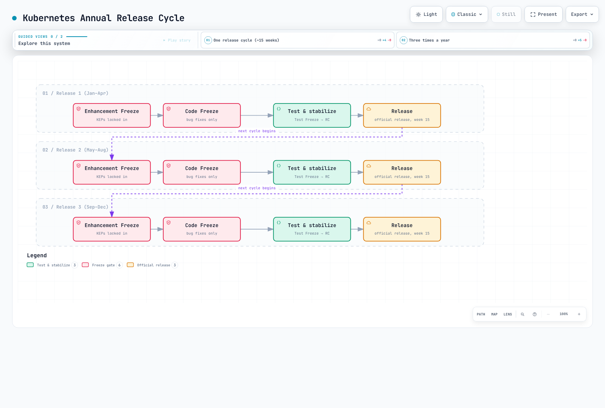
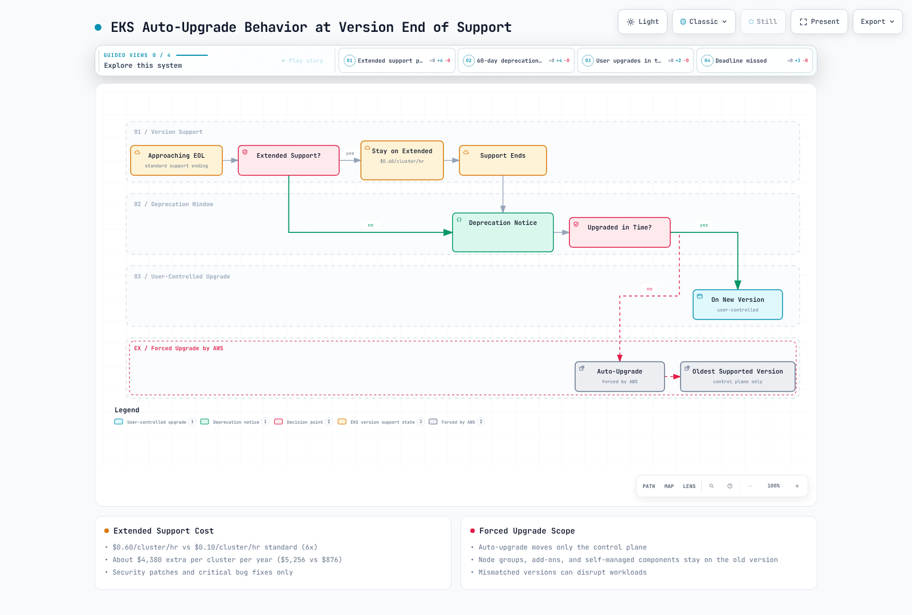
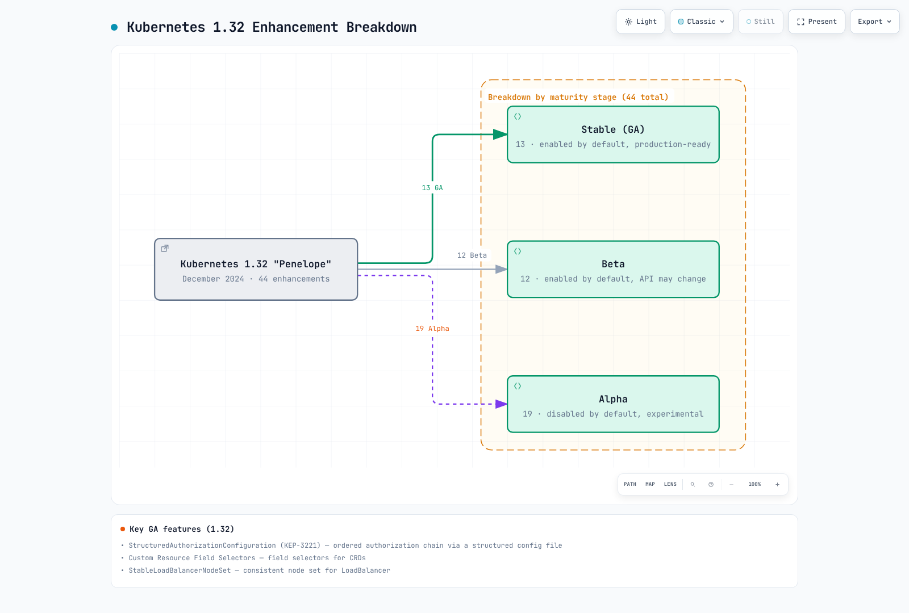
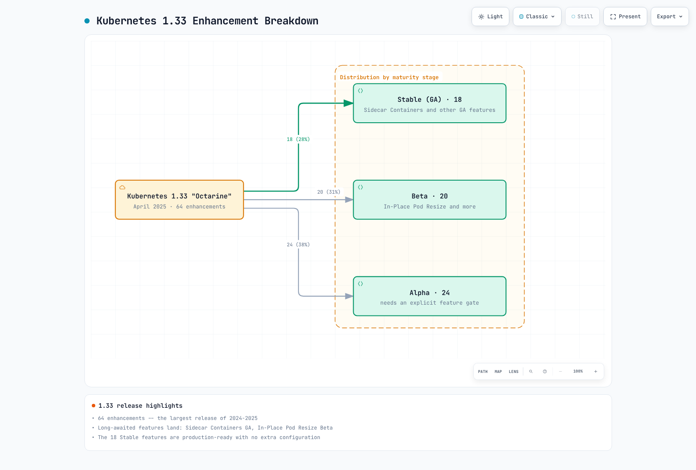
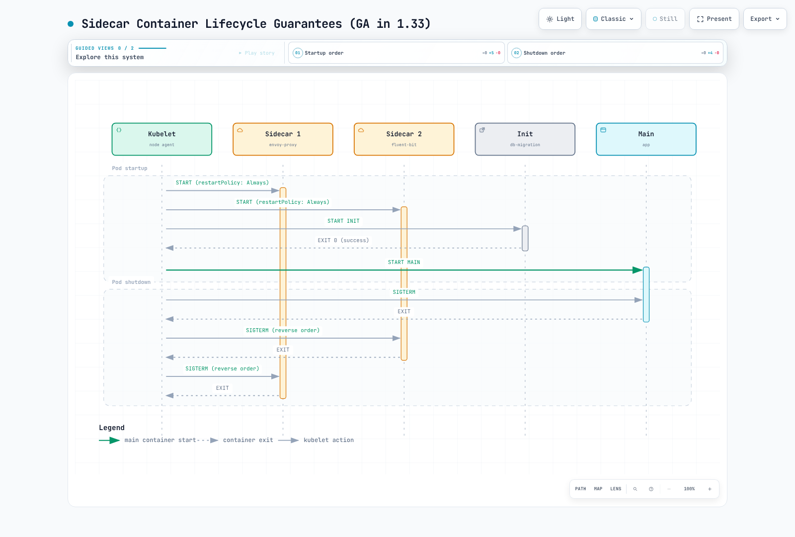
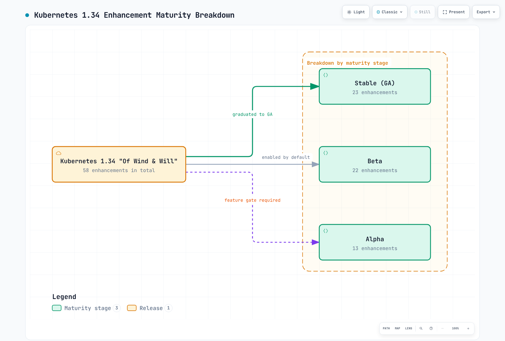
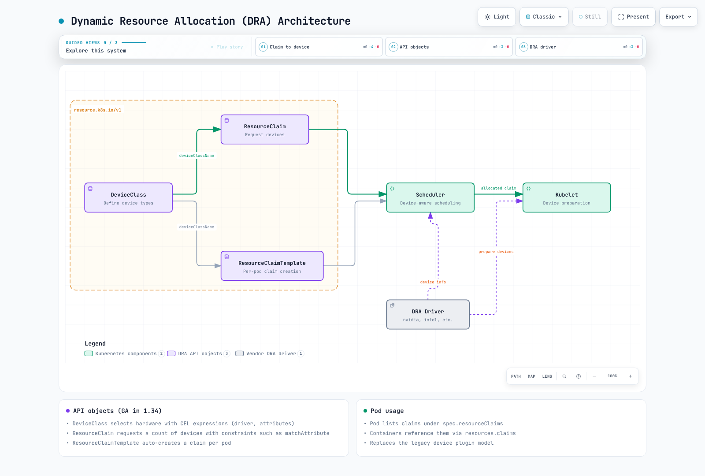
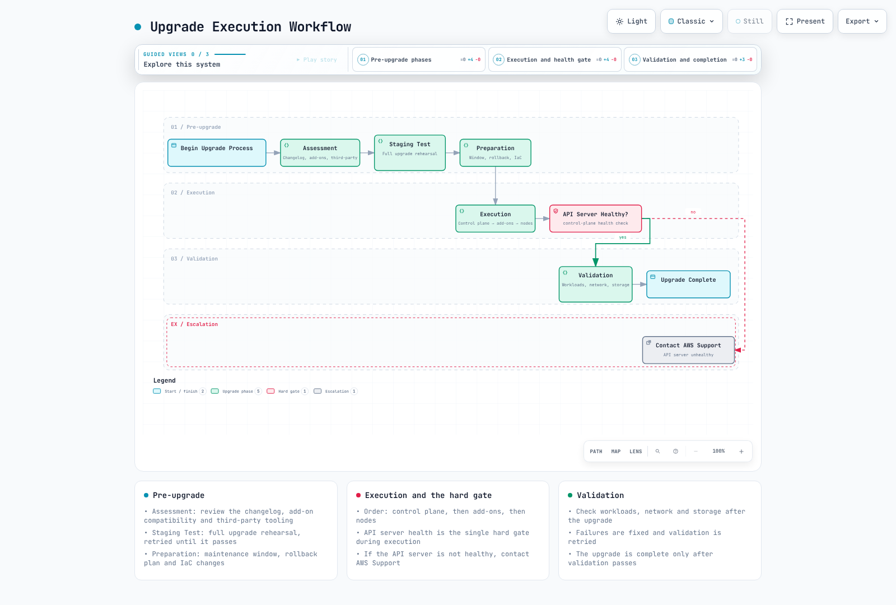

# Kubernetes 版本功能与路线图

> **历史覆盖范围**：Kubernetes 1.29–1.36；当前 EKS 支持情况另列
> **最后更新**：2026 年 10 月 12 日

Kubernetes 快速演进，每年发布三个版本，引入新功能、推动现有功能毕业并弃用旧 API。对于运行 Amazon EKS 的企业团队，了解各版本情况对于规划升级、适时采用新能力以及避免 API 弃用造成的中断至关重要。本文档按版本系统介绍 Kubernetes 1.29 至 1.36，并为每个版本提供 EKS 专项指导。

## 目录

1. [概览和学习目标](#1-overview-and-learning-objectives)
2. [Kubernetes 发布周期](#2-kubernetes-release-cycle)
3. [EKS 版本支持矩阵](#3-eks-version-support-matrix)
4. [按版本划分的功能指南](#4-version-by-version-feature-guide)
5. [关键功能毕业时间线](#5-key-feature-graduation-timeline)
6. [弃用和移除](#6-deprecations-and-removals)
7. [EKS 专项注意事项](#7-eks-specific-considerations)
8. [版本升级规划](#8-version-upgrade-planning)
9. [未来展望](#9-future-outlook)
10. [参考资料](#10-references)

---

<span id="1-overview-and-learning-objectives"></span>

## 1. 概览和学习目标

### 本文档的目的

本文档集中介绍以下内容：

- **各版本的新功能**：Kubernetes 1.29 至 1.36 引入的功能
- **功能毕业时间线**：跟踪功能从 Alpha 到 Beta 再到 GA 的演进
- **弃用计划**：以及所需的迁移操作
- **EKS 支持窗口**：包括标准支持和延长支持日期
- **升级规划指导**：面向企业团队

### 学习目标

阅读本文档后，你将能够：

1. 说明 Kubernetes 发布周期和功能成熟度模型
2. 确定各 Kubernetes 版本提供的功能
3. 将功能门控与特定版本对应，并了解其生命周期
4. 根据功能可用性和弃用时间线规划版本升级
5. 了解 EKS 专属的版本支持政策，包括标准支持和延长支持
6. 评估继续使用旧版本的成本与风险权衡
7. 跟踪未来功能时，区分已发布的里程碑和提议的时间表

### 本文档适用读者

| 读者 | 重点章节 |
|----------|-------------|
| **平台工程师** | 版本功能指南、升级规划、弃用 |
| **集群管理员** | EKS 支持矩阵、升级规划、EKS 专项注意事项 |
| **应用开发人员** | 功能指南（Sidecar Containers、In-Place Resize、DRA）、功能毕业时间线 |
| **安全团队** | 弃用、各版本的安全相关功能、StructuredAuthz、用户命名空间 |
| **工程经理** | 概览、支持矩阵、延长支持的成本影响 |

---

<span id="2-kubernetes-release-cycle"></span>

## 2. Kubernetes 发布周期

### 发布节奏和阶段

Kubernetes 通常每年发布约三个**次要版本**，间隔约四个月。补丁版本采用单独的节奏，通常每月发布。上游补丁分支支持约 14 个月：约 12 个月常规维护，随后两个月用于处理 CVE 和关键修复。这与 EKS 的 14 个月标准支持窗口不同；后者从 EKS 发布该版本之日开始计算。

发布团队会公布增强功能纳入、代码冻结、稳定化和发布候选版本等截止日期。原来的“第 15 周”图示是周期示意，不是有保证的日程，也不是通用的周数表。请遵循目标版本的日程和例外流程。



[🔍 查看交互式图表](https://www.atomai.click/kubernetes-docs/archmaps/en-eks-12-kubernetes-version-roadmap-1.html)

### 功能成熟度、API 稳定性和功能门控

| 阶段 | 含义 |
|---|---|
| Alpha | 通常默认禁用；行为/API 可能改变或移除。请确认具体门控和前置条件。 |
| Beta | 经过更广泛测试，但默认值和兼容性仍取决于具体功能和版本。一些 Beta 门控仍处于禁用状态。 |
| Stable / GA | 适用 API 稳定性承诺；这并不证明特定工作负载、驱动程序、操作系统或部署方式是安全的。 |

自 1.24 起，**新的 Beta API** 默认禁用；此前已启用的 Beta API 和现有 Beta API 的新版本则按不同方式处理。API 提供配置与功能门控相关，但两者并不相同。不要推断所有 Beta 功能都必须选择启用，也不要认为所有稳定功能都无需工作负载配置。

GA API 版本在同一 Kubernetes 主版本内不能被移除。这项规则与功能门控移除不同：Beta 转为 GA 的门控，其最短弃用窗口为六个月或两个版本，以较长者为准。必须核实实际移除版本。已锁定或移除的门控不能再视为受支持的禁用开关。例如，已发布的 1.36.2 源码仍包含已锁定的 `SidecarContainers` 门控；该功能在 1.33 达到 GA，本身不能证明它会在 1.35 移除。

以下是**历史配置片段**，不是完整的 KubeletConfiguration，也不是对 EKS 控制平面的修改。在当前节点上，应使用该节点确切版本所支持的配置；不要将已退役的门控复制到新的引导文件中。

```yaml
# Historical fragment for a self-managed Kubernetes 1.33 test node.
# Merge through the supported node bootstrap/configuration mechanism.
featureGates:
  InPlacePodVerticalScaling: true
  UserNamespacesSupport: true
```

AWS 管理 EKS 控制平面配置；客户不能编辑 EKS kube-apiserver 静态 Pod，也不能传入任意服务器标志。EKS 版本常见问题说明 Alpha 功能不受支持。在自行管理的节点上更改门控，不能启用控制平面不提供的 API。请查看 AWS 针对具体功能的指导，以及节点运行时/操作系统要求。

节点的 `configz` 端点显示所选 kubelet 的配置；该输出未显示的默认值和控制平面行为不能由此确定。`/metrics` 需要相应的非资源 URL 授权，功能指标也可能不可用或带有其他标签。没有输出或访问错误都不表示“已禁用”。

```bash
# Authorized, read-only diagnostics; these endpoints may be restricted.
: "${KUBE_CONTEXT:?}"; : "${NODE_NAME:?Choose the actual node}"
kubectl --context "$KUBE_CONTEXT" --request-timeout=15s \
  get --raw="/api/v1/nodes/$NODE_NAME/proxy/configz" | jq '.kubeletconfig.featureGates'
```

```bash
# Run separately; absence of a metric is not proof that a feature is disabled.
: "${KUBE_CONTEXT:?}"
kubectl --context "$KUBE_CONTEXT" --request-timeout=15s get --raw='/metrics' \
  | awk '/^kubernetes_feature_enabled/ { print }'
```

### SIG 和增强提案

SIG 负责相关领域：Node（运行时/生命周期）、Auth（身份验证/授权）、Network（Service 路由）、Storage（CSI/卷）、Scheduling、Apps、API Machinery、Instrumentation 和 Autoscaling。重要增强功能通过 KEP 说明动机、设计、毕业标准、测试和生产就绪审查。计划中的里程碑不代表发布承诺；请确认已发布的 API 和功能门控历史。

[上游补丁政策](https://kubernetes.io/releases/patch-releases/) · [功能门控](https://kubernetes.io/docs/reference/command-line-tools-reference/feature-gates/) · [弃用政策](https://kubernetes.io/docs/reference/deprecation-policy/) · [Kubernetes 1.36.2 门控实现](https://github.com/kubernetes/kubernetes/blob/v1.36.2/pkg/features/kube_features.go)

---

<span id="3-eks-version-support-matrix"></span>

## 3. EKS 版本支持矩阵

### 支持期限和价格依据

| 层级 | 从 EKS 提供该版本起算的期限 | 版本支持费用 |
|---|---|---|
| 标准 | 前 14 个月 | 每个集群小时 $0.10 |
| 延长 | 接下来的 12 个月 | 每个集群小时共 $0.60（$0.10 + $0.50） |

以上是已公布的版本支持费用，并非集群运行总成本。预置控制平面层级、计算资源、Auto Mode/Hybrid Nodes、其他能力、存储和网络都可能产生额外费用。按每年 365 天且费率恒定计算，对应费用分别为每个集群 $876 和 $5,256：相差 $4,380。按每月 730 小时计算，示例费用分别为 $73 和 $438。这些只是算术示例，不是实测账单。

### 已核实的支持日历：2026 年 10 月 12 日（UTC）

| 版本 | 上游发布 | EKS 发布 | 标准支持结束 | 延长支持结束 | 审查日状态 |
|---|---|---|---|---|---|
| 1.31 | 2024-08-13 | 2024-09-26 | 2025-11-26 | 2026-11-26 | 延长支持 |
| 1.32 | 2024-12-11 | 2025-01-23 | 2026-03-23 | 2027-03-23 | 延长支持 |
| 1.33 | 2025-04-23 | 2025-05-29 | 2026-07-29 | 2027-07-29 | 延长支持 |
| 1.34 | 2025-08-27 | 2025-10-02 | 2026-12-02 | 2027-12-02 | 标准支持 |
| 1.35 | 2025-12-17 | 2026-01-27 | 2027-03-27 | 2028-03-27 | 标准支持 |
| 1.36 | 2026-04-22 | 2026-06-02 | 2027-08-02 | 2028-08-02 | 标准支持 |
| 1.37 | 2026-08-26 | 2026-10-01 | 2027-12-01 | 2028-12-01 | 标准支持 |

当前 AWS 日历提供 EKS 1.31–1.37。这里列出 1.29 和 1.30 是为了说明历史功能覆盖情况，不代表它们仍是受支持的部署目标。

延长支持计费从所列标准支持结束日期的 00:00 UTC 开始。安排变更前，请重新查看实时日历或 API；AWS 仅按月份列出的未来日期属于估算值。

EKS 1.35 于 **2026 年 1 月 27 日**提供，1.36 于 **2026 年 6 月 2 日**提供，1.37 于 **2026 年 10 月 1 日**提供。EKS Distro 公告是不同的发布事件；较早使用的“1 月 28 日”合并标签不能取代 EKS 日历日期。

下方各版本章节保留了其运行时和准入前置条件。EKS 回滚以及控制平面扩缩容/SLA 主题见 [EKS 升级](08-eks-upgrades.md)。

```bash
# Read-only when executed with your normal authorized AWS identity.
: "${AWS_REGION:?Choose the intended Region}"
aws eks describe-cluster-versions --region "$AWS_REGION" --no-cli-pager \
  --query clusterVersions --output json
```
This prints the service’s version records rather than assuming the first array element is the newest version or reusing an old example’s status. No AWS query was executed during this audit.

### 升级政策和自动升级

`EXTENDED` 是集群升级政策的默认值。使用 `STANDARD` 的集群可能会在标准支持结束后自动升级；选择在延长支持期间继续使用某个版本，是有意作出的成本/生命周期决定。延长支持结束后，EKS 会逐步将仍在运行的控制平面升级到受支持的版本。AWS 不承诺具体升级时间，并说明自动更新前不会立即发送通知。至少提前 60 天通知的说明针对的是**标准支持结束**公告，并不表示延长支持结束后另有 60 天宽限期，也不保证按 60/30/7 天的顺序通知。

托管节点组、自行管理的节点、Fargate Pod 和 Hybrid Nodes 分别需要各自的更新/替换流程。Auto Mode 节点可以自动更新；已安装的普通附加组件仍须检查兼容性和管理责任。条件允许时，应让节点版本与控制平面版本保持一致，不要把允许的最大版本偏差当作目标。应检查工作负载就绪情况和实际更新状态，不能只看控制平面版本字符串。EKS 延长支持结束后的自动升级不能使用 EKS 原生的七天功能回滚；回滚资格和节点优先的回退顺序请参阅升级章节。

[EKS 支持日历和常见问题](https://docs.aws.amazon.com/eks/latest/userguide/kubernetes-versions.html) · [EKS 定价](https://aws.amazon.com/eks/pricing/)

<!-- Parent diagram repair pending: stage/default guarantees and support status/notification timing are stale.


[🔍 View interactive diagram](https://www.atomai.click/kubernetes-docs/archmaps/en-eks-12-kubernetes-version-roadmap-2.html)


[🔍 View interactive diagram](https://www.atomai.click/kubernetes-docs/archmaps/en-eks-12-kubernetes-version-roadmap-3.html)



[🔍 View interactive diagram](https://www.atomai.click/kubernetes-docs/archmaps/en-eks-12-kubernetes-version-roadmap-5.html)

-->

---

<span id="4-version-by-version-feature-guide"></span>

## 4. 按版本划分的功能指南

本节详细介绍 Kubernetes 1.29 至 1.36 各版本引入、毕业和弃用的功能。

### 4.1 Kubernetes 1.29 “Mandala”（2023 年 12 月）

12 月 13 日发布公告列出 **49 项增强功能：11 项 Stable、19 项 Beta 和 19 项 Alpha**。这些是历史发布数量，并不表示 EKS 仍支持 1.29。图示中的默认状态/生产可用性标签只是概括；请根据上文说明核对每项功能的门控历史和运行时要求。


[🔍 查看交互式图表](https://www.atomai.click/kubernetes-docs/archmaps/en-eks-12-kubernetes-version-roadmap-6.html)

#### KMS v2 静态数据加密：GA

KMS v2 通过从机密种子派生一次性数据加密密钥来提升信封加密性能；保护/轮换该种子时才调用 KMS 插件，而不是每写入一个对象都要执行新的远程加密操作。两种信封加密设计都包含数据加密层和密钥加密层；KMS v1 并非“单层”设计。这种改进不保证固定延迟。

KMS v1 在 1.28 中被弃用，并在 1.29 中默认禁用。当前上游 KMS 指南仍记录其旧实现；此前声称它在 1.31 被移除的说法不正确。请优先采用受支持的 v2 迁移路径。

此配置面向由管理员管理、已审查且已安装 v2 插件（位于指定套接字）的上游 API server。**它不是 EKS 控制平面清单**。KMS v2 不接受 `cachesize`。末尾的 `identity` provider 用于在迁移期间读取现有明文；当首个 provider 无法加密写入时，它并非明文回退机制。请审查加密迁移，并仅在验证迁移后移除明文读取支持。

```yaml
apiVersion: apiserver.config.k8s.io/v1
kind: EncryptionConfiguration
resources:
- resources:
  - secrets
  providers:
  - kms:
      apiVersion: v2
      name: reviewed-kms-provider
      endpoint: unix:///var/run/kmsplugin/socket.sock
      timeout: 3s
  - identity: {}
```

**EKS 区别**：当前 AWS 指南说明，EKS 1.28 及更高版本默认对所有 Kubernetes API 数据提供 KMS v2 信封加密；除非配置客户自主管理的密钥，否则使用 AWS 所有的密钥。这包括 Secrets 和 ConfigMaps 等 API 数据，不包括任意节点数据或 EBS 卷数据。不要因此推断 EKS 只从 1.29 才开始提供该功能，也不要将此上游文件用于 EKS。

#### ReadWriteOncePod：GA

`ReadWriteOncePod` 将 PVC 限制为整个集群中仅供一个 Pod 使用。`ReadWriteOnce` 则允许同一节点上的多个 Pod 使用。RWOP 需要兼容的 CSI 卷/驱动程序；其上游最低 sidecar 版本为 csi-provisioner 3.0.0、csi-attacher 3.3.0 和 csi-resizer 1.3.0。这些是功能最低版本，不是当前建议版本。应为实际集群和 provisioner 选择受支持的版本。

该示例要求 `version-lab` 命名空间已存在，并配置合适且经过审查的 `reviewed-csi-class`。访问模式协调不是抵御特权主机访问的内核安全边界，也不是数据库领导者选举协议，不能替代应用层 fencing 和备份。

```yaml
apiVersion: v1
kind: PersistentVolumeClaim
metadata:
  name: database-pvc
  namespace: version-lab
spec:
  accessModes:
  - ReadWriteOncePod
  storageClassName: reviewed-csi-class
  resources:
    requests:
      storage: 100Gi
```

#### 选定的 Beta 和 Alpha 功能

| 功能 | 1.29 状态 | 含义 |
|---|---|---|
| SidecarContainers | Beta，默认启用 | 可重启的 init container；1.28 为 Alpha，1.33 达到 GA |
| NFTablesProxyMode | Alpha，默认禁用 | Linux Service 代理后端；须检查内核、CNI 和 NodePort 行为 |
| LoadBalancerIPMode | Alpha | 由控制器报告的 LoadBalancer ingress 状态模式，不是任意 Pod 字段 |
| PodSchedulingReadiness | Beta | 调度门控会延迟调度器对 Pod 的处理 |
| NodeLogQuery | Alpha | 查询节点日志需要相应 kubelet 配置/访问权限 |
| KubeletTracing | Beta | 它不是在 1.29 达到 GA；GA 版本为 1.34 |
| MinDomainsInPodTopologySpread | Beta | 随后在 1.30 达到 GA |

以下是原生 sidecar 的 **Pod spec 片段**。请用经过审查的实现替换示意镜像，并配置实际日志管道。这不是已经部署的 Fluent Bit。sidecar 启动后（如果配置了 startup probe，则还需该探针成功）即可继续启动；就绪状态和优雅关闭仍取决于正确的探针、应用行为和充足的终止时间预算。

```yaml
initContainers:
- name: log-helper
  image: example.invalid/version-lab/log-helper:reviewed
  restartPolicy: Always
```

该版本还将 CSI `NodeExpandSecret` 提升至稳定版，允许驱动程序的节点侧扩容请求携带相应凭证。已弃用的 `flowcontrol.apiserver.k8s.io/v1beta2` 端点在 1.29 中停止提供；请改用稳定的 `v1` API，并检查字段变更。`SecurityContextDeny` 更早已被弃用，并在 1.30 移除；它不是在 1.29 才被弃用。本文没有证明通用的“5,000 个 Service”性能阈值，也没有提供代理性能的实测基准。

[Kubernetes 1.29 发布说明](https://kubernetes.io/blog/2023/12/13/kubernetes-v1-29-release/) · [KMS provider](https://kubernetes.io/docs/tasks/administer-cluster/kms-provider/) · [EKS 信封加密](https://docs.aws.amazon.com/eks/latest/userguide/envelope-encryption.html) · [持久卷和 RWOP](https://kubernetes.io/docs/concepts/storage/persistent-volumes/) · [API 迁移指南](https://kubernetes.io/docs/reference/using-api/deprecation-guide/)

---

### 4.2 Kubernetes 1.30 “Uwubernetes”（2024 年 4 月）

4 月 17 日发布的版本包含 **45 项增强功能：17 项 Stable、18 项 Beta 和 10 项 Alpha**。成熟度标签不能替代对具体功能配置和运行时条件的检查。


[🔍 查看交互式图表](https://www.atomai.click/kubernetes-docs/archmaps/en-eks-12-kubernetes-version-roadmap-7.html)

#### ValidatingAdmissionPolicy：GA

ValidatingAdmissionPolicy 在 API server 中执行 CEL。它可以替代许多需要网络、证书和服务器依赖的验证 webhook，但策略错误、求值错误或 fail-closed 配置仍可能拒绝请求。策略、绑定和可选参数对象各有不同作用；参数可以是内置资源或自定义资源，并不一定需要第三种 CRD 类型。

以下示例使用当前稳定的 `v1` API。绑定设置为 **仅审计（Audit-only）**，并选择带有 `version-lab-policy=enabled` 标签的命名空间；违规会添加审计注解，不会拒绝请求。请配置审计日志采集以观察结果，并限制谁可以设置该命名空间标签。先评估正向和反向测试样本，再根据需要有意选择 `Deny` 强制执行。这些示例不能证明生产环境的准入行为。

资源策略会检查普通 container 和 init container 是否声明了 CPU/内存 limit 键。它不验证数值是否为合适的正值：键存在且值为零，并不能构成有用的硬性限制。容量要求应使用合适的 LimitRange/资源策略。Ephemeral container 不能声明此类限制，因此不包括在内。针对当前集群还应匹配 `pods/resize` 子资源；该子资源是在 1.30 最初将 VAP 提升至 GA 之后才引入的。

```yaml
apiVersion: admissionregistration.k8s.io/v1
kind: ValidatingAdmissionPolicy
metadata:
  name: version-lab-resource-limits
spec:
  failurePolicy: Fail
  matchConstraints:
    resourceRules:
    - apiGroups:
      - ''
      apiVersions:
      - v1
      operations:
      - CREATE
      - UPDATE
      resources:
      - pods
      - pods/resize
  validations:
  - expression: "object.spec.containers.all(c,\n  has(c.resources) && has(c.resources.limits)\
      \ &&\n  has(c.resources.limits.cpu) && has(c.resources.limits.memory)\n) &&\n\
      (!has(object.spec.initContainers) || object.spec.initContainers.all(c,\n  has(c.resources)\
      \ && has(c.resources.limits) &&\n  has(c.resources.limits.cpu) && has(c.resources.limits.memory)\n\
      ))"
    message: Regular and init containers must declare CPU and memory limits.
    reason: Invalid
---
apiVersion: admissionregistration.k8s.io/v1
kind: ValidatingAdmissionPolicyBinding
metadata:
  name: version-lab-resource-limits
spec:
  policyName: version-lab-resource-limits
  validationActions:
  - Audit
  matchResources:
    namespaceSelector:
      matchLabels:
        version-lab-policy: enabled
```

镜像策略使用完整的 registry/repository 前缀，包括 `/` 边界。旧的 `123456789012.dkr.ecr.` 前缀也会匹配相似域名。请将示例账号、区域和公共别名替换为已批准的来源。此策略只检查镜像引用，不检查签名、漏洞状态或 digest 是否不可变。可选的 init/ephemeral 列表使用了保护性判断，并且明确匹配 ephemeral-container 子资源。

```yaml
apiVersion: admissionregistration.k8s.io/v1
kind: ValidatingAdmissionPolicy
metadata:
  name: version-lab-image-registries
spec:
  failurePolicy: Fail
  matchConstraints:
    resourceRules:
    - apiGroups:
      - ''
      apiVersions:
      - v1
      operations:
      - CREATE
      - UPDATE
      resources:
      - pods
      - pods/ephemeralcontainers
  validations:
  - expression: object.spec.containers.all(c, c.image.startsWith('123456789012.dkr.ecr.us-west-2.amazonaws.com/')
      || c.image.startsWith('public.ecr.aws/approved-alias/'))
    message: Regular container images must use an approved registry/repository prefix.
  - expression: '!has(object.spec.initContainers) || object.spec.initContainers.all(c,
      c.image.startsWith(''123456789012.dkr.ecr.us-west-2.amazonaws.com/'') || c.image.startsWith(''public.ecr.aws/approved-alias/''))'
    message: Init container images must use an approved registry/repository prefix.
  - expression: '!has(object.spec.ephemeralContainers) || object.spec.ephemeralContainers.all(c,
      c.image.startsWith(''123456789012.dkr.ecr.us-west-2.amazonaws.com/'') || c.image.startsWith(''public.ecr.aws/approved-alias/''))'
    message: Ephemeral container images must use an approved registry/repository prefix.
---
apiVersion: admissionregistration.k8s.io/v1
kind: ValidatingAdmissionPolicyBinding
metadata:
  name: version-lab-image-registries
spec:
  policyName: version-lab-image-registries
  validationActions:
  - Audit
  matchResources:
    namespaceSelector:
      matchLabels:
        version-lab-policy: enabled
```

其他**验证列表片段**用于说明普通 container 的有效 `runAsNonRoot` 继承行为，以及如何检查应用标签非空。container 级设置会覆盖 Pod 级设置。这些片段需要配套的策略和绑定；它们不会验证全部 Pod Security Standards、init/ephemeral container 或镜像用户。键中包含 `/` 的 map 应使用成员资格测试；`has(map["key"])` 不是有效的 CEL 宏语法。

```yaml
- expression: "object.spec.containers.all(c,\n  has(c.securityContext) && has(c.securityContext.runAsNonRoot)\n\
    \    ? c.securityContext.runAsNonRoot\n    : (has(object.spec.securityContext)\
    \ &&\n       has(object.spec.securityContext.runAsNonRoot) &&\n       object.spec.securityContext.runAsNonRoot)\n\
    )"
  message: Regular containers must effectively set runAsNonRoot.
- expression: 'has(object.metadata.labels) &&

    ''app.kubernetes.io/name'' in object.metadata.labels &&

    ''app.kubernetes.io/version'' in object.metadata.labels &&

    object.metadata.labels[''app.kubernetes.io/name''] != '''' &&

    object.metadata.labels[''app.kubernetes.io/version''] != '''' '
  message: Nonempty application name and version labels are required.
```

#### Pod Scheduling Readiness：GA

调度门控会使 Pod 暂不参与调度考量。创建/准入时可以设置门控，之后可将其移除，但创建后不能再添加新的门控。带门控的 Pod 本身不会触发通常由不可调度 Pod 引发的节点配置；必须由外部审批/配置流程满足条件。仅使用门控并不构成原子化的 gang scheduling。

此示例需要自有命名空间、已审查且替换了示意镜像，并配备适当的 GPU 容量。两个门控名称分别表示外部配额审批和安全扫描；Kubernetes 不会因为门控使用了这些名称就执行相应操作。

```yaml
apiVersion: v1
kind: Pod
metadata:
  name: gated-training
  namespace: version-lab
spec:
  schedulingGates:
  - name: example.com/gpu-quota-approved
  - name: example.com/security-scan-passed
  containers:
  - name: trainer
    image: example.invalid/version-lab/training:reviewed
    resources:
      limits:
        nvidia.com/gpu: 4
```

在独立确认指定条件后，此变更只会移除该门控。JSON Patch 测试会保护 UID、resourceVersion 和指定的门控名称；并发更新或对象被替换时，操作会失败。如果前置条件失败，应重新读取并评估对象，而不是猜测索引后删除。只有移除所有门控后，Pod 才符合调度条件；普通放置和容量限制仍然适用。

```bash
# MUTATION: remove only the named gate after independently verifying its condition.
set -euo pipefail
: "${KUBE_CONTEXT:?}"; : "${NAMESPACE:?}"; : "${POD_NAME:?}"; : "${GATE_NAME:?}"
gate_patch=$(kubectl --context "$KUBE_CONTEXT" --request-timeout=15s -n "$NAMESPACE" \
  get pod "$POD_NAME" -o json | jq -ce --arg gate "$GATE_NAME" '
    .metadata as $m |
    [(.spec.schedulingGates // []) | to_entries[] | select(.value.name == $gate)] as $matches |
    if ($matches | length) != 1 then error("Expected exactly one matching gate")
    else ($matches[0].key | tostring) as $i | [
      {op:"test", path:"/metadata/uid", value:$m.uid},
      {op:"test", path:"/metadata/resourceVersion", value:$m.resourceVersion},
      {op:"test", path:("/spec/schedulingGates/" + $i + "/name"), value:$gate},
      {op:"remove", path:("/spec/schedulingGates/" + $i)}
    ] end')
kubectl --context "$KUBE_CONTEXT" --request-timeout=15s -n "$NAMESPACE" \
  patch pod "$POD_NAME" --type=json --patch "$gate_patch"
```

#### HPA ContainerResource 指标：GA（KEP-2702）

ContainerResource 面向指定的 container，因此日志/代理 sidecar 不会扭曲应用的利用率信号。目标 Deployment 必须已存在于 `version-lab`，且包含具有适当 requests 的 `app` container。还需要可用的资源指标 provider。利用率是相对于 requests 计算，而不是相对于 limits。存在多个指标时，HPA 会采用副本数建议中最大的值；缺失指标/就绪状态以及稳定窗口都可能影响扩缩容。2–50 个副本的限制只是示意性的容量输入，不是实测的最优设置。

```yaml
apiVersion: autoscaling/v2
kind: HorizontalPodAutoscaler
metadata:
  name: web-app-hpa
  namespace: version-lab
spec:
  scaleTargetRef:
    apiVersion: apps/v1
    kind: Deployment
    name: web-app
  minReplicas: 2
  maxReplicas: 50
  metrics:
  - type: ContainerResource
    containerResource:
      name: cpu
      container: app
      target:
        type: Utilization
        averageUtilization: 70
  - type: ContainerResource
    containerResource:
      name: memory
      container: app
      target:
        type: Utilization
        averageUtilization: 80
```

#### 其他选定变更

| 功能 | 1.30 状态 |
|---|---|
| MinDomainsInPodTopologySpread | GA |
| StableLoadBalancerNodeSet | GA |
| PodDisruptionConditions | Beta；1.31 达到 GA |
| NodeLogQuery | Beta，默认禁用；1.36 达到 GA |
| UserNamespacesSupport | Beta，默认禁用 |
| ContextualLogging | Beta；调用点必须提供/使用 contextual logger，并非每条消息都会自动带上 Pod/节点字段 |
| RecursiveReadOnlyMounts | Alpha；需要合适的内核/运行时支持 |
| RelaxedEnvironmentVariableValidation | Alpha；改变允许的环境变量**名称**，而不是值 |
| ServiceAccountTokenJTI | Beta；令牌包含用于跟踪的标识符 |

`SecurityContextDeny` 在 1.30 移除；请评估 Pod Security Admission 以及环境所需的策略。仅凭功能成熟度不能代替迁移测试。

[Kubernetes 1.30 发布说明](https://kubernetes.io/blog/2024/04/17/kubernetes-v1-30-release/) · [ValidatingAdmissionPolicy](https://kubernetes.io/docs/reference/access-authn-authz/validating-admission-policy/) · [调度就绪状态](https://kubernetes.io/docs/concepts/scheduling-eviction/pod-scheduling-readiness/) · [HPA container 指标](https://kubernetes.io/docs/tasks/run-application/horizontal-pod-autoscale/#container-resource-metrics)

---

### 4.3 Kubernetes 1.31 “Elli”（2024 年 8 月）

8 月 13 日发布公告列出 **45 项增强功能：11 项 Stable、22 项 Beta 和 12 项 Alpha**。

<!-- Parent repair: DRA structured parameters remained alpha in 1.31, not beta as drawn.


[🔍 View interactive diagram](https://www.atomai.click/kubernetes-docs/archmaps/en-eks-12-kubernetes-version-roadmap-8.html)
-->

#### AppArmor 原生字段：GA

AppArmor profile 从 1.30 起可通过原生字段配置，并在 1.31 达到 GA，取代旧的每容器 Beta 注解。主机必须实际启用 AppArmor，运行时必须支持它，并且每个符合条件的节点上都必须加载 `Localhost` profile。自定义节点标签只能记录由操作人员核实过的前置条件；它不会安装或强制执行该 profile。

第一个示例使用预先安装的 profile；第二个示例补上旧 Deployment 示例缺失的 selector 和 Pod 标签。请替换示意镜像并准备好命名空间。`RuntimeDefault` 表示运行时的默认 profile，而 `Unconfined` 会禁用 AppArmor 限制。并非所有 EKS 操作系统/计算类型都普遍支持已配置的 profile。AppArmor、seccomp 和 SELinux 是不同的控制机制，不能互换使用这些名称来指代同一种保护。

```yaml
apiVersion: v1
kind: Pod
metadata:
  name: apparmor-local-profile
  namespace: version-lab
spec:
  nodeSelector:
    version-lab.example.com/apparmor-profile: reviewed
  containers:
  - name: app
    image: example.invalid/version-lab/app:reviewed
    securityContext:
      appArmorProfile:
        type: Localhost
        localhostProfile: reviewed-app-profile
```

```yaml
apiVersion: apps/v1
kind: Deployment
metadata:
  name: apparmor-runtime-default
  namespace: version-lab
spec:
  replicas: 1
  selector:
    matchLabels:
      app: apparmor-runtime-default
  template:
    metadata:
      labels:
        app: apparmor-runtime-default
    spec:
      containers:
      - name: app
        image: example.invalid/version-lab/app:reviewed
        securityContext:
          appArmorProfile:
            type: RuntimeDefault
```

#### PersistentVolume 最近一次阶段转换时间：GA

PV 状态字段 `.status.lastPhaseTransitionTime` 记录最近一次阶段转换的时间。可将其与事件和后端证据结合起来诊断生命周期；它不是完整的阶段转换历史，也不能重建缺失的旧事件。以下命令不会修改或删除卷。

```bash
# Read-only, for one owned cluster-scoped PV.
: "${KUBE_CONTEXT:?}"; : "${PV_NAME:?}"
kubectl --context "$KUBE_CONTEXT" --request-timeout=15s get pv "$PV_NAME" -o json | jq '{
  name:.metadata.name,phase:.status.phase,lastPhaseTransitionTime:.status.lastPhaseTransitionTime
}'
```

#### DRA 结构化参数：在 1.31 中仍为 Alpha

DRA 重设计通过结构化 API 和 ResourceSlices 向 Kubernetes 提供设备信息和请求，从而支持由调度器侧分配。**经典 DRA 在 1.31 中仍可用**，由单独且默认禁用的 `DRAControlPlaneController` 门控控制。已发布的 1.31 源码中包含该门控；1.32 源码将其移除。因此，旧测验中声称经典 DRA 在 1.31 已被移除的说法不正确。

DRA 在 1.31 中仍为 Alpha，1.32 升为 Beta，随后其核心 API 在 1.34 成为稳定版。旧的 `resource.k8s.io/v1beta1` 示例并未准确表示 1.31 的 API 代际。当前语法请参阅 1.34 章节中的稳定版 DRA 示例，并核实已安装驱动程序提供的 DeviceClasses、ResourceSlices、属性和能力。Kubernetes API 本身不会安装 GPU 驱动程序，也不会实现 time-slicing/MIG。

#### Service 流量分配：Beta

核心 `v1` Service 字段 `trafficDistribution: PreferClose` 请求优先选择同一区域的端点。这只是路由偏好，不是严格的同区域规则、地理距离计算，也不保证消除跨 AZ 费用。端点可用性、实际路由代理和流量策略的优先级都会产生影响。selector 必须匹配真实工作负载 Pod；示例不会创建这些端点。

```yaml
apiVersion: v1
kind: Service
metadata:
  name: zone-preference
  namespace: version-lab
spec:
  trafficDistribution: PreferClose
  selector:
    app: web-app
  ports:
  - port: 80
    targetPort: 8080
```

#### 其他选定变更

| 功能 | 1.31 状态 |
|---|---|
| NFTablesProxyMode | Beta，默认启用；选择该代理模式与核实 Linux/内核/CNI 兼容性是两个步骤 |
| MultiCIDRServiceAllocator | Beta，默认禁用 |
| VolumeAttributesClass | Beta，默认禁用；需要驱动程序/控制器/API 支持 |
| ImageVolume | Alpha，默认禁用 |
| PodDisruptionConditions | GA |
| JobPodReplacementPolicy | Beta；在 1.34 达到 GA |
| SidecarContainers | 已在 1.29 成为 Beta，并非在 1.31 新升为 Beta |

nftables 后端不会自动迁移网络。NodePort 和防火墙行为可能与 iptables 不同；更改生产环境代理模式前应评估实际实现。

[Kubernetes 1.31 发布说明](https://kubernetes.io/blog/2024/08/13/kubernetes-v1-31-release/) · [AppArmor 前置条件](https://kubernetes.io/docs/tutorials/security/apparmor/) · [1.31 功能源码](https://github.com/kubernetes/kubernetes/blob/v1.31.0/pkg/features/kube_features.go) · [1.32 功能源码](https://github.com/kubernetes/kubernetes/blob/v1.32.0/pkg/features/kube_features.go)

---

### 4.4 Kubernetes 1.32 “Penelope”（2024 年 12 月）

12 月 11 日发布公告列出 **44 项增强功能：13 项 Stable、12 项 Beta 和 19 项 Alpha**。图示中默认启用的标签只是简化的成熟度图例；下方单项 Beta 功能仍可能处于禁用状态。



[🔍 查看交互式图表](https://www.atomai.click/kubernetes-docs/archmaps/en-eks-12-kubernetes-version-roadmap-9.html)

#### 结构化授权配置：GA

稳定版配置使用 `apiserver.config.k8s.io/v1` 的 `AuthorizationConfiguration`。这是授权模式标志的替代机制，并不表示 `--authorization-mode` 已被移除。不要同时使用标志和配置文件机制。EKS 管理该控制平面配置；下方文件供管理员管理的 API server 使用，不能用 kubectl 应用，也不是 EKS 的自定义接口。

授权器按顺序运行，明确的允许/拒绝决定会结束授权链。在此示例中，只有与 `version-lab` 匹配、且尚未由 Node 和 RBAC 决定的资源请求才会交给 webhook。因此，它**不会对已经由 RBAC 允许的请求再施加拒绝过滤**。CEL 匹配条件用于选择调用 webhook 的请求；CEL 本身不是另一种独立授权器。请求是 SubjectAccessReview spec，因此命名空间位于 `request.resourceAttributes` 中，并对非资源请求使用存在性检查。

```yaml
apiVersion: apiserver.config.k8s.io/v1
kind: AuthorizationConfiguration
authorizers:
- type: Node
  name: node
- type: RBAC
  name: rbac
- type: Webhook
  name: reviewed-webhook
  webhook:
    authorizedTTL: 5m
    unauthorizedTTL: 30s
    timeout: 3s
    subjectAccessReviewVersion: v1
    matchConditionSubjectAccessReviewVersion: v1
    failurePolicy: Deny
    connectionInfo:
      type: KubeConfigFile
      kubeConfigFile: /etc/kubernetes/reviewed-authz-webhook.kubeconfig
    matchConditions:
    - expression: has(request.resourceAttributes) && request.resourceAttributes.namespace
        == 'version-lab'
```

使用前应准备好实际的 webhook、TLS 信任配置和受保护的 kubeconfig。`failurePolicy: Deny` 适用于相关 webhook/条件故障；缓存的决策可能延迟后端策略变更的生效。所有 API server 上都要使用一致配置。支持配置重新加载，但不能借此增加或移除 Node/RBAC 授权器；应在非生产环境验证完整策略和恢复流程。

#### StatefulSet PVC 保留策略：GA

1.32 中相关的毕业功能是**自动删除/保留由 StatefulSet volume claim template 创建的 PVC**，并不意味着所有未使用 PVC 的保护 finalizer 都会立即消失。`whenDeleted` 控制 StatefulSet 删除时的行为，`whenScaled` 控制缩容时的行为；两者都支持 `Retain` 或 `Delete`。默认会保留数据。以下片段供审查已有 StatefulSet 时参考：

```yaml
spec:
  persistentVolumeClaimRetentionPolicy:
    whenDeleted: Retain
    whenScaled: Retain
```

选择 `Delete` 属于数据生命周期变更：根据 PV 回收策略，删除 PVC 也可能删除后端存储。Pod 所有权、垃圾回收、CSI 操作和 finalizer 仍会影响完成时间。PVC 使用中保护机制远早于 1.32；遇到卡住的声明时，应检查使用者、UID、挂载和控制器，而不是一概移除 finalizer 或假设升级即可修复。

#### VolumeAttributesClass：在 1.32 中仍为 Beta

VAC 在 1.31 升为 Beta，并在 1.34 达到 GA。其 Beta API 为 `storage.k8s.io/v1beta1`；如果集群和 CSI 驱动支持，应使用 1.34 章节中的稳定版 API。类中的参数不可变；PVC 通过更改类引用来请求驱动程序支持的属性，例如 EBS IOPS 或吞吐量。

这是异步存储修改，并不普遍保证零停机。请确认驱动/控制器版本、API 可用性、IAM/KMS 权限、卷类型限制、修改冷却时间和状态。不要把不完整的 PVC 对象当成完整的创建清单来应用。以下读取操作会对比目标类与报告的进度：

```bash
# Read-only: inspect one existing owned PVC and the CSI modification state.
: "${KUBE_CONTEXT:?}"; : "${NAMESPACE:?}"; : "${PVC_NAME:?}"
kubectl --context "$KUBE_CONTEXT" --request-timeout=15s -n "$NAMESPACE" \
  get pvc "$PVC_NAME" -o json | jq '{
    requestedClass:.spec.volumeAttributesClassName,
    currentClass:.status.currentVolumeAttributesClassName,
    modification:.status.modifyVolumeStatus,
    conditions:.status.conditions
  }'
```

AWS 的 1.34 说明区分了稳定版 VAC API 和早期 Beta sidecar 支持。仅凭 EKS 控制平面版本，无法证明任意 EBS CSI 版本都仍与 VAC API 兼容。

#### 用户命名空间：在 1.32 中为 Beta，默认禁用

用户命名空间在 1.30 进入 Beta，在 1.33 默认启用，并在 1.36 达到 GA。Pod 通过 `hostUsers: false` 选择启用。容器内 UID 0 会映射到实现所选的非 root 主机 UID，并不存在通用的 `65534 + offset` 公式。这需要兼容的内核、文件系统和 CRI/运行时，并不保证所有工作负载或主机访问模式都兼容。

示例特意展示容器 UID 0，以说明映射方式；请替换示意镜像，并在受支持的测试环境中使用。这属于纵深防御，不能保证抵御所有内核/容器逃逸漏洞，也不能替代其他安全控制。

```yaml
apiVersion: v1
kind: Pod
metadata:
  name: userns-example
  namespace: version-lab
spec:
  hostUsers: false
  containers:
  - name: app
    image: example.invalid/version-lab/app:reviewed
    securityContext:
      runAsUser: 0
```

#### 其他选定变更

| 功能 | 1.32 状态 |
|---|---|
| CustomResourceFieldSelectors | GA；CRD 作者必须声明支持选择的字段 |
| RetryGenerateName | GA；可重试名称冲突，但不保证创建一定成功 |
| SizeMemoryBackedVolumes | GA；基于内存的 emptyDir 限制仍会影响 Pod/节点内存 |
| ServiceAccountTokenJTI | GA；是令牌标识符，不是新增授权权限 |
| JobManagedBy | Beta；1.35 达到 GA |
| DynamicResourceAllocation | Beta，默认禁用；核心 API 在 1.34 升为稳定版 |
| MultiCIDRServiceAllocator | 仍为 Beta，默认禁用 |
| NFTablesProxyMode | 仍为 Beta；1.33 达到 GA |
| MutatingAdmissionPolicy | Alpha；1.34 升为 Beta，1.36 达到 GA |

`StableLoadBalancerNodeSet` 在 1.30 已经达到 GA。请将这些历史阶段与特定 EKS 集群当前启用的功能区分开来。

[Kubernetes 1.32 发布说明](https://kubernetes.io/blog/2024/12/11/kubernetes-v1-32-release/) · [授权配置](https://kubernetes.io/docs/reference/access-authn-authz/authorization/) · [StatefulSet PVC 保留](https://kubernetes.io/docs/concepts/workloads/controllers/statefulset/#persistentvolumeclaim-retention) · [EKS 版本说明](https://docs.aws.amazon.com/eks/latest/userguide/kubernetes-versions-standard.html)

---

### 4.5 Kubernetes 1.33 “Octarine”（2025 年 4 月）

4 月 23 日发布公告列出 **64 项增强功能：18 项 Stable、20 项 Beta、24 项 Alpha，另有 2 项已弃用或撤回**。图表展示了总计 64 项中的三种成熟度类别（共 62 项）；另外两项未绘出。这是 2025 年的一次大型版本发布，不代表所有工作负载的性能或就绪度都有提升。



[🔍 查看交互式图表](https://www.atomai.click/kubernetes-docs/archmaps/en-eks-12-kubernetes-version-roadmap-10.html)

#### 原生 sidecar：GA

该功能从 1.28 的 Alpha 发展为 1.29 的 Beta，并在 1.33 达到 GA。可重启的 init container 设置 `restartPolicy: Always`。当 sidecar 的 `started` 状态变为 true 后，kubelet 才会继续处理下一个 init container：没有 startup probe 时，表示其进程正在运行；如果配置了 startup probe，则表示该探针已成功。就绪状态是另一个独立信号。下方普通 init container 会在**两个 sidecar 都启动后**运行，之后才启动应用程序。

这是结构示例。所有 `example.invalid` 镜像都必须替换为经过审查的实现；代理必须提供其声明的就绪端点，日志代理也需要实际的管道配置。仅选择 Envoy/Istio/Fluent Bit 镜像并不会配置服务网格或日志目标。真实的数据库迁移也需要协调/idempotency，不能假设它在每个副本上运行一次就是安全的。

```yaml
apiVersion: apps/v1
kind: Deployment
metadata:
  name: sidecar-lifecycle
  namespace: version-lab
spec:
  replicas: 2
  selector:
    matchLabels:
      app: sidecar-lifecycle
  template:
    metadata:
      labels:
        app: sidecar-lifecycle
    spec:
      terminationGracePeriodSeconds: 60
      initContainers:
      - name: proxy-helper
        image: example.invalid/version-lab/reviewed-proxy:reviewed
        restartPolicy: Always
        startupProbe:
          httpGet:
            path: /ready
            port: 15021
          periodSeconds: 2
          failureThreshold: 30
        resources:
          requests:
            cpu: 100m
            memory: 128Mi
          limits:
            cpu: 500m
            memory: 256Mi
      - name: log-helper
        image: example.invalid/version-lab/reviewed-log-agent:reviewed
        restartPolicy: Always
        volumeMounts:
        - name: app-logs
          mountPath: /var/log/app
        resources:
          requests:
            cpu: 50m
            memory: 64Mi
          limits:
            cpu: 200m
            memory: 128Mi
      - name: initialize-app
        image: example.invalid/version-lab/reviewed-init:reviewed
        volumeMounts:
        - name: app-logs
          mountPath: /var/log/app
      containers:
      - name: app
        image: example.invalid/version-lab/reviewed-app:reviewed
        volumeMounts:
        - name: app-logs
          mountPath: /var/log/app
      volumes:
      - name: app-logs
        emptyDir: {}
```

正常优雅终止时，主 container 先于 sidecar 停止，sidecar 则按启动顺序的逆序停止。Pod 共享的终止宽限期预算仍然适用：如果主 container 关闭时间较长，sidecar 可能只剩很少甚至没有优雅退出时间。原生 sidecar 不会在其主 container 结束后阻止 Job 完成；这项行为并非到 GA 时才首次出现。规划容量时应考虑 init/sidecar/应用资源的重叠和 Pod 开销。本文没有测量生命周期时间或应用可用性。



[🔍 查看交互式图表](https://www.atomai.click/kubernetes-docs/archmaps/en-eks-12-kubernetes-version-roadmap-11.html)

#### 容器资源原地调整：在 1.33 中为 Beta

原地调整会更改 CPU/内存目标分配，而无需重建 Pod；但 `resizePolicy` 仍可能要求重启 container。该功能在 1.35 达到稳定版。下方使用当前 schema 的示例保持 `Burstable` QoS，将 CPU 设为 `NotRequired`，将内存设为 `RestartContainer`。因此，按策略更改内存会请求重启 container；这并不意味着所有内存变更天生都会重启。

请使用兼容的 Linux 运行时和节点策略、受支持的 kubectl 版本偏差、所属命名空间及已审查的镜像。1.36 指南排除了 Windows 和默认静态 CPU/Memory Manager 场景；还必须按版本评估单独控制的能力。此 API 不会自动改写 Deployment/StatefulSet 模板，也不会与 HPA/VPA/GitOps 资源所有者协调。

```yaml
apiVersion: v1
kind: Pod
metadata:
  name: resizable-app
  namespace: version-lab
spec:
  containers:
  - name: app
    image: example.invalid/version-lab/app:reviewed
    resources:
      requests:
        cpu: 500m
        memory: 256Mi
      limits:
        cpu: '1'
        memory: 512Mi
    resizePolicy:
    - resourceName: cpu
      restartPolicy: NotRequired
    - resourceName: memory
      restartPolicy: RestartContainer
```

审查容量和所有权后，以下仅调整 CPU 的示例请求 1 个 core，限制为 2 个 core。它按名称选择 container，保留现有的 Burstable 类，若 CPU 策略要求重启则拒绝操作，并在 patch 前测试 Pod UID/resourceVersion。它不会更改内存。发生冲突时应重新读取并评估目标，而不是强行更新。

```bash
# MUTATION: reviewed CPU-only resize; desired request=1 core and limit=2 cores.
set -euo pipefail
: "${KUBE_CONTEXT:?}"; : "${NAMESPACE:?}"; : "${POD_NAME:?}"; : "${CONTAINER_NAME:?}"
resize_patch=$(kubectl --context "$KUBE_CONTEXT" --request-timeout=15s -n "$NAMESPACE" \
  get pod "$POD_NAME" -o json | jq -ce --arg container "$CONTAINER_NAME" '
    . as $pod |
    [(.spec.containers | to_entries[]) | select(.value.name == $container)] as $matches |
    if .status.phase != "Running" or .metadata.deletionTimestamp != null
       or ($matches | length) != 1
    then error("Expected one target container in a non-deleting Running Pod")
    elif .status.qosClass != "Burstable"
    then error("This example preserves an existing Burstable QoS class")
    elif $matches[0].value.resources.requests.cpu == null
         or $matches[0].value.resources.limits.cpu == null
    then error("This example requires existing CPU request and limit keys")
    elif any($matches[0].value.resizePolicy[]?; .resourceName == "cpu" and .restartPolicy == "RestartContainer")
    then error("This example requires CPU resize policy NotRequired")
    elif ([.status.containerStatuses[]? | select(.name == $container and .state.running != null)] | length) != 1
    then error("Target container is not reported running")
    else ($matches[0].key | tostring) as $i | [
      {op:"test",path:"/metadata/uid",value:$pod.metadata.uid},
      {op:"test",path:"/metadata/resourceVersion",value:$pod.metadata.resourceVersion},
      {op:"test",path:("/spec/containers/" + $i + "/name"),value:$container},
      {op:"replace",path:("/spec/containers/" + $i + "/resources/requests/cpu"),value:"1"},
      {op:"replace",path:("/spec/containers/" + $i + "/resources/limits/cpu"),value:"2"}
    ] end')
kubectl --context "$KUBE_CONTEXT" --request-timeout=15s -n "$NAMESPACE" \
  patch pod "$POD_NAME" --subresource=resize --type=json --patch "$resize_patch"
```

请使用当前状态字段，而不是旧的 `.status.resize` 字符串。`PodResizePending=True` 可能报告 `Deferred` 或 `Infeasible`；`PodResizeInProgress=True` 表示实际调整仍在进行。请对照目标 spec、已确认的 generation 和指定 container 的 `status.containerStatuses[].resources`。`allocatedResources` 是高级分配字段，并非运行时限制已应用的唯一证据。没有条件状态或 patch 已被接受，都不能证明工作负载健康。

```bash
# Read-only observation; an accepted patch is not proof of completed actuation.
set -euo pipefail
: "${KUBE_CONTEXT:?}"; : "${NAMESPACE:?}"; : "${POD_NAME:?}"; : "${CONTAINER_NAME:?}"
kubectl --context "$KUBE_CONTEXT" --request-timeout=15s -n "$NAMESPACE" \
  get pod "$POD_NAME" -o json | jq --arg container "$CONTAINER_NAME" '{
    uid:.metadata.uid,generation:.metadata.generation,
    observedGeneration:.status.observedGeneration,qosClass:.status.qosClass,
    resizeConditions:[.status.conditions[]? | select(.type == "PodResizePending" or .type == "PodResizeInProgress")],
    desired:[.spec.containers[] | select(.name == $container) | .resources],
    reported:[.status.containerStatuses[]? | select(.name == $container) |
      {name,resources,allocatedResources,containerID,restartCount,ready}]
  }'
```

资源调整不能更改 Pod 的 QoS 类。Guaranteed Pod 必须继续保持 CPU 和内存 requests/limits 相等；上方示例有意使用 Burstable。使用 `NotRequired` 缩减内存属于尽力而为；如果当前用量超过新限制，操作可能持续进行，竞争条件仍可能导致 OOM kill。不可重启的 init container 和 ephemeral container 不能调整大小。功能达到某个成熟度并不代表可以保证零停机、延迟或成功调整。

#### 当前 VPA 集成需单独决定版本

这是一个**2026 年配套组件示例**，并非声称 Kubernetes 1.33 发布时 VPA 1.8 已存在。已发布的 VPA **1.8.0** API 支持 `InPlace`；该模式在 1.7.0 作为 Alpha 引入，在 1.8.0 中仍为 Alpha。它要求 admission-controller 和 updater 都启用 VPA `InPlace` 功能门控，并要求 Kubernetes 支持 1.33+ 原地调整；VPA 1.8.x 自身说明兼容 Kubernetes 1.36–1.38。它避免 VPA 回退为驱逐 Pod，但不保证调整一定完成，也不保证每种 container 策略都无需重启。若目标只是观察建议，应从 `Off` 开始。

下方仅调整 CPU 的策略为现有 Deployment/container 使用示例边界值。启用变更前应审查控制器部署标志和容量。`InPlaceOrRecreate` 是另一种模式：它可以回退为重建，在 VPA 1.6 达到 GA，其旧门控在 1.7 移除。不要启用已移除的门控，也不要仅从 Kubernetes 的 GA 状态推断 VPA 行为。

```yaml
apiVersion: autoscaling.k8s.io/v1
kind: VerticalPodAutoscaler
metadata:
  name: current-in-place-example
  namespace: version-lab
spec:
  targetRef:
    apiVersion: apps/v1
    kind: Deployment
    name: web-app
  updatePolicy:
    updateMode: InPlace
  resourcePolicy:
    containerPolicies:
    - containerName: app
      minAllowed:
        cpu: 100m
      maxAllowed:
        cpu: '4'
      controlledResources:
      - cpu
      controlledValues: RequestsAndLimits
```

#### ServiceCIDR 和 IPAddress：GA

启用分配器/API 后，上游 Kubernetes 可以通过额外的 `networking.k8s.io/v1` ServiceCIDR 对象扩展可用的 Service 地址。名为 `kubernetes` 的默认对象表示 API server 的初始地址范围。添加地址范围前，请检查 IPAM、地址族和路由是否重叠；finalizer 会阻止删除可能导致已分配 Service IP 孤立的地址范围。ServiceCIDR 不是 VPC 子网，也不是 Pod 地址 CIDR。

此 IPv4 清单是上游示例，并非已执行的 EKS 地址范围扩展。EKS 的 `serviceIpv4Cidr` 创建参数在集群创建后不可修改。创建另一个 Kubernetes ServiceCIDR 是不同操作；本文审查的 AWS 资料没有证明 EKS 存在经过测试的操作流程。在 EKS 上使用前，请确认提供方支持、准入策略和目标网络。仅能发现 API 并不能完成这些验证。

```yaml
apiVersion: networking.k8s.io/v1
kind: ServiceCIDR
metadata:
  name: reviewed-extra-service-range
spec:
  cidrs:
  - 10.200.0.0/16
```

```bash
# Read-only discovery; do not interpret availability alone as an approved EKS change.
set -euo pipefail
: "${KUBE_CONTEXT:?}"
kubectl --context "$KUBE_CONTEXT" --request-timeout=15s api-resources --api-group=networking.k8s.io
kubectl --context "$KUBE_CONTEXT" --request-timeout=15s get servicecidrs
kubectl --context "$KUBE_CONTEXT" --request-timeout=15s get ipaddresses
```

#### 拓扑感知路由和流量分配：GA

拓扑感知端点提示与 Service 的 `trafficDistribution` 偏好相关，但属于不同机制。下方使用 `PreferClose` 请求优先选择同一区域；这不是严格的同区域保证、区域距离计算，也不表示某个 annotation 在所有情况下都已弃用。就绪端点的分布、代理实现以及 `internalTrafficPolicy`/`externalTrafficPolicy` 都可能影响路由。

跨 AZ 流量可能产生费用，但旧的统一 `$0.01/GB` 说法并非完整定价模型。费用取决于服务、路径以及计费的入站/出站方向；同一区域流量也有例外。应比较实际流量和账单数据，不要承诺固定节省金额。

```yaml
apiVersion: v1
kind: Service
metadata:
  name: same-zone-preference
  namespace: version-lab
spec:
  trafficDistribution: PreferClose
  selector:
    app: web-app
  ports:
  - port: 80
    targetPort: 8080
```

#### Job 成功策略：GA

成功策略适用于 Indexed Job。此处要求 index 0 成功；只有当应用实现相应协议时，它才代表 leader。Kubernetes 不会推断分布式结果已经完整或持久。失败策略和其余 Pod 的终止也仍会产生影响。Job 模板明确设置 `restartPolicy: Never`，而这在原有示例中缺失。

```yaml
apiVersion: batch/v1
kind: Job
metadata:
  name: indexed-success-example
  namespace: version-lab
spec:
  completionMode: Indexed
  completions: 8
  parallelism: 8
  backoffLimit: 2
  successPolicy:
    rules:
    - succeededIndexes: '0'
      succeededCount: 1
  template:
    spec:
      restartPolicy: Never
      containers:
      - name: trainer
        image: example.invalid/version-lab/training:reviewed
        env:
        - name: JOB_COMPLETION_INDEX
          valueFrom:
            fieldRef:
              fieldPath: metadata.annotations['batch.kubernetes.io/job-completion-index']
```

#### OCI 镜像卷：在 1.33 中为 Beta，默认禁用

镜像卷可将 OCI 镜像内容挂载到 Pod，例如模型数据，而无需将其嵌入应用镜像。它需要受支持的运行时、适当的功能配置和 registry 拉取身份。挂载为只读，不是可写 PVC。应用镜像和数据镜像都应经过审查并固定版本。ImageVolume 在 1.35 默认启用，并在 1.36 达到稳定版；不是在 1.34 达到 GA。

```yaml
apiVersion: v1
kind: Pod
metadata:
  name: image-volume-example
  namespace: version-lab
spec:
  containers:
  - name: inference
    image: example.invalid/version-lab/inference:reviewed
    volumeMounts:
    - name: model
      mountPath: /models
      readOnly: true
  volumes:
  - name: model
    image:
      reference: example.invalid/version-lab/model:reviewed
      pullPolicy: IfNotPresent
```

#### 1.33 中的其他选定阶段

| 功能 | 状态 |
|---|---|
| NFTablesProxyMode、RecursiveReadOnlyMounts | GA |
| CRDValidationRatcheting | GA；这不允许绕过对发生变化的无效字段进行验证 |
| MatchLabelKeysInPodAffinity、NodeInclusionPolicyInPodTopologySpread | GA |
| PersistentVolume 回收策略删除保护 | GA；与 PVC 使用中保护不同 |
| UserNamespacesSupport | Beta，现在默认启用 |
| PodLevelResources | 仍为 Alpha；1.34 升为 Beta |
| StructuredAuthenticationConfiguration | Beta；1.34 达到 GA |
| MutatingAdmissionPolicy | 仍为 Alpha；1.34 升为 Beta |
| PodLifecycleSleepAction | Beta；1.34 达到 GA |
| JobManagedBy | Beta；1.35 达到 GA |

LoadBalancerIPMode 和 RetryGenerateName 已在 1.32 达到 GA。KYAML 在 1.34 引入，不是在 1.33。

[Kubernetes 1.33 发布说明](https://kubernetes.io/blog/2025/04/23/kubernetes-v1-33-release/) · [1.36 版本调整指南](https://github.com/kubernetes/website/blob/release-1.36/content/en/docs/tasks/configure-pod-container/resize-container-resources.md) · [VPA 1.8.0 功能](https://github.com/kubernetes/autoscaler/blob/vertical-pod-autoscaler-1.8.0/vertical-pod-autoscaler/docs/features.md) · [VPA 1.8.0 兼容性](https://github.com/kubernetes/autoscaler/blob/vertical-pod-autoscaler-1.8.0/vertical-pod-autoscaler/docs/installation.md#compatibility) · [扩展 Service 地址范围](https://kubernetes.io/docs/tasks/network/extend-service-ip-ranges/) · [EKS 网络配置 API](https://docs.aws.amazon.com/eks/latest/APIReference/API_KubernetesNetworkConfigRequest.html) · [数据传输费用解读](https://docs.aws.amazon.com/cur/latest/userguide/cur-data-transfers-charges.html)

---

### 4.6 Kubernetes 1.34 “Of Wind & Will”（2025 年 8 月）

8 月 27 日发布公告列出 **58 项增强功能：23 项 Stable、22 项 Beta 和 13 项 Alpha**。各 Beta 功能的默认状态不同；图表中概括性的“默认启用”箭头并非启用情况矩阵。



[🔍 查看交互式图表](https://www.atomai.click/kubernetes-docs/archmaps/en-eks-12-kubernetes-version-roadmap-12.html)

#### DRA 核心 API：GA

DeviceClass、ResourceClaim、ResourceClaimTemplate 和 ResourceSlice 是内置的 `resource.k8s.io/v1` API，不是需要安装的 DRA 核心 CRD。驱动程序通过 ResourceSlices 发布设备清单；调度器分配符合条件的资源，kubelet 则协调驱动程序准备设备。架构图表示逻辑流程，省略了 API server/ResourceSlice 传输路径。

DRA 不会移除现有 device-plugin 模式，也不会自动提供每个供应商的 time-slicing、MPS、MIG、NUMA 或网络功能。高级 DRA 功能有各自独立的门控和阶段。如果没有受支持的协调模型，不要对同一设备配置两个独立分配器。



[🔍 查看交互式图表](https://www.atomai.click/kubernetes-docs/archmaps/en-eks-12-kubernetes-version-roadmap-13.html)

以下使用**明确的合成驱动契约**：`gpu.example.com` 发布字符串 `model` 属性和一个 `numa` 属性。这并非声称实际 NVIDIA 驱动程序使用这些属性名称或配置。请先检查已安装驱动程序的 ResourceSlices，再替换驱动程序和属性。在稳定版请求中，`deviceClassName`、`allocationMode` 和 `count` 位于 `exactly` 下面；旧的根级写法不正确。`matchAttribute` 是对所请求设备的硬性相等匹配，并非 NUMA 偏好。

```yaml
apiVersion: resource.k8s.io/v1
kind: DeviceClass
metadata:
  name: example-a100
spec:
  selectors:
  - cel:
      expression: 'device.driver == "gpu.example.com" &&

        "gpu.example.com" in device.attributes &&

        "model" in device.attributes["gpu.example.com"] &&

        device.attributes["gpu.example.com"].model == "A100"'
---
apiVersion: resource.k8s.io/v1
kind: ResourceClaim
metadata:
  name: training-gpus
  namespace: version-lab
spec:
  devices:
    requests:
    - name: gpu
      exactly:
        deviceClassName: example-a100
        allocationMode: ExactCount
        count: 4
    constraints:
    - requests:
      - gpu
      matchAttribute: gpu.example.com/numa
---
apiVersion: resource.k8s.io/v1
kind: ResourceClaimTemplate
metadata:
  name: four-gpu-template
  namespace: version-lab
spec:
  spec:
    devices:
      requests:
      - name: gpu
        exactly:
          deviceClassName: example-a100
          allocationMode: ExactCount
          count: 4
      constraints:
      - requests:
        - gpu
        matchAttribute: gpu.example.com/numa
```

根据预期生命周期，选择显式管理的 claim，或通过模板为每个 Pod 创建 claim。后续示例分别展示这两种方式。模板请求四个设备，以匹配 `--tensor-parallel-size 4`；先前模板只请求一个设备。推理镜像必须实现该参数，且此处所有镜像都是占位符。一个副本需要四个符合条件的设备；三个这样的副本共需十二个。没有运行 GPU 分配或模型服务基准测试。

```yaml
apiVersion: v1
kind: Pod
metadata:
  name: direct-gpu-claim
  namespace: version-lab
spec:
  resourceClaims:
  - name: accelerators
    resourceClaimName: training-gpus
  containers:
  - name: trainer
    image: example.invalid/version-lab/trainer:reviewed
    resources:
      claims:
      - name: accelerators
        request: gpu
```

```yaml
apiVersion: apps/v1
kind: Deployment
metadata:
  name: four-gpu-serving
  namespace: version-lab
spec:
  replicas: 1
  selector:
    matchLabels:
      app: four-gpu-serving
  template:
    metadata:
      labels:
        app: four-gpu-serving
    spec:
      resourceClaims:
      - name: accelerators
        resourceClaimTemplateName: four-gpu-template
      containers:
      - name: inference
        image: example.invalid/version-lab/inference:reviewed
        args:
        - --tensor-parallel-size
        - '4'
        resources:
          claims:
          - name: accelerators
            request: gpu
```

#### VolumeAttributesClass：GA

VAC 从 1.34 起使用 `storage.k8s.io/v1`。这些 class 面向标准的 `ebs.csi.aws.com` 驱动和兼容的现有区域 gp3 卷；它们不是可自动套用于 Auto Mode 的存储方案。更改 PVC 的 class 前，请核实驱动/sidecar 支持、API 版本、权限、卷大小/类型、修改冷却时间和实例 EBS 限制。

当前区域 gp3 的上限为 **80,000 IOPS 和 2,000 MiB/s**；超过 3,000 IOPS 基准后，每 GiB 可配置 500 IOPS，每个预置 IOPS 可配置 0.25 MiB/s。因此，原来的 64,000 IOPS 数值可能有效（卷至少需 128 GiB），而 4,000 MiB/s 并不是有效的 gp3 吞吐量。示例将其更正为 2,000，并假设卷大小经核实为 500 GiB。Outposts 上限更低（16,000 IOPS / 1,000 MiB/s）。预置的卷限制不保证应用程序或实例能够持续达到相应性能。

```yaml
apiVersion: storage.k8s.io/v1
kind: VolumeAttributesClass
metadata:
  name: high-iops
driverName: ebs.csi.aws.com
parameters:
  iops: '16000'
  throughput: '1000'
---
apiVersion: storage.k8s.io/v1
kind: VolumeAttributesClass
metadata:
  name: standard
driverName: ebs.csi.aws.com
parameters:
  iops: '3000'
  throughput: '125'
---
apiVersion: storage.k8s.io/v1
kind: VolumeAttributesClass
metadata:
  name: io-intensive
driverName: ebs.csi.aws.com
parameters:
  iops: '64000'
  throughput: '2000'
---
apiVersion: storage.k8s.io/v1
kind: VolumeAttributesClass
metadata:
  name: throughput-optimized
driverName: ebs.csi.aws.com
parameters:
  iops: '3000'
  throughput: '750'
```

class 参数不可变；应通过已有 PVC 选择另一个 class，而不是原地编辑 class 或创建不完整的 PVC。请确认 `.status.currentVolumeAttributesClassName`、`.status.modifyVolumeStatus`、事件和实际 EBS 状态。请求被接受不代表性能变更已完成。

旧的工作时间 CronJob 缺少身份/RBAC 和时区/重叠处理。下方完整的**挂起状态骨架**仍是未经执行的运维示例：准备 `version-lab`、自有的 `database-pvc`、兼容的 class，以及包含 kubectl/jq 和可信客户端配置的已审查镜像。其 ServiceAccount 只能在该命名空间获取/patch 指定 PVC；RBAC 不会限制 patch 可以更改 PVC 的哪些字段。

```yaml
apiVersion: v1
kind: ServiceAccount
metadata:
  name: vac-scheduler
  namespace: version-lab
---
apiVersion: rbac.authorization.k8s.io/v1
kind: Role
metadata:
  name: vac-scheduler
  namespace: version-lab
rules:
- apiGroups:
  - ''
  resources:
  - persistentvolumeclaims
  resourceNames:
  - database-pvc
  verbs:
  - get
  - patch
---
apiVersion: rbac.authorization.k8s.io/v1
kind: RoleBinding
metadata:
  name: vac-scheduler
  namespace: version-lab
subjects:
- kind: ServiceAccount
  name: vac-scheduler
  namespace: version-lab
roleRef:
  apiGroup: rbac.authorization.k8s.io
  kind: Role
  name: vac-scheduler
```

```yaml
apiVersion: batch/v1
kind: CronJob
metadata:
  name: vac-business-hours
  namespace: version-lab
spec:
  schedule: 0 8 * * 1-5
  timeZone: Asia/Seoul
  suspend: true
  concurrencyPolicy: Forbid
  startingDeadlineSeconds: 300
  successfulJobsHistoryLimit: 1
  failedJobsHistoryLimit: 3
  jobTemplate:
    spec:
      backoffLimit: 0
      activeDeadlineSeconds: 120
      template:
        spec:
          serviceAccountName: vac-scheduler
          restartPolicy: Never
          containers:
          - name: request-class
            image: example.invalid/version-lab/kubectl-jq:reviewed
            command:
            - /bin/sh
            - -c
            - "set -eu\n: \"${POD_NAMESPACE:?}\"; : \"${TARGET_CLASS:?}\"\ncase \"\
              $TARGET_CLASS\" in high-iops|standard|io-intensive|throughput-optimized)\
              \ ;; *) exit 2 ;; esac\nstate=$(kubectl --request-timeout=15s -n \"\
              $POD_NAMESPACE\" get pvc database-pvc -o json)\npatch=$(printf '%s\\\
              n' \"$state\" | jq -ce --arg class \"$TARGET_CLASS\" '\n  if .metadata.deletionTimestamp\
              \ != null or .status.phase != \"Bound\"\n  then error(\"Expected an\
              \ existing non-deleting Bound PVC\")\n  elif .status.modifyVolumeStatus\
              \ != null\n  then error(\"Existing modification needs review before\
              \ another request\")\n  elif .spec.volumeAttributesClassName == $class\n\
              \  then []\n  else [\n    {op:\"test\",path:\"/metadata/uid\",value:.metadata.uid},\n\
              \    {op:\"test\",path:\"/metadata/resourceVersion\",value:.metadata.resourceVersion},\n\
              \    {op:\"add\",path:\"/spec/volumeAttributesClassName\",value:$class}\n\
              \  ] end')\nif [ \"$patch\" = '[]' ]; then\n  printf '%s\\n' 'Class\
              \ already requested; verify actual modification status separately.'\n\
              else\n  kubectl --request-timeout=15s -n \"$POD_NAMESPACE\" patch pvc\
              \ database-pvc --type=json --patch \"$patch\"\n  printf '%s\\n' 'Class\
              \ change requested; this is not proof of completed EBS modification.'\n\
              fi\n"
            env:
            - name: POD_NAMESPACE
              valueFrom:
                fieldRef:
                  fieldPath: metadata.namespace
            - name: TARGET_CLASS
              value: io-intensive
            resources:
              requests:
                cpu: 50m
                memory: 64Mi
              limits:
                cpu: 200m
                memory: 128Mi
---
apiVersion: batch/v1
kind: CronJob
metadata:
  name: vac-off-hours
  namespace: version-lab
spec:
  schedule: 0 22 * * 1-5
  timeZone: Asia/Seoul
  suspend: true
  concurrencyPolicy: Forbid
  startingDeadlineSeconds: 300
  successfulJobsHistoryLimit: 1
  failedJobsHistoryLimit: 3
  jobTemplate:
    spec:
      backoffLimit: 0
      activeDeadlineSeconds: 120
      template:
        spec:
          serviceAccountName: vac-scheduler
          restartPolicy: Never
          containers:
          - name: request-class
            image: example.invalid/version-lab/kubectl-jq:reviewed
            command:
            - /bin/sh
            - -c
            - "set -eu\n: \"${POD_NAMESPACE:?}\"; : \"${TARGET_CLASS:?}\"\ncase \"\
              $TARGET_CLASS\" in high-iops|standard|io-intensive|throughput-optimized)\
              \ ;; *) exit 2 ;; esac\nstate=$(kubectl --request-timeout=15s -n \"\
              $POD_NAMESPACE\" get pvc database-pvc -o json)\npatch=$(printf '%s\\\
              n' \"$state\" | jq -ce --arg class \"$TARGET_CLASS\" '\n  if .metadata.deletionTimestamp\
              \ != null or .status.phase != \"Bound\"\n  then error(\"Expected an\
              \ existing non-deleting Bound PVC\")\n  elif .status.modifyVolumeStatus\
              \ != null\n  then error(\"Existing modification needs review before\
              \ another request\")\n  elif .spec.volumeAttributesClassName == $class\n\
              \  then []\n  else [\n    {op:\"test\",path:\"/metadata/uid\",value:.metadata.uid},\n\
              \    {op:\"test\",path:\"/metadata/resourceVersion\",value:.metadata.resourceVersion},\n\
              \    {op:\"add\",path:\"/spec/volumeAttributesClassName\",value:$class}\n\
              \  ] end')\nif [ \"$patch\" = '[]' ]; then\n  printf '%s\\n' 'Class\
              \ already requested; verify actual modification status separately.'\n\
              else\n  kubectl --request-timeout=15s -n \"$POD_NAMESPACE\" patch pvc\
              \ database-pvc --type=json --patch \"$patch\"\n  printf '%s\\n' 'Class\
              \ change requested; this is not proof of completed EBS modification.'\n\
              fi\n"
            env:
            - name: POD_NAMESPACE
              valueFrom:
                fieldRef:
                  fieldPath: metadata.namespace
            - name: TARGET_CLASS
              value: throughput-optimized
            resources:
              requests:
                cpu: 50m
                memory: 64Mi
              limits:
                cpu: 200m
                memory: 128Mi
```

调度明确使用 Asia/Seoul。`Forbid` 只分别作用于每个 CronJob，并不会在两个计划或其他操作人员之间建立共享锁。UID/resourceVersion 测试只保护 API patch，不保护整个异步 EBS 操作。命令只会拒绝现有修改，并报告已请求某个 class。只有在确认工作负载影响、后端状态检查、协调和恢复流程后，才取消挂起状态；本文不声称该方案已具备生产就绪性。

#### 有序命名空间删除：GA

此变更先删除 Pod，再删除其他命名空间资源，有助于避免 Pod 仍运行时 NetworkPolicy 等安全控制先消失的情况。它不会计算任意依赖关系图，也不保证所有命名空间删除都能完成：API 不可用、控制器和 finalizer 仍可能阻塞删除。应检查实际条件，而不是强制清除 finalizer，或把示例记录当成经过测量的修复结果。

#### KYAML：在 1.34 中为 Alpha 的客户端输出格式

KYAML 对应 **KEP-5295**，不是 KEP-4222。它是一种歧义较少、与 YAML 兼容的输出格式，使用显式分隔符和带引号的字符串值。它不是 API server 准入验证器，不是全局 YAML 1.2 迁移，也不意味着所有清单都必须删除 anchor。它在 kubectl 1.35 成为 Beta 并默认启用，在 1.36 仍为 Beta，并于 1.37 升为稳定版。

将以下普通 YAML 保存为 `format-example.yaml`。在本地用 kubectl 1.36.2 实际检查过该示例：其 anchor 会被接受，输出保留两个 `"no"` 字符串。此示例不会连接集群。

```yaml
apiVersion: v1
kind: ConfigMap
metadata:
  name: kyaml-local-example
data:
  first: &string_value "no"
  norway: *string_value
```

```bash
# Local formatting example, checked with kubectl 1.36.2; no cluster request.
kubectl --kubeconfig=/dev/null --server=https://127.0.0.1:1 --request-timeout=1s \
  label --local --dry-run=client -f format-example.yaml \
  audit.example.com/checked=true -o kyaml
```

在 kubectl 1.36.2 中，`KUBECTL_KYAML=false` 会禁用 `-o kyaml` printer，但 KYAML 格式的输入仍会作为 YAML 解析，并可使用其他输出格式。它不会更改 EKS 控制平面设置。Schema/准入验证和格式化仍是不同检查。较早展示 KYAML 警告/拒绝的记录不能证明服务器端功能。

#### MutatingAdmissionPolicy：在 1.34 中为 Beta

MAP 在 1.32 为 Alpha，1.34 升为 Beta（默认禁用），并在 1.36 达到 GA。下方为**当前 1.36+ 稳定版格式**，不能原样应用于 1.34；历史 Beta API 为 `v1beta1`，并需要相应的 API 提供/功能门控配置。EKS 控制平面门控仍由 AWS 管理。

此策略会添加 Deployment 默认标签，同时保留已有的显式值。根据命名空间生成的成本标签仅为示例，并非经过验证的财务分摊规则。绑定对象只选择选择启用的命名空间。`failurePolicy: Fail` 仍可能在求值错误时阻止匹配请求。已使用 Kubernetes 1.36.2 的原生 mutation compiler/patcher 对合成 Deployment 测试此表达式；完整准入链和生产环境并未测试。CEL 的确定性并不会使所有组合策略都自动具有幂等性，也不能消除重新调用/顺序方面的考量。

```yaml
apiVersion: admissionregistration.k8s.io/v1
kind: MutatingAdmissionPolicy
metadata:
  name: version-lab-default-labels
spec:
  failurePolicy: Fail
  reinvocationPolicy: IfNeeded
  matchConstraints:
    resourceRules:
    - apiGroups:
      - apps
      apiVersions:
      - v1
      operations:
      - CREATE
      resources:
      - deployments
  mutations:
  - patchType: ApplyConfiguration
    applyConfiguration:
      expression: "Object{\n  metadata: Object.metadata{\n    labels: {\n      \"\
        app.kubernetes.io/managed-by\":\n        has(object.metadata.labels) && \"\
        app.kubernetes.io/managed-by\" in object.metadata.labels\n        ? object.metadata.labels[\"\
        app.kubernetes.io/managed-by\"] : \"platform-team\",\n      \"cost-center\"\
        :\n        has(object.metadata.labels) && \"cost-center\" in object.metadata.labels\n\
        \        ? object.metadata.labels[\"cost-center\"] : request.namespace\n \
        \   }\n  }\n}"
---
apiVersion: admissionregistration.k8s.io/v1
kind: MutatingAdmissionPolicyBinding
metadata:
  name: version-lab-default-labels
spec:
  policyName: version-lab-default-labels
  matchResources:
    namespaceSelector:
      matchLabels:
        version-lab-policy: enabled
```

#### 1.34 中的其他选定阶段

| 功能 | 状态 |
|---|---|
| PodLevelResources | Beta，默认启用；尚未达到 GA |
| ImageVolume | Beta，至 1.35 前默认禁用 |
| UserNamespacesSupport | Beta，默认启用；1.36 达到 GA |
| NFTablesProxyMode、MatchLabelKeysInPodAffinity、CRDValidationRatcheting | 已在 1.33 达到 GA |
| KubeletTracing、PodLifecycleSleepAction | GA；后者涵盖 PreStop sleep action |
| JobPodReplacementPolicy、RecoverVolumeExpansionFailure | GA |
| StructuredAuthenticationConfiguration、AnonymousAuthConfigurableEndpoints | GA |
| NodeLogQuery | 仍为 Beta；1.36 达到 GA |

这些示例中不存在标准的 `IfNotPresentOrNewer` 镜像拉取策略；请使用受支持的 `Always`、`IfNotPresent` 或 `Never` 语义，并单独审查镜像是否不可变。

[Kubernetes 1.34 发布说明](https://kubernetes.io/blog/2025/08/27/kubernetes-v1-34-release/) · [DRA](https://kubernetes.io/docs/concepts/scheduling-eviction/dynamic-resource-allocation/) · [EBS gp3 限制](https://docs.aws.amazon.com/ebs/latest/userguide/general-purpose.html) · [KYAML KEP-5295](https://github.com/kubernetes/enhancements/tree/master/keps/sig-cli/5295-kyaml) · [Kubernetes 1.37 更新日志](https://github.com/kubernetes/kubernetes/blob/v1.37.0/CHANGELOG/CHANGELOG-1.37.md) · [MutatingAdmissionPolicy](https://kubernetes.io/docs/reference/access-authn-authz/mutating-admission-policy/)

---

### 4.7 Kubernetes 1.35 “Timbernetes”（2025 年 12 月）

12 月 17 日公告列出 **60 项增强功能**，标题中的分类为 **17 项 Stable、19 项 Beta 和 22 项 Alpha**。这三项分类合计为 58；公告没有细分其他两项。本文保留已发布的总数，不杜撰其他类别，也不将其解释为性能测量结果。


[🔍 查看交互式图表](https://www.atomai.click/kubernetes-docs/archmaps/en-eks-12-kubernetes-version-roadmap-15.html)

#### 容器资源原地调整：GA

此功能的发展路径为：1.27 Alpha、1.33 Beta、1.35 稳定版。早期 Alpha 并非“到 1.33 之前只能调整 CPU”。GA 稳定了 API；但不保证每次内存调整、运行时、节点策略或应用都不会受到干扰。应使用前文调整示例中的 UID/resourceVersion 检查和当前状态字段，并审查对应版本的限制。

普通的 Deployment 模板更新仍会触发其 rollout 行为。Pod API 达到 GA 并不会自动带来“Deployment 滚动原地调整”。调整受管理 Pod 与更改其控制器模板是不同操作。替换 Pod 会使用模板/准入路径，因此应协调 HPA、VPA、GitOps 和任何自定义调整器，避免资源所有者之间互相竞争。

此 Deployment 提供前述 VPA 示例所用的 `web-app`/`app` 目标。镜像和资源值仍需审查；应用程序必须实际实现端口 8080 等 Service 端点。没有在 EKS 上运行 rollout、资源调整或服务可用性测试。

```yaml
apiVersion: apps/v1
kind: Deployment
metadata:
  name: web-app
  namespace: version-lab
spec:
  replicas: 2
  selector:
    matchLabels:
      app: web-app
  template:
    metadata:
      labels:
        app: web-app
    spec:
      containers:
      - name: app
        image: example.invalid/version-lab/app:reviewed
        resources:
          requests:
            cpu: 500m
            memory: 256Mi
          limits:
            cpu: '1'
            memory: 512Mi
        resizePolicy:
        - resourceName: cpu
          restartPolicy: NotRequired
        - resourceName: memory
          restartPolicy: RestartContainer
```

VPA 有单独的版本。`InPlaceOrRecreate` 在 VPA 1.6 达到 GA，并可在原地更新失败时重建 Pod；`InPlace` 是 VPA 1.7 的 Alpha 模式，需单独启用其门控。该模式不驱逐 Pod，并不承诺所有 container 调整策略都无需重启，也不保证所有建议都能应用。前文的当前 VPA 示例记录了这些要求。仅有 Kubernetes 1.35 并不会启用 VPA 模式。

#### PreferSameNode 流量分配：GA

`PreferSameTrafficDistribution` 功能在 1.35 达到稳定版。`PreferSameNode` 在本地节点端点可用时表达优先选择它们的偏好，并可在无法满足时回退；它不同于严格的 `internalTrafficPolicy: Local` 规则。请核实实际 Service 实现、就绪端点和流量策略优先级。它并非控制 ALB/NLB 路由的通用机制，也不能保证完全没有跨区流量。

```yaml
apiVersion: v1
kind: Service
metadata:
  name: prefer-same-node
  namespace: version-lab
spec:
  trafficDistribution: PreferSameNode
  selector:
    app: web-app
  ports:
  - port: 80
    targetPort: 8080
```

#### KYAML：Beta，在 kubectl 中默认启用

KYAML 在 1.35 的 Beta/默认启用状态指的是 `-o kyaml` 输出格式。它不会将所有 API server 输入都切换为新的严格解析器，不会对所有 YAML anchor 发出警告，也不要求提交 EKS 支持工单来更改服务器功能门控。前文的本地格式化示例和 kubectl 1.36.2 原生检查展示了实际行为。KYAML 在 1.37 达到稳定版，不是在 1.36。

#### 原生 gang scheduling：Alpha，KEP-4671

Kubernetes 1.35 引入原生的工作负载感知/gang scheduling 概念。到 1.36 时它仍为 Alpha，需要启用 `GenericWorkload`/`GangScheduling` 及相应 API/调度器配置。EKS 版本常见问题不支持 Alpha 功能；在自行管理的节点上启用门控不能让 EKS 控制平面启用其不提供的 API。

下方是供上游实验环境使用的 **1.36 `v1alpha2` schema 示例**，不是旧版 1.35 schema，也不是 EKS GA 配方。它使用 `spec.schedulingPolicy.gang.minCount` 和 Pod `spec.schedulingGroup.podGroupName`。旧的 `minMember`/`scheduleTimeoutSeconds` 字段，以及单独使用 Pod label/schedulingGate，都不能定义此原生 API。第三方 PodGroup CRD 有各自的契约。

```yaml
apiVersion: scheduling.k8s.io/v1alpha2
kind: PodGroup
metadata:
  name: experimental-training
  namespace: version-lab
spec:
  schedulingPolicy:
    gang:
      minCount: 8
```

```yaml
apiVersion: batch/v1
kind: Job
metadata:
  name: experimental-training
  namespace: version-lab
spec:
  completionMode: Indexed
  completions: 8
  parallelism: 8
  backoffLimit: 0
  template:
    spec:
      restartPolicy: Never
      schedulingGroup:
        podGroupName: experimental-training
      containers:
      - name: worker
        image: example.invalid/version-lab/worker:reviewed
        resources:
          requests:
            cpu: 100m
            memory: 64Mi
          limits:
            cpu: '1'
            memory: 256Mi
```

最小组大小以及 Job 的 parallelism/completions 均为八。这是独立的组示例：必须由所有者/控制器管理组的生命周期，并在 Pod 调度期间保持关联关系稳定。调度决策不保证进程同时启动、就绪、分布式计算成功，也不保证不会发生任何死锁。应用程序仍需屏障、超时/恢复逻辑和兼容容量。这些对象仅进行了 schema 检查；没有执行组放置实验。

#### 选定的版本和升级注意事项
| JobManagedBy | 1.35 达到 GA |
| ImageVolume | Beta，现在默认启用；1.36 达到 GA |
| PodLevelResources | 1.34 升为 Beta 后仍为 Beta |
| UserNamespacesSupport | 仍为 Beta；1.36 达到 GA |
| ContextualLogging | 仍为 Beta，并未在 1.35 达到 GA |
| CRDValidationRatcheting | 已在 1.33 达到 GA |
| NodeInclusionPolicyInPodTopologySpread | 已在 1.33 达到 GA |
| RecoverVolumeExpansionFailure / 可配置的匿名端点 | 已在 1.34 达到 GA |

升级节点时应检查 cgroup/运行时要求，不要假设“GA 就表示生产安全”。EKS 1.35 说明提到 kubelet 默认拒绝使用 cgroup v1，也提到 Fargate 等提供方特定情况；不要编辑由 AWS 管理的 Fargate 主机设置。相关说明中，Kubernetes 1.35 是最后一个支持 containerd 1.x 的版本，kubelet 的 `--pod-infra-container-image` 标志也已移除。请使用当前 EKS 节点/AMI 流程和升级章节，不要盲目覆盖引导参数。

[Kubernetes 1.35 发布说明](https://kubernetes.io/blog/2025/12/17/kubernetes-v1-35-release/) · [版本化的 1.36 功能门控](https://github.com/kubernetes/kubernetes/blob/v1.36.2/pkg/features/kube_features.go) · [Kubernetes 1.36.2 API schema](https://github.com/kubernetes/kubernetes/blob/v1.36.2/api/openapi-spec/swagger.json) · [EKS 版本说明](https://docs.aws.amazon.com/eks/latest/userguide/kubernetes-versions-standard.html)

---

### 4.8 Kubernetes 1.36 “Haru”（2026 年 4 月） {#_4-8-kubernetes-1-36-haru-april-2026}

4 月 22 日公告列出 **70 项增强功能**，其中成熟度分类为 **18 项 Stable、25 项 Beta 和 25 项 Alpha**。三类总计为 68；原章节错误地将此小计当作版本发布总数。EKS 可用情况另列于支持日历。

<!-- Parent repair: release total is70, not68; verify stage/default/provider labels before restoring.


[🔍 View interactive diagram](https://www.atomai.click/kubernetes-docs/archmaps/en-eks-12-kubernetes-version-roadmap-17.html)
-->

#### MutatingAdmissionPolicy：GA

MAP 稳定版资源是 `admissionregistration.k8s.io/v1` 中的 `MutatingAdmissionPolicy` 和 `MutatingAdmissionPolicyBinding`。对于受支持的变更，进程内 CEL 可以避免单独的 webhook，但并不会消除策略失败、成本限制、顺序或重新调用方面的考量。确定性并不普遍保证幂等性。

下方 resize-policy 示例明确采用选择启用的方式。它只会为尚未填充 `resizePolicy` 的 container 添加默认值，并保留已有的显式策略。Kubernetes CEL 支持 `indexOf()`；原表达式有效，但会覆盖现有策略。使用 Kubernetes 1.36.2 原生 compiler/patcher 测试，验证了原行为和此项修正。`resizePolicy` 是 atomic list，因此 ApplyConfiguration patcher 会拒绝对此字段进行变更；此处适合使用 JSONPatch。在 MAP 中，JSONPatch `test` 失败会被该实现作为无操作处理，而不是自动拒绝准入。

```yaml
apiVersion: admissionregistration.k8s.io/v1
kind: MutatingAdmissionPolicy
metadata:
  name: inject-resizepolicy
spec:
  failurePolicy: Fail
  reinvocationPolicy: Never
  matchConstraints:
    resourceRules:
    - apiGroups:
      - ''
      apiVersions:
      - v1
      operations:
      - CREATE
      resources:
      - pods
  matchConditions:
  - name: only-resize-enabled
    expression: has(object.metadata.annotations) && ("resize.example.com/enabled"
      in object.metadata.annotations) && object.metadata.annotations["resize.example.com/enabled"]
      == "true"
  mutations:
  - patchType: JSONPatch
    jsonPatch:
      expression: "object.spec.containers.filter(c, !has(c.resizePolicy)).map(c, JSONPatch{\n\
        \  op: \"add\",\n  path: \"/spec/containers/\" + string(object.spec.containers.indexOf(c))\
        \ + \"/resizePolicy\",\n  value: [\n    {\"resourceName\": \"cpu\",    \"\
        restartPolicy\": \"NotRequired\"},\n    {\"resourceName\": \"memory\", \"\
        restartPolicy\": \"RestartContainer\"}\n  ]\n})"
---
apiVersion: admissionregistration.k8s.io/v1
kind: MutatingAdmissionPolicyBinding
metadata:
  name: inject-resizepolicy-binding
spec:
  policyName: inject-resizepolicy
  matchResources:
    namespaceSelector:
      matchLabels:
        map-demo: 'true'
```

此绑定只应给自有测试命名空间添加标签。如果求值失败，`failurePolicy: Fail` 仍可能拒绝匹配的 Pod 创建。为工作负载启用前，请验证策略就绪状态、反例和完整准入链；创建策略后固定等待一段时间并不能保证策略已就绪。仅观察到注入字段，无法判断是哪个准入组件生成了它。

#### 原地调整和 Pod 级预算

每容器资源原地调整已在 1.35 达到 GA。另一个独立功能 `InPlacePodLevelResourcesVerticalScaling` 在 1.36 升为 Beta 并默认启用，同时 PodLevelResources 功能仍为 Beta。Pod 级预算和容器限制需要分别记账和进行策略检查。下方示例不由后面的 CPU 降配原型管理；该原型会有意拒绝 Pod 级预算。

```yaml
apiVersion: v1
kind: Pod
metadata:
  name: pod-budget-example
  namespace: version-lab
spec:
  os:
    name: linux
  nodeSelector:
    kubernetes.io/os: linux
  resources:
    requests:
      cpu: '2'
      memory: 4Gi
    limits:
      cpu: '4'
      memory: 8Gi
  containers:
  - name: app
    image: example.invalid/version-lab/app:reviewed
    resources:
      requests:
        cpu: '1'
        memory: 2Gi
  - name: helper
    image: example.invalid/version-lab/helper:reviewed
    resources:
      requests:
        cpu: 500m
        memory: 512Mi
```

CPUManager 检查点的改进并不能证明所有 static CPU/Memory Manager 工作负载都可以调整，也不能保证保持特定 NUMA 放置。这些路径有各自的功能和支持要求。`NotRequired` 避免了策略强制要求的重启，但不能避免所有可能的中断。设置 `RestartContainer` 时，资源变更会请求重启；设置 `NotRequired` 时，缩减内存尽力而为，可能停滞或发生 OOM 竞争。应监控实际容器资源和应用行为。

#### 用户命名空间、kubelet 授权和设备健康

UserNamespacesSupport 在 **1.36** 达到 GA；已发布的 1.36.2 源码中仍有该门控，且状态为 locked。Pod 通过 `hostUsers: false` 选择启用，同时需要兼容的内核/文件系统/运行时。UID 重映射属于纵深防御，不证明所有逃逸都无害，也不意味着所有应用都无需修改。

KubeletFineGrainedAuthz 也在此版本达到 GA。在回退到宽泛的 `nodes/proxy` 之前，它会对 `/pods`、`/runningPods`、`/configz` 和 `/healthz` 进行更细粒度检查。`/metrics`、`/stats` 和 `/logs` 已有各自独立的子资源区分。不要将它与控制 kubelet 访问 API server 的 Node authorizer 规则混淆；请审查调用方的实际权限，在较窄权限足够时避免授予宽泛的 proxy 访问权限。

ResourceHealthStatus 在 1.36 升为 Beta，可报告 device plugin 和 DRA 的逐设备健康情况。检查 `status.containerStatuses[].allocatedResourcesStatus`；`status.resourceClaimStatuses` 则用于映射 claim 引用/生成的名称。对于缺失、Unknown 或 Unhealthy 状态，需要结合驱动、节点和应用情况调查；单凭状态不能证明根因，也不构成重置设备的授权。

```bash
# Read-only per-container resource health; no device reset or Pod deletion.
set -euo pipefail
: "${KUBE_CONTEXT:?}"; : "${NAMESPACE:?}"; : "${POD_NAME:?}"
kubectl --context "$KUBE_CONTEXT" --request-timeout=15s -n "$NAMESPACE" get pod "$POD_NAME" -o json |
  jq '{uid:.metadata.uid,containers:[.status.containerStatuses[]? |
       {name,allocatedResourcesStatus}]}'
```

LegacyServiceAccountTokenCleanUp 已在 **1.30** 达到 GA，并非在 1.36 才升级为 GA。清理逻辑会根据 ServiceAccount 引用和其他使用/挂载条件区分自动生成的旧式 token Secret。默认情况下，闲置一年后会先使令牌失效；再经过一段闲置时间后才会删除。这不表示所有旧令牌或手动创建的令牌都会被移除。优先使用有时限的 TokenRequest 令牌；不要为了审计而打印令牌值。

#### SELinux、网络和其他兼容性变化

已发布的 1.36.2 门控定义将 **SELinuxMountReadWriteOncePod** 和 **SELinuxChangePolicy**（GA）与 **SELinuxMount**（仍为 Beta/默认关闭）区分开来。一些概要文档对此作了更宽泛的描述。不要声称现在所有卷都采用相同的挂载标签行为；请核实实际节点和提供方配置、CSI 支持以及卷共享模式。共享使用不同 SELinux 标签的卷可能需要明确审查。

`StrictIPCIDRValidation` 在 1.36 升为 Beta 并默认启用。创建或更改受检查的内置字段时应使用规范的 IP/CIDR 值；现有存储值可能受到验证 ratcheting 兼容性的影响，这并不代表所有 CRD 都会自动规范化。`gitRepo` 卷驱动程序在 1.36 永久禁用，即使 API schema 仍接受该字段，kubelet 也会拒绝运行这类卷。升级前请迁移相应工作负载模式。

Service 的 `externalIPs` 在 1.36 弃用；已公布的移除目标属于未来计划，并非此版本已移除。上游 1.36.2 仍包含并实例化 IPVS proxier。AWS 版本概要中的移除措辞与该上游代码冲突；不要将其转化为普遍适用的上游移除结论，也不要假设某个 EKS 附加组件镜像仍受支持。应分别检查所选 EKS 附加组件和迁移路径。本文未测试 EKS IPVS 运行时。

ImageVolume 和 NodeLogQuery 在 1.36 达到 GA。DRA 可分区设备、可消耗容量和设备绑定条件分别有独立的 Beta 门控。KYAML 在 1.36 仍是 kubectl 的 Beta 功能（1.37 达到稳定版）；GenericWorkload/GangScheduling 在 1.36 仍为 Alpha。不要把更早版本已达到 GA 的功能重新标记为 1.36 的新毕业功能。

#### 阶段感知的 CPU 降配原型

启动阶段较重的应用可能受益于不同的稳态 CPU 分配，但合适的下限必须针对具体应用测量。Kubernetes 的 `Running` 状态并不表示预热已完成。以下为**实验性、未在集群中执行的控制器**，默认使用实际的 startupProbe 信号，并采用范围有限的仅 CPU 契约。它不是生产就绪的控制器，也不保证可用性。

其必需输入为一个 `WATCH_NAMESPACE` 和经过审查的正数 `MIN_STEADY_CPU`。它只监视该命名空间中带有 `resize.example.com/managed=true` 标签、并且还带有选择启用 annotation 的 Pod。标签/annotation 选择不是授权边界；必须信任该命名空间中的工作负载写入者。示例仅接受被明确选中的 Linux、容器级 Guaranteed Pod，且其应用/init CPU 和内存 requests 均等于 limits。它会拒绝内存变更、扩容、无效目标、不受支持的 CPU 重启策略、正在等待的 resize，以及尚未确认或不相等的观测资源。

StartupProbePassed 要求每个目标都实际配置 startupProbe，并且 `started=true`。Ready 和 Delay 是明确的备选触发条件：Ready 需要有意义的就绪信号；Delay 只是计时器，不能证明预热已经完成。每 30 秒重新同步一次，加上 API/协调延迟，意味着这些时间都不是精确保证。

使用匹配的依赖项（审计使用 Go 1.27.1 和 Kubernetes 库 v0.36.2）：

```text
module example.com/pod-resizer

go 1.26.0

require (
    k8s.io/api v0.36.2
    k8s.io/apimachinery v0.36.2
    k8s.io/client-go v0.36.2
)
```

```go
// Experimental CPU-downscale controller for Kubernetes 1.36.
// Not a production-readiness or zero-downtime guarantee.
package main

import (
	"context"
	"encoding/json"
	"errors"
	"fmt"
	"io"
	"log"
	"os"
	"os/signal"
	"strconv"
	"strings"
	"sync"
	"syscall"
	"time"

	corev1 "k8s.io/api/core/v1"
	apierrors "k8s.io/apimachinery/pkg/api/errors"
	"k8s.io/apimachinery/pkg/api/resource"
	metav1 "k8s.io/apimachinery/pkg/apis/meta/v1"
	"k8s.io/apimachinery/pkg/types"
	"k8s.io/apimachinery/pkg/util/validation"
	"k8s.io/client-go/informers"
	"k8s.io/client-go/kubernetes"
	"k8s.io/client-go/rest"
	"k8s.io/client-go/tools/cache"
	"k8s.io/client-go/util/workqueue"
)

const (
	managedLabel = "resize.example.com/managed"
	annEnabled   = "resize.example.com/enabled"
	annTrigger   = "resize.example.com/trigger"
	annDelay     = "resize.example.com/delay-seconds"
	annSteady    = "resize.example.com/steady-resources"
)

type config struct {
	namespace string
	minCPU    resource.Quantity
}

type resourceValues struct {
	Requests map[string]string `json:"requests"`
	Limits   map[string]string `json:"limits"`
}

type patchOperation struct {
	Op    string `json:"op"`
	Path  string `json:"path"`
	Value any    `json:"value"`
}

func main() {
	namespace := os.Getenv("WATCH_NAMESPACE")
	minCPU, err := resource.ParseQuantity(os.Getenv("MIN_STEADY_CPU"))
	if len(validation.IsDNS1123Label(namespace)) != 0 || err != nil || minCPU.Sign() <= 0 {
		log.Fatal("Set one valid WATCH_NAMESPACE and a reviewed positive MIN_STEADY_CPU")
	}
	cfg := config{namespace: namespace, minCPU: minCPU}
	ctx, stop := signal.NotifyContext(context.Background(), os.Interrupt, syscall.SIGTERM)
	defer stop()
	clientConfig, err := rest.InClusterConfig()
	if err != nil {
		log.Fatal("In-cluster client configuration unavailable")
	}
	clientConfig.QPS, clientConfig.Burst = 5, 10
	client, err := kubernetes.NewForConfig(clientConfig)
	if err != nil {
		log.Fatal("Client initialization failed")
	}
	factory := informers.NewSharedInformerFactoryWithOptions(client, 30*time.Second,
		informers.WithNamespace(namespace),
		informers.WithTweakListOptions(func(options *metav1.ListOptions) {
			options.LabelSelector = managedLabel + "=true"
		}))
	informer := factory.Core().V1().Pods().Informer()
	queue := workqueue.NewTypedRateLimitingQueue(workqueue.DefaultTypedControllerRateLimiter[string]())
	enqueue := func(obj any) {
		key, err := cache.MetaNamespaceKeyFunc(obj)
		if err == nil {
			queue.Add(key)
		}
	}
	_, err = informer.AddEventHandler(cache.ResourceEventHandlerFuncs{
		AddFunc: enqueue, UpdateFunc: func(_, current any) { enqueue(current) },
	})
	if err != nil {
		log.Fatal("Informer handler registration failed")
	}
	factory.Start(ctx.Done())
	if !cache.WaitForCacheSync(ctx.Done(), informer.HasSynced) {
		queue.ShutDown()
		return
	}
	log.Printf("Cache synchronized; watching one namespace: %s", namespace)
	var workers sync.WaitGroup
	workers.Add(1)
	go func() {
		defer workers.Done()
		for {
			key, shutdown := queue.Get()
			if shutdown {
				return
			}
			obj, exists, err := informer.GetIndexer().GetByKey(key)
			if err == nil && exists {
				pod, ok := obj.(*corev1.Pod)
				if ok {
					err = requestResize(ctx, client, pod, cfg, time.Now())
				}
			}
			if err != nil && ctx.Err() == nil && queue.NumRequeues(key) < 5 {
				queue.AddRateLimited(key)
			} else {
				queue.Forget(key)
				if err != nil {
					log.Printf("Request failed for %s (%s); later events/resync may retry", key, apierrors.ReasonForError(err))
				}
			}
			queue.Done(key)
		}
	}()
	<-ctx.Done()
	queue.ShutDown()
	workers.Wait()
}

func requestResize(ctx context.Context, client kubernetes.Interface, pod *corev1.Pod, cfg config, now time.Time) error {
	patch, err := buildResizePatch(pod, cfg, now)
	if err != nil {
		// Do not log annotation values, credentials or entire Pod objects.
		log.Printf("Configuration needs review for %s/%s: %v", pod.Namespace, pod.Name, err)
		return nil // Retry only on a later event/resync, not a tight error loop.
	}
	if len(patch) == 0 {
		return nil
	}
	requestCtx, cancel := context.WithTimeout(ctx, 10*time.Second)
	defer cancel()
	_, err = client.CoreV1().Pods(pod.Namespace).Patch(requestCtx, pod.Name,
		types.JSONPatchType, patch, metav1.PatchOptions{}, "resize")
	if err == nil {
		log.Printf("RESIZE_REQUESTED %s/%s uid=%s; verify kubelet status separately",
			pod.Namespace, pod.Name, pod.UID)
	}
	return err
}

func buildResizePatch(pod *corev1.Pod, cfg config, now time.Time) ([]byte, error) {
	if pod == nil || pod.Namespace != cfg.namespace || pod.Labels[managedLabel] != "true" ||
		pod.Annotations[annEnabled] != "true" || pod.DeletionTimestamp != nil ||
		pod.Status.Phase != corev1.PodRunning {
		return nil, nil
	}
	if pod.UID == "" || pod.ResourceVersion == "" {
		return nil, errors.New("missing Pod identity/version")
	}
	// This prototype deliberately handles only container-level Guaranteed Linux Pods.
	if pod.Spec.OS == nil || pod.Spec.OS.Name != corev1.Linux ||
		pod.Spec.NodeSelector[corev1.LabelOSStable] != "linux" ||
		pod.Spec.Resources != nil || pod.Status.QOSClass != corev1.PodQOSGuaranteed {
		return nil, errors.New("prototype requires declared Linux, container-level Guaranteed resources")
	}
	for _, c := range append(append([]corev1.Container{}, pod.Spec.Containers...), pod.Spec.InitContainers...) {
		for _, name := range []corev1.ResourceName{corev1.ResourceCPU, corev1.ResourceMemory} {
			request, hasRequest := c.Resources.Requests[name]
			limit, hasLimit := c.Resources.Limits[name]
			if !hasRequest || !hasLimit || request.Sign() <= 0 || request.Cmp(limit) != 0 {
				return nil, errors.New("all app/init resources must satisfy the Guaranteed contract")
			}
		}
	}
	if pod.Status.ObservedGeneration < pod.Generation {
		return nil, nil
	}
	for _, condition := range pod.Status.Conditions {
		if condition.Status == corev1.ConditionTrue &&
			(condition.Type == corev1.PodResizePending || condition.Type == corev1.PodResizeInProgress) {
			return nil, nil
		}
	}
	raw := pod.Annotations[annSteady]
	if len(raw) == 0 || len(raw) > 4096 {
		return nil, errors.New("missing or oversized steady-resources annotation")
	}
	var desired map[string]resourceValues
	decoder := json.NewDecoder(strings.NewReader(raw))
	decoder.DisallowUnknownFields()
	if err := decoder.Decode(&desired); err != nil {
		return nil, errors.New("invalid steady-resources JSON shape")
	}
	if err := decoder.Decode(new(any)); err != io.EOF || len(desired) == 0 {
		return nil, errors.New("expected one nonempty steady-resources object")
	}
	trigger := pod.Annotations[annTrigger]
	if trigger == "" {
		trigger = "StartupProbePassed"
	}
	delay := 0
	switch trigger {
	case "StartupProbePassed", "Ready":
	case "Delay":
		var err error
		delay, err = strconv.Atoi(pod.Annotations[annDelay])
		if err != nil || delay < 1 || delay > 3600 {
			return nil, errors.New("Delay requires an integer from1 to3600 seconds")
		}
	default:
		return nil, errors.New("unknown trigger")
	}
	podReady := false
	for _, condition := range pod.Status.Conditions {
		if condition.Type == corev1.PodReady && condition.Status == corev1.ConditionTrue {
			podReady = true
		}
	}
	statuses := make(map[string]corev1.ContainerStatus, len(pod.Status.ContainerStatuses))
	for _, status := range pod.Status.ContainerStatuses {
		statuses[status.Name] = status
	}
	ops := []patchOperation{
		{Op: "test", Path: "/metadata/uid", Value: string(pod.UID)},
		{Op: "test", Path: "/metadata/resourceVersion", Value: pod.ResourceVersion},
	}
	matched := 0
	for i, container := range pod.Spec.Containers {
		values, selected := desired[container.Name]
		if !selected {
			continue
		}
		matched++
		if len(values.Requests) != 1 || len(values.Limits) != 1 ||
			values.Requests["cpu"] == "" || values.Limits["cpu"] == "" {
			return nil, errors.New("only explicit CPU request and limit are supported")
		}
		request, errRequest := resource.ParseQuantity(values.Requests["cpu"])
		limit, errLimit := resource.ParseQuantity(values.Limits["cpu"])
		current := container.Resources.Requests[corev1.ResourceCPU]
		if errRequest != nil || errLimit != nil || request.Sign() <= 0 ||
			request.Cmp(limit) != 0 || request.Cmp(cfg.minCPU) < 0 || request.Cmp(current) > 0 {
			return nil, errors.New("CPU target must be equal, positive, above the floor and no larger than current")
		}
		for _, policy := range container.ResizePolicy {
			if policy.ResourceName == corev1.ResourceCPU && policy.RestartPolicy == corev1.RestartContainer {
				return nil, errors.New("CPU restart policy is incompatible with this prototype")
			}
		}
		status, exists := statuses[container.Name]
		if !exists || status.State.Running == nil || status.Resources == nil {
			return nil, nil
		}
		observedRequest, rqOK := status.Resources.Requests[corev1.ResourceCPU]
		observedLimit, lmOK := status.Resources.Limits[corev1.ResourceCPU]
		if !rqOK || !lmOK || observedRequest.Cmp(current) != 0 || observedLimit.Cmp(current) != 0 {
			return nil, nil
		}
		switch trigger {
		case "StartupProbePassed":
			if container.StartupProbe == nil {
				return nil, errors.New("StartupProbePassed requires a real startupProbe on every target")
			}
			if status.Started == nil || !*status.Started {
				return nil, nil
			}
		case "Ready":
			if !podReady {
				return nil, nil
			}
		case "Delay":
			if status.State.Running.StartedAt.IsZero() ||
				now.Sub(status.State.Running.StartedAt.Time) < time.Duration(delay)*time.Second {
				return nil, nil
			}
		}
		if request.Cmp(current) == 0 {
			continue
		}
		base := fmt.Sprintf("/spec/containers/%d", i)
		ops = append(ops,
			patchOperation{Op: "test", Path: base + "/name", Value: container.Name},
			patchOperation{Op: "replace", Path: base + "/resources/requests/cpu", Value: request.String()},
			patchOperation{Op: "replace", Path: base + "/resources/limits/cpu", Value: request.String()})
	}
	if matched != len(desired) {
		return nil, errors.New("steady-resources contains an unknown regular container")
	}
	if len(ops) == 2 {
		return nil, nil
	}
	return json.Marshal(ops)
}
```

成功的 PATCH 会记录为 `RESIZE_REQUESTED`，不会标记为已完成。UID/resourceVersion 测试会拒绝过期名称或已变化的对象。工作队列会限制重试次数、处理取消，并避免旧实现中不断增长的已处理 UID 映射。该原型不会在现有 Pod 内的 container 重启后恢复启动 CPU，不会协调其他 HPA/VPA/GitOps 写入者，不会实现部署打包/就绪/高可用策略，也不能证明应用 SLO。不同工作负载控制器可以创建符合条件的 Pod，但其 rollout/替换/存储行为仍需集成测试。

此 ServiceAccount 仅能在命名空间范围读取 Pod，并且只可写入 resize 子资源；它没有一般 Pod patch 或读取 Secret 的权限。请准备现有命名空间/标签，构建并审查控制器镜像，以此 ServiceAccount 运行，并设置两个必需环境变量。`50m` 演示下限只是示例，并非通用的生产建议。

```yaml
apiVersion: v1
kind: Namespace
metadata:
  name: version-lab
  labels:
    map-demo: 'true'
---
apiVersion: v1
kind: ServiceAccount
metadata:
  name: pod-resizer
  namespace: version-lab
---
apiVersion: rbac.authorization.k8s.io/v1
kind: Role
metadata:
  name: pod-resizer
  namespace: version-lab
rules:
- apiGroups:
  - ''
  resources:
  - pods
  verbs:
  - get
  - list
  - watch
- apiGroups:
  - ''
  resources:
  - pods/resize
  verbs:
  - patch
---
apiVersion: rbac.authorization.k8s.io/v1
kind: RoleBinding
metadata:
  name: pod-resizer
  namespace: version-lab
subjects:
- kind: ServiceAccount
  name: pod-resizer
  namespace: version-lab
roleRef:
  apiGroup: rbac.authorization.k8s.io
  kind: Role
  name: pod-resizer
```

下方工作负载符合控制器契约。它使用 sleep 模拟预热，而非真实 CPU 工作，并保留历史演示值 200m→50m/64Mi。使用前请审查并固定镜像版本。启动进程会创建就绪文件，探针只检查该文件。这修正了原有探针的问题：原探针 sleep 8 秒，超过 1 秒的默认超时时间，并依赖一个主进程从未创建的文件。

```yaml
apiVersion: apps/v1
kind: Deployment
metadata:
  name: phase-aware-demo
  namespace: version-lab
spec:
  replicas: 2
  selector:
    matchLabels:
      app: phase-aware-demo
  template:
    metadata:
      labels:
        app: phase-aware-demo
        resize.example.com/managed: 'true'
      annotations:
        resize.example.com/enabled: 'true'
        resize.example.com/trigger: StartupProbePassed
        resize.example.com/steady-resources: '{"app":{"requests":{"cpu":"50m"},"limits":{"cpu":"50m"}}}'
    spec:
      os:
        name: linux
      nodeSelector:
        kubernetes.io/os: linux
      automountServiceAccountToken: false
      containers:
      - name: app
        image: busybox:1.36
        command:
        - sh
        - -ec
        - 'echo ''starting illustrative warmup''

          sleep 10

          touch "$READY_FILE"

          echo ''readiness file created''

          exec sleep 86400'
        env:
        - name: READY_FILE
          value: /tmp/ready
        resizePolicy:
        - resourceName: cpu
          restartPolicy: NotRequired
        - resourceName: memory
          restartPolicy: RestartContainer
        resources:
          requests:
            cpu: 200m
            memory: 64Mi
          limits:
            cpu: 200m
            memory: 64Mi
        startupProbe:
          exec:
            command:
            - sh
            - -ec
            - test -f "$READY_FILE"
          initialDelaySeconds: 1
          periodSeconds: 2
          timeoutSeconds: 1
          failureThreshold: 30
```

```bash
# Read-only observation for the owned example.
set -euo pipefail
: "${KUBE_CONTEXT:?}"
kubectl --context "$KUBE_CONTEXT" --request-timeout=15s -n version-lab \
  get pods -l app=phase-aware-demo -o json | jq '.items[] | {
    name:.metadata.name,uid:.metadata.uid,generation:.metadata.generation,
    observedGeneration:.status.observedGeneration,qosClass:.status.qosClass,
    desired:[.spec.containers[] | {name,resources}],
    reported:[.status.containerStatuses[]? | {name,started,ready,resources,restartCount,containerID}],
    conditions:.status.conditions
  }'
```

本地审计运行了 50 个叶级单元测试，使用伪造 Kubernetes/RFC6902 行为，并增加了 schema 与主机 shell 探针 fixture。它没有在 EKS 上运行 informer 循环、启动 BusyBox、测量预热时间，或验证 cgroup/应用性能。VPA 1.7 还提供 Alpha 功能 CPUStartupBoost，但其触发条件是 Pod Ready 和可选时长，不是此处的 StartupProbePassed 契约；它有单独的标志和运维权衡。

#### 原先报告的 EKS 快照：来源未核实

较早章节声称环境为 EKS 1.36.1、containerd 2.2.3、AL2023、cgroup v2 和 arm64/Graviton，但未提供原始执行产物/源码。下方原始表格和日志保留为**未经核实的报告结果**，并非重新运行、当前控制器输出，也不能独立证明零停机。两个 MAP 表格重复的是同一项原始声明，并非两组独立测量。

| 用例 | Annotation | 注入的 resizePolicy | 结果 |
|------|-----------|------------------------|--------|
| with-annotation | 有 | `[{cpu:NotRequired},{memory:RestartContainer}]` | ✅ 已注入（未使用 webhook）|
| without-annotation | 无 | `[]`（无） | ✅ 未注入（matchCondition 生效）|

```text
2026/06/28 09:12:03 pod-resizer starting; watching pods annotated resize.example.com/enabled=true
2026/06/28 09:12:03 informer cache synced; ready
2026/06/28 09:12:41 RESIZED resize-demo/busybox-resize-demo-7f8b9c6d4-k2xnm [ReplicaSet] trigger=StartupProbePassed patch={"spec":{"containers":[{"name":"busybox","resources":{"limits":{"cpu":"50m"},"requests":{"cpu":"50m"}}}]}}
2026/06/28 09:12:41 RESIZED resize-demo/busybox-resize-demo-7f8b9c6d4-p9wvj [ReplicaSet] trigger=StartupProbePassed patch={"spec":{"containers":[{"name":"busybox","resources":{"limits":{"cpu":"50m"},"requests":{"cpu":"50m"}}}]}}
2026/06/28 09:13:05 RESIZED resize-demo/busybox-resize-ds-xq7zt [DaemonSet] trigger=StartupProbePassed patch={"spec":{"containers":[{"name":"busybox","resources":{"limits":{"cpu":"50m"},"requests":{"cpu":"50m"}}}]}}
2026/06/28 09:13:22 RESIZED resize-demo/busybox-resize-sts-0 [StatefulSet] trigger=StartupProbePassed patch={"spec":{"containers":[{"name":"busybox","resources":{"limits":{"cpu":"50m"},"requests":{"cpu":"50m"}}}]}}
```

| 工作负载 | QoS | CPU（req/lim） | restartCount | containerID |
|----------|-----|---------------|--------------|-------------|
| Deployment（x2） | Guaranteed -> **Guaranteed** | 200m -> **50m** | 0 -> **0** | **相同** |
| DaemonSet | Guaranteed -> **Guaranteed** | 200m -> **50m** | 0 -> **0** | **相同** |
| StatefulSet | Guaranteed -> **Guaranteed** | 200m -> **50m** | 0 -> **0** | **相同** |

| 用例 | Annotation 是否存在 | 注入的 resizePolicy | 结论 |
|------|-------------------|----------------------|---------|
| with-annotation | 是 | `[{cpu:NotRequired},{memory:RestartContainer}]` | 已注入（不需要 webhook）|
| without-annotation | 否 | `[]`（无） | 未注入（matchCondition 生效）|

旧的 `RESIZED` 日志是在 API PATCH 成功后发出的。containerID/restartCount 不变以及目标 spec 发生变化，都不足以单独证明 cgroup 已执行调整、应用延迟情况或没有丢弃请求。验证需要匹配 Pod UID/时间窗口、kubelet 报告的实际资源/generation，以及适当的运行时/应用观察结果。没有将任何历史数值升级为新 Kubernetes 版本的结果，也没有把它们称为新测量数据。

[Kubernetes 1.36 发布说明](https://kubernetes.io/blog/2026/04/22/kubernetes-v1-36-release/) · [1.36.2 功能定义](https://github.com/kubernetes/kubernetes/blob/v1.36.2/pkg/features/kube_features.go) · [Kubelet 授权](https://kubernetes.io/docs/reference/access-authn-authz/kubelet-authn-authz/) · [ServiceAccount 管理](https://kubernetes.io/docs/reference/access-authn-authz/service-accounts-admin/) · [SELinux 安全上下文](https://kubernetes.io/docs/tasks/configure-pod-container/security-context/) · [已发布的 IPVS 选择路径](https://github.com/kubernetes/kubernetes/blob/v1.36.2/cmd/kube-proxy/app/server_linux.go) · [VPA 1.7.1 功能](https://github.com/kubernetes/autoscaler/blob/vertical-pod-autoscaler-1.7.1/vertical-pod-autoscaler/docs/features.md)

---

<span id="5-key-feature-graduation-timeline"></span>

## 5. 关键功能毕业时间线

此表概述**截至 Kubernetes 1.36 的部分上游历史**，主要依据已发布的 1.36.2 门控定义和官方已移除门控历史。“Beta”表示首次进入 Beta 的版本，并不一定代表默认启用。短横线不承诺未来里程碑。API 可用性、运行时/驱动程序前置条件以及 EKS 支持仍需单独检查。

| 功能 | 首次 Alpha | 首次 Beta | 截至 1.36 已稳定 |
|---|---|---|---|
| Sidecar containers | 1.28 | 1.29 | 1.33 |
| 容器原地调整 | 1.27 | 1.33 | 1.35 |
| Pod 调度就绪 | 1.26 | 1.27 | 1.30 |
| Job 成功策略 | 1.30 | 1.31 | 1.33 |
| Pod 级资源 | 1.32 | 1.34 | - |
| ValidatingAdmissionPolicy | 1.26 | 1.28 | 1.30 |
| MutatingAdmissionPolicy | 1.32 | 1.34 | 1.36 |
| 结构化授权 | 1.29 | 1.30 | 1.32 |
| AppArmor 原生字段 | - | 1.30 | 1.31 |
| 用户命名空间 | 1.25 | 1.30 | 1.36 |
| ServiceCIDR/IPAddress | 1.27 | 1.31 | 1.33 |
| 拓扑感知提示 | 1.21 | 1.23 | 1.33 |
| nftables 代理 | 1.29 | 1.31 | 1.33 |
| Service 流量分配 | 1.30 | 1.31 | 1.33 |
| 同节点/同区域偏好 | 1.33 | 1.34 | 1.35 |
| ReadWriteOncePod | 1.22 | 1.27 | 1.29 |
| VolumeAttributesClass | 1.29 | 1.31 | 1.34 |
| PV 最近一次阶段转换 | 1.28 | 1.29 | 1.31 |
| 卷扩容恢复 | 1.23 | 1.32 | 1.34 |
| Gang scheduling | 1.35 | - | - |
| 拓扑最小域数 | 1.24 | 1.25 | 1.30 |
| DRA core | 1.26 | 1.32 | 1.34 |
| HPA container 指标 | 1.20 | 1.27 | 1.30 |
| 镜像卷 | 1.31 | 1.33 | 1.36 |
| 节点日志查询 | 1.27 | 1.30 | 1.36 |
| KMS v2 | 1.25 | 1.27 | 1.29 |
| Kubelet tracing | 1.25 | 1.27 | 1.34 |
| KYAML | 1.34 | 1.35 | - |

关键沿革细节：

- AppArmor 注解从 1.4 起即为 Beta；表中记录的是较新的原生字段（1.30 进入 Beta，1.31 GA）。
- 用户命名空间工作始于更早的有限/无状态支持；已发布的门控历史记录 Alpha 为 1.25、Beta 为 1.30、1.33 默认启用、1.36 GA。不要根据 GA 日期推断门控已移除。
- DRA 的 1.26 Alpha 属于其原始设计。后续结构化参数重设计（KEP-4381）并非沿用不变的 API 沿革；经典 DRA 在 1.31 仍受门控，并于 1.32 移除。当前稳定版请求语法使用 `exactly`。
- 原生 gang scheduling 对应 KEP-4671，截至 1.36 仍为 Alpha。KYAML 对应 KEP-5295，将在上游 1.37 转为稳定版，超出本表范围；二者在 1.36 都尚未 GA。
- Beta 默认值的变化彼此独立：UserNamespacesSupport 在 1.33 起默认启用，ImageVolume 在 1.35 起默认启用，而 PodLevelResources 首次进入 Beta 是在 1.34。

Gateway API 是单独发布的 API/CRD 项目。不要把它的发布通道、kind 版本或功能符合性归入 Kubernetes 的“1.18 Alpha / 1.26 GA”。同样，VPA 更新模式、Karpenter 和 CSI 驱动程序各自有独立的发布/支持矩阵。核心 API 毕业并不能证明这些组件可用，也不代表每个示例都已适合生产环境。

<!-- Parent repair: graduation diagram has stale DRA/Gang and other milestone assertions.


[🔍 查看交互式图表](https://www.atomai.click/kubernetes-docs/archmaps/en-eks-12-kubernetes-version-roadmap-14.html)
-->

[已发布的 Kubernetes 1.36.2 功能历史](https://github.com/kubernetes/kubernetes/blob/v1.36.2/pkg/features/kube_features.go) · [功能门控](https://kubernetes.io/docs/reference/command-line-tools-reference/feature-gates/) · [已移除的门控](https://kubernetes.io/docs/reference/command-line-tools-reference/feature-gates-removed/) · [KYAML 历史](https://github.com/kubernetes/enhancements/tree/master/keps/sig-cli/5295-kyaml)

---

<span id="6-deprecations-and-removals"></span>

## 6. 弃用与移除

### 区分 API 版本、字段、实现和门控

GA **API 版本**在同一个 Kubernetes 主版本内不得移除。这与 CLI 标志、功能门控、单个字段或卷实现不是一回事。Beta API 的退役另有最低时限：弃用后至少九个月或三个次要版本，以较长者为准。Alpha API 则可能变更或消失，不受该保证约束。最初“GA API 可在 12 个月/3 个版本后移除”的规则并不正确。

门控的弃用/移除遵循不同规则，必须核对实际发布版本。不要仅仅在其 GA 版本号上加二，就移除/禁用门控。前面各版本章节和已发布代码区分了默认启用、锁定和实际移除。

### 部分 API 退役节点

| API 和 kind | 从哪个版本起不再提供 | 当前替代项 / 迁移注意事项 |
|---|---|---|
| `autoscaling/v2beta1` HPA | 1.25 | `autoscaling/v2`；检查指标 schema |
| `autoscaling/v2beta2` HPA | 1.26 | `autoscaling/v2` |
| `batch/v1beta1` CronJob | 1.25 | `batch/v1` |
| `policy/v1beta1` PDB | 1.25 | `policy/v1`；空 selector 的语义不同 |
| `flowcontrol.apiserver.k8s.io/v1beta2` FlowSchema/PriorityLevelConfiguration | 1.29 | `v1`；检查并发份额字段/默认值变更 |
| `flowcontrol.apiserver.k8s.io/v1beta3` FlowSchema/PriorityLevelConfiguration | 1.32 | `v1` |
| `admissionregistration.k8s.io/v1beta1` ValidatingAdmissionPolicy/Binding | 1.34 | `v1`；不要与相同 group/version 中的 MutatingAdmissionPolicy 混淆 |
| `resource.k8s.io/v1alpha3` ResourceClaim/Template、DeviceClass、ResourceSlice | 1.34 | 当前使用稳定版 `v1`；旧的已存储表示需要按具体发布版本制定迁移计划 |
| `storage.k8s.io/v1beta1` CSIDriver、CSINode、StorageClass、VolumeAttachment | 1.22 | `storage.k8s.io/v1` |
| `storage.k8s.io/v1beta1` CSIStorageCapacity | 1.27 | `storage.k8s.io/v1` |
| Beta Ingress / CRD / admission-webhook 配置 API | 1.22 | 稳定版 `v1`；转换涉及 schema/字段变更 |

resource group 中仍有其他 `v1alpha3` kind，因此不能只凭四个已退役的核心 DRA kind 就宣称整个 group/version 已移除。1.34 变更日志还提示了旧 DRA 存储表示的问题。应协调备份、工作负载/claim 所有权以及规定的迁移/重建路径；不要盲目删除所有 claim，也不要只改 `apiVersion` 字符串。

### 1.36 实现中仍存在的 Beta API

已发布的 1.36.2 生命周期元数据和 REST 存储仍区分以下版本。未来移除版本是记录的目标，不保证未来版本不会修改目标，也不代表托管服务默认启用了每个 API。

| API 和 kind | 元数据中标记弃用的版本 | 记录的目标移除版本 |
|---|---|---|
| DRA core `resource.k8s.io/v1beta1` | 1.35 | 1.38 |
| DRA core `resource.k8s.io/v1beta2` | 1.36 | 1.39 |
| VAC `storage.k8s.io/v1beta1` | 1.34 | 1.37 |
| MutatingAdmissionPolicy/Binding `admissionregistration.k8s.io/v1beta1` | 1.37 | 1.40 |

GA 毕业并不意味着这些 Beta API 会立即移除。反过来，如果较新的已发布变更日志修改了实现，旧的 Alpha 移除预测也不能作为依据。

其他重要更正：KMS v1 已弃用/默认禁用，并非在 1.31 移除；`--authorization-mode` 仍是结构化授权配置的替代选项；iptables 代理模式并未在 1.34 移除；IPVS 已弃用，但在上游 1.36.2 中仍有实现。旧式 ServiceAccount Secret 自动生成的变更发生在 1.24，而不是 1.33。不要把旧的 `kubectl --export` 移除说成 1.35 的新变化。对于树内存储插件，应核对具体插件和发布版本、CSI 迁移状态、卷标识符及驱动程序就绪情况，而不要套用统一时间线。

### 分别审计已存储清单和客户端的实际使用情况

GET 响应采用请求或首选的 API 表示形式，可能隐藏客户端最初使用的 API 版本。`kubectl get flowschemas -o json`、API discovery 或 CRD conversion webhook 列表都不能证明实际使用了已弃用 API。也不是每个 `v1beta1` API 都已弃用。应综合检查渲染后的 Git/Helm 清单（如有，检查原始 apply 配置）、API 使用指标/审计日志、EKS Insights 以及目标版本测试。还要单独检查 CRD 的 served/storage 版本和转换行为。

这个指标可以显示服务 API 进程观察到的弃用请求，但它不是完整的历史请求计数，也不保证覆盖每个 API server 副本。指标缺失/访问错误不能视为检查通过。

```bash
# Read-only, explicitly selected cluster; metrics access may be restricted.
set -euo pipefail
: "${KUBE_CONTEXT:?}"; : "${EVIDENCE_PARENT:?Existing private directory}"
umask 077
evidence_dir=$(mktemp -d "$EVIDENCE_PARENT/api-usage.XXXXXXXX")
kubectl --context "$KUBE_CONTEXT" --request-timeout=20s get --raw='/metrics' > "$evidence_dir/metrics.prom"
awk '/^apiserver_requested_deprecated_apis/ {print}' "$evidence_dir/metrics.prom"
```

### 有限的离线生命周期检查器

以下示例需要 Python/PyYAML，以及一个由你管理、存放渲染后 YAML/JSON 清单的目录。其有限目录固定对应 1.36.2 审查，并接受 1.29–1.36 的目标版本。它能区分同一 API 版本中的不同 kind，拒绝解析错误/空目录，且绝不会打印资源正文。它**并非完整的 schema、客户端使用情况或运行时兼容性审计**。它无法检测所有已弃用 API、语义变化或所有 YAML/schema 问题；还应结合针对实际 CRD 的版本化 schema 验证器。`notInCatalog` 项必须人工审查。

退出码 1 表示发现生命周期问题，退出码 2 表示输入/解析问题；只有退出码 0 才表示解析的输入中未发现已知目录问题。不要压制这些失败，也不要把部分扫描标记成“兼容”。

```python
"""Limited offline GVK lifecycle audit, snapshot: Kubernetes 1.36.2.
Requires PyYAML. This is not a schema, runtime or complete client-usage audit.
"""
import argparse
import json
import re
from pathlib import Path

import yaml


CATALOG = {}


def add(api, kinds, deprecated, removed, replacement):
    for kind in kinds.split(","):
        CATALOG[(api, kind)] = (deprecated, removed, replacement)


add("autoscaling/v2beta1", "HorizontalPodAutoscaler", 22, 25, "autoscaling/v2")
add("autoscaling/v2beta2", "HorizontalPodAutoscaler", 23, 26, "autoscaling/v2")
add("batch/v1beta1", "CronJob", 21, 25, "batch/v1")
add("policy/v1beta1", "PodDisruptionBudget", 21, 25, "policy/v1")
add("networking.k8s.io/v1beta1", "Ingress", 19, 22, "networking.k8s.io/v1")
add("extensions/v1beta1", "Ingress", 14, 22, "networking.k8s.io/v1")
add("apiextensions.k8s.io/v1beta1", "CustomResourceDefinition", 16, 22, "apiextensions.k8s.io/v1")
add("admissionregistration.k8s.io/v1beta1", "MutatingWebhookConfiguration,ValidatingWebhookConfiguration", 16, 22, "admissionregistration.k8s.io/v1")
add("admissionregistration.k8s.io/v1beta1", "ValidatingAdmissionPolicy,ValidatingAdmissionPolicyBinding", 31, 34, "admissionregistration.k8s.io/v1")
add("admissionregistration.k8s.io/v1beta1", "MutatingAdmissionPolicy,MutatingAdmissionPolicyBinding", 37, 40, "admissionregistration.k8s.io/v1")
add("flowcontrol.apiserver.k8s.io/v1beta1", "FlowSchema,PriorityLevelConfiguration", 23, 26, "flowcontrol.apiserver.k8s.io/v1")
add("flowcontrol.apiserver.k8s.io/v1beta2", "FlowSchema,PriorityLevelConfiguration", 26, 29, "flowcontrol.apiserver.k8s.io/v1")
add("flowcontrol.apiserver.k8s.io/v1beta3", "FlowSchema,PriorityLevelConfiguration", 29, 32, "flowcontrol.apiserver.k8s.io/v1")
add("storage.k8s.io/v1beta1", "CSIDriver", 19, 22, "storage.k8s.io/v1")
add("storage.k8s.io/v1beta1", "CSINode", 17, 22, "storage.k8s.io/v1")
add("storage.k8s.io/v1beta1", "StorageClass", 19, 22, "storage.k8s.io/v1")
add("storage.k8s.io/v1beta1", "VolumeAttachment", 19, 22, "storage.k8s.io/v1")
add("storage.k8s.io/v1beta1", "CSIStorageCapacity", 24, 27, "storage.k8s.io/v1")
add("storage.k8s.io/v1beta1", "VolumeAttributesClass", 34, 37, "storage.k8s.io/v1")
# Alpha core DRA kinds were actually removed in 1.34, overriding older plans.
add("resource.k8s.io/v1alpha3", "ResourceClaim,ResourceClaimTemplate,DeviceClass,ResourceSlice", 34, 34, "resource.k8s.io/v1")
add("resource.k8s.io/v1beta1", "ResourceClaim,ResourceClaimTemplate,DeviceClass,ResourceSlice", 35, 38, "resource.k8s.io/v1")
add("resource.k8s.io/v1beta2", "ResourceClaim,ResourceClaimTemplate,DeviceClass,ResourceSlice", 36, 39, "resource.k8s.io/v1")


def resources(obj, seen=None):
    seen = set() if seen is None else seen
    if obj is None:
        return
    if not isinstance(obj, dict):
        raise ValueError("expected a resource mapping")
    if id(obj) in seen:
        raise ValueError("recursive resource List")
    if len(seen) >= 32:
        raise ValueError("resource List nesting exceeds32")
    seen.add(id(obj))
    try:
        if obj.get("kind") == "List":
            for item in obj.get("items", []):
                yield from resources(item, seen)
        else:
            yield obj
    finally:
        seen.remove(id(obj))


def audit(directory, target_minor):
    findings, errors, skipped = [], [], 0
    files = sorted(p for p in directory.rglob("*") if p.is_file() and p.suffix.lower() in {".yaml", ".yml", ".json"})
    if len(files) > 5000:
        raise ValueError("limit exceeded: 5000 rendered files")
    if not files:
        errors.append({"path": str(directory), "errorType": "NoManifestFiles", "line": None})
    for path in files:
        try:
            if path.is_symlink() or path.stat().st_size > 16 * 1024 * 1024:
                raise ValueError("symlink or file exceeds16MiB")
            for document in yaml.safe_load_all(path.read_text(encoding="utf-8")):
                for obj in resources(document):
                    key = (obj.get("apiVersion"), obj.get("kind"))
                    entry = CATALOG.get(key)
                    if entry is None:
                        skipped += 1
                        continue
                    deprecated, removed, replacement = entry
                    if target_minor < deprecated:
                        continue
                    metadata = obj.get("metadata") or {}
                    if not isinstance(metadata, dict) or any(
                        metadata.get(k) is not None and not isinstance(metadata[k], str)
                        for k in ("name", "namespace")
                    ):
                        raise ValueError("invalid metadata identity fields")
                    findings.append({
                        "path": str(path), "apiVersion": key[0], "kind": key[1],
                        "namespace": metadata.get("namespace"), "name": metadata.get("name"),
                        "state": "removed" if target_minor >= removed else "deprecated",
                        "replacement": replacement,
                    })
        except (OSError, UnicodeError, ValueError, TypeError, yaml.YAMLError) as exc:
            # Do not print parser snippets or resource/Secret bodies.
            mark = getattr(exc, "problem_mark", None)
            errors.append({"path": str(path), "errorType": type(exc).__name__,
                           "line": mark.line + 1 if mark is not None else None})
    return {"snapshot": "Kubernetes1.36.2", "files": len(files), "findings": findings,
            "errors": errors, "notInCatalog": skipped,
            "limit": "Selected GVK lifecycle checks only; no matches do not certify compatibility."}


if __name__ == "__main__":
    parser = argparse.ArgumentParser()
    parser.add_argument("--directory", type=Path, required=True)
    parser.add_argument("--target-version", required=True)
    args = parser.parse_args()
    match = re.fullmatch(r"1\.(\d+)(?:\.\d+)?", args.target_version)
    if not match or not 29 <= int(match[1]) <= 36 or not args.directory.is_dir():
        parser.error("provide a rendered directory and a reviewed target from1.29 through1.36")
    try:
        result = audit(args.directory, int(match[1]))
    except ValueError as exc:
        parser.error(str(exc))
    print(json.dumps(result, indent=2))
    raise SystemExit(2 if result["errors"] else 1 if result["findings"] else 0)
```

```bash
# Save the Python example as api-version-audit.py; requires PyYAML.
: "${MANIFEST_DIR:?Directory containing owned rendered manifests}"
python3 api-version-audit.py --directory "$MANIFEST_DIR" --target-version 1.36.0
```

### Pluto、kubent 和 Helm 的边界

Pluto 可作为额外的检测工具，但工具/规则的新旧程度不能证明结果正确。本次审计使用的原生 **Pluto 5.24.3** 测试样例未发现已移除的 VAP Beta API；对于格式错误的 YAML 返回了退出码 0；并根据上文发布的 1.36.2 生命周期/存储证据，将 DRA beta1 错标为在 1.36 已移除。应将结果视为需要与一手来源核对的线索。其默认退出码 2/3/4 分别表示发现弃用/移除/无可用替代项；其他失败也需要调查。`--components k8s` 可避免悄悄采用工具内其他组件的默认版本。

```bash
# Advisory only: record the reviewed Pluto version and its rule coverage.
: "${MANIFEST_DIR:?Directory containing owned rendered manifests}"
pluto detect-files --directory "$MANIFEST_DIR" \
  --target-versions k8s=v1.36.0 --components k8s --output json
```

```bash
# Read-only cluster/Helm inspection can require access to release Secrets.
: "${KUBE_CONTEXT:?}"; : "${NAMESPACE:?Owned namespace}"
pluto detect-all-in-cluster --kube-context "$KUBE_CONTEXT" --namespace "$NAMESPACE" \
  --target-versions k8s=v1.36.0 --components k8s --output json
```

```bash
# Inspect names with their namespaces; a Helm release name is not globally unique.
: "${KUBE_CONTEXT:?}"; : "${NAMESPACE:?}"; : "${RELEASE_NAME:?}"
helm list --kube-context "$KUBE_CONTEXT" --namespace "$NAMESPACE" --output json
# If exporting manifests, use a private file: they can contain Secret values.
: "${PRIVATE_MANIFEST_FILE:?Choose a private destination}"
umask 077
helm get manifest --kube-context "$KUBE_CONTEXT" --namespace "$NAMESPACE" \
  "$RELEASE_NAME" > "$PRIVATE_MANIFEST_FILE"
```

Kubent 是另一种扫描原始清单的检测工具，并非 API server 的权威判定器。这里观察到的最新标签版本是 0.7.3（2024 年 8 月）；应核验它对较新目标 API 的规则覆盖情况。其文档中的 `--context`、`--target-version` 和 `--exit-error` 标志值得关注；收集 Helm 资源需要具备访问 release Secret/ConfigMap 的权限。`kubectl convert` 用于转换受支持的对象表示，并非扫描已弃用客户端用法的工具。配置了 CRD conversion webhook 本身并不代表该 CRD 已弃用。

[Kubernetes 弃用政策](https://kubernetes.io/docs/reference/deprecation-policy/) · [API 迁移指南](https://kubernetes.io/docs/reference/using-api/deprecation-guide/) · [1.34 变更日志](https://github.com/kubernetes/kubernetes/blob/v1.34.0/CHANGELOG/CHANGELOG-1.34.md) · [1.36.2 DRA REST 存储](https://github.com/kubernetes/kubernetes/blob/v1.36.2/pkg/registry/resource/rest/storage_resource.go) · [Pluto](https://github.com/FairwindsOps/pluto) · [Kubent](https://github.com/doitintl/kube-no-trouble)

---

<span id="7-eks-specific-considerations"></span>

## 7. EKS 专属注意事项

### 发布与功能可用性

EKS 遵循自己的资格审查和支持日历。第 3 节的日期是已核实的发布记录，并不承诺未来版本总会在固定延迟后发布。上游 API 成熟度、EKS API 可用性以及节点/运行时能力是不同问题。EKS 控制平面标志由 AWS 管理；编辑 kube-apiserver Pod、应用 kubeadm 配置或更改某个节点门控，都不是配置 EKS 控制平面的方式。

EKS FAQ 支持一般可用的 Kubernetes API，说明新的 Beta API 默认不启用，并且不支持 Alpha 功能。已有 Beta API/已有 Beta API 的新版本会另行处理。应检查具体 EKS 版本说明和计算实现，不要假设每个 Beta 字段都可用，也不要假设每个 GA 功能无需驱动、配置或兼容节点即可使用。


[🔍 查看交互式图表](https://www.atomai.click/kubernetes-docs/archmaps/en-eks-12-kubernetes-version-roadmap-20.html)

### 查询兼容性记录，不要猜测最低版本表

先前的 `v1.x+` add-on 矩阵无法证明 EKS 构建、平台、架构或计算兼容性，而且混用了 collector/chart/add-on 版本方案。首先记录你负责的账户、区域、集群版本和已安装组件。IRSA 角色字段为 null 并不能证明 add-on 无权访问 AWS；它可能使用 Pod Identity 或由提供方管理的身份。Auto Mode 内置组件可能不会显示为普通已安装 add-on。

```bash
# Read-only inventory in the explicitly selected account/Region/cluster.
set -euo pipefail
: "${AWS_REGION:?}"; : "${CLUSTER_NAME:?}"; : "${EXPECTED_ACCOUNT_ID:?}"
actual_account=$(aws sts get-caller-identity --region "$AWS_REGION" --query Account --output text)
test "$actual_account" = "$EXPECTED_ACCOUNT_ID" || { printf '%s\n' 'Account mismatch' >&2; exit 1; }
aws eks describe-cluster --region "$AWS_REGION" --name "$CLUSTER_NAME" --no-cli-pager \
  --query 'cluster.{version:version,platform:platformVersion,compute:computeConfig,upgradePolicy:upgradePolicy}' --output json
aws eks list-addons --region "$AWS_REGION" --cluster-name "$CLUSTER_NAME" --no-cli-pager --output json
```

```bash
# Inspect one addon, not a guessed first element or a bare component version.
: "${AWS_REGION:?}"; : "${CLUSTER_NAME:?}"; : "${ADDON_NAME:?}"
aws eks describe-addon --region "$AWS_REGION" --cluster-name "$CLUSTER_NAME" \
  --addon-name "$ADDON_NAME" --no-cli-pager \
  --query 'addon.{name:addonName,version:addonVersion,status:status,issues:health.issues,role:serviceAccountRoleArn,podIdentityAssociations:podIdentityAssociations}' --output json
```

以下候选查询会在每条兼容性记录中匹配**请求的 Kubernetes 版本**。它会保留架构、计算类型、平台版本、默认选择以及配置/IAM 要求。数组的第一个元素或字典序最大的版本都不等于“最新兼容版本”。AWS 的 default 标志只适用于某一条兼容性记录，并非全局排名。

```bash
# Read-only candidates; no addon is installed or changed.
set -euo pipefail
: "${AWS_REGION:?}"; : "${TARGET_K8S_VERSION:?For example1.36}"; : "${ADDON_NAME:?}"
aws eks describe-addon-versions --region "$AWS_REGION" --no-cli-pager \
  --kubernetes-version "$TARGET_K8S_VERSION" --addon-name "$ADDON_NAME" --output json |
  jq -e --arg target "$TARGET_K8S_VERSION" --arg name "$ADDON_NAME" '
    [.addons[]? | select(.addonName == $name) | . as $addon |
      .addonVersions[]? as $release | $release.compatibilities[]? |
      select(.clusterVersion == $target) |
      {addon:$addon.addonName,version:$release.addonVersion,
       architecture:$release.architecture,computeTypes:$release.computeTypes,
       requiresConfiguration:$release.requiresConfiguration,requiresIamPermissions:$release.requiresIamPermissions,
       platformVersions:.platformVersions,defaultForThisCompatibility:.defaultVersion}] |
    if length == 0 then error("No matching compatibility record; do not infer support")
    else . end'
```

这些只是候选项，不能直接作为部署决定。还要检查目标平台、节点架构/计算组合、发布说明、所需配置和 AWS 权限。结果为空或 CLI 失败时必须停止选择。应读取准确的 add-on 配置 schema，并在经过单独审查的更新中保留有意设置的现有值。不要盲目使用 OVERWRITE、随意降级到任意旧版本，也不要假设控制平面更新会升级所有 add-on。本次审计用虚构响应/当前 CLI 模型测试了这些命令，并未连接实时 AWS 目录。

### Auto Mode 与混合集群

Auto Mode 管理其内置的计算、网络和存储组件；它不意味着节点始终遵守 `n−1` 版本不变量，也不意味着所有第三方 add-on 都会自动维护。工作负载约束和中断控制可能延迟节点替换。应检查实际更新状态与节点版本，并审查自定义 NodePool 的兼容性。托管节点组、自管理/Hybrid 节点和 Fargate Pod 各自有独立的更新/替换流程。

当前 Auto Mode 节点将 CoreDNS 作为**节点系统服务**运行。所有适用工作负载都迁移到 Auto Mode 节点后，纯 Auto Mode 集群可以移除传统 CoreDNS Deployment。混合 Auto/非 Auto 集群必须为非 Auto 节点保留该 Deployment。没有普通 CoreDNS/VPC CNI/kube-proxy Pod 并不自动代表 Auto Mode 故障；这些 Pod 存在也不能证明预期模式运行正常。

```bash
# Read-only node inventory; the label is evidence, not an availability check.
set -euo pipefail
: "${KUBE_CONTEXT:?}"
kubectl --context "$KUBE_CONTEXT" --request-timeout=15s get nodes -o json | jq '[
  .items[] | {name:.metadata.name,kubelet:.status.nodeInfo.kubeletVersion,
             computeType:.metadata.labels["eks.amazonaws.com/compute-type"]}]'
```

eksctl ClusterConfig 中新增的 `metadata.version` 本身并不等于已执行升级。应使用经过审查的更新流程，并跟踪该流程返回的 update ID。PDB 不能保证可用性；必须了解哪些替换操作会遵守它、哪些扩缩容/删除路径则不同。计划中还应纳入应用就绪状态、存储和回滚准备。

### 延长支持的费用背景

经核实的版本支持费用差额为每个集群每小时 $0.50。按 365 天的示例年计算，额外费用为：1 个集群 $4,380、5 个集群 $21,900、10 个集群 $43,800、25 个集群 $109,500、50 个集群 $219,000。这些金额不包括计算、预置控制平面层级、网络和其他费用。以每月 730 小时估算仅是规划假设，并不适用于每个日历月。

集群数量只是一个规划维度：一个关键集群可能比许多简单集群带来更高的运营风险。接近标准支持结束时，应提高规划优先级，而不是跳过预发布验证，或只做极少检查就直接升级生产环境。在适用情况下，应比较受控升级与明确接受延长支持费用这两种选择。


[🔍 查看交互式图表](https://www.atomai.click/kubernetes-docs/archmaps/en-eks-12-kubernetes-version-roadmap-19.html)

<!-- Parent repair: imminent-support-end path must not recommend direct production upgrade with minimal validation.


[🔍 查看交互式图表](https://www.atomai.click/kubernetes-docs/archmaps/en-eks-12-kubernetes-version-roadmap-16.html)
-->

[EKS 支持政策](https://docs.aws.amazon.com/eks/latest/userguide/kubernetes-versions.html) · [DescribeAddonVersions](https://docs.aws.amazon.com/eks/latest/APIReference/API_DescribeAddonVersions.html) · [Auto Mode 网络与 DNS](https://docs.aws.amazon.com/eks/latest/userguide/auto-networking.html) · [EKS 定价](https://aws.amazon.com/eks/pricing/) · [经过审查的 EKS 升级指南](08-eks-upgrades.md)

---

<span id="8-version-upgrade-planning"></span>

## 8. 版本升级规划

### 为单个次要版本跨度制定可执行计划

EKS 升级每次只能跨一个次要版本。应使用已核实的发布/支持日历、目标版本的兼容性记录和当前 EKS 升级指南；不要根据上游最新标签推断是否具备升级条件。最初所称准备一到两周、执行一到两天，仅为规划示例，并非实测时长或截止期限。

1. 记录你负责的账户/区域/集群、控制平面与节点版本、计算模式、add-on 构建、API 使用情况、运维组件和工作负载负责人。在下次升级控制平面前，将节点更新至安全的当前版本。支持的版本偏差是兼容性边界，不代表建议节点落后三个次要版本，也不能据此对所有 API 强制机制作出一概而论的判断。
2. 审查目标版本变更、弃用/移除的 API 及已存储版本迁移要求、运行时/操作系统/AMI 支持、CRD 和准入策略。工具返回退出码 0、转换后的 GET 响应或 GA 标签都不能构成完整兼容性测试。
3. 适当备份应用状态和 Kubernetes 配置，并测试恢复流程。EKS 管理 etcd；客户无法检查托管 etcd 备份计划，也不能像拥有控制平面那样运行 etcd snapshot 命令。Git 不能替代数据库/PVC 备份。
4. 在具有代表性的非生产环境中演练实际版本跨度和组件顺序。验证应用就绪状态、网络/DNS、存储、自动扩缩容、身份和可观测性。生产操作前先确定回滚/数据恢复标准。
5. 执行获批的控制平面更新，并跟踪返回的 update ID，直到更新成功结束。按文档顺序升级节点和适用组件。某些兼容性/迁移工作应在控制平面更新前完成；并不存在适用于所有版本和计算模式的通用“kube-proxy → CoreDNS → VPC CNI → CSI”顺序。
6. 每个阶段完成后，验证用户可见行为、副本就绪状态、API/更新状态和组件健康情况。Pod 正在运行并不代表其已就绪。保留证据并更新运维手册。

截至本次审查，EKS 升级指南说明，针对某些升级洞察问题要求使用 `--force` 的机制已暂时回退。这与回滚就绪检查不同。洞察仍然对规划很重要；该强制机制说明并不允许忽略兼容性问题。

### 功能测试与计算资源所有权

不要将过时的门控名称或不受支持的 `managedNodeGroups[].kubelet.featureGates` 结构粘贴到 eksctl 配置中。应使用节点操作系统/置备工具支持的引导机制和当前 schema，参阅[集群创建指南](02-eks-cluster-creation.md)。托管 EKS 控制平面标志仍由 AWS 管理。应使用兼容客户端，并区分离线 schema 检查、服务端 dry-run 和实际运行时测试。

Auto Mode 管理节点替换，但工作负载就绪/中断约束可能拖慢替换。混合集群仍需遵守非 Auto DNS/add-on 要求。托管节点组滚动更新与期望/最小/最大容量调整是不同操作；PDB 并非扩缩容、直接删除或每种恢复路径的通用保护措施。Fargate 和 Hybrid Nodes 各有独立的生命周期流程。

### EKS 原生回滚与恢复方案

版本回滚是 EKS 的实际功能。必须在**原地升级完成后七天内**发起，目标只能是之前的次要版本，并且要求版本/集群符合资格和支持条件。集群若创建时就已使用当前版本、之后又执行过一次升级、资格时限已过，或使用了不兼容的 EKS 功能，都可能导致无法回滚。因延长支持结束而自动升级的版本不符合回滚资格。选择延长支持目标版本也会影响升级政策/计费。

操作员发起回滚后，Auto Mode 会先回滚节点，再回滚控制平面。托管节点组需要先单独通过 UpdateNodegroupVersion 回滚；自管理/Hybrid 节点需要单独准备。Fargate 工作节点无法原地回滚：官方流程要求在控制平面回滚前后协调移除/重新部署。不要把通过 `--force` 绕过 kubelet 版本偏差视为受支持配置，也不要盲目删除正在运行的 Fargate 工作负载。

`--force` 可以跳过回滚洞察中的 ERROR/WARNING/UNKNOWN 检查，但不能跳过资格/先决条件验证或 Auto Mode 中断控制。不要将此设为安全默认值。应遵循详细的 [EKS 升级](08-eks-upgrades.md)流程，其中包括准确跟踪更新状态，以及 Auto Mode 阶段/超时/取消限制。控制平面回滚并不等于应用/数据库回滚；EKS 会保留 etcd/客户数据，而不会让每个应用都恢复到先前状态。

| 层 | 恢复规划 |
|---|---|
| 控制平面 | 符合条件时使用原生回滚，否则准备并行集群恢复路径 |
| 节点 | 兼容版本和受控替换/驱逐；添加 taint 本身不会迁移现有 Pod 或流量 |
| 工作负载 | 经过审查的 GitOps/Helm 修订版回滚，以及应用/数据兼容性检查 |
| Add-on | 准确的兼容构建、配置/IAM 审查和受支持的降级行为；不可盲目使用 OVERWRITE |
| 持久化数据 | 经测试的备份/恢复和应用一致性恢复，并与集群版本分开处理 |

### 在现有项目中使用 Terraform 编辑升级配置

以下内容是**面向现有、由状态管理的资源的属性片段**，不是独立的 Terraform 部署。应保留项目其余部分的 IAM、网络、访问、加密、启动模板和扩缩容配置。根据实际清单定义经过审查的变量并检查计划；复制一份精简替代资源可能会重置设置或创建不同的集群。

对于现有集群资源，应审慎选择下一步的单次次要版本目标及支持政策。STANDARD 可能在标准支持结束后触发自动升级；EXTENDED 则接受后续收费的延长支持期间。

```hcl
# Edit these arguments inside the existing aws_eks_cluster.main resource.
version = var.reviewed_target_version

upgrade_policy {
  support_type = var.reviewed_support_type
}
```

完整的托管节点组资源需要 `node_role_arn`、`subnet_ids` 和 `scaling_config`；旧示例漏掉了前两个字段。请保留现有值。此前 desired=3/min=2/max=10 和 33% 更新预算只是示例输入，并非升级默认值或可用性保证。

```hcl
# Relevant arguments inside the existing aws_eks_node_group.main resource.
# Retain the rest of the existing resource, including its scaling_config.
node_role_arn = var.existing_node_role_arn
subnet_ids    = var.existing_node_subnet_ids
version       = aws_eks_cluster.main.version

update_config {
  max_unavailable_percentage = 33
}
```

对于每个现有 add-on，请使用经过审查的 EKS 构建和明确的更新冲突策略。PRESERVE 是一种更新选项，不是 CreateAddon 冲突选项。它不能免除对配置 schema、身份或回滚的检查。

```hcl
# Edit one already-managed aws_eks_addon resource after compatibility review.
addon_version               = var.reviewed_addon_version
resolve_conflicts_on_update = "PRESERVE"
```

<!-- Parent repair: execution graphic needs operation-specific ordering and validation gates beyond API-server health.


[🔍 查看交互式图表](https://www.atomai.click/kubernetes-docs/archmaps/en-eks-12-kubernetes-version-roadmap-18.html)
-->

[EKS 更新流程](https://docs.aws.amazon.com/eks/latest/userguide/update-cluster.html) · [EKS 回滚先决条件与顺序](https://docs.aws.amazon.com/eks/latest/userguide/rollback-cluster.html) · [Terraform EKS 节点组参考](https://registry.terraform.io/providers/hashicorp/aws/latest/docs/resources/eks_node_group) · [Terraform EKS add-on 参考](https://registry.terraform.io/providers/hashicorp/aws/latest/docs/resources/eks_addon)

---

<span id="9-future-outlook"></span>

## 9. 未来展望

### 区分已发布的上游变更与 EKS 可用性

截至 2026 年 10 月 12 日，Kubernetes **1.37 已可在 EKS 上使用**。AWS 于 10 月 1 日发布该版本，晚于 8 月 26 日的上游版本发布。

本章按版本详述的内容截至 1.36。示例主要依据 1.36.2 检查，并未悄然升级为 1.37 的示例。

升级前，应阅读 EKS 版本说明并核实 add-on、节点镜像、CSI 驱动程序和工作负载的兼容性。

| EKS 1.37 变更 | 当前行为 | 升级影响 |
|---|---|---|
| Auto Mode NodePool 合并 | 新建的自定义 NodePool 若省略 `spec.disruption.consolidationPolicy`，默认值为 `Balanced`。内置的 `general-purpose` 和 `system` 池使用 `Balanced`，且无法更改。 | 如自定义池需要其他行为，请明确设置策略。 |
| SELinux 卷挂载 | 对受支持的 CSI 和 Pod 配置已稳定并默认启用。 | 升级节点前检查驱动程序支持情况，以及跨不同 SELinux 标签共享卷的工作负载。 |

| 已核实的上游 1.37 项目 | 说明 |
|---|---|
| KYAML | 稳定的 kubectl 输出格式；不是新的 API server YAML 验证器 |
| GenericWorkload | Beta，默认禁用；不能仅因独立的 GangScheduling 门控发生变化，就认为原生 group scheduling 已 GA |
| DRADeviceTaints / DRAResourceClaimDeviceStatus | 已晋升至稳定版；仍需驱动程序/状态报告支持 |
| PodLevelResources / Pod 级原地调整 | 根据已发布的门控历史仍处于 Beta，并未如先前预测那样 GA |
| DRAPartitionableDevices | 仍处于 Beta；并未承诺提供通用 GPU 共享实现 |

应参考已发布代码/变更日志和具体 KEP，而不要照搬未经核实的“下一版本预计发布日期”。即使功能已稳定，门控默认值/锁定状态与 API/驱动程序可用性仍可能不同。

### 生态发展方向并非 Kubernetes 发布承诺

DRA 驱动程序、设备共享、拓扑感知放置和批处理协调仍在演进。GPU time-slicing/MIG/RDMA 行为取决于实际硬件和驱动程序，而不仅是核心 API 版本。供应链签名/验证、机密容器、GitOps、平台工程、OpenTelemetry 和 Wasm 都是有各自项目及发布政策的生态集成主题。它们不会自动全部内置于 Kubernetes，也不能保证在某个指定年份推出。

应按支持期限、兼容性和业务风险制定定期升级/演练节奏。“每季度一次”和上游大致每四个月发布一次是不同日程。使用合适且处于标准支持期的 EKS 版本可以避免该版本的额外费用；但不存在普适的 `latest−1` 规则，可以取代应用验证，也没有要求必须立即采用每个 GA 功能的无风险义务。

### 历史规划模板：不是当前部署建议

先前的韩文版章节包含以下示例清单和计划月份。版本/数量/月度数值仅作为历史示例输入保留，不代表已发现的集群、已执行的升级或已验证的组件组合。尤其不要认为旧 Istio/Argo CD/chart 版本已证明可与较新 Kubernetes 版本兼容。制定新计划时应根据实际清单和当前兼容性证据替换这些内容。下面的审查行动更正了旧版关于自动启用 nftables/DRA CRD/KYAML 的假设，但没有虚构重新运行的结果。

```yaml
historical_planning_example:
  provenance: Illustrative prior chapter inputs; no executed upgrade or verified component
    compatibility.
  starting_state:
    cluster_version: '1.33'
    node_count: 50
    workload_count: 200
    component_versions:
    - name: istio
      version: '1.22'
    - name: argocd
      version: '2.11'
    - name: prometheus-stack
      version: '60.0'
  target_version: '1.36'
  upgrade_path:
  - '1.33'
  - '1.34'
  - '1.35'
  - '1.36'
  phases:
  - target: '1.34'
    historical_planned_month: 2025-11
    review:
    - DRA API/driver and VAC compatibility
    - Proxy backend migration only if deliberately selected; not automatic
  - target: '1.35'
    historical_planned_month: 2026-03
    review:
    - In-place resize and the actual VPA release/mode
    - KYAML is a client output format, not a server parsing migration
  - target: '1.36'
    historical_planned_month: 2026-07
    review:
    - Pod-level resource policies and supported compute/runtime
    - Gang scheduling is still alpha in1.36; not a GA EKS prerequisite
```

---

<span id="10-references"></span>

## 10. 参考资料

针对具体版本的来源和供应商 API 文档优先于旧汇总表或工具内置假设。实际变更前应重新核对目标版本、提供方、组件发布版本和功能配置。

- [Kubernetes 发布版本](https://kubernetes.io/releases/)
- [补丁支持政策](https://kubernetes.io/releases/patch-releases/)
- [功能门控](https://kubernetes.io/docs/reference/command-line-tools-reference/feature-gates/)
- [已移除的功能门控](https://kubernetes.io/docs/reference/command-line-tools-reference/feature-gates-removed/)
- [API 弃用政策](https://kubernetes.io/docs/reference/deprecation-policy/)
- [API 迁移指南](https://kubernetes.io/docs/reference/using-api/deprecation-guide/)
- [Kubernetes 1.36.2 源码](https://github.com/kubernetes/kubernetes/tree/v1.36.2)
- [Kubernetes 1.37 变更日志](https://github.com/kubernetes/kubernetes/blob/v1.37.0/CHANGELOG/CHANGELOG-1.37.md)
- [EKS 支持日历](https://docs.aws.amazon.com/eks/latest/userguide/kubernetes-versions.html)
- [EKS 版本说明](https://docs.aws.amazon.com/eks/latest/userguide/kubernetes-versions-standard.html)
- [EKS 升级](https://docs.aws.amazon.com/eks/latest/userguide/update-cluster.html)
- [EKS 回滚](https://docs.aws.amazon.com/eks/latest/userguide/rollback-cluster.html)
- [EKS add-on 兼容性 API](https://docs.aws.amazon.com/eks/latest/APIReference/API_DescribeAddonVersions.html)
- [EKS Auto Mode 网络](https://docs.aws.amazon.com/eks/latest/userguide/auto-networking.html)
- [EKS 最佳实践](https://docs.aws.amazon.com/eks/latest/best-practices/introduction.html)
- [EKS 定价](https://aws.amazon.com/eks/pricing/)
- [VPA 1.8.0 功能](https://github.com/kubernetes/autoscaler/blob/vertical-pod-autoscaler-1.8.0/vertical-pod-autoscaler/docs/features.md)
- [Pluto](https://github.com/FairwindsOps/pluto)
- [Kubent](https://github.com/doitintl/kube-no-trouble)

### 官方版本发布公告

- [Kubernetes 1.29](https://kubernetes.io/blog/2023/12/13/kubernetes-v1-29-release/)
- [Kubernetes 1.30](https://kubernetes.io/blog/2024/04/17/kubernetes-v1-30-release/)
- [Kubernetes 1.31](https://kubernetes.io/blog/2024/08/13/kubernetes-v1-31-release/)
- [Kubernetes 1.32](https://kubernetes.io/blog/2024/12/11/kubernetes-v1-32-release/)
- [Kubernetes 1.33](https://kubernetes.io/blog/2025/04/23/kubernetes-v1-33-release/)
- [Kubernetes 1.34](https://kubernetes.io/blog/2025/08/27/kubernetes-v1-34-release/)
- [Kubernetes 1.35](https://kubernetes.io/blog/2025/12/17/kubernetes-v1-35-release/)
- [Kubernetes 1.36](https://kubernetes.io/blog/2026/04/22/kubernetes-v1-36-release/)

## 测验与后续步骤

- [版本功能与路线图测验](../quizzes/eks/12-kubernetes-version-roadmap-quiz.md)
- [EKS 升级](08-eks-upgrades.md)
- [EKS 高级调试](11-eks-advanced-debugging.md)
- [EKS 集群创建实验](../labs/eks/01-eks-cluster-creation-lab.md)
- [EKS Auto Mode](../eks-auto-mode/README.md)

< [上一页：EKS 高级调试](11-eks-advanced-debugging.md) | [目录](../README.md) >
