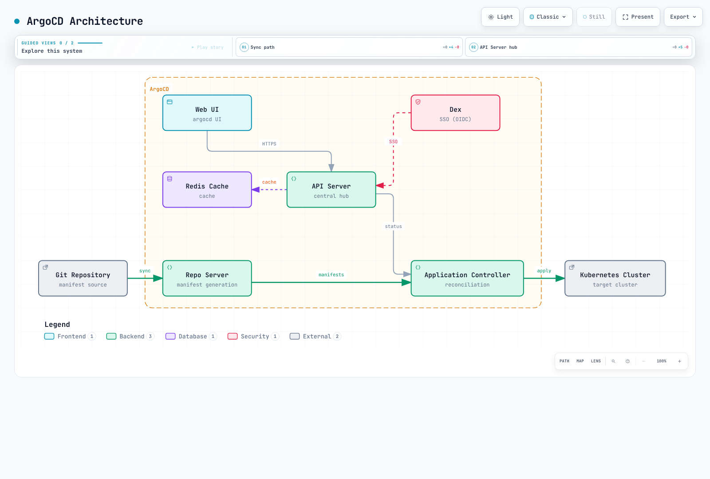

# GitOps 工具对比

> **最后更新**：2026 年 9 月 11 日

本指南全面比较 GitOps 工具，重点介绍 Kubernetes 生态系统中最常用的两种选择：ArgoCD 和 FluxCD。

## 概述

GitOps 是一种运维框架，将应用开发中的 DevOps 最佳实践用于基础设施自动化。CNCF 生态系统中的两种主流 GitOps 工具是：

- **ArgoCD**：面向 Kubernetes 的声明式 GitOps 持续交付工具
- **FluxCD**：一组面向 Kubernetes 的持续交付和渐进式交付解决方案

两者都是 CNCF 毕业项目，表明它们具有成熟度并得到广泛采用。

## ArgoCD 与 FluxCD：全面对比

### 理念与设计

| 方面 | ArgoCD | FluxCD |
|--------|--------|--------|
| **架构** | API/Repo Server、Application Controller 及其配套组件各自独立 | 由多个 Controller 组成的模块化工具集 |
| **配置** | 以 Application 为中心的 CRD | 以 Source 为中心的 CRD |
| **用户界面** | 内置功能丰富的 Web UI | 以 CLI 为先，不内置 UI |
| **学习重点** | Application、AppProject 和 UI 工作流 | Source、Kustomization 与 HelmRelease Controller 之间的关系 |
| **部署模式** | 拉取式 GitOps | 拉取式 GitOps |

### 功能对比

| 功能 | ArgoCD | FluxCD |
|---------|--------|--------|
| **Web UI** | 内置，功能丰富 | 核心组件不包含；可评估有维护者的生态系统 UI |
| **CLI** | `argocd` CLI | `flux` CLI |
| **多租户** | 使用 Project 和 RBAC | 命名空间隔离 |
| **多集群** | 原生支持 | 原生支持 |
| **Helm 支持** | 使用 helm template；Argo CD 管理生命周期 | Helm Controller 管理 Helm Release |
| **Kustomize 支持** | 完整支持 | 由 Kustomize Controller 完整支持 |
| **OCI 支持** | 通用 OCI 和 OCI Helm 源；需检查版本及媒体类型要求 | OCIRepository；需检查层和验证支持情况 |
| **通知** | 内置通知系统 | Notification Controller |
| **RBAC** | 全面的 RBAC | Kubernetes 原生 RBAC |
| **SSO 集成** | 直接使用 OIDC 或受支持的 Dex Connector | Kubernetes 身份验证 |
| **健康检查** | 内置健康检查和自定义资源健康状态 | Controller 专用就绪状态、健康检查和自定义条件 |
| **渐进式交付** | 通过 Argo Rollouts | 通过 Flagger |
| **镜像自动化** | 通过 Argo Image Updater | 可选的 Image Reflector/Automation Controller |
| **差异预览** | 在 UI 中查看可视化差异 | 使用 CLI 查看差异 |
| **同步波次** | 原生支持 | 通过依赖关系实现 |
| **Hook** | Argo 同步 Hook | Helm Hook；Kustomization 依赖关系和 Job 需单独设计 |

### 架构对比

#### ArgoCD 架构



[🔍 查看交互式图示](https://www.atomai.click/kubernetes-docs/archmaps/en-gitops-03-gitops-comparison-0.html)

#### FluxCD 架构


[🔍 查看交互式图示](https://www.atomai.click/kubernetes-docs/archmaps/en-gitops-03-gitops-comparison-1.html)

### 社区与生态系统

| 指标 | ArgoCD | FluxCD |
|--------|--------|--------|
| **CNCF 状态** | 毕业（2022 年 12 月） | 毕业（2022 年 11 月） |
| **首次发布** | 2018 年 | 2016 年（v1）、2020 年（v2） |
| **维护情况** | 检查当前治理情况和安全支持 | 检查当前治理情况和安全支持 |
| **生态系统工具** | Argo Workflows、Rollouts、Events | Flagger、Weave GitOps |

## 何时选择 ArgoCD

需要以下能力时，ArgoCD 是理想选择：

### 适用场景

1. **可视化管理**：团队偏好通过图形界面管理部署
2. **集中式控制**：组织希望通过单一视图管理多个集群
3. **全面的 RBAC**：跨团队的复杂访问控制需求
4. **SSO 集成**：企业环境需要 OIDC/SAML 身份验证
5. **同步波次与 Hook**：部署编排有复杂的顺序要求

### 优势

- **丰富的 Web UI**：用于部署管理的直观可视化界面
- **以 Application 为中心**：自然贴合开发者理解部署的方式
- **成熟的生态系统**：与 Argo Workflows、Rollouts 和 Events 紧密集成
- **企业功能**：开箱即用的 SSO、RBAC 和审计日志
- **易于调试**：在 UI 中查看可视化差异和同步状态

### 示例场景

```
Scenario: Enterprise with 50+ microservices
- Multiple teams need self-service deployments
- Security team requires audit logs and RBAC
- Developers want visual feedback on sync status
- Need SSO integration with corporate identity provider

Recommendation: ArgoCD
- Projects per team with role-based access
- Application Sets for template-driven deployments
- Web UI for developer self-service
- Dex integration for SSO
```

## 何时选择 FluxCD

需要以下能力时，FluxCD 是理想选择：

### 适用场景

1. **模块化架构**：仅选择所需的 Controller
2. **以 CLI 为先的工作流**：采用 GitOps 原生工作流，不依赖 UI
3. **镜像自动化**：在 Git 中自动更新容器镜像
4. **OCI 制品**：在 OCI 仓库中存储和部署制品
5. **组件选择**：挑选 Controller 并测量其实际工作负载

### 优势

- **模块化设计**：只使用所需的组件
- **原生镜像自动化**：可选 Controller 用于自动更新容器镜像
- **OCI 支持**：一流地支持 OCI 制品
- **Kubernetes 原生**：使用标准 Kubernetes RBAC
- **资源控制**：根据已安装的组件、源、对象和协调间隔测量 CPU/内存使用量

### 示例场景

```
Scenario: Platform team building internal developer platform
- Need automated image updates when CI builds new versions
- Want to store deployment artifacts in container registry
- Prefer CLI-driven GitOps workflows
- Multiple clusters with different configurations

Recommendation: FluxCD
- Image automation for continuous deployment
- OCI repositories for artifact storage
- Kustomize overlays for environment differences
- Multi-cluster management with fleet repo
```

## 两者可以一起使用吗？

应明确划分资源所有权，避免两个协调器修改或清理同一对象。与其 Operator 一起管理一个自定义资源，与两个工具争抢同一个 Deployment 或 Helm Release 的管理权并不是一回事。

可以，ArgoCD 和 FluxCD 能以互补方式配合使用：

### 模式 1：FluxCD 管理基础设施，ArgoCD 管理应用

```
Git Repository
├── infrastructure/     # Managed by FluxCD
│   ├── cert-manager/
│   ├── ingress-controller/
│   └── monitoring/
└── applications/       # Managed by ArgoCD
    ├── app-a/
    ├── app-b/
    └── app-c/
```

- FluxCD 管理集群基础设施（Operator、Controller）
- ArgoCD 通过面向开发者的 UI 管理应用部署

### 模式 2：FluxCD 自动更新镜像，ArgoCD 部署应用

```
1. CI builds new image → pushes to registry
2. FluxCD Image Automation detects new tag
3. FluxCD commits updated manifest to Git
4. ArgoCD syncs the change to cluster
```

### 模式 3：不同集群使用不同工具

- 生产集群：ArgoCD（满足 UI 和审计要求）
- 开发集群：FluxCD（支持快速迭代）

## 迁移注意事项

以下是设计层面的映射，并非 CRD 的自动重命名。应比较资源清单、Helm Release、Hook、清理策略/终结器、密钥和权限。在预发布环境测试停止旧协调器并转移资源所有权，确认不会触发删除。Argo CD 模板不会自动接管 Flux Helm Release 的历史记录。

### 从 FluxCD 迁移到 ArgoCD

1. 将 FluxCD Kustomization 导出为 ArgoCD Application
2. 将 FluxCD Source 映射到 ArgoCD 仓库
3. 将 HelmRelease 转换为 ArgoCD Helm Application
4. 在 ArgoCD 中配置 RBAC 和 SSO

### 从 ArgoCD 迁移到 FluxCD

1. 将 ArgoCD Application 转换为 Kustomization/HelmRelease
2. 使用 Git/Helm 仓库设置 Source Controller
3. 配置 Notification Controller 以发送告警
4. 按需配置 Image Automation

## 其他 GitOps 工具

虽然 ArgoCD 和 FluxCD 在 GitOps 领域占主导地位，但还有其他工具：

### Jenkins X

- 专注于 CI/CD 流水线自动化
- 提供内置预览环境
- 基于 Tekton 的流水线
- 适合：希望将 CI/CD 与 GitOps 集成的团队

### Rancher Fleet

- 专为管理数千个集群而设计
- 支持大规模 GitOps
- 与 Rancher 集成
- 适合：大规模边缘部署

### Weave GitOps

- 基于 Flux 的开源 UI 项目；应另行确认商业支持情况
- 为 Flux 添加 UI 和企业功能
- 评估当前版本、Flux 兼容性以及由谁提供支持

## 决策矩阵

| 需求 | 最佳选择 |
|-------------|-------------|
| 需要 Web UI | ArgoCD |
| 以 CLI 为先的工作流 | FluxCD |
| 镜像自动化 | 可选 Flux Controller 或 Argo CD Image Updater |
| 复杂 RBAC | ArgoCD |
| SSO 集成 | ArgoCD |
| 资源限制 | 使用相同的实际工作负载进行基准测试 |
| OCI 制品 | 两者皆可；应比较格式、验证和身份验证需求 |
| 同步波次/Hook | ArgoCD |
| 可视化差异 | ArgoCD |
| 模块化部署 | FluxCD |
| 企业审计 | ArgoCD |
| 大规模多集群 | 两者皆可 |

## 结论

ArgoCD 和 FluxCD 都是实施 GitOps 的优秀选择。决策通常取决于：

- 如果你看重丰富的 UI、企业功能和以 Application 为中心的管理，**选择 ArgoCD**
- 如果你偏好模块化、CLI 工作流和内置镜像自动化，**选择 FluxCD**

许多组织会在不同场景中成功使用这两种工具，在需要的地方发挥各自的优势。

## 测验

为检验你对本指南的理解，请尝试 [GitOps 工具对比测验](../quizzes/gitops/03-gitops-comparison-quiz.md)。

## 参考资料

- [Argo CD OCI](https://argo-cd.readthedocs.io/en/stable/user-guide/oci/)
- [Argo CD Helm 生命周期](https://argo-cd.readthedocs.io/en/stable/user-guide/helm/)
- [Flux HelmRelease 生命周期](https://fluxcd.io/flux/components/helm/helmreleases/)
- [Flux 多租户](https://fluxcd.io/flux/installation/configuration/multitenancy/)
- [Flux 生态系统](https://fluxcd.io/ecosystem/)
