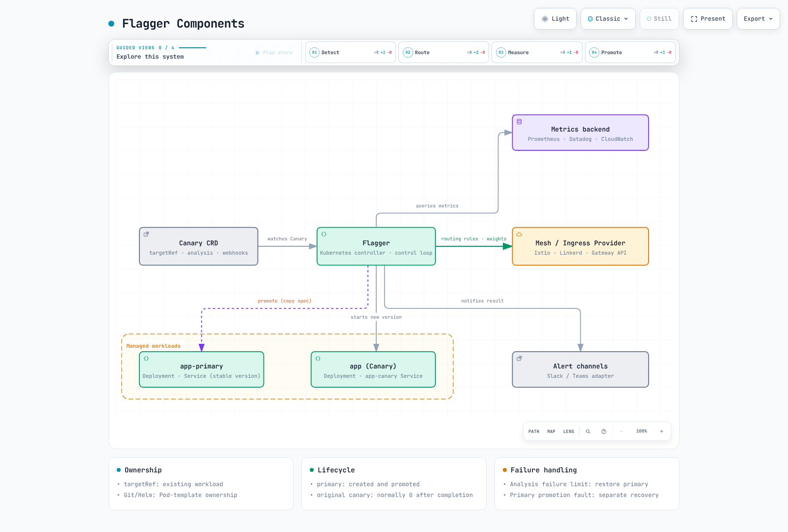
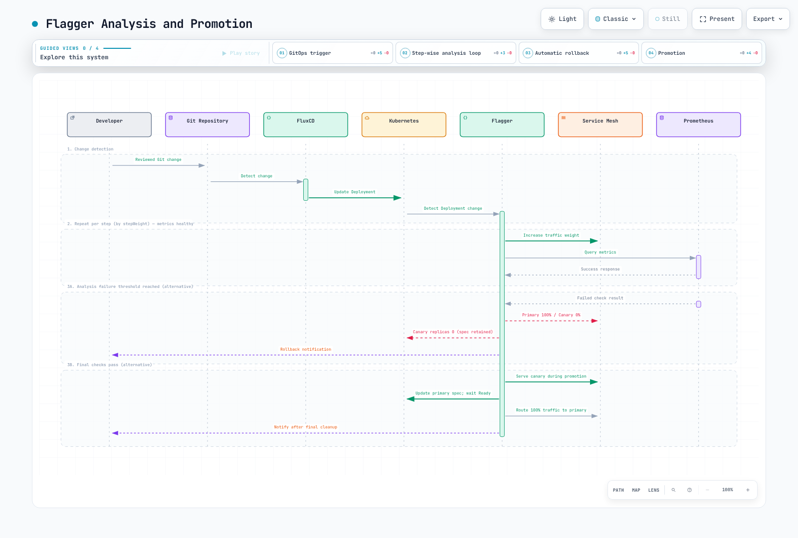
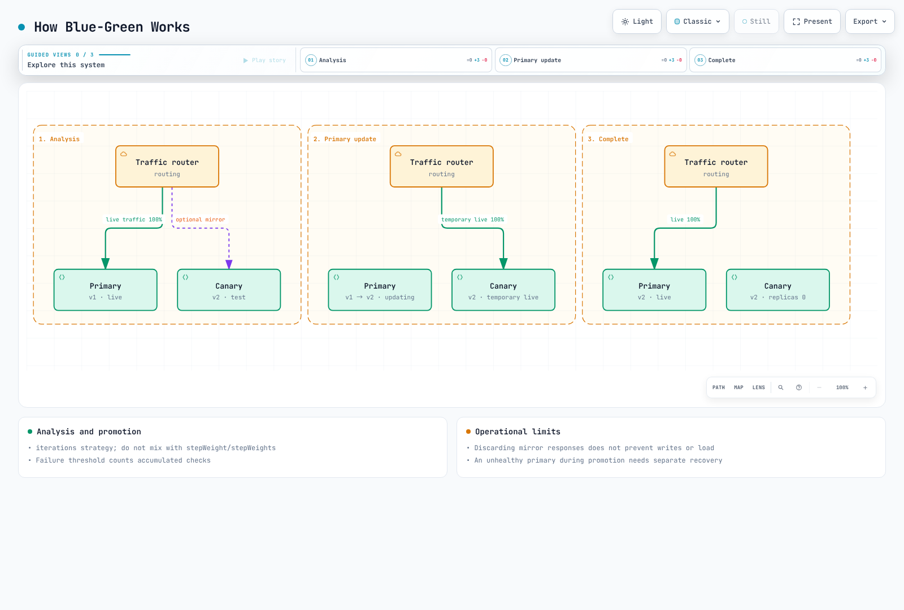
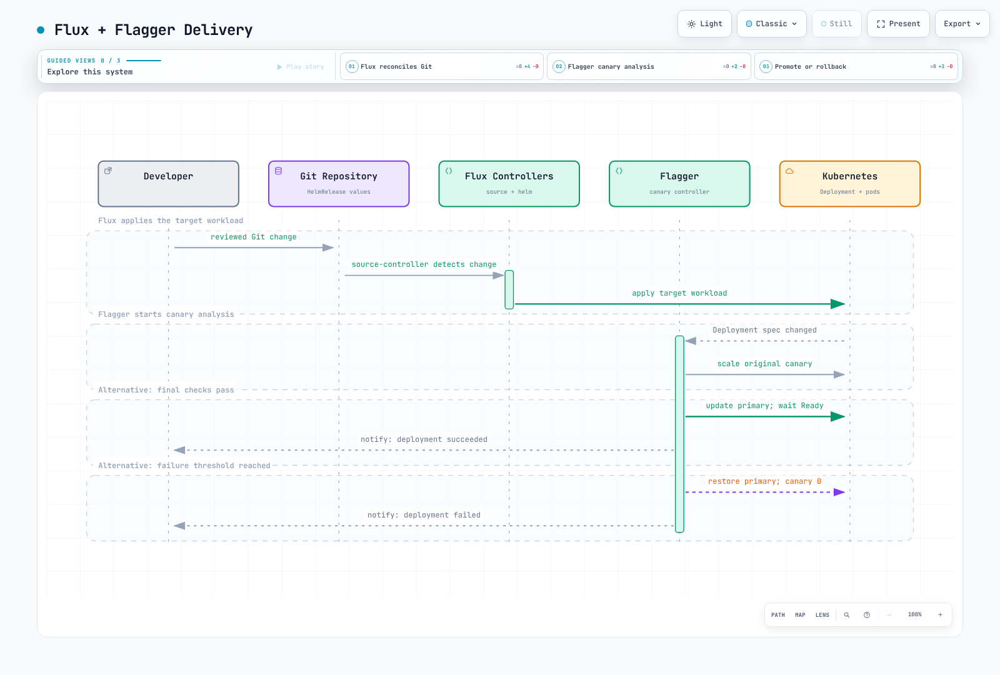
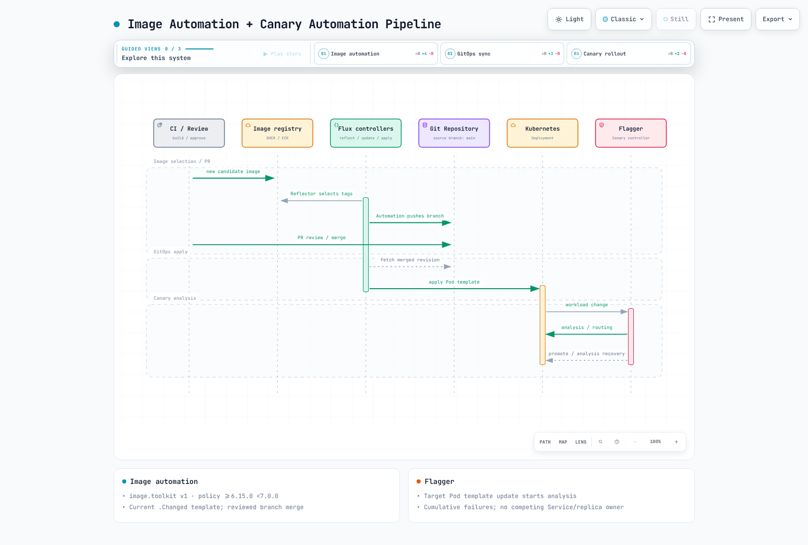
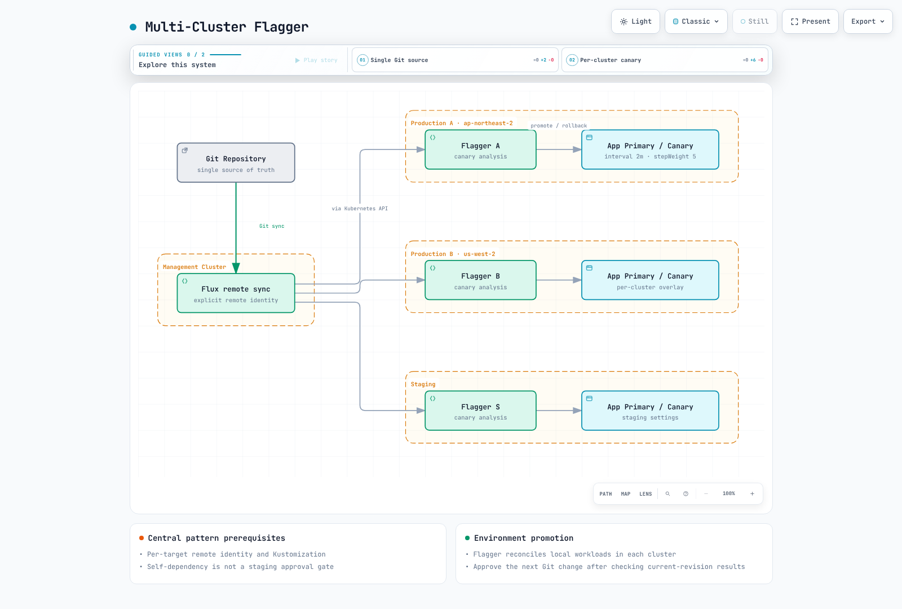

# Flagger 渐进式交付

> **审查基线**：Flagger/Chart 1.45.0、Loadtester 0.39.0、Flux 2.9.5（发布说明审查后更新至补丁版本 2.9.6；示例未重新运行）、Podinfo 6.15.0
> **最后更新**：October 12, 2026

Flagger 通过 Canary CRD 管理 Kubernetes 工作负载的渐进式交付。它控制流量和修订版本，而不负责数据库或外部副作用的事务性回滚。这些实验示例要求网络、监控指标、授权和服务 SLO 相匹配。

代码包含完整的清单以及 spec/Helm-values 片段。请将它们合并到指定的所有者中；同名策略示例是替代方案，而不是需要依次应用的一组代码块。

## 目录

- [概述和学习目标](#overview-and-learning-objectives)
- [Flagger 架构](#flagger-architecture)
- [EKS 安装和配置](#eks-installation-and-configuration)
- [Canary 部署策略](#canary-deployment-strategy)
- [蓝绿部署策略](#blue-green-deployment-strategy)
- [A/B 测试策略](#ab-testing-strategy)
- [自定义指标和 Webhook](#custom-metrics-and-webhooks)
- [GitOps 集成（Flux + Flagger）](#gitops-integration-flux--flagger)
- [可观测性和告警](#observability-and-alerting)
- [生产最佳实践](#production-best-practices)

## 概述和学习目标 {#overview-and-learning-objectives}

Kubernetes Deployment 的 RollingUpdate 已会逐步替换 Pod。Flagger 增加了显式的修订版本流量控制和基于指标/测试的晋升。本章涵盖资源所有权、三种策略、指标/门禁、GitOps 和可观测性。

| 策略 | 控制方式 | 检查项 |
|---|---|---|
| Canary | 逐步调整权重 | 额外副本、最小流量、失败条件 |
| 蓝绿 | 验证独立修订版本后切换 | 两个工作负载加上突增资源、数据库兼容性 |
| A/B | 支持的 header/cookie 匹配 | 队列分配、统计、独立授权 |

蓝绿并不保证恰好两倍资源、即时回滚或零停机。Flagger 将 primary 更新为新修订版本；之后它不会保留一个完整的旧版本待命实例。

### Flagger 和 Argo Rollouts

| 方面 | Flagger | Argo Rollouts |
|---|---|---|
| 资源 | Canary 引用现有工作负载 | Rollout CRD，包括 Deployment workloadRef |
| GitOps | Flux 和其他 GitOps 工具 | Argo CD 和其他 GitOps 工具 |
| 分析 | MetricTemplate、阈值、webhook | AnalysisTemplate/AnalysisRun 以及 Web/Job 提供程序 |
| 项目家族 | CNCF 已毕业的 Flux | CNCF 已毕业的 Argo |

生态系统集成不代表排他性耦合。不要让两个渐进式交付控制器管理同一工作负载。

## Flagger 架构 {#flagger-architecture}



[查看交互式图表](https://www.atomai.click/kubernetes-docs/archmaps/en-gitops-04-flagger-1.html)

在 Deployment 示例中，podinfo 是原始资源和 canary 工作负载。新的稳定工作负载是 podinfo-primary。podinfo-canary 是一个 Service 名称，而不是额外的 Deployment 或 CloneSet。

| 资源 | 所有权/用途 |
|---|---|
| podinfo Deployment | Git/Helm Pod 模板，Flagger canary 控制 |
| podinfo-primary Deployment | 由 Flagger 创建/晋升的稳定工作负载 |
| podinfo / podinfo-primary / podinfo-canary Services | 由 Flagger 管理的入口/目标选择 |
| Primary autoscaler | 使用 autoscalerRef 时对应的 autoscaler |
| VirtualService/DestinationRule/HTTPRoute 等 | 为所选 provider 提供的路由 |



[查看交互式图表](https://www.atomai.click/kubernetes-docs/archmaps/en-gitops-04-flagger-2.html)

初始 primary 设置完成后，Pod 模板或受跟踪的 ConfigMap/Secret 变更会准备 canary。经过预发布检查、分析和路由后，晋升会通过就绪的 canary 提供流量，同时 primary 采用新 spec。primary 就绪后，流量回到它，并缩减 canary。

**分析失败**通常会恢复健康的 primary。**更新 primary 时失败**则不同：在 Promoting/Finalising 期间，1.45.0 可以保留/将流量返回至健康的 canary，同时报告失败。仅凭失败状态不能证明旧 primary 正在提供流量。

### Provider 和生命周期

| Provider | 检查项 |
|---|---|
| Istio | VirtualService/DestinationRule 和 sidecar HTTP 指标 |
| gatewayapi:v1 | Gateway HTTPRoute 功能和 MetricTemplate |
| Linkerd/Contour/Gloo/Traefik/Kuma 等 | 已安装版本的功能和指标约定 |
| kubernetes | Service 切换式蓝绿，而非 L7 加权/A/B 路由 |
| App Mesh / ingress-nginx / OSM | 以下的遗留生命周期限制 |

AWS App Mesh 支持已于 **2026-09-30** 结束；AWS 表示该日期后其控制台和资源将不再可访问。社区 ingress-nginx 已于 2026 年 3 月停止维护，OSM 仓库已归档。

Adapter 可用不代表适合新的生产使用且仍在维护。请按实现验证 A/B、镜像和会话亲和性支持。

## EKS 安装和配置 {#eks-installation-and-configuration}

基线要求受支持的 EKS/Kubernetes、已安装的 Istio sidecar 环境，以及 Prometheus 抓取所需指标。将其 URL 替换为实际的 Service。Flagger 不安装 Istio 或监控埋点。Chart 捆绑的 Prometheus 镜像是旧版 2.41.0，因此将其禁用。

选择一种发布/管理方法。在不同 namespace 安装独立的 Flagger 实例可能使它们都控制同一个 Canary。示例将控制器使用 flagger-system，将工作负载使用 flagger-demo。请根据实际 Istio revision 调整注入标签。

```yaml
apiVersion: v1
kind: Namespace
metadata:
  name: flagger-system
  labels:
    istio-injection: enabled
---
apiVersion: v1
kind: Namespace
metadata:
  name: flagger-demo
  labels:
    istio-injection: enabled
---
apiVersion: v1
kind: ServiceAccount
metadata:
  name: flagger-loadtester
  namespace: flagger-system
automountServiceAccountToken: false
```

### Flagger Helm 安装

```yaml
fullnameOverride: flagger
meshProvider: istio
namespace: flagger-demo
noCrossNamespaceRefs: true
metricsServer: http://prometheus.monitoring.svc.cluster.local:9090
prometheus:
  install: false
leaderElection:
  enabled: true
  replicaCount: 2
resources:
  requests:
    cpu: 100m
    memory: 128Mi
  limits:
    cpu: '1'
    memory: 512Mi
podDisruptionBudget:
  enabled: true
  minAvailable: 1
```

```bash
helm repo add flagger https://flagger.app
helm repo update flagger
helm upgrade --install flagger flagger/flagger --version 1.45.0 \
  --namespace flagger-system -f flagger-values.yaml --wait --timeout 5m
```

namespace 限制的是监视范围，而不是 Chart 的 ClusterRole 权限。请单独限制租户 RBAC。leaderElection.replicaCount 是实际的 Chart 值。普通 Helm upgrade 不会像初始安装那样更新 crds/；请单独应用审查过的 CRD，或使用 Flux 的 CRD 策略。

```bash
kubectl apply --server-side -f https://raw.githubusercontent.com/fluxcd/flagger/v1.45.0/artifacts/flagger/crd.yaml
```

### Loadtester 和访问范围

```yaml
fullnameOverride: flagger-loadtester
replicaCount: 1
service:
  type: ClusterIP
  port: 80
serviceAccountName: flagger-loadtester
rbac:
  create: false
cmd:
  timeout: 2m
  namespaceRegexp: ^flagger-demo$
resources:
  requests:
    cpu: 100m
    memory: 64Mi
  limits:
    cpu: 500m
    memory: 256Mi
securityContext:
  enabled: true
  context:
    allowPrivilegeEscalation: false
    capabilities:
      drop:
      - ALL
    readOnlyRootFilesystem: true
    runAsUser: 100
    runAsGroup: 101
volumes:
- name: tmp
  emptyDir: {}
volumeMounts:
- name: tmp
  mountPath: /tmp
```

```bash
helm upgrade --install flagger-loadtester flagger/loadtester --version 0.39.0 \
  --namespace flagger-system -f loadtester-values.yaml --wait --timeout 5m
```

Loadtester 从 HTTP 请求执行命令。namespaceRegexp 过滤 body 字符串；它不是调用方认证。请让其保持不暴露于互联网，并通过 CNI policy 将入站限制为 controller Pod。使用 RBAC 控制 operator exec/port-forward。内存门禁实验请使用一个副本。

```yaml
apiVersion: networking.k8s.io/v1
kind: NetworkPolicy
metadata:
  name: flagger-loadtester-ingress
  namespace: flagger-system
spec:
  podSelector:
    matchLabels:
      app.kubernetes.io/name: loadtester
  policyTypes:
  - Ingress
  ingress:
  - from:
    - namespaceSelector:
        matchLabels:
          kubernetes.io/metadata.name: flagger-system
      podSelector:
        matchLabels:
          app.kubernetes.io/name: flagger
    ports:
    - protocol: TCP
      port: 8080
```

允许所需的 Istio mTLS 和抓取路径。此 loadtester 不执行 API 操作，因此禁用了自动挂载 ServiceAccount token。添加 Helm/kubectl 测试需要显式权限和可写路径。

### Gateway API 替代方案

这假定已有 Istio GatewayClass 和兼容的 Gateway API CRD。不要用旧 bundle 覆盖它们。其他实现需要匹配的监控埋点/查询。请为环境配置 Service/LB 暴露、DNS 和 TLS。

```yaml
apiVersion: gateway.networking.k8s.io/v1
kind: Gateway
metadata:
  name: podinfo-gateway
  namespace: flagger-demo
spec:
  gatewayClassName: istio
  listeners:
  - name: http
    protocol: HTTP
    port: 80
    allowedRoutes:
      namespaces:
        from: Same
```

请使用 **gatewayapi:v1** 和 Canary service.gatewayRefs，而不是虚构的 Helm gatewayApi.gateway 值。准备以下三个 MetricTemplate，并将此 Canary 作为 Istio 方案的**替代方案**使用。

```yaml
apiVersion: flagger.app/v1beta1
kind: Canary
metadata:
  name: podinfo
  namespace: flagger-demo
spec:
  provider: gatewayapi:v1
  targetRef:
    apiVersion: apps/v1
    kind: Deployment
    name: podinfo
  autoscalerRef:
    apiVersion: autoscaling/v2
    kind: HorizontalPodAutoscaler
    name: podinfo
  progressDeadlineSeconds: 120
  service:
    port: 9898
    targetPort: 9898
    hosts:
    - app.example.com
    gatewayRefs:
    - name: podinfo-gateway
      namespace: flagger-demo
      sectionName: http
  analysis:
    interval: 1m
    threshold: 5
    maxWeight: 50
    stepWeight: 10
    metrics:
    - name: error-rate
      templateRef:
        name: istio-error-rate
      thresholdRange:
        min: 0
        max: 1
      interval: 1m
    - name: latency-p99-ms
      templateRef:
        name: istio-latency-ms
      thresholdRange:
        min: 0
        max: 500
      interval: 1m
    - name: request-count
      templateRef:
        name: istio-request-count
      thresholdRange:
        min: 100
      interval: 1m
    webhooks:
    - name: smoke-test
      type: pre-rollout
      url: http://flagger-loadtester.flagger-system.svc.cluster.local/
      timeout: 30s
      metadata:
        type: bash
        cmd: |-
          set -euo pipefail
          curl -fsS --max-time 10 http://podinfo-canary.flagger-demo.svc.cluster.local:9898/healthz >/dev/null
          curl -fsS --max-time 10 http://podinfo-canary.flagger-demo.svc.cluster.local:9898/readyz >/dev/null
    - name: load-test
      type: rollout
      url: http://flagger-loadtester.flagger-system.svc.cluster.local/
      timeout: 5s
      metadata:
        type: cmd
        cmd: hey -z 1m -q 10 -c 2 http://podinfo-canary.flagger-demo.svc.cluster.local:9898/
```

```bash
helm upgrade --install flagger flagger/flagger --version 1.45.0 \
  --namespace flagger-system -f flagger-values.yaml --set meshProvider=gatewayapi:v1
```

## Canary 部署策略 {#canary-deployment-strategy}

以下是基线 Istio 工作负载和 HPA；需要 Metrics Server。请从 Git 中省略 Deployment replicas，以便 HPA/Flagger 拥有扩缩容控制权，并且不要创建竞争的 Service。选择这些清单或后面的 HelmRelease 替代方案。

```yaml
apiVersion: apps/v1
kind: Deployment
metadata:
  name: podinfo
  namespace: flagger-demo
spec:
  selector:
    matchLabels:
      app: podinfo
  template:
    metadata:
      labels:
        app: podinfo
    spec:
      containers:
      - name: podinfo
        image: ghcr.io/stefanprodan/podinfo:6.15.0
        ports:
        - name: http
          containerPort: 9898
        readinessProbe:
          httpGet:
            path: /readyz
            port: http
        livenessProbe:
          httpGet:
            path: /healthz
            port: http
        resources:
          requests:
            cpu: 100m
            memory: 64Mi
          limits:
            cpu: 500m
            memory: 256Mi
---
apiVersion: autoscaling/v2
kind: HorizontalPodAutoscaler
metadata:
  name: podinfo
  namespace: flagger-demo
spec:
  scaleTargetRef:
    apiVersion: apps/v1
    kind: Deployment
    name: podinfo
  minReplicas: 2
  maxReplicas: 4
  metrics:
  - type: Resource
    resource:
      name: cpu
      target:
        type: Utilization
        averageUtilization: 80
```


[查看交互式图表](https://www.atomai.click/kubernetes-docs/archmaps/en-gitops-04-flagger-3.html)

```yaml
apiVersion: flagger.app/v1beta1
kind: Canary
metadata:
  name: podinfo
  namespace: flagger-demo
spec:
  provider: istio
  targetRef:
    apiVersion: apps/v1
    kind: Deployment
    name: podinfo
  autoscalerRef:
    apiVersion: autoscaling/v2
    kind: HorizontalPodAutoscaler
    name: podinfo
  progressDeadlineSeconds: 120
  service:
    port: 9898
    targetPort: 9898
    portName: http
    gateways:
    - mesh
    hosts:
    - podinfo
    trafficPolicy:
      tls:
        mode: ISTIO_MUTUAL
  analysis:
    interval: 1m
    threshold: 5
    maxWeight: 50
    stepWeight: 10
    metrics:
    - name: request-success-rate
      thresholdRange:
        min: 99
        max: 100
      interval: 1m
    - name: request-duration
      thresholdRange:
        min: 0
        max: 500
      interval: 1m
    webhooks:
    - name: smoke-test
      type: pre-rollout
      url: http://flagger-loadtester.flagger-system.svc.cluster.local/
      timeout: 30s
      metadata:
        type: bash
        cmd: |-
          set -euo pipefail
          curl -fsS --max-time 10 http://podinfo-canary.flagger-demo.svc.cluster.local:9898/healthz >/dev/null
          curl -fsS --max-time 10 http://podinfo-canary.flagger-demo.svc.cluster.local:9898/readyz >/dev/null
    - name: load-test
      type: rollout
      url: http://flagger-loadtester.flagger-system.svc.cluster.local/
      timeout: 5s
      metadata:
        type: cmd
        cmd: hey -z 1m -q 10 -c 2 http://podinfo-canary.flagger-demo.svc.cluster.local:9898/
```

iterations 选择蓝绿，或在存在 match 时选择 A/B；不要将它们混入加权 Canary。stepWeight 10 和 maxWeight 50 描述了晋升前在 10→20→30→40→50% 进行的分析。总时间取决于就绪情况、检查延迟、失败/批准以及 primary rollout。

analysis.interval 调度分析；metric interval 提供其查询/聚合窗口。threshold 5 适用于某个修订版本累积失败的检查，而不是每次成功都会重置的连续计数。达到五次会在后续协调时导致回滚。预发布和 rollout/metric 失败都会进入此路径。progressDeadlineSeconds 限制工作负载进度/就绪，而不是总 rollout 时间的两倍。

对于非线性权重，使用 stepWeights 并移除已有的 stepWeight/maxWeight。连接和路由收敛意味着配置的权重不能保证每一刻都具有精确的请求比例。

```yaml
spec:
  analysis:
    stepWeights:
    - 1
    - 2
    - 5
    - 10
    - 25
    - 50
```

```bash
kubectl get canary podinfo -n flagger-demo --watch
kubectl describe canary podinfo -n flagger-demo
kubectl logs -n flagger-system -l app.kubernetes.io/name=flagger -c flagger --prefix --tail=100
```

初始稳定设置后，通过 Git 应用经过审查的 image/tag/digest 或 Pod 模板变更以启动分析。在同一 tag 后替换远程内容不能替代 Git 变更。不要直接编辑生成的 primary、Service 或路由资源。

## 蓝绿部署策略 {#blue-green-deployment-strategy}



[查看交互式图表](https://www.atomai.click/kubernetes-docs/archmaps/en-gitops-04-flagger-4.html)

```yaml
apiVersion: flagger.app/v1beta1
kind: Canary
metadata:
  name: podinfo
  namespace: flagger-demo
spec:
  provider: istio
  targetRef:
    apiVersion: apps/v1
    kind: Deployment
    name: podinfo
  autoscalerRef:
    apiVersion: autoscaling/v2
    kind: HorizontalPodAutoscaler
    name: podinfo
  progressDeadlineSeconds: 120
  service:
    port: 9898
    targetPort: 9898
    portName: http
    gateways:
    - mesh
    hosts:
    - podinfo
    trafficPolicy:
      tls:
        mode: ISTIO_MUTUAL
  analysis:
    interval: 1m
    threshold: 5
    metrics:
    - name: request-success-rate
      thresholdRange:
        min: 99
        max: 100
      interval: 1m
    - name: request-duration
      thresholdRange:
        min: 0
        max: 500
      interval: 1m
    webhooks:
    - name: smoke-test
      type: pre-rollout
      url: http://flagger-loadtester.flagger-system.svc.cluster.local/
      timeout: 30s
      metadata:
        type: bash
        cmd: |-
          set -euo pipefail
          curl -fsS --max-time 10 http://podinfo-canary.flagger-demo.svc.cluster.local:9898/healthz >/dev/null
          curl -fsS --max-time 10 http://podinfo-canary.flagger-demo.svc.cluster.local:9898/readyz >/dev/null
    - name: load-test
      type: rollout
      url: http://flagger-loadtester.flagger-system.svc.cluster.local/
      timeout: 5s
      metadata:
        type: cmd
        cmd: hey -z 1m -q 10 -c 2 http://podinfo-canary.flagger-demo.svc.cluster.local:9898/
    iterations: 10
```

此示例在实时流量保持在 primary 时分析合成流量。通过后，流量移至 canary，同时 primary 更新，然后在 primary 就绪时返回。失败阈值仍然适用；一次失败测量不一定会立即回滚。这不是一个保留完整旧版本待命实例的独立环境。

### 可选流量镜像

```yaml
spec:
  analysis:
    mirror: true
    mirrorWeight: 10
```

支持的 provider 可以将流量作为 Canary 预阶段或用于蓝绿进行镜像。请验证 Gateway API 的 RequestMirror 支持。丢弃响应无法阻止数据库写入、付款、消息或负载；请使用经过验证的只读请求或隔离。镜像不是数据库复制或回滚。

<span id="ab-testing-strategy"></span>

## A/B 测试策略

```yaml
apiVersion: flagger.app/v1beta1
kind: Canary
metadata:
  name: podinfo
  namespace: flagger-demo
spec:
  provider: istio
  targetRef:
    apiVersion: apps/v1
    kind: Deployment
    name: podinfo
  autoscalerRef:
    apiVersion: autoscaling/v2
    kind: HorizontalPodAutoscaler
    name: podinfo
  progressDeadlineSeconds: 120
  service:
    port: 9898
    targetPort: 9898
    portName: http
    gateways:
    - mesh
    hosts:
    - podinfo
    trafficPolicy:
      tls:
        mode: ISTIO_MUTUAL
  analysis:
    interval: 1m
    threshold: 5
    metrics:
    - name: request-success-rate
      thresholdRange:
        min: 99
        max: 100
      interval: 1m
    - name: request-duration
      thresholdRange:
        min: 0
        max: 500
      interval: 1m
    webhooks:
    - name: smoke-test
      type: pre-rollout
      url: http://flagger-loadtester.flagger-system.svc.cluster.local/
      timeout: 30s
      metadata:
        type: bash
        cmd: |-
          set -euo pipefail
          curl -fsS --max-time 10 http://podinfo-canary.flagger-demo.svc.cluster.local:9898/healthz >/dev/null
          curl -fsS --max-time 10 http://podinfo-canary.flagger-demo.svc.cluster.local:9898/readyz >/dev/null
    - name: load-test
      type: rollout
      url: http://flagger-loadtester.flagger-system.svc.cluster.local/
      timeout: 5s
      metadata:
        type: cmd
        cmd: hey -z 1m -q 10 -c 2 http://podinfo-canary.flagger-demo.svc.cluster.local:9898/
    iterations: 10
    match:
    - headers:
        x-canary:
          exact: insider
    - headers:
        cookie:
          regex: (^|.*;\s*)canary=always(;.*|$)
```

match 条目是 OR 替代项；条目内条件遵循 provider 规则。cookie regex 处理分号后的空格。Istio sourceLabels 描述工作负载标签，而不是源 IP。请按 Gateway 实现/版本验证 matcher 支持。

路由既不是授权，也不是完整的统计实验。不要将客户端控制的标记视为员工权限。在可信边缘分配队列并在服务端授权；有意义的 A/B 结论还需要样本、分配设计和统计测试。

从已注入的 loadtester Pod 验证基线 mesh 路由。通过实际 host/TLS/ingress 测试外部 Gateway 路径。直接调用 -canary 不能验证路由匹配。

```bash
kubectl exec -n flagger-system deployment/flagger-loadtester -- \
  curl -fsS http://podinfo.flagger-demo.svc.cluster.local:9898/
kubectl exec -n flagger-system deployment/flagger-loadtester -- \
  curl -fsS -H 'x-canary: insider' http://podinfo.flagger-demo.svc.cluster.local:9898/
kubectl exec -n flagger-system deployment/flagger-loadtester -- \
  curl -fsS -b 'canary=always' http://podinfo.flagger-demo.svc.cluster.local:9898/
```

## 自定义指标和 Webhook {#custom-metrics-and-webhooks}

### Prometheus MetricTemplate

这些查询使用 Istio sidecar 指标约定。请验证 namespace/workload 标签、reporter 和抓取。缺失的 5xx series 会成为零分子；不存在的流量或零分母不会成为成功。最小 100 个请求和其他边界只是示例；请从 SLO 和样本要求中选择值。

```yaml
apiVersion: flagger.app/v1beta1
kind: MetricTemplate
metadata:
  name: istio-error-rate
  namespace: flagger-demo
spec:
  provider:
    type: prometheus
    address: http://prometheus.monitoring.svc.cluster.local:9090
  query: |
    (sum(rate(istio_requests_total{reporter="destination", destination_workload_namespace="{{ namespace }}", destination_workload="{{ target }}", response_code=~"5.."}[{{ interval }}])) or vector(0)) / sum(rate(istio_requests_total{reporter="destination", destination_workload_namespace="{{ namespace }}", destination_workload="{{ target }}"}[{{ interval }}])) * 100
---
apiVersion: flagger.app/v1beta1
kind: MetricTemplate
metadata:
  name: istio-latency-ms
  namespace: flagger-demo
spec:
  provider:
    type: prometheus
    address: http://prometheus.monitoring.svc.cluster.local:9090
  query: |
    histogram_quantile(0.99, sum(rate(istio_request_duration_milliseconds_bucket{reporter="destination", destination_workload_namespace="{{ namespace }}", destination_workload="{{ target }}"}[{{ interval }}])) by (le))
---
apiVersion: flagger.app/v1beta1
kind: MetricTemplate
metadata:
  name: istio-request-count
  namespace: flagger-demo
spec:
  provider:
    type: prometheus
    address: http://prometheus.monitoring.svc.cluster.local:9090
  query: |
    sum(increase(istio_requests_total{reporter="destination", destination_workload_namespace="{{ namespace }}", destination_workload="{{ target }}"}[{{ interval }}]))
---
spec:
  analysis:
    metrics:
    - name: error-rate
      templateRef:
        name: istio-error-rate
      thresholdRange:
        min: 0
        max: 1
      interval: 1m
    - name: latency-p99-ms
      templateRef:
        name: istio-latency-ms
      thresholdRange:
        min: 0
        max: 500
      interval: 1m
    - name: request-count
      templateRef:
        name: istio-request-count
      thresholdRange:
        min: 100
      interval: 1m
```

MetricTemplate 必须返回一个数值。Prometheus provider 拒绝空结果/NaN。将百分比边界限定为有限的 0–100 范围，并对齐自定义延迟单位。边界是包含式的。具有重叠查询窗口的测量不是独立样本。

### Datadog 单位和所选数据点

```yaml
apiVersion: flagger.app/v1beta1
kind: MetricTemplate
metadata:
  name: datadog-average-latency-ms
  namespace: flagger-demo
spec:
  provider:
    type: datadog
    address: https://api.datadoghq.com
    secretRef:
      name: datadog-api
  query: |
    avg:myapp.request_duration_ms{kube_deployment:{{ target }},kube_namespace:{{ namespace }}}.rollup(avg, 60)
---
apiVersion: v1
kind: Secret
metadata:
  name: datadog-api
  namespace: flagger-demo
type: Opaque
stringData:
  datadog_api_key: REPLACE_WITH_API_KEY
  datadog_application_key: REPLACE_WITH_APPLICATION_KEY
```

myapp.request_duration_ms 是你必须发布的自定义平均毫秒延迟；它不是 P99。通过 provider.address 选择站点。客户端读取所示的两个 Secret key，而不是 datadog_site。它查询指标 interval 的十倍，并返回第一个 series 中最旧的第一个点。不要仅凭它证明当前 canary 的健康；请将其与新鲜的、修订版本特定的测量配对。

对原始客户端进行本地 mock-response 测试还确认，第一个数据点为 null 时会解码为零。因此，接受零毫秒的延迟门禁可能具有误导性。请使用验证时间戳/缺失值的桥接组件或新鲜的 Prometheus 测量。

### CloudWatch 字段和限制

```yaml
apiVersion: flagger.app/v1beta1
kind: MetricTemplate
metadata:
  name: cloudwatch-error-percent
  namespace: flagger-demo
spec:
  provider:
    type: cloudwatch
    region: ap-northeast-2
  query: |
    [
      {
        "Id": "errorrate",
        "Expression": "IF(FILL(requests,0)>=100,100*FILL(errors,0)/FILL(requests,0),-1)",
        "Label": "CanaryErrorPercent",
        "ReturnData": true
      },
      {
        "Id": "errors",
        "MetricStat": {
          "Metric": {
            "Namespace": "MyApp",
            "MetricName": "5xxErrors",
            "Dimensions": [
              {
                "Name": "Service",
                "Value": "{{ target }}"
              },
              {
                "Name": "Namespace",
                "Value": "{{ namespace }}"
              }
            ]
          },
          "Period": 60,
          "Stat": "Sum"
        },
        "ReturnData": false
      },
      {
        "Id": "requests",
        "MetricStat": {
          "Metric": {
            "Namespace": "MyApp",
            "MetricName": "TotalRequests",
            "Dimensions": [
              {
                "Name": "Service",
                "Value": "{{ target }}"
              },
              {
                "Name": "Namespace",
                "Value": "{{ namespace }}"
              }
            ]
          },
          "Period": 60,
          "Stat": "Sum"
        },
        "ReturnData": false
      }
    ]
---
spec:
  analysis:
    metrics:
    - name: cw-error-percent
      templateRef:
        name: cloudwatch-error-percent
      thresholdRange:
        min: 0
        max: 1
      interval: 1m
```

Provider.region 受支持且必需。请单独发布 MyApp 指标和 Service/Namespace 维度。该 expression 会对缺失/低流量周期返回 -1，使其不满足 0–1% 边界。摄取延迟可能拒绝 rollout；请验证实际的发布和聚合/查询窗口。

原生 provider 查询指标 interval 的十倍，并选择第一个结果的第一个值，而不会单独验证 timestamp/StatusCode。请使用当前修订版本的 Prometheus 请求/健康检查加以补充，以免将较旧点或聚合 ALB 指标误认为当前 canary 健康状态。其 AWS API 权限是 GetMetricData。

```json
{
  "Version": "2012-10-17",
  "Statement": [
    {
      "Effect": "Allow",
      "Action": "cloudwatch:GetMetricData",
      "Resource": "*",
      "Condition": {
        "StringEquals": {
          "aws:RequestedRegion": "ap-northeast-2"
        }
      }
    }
  ]
}
```

使用 CloudWatch 时，请配置 Flagger ServiceAccount 认证和 role trust，并匹配 region 条件。本次审查未调用 AWS API 或部署 role。

### Webhook 契约

| 类型 | 含义 / 拒绝行为 |
|---|---|
| confirm-rollout | 等待启动批准 |
| pre-rollout | 初始流量转移前检查；增加失败计数 |
| rollout | 在分析期间调用；增加失败计数 |
| confirm-traffic-increase | 增加权重前等待 |
| confirm-promotion | 晋升前等待 |
| post-rollout | 在 Succeeded 或 Failed 后通知/清理；不会逆转结果 |
| rollback | 分析/批准等待期间成功会请求回滚 |
| event | 转发与状态相关的事件 |

通常返回 HTTP 200。版本 1.45.0 将大于 202 的状态码视为错误，因此不要假定 204 会成功。metadata 按字面复制；`{{ .Version }}` 不会插值。请使用 payload 中的 name/namespace/phase/checksum。非成功 body 可能进入 logs/events，因此不要返回敏感值。

```yaml
name: podinfo
namespace: flagger-demo
phase: Progressing
checksum: example-revision-checksum
metadata:
  gate: promotion
```

Webhook 配置不提供任意 Authorization header。请通过经过审查的 mTLS/internal-proxy 边界实现所需认证；不要将 secret 放入公开 Git URL/metadata 中，也不要默认禁用 TLS 验证。

cmd 负载测试会异步接受；HTTP 成功不是负载测试质量的判定。Bash 会阻塞至完成，且必须符合其 timeout。镜像 0.39.0 包含 curl/jq/hey/wrk/bash，但不包含 k6。k6 需要单独验证的镜像和阈值，因为仅 check() 不会建立失败的退出状态。

此脚本适用于安装了 k6 的专用测试镜像，而不是可在默认 loadtester 镜像中运行的命令。

```javascript
import http from 'k6/http';
import { check, sleep } from 'k6';

export const options = {
  vus: 2,
  duration: '20s',
  thresholds: {
    checks: ['rate==1'],
    http_req_failed: ['rate<0.01'],
    http_req_duration: ['p(99)<500'],
  },
};
export default function () {
  const result = http.get('http://podinfo-canary.flagger-demo.svc.cluster.local:9898/');
  check(result, { 'HTTP 200': (response) => response.status === 200 });
  sleep(0.5);
}
```

### 手动门禁

```yaml
spec:
  analysis:
    webhooks:
    - name: promotion-approval
      type: confirm-promotion
      url: http://flagger-loadtester.flagger-system.svc.cluster.local/gate/check
      timeout: 5s
      metadata:
        gate: promotion
```

将此条目合并到现有 Canary webhook 列表中。/gate/approve 始终会批准；它不是手动门禁。/gate/check 读取内存中的 name.namespace 状态。使用相同 JSON body 进行 open/close/check。关闭会阻止晋升，而非回滚。

```bash
# Close before starting a new revision.
kubectl exec -n flagger-system deployment/flagger-loadtester -- \
  curl -fsS -X POST -H 'Content-Type: application/json' \
  -d '{"name":"podinfo","namespace":"flagger-demo"}' http://localhost:8080/gate/close
# Approve the reviewed revision.
kubectl exec -n flagger-system deployment/flagger-loadtester -- \
  curl -fsS -X POST -H 'Content-Type: application/json' \
  -d '{"name":"podinfo","namespace":"flagger-demo"}' http://localhost:8080/gate/open
# A closed gate returns 403.
kubectl exec -n flagger-system deployment/flagger-loadtester -- \
  curl -sS -o /dev/null -w '%{http_code}\n' -X POST -H 'Content-Type: application/json' \
  -d '{"name":"podinfo","namespace":"flagger-demo"}' http://localhost:8080/gate/check
```

内置 gate 不针对 checksum，会在 Pod 重启时重置，且不会在副本间共享。请在下一个修订版本前关闭它。生产批准需要认证、审计、过期以及按 name/namespace/checksum/gate 键控的状态。一个由启动和晋升共享的 memory gate 并不是两个独立批准。

### 手动回滚和暂停

```yaml
spec:
  analysis:
    webhooks:
    - name: operator-rollback
      type: rollback
      url: http://flagger-loadtester.flagger-system.svc.cluster.local/rollback/check
      timeout: 5s
```

rollback endpoint 在没有信号时通常返回 403，并在请求时返回 200。通知接收方在此处的成功响应可能导致意外回滚。以下请求会在正常协调的分析/晋升批准等待期间请求回滚；它不是适用于每个阶段的即时恢复开关。

```bash
kubectl get canary podinfo -n flagger-demo -o jsonpath='{.status.phase}{"\n"}'
kubectl exec -n flagger-system deployment/flagger-loadtester -- \
  curl -fsS -X POST -H 'Content-Type: application/json' \
  -d '{"name":"podinfo","namespace":"flagger-demo"}' http://localhost:8080/rollback/open
kubectl get canary podinfo -n flagger-demo --watch
# Reset the request after observing the operation.
kubectl exec -n flagger-system deployment/flagger-loadtester -- \
  curl -fsS -X POST -H 'Content-Type: application/json' \
  -d '{"name":"podinfo","namespace":"flagger-demo"}' http://localhost:8080/rollback/close
```

Controller/就绪失败或关闭的 confirm-rollout gate 可能在此 hook 之前停止协调。在 Promoting/Finalising 期间的 primary 失败需要前文所述的单独恢复处理。完成后保持 rollback 打开可能影响下一个修订版本。

不要将 flagger.app/rollback、flagger.app/suspend 或 flagger.app/skipAnalysis annotation 视为控制 API。Suspend/skipAnalysis 是 spec 字段。Suspend 停止协调（包括 rollback hook），而不会将流量返回 primary。SkipAnalysis 会在不分析的情况下晋升；它不是回滚。也请更新 Git 所有者。

```yaml
spec:
  suspend: true
```

<span id="gitops-integration-flux--flagger"></span>

## GitOps 集成（Flux + Flagger）


[查看交互式图表](https://www.atomai.click/kubernetes-docs/archmaps/en-gitops-04-flagger-0.html)



[查看交互式图表](https://www.atomai.click/kubernetes-docs/archmaps/en-gitops-04-flagger-5.html)

Flux bootstrap 不会将 Flagger 作为内置 controller 安装。请通过 HelmRelease 或 Kustomization 单独安装它。不要同时通过 Helm CLI 管理同一 release。还要在 Git 中管理前面的 namespace、ServiceAccount 和 NetworkPolicy。

```yaml
apiVersion: source.toolkit.fluxcd.io/v1
kind: HelmRepository
metadata:
  name: flagger
  namespace: flagger-system
spec:
  interval: 1h
  url: https://flagger.app
---
apiVersion: helm.toolkit.fluxcd.io/v2
kind: HelmRelease
metadata:
  name: flagger
  namespace: flagger-system
spec:
  interval: 1h
  releaseName: flagger
  chart:
    spec:
      chart: flagger
      version: 1.45.0
      sourceRef:
        kind: HelmRepository
        name: flagger
  install:
    crds: Create
  upgrade:
    crds: CreateReplace
  values:
    fullnameOverride: flagger
    meshProvider: istio
    namespace: flagger-demo
    noCrossNamespaceRefs: true
    metricsServer: http://prometheus.monitoring.svc.cluster.local:9090
    prometheus:
      install: false
    leaderElection:
      enabled: true
      replicaCount: 2
    resources:
      requests:
        cpu: 100m
        memory: 128Mi
      limits:
        cpu: '1'
        memory: 512Mi
    podDisruptionBudget:
      enabled: true
      minAvailable: 1
---
apiVersion: helm.toolkit.fluxcd.io/v2
kind: HelmRelease
metadata:
  name: loadtester
  namespace: flagger-system
spec:
  interval: 1h
  releaseName: flagger-loadtester
  chart:
    spec:
      chart: loadtester
      version: 0.39.0
      sourceRef:
        kind: HelmRepository
        name: flagger
  values:
    fullnameOverride: flagger-loadtester
    replicaCount: 1
    service:
      type: ClusterIP
      port: 80
    serviceAccountName: flagger-loadtester
    rbac:
      create: false
    cmd:
      timeout: 2m
      namespaceRegexp: ^flagger-demo$
    resources:
      requests:
        cpu: 100m
        memory: 64Mi
      limits:
        cpu: 500m
        memory: 256Mi
    securityContext:
      enabled: true
      context:
        allowPrivilegeEscalation: false
        capabilities:
          drop:
          - ALL
        readOnlyRootFilesystem: true
        runAsUser: 100
        runAsGroup: 101
    volumes:
    - name: tmp
      emptyDir: {}
    volumeMounts:
    - name: tmp
      mountPath: /tmp
```

Flux CreateReplace CRD 处理不保证安全迁移。请在升级前审查 CRD 变更和已存储对象。在 source 和 provider 安装就绪后再应用 Canary 对象。

### 应用 HelmRelease 替代方案

```yaml
apiVersion: source.toolkit.fluxcd.io/v1
kind: HelmRepository
metadata:
  name: podinfo
  namespace: flagger-demo
spec:
  interval: 1h
  url: https://stefanprodan.github.io/podinfo
---
apiVersion: helm.toolkit.fluxcd.io/v2
kind: HelmRelease
metadata:
  name: podinfo
  namespace: flagger-demo
spec:
  interval: 5m
  releaseName: podinfo
  chart:
    spec:
      chart: podinfo
      version: 6.15.0
      sourceRef:
        kind: HelmRepository
        name: podinfo
  values:
    service:
      enabled: false
    hpa:
      enabled: true
      minReplicas: 2
      maxReplicas: 4
    resources:
      requests:
        cpu: 100m
        memory: 64Mi
      limits:
        cpu: 500m
        memory: 256Mi
```

Podinfo 6.15.0 的 service.enabled=false 避免竞争性的 Service 所有权。使用 hpa.enabled=true 时，Chart 不会固定 Deployment replicas。不要将此 HelmRelease 与原生工作负载清单一同应用。请通过渲染其他 Chart 验证等效行为，而不要假定值名称相同。

将前述 Canary 与应用一起管理。Flux/Helm Ready 关注资源应用/就绪；它不会自动证明 Flagger 已晋升当前修订版本。请根据 Canary state/checksum 以及部署版本与预期变更的匹配情况，决定下一个环境的门禁。

### Kustomization 替代方案

```yaml
apiVersion: kustomize.toolkit.fluxcd.io/v1
kind: Kustomization
metadata:
  name: podinfo
  namespace: flux-system
spec:
  interval: 10m
  targetNamespace: flagger-demo
  sourceRef:
    kind: GitRepository
    name: flux-system
  path: ./apps/podinfo
  prune: true
  timeout: 5m
```

```yaml
apiVersion: kustomize.config.k8s.io/v1beta1
kind: Kustomization
namespace: flagger-demo
resources:
- deployment.yaml
- hpa.yaml
- canary.yaml
```

sourceRef 使用默认 bootstrap GitRepository 名称。将原生清单存储在 apps/podinfo 下，并省略由 Flagger 拥有的 Services/primary 资源。Kustomization 应用成功不代表晋升完成。

环境 overlay 可以显式 patch 标量设置。这些是示例选择，而非通用生产标准。对 CRD 打 patch 时也请检查 array-replacement 行为。

```yaml
apiVersion: kustomize.config.k8s.io/v1beta1
kind: Kustomization
resources:
- ../base
patches:
- target:
    group: flagger.app
    version: v1beta1
    kind: Canary
    name: podinfo
  patch: |
    - op: replace
      path: /spec/analysis/threshold
      value: 3
    - op: replace
      path: /spec/analysis/maxWeight
      value: 30
    - op: replace
      path: /spec/analysis/stepWeight
      value: 5
```

### 镜像自动化和晋升分支



[查看交互式图表](https://www.atomai.click/kubernetes-docs/archmaps/en-gitops-04-flagger-6.html)

```yaml
apiVersion: image.toolkit.fluxcd.io/v1
kind: ImageRepository
metadata:
  name: podinfo
  namespace: flux-system
spec:
  image: ghcr.io/stefanprodan/podinfo
  interval: 5m
---
apiVersion: image.toolkit.fluxcd.io/v1
kind: ImagePolicy
metadata:
  name: podinfo
  namespace: flux-system
  labels:
    app: podinfo
spec:
  imageRepositoryRef:
    name: podinfo
  policy:
    semver:
      range: '>=6.15.0 <7.0.0'
  digestReflectionPolicy: IfNotPresent
---
apiVersion: image.toolkit.fluxcd.io/v1
kind: ImageUpdateAutomation
metadata:
  name: podinfo
  namespace: flux-system
spec:
  interval: 5m
  sourceRef:
    kind: GitRepository
    name: flux-system
  policySelector:
    matchLabels:
      app: podinfo
  git:
    checkout:
      ref:
        branch: main
    commit:
      author:
        name: Flux
        email: flux@example.com
      messageTemplate: |-
        Update podinfo image
        {{ range .Changed.Changes }}{{ .OldValue }} -> {{ .NewValue }}
        {{ end }}
    push:
      branch: flux/podinfo-updates
  update:
    path: ./apps/podinfo
    strategy: Setters
```

这需要 image-reflector/image-automation controller、policy marker 和 Git 写入权限。它推送到专用分支，因此 PR 创建/检查/合并是独立步骤。请调整 repository/paths，并为自动化保留该分支。请使用当前的 .Changed commit-template 模型，而不是不存在的 .NewTag field。

```yaml
# Native Deployment Pod-template fragment.
spec:
  template:
    spec:
      containers:
      - name: podinfo
        image: ghcr.io/stefanprodan/podinfo:6.15.0 # {"$imagepolicy": "flux-system:podinfo"}
```

```yaml
# Alternative: merge into HelmRelease.spec.values.
image:
  repository: ghcr.io/stefanprodan/podinfo
  tag: "6.15.0" # {"$imagepolicy": "flux-system:podinfo:tag"}
```

仅 tag 的 marker 不会固定 digest。请验证 Chart 的 digest 支持或 registry tag 不可变性和验证。不要同时通过 Kustomize images 和 Deployment marker 不一致地覆盖同一 image。ECR 需要独立的 image-reflector AWS 认证以及实际 Pod image-pull 授权。

## 可观测性和告警 {#observability-and-alerting}

Flagger 指标和 Istio/应用指标是不同的抓取目标。annotation 不会使每个 Prometheus 安装都自动抓取。对于 Prometheus Operator，请使 Chart 的 serviceMonitor.enabled 与实际 selector、namespace 和 mTLS 访问保持一致。

```yaml
serviceMonitor:
  enabled: true
  labels:
    release: prometheus
```

release label 仅作示例，必须匹配 Prometheus serviceMonitorSelector。已安装的 Operator CRD 是先决条件。

| 指标 | 类型 / 实际含义 |
|---|---|
| flagger_info | Gauge，version/mesh_provider |
| flagger_canary_total | Gauge，每个 namespace 的 Canary 对象数量 |
| flagger_canary_status | Gauge，0=Progressing、2=Failed，其他 phase 映射为 1 |
| flagger_canary_weight | Gauge，按 workload/namespace 的流量权重 |
| flagger_canary_metric_analysis | Gauge，实际指标值，而非通用的通过/失败 boolean |
| flagger_canary_duration_seconds | Histogram，分析协调处理时间，而非总 rollout 时长 |
| flagger_canary_successes_total / failures_total | Counter，带 strategy/analysis_status label 的结果 |

不要从 status 值 1 推断 Succeeded；批准/晋升和其他 phase 可能共享该值。请检查 Canary.status.phase 和预期修订版本。name label 是 targetRef.name，不一定是 Canary 对象名称。weight 使用 workload 而不是 name。读取 status.iterations，而不要假定存在导出的 iterations 指标。

### Grafana Dashboard

在当前 Grafana Stat/Time series panel 中使用以下查询。集中聚合时请过滤外部 cluster label。Flagger clusterName 影响 alerts；它不会自动向 Prometheus 指标添加 cluster label。

```promql
flagger_canary_status{namespace="flagger-demo"}
flagger_canary_weight{namespace="flagger-demo",workload="podinfo"}
flagger_canary_metric_analysis{namespace="flagger-demo",name="podinfo",metric="request-success-rate"}
increase(flagger_canary_successes_total{namespace="flagger-demo",analysis_status="completed"}[7d])
increase(flagger_canary_failures_total{namespace="flagger-demo",analysis_status="completed"}[7d])
```

官方 Istio dashboard JSON 是参考；请在当前 Grafana 中验证其 datasource 名称和 panel/schema 兼容性，然后再导出。Dashboard JSON 不是 Kubernetes manifest。请提供导出的 dashboard model，而不是 HTTP API `{"dashboard": ...}` envelope。

```bash
curl -fsSL -o flagger-istio-reference.json \
  https://raw.githubusercontent.com/fluxcd/flagger/v1.45.0/charts/grafana/dashboards/istio.json
# After reviewing/exporting flagger-dashboard.json in Grafana:
jq -e '.title and (.panels | type == "array")' flagger-dashboard.json >/dev/null
kubectl create configmap flagger-dashboard -n monitoring \
  --from-file=flagger-dashboard.json=./flagger-dashboard.json \
  --dry-run=client -o yaml > flagger-dashboard-cm.yaml
kubectl label --local -f flagger-dashboard-cm.yaml grafana_dashboard=1 \
  -o yaml > flagger-dashboard-ready.yaml
```

审查生成的 ConfigMap 并将其置于 GitOps 下。配置 Grafana sidecar/provisioner 监视其 label 和 namespace。不要依赖未经验证的 dashboard ID 作为安装指南。

### Prometheus 告警

```yaml
apiVersion: monitoring.coreos.com/v1
kind: PrometheusRule
metadata:
  name: flagger-alerts
  namespace: monitoring
spec:
  groups:
  - name: flagger
    rules:
    - alert: FlaggerAnalysisFailed
      expr: flagger_canary_status == 2
      for: 1m
      labels:
        severity: warning
      annotations:
        summary: Flagger analysis failed for {{ $labels.namespace }}/{{ $labels.name }}
        description: Inspect Canary phase, events, and actual routing before assuming the old primary is serving
          traffic.
    - alert: FlaggerAnalysisLongRunning
      expr: flagger_canary_status == 0
      for: 1h
      labels:
        severity: warning
      annotations:
        summary: Flagger analysis remains active for {{ $labels.namespace }}/{{ $labels.name }}
        description: Check approval gates, failed checks and workload readiness; this is not a measurement of rollout
          duration.
```

这些规则假定使用 cluster-local Prometheus。具有 for:1h 的 ==0 条件衡量持续观测到的 Progressing 条件，而不是每个活跃 phase 或 rollout 开始时间戳。请单独评估有意的 gate 等待。Histogram bucket 代表短暂的协调处理时间；不要使用 time()-duration 或 600 秒 rollout P99 告警。

### Slack、Teams 和外部通知

```yaml
apiVersion: flagger.app/v1beta1
kind: AlertProvider
metadata:
  name: slack
  namespace: flagger-demo
spec:
  type: slack
  channel: C0123456789
  username: flagger
  secretRef:
    name: slack-bot
---
apiVersion: v1
kind: Secret
metadata:
  name: slack-bot
  namespace: flagger-demo
type: Opaque
stringData:
  address: https://slack.com/api/chat.postMessage
  token: REPLACE_WITH_SLACK_BOT_TOKEN
---
spec:
  analysis:
    alerts:
    - name: deployment-alerts
      severity: info
      providerRef:
        name: slack
```

Secret 值是占位符；请将实际 token 保留在 Git 外部。此版本中 AlertProvider secretRef 需要 address，Slack Bot API 还需要 token。请配置 chat:write 和 channel membership，并以实际 ID 替换 channel。对于 Incoming Webhooks，请验证绑定的 channel 和允许的覆盖。

severity 是最低级别，而不是排他路由：info 接收所有级别，warn 接收 warn/error，error 接收 errors。重复订阅可能导致重复通知。

Flagger 1.45.0 原生 msteams 仍发送 MessageCard。不要认为仅将其 URL 换为 Workflows Adaptive Card endpoint 就足够。请配置兼容的 converter 或带认证和 payload 转换的 event receiver。这不同于 Flux 2.9.6 Teams 行为。

不要假定存在原生 PagerDuty Events API AlertProvider。将 type: slack 直接发送至 PagerDuty URL 会产生错误 payload。请使用已建立的 Slack integration 或经过验证的 event adapter。

### 部署历史和事件

```yaml
spec:
  analysis:
    webhooks:
    - name: deployment-events
      type: event
      url: http://deployment-events.flagger-system.svc.cluster.local/events
      timeout: 5s
      metadata:
        environment: demo
```

Deployment-events 是你必须单独提供的内部 receiver。请验证/存储 name/namespace/phase/checksum 和 eventMessage/eventType/timestamp。post-rollout 会在成功和失败时运行；不要总是记录为已晋升。Flux Notification Alert eventSources 不支持 Canary，也不会自动收集任意 Kubernetes events。

```bash
kubectl get events -n flagger-demo \
  --field-selector involvedObject.kind=Canary,involvedObject.name=podinfo \
  --sort-by='.lastTimestamp'
kubectl get canaries -A -o custom-columns=\
NAME:.metadata.name,NAMESPACE:.metadata.namespace,PHASE:.status.phase,WEIGHT:.status.canaryWeight,LAST:.status.lastTransitionTime
```

Kubernetes events 有保留限制；请在外部保留持久化历史。changes(status[7d]) 计算的是转换，而不是部署。请结合 skipped/completed 和实际修订版本解读结果 counter。

## 生产最佳实践 {#production-best-practices}

从非关键/实验工作负载开始，并测试成功、失败、缺失数据、等待批准和 primary 晋升失败。更高的失败阈值可能延迟回滚，而不是提高安全性。更大的 stepWeight 会暴露更多用户；更长的分析 interval 可能延迟检测。

| 决策 | 依据 |
|---|---|
| 错误/延迟边界 | 服务 SLO、真实单位和正常分布 |
| 最小请求数 / 查询窗口 | 低流量、摄取延迟、样本量 |
| 失败阈值 | 允许的暴露时间和误报 |
| 权重步长 | 爆炸半径和备用副本/nodes |
| 进度截止时间 | Pod 启动、就绪、rolling-update 进度 |
| 批准 / 回滚 | 认证、修订版本身份、恢复流程 |

不要仅从环境/行业标签推导出 99.9%、200ms 或精确的 rollout 时长。应测量、调优并定期验证失败/恢复行为。

### 配置跟踪和自动扩缩容

默认启用 ConfigMap/Secret 跟踪，引用的配置变更可触发分析。使用该资源上的此 annotation 排除选定的 ConfigMap/Secret。也可使用全局 configTracking.enabled=false，但请审查其对检测和 primary 配置副本的影响。

```yaml
metadata:
  annotations:
    flagger.app/config-tracking: disabled
```

HPA/受支持的 KEDA scaler 需要正确的 autoscalerRef 和 Metrics Server/metric provider。请验证 Flux/Helm 不会持续覆盖 Flagger 的扩缩容/Service 控制。PDB 主要管理自愿驱逐，而不保证防止 controller 缩容或 Deployment rolling update。请单独配置工作负载 rollout 策略和就绪。

### 多集群 Flagger



[查看交互式图表](https://www.atomai.click/kubernetes-docs/archmaps/en-gitops-04-flagger-8.html)

要么为每个集群使用不同 Git 路径 bootstrap Flux，要么配置中央 Flux，以使用显式 kubeConfig/工作负载身份进行远程协调。共享 Git repository 不会授予远程访问。Flagger 在每个集群本地控制工作负载。

```yaml
apiVersion: kustomize.toolkit.fluxcd.io/v1
kind: Kustomization
metadata:
  name: podinfo-production-a
  namespace: flux-system
spec:
  interval: 10m
  targetNamespace: flagger-demo
  sourceRef:
    kind: GitRepository
    name: flux-system
  path: ./apps/podinfo/overlays/production-a
  prune: true
```

此对象在目标集群的 Flux 中运行。不要让它依赖自身，也不要期望 dependsOn 能在独立集群中找到同名对象。即使一个 control plane 中存在不同的远程 Kustomization，也不会自动使 Ready 证明当前修订版本已晋升；请以实际发布结果作为下一个环境 Git 变更的门禁。

为集中式可观测性配置集群标签和保留期。仅 namespaced alerts/MetricTemplates 无法完成租户隔离；还要限制 RBAC、跨 namespace 引用、网络和 Secret 访问。

## 参考资料

- [Flagger 1.45.0 源码](https://github.com/fluxcd/flagger/tree/v1.45.0)
- [部署策略](https://github.com/fluxcd/flagger/blob/v1.45.0/docs/gitbook/usage/deployment-strategies.md)
- [Webhook 契约](https://github.com/fluxcd/flagger/blob/v1.45.0/docs/gitbook/usage/webhooks.md)
- [实际指标记录器](https://github.com/fluxcd/flagger/blob/v1.45.0/pkg/metrics/recorder.go)
- [调度器 / 回滚行为](https://github.com/fluxcd/flagger/blob/v1.45.0/pkg/controller/scheduler.go)
- [Gateway API 示例](https://github.com/fluxcd/flagger/blob/v1.45.0/docs/gitbook/tutorials/gatewayapi-progressive-delivery.md)
- [AWS App Mesh 支持终止](https://docs.aws.amazon.com/app-mesh/latest/userguide/what-is-app-mesh.html)
- [Kubernetes disruptions / PDB](https://kubernetes.io/docs/concepts/workloads/pods/disruptions/)
- [FluxCD](02-fluxcd.md)
- [Argo Rollouts 流量管理](argocd/05-traffic-management.md)

[上一页：GitOps 比较](03-gitops-comparison.md) · [下一页：功能开关](05-feature-flags.md) · [概述](README.md)

## 测验

使用 [Flagger 测验](../quizzes/gitops/04-flagger-quiz.md) 测试你的理解。