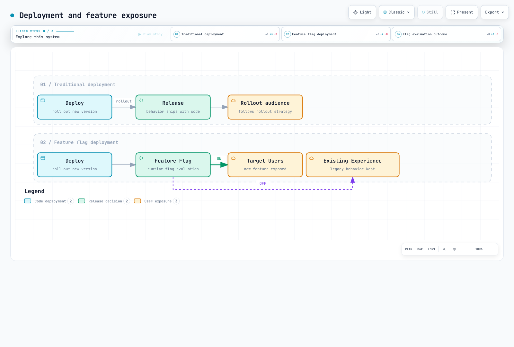
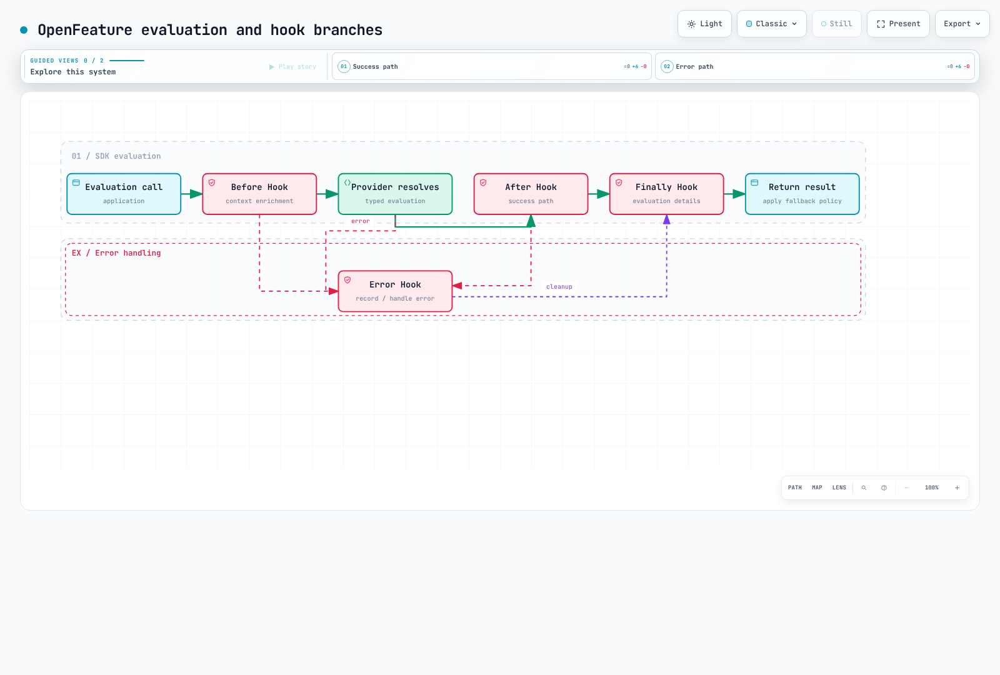
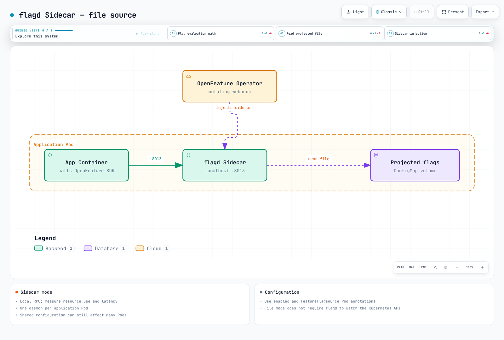

# 功能标志与 OpenFeature

> **审查基线**：flagd 0.16.3、OpenFeature Operator 0.9.3；各 SDK 示例中固定了 SDK 版本
> **最后更新**：2026年9月11日

功能标志将代码部署与运行时功能曝光分开。本指南介绍 OpenFeature、flagd、Kubernetes Operator 配置、SDK 集成和 GitOps 工作流。变更效果取决于同步和消费者状态，不能保证即时回滚。

验证范围：四个 SDK 示例均在本地文件模式下编译/运行。在隔离测试网络中检查了原生 flagd HTTP 求值和 Prometheus 指标。Helm、Kustomize、schema 和脚本也经过检查。这些验证不涵盖真实 EKS 部署、应用程序镜像、每一种 RPC/TLS 路径或生产负载。请根据实际环境调整部署 URL、镜像和策略。

---

## 目录

- [概述和学习目标](#overview-and-learning-objectives)
- [OpenFeature 架构](#openfeature-architecture)
- [Kubernetes 上的 flagd](#flagd-on-kubernetes)
- [OpenFeature Operator](#openfeature-operator)
- [应用程序集成](#application-integration)
- [Canary 发布与功能标志组合](#canary-release-and-feature-flag-combination)
- [GitOps 集成](#gitops-integration)
- [可观测性](#observability)
- [生产最佳实践](#production-best-practices)
- [参考资料](#references)

---

## 概述和学习目标 {#overview-and-learning-objectives}

### 学习目标

完成本节后，你将能够：

- 说明功能标志在渐进式交付和持续部署中的作用
- 比较功能标志平台，并为你的环境选择合适的工具
- 使用 OpenFeature Operator 在 Kubernetes 上部署 flagd
- 在 Go、Java、Python 和 Node.js 应用程序中集成 OpenFeature SDK
- 将功能标志与 Canary 发布结合，制定更精细的推出策略
- 通过 GitOps 工作流以代码方式管理功能标志配置
- 使用 Prometheus 和 Grafana 监控标志求值

### 什么是功能标志？

功能标志（也称功能切换或功能开关）是一种无需部署新代码即可在运行时启用或禁用功能的机制。核心思路很简单：用检查标志值的条件语句包装一段代码路径，并从外部控制该值。

```
if featureEnabled("new-checkout"):
    renderNewCheckout()
else:
    renderLegacyCheckout()
```

功能标志在软件交付中有几种不同用途：

| 类别 | 用途 | 生命周期 | 示例 |
|----------|---------|----------|---------|
| **发布标志** | 将部署与发布解耦 | 数天至数周 | 开发期间将尚未完成的功能隐藏在标志后面 |
| **实验标志** | A/B 测试和数据驱动决策 | 数周至数月 | 向 10% 的用户展示定价页的 B 变体 |
| **运维标志** | 运维控制和熔断器 | 长期 | 关闭非关键下游依赖的开关 |
| **权限标志** | 权益和访问控制 | 长期 | 仅向付费客户启用高级功能 |

功能曝光不能替代身份验证或授权。被禁用的代码仍可能存在于镜像中；功能标志不是密钥存储，也不是访问控制边界。

### 渐进式交付中的功能标志

渐进式交付通过精细控制哪些用户在何时看到新功能，扩展了持续交付。功能标志是这一模式的重要构件：



[🔍 查看交互式图表](https://www.atomai.click/kubernetes-docs/archmaps/en-gitops-05-feature-flags-0.html)

代码部署仍遵循工作负载部署策略，例如滚动更新。功能标志单独控制应用程序选择哪种行为。这与流量拆分方式（如 Canary 部署）有本质区别；流量拆分决定请求命中哪个 Pod 版本。两种技术可以互补，详见[Canary 发布与功能标志组合](#canary-release-and-feature-flag-combination)。

### 功能标志工具比较

应结合评估管理功能、运行时求值和特定语言的 Provider 支持情况。Provider 可用并不代表不同语言拥有相同的 Hook、事件或定向语义。定价和合同功能请查阅厂商当前文档；此处侧重集成和运维责任。

| 工具 | 作用 | 集成和运维检查 |
|------|------|------------------------------------|
| flagd | 自行管理求值和规则同步 | 配置来源、RPC/进程内模式、Operator、可用性和可观测性 |
| [LaunchDarkly](https://launchdarkly.com/docs/sdk/openfeature) | 托管功能标志服务 | 检查各语言 Provider、上下文/事件映射及底层 SDK 能力 |
| [Flagsmith](https://docs.flagsmith.com/integrating-with-flagsmith/openfeature) | 托管或自托管标志平台 | 检查服务器端与 Web Provider 的差异及语言覆盖范围 |
| [Harness FME](https://github.com/harness/developer-hub/tree/main/docs/feature-management-experimentation) | 功能管理和实验 | 检查现有 Split 设置的迁移、Provider 和实验数据集成 |
| [Unleash](https://github.com/Unleash/unleash-openfeature-node-provider) | 由 Unleash SDK 支持的 Provider 生态 | 检查上下文转换、粘性和可选功能；Node Provider 未实现 tracking API |

本指南直接验证了 flagd 路径，不测试商业账户连接，也不证明所有 Provider 的功能完全等效。

### OpenFeature 标准

OpenFeature 是 CNCF 孵化项目，提供厂商中立、由社区驱动的功能标志求值 API。它通过定义适用于任何后端 Provider 的标准接口，降低厂商锁定风险。

OpenFeature 的主要优势：

- **厂商中立的 API**：迁移 Provider 配置和规则时，减少对求值调用的修改
- **一致的求值模型**：布尔、字符串、数字和对象标志类型使用统一的求值 API
- **Hooks**：用于日志、指标、验证和跟踪的生命周期 Hook
- **求值上下文**：传递给每次求值的结构化上下文（用户属性、环境信息）
- **多语言支持**：提供 Go、Java、Python、Node.js、.NET、PHP 等语言的官方 SDK

---

## OpenFeature 架构 {#openfeature-architecture}

### SDK 结构

OpenFeature SDK 采用分层架构，将求值 API 与标志管理后端分离：


[🔍 查看交互式图表](https://www.atomai.click/kubernetes-docs/archmaps/en-gitops-05-feature-flags-1.html)

### 核心组件

**求值 API**：应用程序代码交互的主要接口。它提供类型化求值方法（`getBooleanValue`、`getStringValue`、`getNumberValue`、`getObjectValue`）以及用于限定求值范围的 `Client` 抽象。

**Provider**：将 OpenFeature SDK 连接到特定标志管理后端的具体实现。每个 domain 同一时间只有一个 Provider 处于活动状态，SDK 会将所有标志解析工作委托给它。

**求值上下文**：为标志求值提供信息的一组键值属性。常见属性包括 `targetingKey`（用户 ID）、`email`、`region`、`environment` 和自定义属性。上下文会贯穿整个求值流程。

**Hooks**：在标志求值生命周期的四个阶段进行拦截：

| 阶段 | 时机 | 常见用途 |
|-------|--------|----------|
| `before` | 求值前 | 丰富上下文、验证输入 |
| `after` | 成功求值后 | 记录指标、记录决策 |
| `error` | 求值失败时 | 错误报告、回退逻辑 |
| `finally` | 始终执行（类似 try/finally） | 清理、结束 span |

### Provider 模型

Provider 抽象降低了应用程序与后端的耦合。下列示意接口不是任何特定语言的实现约定；初始化、事件和上下文变更支持情况因 SDK 而异：

```
Provider Interface:
  - resolveBooleanValue(flagKey, defaultValue, context) -> ResolutionDetails
  - resolveStringValue(flagKey, defaultValue, context) -> ResolutionDetails
  - resolveNumberValue(flagKey, defaultValue, context) -> ResolutionDetails
  - resolveObjectValue(flagKey, defaultValue, context) -> ResolutionDetails
  - initialize(context) -> void
  - shutdown() -> void
```

在支持的范围内，切换 Provider 可以保留求值 API；但标志键、变体、定向、凭证、上下文语义和运维行为仍需迁移和测试。重新使用 Client 前，请检查每个 Provider 的构造方式并等待其就绪。完整示例见下文 [Go SDK](#go-sdk)。此图只是 Provider 选择示例，并未规定 flagd 只能用于开发环境。


[🔍 查看交互式图表](https://www.atomai.click/kubernetes-docs/archmaps/en-gitops-05-feature-flags-2.html)

### 求值流程

成功路径按顺序执行 Before、Provider 解析、After 和 Finally。在 Before、Provider 解析或 After 阶段出错时，会先走 Error 路径再完成收尾。当前 Go 接口会将求值详情传给 Finally。



[🔍 查看交互式图表](https://www.atomai.click/kubernetes-docs/archmaps/en-gitops-05-feature-flags-11.html)

---

## Kubernetes 上的 flagd {#flagd-on-kubernetes}

### 什么是 flagd？

flagd 是轻量级开源功能标志守护进程，也是符合 OpenFeature 标准的标志求值引擎参考实现。它面向云原生环境设计，可原生运行于 Kubernetes。

主要特性：

- **轻量**：Go 服务，其 CPU 和内存需求取决于标志数量、来源、流量和启用的遥测
- **Kubernetes 原生**：从 FeatureFlag CRD、ConfigMap 或文件读取标志配置
- **gRPC 和 HTTP**：求值服务使用端口 8013；独立的 OFREP HTTP 端点使用端口 8016。管理/指标默认使用 8014，定义同步默认使用 8015
- **实时同步**：从已配置来源同步定义；更新是异步的，必须检查消费者拿到的是否足够新
- **比例求值**：内置使用一致性哈希进行百分比推出
- **定向规则**：基于 JSON Logic，可用于复杂受众分群

### flagd 架构


[🔍 查看交互式图表](https://www.atomai.click/kubernetes-docs/archmaps/en-gitops-05-feature-flags-3.html)

### Helm 安装 {#helm-installation}

官方仓库发布 `open-feature-operator` chart。不要假设存在独立的 `openfeature/flagd` chart。安装 Operator 后，再配置 Pod 注入或 `Flagd` 资源来创建求值服务。请先为 Webhook 证书准备 [cert-manager](../security/10-cert-manager.md)。

将配置保存为 `openfeature-values.yaml`。Operator `v0.9.3` 默认使用 flagd `v0.16.2`；本示例将 sidecar 和共享部署镜像都固定为 `v0.16.3`。资源值仅适合作为实验起点，不是经测量的生产容量建议。

```yaml
sidecarConfiguration:
  image:
    repository: ghcr.io/open-feature/flagd
    tag: v0.16.3
  resources:
    requests:
      cpu: 50m
      memory: 64Mi
    limits:
      cpu: 200m
      memory: 256Mi
flagdConfiguration:
  image:
    repository: ghcr.io/open-feature/flagd
    tag: v0.16.3
```

```bash
helm repo add openfeature https://open-feature.github.io/open-feature-operator/
helm repo update
helm upgrade --install open-feature-operator openfeature/open-feature-operator \
  --version v0.9.3 \
  --namespace open-feature-operator-system --create-namespace \
  -f openfeature-values.yaml --wait --timeout 5m
```

`sidecarConfiguration` 和 `flagdConfiguration` 分别配置不同的部署方式。旧示例中的 `sidecarConfig`、`flagdProxyConfig` 和 `controllerManager.manager.env` 不属于此 chart 的配置路径。Webhook 默认的 `failurePolicy: Ignore`，因此 Webhook 不可用时，Pod 可能没有 sidecar。请限定受影响的工作负载，并评估故障影响后再决定是否使用 `Fail`；同时定义应用程序 Provider 初始化和回退行为。

### FeatureFlag CRD

OpenFeature Operator 引入 `FeatureFlag` 自定义资源定义，使你能将功能标志声明为 Kubernetes 资源。这是以 Kubernetes 原生方式管理标志配置的主要机制。

以下是一个完整 `FeatureFlag` CR 示例，展示主要标志类型和定向规则：

```yaml
apiVersion: v1
kind: Namespace
metadata:
  name: flag-demo
---
apiVersion: core.openfeature.dev/v1beta1
kind: FeatureFlag
metadata:
  name: product-flags
  namespace: flag-demo
spec:
  flagSpec:
    flags:
      new-checkout:
        state: ENABLED
        variants:
          'on': true
          'off': false
        defaultVariant: 'off'
        targeting:
          if:
          - ==:
            - var: tier
            - internal
          - 'on'
          - fractional:
            - - 'on'
              - 10
            - - 'off'
              - 90
      banner-color:
        state: ENABLED
        variants:
          blue: '#0055ff'
          green: '#008855'
        defaultVariant: blue
        targeting:
          if:
          - ==:
            - var: tier
            - enterprise
          - green
          - blue
      rate-limit:
        state: ENABLED
        variants:
          standard: 100
          premium: 500
        defaultVariant: standard
        targeting:
          if:
          - in:
            - var: tier
            - - premium
              - enterprise
          - premium
          - standard
      feature-config:
        state: ENABLED
        variants:
          default:
            maxUploadBytes: 10485760
            enableOCR: false
          enhanced:
            maxUploadBytes: 52428800
            enableOCR: true
        defaultVariant: default
        targeting:
          if:
          - and:
            - ==:
              - var: environment
              - production
            - in:
              - var: tier
              - - premium
                - enterprise
          - enhanced
          - default
```

### Sidecar 注入与独立部署

flagd 在 Kubernetes 上可采用两种运行模式。选择哪一种取决于延迟要求、运维模式和资源预算。

**Sidecar 模式**（由 OpenFeature Operator 注入）：



[🔍 查看交互式图表](https://www.atomai.click/kubernetes-docs/archmaps/en-gitops-05-feature-flags-4.html)

**独立模式**（集中式部署）：


[🔍 查看交互式图表](https://www.atomai.click/kubernetes-docs/archmaps/en-gitops-05-feature-flags-5.html)

| 方面 | Sidecar | 独立部署 |
|--------|---------|------------|
| **RPC 路径** | 调用 localhost | 调用共享 Service；需测量实际延迟 |
| **资源使用** | 每个 Pod 一个 flagd | 多个 Pod 共享一个实例 |
| **故障范围** | 守护进程故障限于单个 Pod；共享配置可能影响多个 Pod | 共享服务故障可能影响多个消费者 |
| **扩缩容** | 随应用 Pod 扩缩容 | 独立扩缩容 |
| **配置** | Operator Pod 准入和来源引用 | Operator 管理的 Flagd CR 或单独管理的部署 |
| **权衡** | 每 Pod 的运行时与运维开销 | 共享容量并增加服务依赖 |

应用此共享 `Flagd` 之前，请先创建下文所述的 FeatureFlag 和 FeatureFlagSource。Operator 管理其 Deployment 和 ClusterIP Service。文件来源不需要在 flagd Pod 中挂载 API token。Service 地址为 `flagd.flag-demo.svc.cluster.local`，RPC 端口为 8013。

```yaml
apiVersion: v1
kind: ServiceAccount
metadata:
  name: flagd-demo
  namespace: flag-demo
automountServiceAccountToken: false
---
apiVersion: core.openfeature.dev/v1beta1
kind: Flagd
metadata:
  name: flagd
  namespace: flag-demo
spec:
  replicas: 2
  serviceType: ClusterIP
  serviceAccountName: flagd-demo
  featureFlagSource: product-flags-source
```

---

## OpenFeature Operator

OpenFeature Operator 是 Kubernetes Operator，负责管理 flagd 实例的生命周期并同步功能标志配置。它是 Kubernetes 生产环境中运行 flagd 的推荐方式。

### 安装

使用 [Helm 安装](#helm-installation)中固定的 Operator 安装方式和镜像覆盖值。安装 Operator 并不会自动为每个应用程序部署共享 flagd 服务。

### Operator 引入的 CRD

Operator 引入多个用于管理功能标志的 CRD：

| CRD | 用途 |
|-----|------|
| `FeatureFlag` | 内联声明标志定义（标志键、变体、定向规则） |
| `FeatureFlagSource` | 为工作负载指定标志配置来源（CRD、文件、HTTP） |

### FeatureFlagSource CRD

`FeatureFlagSource` 为注入式或共享 flagd 实例配置来源和设置。本基线使用 `file` 来源引用 `flag-demo/product-flags`。Operator 会提供 ConfigMap 卷，因此 flagd 容器无需直接监听 Kubernetes API。请先创建对应的 FeatureFlag。

```yaml
apiVersion: core.openfeature.dev/v1beta1
kind: FeatureFlagSource
metadata:
  name: product-flags-source
  namespace: flag-demo
spec:
  sources:
  - source: flag-demo/product-flags
    provider: file
  port: 8013
  managementPort: 8014
  evaluator: json
  logFormat: json
  probesEnabled: true
```

| 来源 | `source` 格式 | 前置条件 |
|--------|---------------|----------|
| `file` | `namespace/FeatureFlag-name` | Operator 提供 ConfigMap 卷 |
| `kubernetes` | `namespace/FeatureFlag-name` | flagd 需要 Kubernetes API 权限和凭证 |
| `flagd-proxy` | Operator 文档中的代理来源配置 | 代理服务和访问边界 |
| `http` | 真实 HTTPS JSON 端点 | 网络连通、身份验证和服务器信任 |
| `grpc` | 真实的 `host:port` | 同步服务器、TLS 和所需身份验证 |

每个已配置来源都必须真实存在。这些是 FeatureFlagSource 值，并不是 flagd CLI 的自动检测 URI。CLI 的 Kubernetes 自动检测 URI 为 `core.openfeature.dev/flag-demo/product-flags`。不要将身份验证 token 提交到 CR。`evaluator: json` 选择求值引擎，但不会启用缓存，也不会记录每次标志求值。

添加另一个 FeatureFlag CR 时，应在 FeatureFlagSource 中引用它，或将其定义合并到现有 `product-flags` 映射中。仅创建 CR 并不会使每个 flagd 实例或 SDK 自动使用它。

### Pod 自动注入

在 Deployment 的 Pod 模板上设置两个注解；仅设置命名空间标签不会启用注入。以下集成模板要求使用真正集成了 SDK、并在端口 8080 提供 HTTP 服务的应用程序镜像。使用文件来源时，sidecar 不需要 Kubernetes API token。

```yaml
apiVersion: v1
kind: ServiceAccount
metadata:
  name: order-service
  namespace: flag-demo
automountServiceAccountToken: false
---
apiVersion: apps/v1
kind: Deployment
metadata:
  name: order-service
  namespace: flag-demo
spec:
  replicas: 3
  selector:
    matchLabels:
      app: order-service
  template:
    metadata:
      labels:
        app: order-service
      annotations:
        # This annotation triggers flagd sidecar injection
        openfeature.dev/enabled: "true"
        # Reference the FeatureFlagSource to use
        openfeature.dev/featureflagsource: "product-flags-source"
    spec:
      serviceAccountName: order-service
      automountServiceAccountToken: false
      containers:
        - name: order-service
          image: YOUR_REGISTRY/order-service:YOUR_VERSION
          ports:
            - containerPort: 8080
              name: http
          env:
            # The flagd provider connects to localhost because the sidecar
            # runs in the same pod
            - name: FLAGD_HOST
              value: "localhost"
            - name: FLAGD_PORT
              value: "8013"
```

检查准入后的 Pod，确认注入成功，并且镜像、参数和卷符合预期的 FeatureFlagSource。Webhook 的失败策略为 Ignore 时，Pod 正在运行并不能证明注入成功。

### ConfigMap 与 CRD 同步

此处使用文件来源时，Operator 通过 ConfigMap 卷提供 FeatureFlag 定义。直接连接 Kubernetes 和代理来源遵循不同路径。下图描述文件来源路径：


[🔍 查看交互式图表](https://www.atomai.click/kubernetes-docs/archmaps/en-gitops-05-feature-flags-6.html)

文件来源的定义变更无需重启 Pod 即可被读取，但 ConfigMap 投射和文件读取是异步的。更换镜像或来源配置时，请分别检查已部署 Pod 的配置，并在需要时执行滚动更新。初始就绪不代表每个消费者都拿到了最新定义。

---

## 应用程序集成 {#application-integration}

### Go SDK

本示例使用 Go 1.25+、OpenFeature Go SDK `v1.18.0` 和 flagd Provider `v0.6.0`。`NewProvider` 同时返回 Provider 和错误。使用 `WithFileResolver` 与 `WithOfflineFilePath` 选择本地文件解析；旧示例中的 `WithResolverType` 或 `flagd.GRPC` 与此 Provider API 不匹配。

将 `spec.flagSpec` 中的 JSON 对象保存为 `flags.json`，不要保存整个 Kubernetes 资源。该对象必须包含下方读取的四个标志键。导出现有资源时，应选择实际的命名空间。

```bash
kubectl get featureflag product-flags -n flag-demo -o json | jq '.spec.flagSpec' > flags.json
mkdir go-flag-demo
cp flags.json go-flag-demo/
cd go-flag-demo
go mod init example.com/go-flag-demo
go get github.com/open-feature/go-sdk@v1.18.0
go get github.com/open-feature/go-sdk-contrib/providers/flagd@v0.6.0
# Save the code below as main.go, then run it.
go run . flags.json
```

文件模式仅用于本地验证，不会调用 Kubernetes 或 flagd 服务。生产环境中，应从已验证的服务器状态获取 `tier` 等属性。不得使用不可信请求标头决定权益或授权。

```go
package main

import (
    "context"
    "encoding/json"
    "errors"
    "log"
    "os"
    "time"

    "github.com/open-feature/go-sdk/openfeature"
    flagd "github.com/open-feature/go-sdk-contrib/providers/flagd/pkg"
)

func run(flagFile string) error {
    provider, err := flagd.NewProvider(
        flagd.WithFileResolver(),
        flagd.WithOfflineFilePath(flagFile),
    )
    if err != nil {
        return err
    }
    if err := openfeature.SetProviderAndWait(provider); err != nil {
        return err
    }
    defer openfeature.Shutdown()

    client := openfeature.NewClient("docs-demo")
    ctx, cancel := context.WithTimeout(context.Background(), time.Second)
    defer cancel()
    evaluation := openfeature.NewEvaluationContext("synthetic-user", map[string]interface{}{
        "tier": "internal",
        "region": "ap-northeast-2",
        "environment": "development",
    })

    enabled, errBool := client.BooleanValue(ctx, "new-checkout", false, evaluation)
    color, errString := client.StringValue(ctx, "banner-color", "#000000", evaluation)
    limit, errInteger := client.IntValue(ctx, "rate-limit", 10, evaluation)
    config, errObject := client.ObjectValue(ctx, "feature-config", map[string]interface{}{}, evaluation)
    if err := errors.Join(errBool, errString, errInteger, errObject); err != nil {
        return err
    }
    return json.NewEncoder(os.Stdout).Encode(map[string]interface{}{
        "enabled": enabled,
        "color": color,
        "limit": limit,
        "config": config,
    })
}

func main() {
    if len(os.Args) != 2 {
        log.Fatal("usage: go run . flags.json")
    }
    if err := run(os.Args[1]); err != nil {
        log.Fatal(err)
    }
}
```

若要通过 RPC 连接 flagd sidecar，只需将构造函数替换为下列代码。保留 Provider 就绪等待、求值错误处理和关闭逻辑。若使用共享 `Flagd` 部署，应使用其 Service DNS 名称而不是 loopback，并使网络和 TLS 设置与该部署相符。

```go
provider, err := flagd.NewProvider(
    flagd.WithHost("127.0.0.1"),
    flagd.WithPort(8013),
)
```

### Java SDK

本示例使用 JDK 21、Maven 3.9、OpenFeature Java SDK `1.22.1` 和 flagd Provider `0.14.1`。使用 `Config.Resolver` 选择 resolver，而不是 `FlagdOptions.ResolverType`。`MutableContext.add` 提供字符串、整数、布尔值及其他受支持上下文值的重载。

将以下内容保存为新项目中的 `pom.xml`。

```xml
<project xmlns="http://maven.apache.org/POM/4.0.0" xmlns:xsi="http://www.w3.org/2001/XMLSchema-instance" xsi:schemaLocation="http://maven.apache.org/POM/4.0.0 https://maven.apache.org/xsd/maven-4.0.0.xsd">
  <modelVersion>4.0.0</modelVersion>
  <groupId>example.docs</groupId><artifactId>flag-demo</artifactId><version>1.0.0</version>
  <properties><maven.compiler.release>21</maven.compiler.release><project.build.sourceEncoding>UTF-8</project.build.sourceEncoding></properties>
  <dependencies>
    <dependency><groupId>dev.openfeature</groupId><artifactId>sdk</artifactId><version>1.22.1</version></dependency>
    <dependency><groupId>dev.openfeature.contrib.providers</groupId><artifactId>flagd</artifactId><version>0.14.1</version></dependency>
  </dependencies>
  <build><plugins><plugin><groupId>org.apache.maven.plugins</groupId><artifactId>maven-compiler-plugin</artifactId><version>3.14.1</version></plugin></plugins></build>
</project>
```

将下列代码保存为 `src/main/java/FlagDemo.java`，并将相同的 `flags.json` 放在项目根目录。文件模式求值标志时不会连接服务器。

```java
import dev.openfeature.contrib.providers.flagd.Config;
import dev.openfeature.contrib.providers.flagd.FlagdOptions;
import dev.openfeature.contrib.providers.flagd.FlagdProvider;
import dev.openfeature.sdk.Client;
import dev.openfeature.sdk.FlagEvaluationDetails;
import dev.openfeature.sdk.MutableContext;
import dev.openfeature.sdk.MutableStructure;
import dev.openfeature.sdk.OpenFeatureAPI;
import dev.openfeature.sdk.Value;
import java.nio.file.Path;
import java.util.List;

public class FlagDemo {
    public static void main(String[] args) {
        if (args.length != 1) throw new IllegalArgumentException("usage: FlagDemo flags.json");
        OpenFeatureAPI api = OpenFeatureAPI.getInstance();
        FlagdOptions options = FlagdOptions.builder()
                .resolverType(Config.Resolver.FILE)
                .offlineFlagSourcePath(Path.of(args[0]).toAbsolutePath().toString())
                .build();
        try {
            api.setProviderAndWait(new FlagdProvider(options));
            Client client = api.getClient("docs-demo");
            MutableContext context = new MutableContext("synthetic-user");
            context.add("tier", "internal");
            FlagEvaluationDetails<Boolean> enabled = client.getBooleanDetails("new-checkout", false, context);
            FlagEvaluationDetails<String> color = client.getStringDetails("banner-color", "#000000", context);
            FlagEvaluationDetails<Integer> limit = client.getIntegerDetails("rate-limit", 10, context);
            Value fallback = new Value(new MutableStructure().add("maxUploadBytes", 0).add("enableOCR", false));
            FlagEvaluationDetails<Value> config = client.getObjectDetails("feature-config", fallback, context);
            for (FlagEvaluationDetails<?> result : List.of(enabled, color, limit, config)) {
                if (result.getErrorCode() != null) throw new IllegalStateException(result.getErrorCode().toString());
            }
            System.out.printf("enabled=%s color=%s limit=%d config=%s%n", enabled.getValue(), color.getValue(), limit.getValue(), config.getValue().asStructure().asObjectMap());
        } finally {
            api.shutdown();
        }
    }
}
```

```bash
mvn compile org.apache.maven.plugins:maven-dependency-plugin:3.8.1:build-classpath \
  -Dmdep.outputFile=classpath.txt
java -cp "target/classes:$(cat classpath.txt)" FlagDemo flags.json
```

如需使用 RPC，选择 `Config.Resolver.RPC`，配置 `host`、`port` 和 `deadline`，并移除 `offlineFlagSourcePath`。针对已就绪的服务器调用 `setProviderAndWait`，并在应用程序退出时调用 `shutdown`。这个独立示例没有添加日志实现，因此 SLF4J 可能报告 NOP logger 警告。实际服务应使用现有的 SLF4J 日志配置。

### Python SDK

此完整的本地文件示例使用 Python 3.10+、`openfeature-sdk==0.10.0` 和 `openfeature-provider-flagd==0.5.2`。继续使用相同的 `flags.json`。公开构造函数参数为 `resolver_type`，枚举值可为 `ResolverType.FILE`；`ResolverType.GRPC` 和普通字符串 `"rpc"` 不符合此配置 API。

```bash
python -m venv python-flag-demo/.venv
python-flag-demo/.venv/bin/python -m pip install \
  openfeature-sdk==0.10.0 openfeature-provider-flagd==0.5.2
# Save the code below as python-flag-demo/main.py.
python-flag-demo/.venv/bin/python python-flag-demo/main.py flags.json
```

```python
import json
import sys
from pathlib import Path

from openfeature import api
from openfeature.contrib.provider.flagd import FlagdProvider
from openfeature.contrib.provider.flagd.config import ResolverType
from openfeature.evaluation_context import EvaluationContext

if len(sys.argv) != 2:
    raise SystemExit("usage: python main.py flags.json")

provider = FlagdProvider(
    resolver_type=ResolverType.FILE,
    offline_flag_source_path=str(Path(sys.argv[1]).resolve()),
)
try:
    api.set_provider_and_wait(provider)
    client = api.get_client("docs-demo")
    context = EvaluationContext(targeting_key="synthetic-user", attributes={"tier": "internal"})
    results = {
        "enabled": client.get_boolean_details("new-checkout", False, context),
        "color": client.get_string_details("banner-color", "#000000", context),
        "limit": client.get_integer_details("rate-limit", 10, context),
        "config": client.get_object_details("feature-config", {"maxUploadBytes": 0, "enableOCR": False}, context),
    }
    for name, result in results.items():
        if result.error_code is not None:
            raise RuntimeError(f"{name}: {result.error_code}")
    print(json.dumps({name: result.value for name, result in results.items()}))
finally:
    api.shutdown()
```

如需 RPC，可改用 `FlagdProvider(host="127.0.0.1", port=8013,
resolver_type=ResolverType.RPC, deadline_ms=500)`。
移除离线文件选项，并针对已就绪的 flagd 服务初始化。保留 `set_provider_and_wait` 和 `shutdown`。需要区分回退值与成功求值时，请像上面一样检查详细结果的 `error_code`。

### Node.js SDK

此 TypeScript 示例使用 Node.js 22、`@openfeature/server-sdk@1.23.0` 和 `@openfeature/flagd-provider@0.16.1`。`resolverType` 接受 `rpc` 或 `in-process`，不接受 `grpc`。在这个 SDK 中，将 `offlineFlagSourcePath` 添加到 in-process resolver 会选择本地文件，而不是网络同步。

```bash
mkdir node-flag-demo
cp flags.json node-flag-demo/
cd node-flag-demo
npm init -y
npm pkg set type=module
npm install @openfeature/server-sdk@1.23.0 @openfeature/flagd-provider@0.16.1
npm install --save-dev typescript@5.9.3 @types/node@22.19.0
# Save the code below as main.ts.
npx tsc main.ts --target ES2022 --module NodeNext --moduleResolution NodeNext \
  --strict --skipLibCheck --outDir dist
node dist/main.js flags.json
```

```typescript
import { OpenFeature, type EvaluationContext } from '@openfeature/server-sdk';
import { FlagdProvider } from '@openfeature/flagd-provider';

const flagFile = process.argv[2];
if (!flagFile) throw new Error('usage: node dist/main.js flags.json');
const provider = new FlagdProvider({
  resolverType: 'in-process',
  offlineFlagSourcePath: flagFile,
});
try {
  await OpenFeature.setProviderAndWait(provider);
  const client = OpenFeature.getClient('docs-demo');
  const context: EvaluationContext = {targetingKey: 'synthetic-user', tier: 'internal'};
  const results = {
    enabled: await client.getBooleanDetails('new-checkout', false, context),
    color: await client.getStringDetails('banner-color', '#000000', context),
    limit: await client.getNumberDetails('rate-limit', 10, context),
    config: await client.getObjectDetails('feature-config', {maxUploadBytes: 0, enableOCR: false}, context),
  };
  for (const [name, result] of Object.entries(results)) {
    if (result.errorCode) throw new Error(`${name}: ${result.errorCode}`);
  }
  console.log(JSON.stringify(Object.fromEntries(Object.entries(results).map(([name, result]) => [name, result.value]))));
} finally {
  await OpenFeature.clearProviders();
}
```

如需 RPC，请配置 `resolverType: 'rpc'`、服务器 `host` 和 `port: 8013`，并移除 `offlineFlagSourcePath`。在接受请求前等待 `setProviderAndWait` 完成，并在应用程序关闭时等待 `clearProviders` 完成。不要为每个请求构造 Provider。此本地文件测试不会验证实际 RPC 连接。

### 定向规则深入解析

`targeting` 最终必须返回 `variants` 中存在的**变体名称**。`fractional` 返回变体名称，不是用户列表，因此不要检查某个用户键是否 `in` 其结果。基线示例将内部用户规则与推出规则组合为：`if: [internal condition, on, fractional rule]`。

在来源中引用此额外 CR，或将它的定义合并到基线 `flags` 映射中。请使用可信属性，并将 `app_version` 规范化为 SemVer。

```yaml
apiVersion: core.openfeature.dev/v1beta1
kind: FeatureFlag
metadata:
  name: targeting-examples
  namespace: flag-demo
spec:
  flagSpec:
    flags:
      premium-feature:
        state: ENABLED
        variants:
          'on': true
          'off': false
        defaultVariant: 'off'
        targeting:
          if:
          - and:
            - ==:
              - var: tier
              - enterprise
            - '>=':
              - var: account_age_days
              - 30
          - 'on'
          - 'off'
      new-search-algo:
        state: ENABLED
        variants:
          'on': true
          'off': false
        defaultVariant: 'off'
        targeting:
          fractional:
          - - 'on'
            - 20
          - - 'off'
            - 80
      api-v2:
        state: ENABLED
        variants:
          'on': true
          'off': false
        defaultVariant: 'off'
        targeting:
          if:
          - sem_ver:
            - var: app_version
            - '>='
            - 2.0.0
          - 'on'
          - 'off'
```

fractional 中的整数权重是相对权重。示例将哈希空间按 20/80 划分，不保证实际用户或请求恰好占 20%。默认分桶键由标志键和 `targetingKey` 组合而成。请使用稳定且非空的键，不要给所有匿名访客分配相同键。相同规则和键的重复求值结果稳定；改变权重、键或求值器实现都可能改变分配结果。

定向未匹配时使用的标志 `defaultVariant`，不同于 SDK 调用方提供的默认值。在经过测试的 Go flagd Provider 中，`DISABLED` 会返回调用方默认值且不报错，原因值为 `DISABLED`。禁用标志不一定会得到 false。Kill switch 应在保持 `ENABLED` 的同时显式选择 off 变体，并验证值、错误、原因以及向消费者的传播。

---

## Canary 发布与功能标志组合 {#canary-release-and-feature-flag-combination}

此流程假设 v1 主版本已健康并初始化。应区分首次 Canary 初始化与后续工作负载版本的分析。请通过实际求值（包括定向规则）确认初始状态为 OFF；仅检查默认 off 值并不足够。

功能标志和 Canary 发布是互补策略。Canary 在基础设施层控制流量（由哪个 Pod 版本处理请求），功能标志在应用程序层控制行为（执行哪个代码路径）。组合使用能提供更细致的发布控制。

### 架构：Flagger 与功能标志


[🔍 查看交互式图表](https://www.atomai.click/kubernetes-docs/archmaps/en-gitops-05-feature-flags-7.html)

这是面向 [Flagger](./04-flagger.md) 1.45 的 Istio 集成模板。控制器必须监视 `flag-demo`，Deployment、Istio 和 Prometheus 指标都必须已存在。应用镜像必须实际集成 SDK。`threshold: 5` 是一次分析期间累计失败检查的上限，不是要求成功的次数。所有数字都是示例策略，应根据实际 SLO 调整。

应用程序提供且可信的 `release_id` 可用于限定新行为的启用范围。不要把 Pod 的 Canary 角色与应用程序 release ID 混淆。工作负载晋级不会自动将功能标志开放到 100%；扩大标志曝光和恢复行为都需要单独审批、Git 变更或已实现的自动化。

### Flagger 与功能标志工作流

以下工作流使用 Flagger 管理流量，并使用功能标志在 Canary Pod 内进行精细控制：

**阶段 1——标志关闭时部署**：发布启用了新标志但默认关闭的 v2。Flagger 开始将少量流量路由到 v2。

**阶段 2——启用有限用户群**：使用 `tier: internal` 等可信属性和预期 release ID。扩大范围前，确认实际消费者版本和功能曝光情况。

**阶段 3——扩大用户群**：单独更改获批的标志权重，同时监控应用程序结果和工作负载分析。

**阶段 4——分别作出晋级决策**：Flagger 可在分析通过后晋级工作负载。将功能向 100% 用户开放是单独的配置变更，也需要单独验证。

Flagger Canary 资源示例：

```yaml
apiVersion: flagger.app/v1beta1
kind: Canary
metadata:
  name: order-service
  namespace: flag-demo
spec:
  targetRef:
    apiVersion: apps/v1
    kind: Deployment
    name: order-service
  progressDeadlineSeconds: 600
  service:
    port: 8080
    targetPort: 8080
  analysis:
    interval: 1m
    threshold: 5
    maxWeight: 50
    stepWeight: 10
    metrics:
    - name: request-success-rate
      thresholdRange:
        min: 99
      interval: 1m
    - name: request-duration
      thresholdRange:
        max: 500
      interval: 1m
```

Webhook 集成需要真实接收方、身份验证、重试处理和版本检查。成功调用 `rollback` Hook 表示请求回滚，不是回滚完成后的通知。`post-rollout` 可在成功或失败时运行，因此必须检查实际结果。元数据字符串是字面值，不是 Go template 表达式。本示例不会安装外部 flag-controller 服务。

### 使用功能标志进行 A/B 测试

稳定的定向键和不变的规则会产生稳定的变体分配。将此 CR 添加到来源中，或合并到现有标志映射。34/33/33 权重不保证精确的用户数量。

```yaml
apiVersion: core.openfeature.dev/v1beta1
kind: FeatureFlag
metadata:
  name: ab-test-checkout
  namespace: flag-demo
spec:
  flagSpec:
    flags:
      checkout-variant:
        state: ENABLED
        variants:
          control: classic
          variant-a: streamlined
          variant-b: one-click
        defaultVariant: control
        targeting:
          fractional:
          - - control
            - 34
          - - variant-a
            - 33
          - - variant-b
            - 33
```

使用字符串求值详情检查值、变体和错误。只有在实际交付所选体验时才记录曝光；完成求值并不能证明用户看到了体验或完成了转化。应另行定义转化事件、样本量、实验时长和结果指标。稳定分桶也不能保证旧/新应用程序版本或过期规则集提供完全相同的体验。

### 暗发布模式

暗发布是在生产环境中部署新功能，但只向内部用户或影子流水线开放。功能标志可简化此模式：

```yaml
apiVersion: core.openfeature.dev/v1beta1
kind: FeatureFlag
metadata:
  name: dark-launch-quote-v2
  namespace: flag-demo
spec:
  flagSpec:
    flags:
      shadow-quote-v2:
        state: ENABLED
        variants:
          "on": true
          "off": false
        defaultVariant: "off"
        targeting:
          # Only enable for specific internal test accounts
          if:
            - in:
              - var: targetingKey
              - - "test-user-001"
                - "test-user-002"
                - "qa-bot-001"
            - "on"
            - "off"
```

影子执行不得将业务操作执行两次。尤其不要对同一订单调用两个支付处理器。应比较只读计算结果，或在无法收费、写入业务记录或发送通知的隔离环境中重放已清理的输入。调用方仍应收到现有实现的结果。

下方是集成片段：`calculateLegacyQuote`、`calculateCandidateQuote` 和 `compareQuotes` 是应用程序函数。两个计算函数都必须没有副作用，并遵循上下文取消。此同步示例可能为请求增加最多一个候选计算超时的延迟；异步实现需要有界队列和独立超时。

```go
func quoteOrder(ctx context.Context, order Order,
    evalCtx openfeature.EvaluationContext) (Quote, error) {
    original, err := calculateLegacyQuote(ctx, order)
    if err != nil {
        return original, err
    }

    shadowEnabled, flagErr := client.BooleanValue(
        ctx, "shadow-quote-v2", false, evalCtx,
    )
    if flagErr == nil && shadowEnabled {
        shadowCtx, cancel := context.WithTimeout(ctx, 50*time.Millisecond)
        defer cancel()
        candidate, err := calculateCandidateQuote(shadowCtx, order)
        if err == nil {
            compareQuotes(original, candidate)
        }
    }
    return original, nil
}
```

### 基于指标的自动推出

以下模板要求使用[可观测性](#observability)一节中的应用程序检测和 PodMonitor。`app` 标签必须标识目标 Deployment，并排除 primary。请将 Prometheus URL 替换为实际 Service 地址。共享 flagd 服务指标无法可靠识别某个 Canary 的求值失败。

```yaml
apiVersion: flagger.app/v1beta1
kind: MetricTemplate
metadata:
  name: app-flag-errors
  namespace: flag-demo
spec:
  provider:
    type: prometheus
    address: http://prometheus.monitoring.svc:9090
  query: |-
    100 * (
      sum(rate(app_feature_flag_evaluations_total{namespace="{{ namespace }}",app="{{ target }}",flag_key="new-checkout",reason="ERROR"}[{{ interval }}]))
      or vector(0)
    ) / sum(rate(app_feature_flag_evaluations_total{namespace="{{ namespace }}",app="{{ target }}",flag_key="new-checkout"}[{{ interval }}]))
---
apiVersion: flagger.app/v1beta1
kind: MetricTemplate
metadata:
  name: app-flag-samples
  namespace: flag-demo
spec:
  provider:
    type: prometheus
    address: http://prometheus.monitoring.svc:9090
  query: sum(increase(app_feature_flag_evaluations_total{namespace="{{ namespace }}",app="{{
    target }}",flag_key="new-checkout"}[{{ interval }}]))
```

确认指标系列确实存在后，将以下条目追加到 Canary 已有的 `spec.analysis.metrics` 列表。示例策略要求每分钟至少有 100 次 SDK 求值，且错误率不超过 1%；它们不统计不同用户，也不能证明业务正确。应单独监控 DISABLED/默认值结果。

```yaml
- name: app-flag-error-rate
  templateRef:
    name: app-flag-errors
  thresholdRange:
    max: 1
  interval: 1m
- name: app-flag-evaluation-count
  templateRef:
    name: app-flag-samples
  thresholdRange:
    min: 100
  interval: 1m
```

Flagger 分析成功只允许工作负载晋级。功能标志变更仍须单独决策。缺失观测值和 NaN 不得视为成功。

---

## GitOps 集成 {#gitops-integration}

### 将功能标志作为代码

使用上文已验证的资源：`product-flags.yaml` 包含 Namespace 和 FeatureFlag；`feature-source.yaml` 包含文件模式 FeatureFlagSource；`flagd.yaml` 包含共享服务的 ServiceAccount 和 Flagd。请先安装 Operator 和 cert-manager。替换仓库 URL，并在需要时配置仓库身份验证。

```text
gitops-config/
├── base/feature-flags/
│   ├── kustomization.yaml
│   ├── product-flags.yaml
│   ├── feature-source.yaml
│   └── flagd.yaml
├── overlays/dev/feature-flags/kustomization.yaml
├── overlays/production/feature-flags/kustomization.yaml
├── validate-flags.py
└── .github/workflows/feature-flags.yml
```

`base/feature-flags/kustomization.yaml`：

```yaml
apiVersion: kustomize.config.k8s.io/v1beta1
kind: Kustomization
resources:
- product-flags.yaml
- feature-source.yaml
- flagd.yaml
```

### 使用 Kustomize 进行环境特定覆盖

以下是 Kustomization 内的**补丁**，不是可直接 apply 的不完整 FeatureFlag。若要对所有开发用户启用标志，除将默认变体设为 on 以外，还要移除现有定向规则。定向规则的优先级可能高于已更改的默认值。其他三个标志保持不变。

`overlays/dev/feature-flags/kustomization.yaml`：

```yaml
apiVersion: kustomize.config.k8s.io/v1beta1
kind: Kustomization
resources:
- ../../../base/feature-flags
patches:
- target:
    group: core.openfeature.dev
    version: v1beta1
    kind: FeatureFlag
    name: product-flags
  patch: |
    - op: remove
      path: /spec/flagSpec/flags/new-checkout/targeting
    - op: replace
      path: /spec/flagSpec/flags/new-checkout/defaultVariant
      value: 'on'
```

`overlays/production/feature-flags/kustomization.yaml`：

```yaml
apiVersion: kustomize.config.k8s.io/v1beta1
kind: Kustomization
resources:
- ../../../base/feature-flags
patches:
- target:
    group: core.openfeature.dev
    version: v1beta1
    kind: FeatureFlag
    name: product-flags
  patch: |
    - op: replace
      path: /spec/flagSpec/flags/new-checkout/targeting
      value:
        if:
        - ==:
          - var: tier
          - internal
        - 'on'
        - fractional:
          - - 'on'
            - 5
          - - 'off'
            - 95
```

使用 Kustomize 5.8.1 渲染两套配置，并在部署前审核完整输出。

```bash
kustomize build overlays/dev/feature-flags
kustomize build overlays/production/feature-flags
```

### 部署 ArgoCD FeatureFlag CR

现有 `platform` AppProject 必须允许此路径中的真实仓库、`flag-demo` 目标，以及 Namespace、ServiceAccount 和 OpenFeature 资源类型。同步成功并不能证明 Operator 创建的 Deployment 或每个 SDK 都使用了最新的标志定义。

```yaml
apiVersion: argoproj.io/v1alpha1
kind: Application
metadata:
  name: feature-flags
  namespace: argocd
spec:
  project: platform
  source:
    repoURL: https://github.com/YOUR_ORG/gitops-config.git
    targetRevision: main
    path: overlays/production/feature-flags
  destination:
    server: https://kubernetes.default.svc
    namespace: flag-demo
  syncPolicy:
    automated:
      prune: true
      selfHeal: true
    retry:
      limit: 3
      backoff:
        duration: 5s
        factor: 2
        maxDuration: 1m
```

### 部署 Flux FeatureFlag CR

此处假设 Operator 已安装，因此不会通过 `dependsOn` 引用一个不存在的 Kustomization。如果 Flux 也管理 Operator，请使用真实的依赖名称。健康检查只观察 Operator 创建的 `flagd` Deployment 初始是否就绪，并不能持续证明标志足够新。

```yaml
apiVersion: source.toolkit.fluxcd.io/v1
kind: GitRepository
metadata:
  name: feature-flags
  namespace: flux-system
spec:
  interval: 1m
  url: https://github.com/YOUR_ORG/gitops-config.git
  ref:
    branch: main
---
apiVersion: kustomize.toolkit.fluxcd.io/v1
kind: Kustomization
metadata:
  name: feature-flags-production
  namespace: flux-system
spec:
  interval: 5m
  sourceRef:
    kind: GitRepository
    name: feature-flags
  path: ./overlays/production/feature-flags
  prune: true
  timeout: 3m
  healthChecks:
  - apiVersion: apps/v1
    kind: Deployment
    name: flagd
    namespace: flag-demo
```

### 基于 PR 的标志变更工作流


[🔍 查看交互式图表](https://www.atomai.click/kubernetes-docs/archmaps/en-gitops-05-feature-flags-8.html)

以下 `.github/workflows/feature-flags.yml` 用于验证渲染后的定义。它固定工具和 schema，并验证校验和。它不访问集群、不使用密钥，也没有写 PR 评论的权限。请通过仓库保护机制单独配置 CODEOWNERS 和必需的审核。

```yaml
name: Validate Feature Flags
'on':
  pull_request:
    paths:
    - base/feature-flags/**
    - overlays/**/feature-flags/**
    - validate-flags.py
    - .github/workflows/feature-flags.yml
permissions:
  contents: read
jobs:
  validate:
    runs-on: ubuntu-24.04
    steps:
    - uses: actions/checkout@3d3c42e5aac5ba805825da76410c181273ba90b1
    - uses: actions/setup-python@ece7cb06caefa5fff74198d8649806c4678c61a1
      with:
        python-version: '3.12'
    - name: Install pinned tools and schemas
      run: |
        curl -fsSL https://github.com/kubernetes-sigs/kustomize/releases/download/kustomize%2Fv5.8.1/kustomize_v5.8.1_linux_amd64.tar.gz -o kustomize.tgz
        echo '029a7f0f4e1932c52a0476cf02a0fd855c0bb85694b82c338fc648dcb53a819d  kustomize.tgz' | sha256sum --check
        tar -xzf kustomize.tgz kustomize
        mkdir -p .flag-schemas rendered
        curl -fsSL https://raw.githubusercontent.com/open-feature/flagd-schemas/58d732724359b272001ee6a5b8b7a96c549397e4/json/flags.json -o .flag-schemas/flags.json
        curl -fsSL https://raw.githubusercontent.com/open-feature/flagd-schemas/58d732724359b272001ee6a5b8b7a96c549397e4/json/targeting.json -o .flag-schemas/targeting.json
        echo 'a9b065cc3e140d10a5e139a3f2bbd2f24d4fe8a728ce824a5f2a1231ed60680b  .flag-schemas/flags.json' | sha256sum --check
        echo 'fb94d3d24f0edab22b28d1895ee045c698eed0ff8d4c151c791a92a07738a605  .flag-schemas/targeting.json' | sha256sum --check
        python -m pip install PyYAML==6.0.3 jsonschema==4.26.0
    - name: Validate rendered definitions
      run: |
        for environment in dev production; do
          ./kustomize build "overlays/${environment}/feature-flags" > "rendered/${environment}.yaml"
        done
        python validate-flags.py rendered .flag-schemas
```

将完整的 `validate-flags.py` 保存到仓库根目录。它会拒绝重复 YAML 键、缺失默认变体、格式错误的定义以及空的待检查资源集合。Kebab-case 是本示例团队策略，并非 OpenFeature 全局要求。它不能替代 Kubernetes admission/CEL、引用检查或业务意图测试。请为有代表性的上下文添加 SDK 求值，并在部署后验证消费者。

```python
import json
import re
import sys
from pathlib import Path
from urllib.parse import urljoin

import jsonschema
import yaml
from referencing import Registry, Resource


class UniqueKeys(yaml.SafeLoader):
    pass


def unique_mapping(loader, node, deep=False):
    loader.flatten_mapping(node)
    result = {}
    for key_node, value_node in node.value:
        key = loader.construct_object(key_node, deep=deep)
        if key in result:
            raise ValueError(f"duplicate YAML key: {key}")
        result[key] = loader.construct_object(value_node, deep=deep)
    return result


UniqueKeys.add_constructor(yaml.resolver.BaseResolver.DEFAULT_MAPPING_TAG, unique_mapping)
rendered, schema_dir = map(Path, sys.argv[1:3])
registry, schemas = Registry(), {}
for name in ("flags.json", "targeting.json"):
    uri = f"https://flagd.dev/schema/v0/{name}"
    schema = json.loads((schema_dir / name).read_text())
    schema["$id"] = uri

    def normalize_refs(value):
        if isinstance(value, dict):
            for key, item in list(value.items()):
                if key == "$ref" and isinstance(item, str) and not item.startswith("#"):
                    value[key] = urljoin(uri, item)
                else:
                    normalize_refs(item)
        elif isinstance(value, list):
            for item in value:
                normalize_refs(item)

    normalize_refs(schema)
    schemas[name] = schema
    registry = registry.with_resource(uri, Resource.from_contents(schema))
validator = jsonschema.Draft7Validator(schemas["flags.json"], registry=registry)
checked = 0
for path in sorted(rendered.glob("*.yaml")):
    for resource in yaml.load_all(path.read_text(), Loader=UniqueKeys):
        if not isinstance(resource, dict) or resource.get("kind") != "FeatureFlag":
            continue
        definition = resource["spec"]["flagSpec"]
        validator.validate(definition)
        for key, flag in definition["flags"].items():
            if not re.fullmatch(r"[a-z0-9]+(?:-[a-z0-9]+)*", key):
                raise ValueError(f"example naming policy failed: {key}")
            if flag["defaultVariant"] not in flag["variants"]:
                raise ValueError(f"default variant missing: {key}")
        checked += 1
if checked == 0:
    raise ValueError("no rendered FeatureFlag resources were checked")
print(f"validated {checked} rendered FeatureFlag resources")
```

---

## 可观测性 {#observability}

### 标志求值指标（Prometheus）

以下名称通过向 flagd 0.16.3 默认 Prometheus exporter（端口 8014 的 `/metrics`）发送合成请求进行验证。不要混淆 OTLP 和 Prometheus 的命名。

| 指标 | 含义和限制 |
|--------|----------------|
| `feature_flag_flagd_impression_total` | 成功的标志/变体求值；不是所有错误的分母 |
| `feature_flag_flagd_result_reason_total` | 包括错误在内的求值原因；错误样本可能没有 `feature_flag_key` |
| `http_server_request_duration_seconds` | HTTP 处理时长直方图，不是每种 SDK/传输方式的端到端延迟 |

在探测中，缺少标志时 HTTP 返回 404，但 HTTP 时长指标的状态标签记录为 200。对于此版本，不要用该标签判断标志求值是否成功。成功的变体信息和错误原因可能出现在不同计数器中。

共享 Flagd Service 使用 `app: flagd` 标签和名为 `metrics` 的 Service 端口。部署 Prometheus Operator 是前置条件，且其 release 标签/命名空间选择器必须包含此 ServiceMonitor。

```yaml
apiVersion: monitoring.coreos.com/v1
kind: ServiceMonitor
metadata:
  name: flagd
  namespace: flag-demo
  labels:
    release: prometheus
spec:
  selector:
    matchLabels:
      app: flagd
  namespaceSelector:
    matchNames:
    - flag-demo
  endpoints:
  - port: metrics
    path: /metrics
    interval: 15s
```

对于 sidecar PodMonitor，请检查准入后的 Pod，并引用名为 `management` 的端口。字符串 `"8014"` 可能被解析为端口名称，而不是数字端口。进程内 SDK 求值不会自动增加远端 flagd 服务的求值计数。

### 应用程序求值指标

本代码已使用 Go SDK 1.18.0 和 `github.com/prometheus/client_golang@v1.24.1` 验证。通过此封装调用，并通过应用程序 HTTP 服务公开其 registry。仅安装 SDK 或声明计数器不会自动检测求值过程。不要用用户 ID 或标志值作为指标标签；控制应用程序使用的标志键集合。

```go
package main

import (
    "context"
    "time"
    "github.com/open-feature/go-sdk/openfeature"
    "github.com/prometheus/client_golang/prometheus"
)

type FlagMetrics struct {
    evaluations *prometheus.CounterVec
    duration *prometheus.HistogramVec
}

func NewFlagMetrics(reg prometheus.Registerer) *FlagMetrics {
    m := &FlagMetrics{
        evaluations: prometheus.NewCounterVec(prometheus.CounterOpts{
            Name: "app_feature_flag_evaluations_total",
            Help: "SDK evaluations, including explicit fallback reasons.",
        }, []string{"flag_key", "variant", "reason"}),
        duration: prometheus.NewHistogramVec(prometheus.HistogramOpts{
            Name: "app_feature_flag_evaluation_duration_seconds",
            Help: "SDK evaluation duration including local or remote resolution.",
            Buckets: prometheus.DefBuckets,
        }, []string{"flag_key"}),
    }
    reg.MustRegister(m.evaluations, m.duration)
    return m
}

func (m *FlagMetrics) Boolean(ctx context.Context, client *openfeature.Client,
    key string, fallback bool, evaluation openfeature.EvaluationContext) (bool, error) {
    start := time.Now()
    result, err := client.BooleanValueDetails(ctx, key, fallback, evaluation)
    reason, variant := string(result.Reason), result.Variant
    if err != nil { reason = "ERROR" }
    if variant == "" { variant = "fallback" }
    m.evaluations.WithLabelValues(key, variant, reason).Inc()
    m.duration.WithLabelValues(key).Observe(time.Since(start).Seconds())
    return result.Value, err
}
```

将下列片段接入应用程序初始化和求值流程。`promhttp` 属于同一 Prometheus client 模块。HTTP 服务由应用程序现有生命周期管理。

```go
registry := prometheus.NewRegistry()
flagMetrics := NewFlagMetrics(registry)
http.Handle("/metrics", promhttp.HandlerFor(registry, promhttp.HandlerOpts{}))
value, err := flagMetrics.Boolean(ctx, client, "new-checkout", false, evaluation)
```

分别跟踪成功、ERROR 和 DISABLED。DISABLED 可以在不报错的情况下使用 SDK 调用方的默认值。直方图测量的是 SDK 调用耗时，不是完整用户请求耗时。

此 PodMonitor 假设应用程序在名为 `http` 的端口公开指标。它会复制 Pod 的 `app` 标签，以区分 Flagger 目标版本和 primary。使用查询前，请确认 Prometheus 实际指标系列中存在 `namespace` 和 `app` 标签。

```yaml
apiVersion: monitoring.coreos.com/v1
kind: PodMonitor
metadata:
  name: order-service-flags
  namespace: flag-demo
  labels:
    release: prometheus
spec:
  namespaceSelector:
    matchNames:
    - flag-demo
  selector:
    matchExpressions:
    - key: app
      operator: In
      values:
      - order-service
      - order-service-primary
  podTargetLabels:
  - app
  podMetricsEndpoints:
  - port: http
    path: /metrics
    interval: 15s
```

### Grafana 仪表板

根据以下查询创建面板，并配置时间范围、单位和数据源。共享 flagd 服务的错误率不是某个 Canary 应用程序的错误率。请从 Grafana 导出并验证用于预配的仪表板。不要将 API 请求中的 `{"dashboard": ...}` 封套当作仪表板文件本身。

服务器级求值错误率（%）：

```promql
100 * (
  sum(rate(feature_flag_flagd_result_reason_total{namespace="flag-demo",feature_flag_reason="ERROR"}[5m]))
  or vector(0)
) / sum(rate(feature_flag_flagd_result_reason_total{namespace="flag-demo"}[5m]))
```

成功求值中的变体占比（%），与曝光/转化不同：

```promql
100 * sum by (feature_flag_result_variant) (
  rate(feature_flag_flagd_impression_total{namespace="flag-demo",feature_flag_key="new-checkout"}[5m])
) / scalar(sum(rate(feature_flag_flagd_impression_total{namespace="flag-demo",feature_flag_key="new-checkout"}[5m])))
```

面向应用程序的标志错误率（%）：

```promql
100 * (
  sum(rate(app_feature_flag_evaluations_total{namespace="flag-demo",app="order-service",flag_key="new-checkout",reason="ERROR"}[5m]))
  or vector(0)
) / sum(rate(app_feature_flag_evaluations_total{namespace="flag-demo",app="order-service",flag_key="new-checkout"}[5m]))
```

应用程序 SDK 求值 P99（秒）：

```promql
histogram_quantile(0.99, sum by (le) (
  rate(app_feature_flag_evaluation_duration_seconds_bucket{namespace="flag-demo",app="order-service",flag_key="new-checkout"}[5m])
))
```

观测缺失或求值次数为零时，可能没有结果或得到 NaN。不要将其转换为健康的 0% 错误率。部署决策还需要足够样本、实际曝光和业务结果。

### 变更历史跟踪

Git 作者、Kubernetes API 操作者和 ArgoCD/Flux 协调者可能是不同身份。应关联 Git 历史、已部署修订和 API 审计日志。不要假设系统一定会发出未记录的 `FlagConfigurationUpdated` 事件。

```bash
kubectl get events -n flag-demo --sort-by='.metadata.creationTimestamp'
```

Kubernetes Event 是短期运维信号，不是持久审计记录。所有来源至少同步一次后，`/readyz` 仍会返回 200；它不能证明后续数据足够新。请分别验证元数据修订、SDK 实际响应以及来源/Provider 状态。

### 审计日志

自行管理的 Kubernetes audit-policy 文件用于配置 API server，并不是可直接 apply 的普通资源。在 EKS 上，请使用受支持的控制平面审计日志。根据团队策略选择保留期和访问权限。`evaluator: json` 或 `logFormat: json` 不保证每次求值都会留下审计记录。

请使用[ArgoCD 通知](./argocd/08-notifications.md)中经过验证的服务、触发器和模板。不要用单独的简略示例覆盖已有 notifications ConfigMap。
---

## 生产最佳实践 {#production-best-practices}

### 标志生命周期管理

为发布/实验标志指定负责人和审核日期，并区分长期运维开关。删除分支和定义前，请检查所有应用程序版本、其他消费者和回滚窗口。只要代码仍依赖某个键，就不要删除其定义。


[🔍 查看交互式图表](https://www.atomai.click/kubernetes-docs/archmaps/en-gitops-05-feature-flags-9.html)

### 防止技术债务

以下是应添加到现有 FeatureFlag 的**元数据片段**。一个 CR 保存多个标志时，这些注解会应用于整个资源。审核日期由团队策略决定；Operator 不会在该日期自动删除或禁用标志。

```yaml
metadata:
  annotations:
    example.com/owner: checkout-team
    example.com/review-on: "2026-12-31"
```

以下只读 CronJob 会报告审核日期截至今天（UTC）或日期无效的资源。它只能列出所在命名空间中的 FeatureFlag，并支持分页。其 ServiceAccount token 用于 API 请求身份验证。它不会更改或删除标志；Job 成功也不代表审核已完成。日志审核/告警需要另行配置。

```yaml
apiVersion: v1
kind: ServiceAccount
metadata:
  name: flag-review
  namespace: flag-demo
---
apiVersion: rbac.authorization.k8s.io/v1
kind: Role
metadata:
  name: flag-review
  namespace: flag-demo
rules:
- apiGroups:
  - core.openfeature.dev
  resources:
  - featureflags
  verbs:
  - list
---
apiVersion: rbac.authorization.k8s.io/v1
kind: RoleBinding
metadata:
  name: flag-review
  namespace: flag-demo
subjects:
- kind: ServiceAccount
  name: flag-review
  namespace: flag-demo
roleRef:
  apiGroup: rbac.authorization.k8s.io
  kind: Role
  name: flag-review
---
apiVersion: batch/v1
kind: CronJob
metadata:
  name: flag-review
  namespace: flag-demo
spec:
  schedule: 0 9 * * 1
  timeZone: Etc/UTC
  concurrencyPolicy: Forbid
  successfulJobsHistoryLimit: 1
  failedJobsHistoryLimit: 1
  jobTemplate:
    spec:
      backoffLimit: 1
      activeDeadlineSeconds: 60
      template:
        spec:
          serviceAccountName: flag-review
          restartPolicy: Never
          securityContext:
            runAsNonRoot: true
            runAsUser: 65532
            seccompProfile:
              type: RuntimeDefault
          containers:
          - name: review
            image: python:3.12.13-slim@sha256:229a2c5bfa27522db7815ea81f9bed70af17ccb9de9fc7ad142b1877b5830d36
            command:
            - python
            - -I
            - -B
            - -c
            - |
              import datetime
              import json
              import re
              import ssl
              import urllib.parse
              import urllib.request
              from pathlib import Path

              ANNOTATION = "example.com/review-on"


              def review_dates(items, today):
                  results = []
                  for item in items:
                      metadata = item.get("metadata", {})
                      value = metadata.get("annotations", {}).get(ANNOTATION)
                      if value is None:
                          continue
                      identity = {"namespace": metadata.get("namespace"), "name": metadata.get("name")}
                      try:
                          if not re.fullmatch(r"\d{4}-\d{2}-\d{2}", value):
                              raise ValueError("expected YYYY-MM-DD")
                          due = datetime.date.fromisoformat(value)
                      except (ValueError, TypeError):
                          results.append({**identity, "status": "invalid-review-date"})
                          continue
                      if due <= today:
                          results.append({**identity, "status": "review-due", "reviewOn": due.isoformat()})
                  return results


              def fetch_flags(namespace, token, tls_context, open_url=urllib.request.urlopen):
                  endpoint = (
                      "https://kubernetes.default.svc/apis/core.openfeature.dev/v1beta1/namespaces/"
                      + urllib.parse.quote(namespace, safe="") + "/featureflags"
                  )
                  items, cursor = [], ""
                  while True:
                      query = urllib.parse.urlencode({"limit": 500, "continue": cursor})
                      request = urllib.request.Request(endpoint + "?" + query, headers={
                          "Authorization": "Bearer " + token, "Accept": "application/json"
                      })
                      with open_url(request, context=tls_context, timeout=10) as response:
                          page = json.load(response)
                      items.extend(page.get("items", []))
                      cursor = page.get("metadata", {}).get("continue", "")
                      if not cursor:
                          return items


              if __name__ == "__main__":
                  service_account = Path("/var/run/secrets/kubernetes.io/serviceaccount")
                  namespace = (service_account / "namespace").read_text().strip()
                  token = (service_account / "token").read_text().strip()
                  tls_context = ssl.create_default_context(cafile=str(service_account / "ca.crt"))
                  today = datetime.datetime.now(datetime.timezone.utc).date()
                  for result in review_dates(fetch_flags(namespace, token, tls_context), today):
                      print(json.dumps(result))
            resources:
              requests:
                cpu: 50m
                memory: 64Mi
              limits:
                cpu: 200m
                memory: 128Mi
            securityContext:
              allowPrivilegeEscalation: false
              readOnlyRootFilesystem: true
              capabilities:
                drop:
                - ALL
        metadata:
          annotations:
            sidecar.istio.io/inject: 'false'
```

### 紧急 Kill Switch

设计开关时应显式选择布尔值。此示例保持 `ENABLED`，仅在 on/off 间切换 `defaultVariant`，且不配置定向规则。`DISABLED` 可能返回 SDK 调用方的默认值，因此不能保证结果为 false。

```yaml
apiVersion: core.openfeature.dev/v1beta1
kind: FeatureFlag
metadata:
  name: kill-switches
  namespace: flag-demo
spec:
  flagSpec:
    flags:
      external-payment-enabled:
        state: ENABLED
        variants:
          'on': true
          'off': false
        defaultVariant: 'on'
      recommendation-enabled:
        state: ENABLED
        variants:
          'on': true
          'off': false
        defaultVariant: 'on'
      notification-enabled:
        state: ENABLED
        variants:
          'on': true
          'off': false
        defaultVariant: 'on'
```

在 FeatureFlagSource 中引用此额外 CR，或将其标志合并到现有映射中。手动变更前，应协调 GitOps 对该资源的所有权/自愈行为，并准备相应 Git 更新。不要全局暂停无关应用程序。

此 Bash/jq 脚本会拒绝无效操作、带定向规则的标志和布尔变体不正确的情况。同一个 JSON Patch 中的 resourceVersion 检查可防止覆盖并发变更。发生冲突时，重新读取状态并确认预期变更。

```bash
#!/usr/bin/env bash
set -euo pipefail
FLAG_NAME="${1:?usage: emergency-kill-switch.sh FLAG on|off}"
FLAG_ACTION="${2:?usage: emergency-kill-switch.sh FLAG on|off}"
case "$FLAG_ACTION" in on|off) ;; *) echo 'action must be on or off' >&2; exit 2 ;; esac
[[ "$FLAG_NAME" =~ ^[a-z0-9]+(-[a-z0-9]+)*$ ]] || { echo 'invalid flag name' >&2; exit 2; }
FLAG_OBJECT_JSON="$(kubectl get featureflag kill-switches -n flag-demo -o json)"
jq -e --arg flag "$FLAG_NAME" '
  .spec.flagSpec.flags[$flag] as $f |
  ($f != null) and ($f.state == "ENABLED") and
  ($f.variants.on == true) and ($f.variants.off == false) and
  (($f | has("targeting")) | not)
' <<< "$FLAG_OBJECT_JSON" >/dev/null || { echo 'expected an ENABLED boolean kill switch without targeting' >&2; exit 2; }
FLAG_RESOURCE_VERSION="$(jq -er '.metadata.resourceVersion' <<< "$FLAG_OBJECT_JSON")"
FLAG_PATCH="$(jq -nc --arg version "$FLAG_RESOURCE_VERSION" --arg flag "$FLAG_NAME" --arg action "$FLAG_ACTION" '
  [ {op:"test", path:"/metadata/resourceVersion", value:$version},
    {op:"replace", path:("/spec/flagSpec/flags/" + $flag + "/defaultVariant"), value:$action} ]
')"
kubectl patch featureflag kill-switches -n flag-demo --type=json -p "$FLAG_PATCH"
echo 'Configuration updated; verify GitOps reconciliation and actual consumer behavior.'
```

Kubernetes 响应成功只能证明配置已更新。还要验证消费者行为和修订版本：同步/缓存可能滞后，有些 Provider 仍会保留旧规则。标志变更与工作负载回滚不会自动组成同一个事务。

### 渐进式推出策略

根据 SLO 和样本量选择受众、观测窗口和晋级标准。下表仅为示例流程，不是普遍适用的时间或百分比要求。

| 阶段 | 主要检查 |
|-------|-------------|
| 内部用户 | 行为、兼容性、SDK 就绪状态/默认策略 |
| 有限用户群 | 错误、延迟、实际曝光和转化 |
| 扩大范围 | 足够的样本、容量和业务结果 |
| 全量开放 | 实际标志/工作负载传播和回滚计划 |
| 清理 | 删除代码/定义前检查剩余消费者和回滚窗口 |

通过已验证的 Kustomize/Git 路径更改权重。哈希分配不是精确流量百分比，求值次数也不是独立用户数。

### 尽量降低性能影响

- 在实际环境中测量 RPC/进程内延迟、CPU、内存和同步延迟。不存在普遍适用的 20 MB 内存或 5 ms 延迟保证。
- 使用文档说明的 Provider 缓存/失效行为。上下文未变时，可在一次请求内复用结果。仅按标志和用户 ID 建立的长期缓存可能忽略其他属性、规则更新、Provider 变化和回退值。
- 进程内求值使用本地规则。断连时是否保留旧规则、返回错误或默认值取决于 Provider 状态/配置；应验证开关状态的新鲜度。
- 设置截止时间和应用程序默认策略。除错误外，也要观测 DISABLED/DEFAULT 等原因。初始就绪不证明规则足够新。
- 批量求值和网络优化是具体产品/Provider 的能力，不是每种 OpenFeature SDK 都统一支持的 API。

---

## 参考资料 {#references}

### 官方文档

- [flagd 定义和定向](https://flagd.dev/reference/flag-definitions/)
- [flagd 监控和初始就绪](https://flagd.dev/reference/monitoring/)
- [Operator 0.9.3 配置和 CRD](https://github.com/open-feature/open-feature-operator/tree/v0.9.3/docs)
- [OpenFeature 规范](https://openfeature.dev/specification/)
- [OpenFeature SDK 文档](https://openfeature.dev/docs/reference/intro/)
- [flagd 文档](https://flagd.dev/)
- [OpenFeature Operator](https://github.com/open-feature/open-feature-operator)
- [CNCF OpenFeature 项目](https://www.cncf.io/projects/openfeature/)

### Provider 文档

- [flagd Provider（Go）](https://github.com/open-feature/go-sdk-contrib/tree/main/providers/flagd)
- [flagd Provider（Java）](https://github.com/open-feature/java-sdk-contrib/tree/main/providers/flagd)
- [flagd Provider（Python）](https://github.com/open-feature/python-sdk-contrib/tree/main/providers/openfeature-provider-flagd)
- [flagd Provider（Node.js）](https://github.com/open-feature/js-sdk-contrib/tree/main/libs/providers/flagd)
- [LaunchDarkly OpenFeature Providers](https://launchdarkly.com/docs/sdk/openfeature)
- [Flagsmith OpenFeature Providers](https://docs.flagsmith.com/integrating-with-flagsmith/openfeature)

### 相关内部文档

- [GitOps 概述](./README.md)——GitOps 原则和工具选择
- [ArgoCD](./argocd/README.md)——ArgoCD 安装、应用和同步策略
- [FluxCD](./02-fluxcd.md)——FluxCD 控制器和镜像自动化
- [ArgoCD 流量管理](./argocd/05-traffic-management.md)——Argo Rollouts 和渐进式交付
- [Istio 流量拆分](../service-mesh/istio/traffic-management/04-traffic-splitting.md)——服务网格流量管理
- [Prometheus](../observability/metrics/01-prometheus.md)——指标收集和告警
- [Grafana](../observability/grafana/README.md)——仪表板创建和可视化

### 社区资源

- [OpenFeature GitHub 组织](https://github.com/open-feature)
- [OpenFeature 生态](https://openfeature.dev/ecosystem/)——Provider、Hook 和集成的完整列表
- [功能标志最佳实践（Martin Fowler）](https://martinfowler.com/articles/feature-toggles.html)
