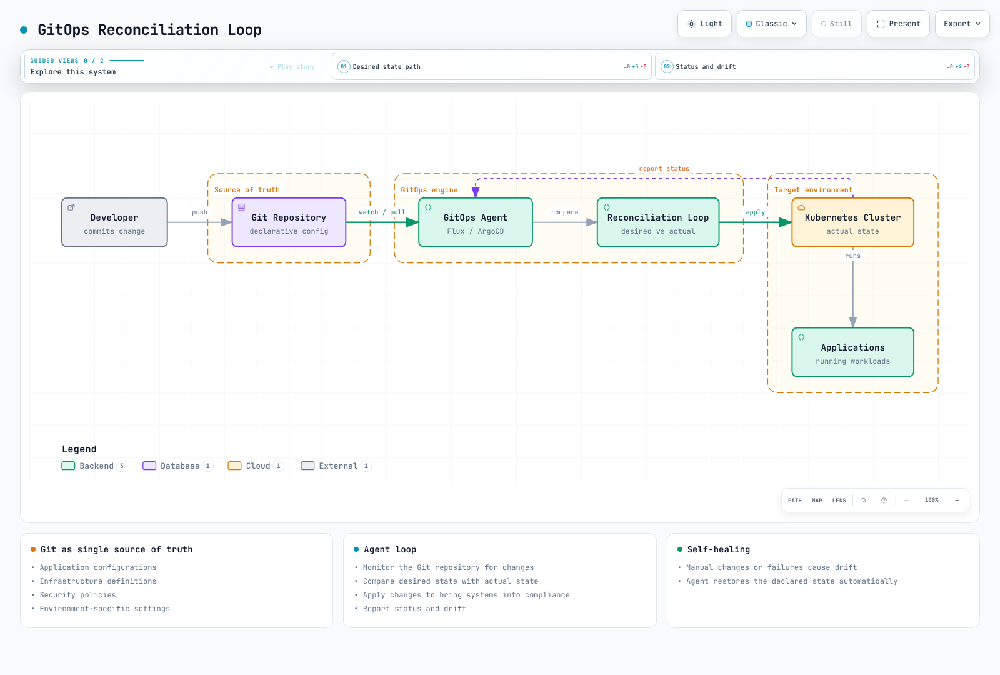
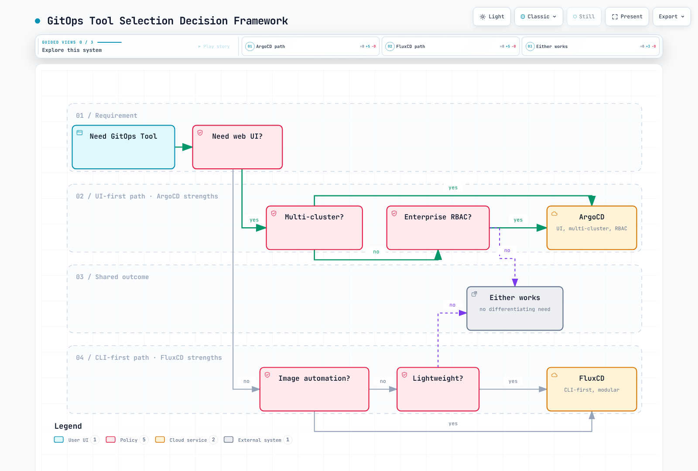
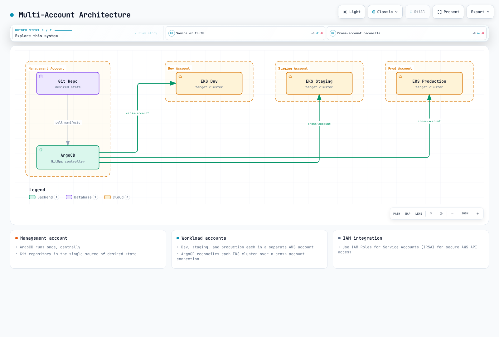

# GitOps

> **最后更新**: October 12, 2026

## 目录
- [什么是 GitOps？](#what-is-gitops)
- [核心原则](#core-principles)
- [Push 与 Pull 模型](#push-vs-pull-model)
- [GitOps 工具概览](#gitops-tools-overview)
- [工具选择指南](#tool-selection-guide)
- [Amazon EKS 上的 GitOps](#gitops-on-amazon-eks)
- [快速入门](#getting-started)

## 什么是 GitOps？

GitOps 是一个运营框架，将版本控制、协作、合规和 CI/CD 等用于基础设施自动化的 DevOps 最佳实践应用于基础设施管理。该术语由 Weaveworks 于 2017 年提出，此后已成为 CNCF 认可的云原生应用部署方法论。

GitOps 的核心是使用 Git 仓库作为声明式基础设施和应用配置的唯一事实来源。通过 Git 提交来变更期望状态，并由自动化流程确保实际系统状态与声明的状态一致。



[🔍 查看交互式图表](https://www.atomai.click/kubernetes-docs/archmaps/en-gitops-readme-10.html)

### 历史与演进

| 里程碑 | 经验证的项目历史 |
|---|---|
| Flux | CNCF Sandbox：2019 年 7 月；Incubating：2021 年 3 月；Graduated：2022 年 11 月 30 日 |
| Argo 项目 | CNCF Incubating：2020 年 3 月；Graduated：2022 年 12 月 6 日 |
| OpenGitOps | 发布带版本的原则；应区分已发布文档与正在开发的 main 分支 |

### CNCF OpenGitOps 定义

OpenGitOps 项目通过四项原则定义 GitOps：

1. **声明式**：由 GitOps 管理的系统必须以声明式方式表达其期望状态
2. **版本化且不可变**：期望状态以强制不可变性和版本化的方式存储，并保留完整的版本历史
3. **自动 Pull**：软件 Agent 会自动从来源拉取期望状态声明
4. **持续协调**：软件 Agent 持续观察实际系统状态，并尝试应用期望状态

## 核心原则

Git 历史记录期望配置。Git revert 不会恢复数据库迁移、已删除的数据或外部状态。Argo CD 的 automated sync、prune 和 selfHeal 是独立设置；GitOps 描述的是尝试进行协调的控制循环。

### 声明式配置

一切都被定义为代码——基础设施、应用、策略和配置。这带来：

- **可复现性**：版本化配置以及可用的工件、Secrets 和数据使重新创建成为可能
- **可审计性**：保留配置历史；仍需收集运行时/API 审计日志
- **一致性**：具有明确且经审查的环境差异的共享基础配置

```yaml
# Example: Declarative application state
apiVersion: apps/v1
kind: Deployment
metadata:
  name: web-app
  labels:
    app: web-app
    version: v1.2.3
spec:
  replicas: 3
  selector:
    matchLabels:
      app: web-app
  template:
    metadata:
      labels:
        app: web-app
    spec:
      containers:
      - name: web-app
        image: myregistry/web-app:v1.2.3
        ports:
        - containerPort: 8080
```

### Git 作为唯一事实来源

Git 仓库存储整个系统的期望状态：

- **应用配置**
- **基础设施定义**
- **安全策略**
- **特定于环境的设置**

### 自动化协调

GitOps Agent 持续：

1. 监控 Git 仓库中的变更
2. 比较期望状态与实际状态
3. 应用变更以使系统符合要求
4. 报告状态和漂移

### 自愈系统

协调尝试取决于 sync/self-heal 策略、权限和健康状况。例如，Argo CD 的 automated sync 和 selfHeal 需要配置；仅安装并不会还原每一项手动更改或恢复丢失的数据。

## Push 与 Pull 模型

将传统 Push 部署与基于 Pull 的 GitOps 进行比较。仅有 CI 的 `kubectl apply` pipeline 本身并不满足 OpenGitOps 的自动 Pull 和持续协调原则：


[🔍 查看交互式图表](https://www.atomai.click/kubernetes-docs/archmaps/en-gitops-readme-11.html)

### Push 模型

在传统 Push 模型中：
- CI/CD pipeline 可直接访问集群
- 凭证存储在 CI 系统中
- 从集群外部 Push 变更

**缺点：**
- CI 系统中需要集群凭证
- 更难审计谁做出了变更
- 没有自动漂移检测

### Pull 模型（推荐）

在 GitOps Pull 模型中：
- Agent 运行在目标集群或单独的管理集群中
- Agent 从 Git Pull 变更
- 管理集群中的 Agent 仍需要获得授权的网络/API 访问权限才能访问远程目标

**优点：**
- 可减少 CI 中的目标集群凭证；Agent 仍持有来源/API 访问权限
- Git 中有完整的审计追踪
- 自动漂移检测和纠正
- 可在防火墙后运行

## GitOps 工具概览

### ArgoCD

[ArgoCD](argocd/README.md) 是 Kubernetes 的声明式 GitOps 持续交付工具。

**主要特性：**
- 用于可视化的 Web UI
- 多集群支持
- SSO 集成
- 回滚功能
- 健康状态监控
- 用于集群规模管理的 ApplicationSet

**最适合：**需要可视化管理、多集群部署和企业功能的团队

### FluxCD

FluxCD 是一组面向 Kubernetes 的持续交付解决方案，具有开放性和可扩展性。

**主要特性：**
- 轻量且模块化
- 原生 Helm 和 Kustomize 支持
- 镜像自动化
- 多租户
- 通知 Controllers

**最适合：**偏好 CLI 优先、轻量级解决方案和镜像自动化工作流的团队

### Jenkins X / JayeX

Jenkins X / JayeX 为 Kubernetes 上的云原生应用提供 CI/CD。

**主要特性：**
- 自动化 CI/CD pipelines
- 预览环境
- GitOps 晋级
- 基于 Tekton 的 pipelines

**评估用途：**集成式 CI/CD 和预览环境工作流；JayeX/Jenkins X / JayeX 并非只是启用了 GitOps 的 Jenkins

### 对比矩阵

| 要求 | Argo CD | Flux |
|---|---|---|
| 默认 UI | 内置 Web UI 和 CLI | 核心 Controllers/CLI；可选生态系统 UI |
| Helm 行为 | helm template；Argo CD 拥有资源生命周期 | Helm Controller 拥有 Helm release 生命周期 |
| 镜像更新 | 独立的 Argo CD Image Updater | 可选的 Image Reflector/Automation Controllers |
| 多租户 | AppProjects、RBAC、目标/来源限制 | Kubernetes RBAC、ServiceAccount 模拟、跨 namespace 限制 |
| OCI 来源 | 通用 OCI/Helm 来源；验证 layers/media types | OCIRepository/Helm 来源；验证 verification/layer 设置 |
| 容量 | 衡量应用/集群数量和协调负载 | 衡量已安装的 Controllers、来源和协调负载 |

## 工具选择指南

### 选择 ArgoCD 的情况：

- 您需要用于运营的可视化仪表板
- 需要多集群管理
- 企业 SSO/RBAC 很重要
- 团队偏好基于 UI 的工作流
- 您需要 ApplicationSet 进行集群规模管理

### 选择 FluxCD 的情况：

- 您偏好轻量、模块化的架构
- 镜像自动化是主要需求
- 偏好 CLI 优先的工作流
- 资源限制值得关注
- 您需要紧密的 Helm Controller 集成

### 决策框架

该图说明的是选择问题，而非互斥的能力。请结合表格和有代表性的试用，比较当前功能、授权边界和运营成本。



[🔍 查看交互式图表](https://www.atomai.click/kubernetes-docs/archmaps/en-gitops-readme-12.html)

## Amazon EKS 上的 GitOps

### EKS 特定注意事项

在 Amazon EKS 上实施 GitOps 时：

#### IAM 集成

仅有 ServiceAccount annotation 并不能建立 IAM 访问。请配置 IRSA OIDC provider/trust policy/SDK support 或 EKS Pod Identity association。AWS API 权限与目标 Kubernetes API authentication/RBAC 是相互独立的。

使用 IAM Roles for Service Accounts (IRSA) 来安全访问 AWS API：

```yaml
apiVersion: v1
kind: ServiceAccount
metadata:
  name: gitops-controller
  annotations:
    eks.amazonaws.com/role-arn: arn:aws:iam::123456789012:role/GitOpsRole
```

#### 多账户架构



[🔍 查看交互式图表](https://www.atomai.click/kubernetes-docs/archmaps/en-gitops-readme-13.html)

#### AWS 服务集成

GitOps 可通过以下方式管理 AWS 资源：

- **AWS Controllers for Kubernetes (ACK)**：AWS 服务的原生 K8s CRDs
- **Crossplane**：多云资源配置
- **Terraform Controller**：通过 GitOps 进行 Terraform state 管理

### 推荐架构

```
├── infrastructure/
│   ├── base/                    # Shared infrastructure
│   │   ├── vpc/
│   │   ├── eks/
│   │   └── iam/
│   └── environments/
│       ├── dev/
│       ├── staging/
│       └── production/
├── applications/
│   ├── base/                    # Application base configs
│   └── overlays/
│       ├── dev/
│       ├── staging/
│       └── production/
└── platform/
    ├── argocd/                  # GitOps tooling
    ├── monitoring/              # Observability stack
    └── security/                # Security policies
```

## 快速入门

### ArgoCD 快速入门

请使用兼容的 Kubernetes 版本、一个空的专用 namespace，以及用于 CRDs/RBAC 的集群权限。此非 HA 安装示例固定使用 Argo CD 3.5.4；在生产环境中使用前，请查阅完整的[安装指南](argocd/01-installation.md)。必须更改初始 admin 凭证，并在使用后删除 bootstrap Secret。

1. **安装 ArgoCD：**
   ```bash
   kubectl create namespace argocd
   kubectl apply --server-side -n argocd -f https://raw.githubusercontent.com/argoproj/argo-cd/v3.5.4/manifests/install.yaml
   ```

2. **访问 UI：**
   ```bash
   kubectl port-forward svc/argocd-server -n argocd 8080:443
   ```

3. **获取初始密码：**
   ```bash
   kubectl -n argocd get secret argocd-initial-admin-secret -o jsonpath="{.data.password}" | base64 -d
   ```

有关 ArgoCD 设置的详细信息，请参阅 [ArgoCD 文档](argocd/README.md)。

### FluxCD 快速入门

准备好 `GITHUB_ORG`/`GITOPS_REPOSITORY`、文档规定的 GitHub authentication 和 Kubernetes 权限。Bootstrap 会写入 Git 并安装集群 Controllers。仅对个人 owner 添加 `--personal`，并在需要时显式选择可选的镜像自动化 Controllers。

1. **安装 Flux CLI：**
   ```bash
   curl --fail --location https://fluxcd.io/install.sh -o install-flux.sh
   # Review the script and select a supported version before running it.
   sudo bash install-flux.sh
   ```

2. **Bootstrap Flux：**
   ```bash
   flux bootstrap github \
     --owner="$GITHUB_ORG" \
     --repository="$GITOPS_REPOSITORY" \
     --path=clusters/my-cluster
   ```

有关 FluxCD 设置的详细信息，请参阅 FluxCD 文档。

## 章节导航

| 主题 | 描述 |
|-------|-------------|
| [ArgoCD](argocd/README.md) | 包含安装、应用、同步策略等内容的完整 ArgoCD 指南 |
| [FluxCD](02-fluxcd.md) | FluxCD 设置、来源 Controllers 和镜像自动化 |

## 延伸阅读

- [CNCF GitOps 工作组](https://github.com/cncf/tag-app-delivery/tree/main/gitops-wg)
- [OpenGitOps 项目](https://opengitops.dev/)
- [GitOps 原则](https://www.gitops.tech/)

## 测验

为检验您所学的内容，请尝试以下测验：
- [ArgoCD 测验](../quizzes/gitops/01-argocd-quiz.md)
- [FluxCD 测验](../quizzes/gitops/02-fluxcd-quiz.md)
- [GitOps 对比测验](../quizzes/gitops/03-gitops-comparison-quiz.md)

### 参考来源

- [OpenGitOps 原则](https://github.com/open-gitops/documents/blob/v1.0.0/PRINCIPLES.md)
- [Argo 项目成熟度](https://www.cncf.io/projects/argo/)
- [Flux 项目成熟度](https://www.cncf.io/projects/flux/)
- [Argo CD OCI 来源](https://argo-cd.readthedocs.io/en/stable/user-guide/oci/)
- [Argo CD 自动同步](https://argo-cd.readthedocs.io/en/stable/user-guide/auto_sync/)
- [Flux 多租户](https://fluxcd.io/flux/installation/configuration/multitenancy/)
- [Flux 生态系统](https://fluxcd.io/ecosystem/)
- [JayeX 项目](https://jayex.io/v3/about/)
