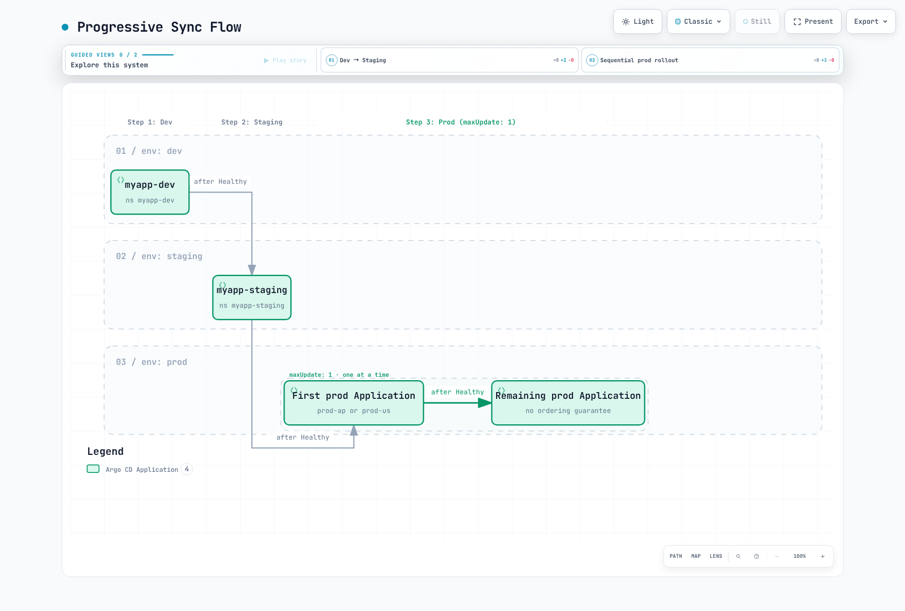

# ArgoCD ApplicationSets

> **已根据以下版本审查**：Argo CD 3.5.2，包括其捆绑的 ApplicationSet controller；在审查发布说明后更新至补丁版本 3.5.4（示例未重新运行）
> **最后更新**：October 12, 2026

## 目录
- [ApplicationSet 概述](#applicationset-overview)
- [生成器](#generators)
- [Go 模板](#go-templating)
- [渐进式同步](#progressive-sync)
- [多集群模式](#multi-cluster-patterns)
- [模板补丁](#template-patches)

## ApplicationSet 概述

ApplicationSet 是一个 Kubernetes controller，用于增加从模板生成 ArgoCD Application 的支持。它可以跨集群、环境或仓库管理具有相似配置的多个应用程序。

### 何时使用 ApplicationSet

| 场景 | 使用 ApplicationSet？ |
|----------|---------------------|
| 同一应用跨多个集群 | 是 |
| 多个环境（dev/staging/prod） | 是 |
| 包含许多服务的单体仓库 | 是 |
| 来自 PR 的动态环境 | 是 |
| 单个应用程序部署 | 否（使用 Application） |

下面的 `myorg`、`example.com`、集群 URL 和私有 chart 均为占位符。在应用前，请提供真实的仓库路径、chart、values 文件、已注册集群、AppProject 权限和凭证。ApplicationSet 不会注册集群或创建 AppProject。`CreateNamespace=true` 只会创建已获授权的目标 Namespace。所有完整示例都显式启用 Go 模板。

应将 ApplicationSet 的编写权限和生成器输入限制为可信管理员。控制 project、source 或 destination 的 Git/PR 输入可能扩大部署权限；请使用固定且范围受限的 AppProject，并审查输入。

### 基本结构

```yaml
apiVersion: argoproj.io/v1alpha1
kind: ApplicationSet
metadata:
  name: my-appset
  namespace: argocd
spec:
  generators:
  - list:
      elements:
      - cluster: dev
        url: https://dev.k8s.local
      - cluster: prod
        url: https://prod.k8s.local
  template:
    metadata:
      name: '{{ .cluster }}-myapp'
    spec:
      project: default
      source:
        repoURL: https://github.com/myorg/myrepo.git
        targetRevision: HEAD
        path: overlays/{{ .cluster }}
      destination:
        server: '{{ .url }}'
        namespace: myapp
      syncPolicy:
        syncOptions:
        - CreateNamespace=true
  goTemplate: true
  goTemplateOptions:
  - missingkey=error
```

## 生成器

生成器会产生参数，这些参数将替换到模板中以创建 Application。

### 1. List 生成器

最简单的生成器——定义静态值列表：

```yaml
apiVersion: argoproj.io/v1alpha1
kind: ApplicationSet
metadata:
  name: list-example
  namespace: argocd
spec:
  generators:
  - list:
      elements:
      - cluster: dev
        url: https://kubernetes.default.svc
        namespace: dev
        values:
          replicas: '1'
          logLevel: debug
      - cluster: staging
        url: https://staging.k8s.local
        namespace: staging
        values:
          replicas: '2'
          logLevel: info
      - cluster: production
        url: https://production.k8s.local
        namespace: production
        values:
          replicas: '5'
          logLevel: warn
  template:
    metadata:
      name: myapp-{{ .cluster }}
      labels:
        environment: '{{ .cluster }}'
    spec:
      project: default
      source:
        repoURL: https://github.com/myorg/myapp.git
        targetRevision: HEAD
        path: charts/myapp
        helm:
          parameters:
          - name: replicaCount
            value: '{{ .values.replicas }}'
          - name: logging.level
            value: '{{ .values.logLevel }}'
      destination:
        server: '{{ .url }}'
        namespace: '{{ .namespace }}'
      syncPolicy:
        automated:
          prune: true
          selfHeal: true
        syncOptions:
        - CreateNamespace=true
  goTemplate: true
  goTemplateOptions:
  - missingkey=error
```

### 2. Cluster 生成器

自动以已注册的 ArgoCD 集群为目标：

```yaml
apiVersion: argoproj.io/v1alpha1
kind: ApplicationSet
metadata:
  name: cluster-example
  namespace: argocd
spec:
  generators:
  - clusters:
      selector: {}
      values:
        clusterName: '{{ .name }}'
  template:
    metadata:
      name: '{{ .nameNormalized }}-guestbook'
    spec:
      project: default
      source:
        repoURL: https://github.com/argoproj/argocd-example-apps.git
        targetRevision: HEAD
        path: guestbook
      destination:
        server: '{{ .server }}'
        namespace: guestbook
      syncPolicy:
        syncOptions:
        - CreateNamespace=true
  goTemplate: true
  goTemplateOptions:
  - missingkey=error
```

#### 用于定向的 Cluster 标签

首先，为集群 Secret 添加标签：

```yaml
apiVersion: v1
kind: Secret
metadata:
  name: production-cluster
  namespace: argocd
  labels:
    argocd.argoproj.io/secret-type: cluster
    environment: production
    region: us-west-2
    tier: critical
type: Opaque
stringData:
  name: production
  server: https://production.k8s.local
  config: |
    {
      "tlsClientConfig": {
        "insecure": false,
        "caData": "..."
      }
    }
```

然后按标签选择集群：

```yaml
generators:
  - clusters:
      selector:
        matchLabels:
          environment: production
        matchExpressions:
          - key: tier
            operator: In
            values:
              - critical
              - high
```

空的 Cluster selector 可以包含本地集群。默认的本地集群没有 Secret，可能不匹配标签 selector；需要按标签选择时，请创建/配置其集群 Secret。对于 Application 名称，请使用 `nameNormalized`，并另外遵守 Namespace/Label 的限制。Secret 片段仅展示其结构：`...` 不是有效的 CA 或凭证。

### 3. Git 生成器 - 目录

扫描 Git 仓库中的目录：

```yaml
apiVersion: argoproj.io/v1alpha1
kind: ApplicationSet
metadata:
  name: git-directories
  namespace: argocd
spec:
  generators:
  - git:
      repoURL: https://github.com/myorg/gitops-repo.git
      revision: HEAD
      directories:
      - path: apps/*
      - path: apps/excluded-app
        exclude: true
  template:
    metadata:
      name: '{{ .path.basename }}'
    spec:
      project: default
      source:
        repoURL: https://github.com/myorg/gitops-repo.git
        targetRevision: HEAD
        path: '{{ .path.path }}'
      destination:
        server: https://kubernetes.default.svc
        namespace: '{{ .path.basename }}'
      syncPolicy:
        syncOptions:
        - CreateNamespace=true
  goTemplate: true
  goTemplateOptions:
  - missingkey=error
```

#### Directory 生成器的仓库结构

```
gitops-repo/
├── apps/
│   ├── frontend/
│   │   ├── deployment.yaml
│   │   └── service.yaml
│   ├── backend/
│   │   ├── deployment.yaml
│   │   └── service.yaml
│   ├── database/
│   │   ├── statefulset.yaml
│   │   └── service.yaml
│   └── excluded-app/    # Excluded via generator
│       └── ...
```

### 4. Git 生成器 - 文件

从 Git 中的 JSON/YAML 文件读取配置：

```yaml
apiVersion: argoproj.io/v1alpha1
kind: ApplicationSet
metadata:
  name: git-files
  namespace: argocd
spec:
  generators:
  - git:
      repoURL: https://github.com/myorg/gitops-repo.git
      revision: HEAD
      files:
      - path: config/**/config.json
  template:
    metadata:
      name: '{{ .cluster.name }}-{{ .app.name }}'
      labels:
        environment: '{{ .cluster.environment }}'
    spec:
      project: default
      source:
        repoURL: '{{ .app.repoURL }}'
        targetRevision: '{{ .app.revision }}'
        path: '{{ .app.path }}'
        helm:
          valueFiles:
          - values.yaml
          - values-{{ .cluster.environment }}.yaml
      destination:
        server: '{{ .cluster.server }}'
        namespace: '{{ .app.namespace }}'
      syncPolicy:
        syncOptions:
        - CreateNamespace=true
  goTemplate: true
  goTemplateOptions:
  - missingkey=error
```

#### 配置文件示例

```json
{
  "cluster": {
    "name": "prod-us-west-2",
    "server": "https://prod-usw2.k8s.local",
    "environment": "production"
  },
  "app": {
    "name": "myapp",
    "repoURL": "https://github.com/myorg/myapp.git",
    "revision": "v1.2.3",
    "path": "charts/myapp",
    "namespace": "myapp-prod"
  }
}
```

### 5. Matrix 生成器

结合两个生成器以创建笛卡尔积：

```yaml
apiVersion: argoproj.io/v1alpha1
kind: ApplicationSet
metadata:
  name: matrix-example
  namespace: argocd
spec:
  generators:
  - matrix:
      generators:
      - clusters:
          selector:
            matchLabels:
              environment: production
      - git:
          repoURL: https://github.com/myorg/apps.git
          revision: HEAD
          directories:
          - path: apps/*
  template:
    metadata:
      name: '{{ .nameNormalized }}-{{ .path.basename }}'
    spec:
      project: default
      source:
        repoURL: https://github.com/myorg/apps.git
        targetRevision: HEAD
        path: '{{ .path.path }}'
      destination:
        server: '{{ .server }}'
        namespace: '{{ .path.basename }}'
      syncPolicy:
        syncOptions:
        - CreateNamespace=true
  goTemplate: true
  goTemplateOptions:
  - missingkey=error
```

#### Matrix 可视化


[🔍 查看交互式图表](https://www.atomai.click/kubernetes-docs/archmaps/en-gitops-argocd-04-applicationsets-0.html)

Matrix 恰好结合两个子生成器；组合生成器仅支持一层嵌套。当两个 Git 生成器会产生冲突的 path 参数时，请使用 `pathParamPrefix`。

### 6. Merge 生成器

合并多个生成器的输出，并组合参数：

```yaml
apiVersion: argoproj.io/v1alpha1
kind: ApplicationSet
metadata:
  name: merge-example
  namespace: argocd
spec:
  generators:
  - merge:
      mergeKeys:
      - cluster
      generators:
      - list:
          elements:
          - cluster: dev
            replicas: '1'
            enableHA: 'false'
          - cluster: staging
            replicas: '2'
            enableHA: 'false'
          - cluster: production
            replicas: '5'
            enableHA: 'false'
      - list:
          elements:
          - cluster: production
            replicas: '10'
            enableHA: 'true'
  template:
    metadata:
      name: myapp-{{ .cluster }}
    spec:
      project: default
      source:
        repoURL: https://github.com/myorg/myapp.git
        targetRevision: HEAD
        path: charts/myapp
        helm:
          parameters:
          - name: replicas
            value: '{{ .replicas }}'
          - name: highAvailability
            value: '{{ .enableHA }}'
      destination:
        server: https://kubernetes.default.svc
        namespace: '{{ .cluster }}'
      syncPolicy:
        syncOptions:
        - CreateNamespace=true
  goTemplate: true
  goTemplateOptions:
  - missingkey=error
```

Merge 会保留基础生成器的条目，并通过 `mergeKeys` 应用匹配的覆盖项；后续生成器具有优先权，且未匹配的覆盖条目会被丢弃。使用 Go 模板时不支持嵌套 merge key。

### 7. SCM Provider 生成器

扫描 GitHub/GitLab 组织中的仓库：

#### GitHub

```yaml
apiVersion: argoproj.io/v1alpha1
kind: ApplicationSet
metadata:
  name: github-org-apps
  namespace: argocd
spec:
  generators:
  - scmProvider:
      github:
        organization: myorg
      filters:
      - repositoryMatch: ^service-.*
        pathsExist:
        - kubernetes/
        labelMatch: ^deploy-to-k8s$
  template:
    metadata:
      name: '{{ .repository }}'
    spec:
      project: default
      source:
        repoURL: '{{ .url }}'
        targetRevision: '{{ .branch }}'
        path: kubernetes
      destination:
        server: https://kubernetes.default.svc
        namespace: '{{ .repository }}'
      syncPolicy:
        syncOptions:
        - CreateNamespace=true
  goTemplate: true
  goTemplateOptions:
  - missingkey=error
```

#### GitLab

```yaml
apiVersion: argoproj.io/v1alpha1
kind: ApplicationSet
metadata:
  name: gitlab-group-apps
  namespace: argocd
spec:
  generators:
  - scmProvider:
      gitlab:
        group: mygroup
        includeSubgroups: true
      filters:
      - pathsExist:
        - deploy/
  template:
    metadata:
      name: '{{ .repository }}'
    spec:
      project: default
      source:
        repoURL: '{{ .url }}'
        targetRevision: '{{ .branch }}'
        path: deploy
      destination:
        server: https://kubernetes.default.svc
        namespace: '{{ .repository }}'
      syncPolicy:
        syncOptions:
        - CreateNamespace=true
  goTemplate: true
  goTemplateOptions:
  - missingkey=error
```

`scmProvider.filters` 与 provider 对象同级。一个 filter 中的条件为 AND；不同的 filter 条目之间为 OR。该示例将名称、路径和标签要求组合在一个 filter 中。私有仓库和 API 速率限制需要具有适当范围的 token 或 GitHub App。

### 8. Pull Request 生成器

为 pull request 创建环境：

```yaml
apiVersion: argoproj.io/v1alpha1
kind: ApplicationSet
metadata:
  name: pr-environments
  namespace: argocd
spec:
  generators:
  - pullRequest:
      github:
        owner: myorg
        repo: myapp
        tokenRef:
          secretName: github-token
          key: token
        labels:
        - preview
      requeueAfterSeconds: 180
  template:
    metadata:
      name: pr-{{ .number }}-{{ .branch_slug }}
      labels:
        preview: 'true'
        pr-number: '{{ .number }}'
    spec:
      project: previews
      source:
        repoURL: https://github.com/myorg/myapp.git
        targetRevision: '{{ .head_sha }}'
        path: kubernetes
        kustomize:
          nameSuffix: -pr-{{ .number }}
          images:
          - myapp:pr-{{ .number }}
      destination:
        server: https://kubernetes.default.svc
        namespace: preview-{{ .number }}
      syncPolicy:
        automated:
          prune: true
          selfHeal: true
        syncOptions:
        - CreateNamespace=true
  goTemplate: true
  goTemplateOptions:
  - missingkey=error
```

仅在已预先创建、并限制 preview 集群/Namespace 的 `previews` AppProject 的情况下使用 PR 示例。GitHub 要求具备列出的全部标签；标签不会使不受信任的 PR 代码变得安全。请勿向 preview 工作负载暴露生产 Secret 或 cluster-admin 凭证。根据默认删除策略，关闭/不匹配的 PR Application 会在协调时被删除；资源清理由 finalizer/保留设置决定，并且仅通过 `CreateNamespace=true` 创建的 Namespace 不会自动成为受跟踪的清理目标。

### 9. Cluster Decision Resource 生成器

将集群选择委托给外部资源：

```yaml
apiVersion: argoproj.io/v1alpha1
kind: ApplicationSet
metadata:
  name: cluster-decision
  namespace: argocd
spec:
  generators:
  - clusterDecisionResource:
      configMapRef: cluster-decisions
      labelSelector:
        matchLabels:
          cluster.open-cluster-management.io/placement: production
      requeueAfterSeconds: 180
  template:
    metadata:
      name: '{{ normalize .name }}-addon'
    spec:
      project: default
      source:
        repoURL: https://github.com/myorg/myapp.git
        targetRevision: HEAD
        path: manifests
      destination:
        server: '{{ .server }}'
        namespace: myapp
      syncPolicy:
        syncOptions:
        - CreateNamespace=true
  goTemplate: true
  goTemplateOptions:
  - missingkey=error
```

Decision resource 配置：

```yaml
apiVersion: v1
kind: ConfigMap
metadata:
  name: cluster-decisions
  namespace: argocd
data:
  apiVersion: cluster.open-cluster-management.io/v1beta1
  kind: placementdecisions
  statusListKey: decisions
  matchKey: clusterName
```

这需要已有的 Open Cluster Management 安装，以及一个生成 PlacementDecision 对象的 `production` Placement。请授予 ApplicationSet controller 对 `argocd` Namespace 中这些对象的读取权限。每个 `status.decisions[].clusterName` 都必须与 Argo CD 已注册的集群匹配；请使用生成的 `server` 值作为其 API endpoint。按名称或 labelSelector 选择 decision。

### 10. Plugin 生成器

通过 ConfigMap 执行自定义生成器逻辑：

```yaml
apiVersion: argoproj.io/v1alpha1
kind: ApplicationSet
metadata:
  name: plugin-example
  namespace: argocd
spec:
  generators:
  - plugin:
      configMapRef:
        name: my-plugin
      input:
        parameters:
          environment: production
          region: us-west-2
      requeueAfterSeconds: 300
  template:
    metadata:
      name: '{{ .name }}'
    spec:
      project: default
      source:
        repoURL: '{{ .repoURL }}'
        targetRevision: '{{ .revision }}'
        path: '{{ .path }}'
      destination:
        server: '{{ .server }}'
        namespace: '{{ .namespace }}'
      syncPolicy:
        syncOptions:
        - CreateNamespace=true
  goTemplate: true
  goTemplateOptions:
  - missingkey=error
```

Plugin 连接配置：

```yaml
apiVersion: v1
kind: ConfigMap
metadata:
  name: my-plugin
  namespace: argocd
data:
  token: "$appset-plugin-token:token"
  baseUrl: "https://appset-plugin.example.com"
  requestTimeout: "30"
```

ConfigMap 不会执行代码。必须由一个单独部署的 HTTP 服务处理 POST `/api/v1/getparams.execute` 并返回 `output.parameters` 数组。请将示例域名替换为经过 TLS 验证的 endpoint。在 `argocd` 中预置 Secret `appset-plugin-token`，其 key 为 `token`，标签为 `app.kubernetes.io/part-of: argocd`；请勿将其值存入 Git。在连接之前，实现身份验证、输入验证以及文档规定的响应 schema。

## Go 模板

设置 `spec.goTemplate: true` 以使用 Go 模板；3.5.4 中的默认引擎仍为 fasttemplate。本页示例均通过 `missingkey=error` 显式启用 Go 模板。每个字符串字段都会独立渲染：控制语句不能跨越 YAML 字段，布尔值/对象/列表需要 `templatePatch`。对于可选 key，请使用 `dig`，因为直接访问缺失 key 会在 `default` 运行之前失败。

### 基本语法

```yaml
template:
  metadata:
    name: '{{ .cluster }}-{{ .app }}'           # Simple substitution
    labels:
      env: '{{ .values.environment }}'       # Nested values
```

### 函数

```yaml
template:
  metadata:
    # Normalize strings
    name: '{{normalize .cluster}}'

    # String manipulation
    labels:
      lower: '{{.cluster | lower}}'
      upper: '{{.cluster | upper}}'
      trimmed: '{{.cluster | trim}}'

    annotations:
      # Conditional
      tier: '{{if eq .env "prod"}}critical{{ else }}standard{{ end }}'
```

### 高级模板

```yaml
apiVersion: argoproj.io/v1alpha1
kind: ApplicationSet
metadata:
  name: advanced-template
  namespace: argocd
spec:
  goTemplate: true
  goTemplateOptions:
  - missingkey=error
  generators:
  - list:
      elements:
      - name: app1
        env: prod
        regions:
        - us-west-2
        - us-east-1
  template:
    metadata:
      name: '{{.name}}-{{.env}}'
      annotations:
        regions: '{{range $i, $r := .regions}}{{if $i}},{{ end }}{{$r}}{{ end }}'
    spec:
      project: default
      source:
        repoURL: https://github.com/myorg/myapp.git
        targetRevision: main
        path: manifests
      destination:
        server: https://kubernetes.default.svc
        namespace: '{{ .name }}'
      syncPolicy:
        syncOptions:
        - CreateNamespace=true
```

## 渐进式同步

Progressive Sync 自 3.3 起为 Beta 功能，在 3.5.4 中仍必须显式启用。将 `applicationsetcontroller.enable.progressive.syncs: "true"` 合并到现有 `argocd-cmd-params-cm.data`，然后重启 ApplicationSet controller。对于 Helm，请管理 `configs.params` 下的对应 key。

RollingSync 选择**已生成 Application 上的标签**，并等待组内的每个 Application 变为 Healthy 后再继续。它会禁用子 Application 的 autosync，并通过 ApplicationSet controller 请求同步，同时遵守 sync window 和 Application retry 设置。不匹配任何步骤的 Application 需要手动同步。

`maxUpdate: 0` 会暂停该组的自动同步；它不会授予批准或推进到重复的组。请手动同步已暂停的组，或应用经过审查的策略更改。正百分比向下取整，最少为一。无法保证组内顺序。以下示例使用一个集群中的 Namespace；`region` 是分组元数据，而不是集群 destination。

通过 RollingSync 控制跨应用程序的发布。

### RollingSync 策略

```yaml
apiVersion: argoproj.io/v1alpha1
kind: ApplicationSet
metadata:
  name: progressive-rollout
  namespace: argocd
spec:
  generators:
  - list:
      elements:
      - name: dev
        env: dev
      - name: staging
        env: staging
      - name: prod-ap
        env: prod
        region: ap-northeast-2
      - name: prod-us
        env: prod
        region: us-west-2
  strategy:
    type: RollingSync
    rollingSync:
      steps:
      - matchExpressions:
        - key: env
          operator: In
          values:
          - dev
        maxUpdate: 100%
      - matchExpressions:
        - key: env
          operator: In
          values:
          - staging
        maxUpdate: 100%
      - matchExpressions:
        - key: env
          operator: In
          values:
          - prod
        maxUpdate: 1
  template:
    metadata:
      name: myapp-{{ .name }}
      labels:
        env: '{{ .env }}'
        region: '{{ dig "region" "global" . }}'
    spec:
      project: default
      source:
        repoURL: https://github.com/myorg/myapp.git
        targetRevision: HEAD
        path: envs/{{ .env }}
      destination:
        server: https://kubernetes.default.svc
        namespace: myapp-{{ .name }}
      syncPolicy:
        syncOptions:
        - CreateNamespace=true
  goTemplate: true
  goTemplateOptions:
  - missingkey=error
```

### 渐进式同步流程



[🔍 查看交互式图表](https://www.atomai.click/kubernetes-docs/archmaps/en-gitops-argocd-04-applicationsets-1.html)

## 多集群模式

### Hub-and-Spoke 模式

集中式 ArgoCD 管理多个集群：

```yaml
apiVersion: argoproj.io/v1alpha1
kind: ApplicationSet
metadata:
  name: hub-spoke-platform
  namespace: argocd
spec:
  generators:
  - matrix:
      generators:
      - clusters:
          selector:
            matchLabels:
              managed-by: hub
      - list:
          elements:
          - app: monitoring
            chart: kube-prometheus-stack
            repo: https://prometheus-community.github.io/helm-charts
            version: 90.0.0
          - app: logging
            chart: loki
            repo: https://grafana-community.github.io/helm-charts
            version: 18.12.1
          - app: gateway
            chart: gateway-helm
            repo: docker.io/envoyproxy
            version: v1.9.1
  template:
    metadata:
      name: '{{ .nameNormalized }}-{{ .app }}'
    spec:
      project: platform
      destination:
        server: '{{ .server }}'
        namespace: '{{ .app }}'
      syncPolicy:
        automated:
          prune: true
          selfHeal: true
        syncOptions:
        - CreateNamespace=true
      sources:
      - repoURL: '{{ .repo }}'
        chart: '{{ .chart }}'
        targetRevision: '{{ .version }}'
        helm:
          valueFiles:
          - $values/platform/{{ .nameNormalized }}/{{ .app }}/values.yaml
      - repoURL: https://github.com/myorg/platform-config.git
        targetRevision: main
        ref: values
  goTemplate: true
  goTemplateOptions:
  - missingkey=error
```

Hub-and-Spoke 示例要求为**每个**集群/应用程序对提供经过审查的 values 文件。在该配置仓库中准备 Loki object storage/schema/deployment-mode 设置、Grafana 凭证、持久化以及 Gateway API 前提条件。按照安装章节的说明，将启用 OCI 的 `docker.io/envoyproxy` 注册为 Helm 仓库。缺失的 `$values` 文件会有意导致渲染失败；请勿用空 values 替代它们。Loki 取代已废弃的 `loki-stack` bundle，Envoy Gateway 取代已废弃的社区 ingress-nginx 示例；这是一项需要路由/value 更改的迁移，而非直接替换式升级。

### 环境提升模式

```yaml
apiVersion: argoproj.io/v1alpha1
kind: ApplicationSet
metadata:
  name: environment-promotion
  namespace: argocd
spec:
  generators:
  - git:
      repoURL: https://github.com/myorg/env-config.git
      revision: HEAD
      files:
      - path: environments/*/config.yaml
  template:
    metadata:
      name: myapp-{{ .environment }}
    spec:
      project: default
      source:
        repoURL: https://github.com/myorg/myapp.git
        targetRevision: '{{ .gitRevision }}'
        path: kubernetes
        kustomize:
          images:
          - myapp:{{ .imageTag }}
      destination:
        server: '{{ .clusterUrl }}'
        namespace: '{{ .namespace }}'
      syncPolicy:
        syncOptions:
        - CreateNamespace=true
  goTemplate: true
  goTemplateOptions:
  - missingkey=error
```

将以下每个 YAML 文档分别保存为相应名称的文件；分隔符表示文件边界。通过 Git 提升经过审查的、不可变的 artifact 版本。仅使用如 `sync-wave` 之类的 Application annotation 并不会对独立协调的 Application 排序；需要协调发布时，请使用 RollingSync 和标签。

配置文件：

```yaml
# environments/dev/config.yaml
environment: dev
namespace: myapp-dev
clusterUrl: https://dev.k8s.local
gitRevision: HEAD
imageTag: git-8c9f1a2
---

# environments/staging/config.yaml
environment: staging
namespace: myapp-staging
clusterUrl: https://staging.k8s.local
gitRevision: release-candidate
imageTag: rc-1.2.3
---

# environments/production/config.yaml
environment: production
namespace: myapp-prod
clusterUrl: https://production.k8s.local
gitRevision: v1.2.3
imageTag: v1.2.3

```

## 模板补丁

根据生成器输出覆盖模板字段。

### 基本补丁

```yaml
apiVersion: argoproj.io/v1alpha1
kind: ApplicationSet
metadata:
  name: patched-apps
  namespace: argocd
spec:
  generators:
  - list:
      elements:
      - name: app1
        env: dev
      - name: app2
        env: prod
  template:
    metadata:
      name: '{{ .name }}'
    spec:
      project: default
      source:
        repoURL: https://github.com/myorg/apps.git
        targetRevision: HEAD
        path: '{{ .name }}'
      destination:
        server: https://kubernetes.default.svc
        namespace: '{{ .name }}'
      syncPolicy:
        syncOptions:
        - CreateNamespace=true
  templatePatch: |
    {{- if eq .env "prod" }}
    spec:
      syncPolicy:
        automated:
          prune: true
          selfHeal: true
    {{- end }}
  goTemplate: true
  goTemplateOptions:
  - missingkey=error
```

### 条件式 Strategic Merge Patch

```yaml
apiVersion: argoproj.io/v1alpha1
kind: ApplicationSet
metadata:
  name: strategic-patch
  namespace: argocd
spec:
  generators:
  - list:
      elements:
      - cluster: dev
        autoSync: 'false'
      - cluster: prod
        autoSync: 'true'
  template:
    metadata:
      name: app-{{ .cluster }}
    spec:
      project: default
      source:
        repoURL: https://github.com/myorg/apps.git
        targetRevision: HEAD
        path: app
      destination:
        server: https://kubernetes.default.svc
        namespace: app-{{ .cluster }}
      syncPolicy:
        syncOptions:
        - CreateNamespace=true
  templatePatch: |
    spec:
      {{- if eq .autoSync "true" }}
      syncPolicy:
        automated:
          prune: true
          selfHeal: true
      {{- else }}
      syncPolicy: {}
      {{- end }}
  goTemplate: true
  goTemplateOptions:
  - missingkey=error
```

## 删除与保留

删除 ApplicationSet 通常会通过 ownerReferences 对其生成的 Application 进行垃圾回收。`preserveResourcesOnDeletion: true` 会阻止向 Application 添加资源删除 finalizer，从而保留其已部署的资源；**它不会保留 Application 对象本身**。更改生命周期设置之前，请检查现有 Application 上的 finalizer。

若只移除父对象，请使用 `kubectl delete applicationset NAME -n argocd --cascade=orphan`。被孤立的 Application 会保留 autosync 和任何已有 finalizer；之后删除其中一个仍可能会删除其已部署的资源。`applicationsSync: create-update` 限制由协调驱动的删除，而不限制移除父对象时的 owner-reference 垃圾回收。

`templatePatch` 需要 `goTemplate: true`。在 3.5.4 中，它会针对 Application 类型使用 Kubernetes strategic merge patch。Application spec 中没有 merge tag 的数组（如 Helm valueFiles）会被替换；不要假设存在用于 Pod container 的基于名称的合并。请避免使用无值的 `spec:`（null），因为它会清除现有配置；不要修补 `spec.project`，并使用 `toJson` 等函数转义不受信任的插入字符串。

## 参考资料

- [ApplicationSet 生成器 (3.5.4)](https://github.com/argoproj/argo-cd/blob/v3.5.4/docs/operator-manual/applicationset/Generators.md)
- [Go 模板规则](https://github.com/argoproj/argo-cd/blob/v3.5.4/docs/operator-manual/applicationset/GoTemplate.md)
- [渐进式同步](https://github.com/argoproj/argo-cd/blob/v3.5.4/docs/operator-manual/applicationset/Progressive-Syncs.md)
- [Application 删除](https://github.com/argoproj/argo-cd/blob/v3.5.4/docs/operator-manual/applicationset/Application-Deletion.md)
- [模板补丁实现](https://github.com/argoproj/argo-cd/blob/v3.5.4/applicationset/controllers/template/patch.go)

## 测验

若要测试所学内容，请尝试 [ArgoCD ApplicationSets 测验](../../quizzes/gitops/argocd/04-applicationsets-quiz.md)。