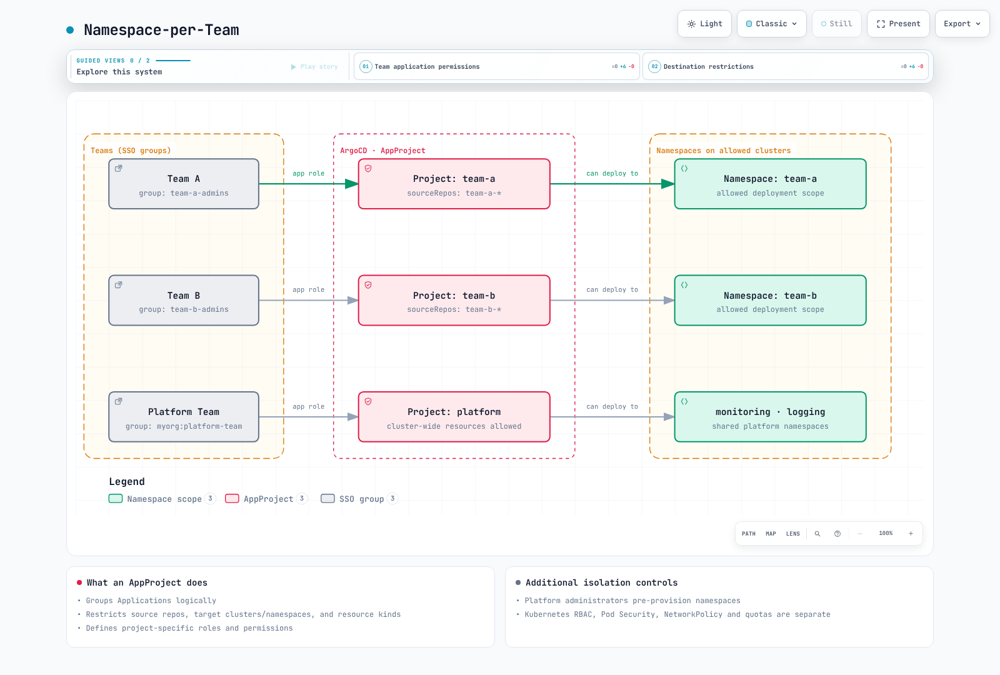

# ArgoCD 项目与 RBAC

> **已根据以下版本审查**：Argo CD 3.5.2；在审查发布说明后更新至补丁版本 3.5.4（示例未重新运行）
> **最后更新**：October 12, 2026

## 目录
- [AppProject 概述](#appproject-overview)
- [默认项目](#default-project)
- [自定义项目](#custom-projects)
- [RBAC 配置](#rbac-configuration)
- [多租户模式](#multi-tenancy-patterns)
- [用于 CI/CD 的 JWT Token](#jwt-tokens-for-cicd)
- [孤立资源监控](#orphaned-resource-monitoring)

## AppProject 概述

AppProject 为 Application 提供逻辑分组，并定义访问控制：哪些资源可以部署、部署到何处以及谁可以管理它们。

AppProject 会限制源、目标、渲染后的资源种类以及 Argo CD API 权限。它不能替代 Kubernetes RBAC、Pod Security Admission、NetworkPolicy 或 ResourceQuota。拒绝 Pod 种类并不能阻止 Deployment 创建特权 Pod。

请提供真实的仓库 URL、组、已注册集群和 namespace。平台管理员应预先创建 Application namespace，并负责其安全性/配额策略。以下团队/环境项目不允许集群范围资源；单独的平台项目仅供受信任的管理员使用。完整项目示例是相互独立的替代方案，包括名称相同的示例。

### 关键功能

| 功能 | 描述 |
|---------|-------------|
| 源限制 | 限制可使用的 Git 仓库 |
| 目标限制 | 限制目标集群和 namespace |
| 资源允许列表/拒绝列表 | 控制可创建哪些 K8s 资源 |
| 角色定义 | 定义项目专属的 RBAC 角色 |
| 同步窗口 | 定义 Application 可以同步的时间 |

### AppProject 配置示例

```yaml
apiVersion: argoproj.io/v1alpha1
kind: AppProject
metadata:
  name: my-project
  namespace: argocd
  finalizers:
  - resources-finalizer.argocd.argoproj.io
spec:
  description: Project description
  sourceRepos:
  - https://github.com/myorg/*
  - https://stefanprodan.github.io/podinfo
  destinations:
  - namespace: my-app-*
    server: https://kubernetes.default.svc
  - namespace: my-project-*
    server: https://production.k8s.local
  clusterResourceWhitelist: []
  namespaceResourceWhitelist:
  - group: '*'
    kind: '*'
  namespaceResourceBlacklist:
  - group: ''
    kind: LimitRange
  - group: ''
    kind: ResourceQuota
  roles:
  - name: developer
    description: Developer access
    policies:
    - p, proj:my-project:developer, applications, get, my-project/*, allow
    - p, proj:my-project:developer, applications, sync, my-project/*, allow
    groups:
    - my-org:developers
  syncWindows:
  - kind: allow
    schedule: 0 9 * * 1-5
    duration: 8h
    applications:
    - '*'
    timeZone: Asia/Seoul
  orphanedResources:
    warn: true
    ignore:
    - group: ''
      kind: ConfigMap
      name: kube-root-ca.crt
```

## 默认项目

ArgoCD 会创建一个默认项目，允许所有源、目标和资源种类。它可以被限制，但不能删除。

### 默认项目规范

```yaml
apiVersion: argoproj.io/v1alpha1
kind: AppProject
metadata:
  name: default
  namespace: argocd
spec:
  description: Default project
  sourceRepos:
  - '*'
  destinations:
  - namespace: '*'
    server: '*'
  clusterResourceWhitelist:
  - group: '*'
    kind: '*'
```

### 何时使用默认项目

- 开发环境
- 快速测试
- 没有多租户要求的小型团队

### 限制默认项目

对于生产环境，请限制默认项目：

```yaml
apiVersion: argoproj.io/v1alpha1
kind: AppProject
metadata:
  name: default
  namespace: argocd
spec:
  description: Restricted default project
  sourceRepos: []
  destinations: []
  sourceNamespaces: []
  clusterResourceWhitelist: []
  namespaceResourceBlacklist:
  - group: '*'
    kind: '*'
```

## 自定义项目

### 基于团队的项目

```yaml
apiVersion: argoproj.io/v1alpha1
kind: AppProject
metadata:
  name: team-frontend
  namespace: argocd
spec:
  description: Frontend team project
  sourceRepos:
  - https://github.com/myorg/frontend-*
  - https://github.com/myorg/shared-libs
  destinations:
  - namespace: frontend-*
    server: https://kubernetes.default.svc
  - namespace: frontend-*
    server: https://staging.k8s.local
  - namespace: frontend-*
    server: https://production.k8s.local
  clusterResourceWhitelist: []
  roles:
  - name: admin
    description: Project admin
    policies:
    - p, proj:team-frontend:admin, applications, *, team-frontend/*, allow
    - p, proj:team-frontend:admin, repositories, *, team-frontend/*, allow
    groups:
    - myorg:frontend-leads
  - name: developer
    description: Developer access
    policies:
    - p, proj:team-frontend:developer, applications, get, team-frontend/*, allow
    - p, proj:team-frontend:developer, applications, sync, team-frontend/*, allow
    - p, proj:team-frontend:developer, applications, action/apps/Deployment/restart, team-frontend/*, allow
    groups:
    - myorg:frontend-devs
  - name: viewer
    description: Read-only access
    policies:
    - p, proj:team-frontend:viewer, applications, get, team-frontend/*, allow
    groups:
    - myorg:frontend-viewers
```

### 基于环境的项目

```yaml
apiVersion: argoproj.io/v1alpha1
kind: AppProject
metadata:
  name: production
  namespace: argocd
spec:
  description: Production environment project
  sourceRepos:
  - https://github.com/myorg/gitops-prod
  destinations:
  - namespace: prod-*
    server: https://production.k8s.local
  - namespace: prod-*
    server: https://production-dr.k8s.local
  clusterResourceWhitelist: []
  namespaceResourceBlacklist:
  - group: ''
    kind: ResourceQuota
  - group: ''
    kind: LimitRange
  syncWindows:
  - kind: allow
    schedule: 0 9 * * 1-5
    duration: 8h
    applications:
    - '*'
    manualSync: true
    timeZone: Asia/Seoul
  roles:
  - name: sre
    description: SRE team with full access
    policies:
    - p, proj:production:sre, applications, *, production/*, allow
    groups:
    - myorg:sre-team
  - name: deployer
    description: CI/CD deployment access
    policies:
    - p, proj:production:deployer, applications, sync, production/*, allow
    - p, proj:production:deployer, applications, get, production/*, allow
```

### 平台基础设施项目

```yaml
apiVersion: argoproj.io/v1alpha1
kind: AppProject
metadata:
  name: platform
  namespace: argocd
spec:
  description: Platform infrastructure components
  sourceRepos:
  - https://github.com/myorg/platform-*
  - https://prometheus-community.github.io/helm-charts
  - https://grafana-community.github.io/helm-charts
  - https://charts.jetstack.io
  - docker.io/envoyproxy
  destinations:
  - namespace: kube-system
    server: https://dev-cluster.example.com
  - namespace: kube-system
    server: https://staging-cluster.example.com
  - namespace: kube-system
    server: https://prod-cluster.example.com
  - namespace: monitoring
    server: https://dev-cluster.example.com
  - namespace: monitoring
    server: https://staging-cluster.example.com
  - namespace: monitoring
    server: https://prod-cluster.example.com
  - namespace: logging
    server: https://dev-cluster.example.com
  - namespace: logging
    server: https://staging-cluster.example.com
  - namespace: logging
    server: https://prod-cluster.example.com
  - namespace: envoy-gateway-system
    server: https://dev-cluster.example.com
  - namespace: envoy-gateway-system
    server: https://staging-cluster.example.com
  - namespace: envoy-gateway-system
    server: https://prod-cluster.example.com
  - namespace: cert-manager
    server: https://dev-cluster.example.com
  - namespace: cert-manager
    server: https://staging-cluster.example.com
  - namespace: cert-manager
    server: https://prod-cluster.example.com
  clusterResourceWhitelist:
  - group: '*'
    kind: '*'
  roles:
  - name: platform-admin
    description: Platform team admin
    policies:
    - p, proj:platform:platform-admin, applications, *, platform/*, allow
    - p, proj:platform:platform-admin, clusters, *, platform/*, allow
    - p, proj:platform:platform-admin, repositories, *, platform/*, allow
    groups:
    - myorg:platform-team
```

### 范围解读与验证

- AppProject 目标匹配 `(server OR registered name) AND namespace`；同时指定两个集群标识符不会增加 AND 约束。这些示例仅使用 server。Application 的目标则要求选择 server 或 name。
- ResourceQuota 和 LimitRange 属于 namespace 范围；clusterResourceBlacklist 无法阻止它们。请针对 Argo CD 部署路径使用 namespaceResourceBlacklist。
- 省略 namespaceResourceWhitelist 会默认允许 namespace 范围的种类；显式允许/拒绝列表会一并评估。集群范围的种类需要允许列表。Argo CD 3.5.4 还支持在集群资源列表中使用名称模式。
- 如果委托 Namespace 管理，也应限制其名称（group:'', kind:Namespace, name:team-a-*）。这仍允许修改 Namespace 标签；对于租户边界，预先配置及准入控制更加安全。
- manualSync 允许在允许窗口之外手动例外；它不会禁用自动同步，也不会将例外限制为值班角色。请在同步章节中检查重叠的拒绝窗口及显式时区。
- 在限制 default 之前，请将现有 Application 移至显式项目并验证访问权限。

## RBAC 配置

ArgoCD RBAC 在 `argocd-rbac-cm` ConfigMap 中配置。

### RBAC 策略语法

```
p, <subject>, <resource>, <action>, <object>, <effect>
g, <subject>, <role>
```

| 字段 | 描述 |
|-------|-------------|
| `subject` | 用户、组或角色 |
| `resource` | applications、clusters、repositories 等 |
| `action` | get、create、update、delete、sync 等 |
| `object` | 资源标识符（project/app 或 *） |
| `effect` | allow 或 deny |

### 内置角色

| 角色 | 描述 |
|------|-------------|
| `role:readonly` | 对所有资源的只读访问 |
| `role:admin` | 对所有资源的完全访问 |

### 完整 RBAC 配置

此示例不授予隐式 Application 访问权限，而是分配显式组权限。Developer 的范围限定为 team-frontend。请保留 role:authenticated，且不为其添加策略条目。默认策略授予的权限无法通过用户 deny 移除；默认设为 role:readonly 会暴露跨项目读取权限。不要在 policy.csv 中复制/重新定义内置角色规则。

```yaml
apiVersion: v1
kind: ConfigMap
metadata:
  name: argocd-rbac-cm
  namespace: argocd
  labels:
    app.kubernetes.io/part-of: argocd
data:
  policy.default: role:authenticated
  policy.matchMode: glob
  scopes: '[groups]'
  policy.csv: |
    # Built-in role:admin and role:readonly are already provided by Argo CD.
    p, role:developer, applications, get, team-frontend/*, allow
    p, role:developer, applications, sync, team-frontend/*, allow
    p, role:developer, applications, action/apps/Deployment/restart, team-frontend/*, allow
    p, role:developer, logs, get, team-frontend/*, allow
    p, role:viewer, applications, get, team-frontend/*, allow
    p, role:frontend-admin, applications, *, team-frontend/*, allow
    p, role:frontend-admin, logs, get, team-frontend/*, allow
    p, role:backend-admin, applications, *, team-b/*, allow
    p, role:backend-admin, logs, get, team-b/*, allow
    p, role:sre, applications, get, production/*, allow
    p, role:sre, applications, sync, production/*, allow
    p, role:sre, applications, action/apps/Deployment/restart, production/*, allow
    p, role:sre, logs, get, production/*, allow
    p, role:sre, exec, create, production/*, allow
    p, role:security-auditor, applications, get, */*, allow
    p, role:security-auditor, projects, get, *, allow
    p, role:security-auditor, repositories, get, *, allow
    g, platform-team, role:admin
    g, developers, role:developer
    g, frontend-team, role:frontend-admin
    g, backend-team, role:backend-admin
    g, viewers, role:viewer
    g, sre-team, role:sre
    g, security-team, role:security-auditor
    p, role:developer, projects, get, team-frontend, allow
    p, role:viewer, projects, get, team-frontend, allow
    p, role:frontend-admin, projects, get, team-frontend, allow
    p, role:backend-admin, projects, get, team-b, allow
    p, role:sre, projects, get, production, allow
```

使用 Kustomize/Helm 将额外策略片段组合到现有 ConfigMap data 中。Argo CD 会将 policy.example-N.csv 键追加到 policy.csv。不要将每个片段作为整个 ConfigMap 的替代项应用，也不要累积无关的宽泛 allow 示例。

Argo CD API RBAC 与 Kubernetes RBAC 相互独立。object project/app 不标识目标 namespace；控制平面 namespace 之外的 Application 也使用 project/application-namespace/app。Glob 匹配不会将斜杠视为分隔符，因此应包含完整的资源-操作路径。

在 3.x 默认设置下，Application 的 update/delete 权限不会自动授予对子 Kubernetes 资源执行相同操作的权限。对于这些操作，请使用 `update/<group>/<kind>/<namespace>/<name>` 或 `delete/...`，同时考虑 `server.rbac.disableApplicationFineGrainedRBACInheritance`。

sync 可以创建、更新并清理已部署资源。拒绝删除 Application 并不能阻止通过 sync/prune 进行删除。rollback API 同样检查 sync；没有单独的 action/rollback 或仅限 rollback 的权限。override 允许替换源，例如使用本地 manifests，而不仅仅是强制同步。当提供 revision 时，application.sync.requireOverridePrivilegeForRevisionSync 可以要求 override。

### 资源专属权限

```yaml
policy.example-1.csv: |
  # Applications - fine-grained permissions
  p, role:deployer, applications, get, production/*, allow
  p, role:deployer, applications, sync, production/*, allow
  p, role:deployer, applications, update, production/*, deny
  p, role:deployer, applications, delete, production/*, deny

  # Cluster management
  p, role:cluster-admin, clusters, *, *, allow
  p, role:cluster-viewer, clusters, get, *, allow

  # Repository management
  p, role:repo-admin, repositories, *, *, allow
  p, role:repo-viewer, repositories, get, *, allow

  # Project-specific permissions
  p, role:team-a-admin, applications, *, team-a/*, allow
  p, role:team-a-admin, projects, get, team-a, allow

  # Exec into running pods (debugging)
  p, role:debugger, exec, create, production/*, allow
  p, role:debugger, applications, get, production/*, allow
```

### Application 专属操作

```yaml
policy.example-2.csv: |
  # Sync-only role (for CI/CD)
  p, role:sync-only, applications, get, production/*, allow
  p, role:sync-only, applications, sync, production/*, allow

  # Explicit Deployment restart resource action
  p, role:operator, applications, action/apps/Deployment/restart, production/*, allow

  # Rollback API requires sync; update is for changing the Application
  p, role:operator, applications, sync, production/*, allow
  p, role:operator, applications, get, production/*, allow
```

## 多租户模式

### 每个团队一个 Namespace



[🔍 查看交互式图表](https://www.atomai.click/kubernetes-docs/archmaps/en-gitops-argocd-06-projects-rbac-0.html)

实现：

```yaml
apiVersion: argoproj.io/v1alpha1
kind: AppProject
metadata:
  name: team-a
  namespace: argocd
spec:
  sourceRepos:
  - https://github.com/myorg/team-a-*
  destinations:
  - namespace: team-a
    server: https://kubernetes.default.svc
  - namespace: team-a-*
    server: https://kubernetes.default.svc
  clusterResourceWhitelist: []
  roles:
  - name: admin
    policies:
    - p, proj:team-a:admin, applications, *, team-a/*, allow
    groups:
    - team-a-admins
---
apiVersion: argoproj.io/v1alpha1
kind: AppProject
metadata:
  name: team-b
  namespace: argocd
spec:
  sourceRepos:
  - https://github.com/myorg/team-b-*
  destinations:
  - namespace: team-b
    server: https://kubernetes.default.svc
  - namespace: team-b-*
    server: https://kubernetes.default.svc
  clusterResourceWhitelist: []
  roles:
  - name: admin
    policies:
    - p, proj:team-b:admin, applications, *, team-b/*, allow
    groups:
    - team-b-admins
```

### 每个环境一个集群

```yaml
apiVersion: argoproj.io/v1alpha1
kind: AppProject
metadata:
  name: development
  namespace: argocd
spec:
  sourceRepos:
  - https://github.com/myorg/dev-*
  destinations:
  - namespace: dev-*
    server: https://dev.k8s.local
  clusterResourceWhitelist: []
---
apiVersion: argoproj.io/v1alpha1
kind: AppProject
metadata:
  name: production
  namespace: argocd
spec:
  sourceRepos:
  - https://github.com/myorg/gitops-prod
  destinations:
  - namespace: prod-*
    server: https://prod.k8s.local
  clusterResourceWhitelist: []
  syncWindows:
  - kind: deny
    schedule: 0 0 * * 6
    duration: 48h
    applications:
    - '*'
    timeZone: Asia/Seoul
  namespaceResourceBlacklist:
  - group: ''
    kind: ResourceQuota
  - group: ''
    kind: LimitRange
```

<span id="jwt-tokens-for-cicd"></span>

## 用于 CI/CD 的 JWT Token

为自动化创建项目范围的 Token。

### 创建 JWT Token

有权更新项目的操作员负责签发/撤销 Token；CI 角色本身仅有 get/sync 权限。请先准备 my-project、其 ci-deployer 角色和 my-app Application。请在过期前轮换；CLI 默认不设置过期时间。

```bash
set -euo pipefail
umask 077
# Run as an operator authorized to update my-project.
argocd proj role create-token my-project ci-deployer \
  --expires-in 24h --token-only > ./argocd-ci.token
# Store this file's value in the approved CI secret store; do not commit or print it.
```

需要显式标识符时，请使用 `--id UNIQUE_ID`；--token-id 不是 3.5.4 的 flag。expires-in 接受如 24h 的 duration。签名 Token 值会在签发时返回，不能在之后检索。

### 在 CI/CD 中使用 Token

将此角色合并到现有 my-project AppProject；它本身不会创建源/目标权限或 Application：

```yaml
spec:
  roles:
  - name: ci-deployer
    policies:
    - p, proj:my-project:ci-deployer, applications, get, my-project/*, allow
    - p, proj:my-project:ci-deployer, applications, sync, my-project/*, allow
```

工作流会同步由 Application 声明的 revision，而不是强制使用工作流 SHA。在需要不可变 revision 时，请在 Git 中固定 targetRevision。使用 --revision 前，请审查 server override 设置。请单独配置生产 Environment 的批准/保护规则。

```yaml
name: Sync declared Argo CD application
'on':
  push:
    branches:
    - main
  workflow_dispatch: {}
permissions: {}
concurrency:
  group: argocd-my-project-my-app
  cancel-in-progress: false
jobs:
  sync:
    runs-on: ubuntu-24.04
    timeout-minutes: 15
    environment: production
    steps:
    - name: Install verified CLI
      shell: bash
      run: |
        set -euo pipefail
        ARGOCD_VERSION=v3.5.4
        case "$(uname -m)" in
          x86_64) cli_arch=amd64 ;;
          aarch64|arm64) cli_arch=arm64 ;;
          *) echo "Unsupported runner architecture" >&2; exit 1 ;;
        esac
        cli_asset="argocd-linux-${cli_arch}"
        cli_dir="$(mktemp -d)"
        trap 'rm -rf "$cli_dir"' EXIT
        cli_base="https://github.com/argoproj/argo-cd/releases/download/${ARGOCD_VERSION}"
        curl --fail --location --retry 3 "$cli_base/$cli_asset" -o "$cli_dir/$cli_asset"
        curl --fail --location --retry 3 "$cli_base/cli_checksums.txt" -o "$cli_dir/checksums.txt"
        awk -v artifact="$cli_asset" '$2 == artifact { print }' "$cli_dir/checksums.txt" > "$cli_dir/selected.sha256"
        test -s "$cli_dir/selected.sha256"
        (cd "$cli_dir" && sha256sum --check selected.sha256)
        install -m 0755 "$cli_dir/$cli_asset" "$RUNNER_TEMP/argocd"
    - name: Sync and wait
      shell: bash
      env:
        ARGOCD_SERVER: ${{ secrets.ARGOCD_SERVER }}
        ARGOCD_AUTH_TOKEN: ${{ secrets.ARGOCD_TOKEN }}
      run: |
        set -euo pipefail
        "$RUNNER_TEMP/argocd" app sync my-app --server "$ARGOCD_SERVER" --grpc-web --timeout 300
        "$RUNNER_TEMP/argocd" app wait my-app --server "$ARGOCD_SERVER" --grpc-web --sync --health --timeout 300
```

### Token 管理

Token 元数据存储/规范化在项目的角色/status 记录中。手动声明 iat/exp/id 不会签发已签名的 Token。角色策略变更会影响已签发的 Token。请使用操作员凭证，以 Token 的 ISSUED AT 整数而不是其 ID 标签来撤销单个 Token：

```bash
argocd proj role list-tokens my-project ci-deployer --unixtime

# Select one token's ISSUED AT value from the list, using operator credentials.
: "${SELECTED_ISSUED_AT:?Set the selected integer ISSUED AT value}"
argocd proj role delete-token my-project ci-deployer "$SELECTED_ISSUED_AT"
```

### 集群内 CI 的 Token 存储

Kubernetes Secret 可为 CI job 存储之前签发的 Token。它不是 Argo CD Token 签发器，也不存在特殊的 argocd-token Secret 类型。例如，请使用 CI job 的 namespace 和安全的文件输入：

```bash
kubectl create secret generic argocd-ci-token -n ci \
  --from-file=token=./argocd-ci.token
```

请先配置 ci namespace 和 job RBAC。仅在获授权的 CI job 中挂载/读取 Secret，并在 Token 过期前轮换其值。不要将 Token 值放入 Git。

## 孤立资源监控

检测目标 namespace 中不由 ArgoCD 管理的资源。

### 启用孤立资源监控

```yaml
apiVersion: argoproj.io/v1alpha1
kind: AppProject
metadata:
  name: my-project
  namespace: argocd
spec:
  orphanedResources:
    warn: true
    ignore:
    - group: ''
      kind: ConfigMap
      name: kube-root-ca.crt
    - group: ''
      kind: ServiceAccount
      name: default
    - group: ''
      kind: Secret
      name: default-token-*
  clusterResourceWhitelist: []
```

### 查看孤立资源

```bash
argocd app resources my-app --orphaned

: "${ARGOCD_AUTH_TOKEN:?Provide an authorized token securely}"
curl --fail --silent --show-error --max-time 30 \
  -H "Authorization: Bearer $ARGOCD_AUTH_TOKEN" \
  https://argocd.example.com/api/v1/applications/my-app/resource-tree \
  | jq '.orphanedNodes'
```

警告是可选的：warn:false 仍允许查看孤立候选资源。项目拒绝的资源和内置默认对象都有例外；请缩小受监控的 namespace，以避免大范围扫描 kube-system。

### 清理前审查

孤立资源监控会报告未由 Argo CD Application 跟踪的顶层 namespace 范围资源。它们仍可能属于另一个 operator，或被有意地在 GitOps 之外管理。标签选择器 `managed-by!=argocd` 也会匹配没有该标签的资源，并且不实现 Argo CD 跟踪。不要将该选择器变为 PostSync 删除 job。

在决定资源是否已废弃之前，请检查孤立列表、owner reference、实际的 Argo CD 跟踪元数据和所属 controller。使用范围严格的孤立监控忽略规则来排除合法资源。任何删除都应使用经过明确审查的资源列表以及适当的备份/恢复流程；此处示例仅报告候选资源。

## 策略验证

将基础 ConfigMap 示例保存为 argocd-rbac-cm.yaml。CLI 也会初始化有效的 kubeconfig，但策略文件检查不会修改实时设置。请另行检查动态 AppProject 角色、实际 SSO claim 和 Kubernetes 准入。

```bash
argocd admin settings rbac validate --policy-file ./argocd-rbac-cm.yaml
argocd admin settings rbac can developers sync applications team-frontend/my-app \
  --policy-file ./argocd-rbac-cm.yaml
# Expected: No (exit 1)
argocd admin settings rbac can developers get applications team-b/my-app \
  --policy-file ./argocd-rbac-cm.yaml
```

validate 可能警告内置 role:admin 在用户 CSV 中缺失。can 默认包含内置策略；不要为了消除该警告而重复内置角色。请检查本地用户/SSO 组冲突及实际组 claim。exec 策略本身不会启用终端：还应检查 exec.enabled 和底层 Kubernetes 权限。

## 参考资料

- [Argo CD 3.5.4 RBAC](https://github.com/argoproj/argo-cd/blob/v3.5.4/docs/operator-manual/rbac.md)
- [项目匹配和验证](https://github.com/argoproj/argo-cd/blob/v3.5.4/pkg/apis/application/v1alpha1/app_project_types.go)
- [源完整性](https://github.com/argoproj/argo-cd/blob/v3.5.4/docs/user-guide/source-integrity-git-gpg.md)
- [项目 Token CLI](https://github.com/argoproj/argo-cd/blob/v3.5.4/cmd/argocd/commands/project_role.go)

## 测验

为了测试所学内容，请尝试 [ArgoCD 项目与 RBAC 测验](../../quizzes/gitops/argocd/06-projects-rbac-quiz.md)。
