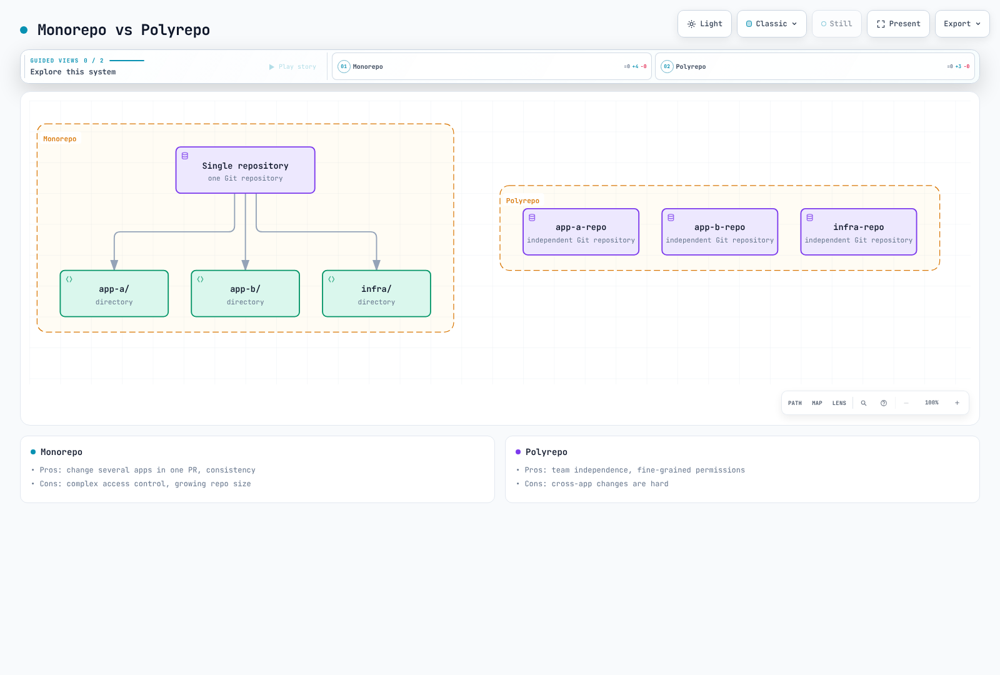

# ArgoCD 最佳实践

> **审查基线**：Argo CD 3.5.2 / Helm Chart 10.8.4 / Kustomize 5.8.1；在审查发行说明后，清单示例已更新至补丁版本 3.5.5（仍捆绑 Kustomize 5.8.1；示例未重新运行）
> **最后更新**：October 16, 2026

## 目录

- [仓库结构](#repository-structure)
- [环境晋级](#environment-promotion)
- [资源管理](#resource-management)
- [性能调优](#performance-tuning)
- [灾难恢复](#disaster-recovery)
- [升级策略](#upgrade-strategies)
- [故障排除](#troubleshooting)
- [EKS 最佳实践](#eks-best-practices)
- [生产环境检查清单](#production-checklist)

## 仓库结构 {#repository-structure}

### Monorepo 模式

使用单个仓库管理所有应用和环境：

```
gitops-repo/
├── apps/
│   ├── app-a/
│   │   ├── base/
│   │   │   ├── deployment.yaml
│   │   │   ├── service.yaml
│   │   │   └── kustomization.yaml
│   │   └── overlays/
│   │       ├── dev/
│   │       │   ├── kustomization.yaml
│   │       │   └── patch.yaml
│   │       ├── staging/
│   │       │   ├── kustomization.yaml
│   │       │   └── patch.yaml
│   │       └── production/
│   │           ├── kustomization.yaml
│   │           └── patch.yaml
│   └── app-b/
│       └── ...
├── platform/
│   ├── argocd/
│   ├── monitoring/
│   └── ingress/
└── clusters/
    ├── dev/
    ├── staging/
    └── production/
```

**优点：**
- 单一事实来源
- 轻松跨应用修改
- 简化 CI/CD
- 一次原子性 Git 提交可以描述多个应用；但它们在集群中的部署并非一个原子事务

**缺点：**
- 仓库可能变得很大
- 访问控制较复杂
- 存在单点故障



[🔍 查看交互式图示](https://www.atomai.click/kubernetes-docs/archmaps/en-gitops-argocd-09-best-practices-0.html)

### Polyrepo 模式

为每个应用或团队使用独立仓库：

```
Organization:
├── gitops-platform/          # Platform team
│   ├── argocd/
│   ├── monitoring/
│   └── ingress/
├── gitops-team-a/            # Team A applications
│   ├── app-a/
│   └── app-b/
├── gitops-team-b/            # Team B applications
│   ├── app-c/
│   └── app-d/
└── gitops-infra/             # Infrastructure
    ├── terraform/
    └── clusters/
```

**优点：**
- 所有权清晰
- 可独立部署
- 访问控制粒度精细
- 仓库规模较小

**缺点：**
- 更难协调变更
- 需要管理更多仓库
- 可能出现配置漂移

### App of Apps 仓库结构

```
gitops-root/
├── argocd-apps/
│   ├── Chart.yaml
│   ├── values.yaml
│   ├── values-dev.yaml
│   ├── values-staging.yaml
│   ├── values-production.yaml
│   └── templates/
│       ├── _helpers.tpl
│       ├── namespace.yaml
│       ├── project.yaml
│       ├── app-a.yaml
│       ├── app-b.yaml
│       └── platform-apps.yaml
└── bootstrap/
    └── root-app.yaml
```

### 推荐的命名约定

| 类型 | 模式 | 示例 |
|------|---------|---------|
| 应用 | `{app}-{env}` | `frontend-production` |
| 项目 | `{team}` 或 `{env}` | `platform`、`production` |
| Namespace | `{app}` 或 `{app}-{env}` | `frontend`、`frontend-prod` |
| 仓库 | `gitops-{scope}` | `gitops-platform` |

## 环境晋级 {#environment-promotion}

### Git 分支策略

长期存在的环境分支是一种选择；在共享的主分支上使用基于目录的 overlays，通常可以减少分支分歧。App of Apps 是一种管理能力：应限制对根仓库以及创建子 Application 的权限。手动执行生产环境同步，与经过审查的 Git 变更是两道不同的关卡。

### 基于目录的晋级

让同一个经过测试的制品逐级晋级到不同环境，而不要针对每个环境重新构建。以下示例假设已有基础配置，并且镜像仓库会强制执行不可变标签；如果不能保证标签不可变，优先使用摘要。更改可变标签的内容本身不会更新 Git 或 Deployment Pod 模板。基础镜像名称为 `my-app`；在 overlay 中同时应用名称和标签转换。匹配旧名称的 overlay 不会更新已由基础配置重命名的镜像。

```yaml
# overlays/dev/kustomization.yaml
apiVersion: kustomize.config.k8s.io/v1beta1
kind: Kustomization
resources:
  - ../../base
images:
  - name: my-app
    newName: my-registry/my-app
    newTag: v1.2.3

---
# overlays/staging/kustomization.yaml
apiVersion: kustomize.config.k8s.io/v1beta1
kind: Kustomization
resources:
  - ../../base
images:
  - name: my-app
    newName: my-registry/my-app
    newTag: v1.2.3

---
# overlays/production/kustomization.yaml
apiVersion: kustomize.config.k8s.io/v1beta1
kind: Kustomization
resources:
  - ../../base
images:
  - name: my-app
    newName: my-registry/my-app
    newTag: v1.2.3
```

### 自动化晋级流水线

此工作流会为**已经过测试的摘要**创建 PR。请根据实际情况调整示例中的镜像仓库和 overlay 路径。使用具有目标仓库 contents/pull requests 写入权限的 GitHub App token 或受限作用域 token 设置 `GITOPS_PR_TOKEN`。使用默认 GITHUB_TOKEN 进行的更改存在后续工作流触发限制；请确认所需检查能够运行。通过仓库 rulesets/分支保护机制强制执行审查、测试和制品策略。

```yaml
name: Promote tested image to production
on:
  workflow_dispatch:
    inputs:
      digest:
        description: 'Tested image digest (sha256: followed by 64 hex characters)'
        required: true
        type: string
permissions:
  contents: read
concurrency:
  group: promote-production
  cancel-in-progress: false
jobs:
  promote:
    runs-on: ubuntu-24.04
    steps:
      - uses: actions/checkout@3d3c42e5aac5ba805825da76410c181273ba90b1 # v7.0.1
        with:
          persist-credentials: false
      - name: Install verified Kustomize
        shell: bash
        run: |
          set -euo pipefail
          tool_dir="$RUNNER_TEMP/kustomize-bin"
          mkdir -p "$tool_dir"
          cd "$tool_dir"
          curl -fsSL -o kustomize.tar.gz \
            https://github.com/kubernetes-sigs/kustomize/releases/download/kustomize/v5.8.1/kustomize_v5.8.1_linux_amd64.tar.gz
          echo "029a7f0f4e1932c52a0476cf02a0fd855c0bb85694b82c338fc648dcb53a819d  kustomize.tar.gz" | sha256sum -c -
          tar -xzf kustomize.tar.gz kustomize
          echo "$tool_dir" >> "$GITHUB_PATH"
      - name: Update production overlay
        env:
          IMAGE_DIGEST: ${{ inputs.digest }}
        shell: bash
        run: |
          set -euo pipefail
          [[ "$IMAGE_DIGEST" =~ ^sha256:[a-f0-9]{64}$ ]] || exit 1
          cd overlays/production
          kustomize edit set image "my-app=my-registry/my-app@${IMAGE_DIGEST}"
          kustomize build . > /dev/null
      - name: Create reviewed promotion PR
        uses: peter-evans/create-pull-request@5f6978faf089d4d20b00c7766989d076bb2fc7f1 # v8.1.1
        with:
          token: ${{ secrets.GITOPS_PR_TOKEN }}
          branch: promote-production
          title: 'Promote tested image to production'
          commit-message: 'chore: promote tested image digest'
          add-paths: overlays/production/kustomization.yaml
          body: |
            Promote the already tested image digest: ${{ inputs.digest }}
            Require the repository's validation and approval checks before merging.
```

## 资源管理 {#resource-management}

### 组件资源

这些 Chart 10.8.4 值是**用于测量的起始参考值**，并非保证适用的资源配置表。请将它们合并到现有 values 中，并保留唯一的部署管理方。该 chart 会提供正确的容器名称和工作负载类型；避免使用不完整的 Deployment 补丁，以免意外添加容器。

```yaml
fullnameOverride: argocd
controller:
  replicas: 1
  resources:
    requests:
      cpu: 500m
      memory: 1Gi
    limits:
      cpu: '2'
      memory: 4Gi
server:
  replicas: 2
  resources:
    requests:
      cpu: 100m
      memory: 256Mi
    limits:
      cpu: 500m
      memory: 512Mi
repoServer:
  replicas: 2
  resources:
    requests:
      cpu: 200m
      memory: 512Mi
    limits:
      cpu: '1'
      memory: 2Gi
```

| 测量项 | 调优方向 |
|---|---|
| 清单生成时间、并发请求数、仓库大小 | repo-server 的 CPU/内存、并行度、磁盘 |
| 每个集群的资源数量及 watch/cache 内存 | Controller 内存和集群分布 |
| 协调/同步队列延迟及 API 限流 | 处理器并发度，同时考虑目标 API 的容量 |
| CPU 限流、OOM 和重启 | requests/limits，同时考虑并发执行 |

仅凭应用数量无法确定 100/500 个应用的分片阈值。Redis 是可重建的缓存，但缓存丢失可能导致重新计算负载和延迟。请应用[高可用安装章节](01-installation.md#high-availability-setup)中的节点/反亲和性/PDB 前提条件。不要盲目复制每个组件。

### 可选的 repo-server HPA

此配置需要 Metrics Server 和 CPU requests。启用 HPA 后，副本数由 HPA 管理。CPU 扩缩容无法解释所有清单生成瓶颈；仅根据持续占用的缓存内存进行扩缩容，可能会让不必要的副本一直运行。

```yaml
repoServer:
  autoscaling:
    enabled: true
    minReplicas: 2
    maxReplicas: 5
    targetCPUUtilizationPercentage: 70
    targetMemoryUtilizationPercentage: null
    behavior:
      scaleDown:
        stabilizationWindowSeconds: 300
```

## 性能调优 {#performance-tuning}

### 配置位置及含义

将这些配置合并到同一个 Helm values 文件中。`configs.params` 会生成 `argocd-cmd-params-cm`；`configs.cm` 会生成 `argocd-cm`。通过命令行/环境设置使用的值，需要重启受影响的 controller/repo-server/server；请检查渲染后的 Pod 和启动日志。

```yaml
configs:
  params:
    controller.status.processors: '20'
    controller.operation.processors: '10'
    controller.repo.server.timeout.seconds: '180'
    server.repo.server.timeout.seconds: '180'
    reposerver.parallelism.limit: '2'
    reposerver.repo.cache.expiration: 24h
    reposerver.git.request.timeout: 30s
    reposerver.git.lsremote.parallelism.limit: '5'
  cm:
    timeout.reconciliation: 300s
    timeout.reconciliation.jitter: 60s
    application.resourceTrackingMethod: annotation
repoServer:
  env:
  - name: ARGOCD_EXEC_TIMEOUT
    value: 2m
```

- Status/operation processors 控制并发度，而不是轮询频率；20/10 是默认并发值。
- 180 秒的 repo-server RPC 超时、两分钟的工具执行超时和 30 秒的 Git 请求超时是不同的限制。请先确定变慢的阶段以及取消行为，再考虑延长这些超时时间。
- `reposerver.parallelism.limit` 限制的是并发清单生成数量，而非缓存 TTL。请针对内存/进程限制进行负载测试。
- 默认定期协调间隔为 120 秒，并附加最多 60 秒的抖动。示例采用 300 + 60 秒（五到六分钟）；webhook 和其他刷新触发原因不受此配置影响。
- `application.resourceTrackingMethod` 设置的是资源跟踪方式，而不是刷新频率。更改现有跟踪方式之前，请评估迁移影响。

### 对多个目标集群进行分片

默认的分片单位是目标**集群**。增加副本不会将所有指向同一个集群的 Application 均匀分配到各副本。该 chart 会将 StatefulSet 副本与 `ARGOCD_CONTROLLER_REPLICAS` 协调起来。此版本中的 Round-robin/一致性哈希和动态集群分布功能仍属实验性，不要将其描述为普遍适用的生产默认配置。

```yaml
controller:
  replicas: 3
configs:
  params:
    controller.sharding.algorithm: legacy
```

### Application 边界与 HPA

应根据所有权和生命周期边界拆分大型 Application。随意按资源种类拆分，会使 Secret/Service/Deployment 依赖关系和删除顺序变复杂。App of Apps 中的子 Application 并非单次原子部署。

此示例假设已有 `workloads` 项目、目标 namespace，以及一个管理 Deployment `my-app` 的 HPA。优先从 Git 中省略 replicas；如有必要，应将 diff/apply 排除范围限定为该资源。`ignoreDifferences.name` 必须与经过 Kustomize 前缀/后缀处理后的最终名称一致。`ApplyOutOfSyncOnly` 用于优化 apply 目标；它不会改变同步频率。

```yaml
apiVersion: argoproj.io/v1alpha1
kind: Application
metadata:
  name: large-app
  namespace: argocd
spec:
  project: workloads
  source:
    repoURL: https://github.com/myorg/gitops.git
    targetRevision: main
    path: overlays/production
  destination:
    server: https://kubernetes.default.svc
    namespace: my-app-production
  syncPolicy:
    automated:
      enabled: true
      prune: true
      selfHeal: true
    syncOptions:
    - ApplyOutOfSyncOnly=true
    - RespectIgnoreDifferences=true
  ignoreDifferences:
  - group: apps
    kind: Deployment
    name: my-app
    namespace: my-app-production
    jsonPointers:
    - /spec/replicas
```

## 灾难恢复 {#disaster-recovery}

### 备份范围

`argocd admin export` 会导出 Applications/AppProjects/ApplicationSets、四个核心 ConfigMap，以及选定的 Argo CD Secret。它**并不是完整的 namespace 备份**。不要假设其中包含 cmd-params、Notifications/CMP 配置以及单独管理的 TLS/notification Secret。还要检查已配置的其他 Application/ApplicationSet namespace。

请使用匹配的 CLI 版本、经过验证的 kubecontext、`age` 工具和获准使用的公钥接收方。私钥身份文件应单独保管，并测试解密/恢复流程。补充快照会加密 namespace 中的所有 ConfigMap/Secret，其中可能包括 Helm release Secret。恢复时应选择所需对象；不要不加筛选地应用整个补充快照。

```bash
#!/usr/bin/env bash
set -euo pipefail
umask 077
: "${ARGO_BACKUP_RECIPIENT:?Set the approved age public recipient}"
ARGO_BACKUP_DIR="./argocd-backup-$(date -u +%Y%m%dT%H%M%SZ)"
mkdir -m 700 "$ARGO_BACKUP_DIR"
kubectl config current-context
kubectl get configmap argocd-cm -n argocd -o name

argocd admin export -n argocd |
  age --recipient "$ARGO_BACKUP_RECIPIENT" --output "$ARGO_BACKUP_DIR/data.yaml.age.tmp"
mv "$ARGO_BACKUP_DIR/data.yaml.age.tmp" "$ARGO_BACKUP_DIR/data.yaml.age"

# Supplement: all namespace ConfigMaps/Secrets, including custom configuration.
kubectl get configmaps,secrets -n argocd -o yaml |
  age --recipient "$ARGO_BACKUP_RECIPIENT" --output "$ARGO_BACKUP_DIR/namespace-config.yaml.age.tmp"
mv "$ARGO_BACKUP_DIR/namespace-config.yaml.age.tmp" "$ARGO_BACKUP_DIR/namespace-config.yaml.age"
```

此外，还应保留固定版本的安装清单/Helm values、CRD 和扩展 controller，以及外部 Secret/KMS、SSO、DNS 和证书的恢复流程。应用数据库/PV 需要单独备份。请根据 RPO/RTO 和访问策略确定备份频率与保留期限。

### Velero 配置备份替代方案

此 Schedule 假设 Velero 已安装，且有可用的 `aws-s3` BackupStorageLocation。请验证计划的时区、加密和访问控制。part-of 标签选择器可能会漏掉用户创建的 Application，因此示例不使用此类筛选条件。CRD/安装/PV 恢复仍属于 DR 中需要单独处理的部分。

```yaml
apiVersion: velero.io/v1
kind: Schedule
metadata:
  name: argocd-config-backup
  namespace: velero
spec:
  schedule: 0 2 * * *
  template:
    includedNamespaces:
    - argocd
    includedResources:
    - applications.argoproj.io
    - applicationsets.argoproj.io
    - appprojects.argoproj.io
    - secrets
    - configmaps
    includeClusterResources: false
    storageLocation: aws-s3
    ttl: 720h0m0s
```

### 分阶段恢复

首先使用原版本和安装方式准备一套**隔离的恢复安装**。确保只有一个管理实例处于活动状态，以免主实例和恢复实例同时修改相同工作负载。对于默认 StatefulSet 布局，在检查导入变更时，应停止 Application 和 ApplicationSet controller。若启用了动态分布，请调整工作负载类型。

```bash
set -euo pipefail
umask 077
: "${ARGO_BACKUP_FILE:?Set the encrypted data.yaml.age path}"
: "${ARGO_BACKUP_IDENTITY:?Set the protected age identity file}"

# Fresh, isolated recovery installation: default StatefulSet controller layout.
kubectl config current-context
kubectl scale statefulset/argocd-application-controller -n argocd --replicas=0
kubectl scale deployment/argocd-applicationset-controller -n argocd --replicas=0

ARGO_RESTORE_DIR="$(mktemp -d)"
trap 'rm -rf "$ARGO_RESTORE_DIR"' EXIT
age --decrypt --identity "$ARGO_BACKUP_IDENTITY" "$ARGO_BACKUP_FILE" \
  > "$ARGO_RESTORE_DIR/data.yaml"
argocd admin import -n argocd --dry-run "$ARGO_RESTORE_DIR/data.yaml"
# Keep controllers stopped while reviewing the recovery copy and destinations.
```

请在同一个 shell 中检查受保护的恢复文件：目标集群/namespace、仓库/集群凭据、删除 finalizer、自动同步策略以及存储的 `operation` 字段。若要暂停自动同步，请同时更新 Applications 和 ApplicationSet 模板，并从恢复副本中移除待处理操作。重启 controller 前，请检查 Git/Helm 源是否会还原这些暂停设置。

```bash
argocd admin import -n argocd "$ARGO_RESTORE_DIR/data.yaml"
```

恢复所需的补充 ConfigMap/Secret 和外部依赖，然后根据经过审查的安装配置恢复 controller 副本数。在逐个恢复部署之前，先检查有代表性的 Application diff/健康状态。对所有应用执行同步、使用 `--prune` 导入或删除 namespace，都不是默认的恢复步骤。

## 升级策略 {#upgrade-strategies}

### 版本与安装管理方

此示例针对经过审查的 3.5.x 补丁升级至 3.5.5，并非从 2.x 或更早的次要版本无条件跳级。请在非生产环境中审查所有中间次要/主要版本的迁移说明、经过测试的 Kubernetes 组合，以及 CRD/RBAC/SSO/CMP 变更。保留现有的 manifest/Helm/GitOps 管理方。请勿将此自管理流程用于 EKS 托管的 Argo CD 功能。

```bash
# Example: reviewed 3.5.x patch upgrade to 3.5.5, manifest-managed non-HA install.
kubectl config current-context
argocd version
kubectl apply --server-side -n argocd \
  -f https://raw.githubusercontent.com/argoproj/argo-cd/v3.5.5/manifests/install.yaml
kubectl rollout status deployment/argocd-server -n argocd --timeout=5m
kubectl rollout status deployment/argocd-repo-server -n argocd --timeout=5m
kubectl rollout status statefulset/argocd-application-controller -n argocd --timeout=5m
kubectl rollout status deployment/argocd-applicationset-controller -n argocd --timeout=5m
kubectl rollout status deployment/argocd-notifications-controller -n argocd --timeout=5m
argocd version
argocd app list
```

对于 HA manifest 安装，请使用 `manifests/ha/install.yaml`；对于自定义 overlays，请更新并渲染固定版本的基础配置。Server-side apply 可处理较大的 CRD。请先检查字段所有权冲突；只有在确实要转移所有权时，才使用官方指南中的 `--force-conflicts`。Pod rollout 成功并不代表迁移、SSO、diff 和同步验证均已完成。

### Helm 管理安装的替代方案

经过审查的 chart 10.8.4 部署的是 Argo CD v3.5.2，因此此 Helm 流程无法升级到上文使用的 3.5.5 补丁版本。Argo CD 3.5.5 首次随 chart 10.10.3 发布；这是此处未审查的 chart 次要版本更新。

```bash
helm repo add argo https://argoproj.github.io/argo-helm
helm repo update argo
helm upgrade argocd argo/argo-cd --version 10.8.4 \
  --namespace argocd -f reviewed-values.yaml --dry-run=server --hide-secret
# After reviewing the dry run and the version-specific migration notes:
helm upgrade argocd argo/argo-cd --version 10.8.4 \
  --namespace argocd -f reviewed-values.yaml --wait --timeout 10m
```

`--hide-secret` 会在 dry-run 输出中隐藏 Secret 清单；还应检查其他位置是否嵌入了敏感值。回滚镜像无法撤销 CRD、持久化数据和集成变更，因此应保留经过测试的备份/恢复方案。

### 并行验证的局限

同一集群中的两个 namespace 仍会共享 CRD 和其他集群级资源。仅更改安装 namespace 不会改写 ClusterRoleBinding subject。Kubernetes 没有 `kubectl rename namespace` 命令。优先在独立集群中进行验证，并明确规划凭据、跟踪/实例 ID、活动 controller 和流量切换。删除旧 namespace 可能会通过 Application finalizer 连带删除受其管理的工作负载。

## 故障排除 {#troubleshooting}

### 检查同步和差异

```bash
argocd app get my-app
argocd app diff my-app
argocd app history my-app
argocd app resources my-app
kubectl describe application my-app -n argocd
kubectl logs -n argocd -l app.kubernetes.io/name=argocd-application-controller --tail=100

# Re-check desired state after identifying the cause; this does not apply resources.
argocd app get my-app --refresh
# Invalidates the cached target manifests for this Application; use sparingly.
argocd app get my-app --hard-refresh
```

`--force` 不是通用的故障排除选项，可能会重新创建资源。Hard refresh 不会应用或回滚工作负载，但会重新生成清单；避免对所有应用反复执行。

### 仓库与 Webhook

```bash
argocd repo list
argocd repo get https://github.com/myorg/myrepo.git
kubectl logs -n argocd deployment/argocd-repo-server --tail=100
kubectl get secrets -n argocd -l argocd.argoproj.io/secret-type=repository
kubectl logs -n argocd deployment/argocd-server --tail=100 | grep -i webhook
```

请检查 TLS/SSH 信任、凭据范围、DNS/出站连接，以及提供商 webhook 的签名、URL 和投递日志。列出 Secret 名称不需要打印凭据值。`argocd repo update --repo-cache-expiration` 不是有效的缓存配置命令。

### OOM 和处理缓慢

```bash
kubectl top pods -n argocd
kubectl get pods -n argocd
kubectl describe pods -n argocd -l app.kubernetes.io/name=argocd-repo-server
argocd app get my-app -o json |
  jq '.status.operationState | {phase, startedAt, finishedAt}'
```

请区分 OOMKilled、CPU 限流、克隆磁盘压力、大型清单、Git 超时和 API 限流。通过 Helm/Git 管理方调整资源/并发度。删除所有 repo-server Pod 不会清除 Redis 清单缓存，反而会增加中断和克隆负载。

### 其他检查

```bash
argocd app manifests my-app
argocd app list -o wide
argocd cluster list
argocd cluster get https://my-target-cluster.example.com
kubectl logs -n argocd statefulset/argocd-application-controller --tail=100
kubectl logs -n argocd deployment/argocd-server --tail=100
kubectl logs -n argocd deployment/argocd-repo-server --tail=100
```

渲染后的清单可能包含生成的 Secret；不要将其写入共享日志。默认 controller 是 StatefulSet；如果启用了动态分布，请检查实际的 Deployment。将临时调试日志范围限定在受影响的组件，并妥善管理其 rollout 和移除。

## EKS 最佳实践 {#eks-best-practices}

### AWS 凭据

仅设置 ServiceAccount 的角色 ARN 并不能完成目标 EKS 访问配置。还需配置 controller/server 的 EKS 身份验证、assume-role 权限、目标 EKS access entries 或旧版 auth 映射，以及 Kubernetes RBAC。只有在 S3/OCI/CMP 访问需要时，才为 repo-server 配置单独的最小权限角色。还需要 IRSA OIDC 信任或 Pod Identity association；这与镜像拉取授权并非一回事。有关实际目标和 ServiceAccount，请参阅 [EKS 安装章节](01-installation.md#argocd-on-amazon-eks)。

### 使用 HTTPS 的内部 ALB

这需要 AWS Load Balancer Controller、管理员到 VPC 的网络连接、匹配的 DNS/ACM 证书、受限的安全组以及 SSO。请替换证书 ARN 和主机名。后端仍使用 HTTPS，且 `server.insecure=false`；通过此单一 HTTP target group 访问 CLI 时，请使用 `--grpc-web`。

```yaml
apiVersion: networking.k8s.io/v1
kind: Ingress
metadata:
  name: argocd
  namespace: argocd
  annotations:
    alb.ingress.kubernetes.io/scheme: internal
    alb.ingress.kubernetes.io/target-type: ip
    alb.ingress.kubernetes.io/backend-protocol: HTTPS
    alb.ingress.kubernetes.io/healthcheck-protocol: HTTPS
    alb.ingress.kubernetes.io/healthcheck-path: /healthz
    alb.ingress.kubernetes.io/listen-ports: '[{"HTTPS":443}]'
    alb.ingress.kubernetes.io/certificate-arn: arn:aws:acm:ap-northeast-2:123456789012:certificate/REPLACE_WITH_CERTIFICATE_ID
    alb.ingress.kubernetes.io/ssl-policy: ELBSecurityPolicy-TLS13-1-2-2021-06
spec:
  ingressClassName: alb
  rules:
  - host: argocd.example.com
    http:
      paths:
      - path: /
        pathType: Prefix
        backend:
          service:
            name: argocd-server
            port:
              number: 443
```

通过单独的 annotation，在同一区域关联经过审查的区域性 WAF Web ACL。请验证 ALB 访问日志存储桶策略和区域。默认不要启用 Shield Advanced 等需要订阅/产生费用的选项。

### EKS 版本升级

请检查经过测试的当前/目标 EKS 和 Argo CD 组合、附加组件/CRD/节点/kubelet 兼容性以及已移除的 API。EKS 控制平面应一次升级一个次要版本；节点/附加组件更新则需单独处理。原地版本更新不需要更改现有 API endpoint。替换集群则需要更新 endpoint/CA/访问配置。

如果要暂停自动同步，请记录原始设置，并通过 Git/ApplicationSet 管理方进行更改。仅通过 CLI 更改子 Application，可能会被其父级还原。完成连接、diff 和示例同步验证后，应恢复**原有的** prune/selfHeal/自动化策略，而不是无条件启用自动化。

## 生产环境检查清单 {#production-checklist}

- [ ] 停用默认 admin 前，验证 SSO/RBAC/TLS 和恢复访问
- [ ] 加密/外置 Secret，并限制仓库/集群凭据的作用范围
- [ ] 测量资源和并发度，并确认是否需要集群分片
- [ ] 验证 HA 节点/反亲和性/PDB，以及组件专属副本数/leader election
- [ ] 验证指标/ServiceMonitor 选择和告警投递；收集 JSON 日志和 Kubernetes 审计/事件
- [ ] 强制执行 AppProject 源/目标限制、同步窗口和经过审查的晋级 PR
- [ ] 测试加密备份解密、补充配置恢复和单管理实例 DR
- [ ] 维护针对特定版本的升级、故障排除和配置恢复操作手册

## 参考资料

- [最佳实践](https://argo-cd.readthedocs.io/en/release-3.5/user-guide/best_practices/)
- [高可用与扩展](https://argo-cd.readthedocs.io/en/release-3.5/operator-manual/high_availability/)
- [备份实现与范围](https://github.com/argoproj/argo-cd/blob/v3.5.5/cmd/argocd/commands/admin/backup.go)
- [升级指南](https://argo-cd.readthedocs.io/en/release-3.5/operator-manual/upgrading/overview/)
- [Chart 10.8.4 values](https://github.com/argoproj/argo-helm/blob/argo-cd-10.8.4/charts/argo-cd/values.yaml)
- [捆绑的 Kustomize 版本](https://github.com/argoproj/argo-cd/blob/v3.5.5/hack/tool-versions.sh)
- [Velero 计划](https://velero.io/docs/main/backup-reference/#schedule-a-backup)

## 测验

尝试[最佳实践测验](../../quizzes/gitops/argocd/09-best-practices-quiz.md)。
