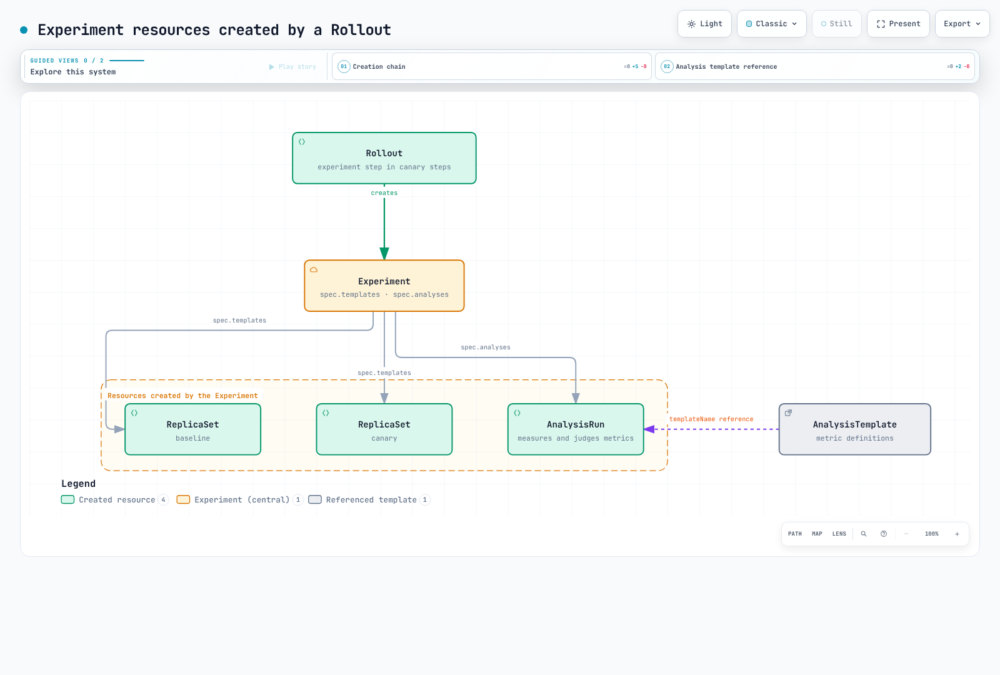

# Argo Rollouts 实验深入解析

> **支持版本**：Argo Rollouts 1.10.0（历史报告中单独标出 1.8.3/Kubernetes 1.33）
> **最后更新**：2026 年 9 月 11 日

## 目录

- [什么是 Experiment？](#what-is-an-experiment)
- [资源层级和创建链](#resource-hierarchy-and-creation-chain)
- [名称生成规则](#name-generation-rules)
- [流量路由行为](#traffic-routing-behavior)
- [度量和判定：AnalysisRun](#measurement-and-verdict-analysisrun)
- [结果传播与 Rollout 状态转换](#result-propagation-and-rollout-state-transitions)
- [示例](#working-example)
- [使用 kubectl 插件观察](#observing-with-the-kubectl-plugin)
- [验证结果](#verification-results)
- [后续步骤](#next-steps)
- [参考资料](#references)
- [测验](#quiz)

## 什么是 Experiment？

Experiment 是一种 Argo Rollouts CRD，它会创建临时 ReplicaSet 并运行分析。它支持基线/金丝雀比较、部署前检查以及带真实流量的实验。**创建单独的 ReplicaSet 本身并不能隔离生产流量。** 应明确设计 Service 选择器、路由器和测试流量。

| 方面 | Canary 步骤 | Experiment 步骤 |
|---|---|---|
| Pod | Rollout 的金丝雀 ReplicaSet | 临时 Experiment ReplicaSet |
| 流量 | 基础金丝雀按 Pod 比例近似分流；配置后可按权重路由 | 根据 Service/路由器配置使用隔离流量或真实流量 |
| 完成 | 可以成为新的稳定版本 | 根据清理延迟策略将副本缩容至零 |
| 分析 | 特定版本的质量指标 | 单独的基线/金丝雀指标和测试流量 |

既支持独立的 Experiment，也支持 Rollout 中的 experiment 步骤。`specRef` 和 `weight` 属于 **Rollout 步骤模板**。独立 Experiment 会直接定义选择器和 Pod 模板。

## 资源层级和创建链

Rollout 到达 experiment 步骤时，会沿着以下链条创建资源：



[🔍 查看交互式图表](https://www.atomai.click/kubernetes-docs/archmaps/en-gitops-argocd-10-rollouts-experiment-0.html)

1. 更新到达 experiment 步骤后会创建 Experiment。首次创建时会确立稳定版本并跳过普通金丝雀步骤；要观察 Experiment，应进行**后续的 Pod 模板变更**。
2. 控制器会为每个模板创建一个 ReplicaSet，并等待其请求的副本数都可用。就绪状态和 `minReadySeconds` 都会产生影响；超过进度期限后，Experiment 会失败。
3. 所有副本都可用后，控制器记录 `status.availableAt` 并启动分析。配置的 `duration` 从此时开始计时。
4. 完成结果会向上传播：Successful 会继续前进；Failed/Error 会中止；**Inconclusive 会暂停**。ReplicaSet/Service 清理则由单独的协调流程处理。

## 名称生成规则

Experiment 系列资源的命名遵循固定规则，因此仅凭名称就可以追踪所属 Rollout、修订版本和步骤。

| 资源 | 规则 | 实测示例 |
|----------|------|------------------|
| Experiment | `<rollout-name>-<new-version PodTemplateHash>-<revision>-<step-index>` | `demo-app-74d8d8b4fb-2-0` |
| ReplicaSet | `<experiment-name>-<template-name>` | `demo-app-74d8d8b4fb-2-0-baseline`、`demo-app-74d8d8b4fb-2-0-canary` |
| AnalysisRun | `<experiment-name>-<analysis-name>` | `demo-app-74d8d8b4fb-2-0-success-rate` |

以上示例来自 `demo-app` Rollout 第 2 次修订中步骤索引为 0 的 Experiment。[验证结果](#verification-results)中的树状输出展示了实际层级。

以上是基础名称。Experiment/AnalysisRun 名称冲突时可能会附加数字后缀；应通过 ownerReferences 和 status 查找实际资源。

## 流量路由行为

如果生产 Service 只选择 `app: demo-app`，它也可能选中 Experiment Pod。还应检查实际的哈希专属选择器；不要认为单独使用一个哈希值就能保证足够隔离。此示例要求生产 Service 使用 `traffic-class: production`，并在 Experiment 模板中将其覆盖为 `experiment`。还应检查其他 Service 和 mesh 路由。

以下是 Rollout `spec.strategy.canary.steps` 中一个条目的**两种替代写法**。创建 Service 并不会自动把外部流量接入该 Service。

```yaml
- experiment:
    duration: 1m
    templates:
    - name: baseline
      specRef: stable
      service: {}
    - name: canary
      specRef: canary
      service: {}
```

```yaml
- experiment:
    duration: 1m
    templates:
    - name: baseline
      specRef: stable
      weight: 5
    - name: canary
      specRef: canary
      weight: 5
```

- `service: {}` 会为该模板创建 Service。默认名称与 ReplicaSet 相同；可以通过 `service.name` 覆盖。声明的容器端口必须与应用实际监听的端口一致。
- `weight` 按模板分别计算。默认总权重为 100 时，5 表示 5%；使用自定义 `maxTrafficWeight` 时应确认单位。设置权重也会创建 Service。
- 加权 Experiment 需要受支持的路由器。1.10 版本的文档列出了 ALB/Istio/SMI。普通金丝雀加权并不代表 NGINX 或所有插件都支持 Experiment 流量拆分。

## 度量和判定：AnalysisRun

AnalysisRun 根据条件评估提供方结果。以下是 **AnalysisTemplate 的 spec 片段**；完整提供方配置见下方示例。成功率缺失或超出范围时，两个条件都为 false，结果是 Inconclusive。类型无效、HTTP/收集失败以及表达式错误会走 Error 路径。

```yaml
metrics:
- name: success-rate
  interval: 15s
  count: 3
  successCondition: let payload = default(result, {}); payload?.status == 'ok' && payload?.success_rate != nil &&
    asFloat(payload.success_rate) >= 0.95 && asFloat(payload.success_rate) <= 1
  failureCondition: let payload = default(result, {}); payload?.status == 'ok' && payload?.success_rate != nil &&
    asFloat(payload.success_rate) >= 0 && asFloat(payload.success_rate) < 0.95
  failureLimit: 1
  inconclusiveLimit: 1
  consecutiveErrorLimit: 2
```

| 条件 | 度量结果 |
|---|---|
| `failureCondition=true` | Failed，优先于 Successful |
| `successCondition=true`，且 `failureCondition=false` | Successful |
| 两者都为 false | Inconclusive |
| 提供方或表达式错误 | Error |

只设置成功条件时，条件为 false 就表示 Failed。只设置失败条件时，条件为 false 就表示 Successful。两个条件都不设置时，只要没有收集错误，度量结果就是 Successful。

| 字段 | 含义 | 超限时的结果 |
|---|---|---|
| failureLimit | 允许 Failed 度量的数量 | Failed |
| inconclusiveLimit | 允许 Inconclusive 度量的数量 | Inconclusive |
| consecutiveErrorLimit | 允许连续 Error 的数量，默认 4 | Error |

`failureLimit: 1` 会在第二次失败的度量时超限。`count` 统计度量次数，而不是 HTTP 请求数。只设置 interval、不设置 count 时会无限重复；两者都省略时只执行一次。三个重叠的指标时间窗口并不等于三个独立样本。

## 结果传播与 Rollout 状态转换


[🔍 查看交互式图表](https://www.atomai.click/kubernetes-docs/archmaps/en-gitops-argocd-10-rollouts-experiment-1.html)

| Experiment 结果 | Rollout 行为 |
|---|---|
| Successful | 前进到下一步骤 |
| Failed / Error | 中止/Degraded；按已配置的路由/副本策略恢复稳定版本 |
| Inconclusive | 以 `InconclusiveExperiment` 状态暂停，等待调查和运维人员决策 |

1.10 版本不会无条件等待 duration 和分析都完成。所有必需分析成功后，即使 duration 尚未结束，Experiment 也可以完成。仍在运行的必需分析可能使其超过 duration；duration 结束时，非必需分析可能会被终止。既没有 duration 也没有必需分析时，它会一直运行，直到被显式终止。此示例省略 duration，并使用有限次数的必需分析来结束 Experiment。

`scaleDownDelaySeconds` 默认为 30 秒。终止状态、Pod 数为零以及 Service 删除并不保证同时发生。控制器会在该延迟后缩容；所有可用副本都归零后，再删除生成的 Service。ReplicaSet/AnalysisRun 对象仍可能根据历史记录/垃圾回收策略保留。中止操作不会撤销数据库变更或外部副作用。

## 示例

这是一个**用于教学的控制流示例**。请安装 Rollouts 1.10.0/CRD 和插件，并另行在 `demo` 命名空间提供名为 `metrics-mock` 的 HTTP Service，使其返回下方 JSON。此处没有包含该服务端实现，因此单独应用这些清单不能保证成功。固定的 mock 值无法衡量基线/金丝雀质量或真实流量比例。

```json
{"status":"ok","success_rate":0.99}
```

```yaml
apiVersion: v1
kind: Namespace
metadata:
  name: demo
---
apiVersion: v1
kind: Service
metadata:
  name: demo-production
  namespace: demo
spec:
  selector:
    app: demo-app
    traffic-class: production
  ports:
  - name: http
    port: 9898
    targetPort: http
---
apiVersion: argoproj.io/v1alpha1
kind: AnalysisTemplate
metadata:
  name: success-rate-check
  namespace: demo
spec:
  metrics:
  - name: success-rate
    interval: 15s
    count: 3
    successCondition: let payload = default(result, {}); payload?.status == 'ok' && payload?.success_rate != nil
      && asFloat(payload.success_rate) >= 0.95 && asFloat(payload.success_rate) <= 1
    failureCondition: let payload = default(result, {}); payload?.status == 'ok' && payload?.success_rate != nil
      && asFloat(payload.success_rate) >= 0 && asFloat(payload.success_rate) < 0.95
    failureLimit: 1
    inconclusiveLimit: 1
    consecutiveErrorLimit: 2
    provider:
      web:
        url: http://metrics-mock.demo.svc.cluster.local/metrics.json
        jsonPath: '{$}'
---
apiVersion: argoproj.io/v1alpha1
kind: Rollout
metadata:
  name: demo-app
  namespace: demo
spec:
  replicas: 3
  revisionHistoryLimit: 3
  progressDeadlineSeconds: 180
  selector:
    matchLabels:
      app: demo-app
  strategy:
    canary:
      steps:
      - experiment:
          scaleDownDelaySeconds: 30
          templates:
          - name: baseline
            specRef: stable
            replicas: 1
            metadata:
              labels:
                traffic-class: experiment
                experiment-role: baseline
            service: {}
          - name: canary
            specRef: canary
            replicas: 1
            metadata:
              labels:
                traffic-class: experiment
                experiment-role: canary
            service: {}
          analyses:
          - name: success-rate
            templateName: success-rate-check
            requiredForCompletion: true
      - setWeight: 20
      - pause:
          duration: 10s
  template:
    metadata:
      labels:
        app: demo-app
        traffic-class: production
      annotations:
        demo-revision: v1
    spec:
      containers:
      - name: app
        image: ghcr.io/stefanprodan/podinfo:6.15.0
        ports:
        - name: http
          containerPort: 9898
        readinessProbe:
          httpGet:
            path: /readyz
            port: http
        resources:
          requests:
            cpu: 50m
            memory: 64Mi
          limits:
            cpu: 500m
            memory: 128Mi
```

应用文件并在专用实验集群中建立首个稳定修订后，修改 Pod 模板注解以触发 experiment 步骤。这只演示控制器流程，不代表新镜像的质量。对于由 Argo CD 管理的资源，应在 Git 中进行变更，不要直接修改线上状态。mock 速率 0.99 会触发成功；0.50 会超过 failureLimit 并中止；缺少速率则会触发 Inconclusive 暂停。之后应检查实验资源的清理范围。

```bash
kubectl argo rollouts status demo-app -n demo --timeout=180s
# A second Pod-template revision exercises the steps; the image stays unchanged in this demo.
kubectl patch rollout demo-app -n demo --type merge \
  -p '{"spec":{"template":{"metadata":{"annotations":{"demo-revision":"v2"}}}}}'
kubectl argo rollouts get rollout demo-app -n demo --watch
```

未配置 trafficRouting 时，`setWeight: 20` 是按 Pod 比例分流的一种近似。三个副本无法保证用户请求恰好有 20% 被分配到金丝雀。真实比较需要测试流量、检测/抓取、足够的样本，以及下面的 **Experiment ReplicaSet** 哈希参数。这些不是 `podTemplateHashValue: Baseline/Canary` 字段。

```yaml
args:
- name: baseline-hash
  value: '{{templates.baseline.podTemplateHash}}'
- name: canary-hash
  value: '{{templates.canary.podTemplateHash}}'
```

另请参阅[指标比较示例](05-traffic-management.md#experiments)。

## 使用 kubectl 插件观察

`kubectl argo rollouts get rollout <name> --watch` 会实时显示完整的 Experiment 层级（Experiment → ReplicaSet → Pod，以及 AnalysisRun）。下方输出是原文记录的 1.8.3 历史结果，并非当前示例的一次新运行。不要将其名称、时间或清理时机当作新的 1.10.0 结果。

```
$ kubectl argo rollouts get rollout demo-app -n demo
Name:            demo-app
Namespace:       demo
Status:          ◌ Progressing
Strategy:        Canary
  Step:          0/3
  SetWeight:     0
  ActualWeight:  0

NAME                                                  KIND         STATUS         AGE  INFO
⟳ demo-app                                            Rollout      ◌ Progressing  51s
├──# revision:2
│  ├──⧉ demo-app-74d8d8b4fb                           ReplicaSet   • ScaledDown   29s  canary
│  └──Σ demo-app-74d8d8b4fb-2-0                       Experiment   ◌ Running      29s
│     ├──⧉ demo-app-74d8d8b4fb-2-0-baseline           ReplicaSet   ✔ Healthy      29s
│     │  └──□ demo-app-74d8d8b4fb-2-0-baseline-gvgnq  Pod          ✔ Running      29s  ready:1/1
│     ├──⧉ demo-app-74d8d8b4fb-2-0-canary             ReplicaSet   ✔ Healthy      29s
│     │  └──□ demo-app-74d8d8b4fb-2-0-canary-jq6lb    Pod          ✔ Running      29s  ready:1/1
│     └──α demo-app-74d8d8b4fb-2-0-success-rate       AnalysisRun  ◌ Running      29s  ✔ 2
└──# revision:1
   └──⧉ demo-app-779c8779bf                           ReplicaSet   ✔ Healthy      51s  stable
```

历史跟踪显示第 2 次修订的主 ReplicaSet 已缩容。这并不能证明其他步骤顺序或 Service/路由器配置下生产流量绝不会暴露。AnalysisRun 会在其 status 中保留度量历史，供事后分析：

```
$ kubectl get analysisrun demo-app-74d8d8b4fb-2-0-success-rate -n demo \
    -o jsonpath='{.status.metricResults[0]}' | python3 -m json.tool
{
    "consecutiveSuccess": 2,
    "count": 2,
    "measurements": [
        {
            "finishedAt": "2026-07-17T01:24:09Z",
            "phase": "Successful",
            "value": "{\"error_rate\":0.004,\"status\":\"ok\",\"success_rate\":0.99}"
        },
        ...
    ],
    "name": "success-rate",
    "phase": "Running",
    "successful": 2
}
```

## 验证结果

原文报告了在 1.8.3 源码构建版和 Kubernetes 1.33/kwok（真实控制平面二进制文件，模拟节点/Pod 生命周期）上得到的以下结果。报告未附上完整执行清单、原始 API 转储和日志，因此本次审查无法复现。以下是历史观测，并非新的 1.10.0 结果，也不能证明真实流量、Pod 就绪情况或应用质量。

| 历史项目 | 原始报告 |
|---------------|--------|
| Experiment 在 experiment 步骤自动创建，名称为 `<rollout>-<PodHash>-<revision>-<step>` | 报告值：`demo-app-74d8d8b4fb-2-0`（修订 2，步骤 0） |
| 根据模板创建 ReplicaSet，名称为 `<experiment>-<template>` | 报告值：`...-2-0-baseline`、`...-2-0-canary`，各 1 个副本 |
| 为配置 `service: {}` 的模板创建专属 Service，并在之后清理 | 报告值：创建 `...-2-0-canary` Service，确认 Experiment 结束后已删除 |
| 所有模板健康后创建 AnalysisRun；按 `interval: 15s`/`count: 3` 重复度量 | 报告值：记录 3 次相隔 15 秒的度量，`successCondition` 评估为 Successful |
| 成功路径：60 秒 duration 到期 → Experiment Successful → Experiment RS 缩容至 0 → 下一步骤（setWeight 20）→ Rollout Healthy | 报告：正常运行 |
| 失败路径：指标恶化 → AnalysisRun Failed，`failed (2) > failureLimit (1)` → Experiment Failed → Rollout 中止（Degraded），保留稳定版本 | 报告：正常运行（中止消息会原样列出出问题的指标） |

## 后续步骤

1. **[流量管理](05-traffic-management.md)**：将 Experiment 步骤与金丝雀/蓝绿策略和 Ingress 集成结合起来。

2. **[最佳实践](09-best-practices.md)**：了解渐进式交付运维的最佳实践。

## 参考资料

- [Experiment 官方文档](https://argoproj.github.io/argo-rollouts/features/experiment/)
- [Analysis 官方文档](https://argoproj.github.io/argo-rollouts/features/analysis/)
- [Experiment CRD 规范](https://argoproj.github.io/argo-rollouts/features/specification/)

- [1.10.0 Experiment 状态机](https://github.com/argoproj/argo-rollouts/blob/v1.10.0/experiments/experiment.go)
- [1.10.0 Rollout 暂停/中止处理](https://github.com/argoproj/argo-rollouts/blob/v1.10.0/rollout/experiment.go)
- [1.10.0 ReplicaSet 清理](https://github.com/argoproj/argo-rollouts/blob/v1.10.0/experiments/replicaset.go)

## 测验

请通过[Rollouts Experiments 测验](../../quizzes/gitops/argocd/10-rollouts-experiment-quiz.md)测试你对本章内容的掌握情况。
