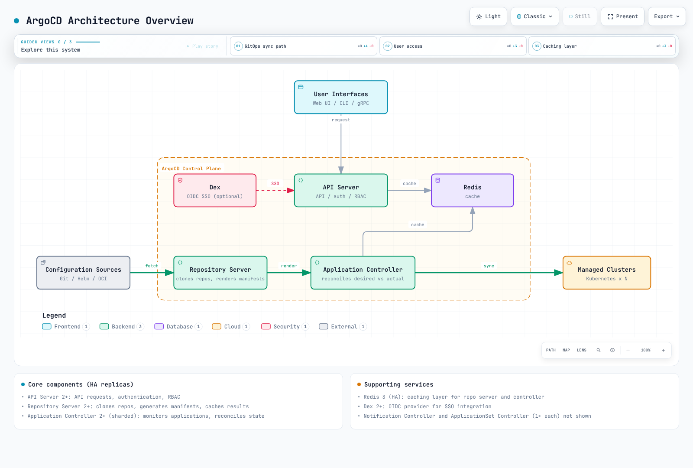
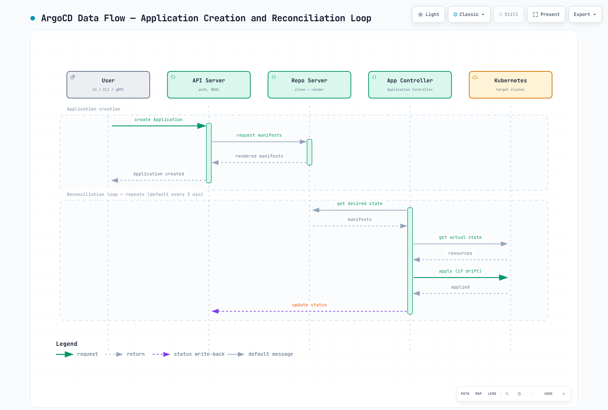

# ArgoCD

> **审查基线**：Argo CD 3.5.2、Argo Rollouts 1.10.0；经审阅发行说明后，Argo CD 清单中的版本固定值已更新为补丁版本 3.5.5（未重新运行示例）
> **最近更新**：2026年11月19日

## 目录
- [什么是 ArgoCD？](#what-is-argocd)
- [主要优势](#key-benefits)
- [架构概览](#architecture-overview)
- [核心概念](#core-concepts)
- [子指南导航](#sub-guide-navigation)
- [快速入门](#quick-start)
- [版本兼容性](#version-compatibility)

## 什么是 ArgoCD？ {#what-is-argocd}

ArgoCD 是一款面向 Kubernetes 的声明式 GitOps 持续交付工具。它通过将 Git 仓库中定义的期望状态与集群中的实际状态同步，自动将应用部署到 Kubernetes 集群。

Argo CD 是 CNCF 毕业级 Argo 项目的一部分。仅仅采用该项目，并不能证明它适用于特定的安全或可用性要求。



[🔍 查看交互式图表](https://www.atomai.click/kubernetes-docs/archmaps/en-gitops-argocd-overview-0.html)

## 主要优势 {#key-benefits}

### 原生支持 GitOps

- **Git 是唯一事实来源**：所有应用配置都存储在 Git 中
- **声明式部署**：定义期望状态，其余工作由 ArgoCD 处理
- **审计跟踪**：通过 Git 提交记录所有变更的完整历史
- **回滚**：重新部署保留的配置修订版本；数据库/外部状态的恢复需单独处理

### 多集群管理

- **集中控制**：通过单个 ArgoCD 实例管理数百个集群
- **ApplicationSet**：基于模板的多集群部署
- **集群生成器**：根据标签动态选择目标集群

### 满足企业级需求

- **RBAC**：细粒度的基于角色的访问控制
- **SSO 集成**：直接使用 OIDC，或通过受支持的 Dex 连接器对接其他身份提供方
- **多租户**：基于 Project 的隔离
- **高可用性**：适用于生产环境的 HA 部署

### 开发者体验

- **Web UI**：以可视化方式管理和监控应用
- **CLI**：功能齐全的命令行界面
- **通知**：集成 Slack、Teams、电子邮件和 Webhook
- **健康监控**：内置及自定义健康检查

## 架构概览 {#architecture-overview}

### 核心组件

| 组件 | 描述 | 副本数（HA） |
|-----------|-------------|---------------|
| **API Server** | 处理所有 API 请求、身份验证和 RBAC | 2+ |
| **Repository Server** | 克隆仓库、生成清单并缓存结果 | 2+ |
| **Application Controller** | 监控应用并协调状态 | 2+（分片） |
| **Redis** | 为 repo server 和 controller 提供缓存层 | 3（HA） |
| **Dex** | 可选的身份代理；通过增加副本数无法安全扩展捆绑的内存存储 | 标准捆绑配置为 1 个 |
| **Notification Controller** | 根据事件发送通知 | 1+ |
| **ApplicationSet Controller** | 管理 ApplicationSet 资源 | 1+ |

### 数据流



[🔍 查看交互式图表](https://www.atomai.click/kubernetes-docs/archmaps/en-gitops-argocd-overview-1.html)

## 核心概念 {#core-concepts}

### Application

Application CRD 是 ArgoCD 中的主要资源。它定义：
- **源**：从哪里获取清单（Git 仓库、Helm Chart、OCI）
- **目标**：部署到哪里（集群和命名空间）
- **同步策略**：如何处理同步

### Project

Project 提供逻辑分组和访问控制：
- 限制可使用的仓库
- 限定目标集群和命名空间
- 定义允许/拒绝的资源

### ApplicationSet

ApplicationSet 使用生成器，通过单个定义管理多个应用：
- **List Generator**：静态值列表
- **Cluster Generator**：选择已注册的集群
- **Git Generator**：扫描仓库目录/文件
- **Matrix/Merge**：组合多个生成器

### 同步

同步会使集群状态与期望状态一致：
- **手动同步**：由用户触发
- **自动同步**：Git 发生变更时自动执行
- **自愈**：自动纠正状态偏差
- **Prune**：移除孤立资源

## 子指南导航 {#sub-guide-navigation}

| 指南 | 描述 |
|-------|-------------|
| [安装](01-installation.md) | 安装方式、CLI 设置、HA 配置、EKS 集成 |
| [应用](02-applications.md) | Application CRD、源类型、健康检查、钩子、App of Apps |
| [同步策略](03-sync-strategies.md) | 同步策略、waves、窗口、差异比较、重试配置 |
| [ApplicationSet](04-applicationsets.md) | 所有生成器、模板化、渐进式同步、多集群模式 |
| [流量管理](05-traffic-management.md) | Argo Rollouts、蓝绿发布、金丝雀发布、分析、Ingress 集成 |
| [Projects 与 RBAC](06-projects-rbac.md) | AppProject、RBAC 策略、多租户、JWT 令牌 |
| [安全](07-security.md) | SSO 集成、密钥管理、TLS、审计日志 |
| [通知](08-notifications.md) | 通知服务、触发器、模板、订阅 |
| [最佳实践](09-best-practices.md) | 仓库模式、性能调优、故障排查、EKS 提示 |
| [Rollouts 实验深入解析](10-rollouts-experiment.md) | Experiment CRD、临时 ReplicaSet 验证、AnalysisRun 判定结果 |

## 快速入门 {#quick-start}

### 1. 安装 ArgoCD

这是一个自行管理的非 HA 评估示例。请准备兼容的集群、CRD/RBAC 权限和专用空命名空间；有关生产环境中的 HA/身份验证/升级决策，请参阅[安装指南](01-installation.md)。

```bash
# Create namespace
kubectl create namespace argocd

# Install ArgoCD
kubectl apply --server-side -n argocd -f https://raw.githubusercontent.com/argoproj/argo-cd/v3.5.5/manifests/install.yaml

# Wait for pods to be ready
kubectl wait --for=condition=Ready pods --all -n argocd --timeout=300s
```

### 2. 访问 UI

```bash
# Port forward to access locally
kubectl port-forward svc/argocd-server -n argocd 8080:443
```

### 3. 获取初始密码

```bash
# Retrieve the initial admin password
kubectl -n argocd get secret argocd-initial-admin-secret \
  -o jsonpath="{.data.password}" | base64 -d && echo
```

### 4. 通过 CLI 登录

安装与操作系统/架构匹配的 CLI，并按照[安装指南](01-installation.md)中的说明验证发行版校验和。在另一个终端中保持端口转发运行。

```bash
# Install CLI (macOS)
brew install argocd

# Login
argocd login localhost:8080

# Change the bootstrap password
argocd account update-password
kubectl -n argocd delete secret argocd-initial-admin-secret
```

### 5. 部署第一个应用

```bash
# Create application via CLI
argocd app create guestbook \
  --repo https://github.com/argoproj/argocd-example-apps.git \
  --path guestbook \
  --dest-server https://kubernetes.default.svc \
  --dest-namespace default

# Sync the application
argocd app sync guestbook
```

或者使用声明式配置：

```yaml
apiVersion: argoproj.io/v1alpha1
kind: Application
metadata:
  name: guestbook
  namespace: argocd
spec:
  project: default
  source:
    repoURL: https://github.com/argoproj/argocd-example-apps.git
    targetRevision: HEAD
    path: guestbook
  destination:
    server: https://kubernetes.default.svc
    namespace: default
  syncPolicy:
    automated:
      prune: true
      selfHeal: true
    syncOptions:
      - CreateNamespace=true
```

## 版本兼容性 {#version-compatibility}

审阅基线为 **Argo CD 3.5.2 / Helm Chart 10.8.4**；经审阅发行说明后，清单示例已更新到补丁版本 3.5.5（未重新运行）。Chart 10.8.4 仍会部署 Argo CD v3.5.2；3.5.5 首次随 Chart 10.10.3 发布。应用版本与安装 Chart 版本并不相同。Argo CD 为最近三个次要版本系列提供补丁；更旧的版本系列已停止维护。

### 已测试的 Kubernetes 版本组合

| Argo CD | Kubernetes |
|---|---|
| 3.5 | 1.36、1.35、1.34、1.33 |
| 3.4 | 1.35、1.34、1.33、1.32 |
| 3.3 | 1.35、1.34、1.33、1.32 |

这是 3.5.5 仓库中记录的上游测试矩阵。它不同于 Chart 的最低 kubeVersion 约束、Kubernetes/EKS 支持窗口以及托管 Argo CD 版本策略。EKS 次要版本与 Argo CD 次要版本之间并不存在一一对应关系。

### 近期发行版本

- 3.5.0：于 **2026年8月4日**发布。对于包括服务器 Helm 4 渲染器在内的变更，请查阅迁移指南。
- 3.5.1：于 2026年8月12日发布。
- 3.5.2：于 2026年8月27日发布。
- 3.5.3：于 2026年9月14日发布。包含错误修复（健康检查、同步重试状态、UI）。
- 3.5.4：于 2026年10月6日发布。这是一个**安全补丁版本**：它修复了四个严重问题，分别是通过 Kustomize 远程引用以及 Kustomize Helm 配置目录在 repo-server 中执行命令、通过 Jsonnet 导入读取 repo-server 文件，以及通过 PreDelete/PostDelete 钩子绕过 AppProject 限制（CVE-2026-77459）。相同的修复也回移植到了 v3.4.10/v3.3.15。行为变更：Kustomize 构建不再遵循 `helmGlobals.configHome`，并且会拒绝超过 4 MiB 的 OCI 清单；升级前请查阅[发行说明](https://github.com/argoproj/argo-cd/releases/tag/v3.5.4)。
- 3.5.5：于 2026年10月12日发布。这是一个错误修复补丁版本（修复了 CMP 失败后 repo-server 中的清单过期和 goroutine 泄漏问题、OCI 缓存行为等）；v3.4.11/v3.3.16 也于同日发布。请参阅[发行说明](https://github.com/argoproj/argo-cd/releases/tag/v3.5.5)。
- 3.5.6：于 2026年10月20日发布。这是一个错误修复补丁版本；v3.4.12（2026年10月21日）和 v3.3.17（2026年10月20日）也在同一时间段发布。请参阅[发行说明](https://github.com/argoproj/argo-cd/releases/tag/v3.5.6)。
- 3.3.18：于 2026年10月22日发布。此版本为 3.3 系列提供了一项**安全修复**，用于不再信任已遭入侵的 eMudhra CA 证书（该中间 CA 遭入侵事件于 2026年10月20日披露，并在整个生态系统中进行了修复）。请参阅[发行说明](https://github.com/argoproj/argo-cd/releases/tag/v3.3.18)。
- [3.6.0-rc1](https://github.com/argoproj/argo-cd/releases/tag/v3.6.0-rc1)：3.6 系列的首个候选发行版，于 2026年9月15日发布。不是生产环境基线。
- [3.6.0-rc3](https://github.com/argoproj/argo-cd/releases/tag/v3.6.0-rc3)：3.6 系列的候选发行版，于 2026年10月15日发布。同样不是生产环境基线。
- [3.6.0-rc4](https://github.com/argoproj/argo-cd/releases/tag/v3.6.0-rc4)：3.6 系列最新的候选发行版，于 2026年10月22日发布。同样不是生产环境基线。
- 3.5.7：于 2026年11月2日发布。这是一个错误修复补丁版本；v3.4.13 和 v3.3.19 也于同日发布。请参阅[发行说明](https://github.com/argoproj/argo-cd/releases/tag/v3.5.7)。
- 3.6.0：于 **2026年11月3日**发布，是 3.6 系列的 GA 版本（包含 ApplicationSet 渐进式同步指标/条件和强制刷新注解、可配置的 Dex 存储和 TLS 设置、CloudNativePG 集群的休眠/恢复操作等）。错误修复补丁 v3.6.1 于 2026年11月4日发布。本文档的审查基线仍为 3.5.x；升级次要版本前，请阅读[升级指南和发行说明](https://github.com/argoproj/argo-cd/releases/tag/v3.6.0)。

### 2026年10月更新：Argo CD 4.0 愿景规划启动

根据[9月30日的 CNCF 帖子](https://www.cncf.io/blog/2026/09/30/argocon-north-america-2026-what-to-expect-as-the-argo-community-looks-toward-cd-4-0/)，Argo 社区已开始为 Argo CD 4.0 制定愿景；ArgoCon North America 2026（与 KubeCon NA 同地举办的全天双会场活动）将以维护者主题演讲拉开序幕，内容涵盖近期进展和即将推出的版本。这只是早期路线图方向的制定；4.0 的功能和时间安排尚未确定。

### Argo Rollouts

Rollouts 是一个独立的 controller，可在不使用 Argo CD 的情况下运行。本次审阅依据的是其 1.10.0 文档。请分别验证 Rollouts CRD/controller、流量插件、Kubernetes 以及与 Argo CD 的健康检查集成，不要将无关产品的版本号相互对应。

### EKS 托管 Argo CD 能力

EKS 的 Argo CD Capability 与自行管理的安装方式是两种不同的运维模式。它的自定义配置仅适用于**受支持的** argocd-cm 键，且必须位于由该 Capability 配置的命名空间中，并带有标签 `app.kubernetes.io/part-of: argocd`。不受支持的键/标志会被忽略；不要假设可使用标准 Lua 库或任意执行插件。请参阅[托管配置指南](https://docs.aws.amazon.com/eks/latest/userguide/argocd-configure-settings.html)。

在 2026年10月的测试中，即使是本地集群也必须使用带有其 EKS ARN 的集群 Secret 进行注册；自动创建的访问条目只有在同时附加 `AmazonEKSEditPolicy` 和 `AmazonEKSAdminViewPolicy` 后才能同步。默认 Git 轮询从提交到 Synced 耗时 342–697 秒；使用 GitHub Webhook 后，耗时降至约 7 秒。登录仅支持 IAM Identity Center，不提供 CMP 和 `argocd admin`，版本由 AWS 选择。此前不可用的 Argo CD Notifications 自[2026年11月3日的公告](https://aws.amazon.com/about-aws/whats-new/2026/11/amazon-eks-argo-cd-notifications/)起已受支持，包括通过 IAM Capability Role 投递到 Amazon SQS/EventBridge，以及引用 AWS Secrets Manager 中第三方令牌的方式。有关权限、多集群布局、版本准备情况以及与自行管理方式的比较，请参阅[EKS Capabilities](../../eks/13-eks-capabilities.md)。

## 后续步骤

1. **[安装指南](01-installation.md)**：为生产环境设置 ArgoCD
2. **[应用指南](02-applications.md)**：了解 Application CRD
3. **[ApplicationSet 指南](04-applicationsets.md)**：多集群部署

## 资源

- [ArgoCD 官方文档](https://argo-cd.readthedocs.io/)
- [ArgoCD GitHub 仓库](https://github.com/argoproj/argo-cd)
- [Argo Rollouts 文档](https://argoproj.github.io/argo-rollouts/)
- [CNCF Argo 项目页面](https://www.cncf.io/projects/argo/)

## 测验

要检验你学到的内容，请尝试 [ArgoCD 安装测验](../../quizzes/gitops/argocd/01-installation-quiz.md)。

### 版本审阅来源

- [Argo CD 3.5.5 已测试的 Kubernetes 版本](https://github.com/argoproj/argo-cd/blob/v3.5.5/docs/operator-manual/tested-kubernetes-versions.md)
- [发行版支持策略](https://github.com/argoproj/argo-cd/blob/v3.5.5/docs/developer-guide/release-process-and-cadence.md)
- [3.5.0 发行版](https://github.com/argoproj/argo-cd/releases/tag/v3.5.0)
- [3.5.2 发行版](https://github.com/argoproj/argo-cd/releases/tag/v3.5.2)
- [3.5.3 发行版](https://github.com/argoproj/argo-cd/releases/tag/v3.5.3)
- [3.5.4 发行版](https://github.com/argoproj/argo-cd/releases/tag/v3.5.4)
- [Chart 10.10.3（首个包含 Argo CD 3.5.5 的 Chart）](https://github.com/argoproj/argo-helm/releases/tag/argo-cd-10.10.3)
- [HA 组件行为](https://github.com/argoproj/argo-cd/blob/v3.5.5/docs/operator-manual/high_availability.md)
