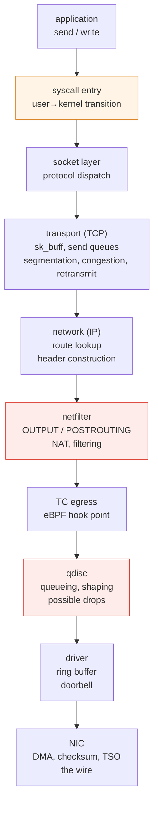
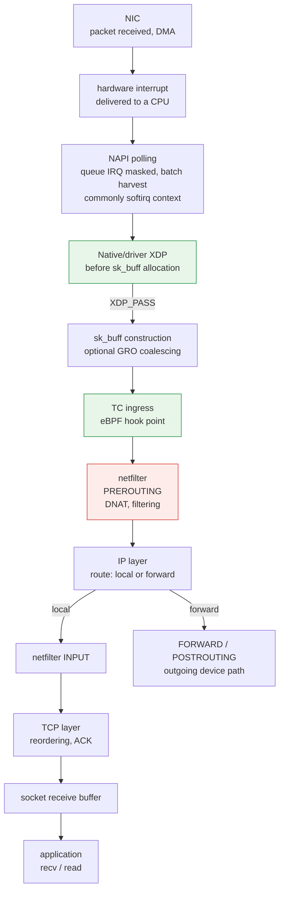

# 内核网络协议栈

> **支持的版本**：Linux 6.1 / 6.12 / 6.18（Amazon Linux 2023）
> **最后更新**：2026 年 9 月 14 日

## 本文涵盖内容

- 一个 `send()` 在内核中到达网线所经过的路径，以及每个环节的作用
- socket 文件描述符如何连接到虚拟文件系统（VFS），以及 TCP 缓冲区、窗口和队列观测值之间的区别
- 可挂载钩子的位置，以及 XDP、TC 和 netfilter 所处位置如何造成性能差异
- 为什么同一节点、同一可用区和跨可用区的 Pod-to-Pod 流量会实际经过不同路径

## 了解数据路径的意义

“网络很慢”不是可用于诊断的描述。内核网络路径上有**多个会以不同原因造成延迟和丢包的位置**；应采取何种措施，完全取决于问题发生在哪个位置。

| 症状 | 调查方向 |
|---|---|
| 吞吐量在某个水平停滞 | 应用速率、socket 缓冲区、接收/拥塞窗口或路径限制 |
| 只在流量突发时丢包 | qdisc、NIC/驱动队列、协议栈内存压力或下游丢包 |
| 只有一个 CPU 达到 100% | 队列/中断分布、单个流或该核心上的应用工作 |
| 小请求异常缓慢 | 系统调用、上下文切换等固定开销占主导 |
| 规则增多后性能变慢 | netfilter 规则评估 |

了解数据路径，就可以反向查看此表，确定从哪里开始排查。

## Socket 与 VFS：从 FD 到协议 {#socket-vfs-bridge}

`socket()` 会返回一个文件描述符（FD），即进程描述符表中的索引。对于 socket，该表项会引用一个 **`struct file`**；其 socket 文件操作和 `private_data` 会将它连接到一个 **`struct socket`**。Internet TCP socket 进一步包含承载协议状态的 **`struct sock`**。共享文件抽象使 socket 可以参与 `close()`、描述符复制和就绪状态轮询；**socket 不是磁盘文件**，普通 TCP 数据不会经过磁盘页缓存或块 I/O。

入口路径取决于所用 API：

```text
FD → struct file → struct socket → struct sock / TCP state

read / write
  → VFS → socket_file_ops.read_iter / write_iter
  → sock_read_iter / sock_write_iter → socket receive/send operations

recv / send / recvmsg / sendmsg
  → socket-specific syscall path → look up the socket through the FD
  → socket receive/send operations
```

因此，`read()`/`write()` 会通过 VFS 分派到 socket 文件操作；socket 专用 API 也可以按需接受标志、地址或辅助数据。**这些 API 并非全部经过 `vfs_read()`/`vfs_write()`**。不同路径最终会汇合到 socket/协议操作。请参见 Linux v6.12 [`net/socket.c`](https://github.com/torvalds/linux/blob/v6.12/net/socket.c)（`sock_alloc_file`、`socket_file_ops`、`__sys_sendto`、`__sys_recvfrom`）和 [`fs/read_write.c`](https://github.com/torvalds/linux/blob/v6.12/fs/read_write.c)。这些是带版本的示例，并不保证内部函数名称永远不变。

TCP 提供字节流：一次 `write()` 不一定对应一个数据包或对端的一次 `read()`。`send()` 成功返回表示字节已在本地被接受，并不证明对端应用已经读取这些字节（[socket(7)](https://man7.org/linux/man-pages/man7/socket.7.html)、[tcp(7)](https://man7.org/linux/man-pages/man7/tcp.7.html)）。

## 发送路径：从 send() 到网线

下面展示的是一个简化的**本机生成、发往物理 NIC 的 TCP/IP 路径**，并非每个数据包都必须经过的固定路线。Loopback 和虚拟设备、转发、XDP/AF_XDP 或其他旁路路径、netfilter flowtable 卸载以及 NIC 卸载，都可能跳过、移动或合并部分工作。只有配置了钩子才会执行相应处理；NAT 可能触发另一次路由查询。



理解各阶段实际发生的操作，是进行诊断的基础。

### ① 系统调用入口：固定开销的来源

普通的 `send()` 调用会通过系统调用进入内核。进入/退出每次调用都会带来一部分固定开销；总成本还取决于数据复制、协议处理、调度以及调用是否阻塞。

大量小型写入时，这部分开销可能很重要。假设每次调用都接受请求字节，那么请求 10,000 次、每次 64 字节，与一次请求 640,000 字节，提交的总负载相同，但系统调用次数相差 10,000 倍。

应用缓冲或 `sendmsg()` scatter/gather 可以把多个缓冲区合并到一次调用中；`sendmmsg()` 可以批处理消息，`io_uring` 可以批处理提交。它们的语义各不相同，而且批处理不会定义 TCP 数据包边界。

### ② Socket 层：sk_buff 与缓冲区

尽管名字相似，**`sk_buff` 并不是 socket 的整个发送或接收缓冲区**。它描述数据包数据和元数据，包括标头偏移以及对线性数据或页片段的引用。skb 可以被克隆、拆分或合并；由于 GSO/GRO 的存在，一个 skb 不一定对应一个线上数据包。请参见内核的 [`sk_buff` 文档](https://docs.kernel.org/networking/skbuff.html)。

| 概念 | 表示的内容 |
|---|---|
| 应用字节 | 应用提交或读取的 TCP 流负载 |
| Socket 发送缓冲区 | 已排队输出的内存预算，包括等待发送的数据，以及保留用于确认/重传的数据 |
| Socket 接收缓冲区 | 接收数据的内存预算，包括尚未读取以及可能乱序的数据 |
| 内核内存记账 | skb 元数据、数据存储和分配开销等分配费用；并不只有负载长度 |
| 通告接收窗口（`rwnd`） | 接收方根据可用接收容量和 TCP 窗口规则，允许对端继续发送的序列空间大小 |
| 拥塞窗口（`cwnd`） | 发送方侧的拥塞控制限制，用于限制未完成的数据量；它独立于接收方缓冲区预算 |

发送空间不足时，阻塞调用可能等待；非阻塞调用若一个字节也未能接受，则返回 `EAGAIN`/`EWOULDBLOCK`。两种模式都可能返回成功但只写入部分字节；应用必须处理剩余字节。较大的缓冲区允许在本地排入更多数据，但不会直接增大对端窗口或发送方的 `cwnd`。

### TCP 缓冲区策略与单 Socket 设置 {#tcp-buffer-policy}

TCP sysctl 描述的是策略，不是每个 socket 当前的占用量：

| 设置 | 含义 |
|---|---|
| `net.ipv4.tcp_rmem` / `net.ipv4.tcp_wmem` | 三个以**字节**为单位的值：内存压力下的最小值、初始默认值，以及自动调整接收/发送缓冲区的上限 |
| `net.ipv4.tcp_moderate_rcvbuf` | 启用接收缓冲区自动调优，并受其限制和内存压力影响 |
| `SO_RCVBUF` / `SO_SNDBUF` | 应用针对单个 socket 的请求；显式设置任一方向后，该方向的缓冲区大小就会锁定，不再由 TCP 常规自动调整 |
| `net.core.rmem_max` / `net.core.wmem_max` | 普通应用 `SO_RCVBUF` / `SO_SNDBUF` 请求的上限，与 TCP 自动调优上限不同 |

`SO_RCVBUF` 会设置 `SOCK_RCVBUF_LOCK`，从而为该 socket 禁用接收缓冲区自动调优；`SO_SNDBUF` 会设置 `SOCK_SNDBUF_LOCK`，阻止正常的发送缓冲区扩展。这些是配置标志，不是互斥锁。提高 TCP sysctl 不会撤销应用的显式设置。Linux 通常会将接受的 `SO_*BUF` 请求值加倍用于记账，并通过 `getsockopt()` 返回加倍后的值（受最小值/上限影响）；这个值既不是当前已分配内存，也不保证是负载容量。不要把 `tcp_rmem[2]` 当作显式 `SO_RCVBUF` 请求允许的最大值，也不要将每个 `tcp_*mem` 值都加倍。请参见 [IP sysctl](https://docs.kernel.org/networking/ip-sysctl.html)、[socket(7)](https://man7.org/linux/man-pages/man7/socket.7.html)，以及 Linux v6.12 [`net/core/sock.c`](https://github.com/torvalds/linux/blob/v6.12/net/core/sock.c) / [`tcp_input.c`](https://github.com/torvalds/linux/blob/v6.12/net/ipv4/tcp_input.c)。

### BDP：通过单位进行推理 {#tcp-bdp-reasoning}

假设路径带宽为 **1 Gbit/s**、RTT 为 **40 ms**，带宽时延积为：

```text
BDP = 1,000,000,000 bit/s × 0.040 s ÷ 8 bit/byte
    = 5,000,000 bytes = 5 MB ≈ 4.77 MiB
```

这可以估算理想化稳态模型中要达到该速率所需的在途负载量；应使用往返时间，而不是单向延迟。接收窗口和拥塞窗口都必须允许足够多的数据处于未完成状态。`ss -i` 通常以分段数量表示 `cwnd`，所以应将 `cwnd × MSS` 与字节数比较。Socket 内存还需要计入管理开销；发送方可以排入尚未进入网络的数据。

**BDP 是用于诊断的尺度，不是 sysctl 配方。** 应用数据生成速度慢、CPU 压力、丢包、节奏控制、RTT 变化或路径限制都可能成为主导因素；增加队列还可能增大延迟和内存用量。形成结论前，请比较 [TCP 缓冲区实验](../networking/07-linux-network-diagnostics.md#tcp-buffer-lab)中的观测。

### ③ 传输层（TCP）：拥塞控制所在位置

TCP 协调可靠性、流量控制和拥塞控制。

- 按 MSS 和路径 MTU 限制分段负载；GSO/TSO 可以推迟实际分段操作
- 同时按对端的**接收窗口**和发送方的**拥塞窗口**（cwnd）限制未完成数据，并受节奏控制等其他因素约束
- 维护重传队列；未收到 ACK 时执行重传

拥塞控制算法位于此层。以下两个示例在发送控制方式上有所不同：

| 算法 | 主要模型 | 解读 |
|---|---|---|
| **cubic** | 遇到丢包/ECN 等拥塞事件后增长或缩减窗口 | 丢包原因不只有拥塞；应检查路径 |
| **bbr** | 使用传输速率和 RTT 估算来控制节奏及在途数据量 | 估算和丢包/恢复行为取决于具体实现/版本 |

这两个模型都不能证明哪种算法对某项工作负载更快；使用 BBR 也不代表丢包或恢复问题无关紧要。使用 `ss -ti` 检查活动算法以及 RTT/cwnd；比较时必须注明内核版本、负载和路径。带版本的实现参见 [`tcp_cubic.c`](https://github.com/torvalds/linux/blob/v6.12/net/ipv4/tcp_cubic.c)、[`tcp_bbr.c`](https://github.com/torvalds/linux/blob/v6.12/net/ipv4/tcp_bbr.c)。

### ④ 网络层（IP）：路由查询

在路由表中查找通往目标的路径。**此查询按网络命名空间隔离**，因此在 Pod 内看到的路由表不是节点的路由表（[容器内核特性](./01-container-primitives.md)）。

### ⑤ netfilter：评估规则的位置

本机生成的流量可能经过 `OUTPUT` 和 `POSTROUTING`；从 Pod veth 接收的流量则可能在节点命名空间中经过 `PREROUTING` → `FORWARD` → `POSTROUTING`。Service DNAT 和出口 MASQUERADE 取决于所配置的数据平面和钩子，不存在适用于所有环境的统一路径。

随着 Service 增多，需要线性评估的长 iptables 链可能增加查找工作量。实际成本取决于规则、查找结构和数据平面模式；规则数量本身并非延迟测量值。已配置的 netfilter flowtable 快速路径可能绕过后续转发钩子（[netfilter flowtable](https://docs.kernel.org/networking/nf_flowtable.html)）。

### ⑥ qdisc：实际发生丢弃的位置

qdisc（排队规则）会**在数据包交给 NIC 之前排队，并决定发送顺序和速率。**

运维中要点如下：

> qdisc 队列溢出是造成突发丢包的可能原因之一。归因之前，应关联 qdisc、NIC/驱动、协议栈和云网络计数器。

队列未满时，qdisc 也可能因为队列限制或主动队列管理而丢弃数据包。它的丢弃计数器只记录由该 qdisc 归因的丢弃，不涵盖整条路径中的所有丢包。有些设备使用 `noqueue`，而直接发送/卸载路径也不一定将每个数据包都排队。

**观测方法**：比较受影响时间段内，`tc -s qdisc show dev <iface>` 中 `dropped`、`backlog`、`overlimits` 和 `requeues` 的变化。`overlimits` 可能表示整形决策，而非丢弃；`requeues` 记录重新排队的数据包。还要检查接口和驱动计数器，但不要假定这些计数完全相同或可相加。

不同 qdisc 的特性各异。

| qdisc | 特性 |
|---|---|
| `pfifo_fast` | 简单 FIFO（3 个优先级带）；旧默认值 |
| `fq_codel` | 按流排队并通过 CoDel 控制延迟；可通过丢包或 ECN 标记表示拥塞 |
| `fq` | 支持节奏控制的公平流排队 |
| `mq` | 在多队列 NIC 上为每个硬件队列配置 qdisc 的封装器 |

**Bufferbloat**（缓冲膨胀）指过多的排队延迟：较大的队列可以吸收突发流量，但也会让数据驻留更久。`fq_codel` 会监控驻留时间，并在适用时通过丢包或 ECN 标记来发出拥塞信号。队列更大并不一定更好（[tc-fq_codel(8)](https://man7.org/linux/man-pages/man8/tc-fq_codel.8.html)）。

### ⑦ 驱动与 NIC：卸载

在典型物理 NIC 路径中，驱动会将数据包数据映射为 DMA，为发送环中的描述符准备对这些内存的引用，然后通知 NIC。NIC 不会直接读取 C 语言 `sk_buff` 结构；驱动会保留记账信息，直至发送完成。

卸载功能会改变工作在哪个位置执行，以及主机观测结果的含义。

| 卸载 | 作用 |
|---|---|
| **TSO / GSO** | TSO 将分段交给受支持的硬件；GSO 是内核通用/软件分段框架和回退路径。它们不都是仅由 NIC 执行的操作 |
| **GRO**（Generic Receive Offload） | 在接收侧将小数据包**合并**后再交给协议栈 → 减少协议栈遍历次数 |
| **Checksum offload** | 由 NIC 计算校验和 |
| **RSS**（Receive Side Scaling） | 将接收流哈希到硬件队列；IRQ 亲和性及后续导流会决定 CPU 放置 |

TSO/GRO 可以减少每段数据所需的处理。**只读检查**：`ethtool -k <iface>` 显示已配置的特性，但不能证明每个数据包都使用了这些特性。主机抓包可能显示较大的 GSO/GRO 单元或尚未完成的发送校验和；仅凭捕获到的大数据包或表面上错误的校验和，不能证明线上出现故障（[分段卸载](https://docs.kernel.org/networking/segmentation-offloads.html)、[校验和卸载](https://docs.kernel.org/networking/checksum-offloads.html)）。

## 接收路径：从中断到应用

图中显示了物理 NIC 接收数据时常见的路径：驱动 NAPI 和可选的原生 XDP，随后将数据交付本地 TCP。`XDP_PASS` 会继续进入协议栈；丢弃、重定向和发送操作则走其他路径。通用 XDP 运行时 skb 已存在。Loopback、虚拟设备、硬件卸载、忙轮询和线程化 NAPI 都可能改变此顺序。



### NAPI：防止中断风暴的机制

如果每个数据包都触发中断，高负载时系统可能进入**只顾处理中断、无法执行其他工作的状态**（活锁）。

在常见的中断驱动 NAPI 设置中，驱动会屏蔽相关队列中断并安排轮询。一次轮询处理有数量上限的工作；轮询完成后，驱动可以重新启用该中断。这并不等于禁用了所有 CPU 中断。忙轮询和线程化 NAPI 是其他执行模式（[NAPI](https://docs.kernel.org/networking/napi.html)）。

批处理可以摊销每个数据包的开销；高负载仍可能耗尽轮询预算并增加延迟或丢包。

### 中断集中到一个核心

接收中断会指向特定 CPU。若只有一个队列或处理流量集中在一起，即使总体 CPU 用量较低，也可能使单个核心饱和。单个流或应用工作也可能造成这种现象。

可在三个层面解决：

| 功能 | 层面 | 作用 |
|---|---|---|
| **RSS** | 硬件 | NIC 将流哈希到接收队列；IRQ 亲和性可以把队列处理分散到不同 CPU |
| **RPS** | 软件 | 内核将接收处理交给其他 CPU（适用于缺少 RSS 或队列很少的情况） |
| **RFS** | 软件 | 尝试将接收处理导向使用该流的应用所在 CPU，以获得缓存局部性 |

**诊断方法**：使用 `/proc/interrupts` 检查各核心的分布是否均衡；使用 `mpstat -P ALL` 检查是否有单个核心的 `%soft`（softirq）飙升。

RSS、RPS 和 RFS 并不会全部转移硬件中断。为了保序，单个流可能仍留在一个队列上（[网络协议栈扩展性](https://docs.kernel.org/networking/scaling.html)）。

### Socket 接收缓冲区与背压

如果应用读取接收数据不够快，尚未读取的字节会不断累积，可用接收容量随之下降。TCP 可以通告更小或零接收窗口，从而应用流量控制背压。窗口计算、连接建立时协商的缩放以及预留内存意味着，通告窗口并不简单等于 `SO_RCVBUF - Recv-Q`。

`Recv-Q` 持续增长时，应调查读取进度、CPU 调度和下游应用工作，并结合网络证据。单次快照不能证明应用是唯一原因。更大的缓冲区可能只是推迟背压，同时保留更多数据。

## 比较钩子位置：XDP、TC、netfilter

它们都用于“拦截并处理数据包”，但**所在位置决定性能和可执行的操作。**

| 项目 | **XDP** | **TC（eBPF）** | **netfilter** |
|---|---|---|---|
| **位置** | 原生/驱动 XDP：`sk_buff` 创建前；通用 XDP：基于 skb | 创建 `sk_buff` 后，入口/出口方向 | 协议栈钩子 |
| **方向** | 主要是入口方向 | 入口 + 出口 | 所有方向 |
| **避免或增加的工作** | 原生早期丢弃可避免分配 skb 及后续协议栈处理 | skb 创建后运行；工作量取决于程序和挂载方式 | 成本取决于钩子、规则、状态跟踪和卸载 |
| **可用信息** | 数据包数据、允许的元数据/辅助函数/映射 | 验证器允许的 `__sk_buff` 上下文/辅助函数；不能任意读取内核内存 | conntrack 活动时可读取连接状态 |
| **主要用途** | **DDoS 丢弃**、负载均衡、数据包重定向 | 策略执行、可观测性、重定向 | NAT、有状态过滤 |
| **硬件卸载** | 部分驱动/NIC 组合支持 | 部分支持 | 特定 nftables flowtable 卸载；并非每条规则/路径都支持 |

早期丢弃的优势特指**原生/驱动 XDP**，即在分配 skb 之前执行。通用 XDP 已经有 skb；实际性能取决于驱动支持情况和程序工作量。不要将一种模式的解释当作通用基准结果。

XDP 不会自动获得所有 socket/协议栈上下文，但 BPF 映射可以维护状态，受支持的辅助函数也能提供额外信息。**有状态处理并非 XDP 天生做不到**；应评估具体程序、内核、验证器和驱动限制。

一个数据平面可以组合多种钩子来执行不同工作；Cilium 的实际挂载点取决于配置和受支持的功能（[Cilium eBPF](../networking/cilium/02-ebpf.md)、[Cilium L2-L7 网络](../networking/cilium/05-l2-l7-networking.md)）。

## Pod-to-Pod：数据路径为何不同

在 Kubernetes 中，Pod-to-Pod 流量会根据 Pod 的位置**实际经过不同的内核路径**。这就是 [Pod 网络基准测试](../networking/06-pod-network-benchmark.md)中测得 RTT 梯度的原因（同一节点 0.040 ms → 同一 AZ 0.339 ms → 跨 AZ 0.544 ms）。

### 同一节点上的 Pod

```text
Pod A [net ns A] → veth A → (node net ns) → veth B → Pod B [net ns B]
```

在所示的普通 veth/路由式同节点路径中，流量无需经过物理 NIC。其他数据平面、覆盖网络、SR-IOV 或策略/服务绕行都可能改变路径；虚拟设备仍由内核驱动处理。

因此，基准测试中同节点单流吞吐量达到 **29.97 Gbps**（跨节点则碰到 EC2 单流限制 4.96 Gbps）。瓶颈不是网络，而是**CPU**：客户端一个核心达到 99.8%。

### 不同节点上的 Pod（VPC CNI）

```text
Pod A → veth → node net ns → ENI → VPC network → target ENI → veth → Pod B
```

使用 Amazon VPC CNI 时，Pod 获得**真实 VPC IP**，因此没有覆盖网络封装。与 VXLAN 等覆盖网络 CNI 相比，避免封装/解封装成本和 MTU 损失是 VPC CNI 的结构性优势（[VPC CNI](../networking/01-vpc-cni.md)）。

此类普通跨节点路径会使用物理网络设备，并受**EC2 实例网络限制**：单流上限、实例总带宽和 PPS 上限。确切的排队和钩子路径仍取决于设备和数据平面。

### 跨越 AZ

所引用的单流实验在两种跨节点放置中都观察到了 +0.21 ms RTT 和约 4.96 Gbps。该结果只适用于该实验所用的实例、负载和路径，并不能证明每个跨 AZ 工作负载的吞吐量都不会变化。

### MTU 与分片

**MTU** 是接口对 IP 数据包的大小限制，包括 IP 标头；**PMTU** 是路径上最小的有效 MTU。**MSS** 限制每个 TCP 段的负载，不包括 IP/TCP 标头。在 IP MTU 为 1500 字节且没有选项时，IPv4 的 20 字节标头加 TCP 的 20 字节标头，剩余 1460 字节；IPv6 的 40 字节标头加 TCP 的 20 字节标头，剩余 1440 字节。选项和封装还会占用空间。对端通告的 MSS 不是整条路径的测量结果。

如果 DF 未设置，IPv4 路由器可能会将超大数据包分片；如果 DF 已设置，则会丢弃数据包，通常返回 ICMP “fragmentation needed”。IPv6 路由器不会进行分片，而会返回 ICMPv6 “Packet Too Big”，由发送方调整大小或自行分片。PMTUD 使用这些反馈；相关 ICMP 丢失时可能形成黑洞，不过分组层探测有时可以恢复。只有完整路径支持所需大小时，9001 等 Jumbo MTU 才有帮助。

“握手成功但数据传输停滞”**与** PMTU 问题相符，但不能证明问题就在 PMTU。请比较接口 MTU、TCP MSS/PMTU 信息和适当位置的抓包结果。GSO/TSO/GRO 和校验和卸载可能导致主机抓包与线上数据包不同；不要仅凭主机捕获到的大数据单元就推断发生了分片或损坏。请参见 [MTU/MSS 实验](../networking/07-linux-network-diagnostics.md#mtu-mss-lab)、[IPv4 PMTUD](https://www.rfc-editor.org/rfc/rfc1191) 和 [IPv6 PMTUD](https://www.rfc-editor.org/rfc/rfc8201)。

## 观测工具

每一层都需要观察不同的信息。

| 层 | 工具 | 观测内容 |
|---|---|---|
| Socket | `ss -tinm`、`ss -ltn` | TCP 状态、流队列与监听器 backlog、RTT/cwnd、socket 内存 |
| TCP 全局状态 | `nstat` / `netstat -s` | 重传、乱序、缓冲区溢出 |
| netfilter | `iptables-save`、`nft list ruleset` | 规则数量和内容 |
| conntrack | `conntrack -S` | `insert_failed`：结合计数/上限和日志分析；此计数并非只与资源耗尽有关 |
| qdisc | `tc -s qdisc show dev <if>` | 该 qdisc 的丢弃、积压、整形和重新排队计数器 |
| 接口 | `ip -s link`、`ethtool -S <if>` | 接口和 NIC 计数器 |
| 卸载 | `ethtool -k <if>` | TSO/GRO/校验和状态 |
| 中断 | `/proc/interrupts`、`mpstat -P ALL` | 核心负载偏斜、softirq 占比 |
| 数据包追踪/流状态 | `tcpdump`、`ss`、eBPF 工具 | 观测位置上的数据包或 socket/事件状态，受卸载功能和挂载点影响 |

从丢弃计数器开始，然后关联时间、接口/命名空间、流量和资源压力。计数器上升是需要调查的证据，不代表已证明唯一原因；计数器未增加，也不能排除其他位置的丢包。适当时还应使用 RTT/cwnd、应用指标和抓包。

### 根据 Socket 状态读取 TCP 队列 {#ss-tcp-queues}

对于普通 Linux TCP socket，`ss` 会根据状态显示不同数量：

| 状态 | `Recv-Q` | `Send-Q` |
|---|---|---|
| `ESTABLISHED` | 已接收但尚未复制给应用的按序流**字节数** | 已写入但尚未累计确认的流**字节数**：包括尚未发送和已发送/未确认的字节 |
| `LISTEN` | 排队等待 `accept()` 的连接**数量** | 已配置的 accept backlog 上限，单位为**连接数**，不是排队负载 |

监听器数值不是 SYN 队列占用量或字节缓冲区大小。Accept backlog 受 `listen()` 和 `somaxconn` 限制；未完成请求和 SYN cookie 有各自的行为。Linux v6.12 [`tcp_diag_get_info()`](https://github.com/torvalds/linux/blob/v6.12/net/ipv4/tcp_diag.c) 会导出这些依赖状态的值；另请参见 [listen(2)](https://man7.org/linux/man-pages/man2/listen.2.html)。

`ss -m` 会显示 `skmem` 内存记账：`r`（接收内存）、`rb`（接收预算）、`w`（排队的发送内存）和 `tb`（发送预算）等字段都表示内核字节数，并包括开销。它们不一定等于 `Recv-Q`/`Send-Q`。乱序接收数据可能占用内存，却不会显示为可读取的按序字节；仅凭 `Send-Q` 非零不能证明发生丢包或缓冲区已满。如果可用，`ss -i` 会补充 RTT、MSS 和 `cwnd`；其中的 `rcv_space` 是内部自动调优辅助量，不是通告窗口（[ss(8)](https://man7.org/linux/man-pages/man8/ss.8.html)）。

以下命令会观测当前网络命名空间中的 socket，并读取进程可见的缓冲区策略：

```bash
ss -tinm
ss -ltn
sysctl net.ipv4.tcp_rmem net.ipv4.tcp_wmem net.ipv4.tcp_moderate_rcvbuf
sysctl net.core.rmem_max net.core.wmem_max net.core.somaxconn
```

应一并记录 socket 状态、单位、应用读/写进度以及随时间的变化。如需受控示例和解读，请继续阅读 [TCP 缓冲区实验](../networking/07-linux-network-diagnostics.md#tcp-buffer-lab)。

## 总结

- Socket FD 共享 VFS 文件抽象；`read`/`write` 通过 socket 文件操作分派，而 `send`/`recv` 使用 socket 专用入口路径。
- skb 对象、socket 内存预算、流字节数、`rwnd` 和 `cwnd` 表示不同数量。应根据 socket 状态读取 `ss` 队列列项。
- TCP 缓冲区 sysctl 控制自动调优；显式 `SO_*BUF` 设置会锁定对应方向。BDP 提供推理尺度，不是通用缓冲区配置值。
- 普通 TCP/IP 路径有多个观测点；旁路、转发和卸载会改变路径。qdisc 丢弃只是可能的丢包来源之一。
- NAPI 会批处理工作；RSS/RPS/RFS 会分配队列或处理任务。原生 XDP 在创建 skb 之前运行；通用 XDP 则不是。
- 同节点 veth 流量可以绕过物理 NIC，但实际路径由数据平面决定。PMTU 停滞和主机抓包异常都需要证据，不能仅由单个症状推断。

下一篇：[EKS 节点内核调优](./03-eks-node-tuning.md)将介绍何时以及如何调整此路径上的参数。

## 参考资料

- [Linux 网络文档：内核](https://docs.kernel.org/networking/index.html)
- [NAPI：Linux 内核文档](https://docs.kernel.org/networking/napi.html)
- [Linux 网络协议栈扩展性（RSS/RPS/RFS）](https://docs.kernel.org/networking/scaling.html)
- [XDP（eXpress Data Path）](https://docs.kernel.org/networking/af_xdp.html)
- [Linux v6.12 Socket 实现](https://github.com/torvalds/linux/blob/v6.12/net/socket.c)：FD、VFS 操作和 socket API 入口点
- [Socket API 与选项：socket(7)](https://man7.org/linux/man-pages/man7/socket.7.html)
- [TCP：tcp(7)](https://man7.org/linux/man-pages/man7/tcp.7.html)
- [Socket 观测：ss(8)](https://man7.org/linux/man-pages/man8/ss.8.html)
- [Pod 网络基准测试](../networking/06-pod-network-benchmark.md)
- [eBPF 基础](../basics/05-ebpf-fundamentals.md)
- [Linux 分段卸载](https://docs.kernel.org/networking/segmentation-offloads.html)：硬件 TSO 和软件 GSO
- [Linux IP sysctl](https://docs.kernel.org/networking/ip-sysctl.html)：TCP 缓冲区大小和 socket 覆盖设置
