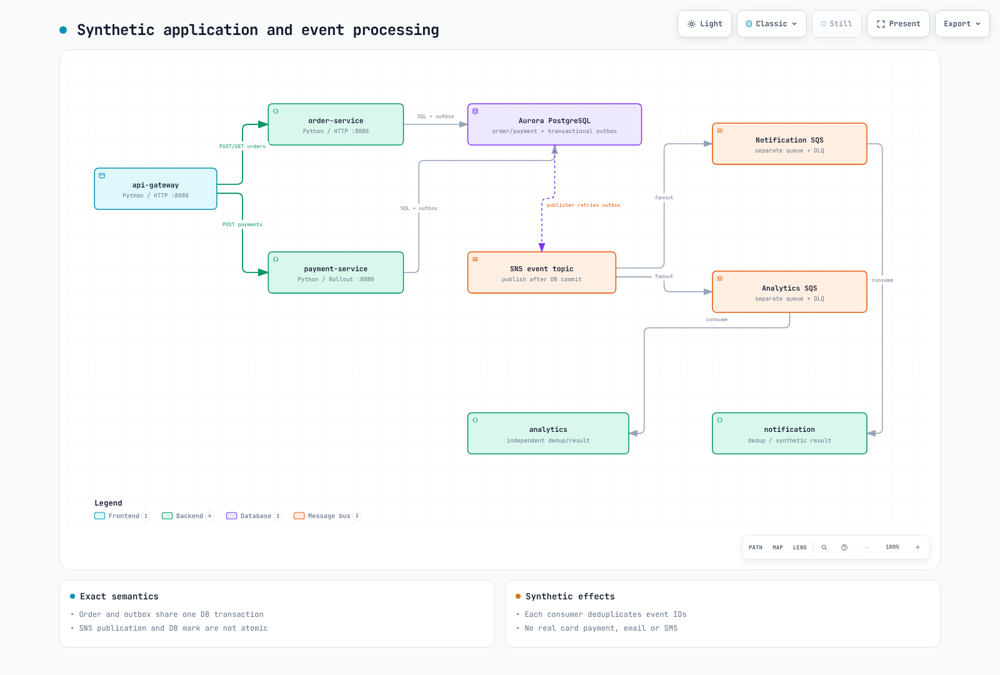
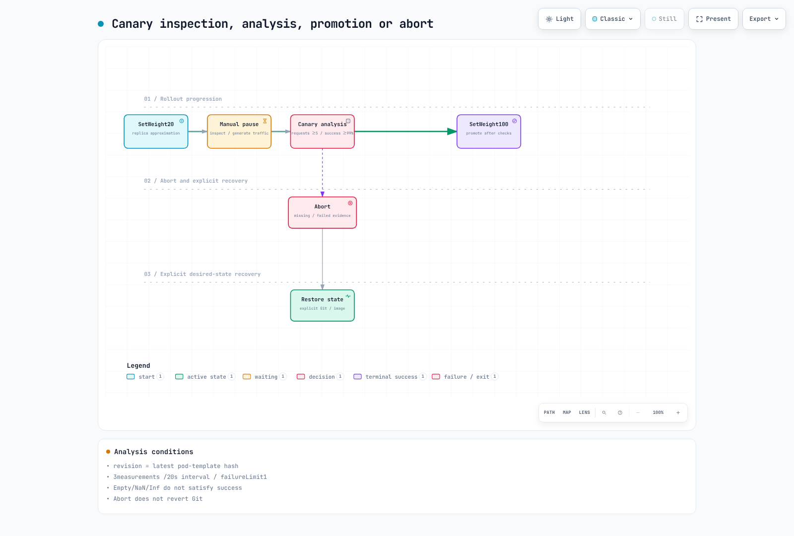

# 第 3 部分：MSA 部署与金丝雀发布

<span id="application-structure"></span>
<span id="architecture-overview"></span>
<span id="canary-state-diagram"></span>
<span id="cleanup"></span>
<span id="exercise-1-msa-application-overview"></span>
<span id="exercise-2-karpenter-nodepool-configuration"></span>
<span id="exercise-3-keda-scaledobject-configuration"></span>
<span id="exercise-4-argocd-application-deployment"></span>
<span id="exercise-5-opentelemetry-auto-instrumentation"></span>
<span id="exercise-6-argo-rollouts-canary-deployment"></span>
<span id="exercise-7-intentional-failure-and-automatic-rollback"></span>
<span id="learning-objectives"></span>
<span id="next-steps"></span>
<span id="prerequisites"></span>
<span id="references"></span>
<span id="repository-structure"></span>
<span id="sample-code-snippets"></span>
<span id="service-call-flow"></span>
<span id="steps"></span>
<span id="steps-1"></span>
<span id="steps-2"></span>
<span id="steps-3"></span>
<span id="steps-4"></span>
<span id="steps-5"></span>
<span id="summary"></span>
<span id="troubleshooting"></span>
<span id="verification"></span>
<span id="verification-1"></span>
<span id="verification-2"></span>
<span id="verification-3"></span>
<span id="verification-4"></span>
<span id="verification-5"></span>

> **难度**：高级
> **最后更新**：2026 年 10 月 16 日

将五个可运行的 Python 角色部署为独立工作负载。[应用程序 README](https://github.com/Atom-oh/kubernetes-docs/tree/main/examples/labs/observability/application)介绍了代码、数据库、镜像和 chart 输入。支付和通知均为模拟场景：不会实际扣款，也不会发送电子邮件或 SMS。



[🔍 查看交互式图表](https://www.atomai.click/kubernetes-docs/archmaps/en-labs-observability-03-msa-deployment-lab-10.html)

## 1. 共享 API 和持久化契约 {#contracts}

| 请求/角色 | 契约 |
|---|---|
| `POST /orders` | 201 + `id`；订单和 outbox 一起提交 |
| `POST /payments` | 200 + `status: completed`；相同订单/金额/方式具有幂等性；冲突值返回 409 |
| `GET /orders/{id}` | 200 + 相同 ID，否则 404 |
| `notification` | 使用独立的 SQS 队列，持久化模拟通知 |
| `analytics` | 使用单独的 SQS 队列，持久化独立结果 |

W3C 上下文会跨越 gateway/service 的 HTTP 请求边界以及生产者/消费者边界。如果在 outbox 发布后、数据库标记之前发生崩溃，消息会重新投递，因此消费者会以事务方式按事件 ID 去重。但这不能让外部电子邮件/支付操作实现恰好一次。这里不包含适用于订单 POST 的通用 Idempotency-Key 处理。

应用指标为 `lab_http_requests_total` 和 `lab_http_request_duration_seconds`，标签包括服务/路由/状态/修订版本。JSON 日志包含 service/level/trace_id/span_id；客户和支付负载不会用作指标标签。

## 2. 数据库文件和镜像 {#image-database}

使用第 1 部分中的专用运行时账户和私有连接文件。Pod 内的路径为 `/run/database-ca/global-bundle.pem` 和 `/run/database/connection.json`；将连接文件和公开的 RDS CA 分别挂载为 Secret/ConfigMap。

```bash
cd examples/labs/observability/application
kubectl --context service create namespace msa --dry-run=client -o yaml | kubectl --context service apply -f -
kubectl --context service -n msa create secret generic lab-database --from-file=connection.json="$LAB_STATE/runtime-pod-connection.json"
kubectl --context service -n msa create configmap lab-database-ca --from-file=global-bundle.pem="$LAB_STATE/global-bundle.pem"
docker buildx build --platform linux/amd64 \
  --tag "$IMAGE_REPOSITORY:$IMAGE_TAG" --push .
docker buildx imagetools inspect "$IMAGE_REPOSITORY:$IMAGE_TAG"
```

使用第 1 部分中选定的不可变版本。按照组织的密钥轮换流程更新现有 Secret；不要打印其值，也不要将其放入 chart 文件。Dockerfile 固定了基础镜像摘要和 UID 10001，并使用有界构建上下文。

生成的 `m6i.large` 节点采用 AMD64。请使用 AMD64 或支持跨平台构建的 Buildx 构建器，并在部署前确认推送的清单包含 `linux/amd64`。审计中进行的本地 ARM64 冒烟测试无法验证 AMD64 构建。

## 3. 安装控制器和 chart {#deployment}

```bash
helm repo add kedacore https://kedacore.github.io/charts
helm repo add argo https://argoproj.github.io/argo-helm
helm upgrade --install keda kedacore/keda --version 2.20.2   --kube-context service -n keda --create-namespace -f "$LAB_STATE/helm-inputs/keda.yaml"
helm upgrade --install argo-rollouts argo/argo-rollouts --version 2.43.1   --kube-context service -n argo-rollouts --create-namespace
helm upgrade --install observability-lab ./chart --kube-context service -n msa   -f "$LAB_STATE/helm-inputs/application.yaml"
kubectl --context service -n msa get deployment,rollout,pods,svc,scaledobject
```

验证五个 ServiceAccount 和 IRSA 主体。Gateway 不使用 AWS 角色；发布者访问 SNS，消费者访问各自的队列，KEDA 只读取队列属性。不要为同一工作负载配置重复的 Pod Identity/IRSA 路径。就绪检查会验证数据库/架构，不会验证 SQS/IAM 是否成功投递。

ServiceMonitor 标签与服务对应的 Prometheus release 相匹配，`honorLabels` 会保留应用的 service 标签。基线工作负载可以运行在托管节点组上；只有在[单独的指南](../../autoscaling/02-karpenter.md)核实 IAM、发现机制、EC2NodeClass、AMI 和污点后，才添加 Karpenter。


[🔍 查看交互式图表](https://www.atomai.click/kubernetes-docs/archmaps/en-labs-observability-03-msa-deployment-lab-0.html)

## 4. 验证 HTTP 和异步处理 {#verify}

```bash
kubectl --context service -n msa port-forward svc/api-gateway 8080:8080
# Run in another terminal from the repository root:
BASE_URL=http://127.0.0.1:8080 LOAD_PROFILE=smoke   k6 run --no-usage-report examples/labs/observability/load-test/k6-scenario.js
```

只读取本次创建的 ID，并验证模拟支付状态。确认消息分别投递到各自的队列，同时检查消费者 `/stats`、数据库计数和日志是否递增。通知和分析使用不同的队列；若让消费者竞争同一个队列，就无法实现扇出。失败/有毒消息会保持未确认状态，由 DLQ 策略处理。

对比 CloudWatch/Loki JSON 中的 trace_id、实际 Tempo span 和 Prometheus exemplar ID。安装 collector 并不等于完成端到端验证。

## 5. 金丝雀发布与 GitOps 所有权 {#canary}



[🔍 查看交互式图表](https://www.atomai.click/kubernetes-docs/archmaps/en-labs-observability-03-msa-deployment-lab-1.html)

一个 Rollout 管理 payment-service。若有五个副本，20% 步骤按副本数计算，并不保证实际请求中有 20% 会发送到金丝雀版本。在手动暂停期间，先向新修订版本发送流量，再执行分析。查询会筛选 `rollouts-pod-template-hash`，要求至少有五个近期请求且成功率达到 99%，并拒绝空值/NaN/Inf/多序列结果。

实际测试了 Rollouts 1.10.0 的条件评估和 PromQL，但没有执行集群推进操作。中止并不等于 Git 回退，也不会恢复期望镜像。若选择使用 ArgoCD，请遵循其[安装指南](../../gitops/argocd/01-installation.md)，将其指向此仓库中真实的 chart 路径和经过审阅的修订版本，并避免同时由直接 Helm 操作管理。应引用现有 Secret，而不是将其提交到仓库。仅使用 app-of-apps 同步波次并不能保证子应用已就绪。

### 练习手动暂停

以下步骤由 Helm 管理期望状态。在 GitOps 环境中，应在 Git 中审阅镜像变更和恢复方式，不要混用直接 Helm 写入。检查 [Argo Rollouts 1.10.0 发布页](https://github.com/argoproj/argo-rollouts/releases/tag/v1.10.0)上的二进制文件和校验和后，安装与操作系统/CPU 相匹配的插件。

```bash
# ROLLOUTS_BINARY: checksum-verified binary for your OS/architecture.
: "${ROLLOUTS_BINARY:?Set the verified Argo Rollouts 1.10.0 binary path}"
mkdir -p "$HOME/.local/bin"
install -m 755 "$ROLLOUTS_BINARY" "$HOME/.local/bin/kubectl-argo-rollouts"
export PATH="$HOME/.local/bin:$PATH"
kubectl argo rollouts version --short
```

发布采用新不可变标签、且已经实际审阅的 AMD64 镜像之前，先确认 Rollout 处于稳定状态并保留其完整 values；按第 3 部分的构建流程生成镜像。初次安装没有先前的稳定修订版本，因此不属于本次更新练习。chart 将一个镜像设置共用于所有角色，因此更改它也会像普通 Deployment 一样更新其他角色；只有 payment 遵循 Rollout 步骤。

```bash
# Run from examples/labs/observability/application.
: "${CANARY_IMAGE_TAG:?Set an actually built and reviewed immutable AMD64 image tag}"
# Keep the original application.yaml as the stable revision's complete values.
CANARY_VALUES="$LAB_STATE/helm-inputs/canary-image.yaml"
python3 - "$CANARY_VALUES" "$CANARY_IMAGE_TAG" <<'PYIMAGE'
import sys, json
with open(sys.argv[1], "w") as output:
    json.dump({"image": {"tag": sys.argv[2]}}, output)
PYIMAGE
helm upgrade observability-lab ./chart --kube-context service -n msa \
  -f "$LAB_STATE/helm-inputs/application.yaml" -f "$CANARY_VALUES"
kubectl argo rollouts get rollout payment-service --context service -n msa --watch
```

在另一个终端中查看 `--watch` 输出；需要时按 Ctrl+C 停止。流量生成以及推进/中止命令应在其他终端中运行。

处于 Paused 状态时，继续第 4 节的流量测试，并在 Prometheus 中确认至少五个近期请求到达了新 `rollouts-pod-template-hash` 修订版本。流量不足或查询失败不代表成功。检查后，继续执行下面的手动暂停步骤，让配置的 AnalysisRun 及后续步骤运行。不要使用 `--full`：它会跳过分析和暂停步骤。

```bash
kubectl argo rollouts promote payment-service --context service -n msa
kubectl argo rollouts get rollout payment-service --context service -n msa --watch
kubectl --context service -n msa get analysisruns
```

如果出现问题，应中止而不是推进，然后通过原始完整 values 恢复期望镜像。仅执行中止不会恢复 `spec.template` 或 Git 中的配置。

```bash
kubectl argo rollouts abort payment-service --context service -n msa
helm upgrade observability-lab ./chart --kube-context service -n msa \
  -f "$LAB_STATE/helm-inputs/application.yaml"
kubectl argo rollouts get rollout payment-service --context service -n msa --watch
```

成功推进后，后续 Helm 命令仍须保留已批准的镜像覆盖值，或将其纳入受管理的期望值。保留故障分析证据并检查最终状态。本次审计验证了 CLI 校验和/帮助信息以及 chart/分析逻辑；没有执行这些集群更新/推进/中止命令。

继续学习[第 4 部分](./04-load-testing-scaling-lab.md)。按照[第 6 部分](./06-distributed-tracing-lab.md#cleanup)进行考虑资源所有权和依赖关系的清理。

## 验证范围

检查涵盖本地 SQLite/PostgreSQL、三个 HTTP 服务、OTel 关联、SNS/SQS SDK stub、容器冒烟测试、Helm/CRD 以及 PromQL/Argo 条件。未实际验证 Aurora TLS、EKS/IRSA、SNS 扇出、KEDA/Karpenter 和金丝雀流量拆分。
