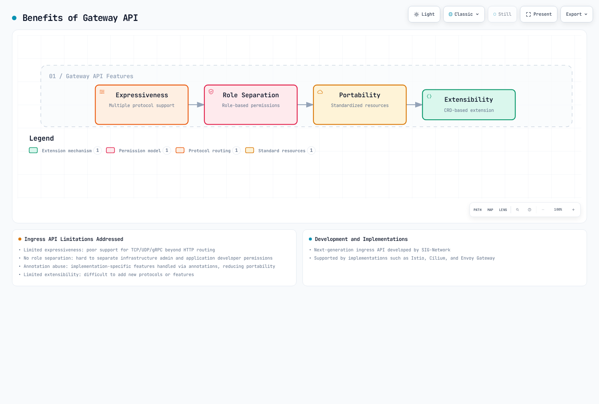

# Kubernetes Gateway API

> **API 基线**：Gateway API v1.6 Standard；请选择控制器支持的准确 bundle。
> **最后更新**：October 16, 2026

## 概述

Gateway API 是 Kubernetes 的下一代 Ingress API，旨在克服现有 Ingress API 的局限，并提供表达能力更强、可扩展性更高的网络路由功能。它由 SIG-Network 开发，Istio、Cilium、Envoy Gateway 等多种实现均支持它。

### Ingress API 的局限

| 问题 | 说明 |
|---------|-------------|
| **表达能力有限** | 除 HTTP 路由外，对 TCP/UDP/gRPC 的支持较弱 |
| **职责合并** | RBAC/IngressClass 可以限制访问，但监听器和路由职责的分离不够明确 |
| **滥用注解** | 通过注解处理实现特定功能，降低了可移植性 |
| **可扩展性有限** | 难以添加新协议或功能 |
| **跨命名空间** | 跨命名空间路由较复杂 |

### Gateway API 的优势



[🔍 查看交互式图表](https://www.atomai.click/kubernetes-docs/archmaps/en-networking-04-gateway-api-0.html)

表达能力、职责分离、可移植性和可扩展性是彼此独立的设计目标。实际功能支持取决于控制器和一致性配置文件；Kubernetes RBAC 和准入策略负责强制执行谁可以更改各项资源。

## 资源模型

Gateway API 使用分层资源模型。


[🔍 查看交互式图表](https://www.atomai.click/kubernetes-docs/archmaps/en-networking-04-gateway-api-1.html)

该图展示了资源之间的关系以及一种常见的 Gateway 部署模型。Gateway 并不总是对应一个云负载均衡器：Istio 可以预配代理 Deployment/Service，而 VPC Lattice 则将其映射到服务网络。**被引用命名空间**的所有者通过 ReferenceGrant 授予跨命名空间访问后端/Secret 的权限。

### 角色分离

| 角色 | 管理的资源 | 职责 |
|------|------------------|----------------|
| **基础设施提供方** | GatewayClass | 定义基础设施的基本配置 |
| **集群运维人员** | Gateway | Gateway 基础设施和 Route 附加策略 |
| **被引用命名空间的所有者** | ReferenceGrant | 授权引用其拥有的后端/Secret |
| **应用开发人员** | HTTPRoute、GRPCRoute 等 | 定义应用路由规则 |

## GatewayClass

GatewayClass 定义创建 Gateway 时使用的控制器和配置。

```yaml
apiVersion: gateway.networking.k8s.io/v1
kind: GatewayClass
metadata:
  name: istio
spec:
  controllerName: istio.io/gateway-controller
  description: Istio Gateway Controller for production workloads
```

GatewayClass 选择的是已安装的控制器；创建该类并不会安装控制器。以下定义互为替代方案。请使用 `Accepted` 条件为 true 的类，并将示例类名替换为集群中已接受的名称。

`parametersRef` 的支持情况及其 group/kind 取决于具体实现。对于 Istio 1.31，单个 Gateway 的 ConfigMap 应放在 Gateway 所在命名空间中的 `Gateway.spec.infrastructure.parametersRef` 下。类级默认值使用 Istio 根命名空间中带有 `gateway.istio.io/defaults-for-class` 标签的 ConfigMap。下方的 ALB→Istio 示例展示了单个 Gateway 的配置方式。

### 各实现中的 GatewayClass

```yaml
# Istio
apiVersion: gateway.networking.k8s.io/v1
kind: GatewayClass
metadata:
  name: istio
spec:
  controllerName: istio.io/gateway-controller
---
# Cilium
apiVersion: gateway.networking.k8s.io/v1
kind: GatewayClass
metadata:
  name: cilium
spec:
  controllerName: io.cilium/gateway-controller
---
# AWS Gateway API Controller
apiVersion: gateway.networking.k8s.io/v1
kind: GatewayClass
metadata:
  name: amazon-vpc-lattice
spec:
  controllerName: application-networking.k8s.aws/gateway-api-controller
---
# Envoy Gateway
apiVersion: gateway.networking.k8s.io/v1
kind: GatewayClass
metadata:
  name: envoy-gateway
spec:
  controllerName: gateway.envoyproxy.io/gatewayclass-controller
---
# Contour
apiVersion: gateway.networking.k8s.io/v1
kind: GatewayClass
metadata:
  name: contour
spec:
  controllerName: projectcontour.io/gateway-controller
---
# NGINX Gateway Fabric
apiVersion: gateway.networking.k8s.io/v1
kind: GatewayClass
metadata:
  name: nginx
spec:
  controllerName: gateway.nginx.org/nginx-gateway-controller
```

## Gateway

Gateway 描述流量处理基础设施和监听器。它映射到代理工作负载、托管负载均衡器还是服务网络，取决于具体控制器。

### 基本 Gateway 配置

以下是彼此独立的配置场景，并不是一组可以同时应用的 Routes。在同一主机/监听器上重叠的 Routes 可能会改变优先级。请先安装选定的控制器及其兼容的 CRD，创建 `gateway-system`，并提供名称匹配的 Services、就绪端点和 TLS Secrets。证书必须涵盖所配置的 DNS 名称。请为平台配置数据平面 Service 暴露方式、DNS 和网络控制；GatewayClass 或请求的 IP 地址本身并不会预留外部地址。

HTTP/gRPC/TCP/TLS 示例使用 Istio 1.31。UDP 示例使用单独的 Envoy Gateway 实例，因为 Istio 1.31 会明确拒绝 UDP 监听器。Envoy Gateway 1.9 要求使用 Gateway API 1.6.1 及其发布说明中规定的 Kubernetes 版本组合。更改共享 CRD 的版本/通道之前，请检查相关 CRD。

基本示例中的 Namespace 带有 `gateway-access: "true"`。这是一个 **Namespace 标签**，应由控制 Gateway 访问权限的管理员负责修改。`allowedRoutes` 不会对应用客户端进行身份验证。

```yaml
apiVersion: v1
kind: Namespace
metadata:
  name: production
  labels:
    gateway-access: 'true'
---
apiVersion: gateway.networking.k8s.io/v1
kind: Gateway
metadata:
  name: production-gateway
  namespace: gateway-system
spec:
  gatewayClassName: istio
  listeners:
  - name: http
    protocol: HTTP
    port: 80
    allowedRoutes:
      namespaces:
        from: Selector
        selector:
          matchLabels:
            gateway-access: 'true'
  - name: https
    protocol: HTTPS
    port: 443
    tls:
      mode: Terminate
      certificateRefs:
      - kind: Secret
        name: tls-cert
        namespace: gateway-system
    allowedRoutes:
      namespaces:
        from: Selector
        selector:
          matchLabels:
            gateway-access: 'true'
```

### 高级 Gateway 配置

以下是一个名为 `multi-protocol-gateway` 的独立 Gateway。下方的 gRPC、TLS 和 TCP Routes 会附加到名称相匹配的监听器。数据库和其他 TCP 示例各自使用不同的监听器，因此可以同时使用，而不会争用同一个 L4 监听器。

```yaml
apiVersion: gateway.networking.k8s.io/v1
kind: Gateway
metadata:
  name: multi-protocol-gateway
  namespace: gateway-system
spec:
  gatewayClassName: istio
  listeners:
  - name: http
    protocol: HTTP
    port: 80
    allowedRoutes:
      namespaces:
        from: Selector
        selector:
          matchLabels:
            gateway-access: 'true'
  - name: https-wildcard
    protocol: HTTPS
    port: 443
    hostname: '*.example.com'
    tls:
      mode: Terminate
      certificateRefs:
      - kind: Secret
        name: wildcard-cert
    allowedRoutes:
      namespaces:
        from: Selector
        selector:
          matchLabels:
            gateway-access: 'true'
      kinds:
      - kind: HTTPRoute
  - name: grpc
    protocol: HTTPS
    port: 443
    hostname: grpc.example.com
    tls:
      mode: Terminate
      certificateRefs:
      - kind: Secret
        name: grpc-cert
    allowedRoutes:
      namespaces:
        from: Selector
        selector:
          matchLabels:
            gateway-access: 'true'
      kinds:
      - kind: GRPCRoute
  - name: tcp-passthrough
    protocol: TLS
    port: 8443
    tls:
      mode: Passthrough
    allowedRoutes:
      namespaces:
        from: Selector
        selector:
          matchLabels:
            gateway-access: 'true'
      kinds:
      - kind: TLSRoute
  - name: tcp
    protocol: TCP
    port: 9000
    allowedRoutes:
      namespaces:
        from: Selector
        selector:
          matchLabels:
            gateway-access: 'true'
      kinds:
      - kind: TCPRoute
  - name: database
    protocol: TCP
    port: 5432
    allowedRoutes:
      namespaces:
        from: Selector
        selector:
          matchLabels:
            gateway-access: 'true'
      kinds:
      - kind: TCPRoute
```

### TLS 模式

Terminate 模式会在 Gateway 处终止下游 TLS 连接。后端连接需单独配置，可以使用 HTTP 或 TLS，例如通过受支持的 BackendTLSPolicy 配置。Passthrough 模式使用带有 `mode: Passthrough` 的 `TLS` 监听器，由后端终止 TLS。仅更改 `mode` 并不能将 `HTTPS` 监听器切换为 passthrough。

| 模式 | 说明 | 使用场景 |
|------|-------------|----------|
| **Terminate** | 在 Gateway 处终止 TLS | 标准 HTTPS |
| **Passthrough** | 将 TLS 传递给后端 | 端到端加密 |

```yaml
# TLS Terminate example
listeners:
  - name: https
    protocol: HTTPS
    port: 443
    tls:
      mode: Terminate
      certificateRefs:
        - kind: Secret
          name: server-cert
---
# TLS Passthrough example
listeners:
  - name: tls-passthrough
    protocol: TLS
    port: 443
    tls:
      mode: Passthrough
```

## HTTPRoute

HTTPRoute 定义 HTTP/HTTPS 流量的路由规则。

### 基本 HTTPRoute

```yaml
apiVersion: gateway.networking.k8s.io/v1
kind: HTTPRoute
metadata:
  name: basic-route
  namespace: production
spec:
  # Gateway to attach to
  parentRefs:
    - name: production-gateway
      namespace: gateway-system
      sectionName: https  # Target specific listener

  # Host matching
  hostnames:
    - "api.example.com"
    - "www.example.com"

  # Routing rules
  rules:
    - matches:
        - path:
            type: PathPrefix
            value: /api/v1
      backendRefs:
        - name: api-v1-service
          port: 80

    - matches:
        - path:
            type: PathPrefix
            value: /api/v2
      backendRefs:
        - name: api-v2-service
          port: 80

    # Default path
    - backendRefs:
        - name: default-service
          port: 80
```

### 高级匹配规则

同一个 `matches` 条目中的字段按 AND 关系组合；多个条目按 OR 关系组合。PathPrefix 匹配的是路径元素，而不是任意字符串前缀。RegularExpression 的支持情况和语法取决于具体实现。下方的演示租户标头只是一个路由选择器，任何客户端都可以提供它；它不能为管理应用提供身份验证。

```yaml
apiVersion: gateway.networking.k8s.io/v1
kind: HTTPRoute
metadata:
  name: advanced-matching
  namespace: production
spec:
  parentRefs:
  - name: production-gateway
    namespace: gateway-system
    sectionName: https
  hostnames:
  - api.example.com
  rules:
  - matches:
    - path:
        type: Exact
        value: /health
    backendRefs:
    - name: health-service
      port: 80
  - matches:
    - path:
        type: RegularExpression
        value: /users/[0-9]+
    backendRefs:
    - name: user-service
      port: 80
  - matches:
    - headers:
      - name: X-Version
        value: v2
    backendRefs:
    - name: api-v2-service
      port: 80
  - matches:
    - queryParams:
      - name: debug
        value: 'true'
    backendRefs:
    - name: debug-service
      port: 80
  - matches:
    - method: POST
      path:
        type: PathPrefix
        value: /api/data
    backendRefs:
    - name: write-service
      port: 80
  - matches:
    - method: GET
      path:
        type: PathPrefix
        value: /api/data
    backendRefs:
    - name: read-service
      port: 80
  - matches:
    - path:
        type: PathPrefix
        value: /admin
      headers:
      - name: X-Demo-Tenant
        type: Exact
        value: operations
    backendRefs:
    - name: admin-service
      port: 80
  - matches:
    - path:
        type: PathPrefix
        value: /api
    - path:
        type: PathPrefix
        value: /v1
    backendRefs:
    - name: api-service
      port: 80
```

### 过滤器

标头修改器会设置字面值。`X-Example-Source: gateway-demo` 是一个静态标记，不是生成的唯一请求 ID；如需生成 ID，请使用代理/应用的跟踪功能。镜像示例使用自己的 `/mirror` 路径，因此前面的 `/api` 规则不会遮蔽它。该示例会将 GET 请求复制到影子后端，并忽略该后端的响应。请隔离副作用，并检查复制到影子 Service 的数据/凭据。只有实际适合公开缓存的内容才应使用公共缓存标头。

过滤器允许修改请求/响应。

```yaml
apiVersion: gateway.networking.k8s.io/v1
kind: HTTPRoute
metadata:
  name: filtered-route
  namespace: production
spec:
  parentRefs:
  - name: production-gateway
    namespace: gateway-system
    sectionName: https
  rules:
  - matches:
    - path:
        type: PathPrefix
        value: /api
    filters:
    - type: RequestHeaderModifier
      requestHeaderModifier:
        add:
        - name: X-Example-Source
          value: gateway-demo
        set:
        - name: X-Api-Version
          value: v1
        remove:
        - X-Internal-Header
    backendRefs:
    - name: api-service
      port: 80
  - matches:
    - path:
        type: PathPrefix
        value: /public
    filters:
    - type: ResponseHeaderModifier
      responseHeaderModifier:
        add:
        - name: Cache-Control
          value: public, max-age=3600
        set:
        - name: X-Content-Type-Options
          value: nosniff
    backendRefs:
    - name: public-service
      port: 80
  - matches:
    - path:
        type: PathPrefix
        value: /old-api
    filters:
    - type: URLRewrite
      urlRewrite:
        path:
          type: ReplacePrefixMatch
          replacePrefixMatch: /new-api
        hostname: new-api.example.com
    backendRefs:
    - name: new-api-service
      port: 80
  - matches:
    - path:
        type: PathPrefix
        value: /legacy
    filters:
    - type: RequestRedirect
      requestRedirect:
        scheme: https
        hostname: new.example.com
        port: 443
        statusCode: 301
        path:
          type: ReplacePrefixMatch
          replacePrefixMatch: /modern
  - matches:
    - method: GET
      path:
        type: PathPrefix
        value: /mirror
    filters:
    - type: RequestMirror
      requestMirror:
        backendRef:
          name: shadow-service
          port: 80
    backendRefs:
    - name: main-service
      port: 80
```

### 流量拆分（权重）

```yaml
apiVersion: gateway.networking.k8s.io/v1
kind: HTTPRoute
metadata:
  name: canary-route
  namespace: production
spec:
  parentRefs:
  - name: production-gateway
    namespace: gateway-system
    sectionName: https
  hostnames:
  - app.example.com
  rules:
  - matches:
    - path:
        type: PathPrefix
        value: /
    backendRefs:
    - name: app-stable
      port: 80
      weight: 90
    - name: app-canary
      port: 80
      weight: 10
```

### 超时和重试

v1.6 Standard 架构包含 `timeouts`，但不包含 `HTTPRoute.rules.retry`。Experimental 架构会添加重试字段，并有单独的准入/实现要求。下方示例仅为 GET 请求设置预算：`backendRequest` 不得超过非零的总 `request` 预算。

省略重试字段并不能证明客户端、Gateway、网格代理或 SDK 绝不会重试。请配置并验证每个适用层，尤其是非幂等写入操作。重试次数设为零并不能有效禁用 Experimental v1.6 的 `retry.attempts` 字段，该字段的最小值为一。请使用实现文档中规定的控制项，并考虑应用的幂等性行为。

```yaml
apiVersion: gateway.networking.k8s.io/v1
kind: HTTPRoute
metadata:
  name: resilient-route
  namespace: production
spec:
  parentRefs:
  - name: production-gateway
    namespace: gateway-system
    sectionName: https
  rules:
  - matches:
    - path:
        type: PathPrefix
        value: /api
      method: GET
    timeouts:
      request: 30s
      backendRequest: 25s
    backendRefs:
    - name: api-service
      port: 80
```

## GRPCRoute

后端必须提供所需的 gRPC/HTTP2 传输和适当的 TLS 配置。仅设置端口号并不会配置这些行为。

定义 gRPC 流量的路由规则。

```yaml
apiVersion: gateway.networking.k8s.io/v1
kind: GRPCRoute
metadata:
  name: grpc-route
  namespace: production
spec:
  parentRefs:
  - name: multi-protocol-gateway
    namespace: gateway-system
    sectionName: grpc
  hostnames:
  - grpc.example.com
  rules:
  - matches:
    - method:
        service: myapp.UserService
    backendRefs:
    - name: user-grpc-service
      port: 50051
  - matches:
    - method:
        service: myapp.OrderService
        method: CreateOrder
    backendRefs:
    - name: order-grpc-service
      port: 50052
  - matches:
    - headers:
      - name: x-environment
        value: staging
    backendRefs:
    - name: staging-grpc-service
      port: 50051
  - backendRefs:
    - name: default-grpc-service
      port: 50051
```

## TCPRoute

定义 TCP 流量路由。

```yaml
apiVersion: gateway.networking.k8s.io/v1
kind: TCPRoute
metadata:
  name: database-route
  namespace: production
spec:
  parentRefs:
  - name: multi-protocol-gateway
    namespace: gateway-system
    sectionName: database
  rules:
  - backendRefs:
    - name: database-service
      port: 5432
---
apiVersion: gateway.networking.k8s.io/v1
kind: TCPRoute
metadata:
  name: tcp-loadbalance
  namespace: production
spec:
  parentRefs:
  - name: multi-protocol-gateway
    namespace: gateway-system
    sectionName: tcp
  rules:
  - backendRefs:
    - name: tcp-backend-1
      port: 9000
      weight: 50
    - name: tcp-backend-2
      port: 9000
      weight: 50
```

## TLSRoute

定义 TLS passthrough 流量路由。

```yaml
apiVersion: gateway.networking.k8s.io/v1
kind: TLSRoute
metadata:
  name: tls-passthrough-route
  namespace: production
spec:
  parentRefs:
  - name: multi-protocol-gateway
    namespace: gateway-system
    sectionName: tcp-passthrough
  hostnames:
  - secure.example.com
  rules:
  - backendRefs:
    - name: secure-backend
      port: 8443
```

## UDPRoute

此场景要求安装 Envoy Gateway 控制器，且有一个已接受的 `envoy-gateway` 类、兼容的 Gateway API bundle，以及 `dns-service` UDP 后端。它会暴露 UDP 端口 5300，并将流量路由到后端端口 53。Envoy 的 UDP 代理不是透明代理：后端看到的是 Gateway 的源 IP/端口。请确保平台负载均衡器/Service 支持这种 UDP 暴露方式。

定义 UDP 流量路由。

```yaml
apiVersion: gateway.networking.k8s.io/v1
kind: Gateway
metadata:
  name: udp-gateway
  namespace: gateway-system
spec:
  gatewayClassName: envoy-gateway
  listeners:
  - name: udp
    protocol: UDP
    port: 5300
    allowedRoutes:
      namespaces:
        from: Selector
        selector:
          matchLabels:
            gateway-access: 'true'
      kinds:
      - kind: UDPRoute
---
apiVersion: gateway.networking.k8s.io/v1
kind: UDPRoute
metadata:
  name: dns-route
  namespace: production
spec:
  parentRefs:
  - name: udp-gateway
    namespace: gateway-system
    sectionName: udp
  rules:
  - backendRefs:
    - name: dns-service
      port: 53
```

## ReferenceGrant

ReferenceGrant 由**包含被引用 Service 或 Secret 的命名空间**的所有者在该命名空间中创建。`from` 选择来源 group/kind/namespace；`to.name` 可以限制目标名称。多个 Grant 的授权效果会累加；它们授权的是引用，而不是应用调用方。

跨命名空间的 Route→Gateway 附加使用 `parentRefs` 和 Gateway 监听器的 `allowedRoutes` 握手机制，而不是 ReferenceGrant。如下所示，后端和证书引用使用 ReferenceGrant。名为 `shared-api` 的 Service 和名为 `shared-tls` 的 Secret 必须已经存在；Grant 本身不会创建它们。

ReferenceGrant 允许跨命名空间引用。

```yaml
apiVersion: gateway.networking.k8s.io/v1beta1
kind: ReferenceGrant
metadata:
  name: allow-routes-to-backend
  namespace: backend-services
spec:
  from:
  - group: gateway.networking.k8s.io
    kind: HTTPRoute
    namespace: production
  - group: gateway.networking.k8s.io
    kind: HTTPRoute
    namespace: staging
  to:
  - group: ''
    kind: Service
    name: shared-api
---
apiVersion: gateway.networking.k8s.io/v1beta1
kind: ReferenceGrant
metadata:
  name: allow-gateway-to-secrets
  namespace: cert-management
spec:
  from:
  - group: gateway.networking.k8s.io
    kind: Gateway
    namespace: gateway-system
  to:
  - group: ''
    kind: Secret
    name: shared-tls
```

## 实现对比

### 主要实现

| 实现 | 控制器 | 特性 |
|----------------|------------|----------|
| **Istio** | istio.io/gateway-controller | Service Mesh 集成、高级流量管理 |
| **Cilium** | io.cilium/gateway-controller | Cilium 网络与 Envoy L7 处理 |
| **Envoy Gateway** | gateway.envoyproxy.io/gatewayclass-controller | 基于 Envoy，符合标准 |
| **AWS Gateway API Controller** | application-networking.k8s.aws/gateway-api-controller | VPC Lattice 集成 |
| **Contour** | projectcontour.io/gateway-controller | 基于 Envoy，配置简单 |
| **NGINX Gateway Fabric** | gateway.nginx.org/nginx-gateway-controller | 基于 NGINX |
| **Traefik** | traefik.io/gateway-controller | 动态配置 |

### 按版本划分的实现说明

API 的发布通道、某项功能的 Core/Extended/实现特定支持级别，以及控制器的一致性配置文件是不同的概念。CRD 接受某个字段，并不能证明控制器实现了该字段。请检查已发布的一致性结果，以及适用资源的状态条件，包括 `Accepted`、`ResolvedRefs` 和 `Programmed`。

| 已检查的实现 | 已验证的范围和重要限制 |
|---|---|
| Istio **1.31.2** | HTTP/gRPC 和 v1 TCP/TLS Routes；明确不支持 UDP 监听器。可配置 Envoy 数据平面，但不保证支持所有 Gateway API 扩展 |
| Cilium **1.20.3** | Gateway API **1.6.3**，包括 TCPRoute/UDPRoute；结合 Cilium 网络和 Envoy 进行 L7 处理 |
| Envoy Gateway **1.9.2** | Gateway API **1.6.1**；已发布的 Kubernetes 版本矩阵为 **1.33–1.36**。支持 UDP 路由和 TLS passthrough，传输行为以其文档说明为准 |
| AWS Load Balancer Controller **3.6.0** | Gateway API **1.6.0**；ALB 处理 HTTP/gRPC，NLB 处理 L4 Routes。每个 NLB 监听器仅符合条件的 Route 中最早附加的 L4 Route 会生效；每个监听器使用一个 Route |
| AWS Gateway API Controller **2.1.3** | 集成 VPC Lattice；v2.1 要求 Gateway API **1.5+**。支持 HTTPRoute、GRPCRoute 和 TLSRoute。TCP 资源访问采用独立的 Lattice 资源配置模型，并非通用 TCPRoute/UDPRoute 支持 |
| Contour **1.33.7** | 基于 Gateway API **1.3.0** 构建，并在 Kubernetes **1.32–1.34** 上通过发布测试。文档列出 HTTP/gRPC/TCP/TLS Routes；请使用与其匹配的通道/预配配置，不要直接套用较新的 bundle |
| NGINX Gateway Fabric **2.8.0** | Gateway API **1.6.3**，已发布的 Kubernetes 最低版本为 **1.32**；支持 v1 TCPRoute/UDPRoute（在 2.7.0 中添加）。这是独立于已退役社区版 ingress-nginx 的产品 |

这些说明取代了不区分版本的“支持/不支持”功能表。各项过滤器、TLS 策略、扩展、支持的版本和运行要求，请参阅各实现的文档。Contour 的捆绑兼容性页面没有针对 1.33.7 的特定条目；上文的 API 依赖关系和 Kubernetes 版本范围取自该确切版本的模块文件和发布说明。

## AWS Load Balancer Controller 对 Gateway API 的支持

Gateway API 在 **2026-01-23 发布的 LBC v3.0.0 中达到 GA**。现有 Ingress 和 Service API 仍受支持，因此可以独立规划 Gateway 迁移和控制器升级。当前 v3.6.0 要求使用 [LBC 安装指南](./03-aws-lb-controller.md)中所述的兼容 Gateway API 和 LBC Gateway CRD。EKS Auto Mode 使用独立的托管实现；自主管理的 LBC 功能并不自动适用于 Auto Mode。

已退役的控制器是 Kubernetes 社区项目 **ingress-nginx**，该项目于 2026 年 3 月结束维护。这并不意味着 Kubernetes Ingress API 或 F5 的其他 NGINX 产品也已退役。

v3.0 发布说明中的 `keepTLSSecret=false` 变通方案，适用于**继续使用旧版本**且受 cert-manager 所有权缺陷影响的用户。升级到 v3.0 的用户无需额外操作即可获得该修复。请遵循当前 chart 的证书管理选项，不要在每次升级时都应用历史上的缓解措施。

### LBC v3.4.0 迁移工具

**2026-06-03** 发布的版本引入了真正的 `lbc-migrate` CLI 和 Migration Console。它们面向正在运行的 **LBC Ingress** 资源，并不是适用于所有 Ingress 实现的通用转换器。

- `lbc-migrate` 可读取文件，也可使用 `--from-cluster` 列出/获取集群资源。它会转换受支持的注解并生成 Gateway API 资源。默认输出带有 LBC Gateway 演练注解。
- Migration Console 会比较控制器生成的资源计划。它需要相应的计划注解、功能配置和读取权限。应将计划视为可能需要限制访问和对敏感数据进行脱敏的配置数据。
- 应用经过审核的现有 Gateway 清单会在**现有 ALB 旁边创建新的 ALB**。请先验证新 ALB，再单独切换前端流量。单个 HTTPRoute 中的后端权重不能执行这种前端迁移。

对于从所选 LBC 版本构建的二进制文件，可通过以下命令开始基于文件的转换：

```bash
lbc-migrate -f ingress.yaml --output-dir ./gateway-output/
```

转换器不会生成现有的 Deployments/Services，也不会重新验证所有 Ingress 注解。请检查不受支持的注解、Service/IngressClassParams 覆盖项、跨命名空间 IngressGroup 成员关系、规则优先级和 TLS 设置。已关联到旧 ALB 的外部目标组无法直接同时关联到新 ALB；请规划兼容的重复部署/切换策略。

这些工具提供的是迁移工作流，而不是零停机保证。请参阅[版本化迁移指南](https://github.com/kubernetes-sigs/aws-load-balancer-controller/blob/v3.6.0/docs/guide/ingress2gateway/migrate_from_ingress.md)和 [CLI 参考](https://github.com/kubernetes-sigs/aws-load-balancer-controller/blob/v3.6.0/docs/guide/ingress2gateway/lbc_migrate_reference.md)。

## 从 Ingress 迁移到 Gateway API

### 分步迁移指南

#### 步骤 1：分析现有 Ingress

以下是一个**历史社区版 ingress-nginx 输入示例**，用于说明如何手动将配置转换为 Istio Gateway API。它不是新的 ingress-nginx 安装建议，也不是上文 LBC 专用转换器的输入。请保留实际的请求行为，而不只是设置名称。

```yaml
apiVersion: networking.k8s.io/v1
kind: Ingress
metadata:
  name: my-ingress
  annotations:
    kubernetes.io/ingress.class: nginx
    nginx.ingress.kubernetes.io/rewrite-target: /
    nginx.ingress.kubernetes.io/ssl-redirect: 'true'
  namespace: default
spec:
  tls:
  - hosts:
    - api.example.com
    secretName: api-tls
  rules:
  - host: api.example.com
    http:
      paths:
      - path: /api/v1
        pathType: Prefix
        backend:
          service:
            name: api-v1
            port:
              number: 80
      - path: /api/v2
        pathType: Prefix
        backend:
          service:
            name: api-v2
            port:
              number: 80
```

#### 步骤 2：创建 Gateway 和 GatewayClass

新 Gateway 名为 `migration-gateway`。现有的 `api-tls` Secret 仍位于 `default` 中；该命名空间中的 ReferenceGrant 会明确允许 Gateway 所在命名空间引用它。请提供对 `api.example.com` 有效的证书。`default` Namespace 内置的名称标签可用于 Route 附加选择器。

```yaml
apiVersion: gateway.networking.k8s.io/v1
kind: GatewayClass
metadata:
  name: production
spec:
  controllerName: istio.io/gateway-controller
---
apiVersion: gateway.networking.k8s.io/v1beta1
kind: ReferenceGrant
metadata:
  name: migration-tls
  namespace: default
spec:
  from:
  - group: gateway.networking.k8s.io
    kind: Gateway
    namespace: gateway-system
  to:
  - group: ''
    kind: Secret
    name: api-tls
---
apiVersion: gateway.networking.k8s.io/v1
kind: Gateway
metadata:
  name: migration-gateway
  namespace: gateway-system
spec:
  gatewayClassName: production
  listeners:
  - name: http
    protocol: HTTP
    port: 80
    allowedRoutes:
      namespaces:
        from: Selector
        selector:
          matchLabels:
            kubernetes.io/metadata.name: default
    hostname: api.example.com
  - name: https
    protocol: HTTPS
    port: 443
    tls:
      mode: Terminate
      certificateRefs:
      - kind: Secret
        name: api-tls
        namespace: default
    allowedRoutes:
      namespaces:
        from: Selector
        selector:
          matchLabels:
            kubernetes.io/metadata.name: default
    hostname: api.example.com
```

#### 步骤 3：创建 HTTPRoute

重定向 Route 只附加到 HTTP 监听器。HTTPS Route 会转发应用请求。旧示例中的 `rewrite-target: /` 会将整个匹配的请求路径替换为 `/`，因此转换后的示例使用 **ReplaceFullPath**。使用 ReplacePrefixMatch 会保留后缀（`/api/v1/users` → `/users`），从而改变行为。切换前，请针对旧应用测试根路径、子路径、查询字符串和重定向。

以下重定向假设 ingress-nginx 的默认状态码为 **308**，会保留请求方法/请求体；请检查是否设置了 `http-redirect-code` 覆盖值。它的 rewrite 注解还会为该主机启用不区分大小写的 regex location，而 Gateway API PathPrefix 区分大小写，并按路径元素匹配。因此，`/API/V1` 或 `/api/v10` 的处理结果可能不同。该示例展示的是更严格的 PathPrefix 策略，并未实现完全相同的匹配行为。如果客户端依赖旧行为，请在切换前设计并测试受支持的 regex 匹配规则或其他明确的兼容规则。

```yaml
apiVersion: gateway.networking.k8s.io/v1
kind: HTTPRoute
metadata:
  name: api-route
  namespace: default
spec:
  parentRefs:
  - name: migration-gateway
    namespace: gateway-system
    sectionName: http
  hostnames:
  - api.example.com
  rules:
  - matches:
    - path:
        type: PathPrefix
        value: /
    filters:
    - type: RequestRedirect
      requestRedirect:
        scheme: https
        statusCode: 308
---
apiVersion: gateway.networking.k8s.io/v1
kind: HTTPRoute
metadata:
  name: api-route-https
  namespace: default
spec:
  parentRefs:
  - name: migration-gateway
    namespace: gateway-system
    sectionName: https
  hostnames:
  - api.example.com
  rules:
  - matches:
    - path:
        type: PathPrefix
        value: /api/v1
    filters:
    - type: URLRewrite
      urlRewrite:
        path:
          type: ReplaceFullPath
          replaceFullPath: /
    backendRefs:
    - name: api-v1
      port: 80
  - matches:
    - path:
        type: PathPrefix
        value: /api/v2
    filters:
    - type: URLRewrite
      urlRewrite:
        path:
          type: ReplaceFullPath
          replaceFullPath: /
    backendRefs:
    - name: api-v2
      port: 80
```

#### 步骤 4：切换前端流量

在迁移客户端之前，请验证新 Gateway 的地址、证书、HTTP 重定向、路由匹配、后端行为和可观测性。然后使用适合前端的机制切换流量，例如经过审核的 DNS/负载均衡器路由，并监控故障和延迟。请考虑 DNS 缓存、持久连接和会话，并保留经过测试的流量回退方式，使其能够重新发送到旧前端。

HTTPRoute 后端权重控制的是**所选 Gateway 内部**的流量；专门的流量拆分章节介绍了这种操作。对于前端迁移，请保留旧 Ingress/控制器，直到客户端全部切换，并完成所需的连接排空/回滚检查。

### 迁移检查清单

- [ ] 分析现有 Ingress 注解
- [ ] 选择实现并创建 GatewayClass
- [ ] 创建 Gateway 资源并配置监听器
- [ ] 将路由规则转换为 HTTPRoute
- [ ] 配置用于附加的 allowedRoutes，以及用于后端/Secret 引用的 ReferenceGrant
- [ ] 迁移 TLS 证书
- [ ] 通过经过测试的回滚路径验证并切换前端流量
- [ ] 设置监控和日志记录
- [ ] 仅在切换完成并完成连接排空/回滚检查后移除旧 Ingress 资源

## EKS 模式

### AWS Gateway API Controller（VPC Lattice）

请使用已安装的控制器、带有经审核的 `AWS_IAM` 策略的 `my-network` 服务网络、调用方权限，以及 [VPC Lattice 指南](./02-vpc-lattice.md)中的 `service-stable:8080` 后端。Gateway 名称用于选择网络，不会创建网络。此独立 Route 有自己的 Lattice Service 和域名。下方的 IAMAuthPolicy 用于保护该 Service；协调过程中请保留网络级策略。获取分配给 Route 的域名，并使用指南中带签名的 HTTPS 客户端。`unused` 证书引用遵循此控制器文档中说明的 AWS 托管证书行为，并不代表通用的 Kubernetes Secret 加载方式。

```yaml
apiVersion: gateway.networking.k8s.io/v1
kind: GatewayClass
metadata:
  name: amazon-vpc-lattice
spec:
  controllerName: application-networking.k8s.aws/gateway-api-controller
---
apiVersion: gateway.networking.k8s.io/v1
kind: Gateway
metadata:
  name: my-network
  namespace: lattice-demo
spec:
  gatewayClassName: amazon-vpc-lattice
  listeners:
  - name: https
    protocol: HTTPS
    port: 443
    tls:
      mode: Terminate
      certificateRefs:
      - name: unused
---
apiVersion: gateway.networking.k8s.io/v1
kind: HTTPRoute
metadata:
  name: lattice-route
  namespace: lattice-demo
spec:
  parentRefs:
  - name: my-network
    sectionName: https
  rules:
  - matches:
    - path:
        type: PathPrefix
        value: /api
    backendRefs:
    - name: service-stable
      port: 8080
---
apiVersion: application-networking.k8s.aws/v1alpha1
kind: IAMAuthPolicy
metadata:
  name: lattice-route-auth
  namespace: lattice-demo
spec:
  targetRef:
    group: gateway.networking.k8s.io
    kind: HTTPRoute
    name: lattice-route
  policy: '{"Version":"2012-10-17","Statement":[{"Effect":"Allow","Principal":{"AWS":"arn:aws:iam::123456789012:role/MyAppRole"},"Action":"vpc-lattice-svcs:Invoke","Resource":"*","Condition":{"StringLike":{"vpc-lattice-svcs:RequestPath":["/api","/api/*"]}}}]}'
```

### 与 ALB Controller 配合使用

当应用需要 Istio Gateway 的行为时，此拓扑会在 Istio Gateway 前放置一个 ALB。ConfigMap 通过 Istio 文档中说明的基础设施参数，将生成的 Service 设置为 ClusterIP。ALB Ingress 与该 Service 位于**同一命名空间**，并引用其生成的名称 `internal-gateway-istio`。

应用 HTTPRoute 位于带有标签的 `production` 命名空间中，并指向该命名空间内已存在的 `api-service:80`。请替换 ACM ARN 并配置 LBC/网络前置条件。此示例在 ALB 处终止 TLS；ALB 到 Istio 的连接使用 HTTP。请通过安全控制允许实际的 Gateway 流量和健康检查端口。15021 上的 `/healthz/ready` 检查的是 Gateway 就绪状态，而不是每个应用的健康状态。请分别验证 Route 条件和应用响应。

```yaml
apiVersion: v1
kind: ConfigMap
metadata:
  name: internal-gateway-options
  namespace: istio-system
data:
  service: |
    spec:
      type: ClusterIP
---
apiVersion: gateway.networking.k8s.io/v1
kind: Gateway
metadata:
  name: internal-gateway
  namespace: istio-system
spec:
  gatewayClassName: istio
  listeners:
  - name: http
    protocol: HTTP
    port: 80
    allowedRoutes:
      namespaces:
        from: Selector
        selector:
          matchLabels:
            gateway-access: 'true'
  infrastructure:
    parametersRef:
      group: ''
      kind: ConfigMap
      name: internal-gateway-options
---
apiVersion: gateway.networking.k8s.io/v1
kind: HTTPRoute
metadata:
  name: alb-internal-route
  namespace: production
spec:
  parentRefs:
  - name: internal-gateway
    namespace: istio-system
    sectionName: http
  hostnames:
  - api.example.com
  rules:
  - backendRefs:
    - name: api-service
      port: 80
---
apiVersion: networking.k8s.io/v1
kind: Ingress
metadata:
  name: alb-to-gateway
  annotations:
    alb.ingress.kubernetes.io/scheme: internet-facing
    alb.ingress.kubernetes.io/target-type: ip
    alb.ingress.kubernetes.io/listen-ports: '[{"HTTP":80},{"HTTPS":443}]'
    alb.ingress.kubernetes.io/ssl-redirect: '443'
    alb.ingress.kubernetes.io/certificate-arn: arn:aws:acm:us-east-1:123456789012:certificate/12345678-1234-1234-1234-123456789012
    alb.ingress.kubernetes.io/healthcheck-port: '15021'
    alb.ingress.kubernetes.io/healthcheck-path: /healthz/ready
  namespace: istio-system
spec:
  ingressClassName: alb
  rules:
  - host: api.example.com
    http:
      paths:
      - path: /
        pathType: Prefix
        backend:
          service:
            name: internal-gateway-istio
            port:
              number: 80
```

## API 通道和成熟度

### 通道与 API 版本相互独立

| Gateway API v1.6.0 bundle | 包含的资源/字段 |
|---|---|
| Standard | GatewayClass、Gateway、HTTPRoute、GRPCRoute、TLSRoute、TCPRoute、UDPRoute、ReferenceGrant、BackendTLSPolicy 和 ListenerSet |
| Experimental | Standard 内容，加上 HTTPRoute 重试/会话持久性等实验性字段，以及 XBackend、XBackendTrafficPolicy 和 XMesh |

当前的 Standard 示例对 Route 类型使用 `v1`。v1.6.0 Standard bundle 不再**提供**较旧的 TLSRoute/TCPRoute/UDPRoute alpha 版本。Experimental bundle 仍提供某些已弃用版本，因此某个清单能在 Experimental 中运行，并不能证明它在 Standard 中也能运行。

ReferenceGrant 是“Standard 总是只表示 v1”的一个有用反例：v1.6.0 bundle 同时提供 `v1` 和 `v1beta1`，其存储版本为 `v1beta1`。此处的 ReferenceGrant 示例保留了仍在提供的 beta 版本。

新的实验性 X 资源使用 `gateway.networking.x-k8s.io`。现有资源上的实验性字段仍可能位于 `gateway.networking.k8s.io` 中；整个 Experimental 通道并未迁移到其他 group。它与 Standard 的兼容性保证不同，准入策略负责保护通道/字段边界。请查阅已发布的升级流程，不要通过删除共享 CRD 或准入策略来强行更改。

### v1.6 发布背景

Gateway API v1.6.0 于 **2026-06-29 UTC / 2026-06-30 KST** 发布。TCPRoute 和 UDPRoute 晋升到 Standard `v1`。GRPCRoute 和 TLSRoute 也属于当前的 Standard bundle。请选择所选实现支持的 bundle/通道，不要将目录中最新的版本等同于兼容版本。

## 与 Ingress API 的比较

| 方面 | Ingress | Gateway API |
|---|---|---|
| 资源模型 | Ingress 和 IngressClass；监听器/路由职责大多合并 | GatewayClass、Gateway 和独立的 Route 类型 |
| 授权 | Kubernetes RBAC/准入可以限制所有权 | RBAC/准入，以及明确的附加和引用握手机制 |
| HTTP 路由 | 标准 HTTP 路由 | 标准 HTTPRoute 字段，各项功能有不同支持级别 |
| TCP/UDP/gRPC | 超出 Ingress API 范围的控制器特定扩展 | 专用 API 类型；实际支持取决于控制器/版本 |
| TLS passthrough / 流量拆分 / 重写 | 控制器特定配置 | 相关 Route/过滤器字段，以及对实现支持的要求 |
| 跨命名空间引用 | 实现特定行为 | 后端/Secret 使用 ReferenceGrant；Gateway 附加使用 allowedRoutes |
| 可移植性 | 注解语义不同导致可移植性降低 | 标准字段和一致性提升了可移植性，但扩展仍各不相同 |

## 最佳实践

### 1. 遵循职责分离

```yaml
# Infrastructure team: Manage GatewayClass
# Platform team: Manage Gateway
# App team: Manage HTTPRoute
```

### 2. ReferenceGrant 遵循最小权限原则

```yaml
# Explicitly allow only required namespaces
apiVersion: gateway.networking.k8s.io/v1beta1
kind: ReferenceGrant
metadata:
  name: minimal-access
  namespace: backend
spec:
  from:
    - group: gateway.networking.k8s.io
      kind: HTTPRoute
      namespace: frontend  # Specific namespace only
  to:
    - group: ""
      kind: Service
      name: specific-service  # Specific service only
```

### 3. 分离 Gateway

```yaml
# Separate Gateway by environment
# production-gateway, staging-gateway

# Separate Gateway by protocol
# http-gateway, grpc-gateway
```

### 4. 监控配置

```yaml
# Prometheus metrics collection (varies by implementation)
# - Request count, latency, error rate
# - Backend status
# - TLS certificate expiry
```

---

## 参考资料

- [Gateway API 官方文档](https://gateway-api.sigs.k8s.io/)
- [Gateway API GitHub](https://github.com/kubernetes-sigs/gateway-api)
- [Istio Gateway API 支持](https://istio.io/latest/docs/tasks/traffic-management/ingress/gateway-api/)
- [Cilium Gateway API](https://github.com/cilium/cilium/blob/v1.20.3/Documentation/network/servicemesh/gateway-api/gateway-api.rst)
- [AWS Gateway API Controller](https://github.com/aws/aws-application-networking-k8s/tree/v2.1.3/docs)
- [Envoy Gateway](https://gateway.envoyproxy.io/)

- [Gateway API 1.6 版本控制](https://github.com/kubernetes-sigs/gateway-api/blob/v1.6.0/site/content/en/docs/concepts/versioning.md)
- [ReferenceGrant 和附加例外](https://github.com/kubernetes-sigs/gateway-api/blob/v1.6.0/site/content/en/reference/api-types/referencegrant.md)
- [Envoy Gateway 兼容性](https://github.com/envoyproxy/gateway/blob/v1.9.2/site/content/en/news/releases/matrix.md)
- [NGINX Gateway Fabric 2.8 发布说明](https://github.com/nginx/nginx-gateway-fabric/blob/v2.8.0/CHANGELOG.md)
- [Contour 1.33.7 发布说明](https://github.com/projectcontour/contour/releases/tag/v1.33.7)
- [社区版 ingress-nginx 退役](https://kubernetes.io/blog/2025/11/11/ingress-nginx-retirement/)

- [旧版 ingress-nginx 重定向和重写行为](https://github.com/kubernetes/ingress-nginx/blob/main/docs/user-guide/nginx-configuration/annotations.md)
- [旧版 ingress-nginx 重定向状态码配置](https://github.com/kubernetes/ingress-nginx/blob/main/docs/user-guide/nginx-configuration/configmap.md)
