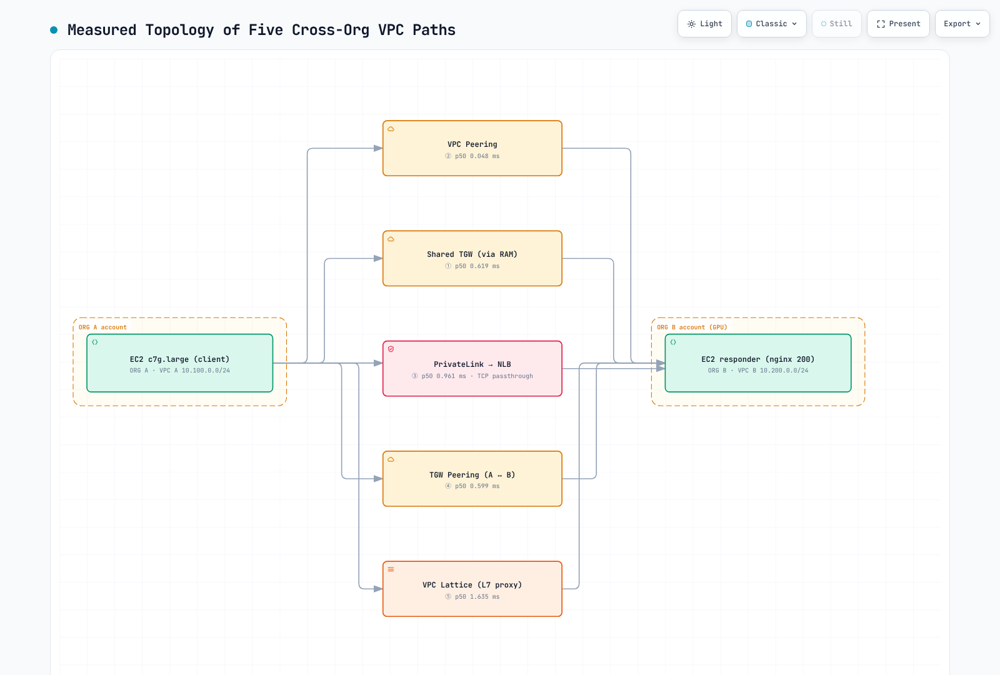

# 跨组织 VPC 连接

> **原始报告时间戳**：2026 年 9 月 1 日
>
> **内容审查**：2026 年 9 月 12 日

本章比较了五种连接**不同 AWS Organizations** 中账户的模式，例如现有环境与单独治理的 GPU 环境。表格保留了早期文档中报告的测量结果。本次审查核查了 AWS 行为和计算结果；并未声称进行了新的实时部署或独立复现基准测试。

## 目录

1. [为何需要跨组织连接](#why-cross-org-connectivity)
2. [五种方案比较](#comparing-the-five-options)
3. [报告的验证结果](#reported-verification-results)
4. [延迟测量（M1–M7）](#latency-measurements-m1m7)
5. [运维发现](#operational-findings)
6. [按需求选择架构](#architecture-selection-by-requirement)
7. [局限性与后续检查](#limitations-and-next-checks)

## 为何需要跨组织连接

合同所有权、收购、独立治理或隔离要求，可能会使 GPU 工作负载和现有服务分别位于不同的 Organizations 中。组织结构应根据这些要求确定，而不应假设另设一个 Organization 就能自动改善 GPU 折扣、配额或合规性。

EC2 资源配额通常按**账户和区域**设定；单独的账户即可实现这种隔离，无需另设 Organization。还需要审查账单汇总、协商折扣以及重复治理等因素。Organization 边界不能替代应用程序授权、网络分段或审计控制。

对于 EKS，需要区分对数据管道/推理 API 的普通 IP 访问与 GPU 集合通信。基于 CPU 实例的请求/响应基准测试，不能证明 NCCL、吞吐量或 RDMA 性能。**EFA OS bypass 流量无法跨越 VPC 或可用区**；其 ENA 接口发出的普通 IP 流量仍可路由。

## 五种方案比较

PrivateLink 和 Lattice 两列描述的是**已测试的、由 NLB 支持的端点服务和 HTTP 服务模式**。PrivateLink 还提供资源和服务网络端点类型；Lattice 也提供 TCP 资源配置。它们并非一概都是“必须使用 NLB”或“仅支持 L7”的产品。

| 方面 | ① TGW RAM 共享 | ② VPC 对等连接 | ③ PrivateLink 端点服务 | ④ TGW 对等连接 | ⑤ VPC Lattice HTTP 服务 |
|---|---|---|---|---|---|
| 机制 | 与外部账户共享 TGW | 直接连接一对 VPC | 使用者接口端点 → 提供方 NLB/服务 | 连接各所有者的 TGW | 将服务和客户端 VPC 关联到服务网络 |
| 地址重叠 | 直接路由需要明确无歧义的地址规划 | CIDR 重叠时无法建立对等连接 | 服务访问可处理 VPC CIDR 重叠 | 直接路由需要明确无歧义的地址规划 | 服务访问可处理 VPC CIDR 重叠 |
| 连接模型 | 在允许的情况下进行双向 IP 路由 | 在允许的情况下进行双向 IP 路由 | 使用者发起连接；响应可沿连接返回 | 在允许的情况下进行双向 IP 路由 | 客户端向已发布的服务发起请求；反向访问需要单独配置 |
| 路由设置 | VPC 路由，以及 TGW 路由表/关联 | 两侧都需配置路由；VPC 对等连接不支持传递路由 | 配置端点/服务权限和网络控制，而非通用 VPC 中转 | 明确配置指向对等端的静态路由，以及 VPC 路由 | 配置服务/网络关联和策略，而非通用 VPC 中转 |
| 控制权 | TGW 所有者管理其 TGW 路由表；使用者保留其 VPC 控制权 | 各 VPC 所有者 | 提供方控制服务权限/目标；使用者控制其端点 | 各 TGW 所有者，并协调路由 | 网络/服务所有者及客户端网络控制 |
| 原始报告的配置时间 | TGW 约 3 分钟，另加接受时间 | 少于 1 分钟 | 端点约 3 分钟 | 约 7 分钟 | 约 5 分钟 |

配置时间是原始报告中的观测结果，并非 SLA 或端到端交付时间估算。路由一行描述的是本章中的双 TGW 拓扑；并未声称可以通过任意对等连接链实现不受限制的中转。NAT 或重新规划地址是处理地址重叠的其他方法，需要单独设计。

## 报告的验证结果

原始报告称，五种模式均已建立，并且流量已在两个 Organizations 之间传输。AWS 文档支持这些模式的跨账户部署；不一定需要属于同一个 Organization。不过，IAM/SCP/共享限制可能阻止配置，而路由、安全组、NACL、DNS 和服务授权决定流量能否正常工作。仅有账户 ID 和接受共享邀请并不足够。

[查看交互式图表](https://www.atomai.click/kubernetes-docs/archmaps/en-networking-05-cross-org-vpc-connectivity-0.html)

图中保留了原始观测结果。Lattice 的数值为 **HTTP KA**，其他显示的数值为 **TCP_RR**；它们并非可以直接比较的同一种指标。“GPU”标签标识的是拟议环境，并非 GPU 基准测试。

## 延迟测量（M1–M7）

**报告中的设置：**`ap-northeast-2`，跨账户使用匹配的 ZoneId `apne2-az1`，实例类型为 `c7g.large`，以及一台返回固定 HTTP 200 的 nginx EC2 响应实例。报告描述了三个 ENI，分别设置每条路径的子网/返回路由；进行了五轮轮询交错测试，每条路径采集 1,500 个持久 TCP_RR 样本和 100 个 ICMP 样本，以及 275 个 HTTP keep-alive 样本。

nginx 的描述用于标识 HTTP 响应实例；页面未说明 TCP_RR 的实现或消息大小。此处未提供原始样本、软件/内核版本、计时器边界和 Linux 返回路径策略配置的链接。持久连接旨在减少反复建立连接的影响，但无法根据这些表格独立核实其计时器边界。

**以下所有延迟值的单位均为毫秒；TTL 是单独的报文字段。**TCP_RR 和 ICMP 是请求/响应往返时间指标。HTTP KA 包含应用程序处理时间。以下两组测量必须分别解读。

| ID | 路径 | ICMP p50 | TCP_RR p50 | RR p99 | RR sd | HTTP KA p50 | TTL |
|---|---|---|---|---|---|---|---|
| M1 | 同一 VPC → EC2（基线） | 0.121 | **0.049** | 0.062 | 0.007 | 0.087 | 127 |
| M2 | ② VPC 对等连接 → EC2 | 0.125 | **0.048** | 0.057 | 0.011 | 0.080 | 127 |
| M3 | ① 共享 TGW（RAM）→ EC2 | 0.535 | **0.619** | 0.695 | 0.141 | 0.686 | 126 |
| M4 | ④ TGW 对等连接（两个 TGW）→ EC2 | 0.912 | **0.599** | 0.855 | 0.133 | 0.488 | 125 |
| M5 | ③ PrivateLink → NLB → EC2 | 未测量 | **0.961** | 1.084 | 0.035 | 0.711 | - |
| M6 | ⑤ VPC Lattice → EC2 目标 | 未测量 | 此 HTTP 服务未测量 | - | - | **1.635** | - |
| M7 | ② 对等连接 → NLB → EC2（隔离 NLB 跳点） | 未测量 | **0.841** | 0.909 | 0.119 | 0.883 | - |

### 报告中的中位数差异

这些是**路径中位数之间的差异**，并非单独的单向跳点成本，也不是对某个 ENI/代理组件的测量。

| 观测到的路径比较 | 差值 | Δ TCP_RR p50 | Δ ICMP p50 | Δ HTTP KA p50 |
|---|---|---|---|---|
| 对等连接与同 VPC 基线 | M2 − M1 | -0.001 | +0.004 | -0.007 |
| 共享 TGW 路径与对等连接 | M3 − M2 | +0.571 | +0.410 | +0.606 |
| 双 TGW 路径与对等连接 | M4 − M2 | +0.551 | +0.787 | +0.408 |
| 使用 NLB 的对等连接与直接对等连接 | M7 − M2 | +0.793 | - | +0.803 |
| PrivateLink/NLB 与对等连接/NLB | M5 − M7 | +0.120 | - | -0.172 |
| Lattice HTTP 服务与直接对等连接 HTTP | M6 − M2 | - | - | +1.555 |

- M2 与同 VPC 基线接近，但这些表格并不能证明二者在统计上等效或没有开销。
- 双 TGW 路径的 TCP_RR 中位数低于单个共享 TGW 路径的中位数。因此，这些数据并不支持“每个 TGW 跳点增加 0.4–0.6 毫秒”这一普遍说法，也不支持线性跳点成本公式。
- M5−M7 的 **TCP_RR 为 +0.120 毫秒，但 HTTP KA 为 −0.172 毫秒**。不能将其标记为纯粹的 PrivateLink ENI 成本。
- Lattice 的比较结果是 **HTTP +1.555 毫秒**，而不是 TCP_RR。这描述的是本次 HTTP 服务测试，并不代表 Lattice 的所有模式。
- 如果不知道初始 TTL 和相关网络行为，就无法从 TTL 推断路径跳数。

### 独立的服务前置测试

原始报告还在每条 L3 路径上放置了 NLB。这有助于比较该服务暴露模式，但并非所有生产环境中的对等连接/TGW 部署都必须如此。

| 配置 | TCP_RR p50 | HTTP KA p50 |
|---|---|---|
| ② 对等连接 → NLB → EC2 | **0.622** | 0.648 |
| ③ PrivateLink → NLB → EC2 | **0.658** | 0.845 |
| ① 共享 TGW → NLB → EC2 | **1.273** | 1.257 |
| ④ TGW 对等连接 → NLB → EC2 | **1.425** | 1.279 |
| ⑤ Lattice HTTP 服务（本次测试未使用单独的 NLB） | - | **1.680** |

在这组测试中，PrivateLink/NLB 减去对等连接/NLB 的结果为 **TCP_RR +0.036 毫秒**，**HTTP KA +0.197 毫秒**。共享 TGW 和 TGW 对等连接的 TCP_RR 中位数分别是 PrivateLink 中位数的 **1.93 倍和 2.17 倍**；HTTP 比值分别为 **1.49 倍和 1.51 倍**。这些是延迟比值，不是吞吐量倍数，也不能证明这些路径彼此等效。

Lattice 的 HTTP 中位数比共享 TGW/NLB 和 TGW 对等连接/NLB 的 HTTP 中位数分别高 **+0.423 毫秒和 +0.401 毫秒**。不要将这组测试与 M1–M7 测试合并来推导组件成本：两次测试中，对等连接/NLB 的中位数甚至都不相同。

原始报告还描述了一项被舍弃的突发型实例/NLB→ALB/新建 curl 试测，p95 约为 **7 毫秒**，以及首次流量增加 **0.6–1.6 毫秒**。这些仍是有所归属的观测结果，但没有附上原始样本链接，也不代表 AWS 保证。应针对实际应用分别测量连接建立阶段和稳定运行阶段的表现。

## 运维发现

1. **RAM 外部共享：**必须允许外部主体，并且 Organization 之外的账户必须接受共享邀请。`CreateResourceShare` API 的 `allowExternalPrincipals` 默认值为 **true**；显式设置 `--allow-external-principals` 可记录设计意图，但并非所有情况下，未提供这个字面 CLI 标志都会导致失败。请核实有效的共享配置和权限。
2. **共享 TGW VPC 连接接受：**当 `AutoAcceptSharedAttachments` 被禁用（默认值）时，TGW 所有者必须接受共享连接。启用该选项会改变此流程。RAM 共享接受与 TGW 连接接受是不同的步骤。使用者无法修改所有者的 TGW 路由表，但仍可控制自己的 VPC 路由和安全设置。
3. **TGW 对等连接接受：**接受方 TGW 所有者必须在**接受方区域**接受待处理的对等连接请求，即使是同一账户内的对等连接也是如此。使用该请求的 `TransitGatewayAttachmentId`；不要将其与 TGW ID 或 VPC 连接 ID 混淆。`NotFound` 响应并不能证明两侧必须使用不同 ID。原始报告中约两分钟的可见性延迟只是观测结果，并非固定等待时间保证。
4. **对等连接路由：**直接的 TGW 到 TGW 对等连接使用明确配置的静态路由，而不是通过对等连接传播 BGP 路由。应在两个方向配置相关的 TGW 和 VPC 路由表。自动化工具可以管理这些静态路由。
5. **路由优先级：**首先进行最长前缀匹配。对于**相同的目标前缀**，静态路由优先于传播路由；较不具体的静态路由不会覆盖较具体的传播路由。
6. **Lattice 目标安全组：**对于文档所述的 VPC 关联服务路径，应在实际目标端口和运行状况检查端口上使用按区域/IP 地址族管理的前缀列表（`com.amazonaws.REGION.vpc-lattice` 和 `com.amazonaws.REGION.ipv6.vpc-lattice`）。原始示例中的 `169.254.171.0/24` 并非通用列表定义；管理列表可能包含链路本地或不可路由的公网地址。端点/资源网关路径有各自的控制措施。还必须配置 IAM 服务身份验证；仅关联 VPC 并不会启用该功能。
7. **清理资源的所有权：**原始报告提到，GuardDuty 管理的网络依赖项、IAM 策略附加项以及残留的 Lattice 资源会影响资源拆除。操作前请检查实际依赖项 ID 和所属服务。不要为了强行删除 VPC/角色而禁用托管安全控制或删除无关资源。

## 按需求选择架构

| 需求 | 候选模式 | 重要检查项 |
|---|---|---|
| 每个 Organization 都必须保留自己的 TGW 路由控制权 | ④ TGW 对等连接 | 静态路由协调、地址规划、吞吐量、可用性、流量检查和传输费用 |
| 需要暴露少量推理/服务端点 | ③ PrivateLink 端点服务 | 支持的协议/模型、端点接受、应用身份验证、DNS、成本以及实际负载/并发量 |
| 需要跨重叠 CIDR 的服务访问 | ③ PrivateLink 或 ⑤ Lattice | 服务/资源范围；如果需要更广泛的 IP 路由，则评估 NAT/重新规划地址 |
| 其他账户可以使用集中控制的中枢 | ① TGW RAM 共享 | 外部共享策略、接受设置以及所有者的 TGW 控制模式 |
| 少量直接 VPC 连接对 | ② VPC 对等连接 | CIDR 不重叠、逐对维护路由、配额和数据传输费用 |
| 需要托管 HTTP 服务身份/发现/治理 | ⑤ VPC Lattice | 明确配置 IAM 身份验证策略、签名请求、服务连接和工作负载测量 |

TGW 对等连接与 PrivateLink 的混合方案，或许适合既需要独立网络治理、又只需暴露少量 API 的场景。已发布的延迟表格并不能证明它最适合大多数 GPU 环境。应根据所需的连接能力和控制措施做出选择，然后测量实际工作负载。

## 局限性与后续检查

原始报告未涵盖经测量的 Network Firewall 检查路径、跨区域延迟以及吞吐量/并发量。报告提到了重叠地址的功能检查，但未公布重叠地址情况下的延迟结果。GPU 集合通信、EFA/RDMA、有代表性的负载大小、不确定性估算以及完整复现材料，也无法通过本页面证实。

请将报告中的数字作为历史参考。部署前，应验证目标账户的策略和支持的连接模式、所需的双向路由或服务访问、故障行为，以及应用的延迟/吞吐量预算。本次审查未执行任何 AWS 资源配置或实时基准测试。

## 参考资料

- [可扩展的多 VPC 网络白皮书](https://docs.aws.amazon.com/whitepapers/latest/building-scalable-secure-multi-vpc-network-infrastructure/welcome.html)
- [跨账户 TGW 共享](https://docs.aws.amazon.com/prescriptive-guidance/latest/integrate-third-party-services/architecture-3-1.html)
- [单个或多个 Organizations](https://aws.amazon.com/blogs/architecture/choosing-between-single-or-multiple-organizations-in-aws-organizations/)
- [RAM CreateResourceShare API](https://docs.aws.amazon.com/ram/latest/APIReference/API_CreateResourceShare.html)
- [TGW 接受选项](https://docs.aws.amazon.com/AWSEC2/latest/APIReference/API_TransitGatewayRequestOptions.html)
- [TGW 对等连接接受](https://docs.aws.amazon.com/vpc/latest/tgw/tgw-peering-accept-reject.html)
- [TGW 路由和评估顺序](https://docs.aws.amazon.com/vpc/latest/tgw/how-transit-gateways-work.html)
- [PrivateLink 端点类型](https://docs.aws.amazon.com/vpc/latest/privatelink/what-is-privatelink.html)
- [私有 NAT 和网络地址重叠](https://docs.aws.amazon.com/vpc/latest/userguide/nat-gateway-scenarios.html)
- [Lattice 安全组](https://docs.aws.amazon.com/vpc-lattice/latest/ug/security-groups.html)
- [EC2 账户/区域配额](https://docs.aws.amazon.com/AWSEC2/latest/UserGuide/ec2-resource-limits.html)
- [EFA 限制](https://docs.aws.amazon.com/AWSEC2/latest/UserGuide/efa.html)
- [VPC Lattice 指南](02-vpc-lattice.md)
- [跨组织测验](../quizzes/networking/05-cross-org-vpc-connectivity-quiz.md)
