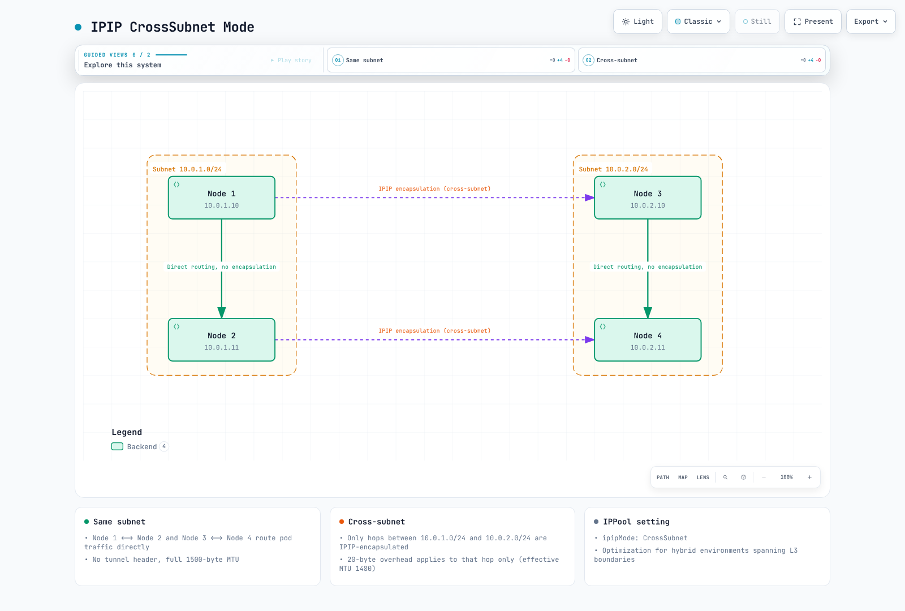
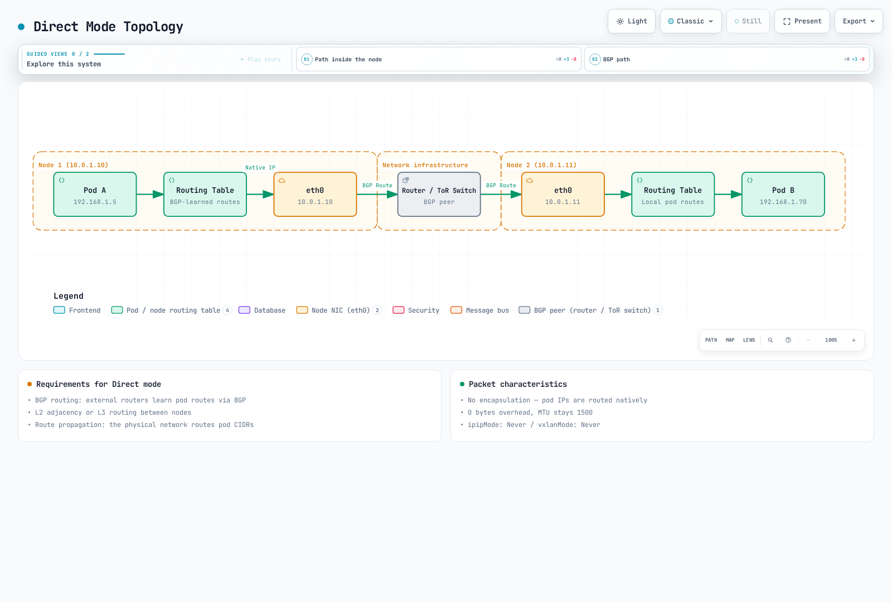

# 第 3 部分：网络模式

> **审查基线**：Calico Open Source 3.32.2 / operator 1.42.6；Kubernetes 1.34–1.36 是 Calico 3.32 的测试范围。
> **最后更新**：September 12, 2026。下方保留的历史基准值是未经验证的报告，并非新测量结果。

## 范围和模式选择

本章涉及由 Calico 管理的 Linux Pod 网络和 IPAM。在 EKS 仅策略模式下，Pod 网络仍由 Amazon VPC CNI 管理；创建 Calico IPPools 并不会将该安装切换为覆盖网络。这里的示例是可选设计，不能一起应用，也不能应用到入门实验中已创建的池上。本次审查未执行集群迁移或网络基准测试。

| 选项 | 含义 | 重要限制 |
|---|---|---|
| IPIP | IPv4-in-IPv4，IP 协议 4 | Calico IPIP 仅支持 IPv4；底层网络必须允许该协议 |
| VXLAN | 通过 UDP 承载内部以太网帧，Calico 默认端口为 4789 | 外层 IPv4 和 IPv6 的开销不同；端口/VNI 可配置 |
| Direct / 未封装 | 对 Pod IP 数据包进行路由，不使用 Pod 网络覆盖层 | 底层网络和返回路径必须能够路由 Pod 地址 |
| CrossSubnet | IPIP 或 VXLAN 的一种设置 | 仅当相关节点地址位于不同的已配置子网时，才封装节点间流量 |

`Always` 适用于发往已配置池中地址的符合条件的节点间流量；同一节点上的流量不需要物理隧道。`Never` 会禁用该封装方式，但不会禁用所有网络功能。CrossSubnet 不是 AZ、Region 或 WAN 链路检测器：即使两个子网位于同一个 AZ，也可能仍需封装。请检查 Calico 使用的节点地址和子网掩码。

默认值取决于安装方式/提供商和数据平面。不存在“所有云环境都默认使用 IPIP”这样的通用规则，也无法保证 Direct 总是最快。[覆盖网络指南](https://docs.tigera.io/calico/latest/networking/configuring/vxlan-ipip)介绍了受支持的路由路径。

### 路由与封装是两个独立的选择

默认情况下，Felix 会为 VXLAN 池配置路由，而 confd/BIRD 会为 IPIP 和未封装池配置集群路由。Calico 3.32 还支持通过 `Installation.spec.calicoNetwork.clusterRoutingMode: Felix` 为这些非 VXLAN 路由配置路由模式。相应的底层设置为 Felix `programClusterRoutes: Enabled` 和 BGP `programClusterRoutes: Disabled`；如果安装由 operator 管理，请使用 operator 设置。向外部通告 BGP 路由仍然需要 BGP。静态路由或适当的路由网络也可以提供底层网络可达性，因此 BGP 和同一 L2 上的邻接关系并非所有未封装设计的通用要求。

## 数据包结构和开销

以下内容使用**底层 IP MTU**。外层以太网标头不计入该 IP MTU。假设没有 IPv4 选项或额外的内部 VLAN 标签；TCP 选项和其他封装还可能进一步减少有效负载。

```text
Direct: outer Ethernet | Pod IP | TCP or UDP | payload
IPIP:   outer Ethernet | outer IPv4 | Pod IPv4 | TCP or UDP | payload
VXLAN:  outer Ethernet | outer IP | UDP | VXLAN | inner Ethernet | Pod IP | TCP or UDP | payload
```

| 传输方式 | Pod IP 数据包以上的开销 | 底层 IP MTU 为 1500 时的 Pod IP MTU |
|---|---|---|
| Direct，无其他隧道 | 0 | 1500 |
| IPIP，外层 IPv4 | 20 | 1480 |
| VXLAN，外层 IPv4 | 20 + 8 + 8 + 14 = 50 | 1450 |
| VXLAN，外层 IPv6 | 40 + 8 + 8 + 14 = 70 | 1430 |
| WireGuard，外层 IPv4 | 60 | 1440 |
| WireGuard，外层 IPv6 | 80 | 1420 |

对于 VXLAN，MTU 开销中的 14 字节是**内部以太网标头**，而不是外层以太网标头。普通 TCP 的最小标头为 20 字节；UDP 标头为 8 字节。因此，在这些假设下，一个 1500 字节的 IPv4 IP 数据包最多可承载 1460 字节的 TCP 有效负载或 1472 字节的 UDP 有效负载。原先共享的“TCP/UDP = 20 字节”标注有误。

IPIP 的协议号是 4，不是 TCP/UDP 端口 4。Calico 通常使用的 VXLAN VNI 为 4096，默认 UDP 端口为 4789，但两者均可配置。其他当前的 VXLAN 实现可能使用 8472；这并不只限于过时软件。请参阅 [IP-in-IP](https://www.rfc-editor.org/rfc/rfc2003) 和 [VXLAN](https://www.rfc-editor.org/rfc/rfc7348)。

### 数据包路径示意图


[🔍 查看交互式图示](https://www.atomai.click/kubernetes-docs/archmaps/en-networking-calico-03-networking-modes-2.html)

“Felix”列表示由 Felix 配置的内核路由/策略；数据包不会经过 Felix 守护进程。这是 IPv4 节点间路径，不是同一节点上的流量，也不是加密机制。


[🔍 查看交互式图示](https://www.atomai.click/kubernetes-docs/archmaps/en-networking-calico-03-networking-modes-3.html)

图中展示的是默认值 4789 和 VNI 4096。50 字节开销和 MTU 1450 适用于所述标头假设下、外层 IPv4 的 1500 字节路径，并不适用于所有网络或地址族。

### CrossSubnet 示例

当节点地址为 10.0.1.10/24 和 10.0.1.11/24 时，同一子网内的路径可以不封装。在 CrossSubnet 设计中，10.0.2.20/24 的对等节点需要封装。因此，即使云子网名称看起来正确，错误的节点掩码也可能改变结果。CrossSubnet 不会建立 VPC/Region 间连接，也不提供加密。



[🔍 查看交互式图示](https://www.atomai.click/kubernetes-docs/archmaps/en-networking-calico-03-networking-modes-1.html)

此选择由子网地址/掩码决定。图中的 1500/1480 值假设底层网络为 IPv4 且 MTU 为 1500；工作负载仍应使用其所有可能路径中的最小 MTU。同一子网内的流量不会使其接口 MTU 动态增大。

### 节点诊断

请在经授权的 **Linux 节点网络命名空间**中运行以下只读命令，而不是在普通应用 Pod 中运行。只有启用了相应模式时，接口才会存在。命令显示的值取决于实际安装情况。

```bash
ip link show tunl0
ip link show vxlan.calico
bridge fdb show dev vxlan.calico
ip route show
```

典型的本地 Pod 路由是类似 `10.244.1.5/32 dev cali…` 的主机路由；不要将整个 /24 或 /26 路由到单个 Pod 的 veth 中。汇总块可能改为使用一条 blackhole 路由以及更具体的 Pod 路由。远程块可以通过隧道或下一跳节点/路由器进行路由；路由协议标签取决于使用的是 BIRD 还是 Felix 配置路由。


[🔍 查看交互式图示](https://www.atomai.click/kubernetes-docs/archmaps/en-networking-calico-03-networking-modes-5.html)

这些是底层网络为 IPv4、MTU 为 1500 的示例。该图比较的是数据包封装方式，而不是实测速度或相同的控制平面行为。选择工作负载 MTU 时，还必须考虑其他封装和 Service 路径。

## 通过其所有者配置池

`kubectl …projectcalico.org` 示例假设使用入门部分中的聚合 Calico API（或相应的 native-v3 设置）。如果未启用该 API，请使用匹配版本的 calicoctl 管理逻辑 Calico 资源。operator 命令仅适用于由 operator 管理的安装。池范围还必须避免与 Service 和节点/底层网络范围冲突。

每个配置只能有一个所有者。`Installation.spec.calicoNetwork.ipPools` 中列出的池由 operator 协调；请通过其所有者编辑该期望列表，而不要应用与之冲突的 IPPool 对象。独立池使用 Calico IPPool API。无论哪种情况，都应先确认集群实际 Pod CIDR、范围不重叠、IPAM 类型和现有分配。

```bash
kubectl get installation.operator.tigera.io default -o yaml
kubectl get ippools.projectcalico.org -o yaml
calicoctl ipam show --show-blocks
```

对于由 operator 管理的池，以下是现有 `ipPools` 列表中的一个**条目片段**。请保留其他条目和 Installation 字段。不要将其创建在入门实验中已分配地址的 /16 池之上：

```yaml
- name: mode-demo-pool
  cidr: 10.244.0.0/16
  blockSize: 26
  encapsulation: VXLAN
  natOutgoing: Enabled
  nodeSelector: all()
```

对于单独规划的新池，其对应的 IPv4 资源如下。这是 operator 条目的替代方案，而不是另一个重叠池。该 CIDR 仅为示例，必须适合实际集群，且不得与任何现有池冲突。

```yaml
apiVersion: projectcalico.org/v3
kind: IPPool
metadata:
  name: mode-demo-pool
spec:
  cidr: 10.244.0.0/16
  blockSize: 26
  ipipMode: Never
  vxlanMode: Always
  natOutgoing: true
  nodeSelector: all()
```

选择一行，不要创建多个使用相同 CIDR 的资源：

| IPv4 设计 | IPPool `ipipMode` | IPPool `vxlanMode` | operator `encapsulation` |
|---|---|---|---|
| IPIP Always | Always | Never | IPIP |
| IPIP CrossSubnet | CrossSubnet | Never | IPIPCrossSubnet |
| VXLAN Always | Never | Always | VXLAN |
| VXLAN CrossSubnet | Never | CrossSubnet | VXLANCrossSubnet |
| Direct | Never | Never | None |

同一个池中不能同时启用 IPIP 和 VXLAN。`encapsulation` 是 operator 的池字段，不是独立 IPPool 的字段名。在通常的聚合 API 安装中，创建重叠池会被拒绝。对于 native v3 CRD（技术预览版），重叠验证是异步的，已创建的池可能收到 Disabled 条件；创建成功并不能证明该池可用于分配。

Calico 3.32 的 Installation 架构允许配置池列表（最多 25 个条目），并会进行控制器验证和平台约束检查。旧示例声称 IPv4 池数量只能有一个，不应被当作当前通用限制。

### 使用外部 BGP 的 Direct 路由

如果设计使用外部 BGP，请先配置真实对等节点和返回路由，再移除覆盖层。仅声明对等节点并不会配置物理路由器，也不能证明路由已被接受。以下是一个单独的拓扑示例，不是对禁用 BGP 的 VXLAN 实验的补充：

```yaml
apiVersion: projectcalico.org/v3
kind: BGPPeer
metadata:
  name: example-rack-tor
spec:
  peerIP: 192.0.2.1
  asNumber: 65001
  nodeSelector: rack == 'rack1'
```

请替换文档示例地址和 AS 编号，为目标节点添加标签，并为每个机架验证路由过滤规则/AS 环路处理。仅当返回路由和所需的外部 NAT 均已设计妥当时，`natOutgoing: false` 才合适；仅靠 BGP 无法让私有 Pod 地址直接通过互联网路由。有关 mesh/RR 更改，请使用 [BGP 迁移指南](02-architecture.md)和 [BGP 深入介绍](04-bgp-deep-dive.md)。



[🔍 查看交互式图示](https://www.atomai.click/kubernetes-docs/archmaps/en-networking-calico-03-networking-modes-4.html)

此图展示的是基于 BGP 的设计，并不意味着所有 Direct 设计都必须使用 BGP。MTU 1500 的数值假设路径可用且没有其他隧道；eBPF Service 交接或加密可能会要求更低的工作负载 MTU。

## NAT 和池选择

当 `natOutgoing: true` 时，Calico 通常会对该池中的源地址执行 SNAT，前提是目标地址不属于**任何 Calico IPPool**。这不只是简单判断流量是否“离开集群”。即使某个池已禁用，它也可能用于标识不进行 NAT 的目标地址范围；移除该池可能会改变 NAT 行为。其他 Felix 设置也可以排除主机 IP。NAT 不会授予 NetworkPolicy 权限。请参阅[出站 NAT](https://docs.tigera.io/calico/latest/networking/configuring/workloads-outside-cluster)。

### 基于拓扑的自动分配

这是一个独立的规划示例，包含两个位于 /16 集群范围内且互不重叠的 /18 池。它不能与已分配地址的父级 /16 池同时存在。不要为了套用此示例而删除正在使用的父级池。

```yaml
apiVersion: projectcalico.org/v3
kind: IPPool
metadata:
  name: zone-a-pool
spec:
  cidr: 10.244.0.0/18
  ipipMode: Never
  vxlanMode: CrossSubnet
  natOutgoing: true
  nodeSelector: topology.kubernetes.io/zone == 'ap-northeast-2a'
---
apiVersion: projectcalico.org/v3
kind: IPPool
metadata:
  name: zone-b-pool
spec:
  cidr: 10.244.64.0/18
  ipipMode: Never
  vxlanMode: CrossSubnet
  natOutgoing: true
  nodeSelector: topology.kubernetes.io/zone == 'ap-northeast-2b'
```

对于自动分配，请确保每个目标节点都匹配一个符合条件的池；选择器不会调度 Pod。以上 zone 标签用于选择地址分配池，而 CrossSubnet 仍使用节点地址/掩码来决定是否封装。

### 显式请求命名空间或 Pod 池

发起请求前，请创建并验证合适的池。以下片段通过命名空间现有的所有者添加注解；它不是完整的命名空间替换清单。Pod 注解的优先级高于命名空间注解，而命名空间注解又高于 CNI 池配置。

```yaml
metadata:
  annotations:
    cni.projectcalico.org/ipv4pools: '["production-pool"]'
```

`production-pool` 必须是一个已存在且已启用、地址充足的池。`assignmentMode: Manual` 可以将池排除在自动选择范围之外，同时允许显式请求。**池选择器和此注解都不是安全边界。**已发布的 [IPAM 实现](https://github.com/projectcalico/calico/blob/v3.32.2/libcalico-go/lib/ipam/ipam.go)会有意忽略显式请求启用池时的节点/命名空间池选择器。如果地址范围涉及信任含义，请控制哪些人可以请求这些池。现有 Pod 会保留其地址；更改注解不会重新分配地址。

## 云和平台限制

| 环境 | 指南 |
|---|---|
| 自行管理的 AWS EC2 | 根据所选模式检查 IP 协议 4 或 VXLAN UDP 的可达性、路由、源/目标检查和返回路径 |
| 使用 Amazon VPC CNI 的 EKS | 默认 Pod 网络由 VPC CNI 提供，而非 Calico VXLAN；仅策略模式的 Calico 不管理这些池 |
| 使用完整 Calico 网络的 EKS | 这是单独规划的安装方式，使用 Calico CNI/IPAM；请遵循[官方 EKS 流程](https://docs.tigera.io/calico/latest/getting-started/kubernetes/managed-public-cloud/eks) |
| 使用 Calico 管理网络的 Azure | Calico 覆盖网络指南支持在不支持 IPIP 的情况下使用 VXLAN；配置 UDR 无法解决不支持 IPIP 封装的问题 |
| AKS | 使用特定的受支持 Azure CNI/策略集成，不要笼统假设适用 Calico 覆盖网络 |
| GCE / GKE | 自行管理的 GCE 路由与托管 GKE 不同；[GKE Dataplane V2 使用 Cilium](https://cloud.google.com/kubernetes-engine/docs/concepts/dataplane-v2) |
| 本地部署 | Direct、静态/BGP 路由或覆盖网络取决于底层网络的可达性；不存在通用的最快选项 |
| OpenStack Neutron 集成 | 引用的 Calico 覆盖网络指南不包括此集成；未遵循平台流程前，不要直接套用 Kubernetes 覆盖网络指南 |

本章不提供适用于 EKS Auto Mode 或 Fargate 的自定义 CNI 配置方法。在 VXLAN 示例中禁用 BGP，表示该配置不需要 BGP；并不表示 AWS 没有支持 BGP 的服务。Windows 也有单独的限制，包括不支持 Calico IPIP 或 VXLAN CrossSubnet。

## MTU 配置和验证

请使用工作负载可能经过的所有路径中的最小可用 MTU，包括加密和 Service 路径。[Calico MTU 指南](https://docs.tigera.io/calico/latest/networking/configuring/mtu)介绍了自动检测以及由 operator/清单管理的配置。`mtuIfacePattern` 用于选择检测时考虑的接口；它不是开关，也不能证明端到端路径 MTU。

**不要盲目叠加 IPIP 和 WireGuard 的开销。**在 Calico 常见的混合部署中，WireGuard 用于已启用的对等节点之间；其他路径则使用 IPIP/VXLAN。请选择适用 MTU 中的最小值。在真实的 1500 字节路径上，IPv4 WireGuard 加 IPIP 意味着 `min(1440, 1480) = 1440`，而不是 `1500 − 60 − 20 = 1420`。外层 IPv6 WireGuard 的开销另为 80 字节。

AKS 有一项已记录的 WireGuard 例外：即使接口显示为 1500，底层路径也可能只有 1400，因此 IPv4 WireGuard 的 MTU 为 1340，IPv6 则为 1320。eBPF NodePort 路径也会使用 VXLAN，因此仅凭 Pod 池未封装，并不能推断工作负载 MTU 为 1500。

对于 operator 安装，在确认**此特定 IPv4 VXLAN 路径适用 1450**后，将其合并到现有期望状态中：


```bash
kubectl patch installation.operator.tigera.io default --type merge   -p '{"spec":{"calicoNetwork":{"mtu":1450}}}'
```

对于由清单管理的安装，文档中指定的设置是 `calico-config.data.veth_mtu`；请更新该 ConfigMap，并按照相应流程滚动更新 Calico node DaemonSet。不要将清单流程应用于由 operator 管理的 Deployment。**更新后的工作负载 MTU 适用于新工作负载。**重启 calico-node 本身不会重新创建应用 Pod，也不能证明其 MTU 已改变。

| 底层 IP MTU 示例 | IPIP IPv4 | VXLAN IPv4 | VXLAN IPv6 | WireGuard IPv4 | WireGuard IPv6 |
|---|---|---|---|---|---|
| 9000 | 8980 | 8950 | 8930 | 8940 | 8920 |
| 9001，前提是 AWS 路径确实支持该值 | 8981 | 8951 | 8931 | 8941 | 8921 |

必须确保整条路径都支持 Jumbo 帧；仅设置接口并不足够。验证工作负载路径时，请从诊断工作负载进行检查，而不只是从节点检查。

以下范围有限的检查假设使用已获批准、包含 iputils 且具备所需权限的 Linux 诊断 Pod。请设置真实的 Pod 名称/地址。以下有效负载大小是 **IPv4 ICMP** 示例：需加上 20 字节 IPv4 标头和 8 字节 ICMP 标头。IPv6 的计算方式不同；探测成功也不能证明所有 ECMP 路径都安全。

```bash
CHECK_NS=calico-demo
CHECK_POD=diagnostic-client
CHECK_TARGET=diagnostic-server
DEST_IPV4=$(kubectl -n "$CHECK_NS" get pod "$CHECK_TARGET" -o jsonpath='{.status.podIP}')
case "$DEST_IPV4" in
  ""|*:*) echo "Select a ready target Pod with an IPv4 address" >&2; exit 1 ;;
esac
kubectl -n "$CHECK_NS" exec "$CHECK_POD" -- ip link show eth0
kubectl -n "$CHECK_NS" exec "$CHECK_POD" -- ping -4 -c 3 -W 2 -M do -s 1472 "$DEST_IPV4"
kubectl -n "$CHECK_NS" exec "$CHECK_POD" -- ping -4 -c 3 -W 2 -M do -s 1452 "$DEST_IPV4"
kubectl -n "$CHECK_NS" exec "$CHECK_POD" -- ping -4 -c 3 -W 2 -M do -s 1422 "$DEST_IPV4"
```

这三个有效负载分别测试 IP 数据包大小 1500、1480 和 1450。失败也可能是策略/ICMP 过滤导致，而不只是 MTU 问题。抓包时，请在具备相应抓包权限的前提下检查 IPv4“需要分片”消息和 IPv6“Packet Too Big”消息；原先仅针对 IPv4 的过滤器无法覆盖 IPv6。

## 有计划地更改模式或迁移地址

更改封装方式与更改 Pod CIDR 或块大小并不相同。Calico 支持更改封装配置，但可能中断正在进行的连接。在维护变更前，请验证底层网络权限、路由、实际 MTU、数据平面支持和恢复方案。不要把重启所有节点或命名空间中的所有 Deployment 当作通用迁移步骤。

对于由 operator 管理的池，请在现有期望 Installation 列表中更改其 `encapsulation`，并保留其他所有池/设置。对于**仅适用于独立 IPv4 IPPool**的情况，以下仅更改模式的示例会保留其 CIDR 和分配设置，并同时更改两个封装字段：

```bash
POOL_NAME=mode-demo-pool
kubectl get ippool.projectcalico.org "$POOL_NAME" -o yaml > pool-before.yaml
kubectl patch ippool.projectcalico.org "$POOL_NAME" --type merge   -p '{"spec":{"ipipMode":"Never","vxlanMode":"Always"}}'
```

这并不保证不会造成中断。如果计划从 Direct 迁移到 IPIP-CrossSubnet 且这种迁移合适，其字段组合为 `ipipMode: CrossSubnet` / `vxlanMode: Never`；更改这些字段不需要替换池 CIDR。只有在经过验证的 MTU/地址方案确有需要时，才使用工作负载自身的滚动更新和就绪策略，重新创建选定的应用工作负载。[PodDisruptionBudgets](https://kubernetes.io/docs/concepts/workloads/pods/disruptions/) 不会限制 Deployment 控制器的滚动更新。

### 单独的 IPPool/CIDR 迁移

仅当 Calico 管理 IPAM，且编排器/网络设计支持时，才使用[池迁移流程](https://docs.tigera.io/calico/latest/networking/ipam/migrate-pools)。

1. 清点现有池、Kubernetes/kube-proxy 集群 CIDR、显式池请求和所有地址分配。位于集群 CIDR 之外的新池可能会改变 NAT 行为或破坏流量；旧示例中的 10.245/16 并不一定与入门示例的 10.244/16 集群兼容。
2. 通过池的所有者添加一个经过验证且不重叠的池，并在撤销旧池之前测试新分配。为旧工作负载保留现有池。
3. 通过相应的所有者停止向旧池分配新地址。独立池的 `spec.disabled: true` 会将其排除在 IPAM 之外。operator 的 `nodeSelector: "!all()"` 会禁用**自动选择**，但显式请求旧池会绕过选择器；也要移除这些请求。
4. 分批受控迁移选定的工作负载，并检查地址、MTU、路由、策略和应用就绪情况。重新创建 Pod 可能中断应用并改变 IP 地址；新池不能保证无缝回滚。
5. 只有在确认旧池剩余分配及其依赖项（包括适用的隧道或 LoadBalancer 用途）后，才能弃用旧池。仅查看 Pod 列表并不足够。从所有者配置中移除旧池时，还要考虑其 NAT/路由影响。

以下只读检查很有用：


```bash
kubectl get ippools.projectcalico.org -o yaml
calicoctl ipam show --show-blocks
calicoctl ipam show --show-borrowed
kubectl get pods --all-namespaces -o wide
```

池的块大小是另一个迁移事项；不要通过替换教程清单来更改现有池不可变的分配结构。旧示例中复制的“为立即应用模式而”重启 calico-node 步骤，无法证明工作负载 MTU 或应用已恢复。

## 早期基准测试报告（来源未经验证）

较早的英文和韩文页面包含不同的数值，且没有提供原始结果、完整软件版本、部署位置或可复现的测试工具。以下保留两份记录；它们不能被视为同一项实验，也不能被视为经过验证的性能保证。本次审查未重新运行测试。

### 记录 A：较早的英文页面

报告的环境：**AWS 上的 3 × c5.xlarge**，标称网络带宽为 10 Gbps，iperf3 TCP，**单流运行 60 秒**。未提供 placement group、Calico/内核版本或延迟收集方法。

| 报告指标 | Direct | IPIP | VXLAN |
|---|---|---|---|
| 吞吐量，Gbps | 9.41 | 9.12 | 8.89 |
| p99 延迟，µs | 45 | 52 | 61 |
| CPU，每 Gbps 占用率，% | 2.1 | 2.8 | 3.4 |

AWS 文档说明，不在集群置放群组中的实例通常有 5 Gbps 的单流上限，另有规定的例外情况。因此，若要使用该报告中高于 9 Gbps 的数值来预测新的部署，就需要补充缺失的置放/路径条件。“最高可达 10 Gbps”也不能证明基准带宽可以持续维持。请参阅 [EC2 带宽](https://docs.aws.amazon.com/AWSEC2/latest/UserGuide/ec2-instance-network-bandwidth.html)。

### 记录 B：较早的韩文页面

| 报告指标 | Direct | IPIP | VXLAN | 标明的方法 |
|---|---|---|---|---|
| 吞吐量，Gbps | 9.8 | 9.2 | 8.5 | iperf3，MTU 1500 |
| 延迟，µs（未说明统计量） | 35 | 42 | 55 | netperf TCP_RR |
| CPU 利用率 | 低 | 中 | 中高 | 10 Gbps 时 |
| PPS，每秒百万个数据包 | 1.8 | 1.5 | 1.2 | 64 字节数据包 |

未提供硬件、样本数量以及“64 字节”的确切含义。netperf 的 TCP_RR 测试通常报告**每秒事务数**；经过明确论证的倒数可以估算平均请求/响应周期时间，但不能代表 p99 或单向网络延迟。报告中微秒数值对应的原始输出/换算过程缺失。

仅凭标头大小无法确定哪种模式更快。NIC 卸载、内核/数据平面、数据包大小、CPU、路由、连接复用和负载都可能改变结果。应将这些记录保留为未经验证的历史数据，并在目标环境中进行测量，而不是依据这些记录为模式排序。

### 新实验中范围有限的客户端探测

准备专用测试 Pod，确保它们包含匹配版本的 iperf3/netperf、运行中的服务器监听器，以及所需的策略权限。这些命令只是客户端探测，并不能完整复现上述任一记录。请记录版本、节点/AZ 部署位置、MTU、请求/响应大小、原始输出和多次运行结果。对于此示例，请确认所选服务器具有 IPv4 地址。

```bash
set -euo pipefail
BENCH_NS=calico-demo
CLIENT_POD=benchmark-client
SERVER_POD=benchmark-server
SERVER_IP=$(kubectl -n "$BENCH_NS" get pod "$SERVER_POD" -o jsonpath='{.status.podIP}')
: "${SERVER_IP:?Server Pod has no address}"
case "$SERVER_IP" in
  *:*) echo "This example requires an IPv4 server Pod" >&2; exit 1 ;;
esac
kubectl -n "$BENCH_NS" get pods "$CLIENT_POD" "$SERVER_POD" -o wide
kubectl -n "$BENCH_NS" exec "$CLIENT_POD" --   iperf3 -c "$SERVER_IP" -t 30 -P 4 -J > iperf3-result.json
kubectl -n "$BENCH_NS" exec "$CLIENT_POD" --   netperf -H "$SERVER_IP" -t TCP_RR -l 60 > netperf-result.txt
```

iperf3 示例使用四个流，因此并非记录 A 的单流测试方法。[netperf 手册](https://github.com/HewlettPackard/netperf/blob/master/doc/netperf.txt)说明了其报告单位和可选的延迟输出。请隔离测试负载，完成后仅停止自己拥有的测试服务器/资源；不要为了复现未注明来源的图表而更改生产网络模式。

[Calico 概述](README.md) · [架构](02-architecture.md) · [下一节：BGP 深入介绍](04-bgp-deep-dive.md) · [网络模式测验](../../quizzes/networking/calico/03-networking-modes-quiz.md)
