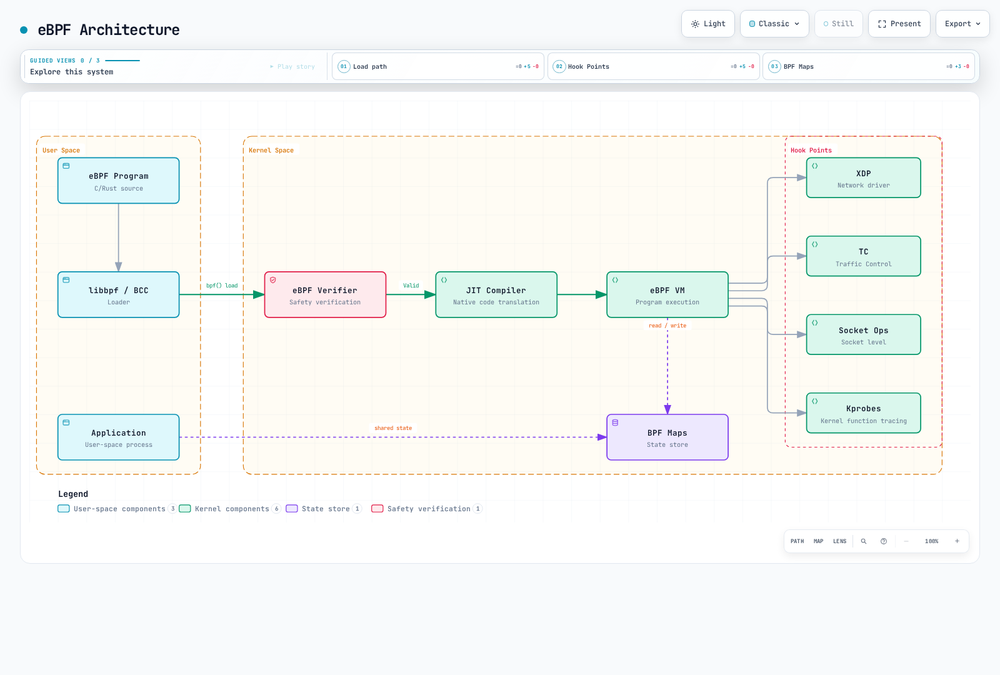
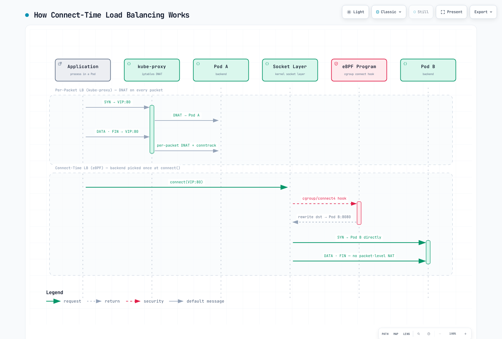

# 第 6 部分：eBPF 数据面

> **审阅基线**：Calico 3.32.2；Calico 3.32 测试覆盖 Kubernetes 1.34–1.36。**最后更新**：2026 年 9 月 12 日。
>
> 以下示例假定已有兼容的 Linux Calico 集群和标准 Calico API server。请按安装的实际所有者选择操作流程；这些配置片段彼此为替代方案，并非要求在每个集群中依次应用。本次审阅没有加载 BPF 程序、迁移集群或复现文中报告的基准测试。

## 简介

Calico 的 eBPF 数据面使用 BPF 程序和 map 实现工作负载网络、策略和 Kubernetes Service 处理。在适用的流量路径上，它可以降低开销；实际性能取决于工作负载和配置。Calico 还提供传统 Linux 数据面和 Windows HNS；eBPF 并非适用于所有平台的通用升级方案。

本篇深入介绍网络视角下的 eBPF 基础、Calico eBPF 架构、迁移策略和性能优化方法。

***

## eBPF 基础

### 什么是 eBPF？

eBPF（extended Berkeley Packet Filter）是一种可在 Linux 内核运行沙箱化程序的技术，无需修改内核源码或加载内核模块。



[🔍 查看交互式图示](https://www.atomai.click/kubernetes-docs/archmaps/en-networking-calico-06-ebpf-dataplane-1.html)

> 虚拟机（VM）是抽象的指令模型。启用 JIT 后，已加载的程序会在其挂钩点以原生代码运行；JIT 之后不存在额外的客户机 VM。该图并未精确列出 Calico 使用的所有挂钩点。

### 网络场景中的 eBPF 核心概念

| 概念 | 说明 | 在 Calico 中的用途 |
| --- | --- | --- |
| **程序（Programs）** | 在内核挂钩点执行的字节码 | 数据包过滤、路由 |
| **Map** | 供多个程序共享的键值存储 | 路由表、策略规则 |
| **挂钩点（Hooks）** | 内核中的附加位置 | XDP、TC、socket |
| **辅助函数（Helpers）** | eBPF 程序可调用的内核函数 | 数据包处理、map 操作 |
| **BTF** | map 和程序的类型信息 | 调试信息、CO-RE |

### eBPF 与 iptables

iptables 数据包处理和 eBPF 程序都在内核中运行。遍历 iptables 规则通常不会切换到用户空间。kube-proxy 是负责配置 Service 规则的控制面进程；在 iptables 模式下，数据包不会经过 kube-proxy 进程本身。

哈希表查找、最长前缀匹配、编译后的策略、tail call 和连接跟踪的开销各不相同。“每条 eBPF 策略都是 O(1)”以及“无论规则数或流数多少，内存都保持不变”都不是有效结论。iptables 也可以使用带索引的 IP set；NAT 规则通常只在连接的首个数据包上选择，后续已建立连接的转换由 conntrack 应用。

## Calico eBPF 架构

| 机制 | 作用和范围 |
| --- | --- |
| TC 数据包挂钩 | 策略、路由、连接状态和数据包级 Service 处理；接口的入站/出站方向不一定等同于工作负载的入站/出站方向 |
| Cgroup socket-address 挂钩 | 在连接时转换 Service 目的地址；已发布的加载器会附加 connect 挂钩，并可在启用 UDP 时附加 sendmsg/recvmsg 挂钩 |
| XDP | 在支持且已配置时提前处理数据包；需区分 Calico 传统数据面的 XDP 加速与完整 eBPF 数据面自身的挂接逻辑 |
| 程序、IP set 和计数器 map | 支持已编译的程序和状态；策略并非单一、通用的“元组到动作”map |

这些是不同的执行上下文，并非必须按 XDP → TC → sockops → sk_msg → TC 的流水线运行。Calico 的连接时负载均衡不会通过 sk_msg 检查 HTTP 方法。应用层策略应使用单独的 [Istio/Dikastes 集成](05-network-policy.md)。

## BPF Map 结构

以下是 **Calico 3.32.2 特定版本的 IPv4 布局**，不是稳定的公共 ABI，也不是直接写入内核 map 的操作指南：

| Map 系列 | 类型 | 键/值字节数 | 用途 |
| --- | --- | --- | --- |
| 路由 | LPM trie | 8 / 8 | 目标前缀、标志位以及 next-hop 或接口索引联合字段 |
| NAT 前端 | LPM trie | 16 / 20 | Service/源前缀匹配、后端组/数量、亲和性和标志位 |
| NAT 后端 | Hash | 8 / 8 | 后端组/序号 → 地址和端口 |
| Conntrack v4 格式 | LRU hash | 16 / 88 | 协议、地址对、端口、状态和 NAT 元数据 |
| 亲和性 | LRU hash | 版本相关 | 缓存客户端到后端的选择结果 |

IPv4 路由键的前 4 个字节以小端序保存前缀长度，后续字节保存 IPv4 地址。其值包含标志位，以及一个 4 字节的 next-hop/接口索引联合字段，并非 MAC 地址。Conntrack 条目先保存 32 位协议字段，再保存地址和端口；此前简化的五元组结构并非实际布局。IPv6 使用不同布局。

策略会编译为 BPF 指令并借助 map；规则计数器 map 本身并不是策略。请使用匹配版本的 Calico 调试工具解码当前 map，并在解读原始字节前检查其实际类型、容量和版本。

## Direct Server Return（DSR）


[🔍 查看交互式图示](https://www.atomai.click/kubernetes-docs/archmaps/en-networking-calico-06-ebpf-dataplane-6.html)

> 前端可以是 NodePort 或其他 Service 地址。Calico 会处理返回流量的源地址转换；图中没有展示外部云负载均衡器，其返回路径限制仍然适用。

这里的“负载均衡器节点”指执行 Service 转发的 Kubernetes 节点。DSR 可以让返回流量绕过该节点，但不会自动绕过外部云负载均衡器。Calico 会执行返回流量的源地址转换，无需应用 Pod 绑定 VIP。

| `bpfExternalServiceMode` | 远端后端路径 |
| --- | --- |
| `Tunnel`（默认） | 请求和响应均经过入口节点/隧道路径 |
| `DSR` | 请求经隧道转发到远端节点；响应直接发往客户端 |

此字段没有 `Disabled` 或 `IPIP` 值。Calico 在此 Service 转发中使用 VXLAN，因此两种模式都需考虑 MTU 和底层网络要求。DSR 还要求网络能够允许某节点以原前端/入口节点的源地址发送流量。Calico 的 AWS 指南要求节点位于同一子网且禁用源/目的检查；不要将此条件泛化为任意跨子网部署。

当前 Calico 故障排查指南明确指出：如果 AWS/GCP 外部负载均衡器要求返回流量经过原目标，则该路径不支持 DSR。即使满足同子网和源/目的检查条件，也不要仅凭这些条件对这种流量启用 DSR。

对于已正常运行且兼容的 eBPF 路径，可设置：

```yaml
apiVersion: projectcalico.org/v3
kind: FelixConfiguration
metadata:
  name: default
spec:
  bpfExternalServiceMode: DSR
```

应通过配置所有者的流程合并设置，并测试返回路由、源地址验证和现有连接。更改模式可能中断连接。DSR 与连接时负载均衡是两种不同的优化。

## 连接时负载均衡



[🔍 查看交互式图示](https://www.atomai.click/kubernetes-docs/archmaps/en-networking-calico-06-ebpf-dataplane-7.html)

> kube-proxy 配置内核规则，而不是亲自转发数据包。已有的 iptables 连接在初次选定规则后会通过 conntrack 处理。CTLB 绕过的是 Service DNAT 路径，并非所有数据包处理。

此图为概念示意：kube-proxy 配置内核状态；后续数据包使用 conntrack，而不是每次都重新遍历完整的 Service 规则列表来选择后端。连接时负载均衡会在数据包处理前转换受支持 socket 的 Service 目的地址。它不会移除所有路由、策略、连接跟踪或其他形式的 NAT。

当前字段为 `bpfConnectTimeLoadBalancing: TCP`（默认），也可设为 `Enabled` 或 `Disabled`。旧布尔字段 `bpfConnectTimeLoadBalancingEnabled` 已弃用，但仍可接受；请由配置所有者检查并移除过时覆盖项，不要不加判断地同时设置新旧字段。

```yaml
apiVersion: projectcalico.org/v3
kind: FelixConfiguration
metadata:
  name: default
spec:
  bpfConnectTimeLoadBalancing: TCP
  bpfHostNetworkedNATWithoutCTLB: Enabled
```

`Enabled` 可以包含 UDP socket 处理；`TCP` 将 CTLB 限定为 TCP。`bpfHostNetworkedNATWithoutCTLB` 控制的是互补的 host-network NAT 路径，而不是 ClusterIP 是否普遍受支持。需要保留原始 Service 地址的 Service mesh 可能要求禁用 CTLB；应遵循已测试的集成方式，不要假定 socket 改写始终兼容。

## XDP 加速


[🔍 查看交互式图示](https://www.atomai.click/kubernetes-docs/archmaps/en-networking-calico-06-ebpf-dataplane-3.html)

> 这些是框架定义的动作。Native、generic 和 offload 执行模式的前提各不相同；该图不表示 Calico 暴露了其中每个动作或硬件功能。

这些是通用 XDP 动作，并不代表 Calico 提供图中所示的所有 offload 或限速功能。Native driver XDP 可在分配 skb 前处理数据包；Generic XDP 则在更后面的 skb 路径运行。硬件 offload 支持取决于网卡、驱动和程序。不能只根据模式名称得出通用的速度排序。

Felix 的 `xdpEnabled` 字段是布尔值，用于传统 iptables 数据面中适用的、未跟踪流量的入站拒绝加速。`genericXDPEnabled` 默认是 false；不能保证自动回退到 generic 模式。这些开关与完整 eBPF 数据面内部的 XDP 程序不同。

```yaml
# Separate classic iptables-dataplane acceleration example.
apiVersion: projectcalico.org/v3
kind: FelixConfiguration
metadata:
  name: default
spec:
  xdpEnabled: true
  genericXDPEnabled: false
```

请在目标接口检查驱动支持和实际挂接情况。`xdpEnabled: Enabled`、`Offload` 或 `BestEffort` 都不是有效的枚举模式。

***

## eBPF 模式要求

请按照所选版本的当前要求操作，不要沿用历史最低要求：

| 要求 | Calico 3.32 eBPF 范围 |
| --- | --- |
| Linux 基础内核 | 5.10 或更高；文档列出的 RHEL 例外为 RHEL 8.4，内核 4.18.0-305 或更高 |
| 架构 | x86-64 或小端序 arm64 |
| 数据存储 | Kubernetes；此模式不支持 etcd 数据存储 |
| 附加功能 | eBPF Log 规则需要内核 5.16；文档所述 QoS 带宽控制需要 6.6/TCX |
| 底层网络 | 节点之间必须允许配置的 VXLAN 流量，包括 Pod 地址池未封装时的 NodePort 转发 |
| 运行环境 | 必需的 BPF/cgroup 功能、权限和可写挂载；不可变 OS 变体需要适用的 `CgroupV2Path` |

BTF 为 CO-RE 和工具提供类型信息；它本身不是 verifier，也不保证与所有内核兼容。Calico 已发布的加载器会在支持时选择 CO-RE/非 CO-RE 对象变体，因此 `/sys/kernel/btf/vmlinux` 并非完整的就绪检查。请核实该版本要求、节点配置和实际加载诊断。固定在 bpffs 中的对象会在创建它的进程退出后继续存在，但不会像持久磁盘数据那样跨主机重启保留。

### 平台适用范围

当前 Calico 指南列出 self-managed/kubeadm、kOps、OpenShift、EKS、MKE，以及经过资格确认的 AKS/RKE 路径。指南明确排除 GKE、稳定运行状态下混用 eBPF 与标准数据面的集群、Windows，以及 SCTP 策略/Service。文档支持 IPv6 和纯 IPv6 运行；“切换到双栈即可修复 IPv6 支持缺失”并非通用解决方案。

使用 Azure CNI 的 AKS 无法禁用其托管 kube-proxy；指南将 Calico 网络模式的 AKS 视为仍在测试的独立路径。仅凭 OS 名称、Ubuntu 镜像或内核版本无法确定平台是否受支持。EKS 节点模式、CNI 组合和 OS 变体必须遵循对应的 Calico/EKS 流程；不要推断托管网络模式或无法运行所需特权节点组件的环境也受支持。

Windows 使用 Windows HNS 数据面，而不是 Linux iptables。不要规划让 eBPF 在单节点上长期试运行、同时与 Windows/标准数据面节点混用。请先在独立且有代表性的集群中验证，再按照文档进行协调切换。

### 只读盘点

```bash
kubectl get nodes -o wide
kubectl -n kube-system get daemonset kube-proxy -o yaml
kubectl get installation.operator.tigera.io default -o yaml
kubectl get felixconfiguration.projectcalico.org default -o yaml
```

请使用安装所在的 namespace，并检查实际 Calico/operator 镜像版本。在每个节点的主机挂载 namespace 中检查 `uname -r`、BTF、bpffs 和 cgroup 挂载。调试容器看到的文件系统不一定与主机相同。不要为了切换数据面模式，使用猜测的 release 名称升级现有 Helm release，也不要丢弃现有 values。

## 从 iptables 迁移到 eBPF

### Operator 自动引导：有限的适用前提

此流程适用于使用 Tigera Operator 安装的自管理 kubeadm 集群；`kube-system` 中的 kube-proxy **不得**由 Helm、Argo CD 或其他协调器管理，并且 operator 必须能够读取 Kubernetes Service 和 endpoints。

```bash
kubectl get installation.operator.tigera.io default -o yaml
# Only when every automatic-bootstrap prerequisite above is met:
kubectl patch installation.operator.tigera.io default --type=merge \
  -p '{"spec":{"calicoNetwork":{"linuxDataplane":"BPF","bpfNetworkBootstrap":"Enabled","kubeProxyManagement":"Enabled"}}}'
```

迁移期间，operator 会配置 API 直连并管理 kube-proxy。滚动更新会暂时使不同节点处于不同模式；官方指南明确指出 NodePort 可能中断。不要将此流程描述为保证不中断的迁移。

### 手动准备和配置所有权

对于其他受支持的安装，首先建立稳定的 **直连** API server 访问路径，且该路径不能依赖即将替换的 Service 实现。使用实际 API 负载均衡器的主机名/地址和端口。对于 EKS，应使用集群 API endpoint 主机名，通常为 443 端口；以下示例中的地址是自管理 API endpoint 的占位值。

```yaml
apiVersion: v1
kind: ConfigMap
metadata:
  name: kubernetes-services-endpoint
  namespace: tigera-operator
data:
  KUBERNETES_SERVICE_HOST: api.internal.example.com
  KUBERNETES_SERVICE_PORT: "6443"
```

Operator 安装使用 `tigera-operator`；独立 manifest 流程使用 `kube-system`。名称应为 **`kubernetes-services-endpoint`**（复数）。更改 Service 数据面前，请确认 Calico 已获取该 endpoint，并能解析和访问它。DNS 引导、安全规则和可达性要求仍取决于具体平台。

如果 kube-proxy 正在使用 IPVS，官方迁移流程要求先将其切换到 iptables 模式，并安排节点重启。请将此步骤作为单独的受控变更处理。

应根据 kube-proxy 的实际所有者进行协调。在它必须继续运行的情况（例如文档提到的 AKS Azure CNI 场景），请将以下字段合并到现有 Felix 配置中：

```yaml
apiVersion: projectcalico.org/v3
kind: FelixConfiguration
metadata:
  name: default
spec:
  bpfKubeProxyIptablesCleanupEnabled: false
  bpfKubeProxyHealthzPort: 0
```

仅设置清理标志并不会启用 Service 处理。启用清理的同时运行 kube-proxy 会使组件争相管理 iptables；让两个健康服务器都使用 10256 端口也会造成冲突。合并配置时应保留无关的 Felix 设置。

只能选择**一种**配置所有权路径来启用数据面：

```bash
# Operator installation:
kubectl patch installation.operator.tigera.io default --type=merge \
  -p '{"spec":{"calicoNetwork":{"linuxDataplane":"BPF"}}}'
```

```bash
# Alternative: standalone manifest installation, without operator ownership:
kubectl patch felixconfiguration.projectcalico.org default --type=merge \
  -p '{"spec":{"bpfEnabled":true}}'
```

如果由安装所有者手动禁用 kube-proxy，请在计划的迁移窗口内按照平台文档执行，并事先保存期望配置。如果使用临时 nodeSelector，请选择此前未用过的键，确认它与任何节点都不匹配，之后只移除新增的键；切勿将整个现有 selector map 替换成 null。删除 DaemonSet 或缩放一个不存在的 kube-proxy Deployment 都不是通用迁移流程。

### 验证实际流量，而不只是已加载的程序

请检查 rollout 状态，以及目标节点上实际的 BPF 程序和 map。跨节点测试新的 Pod-to-Pod、DNS、ClusterIP、NodePort/外部流量、策略拒绝和所需的 host-network 连接。列出程序或看到较少的 iptables 规则，并不能证明这些路径正常。

Kubernetes API 通常使用 HTTPS，而不是 `http://kubernetes.default.svc`。应使用正确的 TLS 信任和适当身份测试 API 传输；身份验证失败与网络失败是两种不同问题。连通性检查优先使用受控的应用 Service，而不要把未经身份验证的 API 请求当作成功标准。

### 回滚

通过同一所有者流程反向切换模式：

```bash
# Operator installation: use its owner/GitOps source for the same change.
kubectl patch installation.operator.tigera.io default --type=merge \
  -p '{"spec":{"calicoNetwork":{"linuxDataplane":"Iptables"}}}'
```

```bash
# Alternative for standalone manifest installations:
kubectl patch felixconfiguration.projectcalico.org default --type=merge \
  -p '{"spec":{"bpfEnabled":false}}'
```

自动引导流程允许 operator 恢复 kube-proxy。如果此前由人工禁用，请通过其所有者恢复那项临时变更，并保留原 selector 及其他设置。重新检查 Service 规则和流量。禁用 eBPF 或更改外部 Service 模式可能中断现有连接；不要保证节点重启后所有应用状态都会恢复正常。

***

## 已报告的性能记录

早期英文和韩文指南包含**不同且未经验证的记录**。下面保留了各自原始数字；它们不是本次审计的测量结果，也不构成 Calico 3.32.2 的性能保证。两份记录都没有提供原始输出、测试日期、确切的 Calico/Kubernetes/内核版本、拓扑、网卡/CPU 详情、连接状态设置或完整测试方法。

### 记录 A：早期英文指南

| 报告的延迟 | iptables | eBPF | 原文四舍五入后的降幅 |
| --- | --- | --- | --- |
| 同节点 Pod | 45 μs | 25 μs | 44% |
| 跨节点 Pod | 120 μs | 80 μs | 33% |
| ClusterIP | 150 μs | 60 μs | 60% |
| NodePort | 180 μs | 70 μs | 61% |

| 报告的吞吐量 | iptables | eBPF | 原文四舍五入后的增幅 |
| --- | --- | --- | --- |
| TCP 单流 | 15 Gbps | 23 Gbps | 53% |
| TCP 多流 | 35 Gbps | 48 Gbps | 37% |
| UDP 单流 | 8 Gbps | 18 Gbps | 125% |
| 64 字节数据包 | 2M pps | 5M pps | 150% |

| 报告的规则数 | iptables 连接数/秒 | eBPF 连接数/秒 |
| --- | --- | --- |
| 1,000 | 50,000 | 120,000 |
| 5,000 | 35,000 | 115,000 |
| 10,000 | 20,000 | 110,000 |

延迟的百分位数未说明。每秒连接数并非 CPU 利用率的直接测量；这三个数据点也不能证明任意规模下的策略开销恒定。

### 记录 B：早期韩文指南

| 报告的指标 | iptables | eBPF | 原文四舍五入后的变化 |
| --- | --- | --- | --- |
| 吞吐量 | 1.2M pps | 2.0M pps | +67% |
| 延迟 | 120 μs | 75 μs | −38% |
| 1,000 个 Service 时的 CPU | 70% | 30% | −57% |
| 连接建立 | 无绝对值 | 无绝对值 | 声称 −50% |

记录 B 与记录 A 并非同一实验。记录 B 中的内存/复杂度说法不是实测数据，其连接建立百分比也没有对应的时长。不要把两份记录合并为一项基准测试，也不要把固定的“提升 20–40%”当作预期结果。

### 可复现的对比测试

使用匹配的客户端/服务器测试镜像、相同节点、流量路径、CPU/网卡分配、MTU 和负载。记录数据面、内核和软件版本、测试时长、样本数、预热、并发数、conntrack 状态和日志设置。对应用 Service 和直接 Pod IP 分别测试。

```bash
# Requires ready test Pods with netperf/netserver and an appropriate test policy.
CLIENT_POD=netperf-client
SERVER_POD=netperf-server
SERVER_IP="$(kubectl -n calico-demo get pod "$SERVER_POD" -o jsonpath='{.status.podIP}')"
test -n "$SERVER_IP"
kubectl -n calico-demo exec "$CLIENT_POD" -- \
  netperf -H "$SERVER_IP" -t TCP_RR -l 30
kubectl -n calico-demo exec "$CLIENT_POD" -- \
  netperf -H "$SERVER_IP" -t TCP_STREAM -l 30
```

`TCP_RR` 通常报告的是**每秒事务数**，而不是延迟百分位数。在相关测试假设成立时，倒数可表示平均事务时间；它不是网络 p99 延迟。netperf 使用控制连接和数据连接，必须允许它们在隔离测试环境中通信。在运维人员的工作站安装 netperf，并不会把它安装到客户端 Pod 中。本次审计未在 Calico 集群上运行此流程。

***

## eBPF 调试

Calico 节点镜像将调试工具嵌入为 **`calico-node -bpf`**。源码中也存在独立的 `calico-bpf` 入口，但不要假设节点镜像安装了单独的二进制文件。嵌入式工具使用 `help`；其 wrapper 可能会在 BPF 子命令收到参数前先处理 `--help`。

```bash
CALICO_NAMESPACE=calico-system
CALICO_NODE=demo-worker
CALICO_POD="$(kubectl -n "$CALICO_NAMESPACE" get pods -l k8s-app=calico-node \
  --field-selector "spec.nodeName=$CALICO_NODE" -o jsonpath='{.items[0].metadata.name}')"
test -n "$CALICO_POD"
kubectl -n "$CALICO_NAMESPACE" exec "$CALICO_POD" -c calico-node -- \
  calico-node -bpf help
kubectl -n "$CALICO_NAMESPACE" exec "$CALICO_POD" -c calico-node -- \
  calico-node -bpf routes dump
kubectl -n "$CALICO_NAMESPACE" exec "$CALICO_POD" -c calico-node -- \
  calico-node -bpf conntrack dump
kubectl -n "$CALICO_NAMESPACE" exec "$CALICO_POD" -c calico-node -- \
  calico-node -bpf nat dump
kubectl -n "$CALICO_NAMESPACE" exec "$CALICO_POD" -c calico-node -- \
  calico-node -bpf counters dump
```

```bash
# Choose an interface actually attached on this node.
BPF_INTERFACE=eth0
kubectl -n "$CALICO_NAMESPACE" exec "$CALICO_POD" -c calico-node -- \
  calico-node -bpf policy dump "$BPF_INTERFACE" all
# IPv6, when enabled: put the debug-tool flag after its subcommand.
kubectl -n "$CALICO_NAMESPACE" exec "$CALICO_POD" -c calico-node -- \
  calico-node -bpf routes dump --ipv6
```

```bash
kubectl -n "$CALICO_NAMESPACE" exec "$CALICO_POD" -c calico-node -- bpftool prog show
kubectl -n "$CALICO_NAMESPACE" exec "$CALICO_POD" -c calico-node -- bpftool map show
kubectl -n "$CALICO_NAMESPACE" exec "$CALICO_POD" -c calico-node -- bpftool net show
kubectl -n "$CALICO_NAMESPACE" exec "$CALICO_POD" -c calico-node -- \
  tc filter show dev "$BPF_INTERFACE" ingress
kubectl -n "$CALICO_NAMESPACE" exec "$CALICO_POD" -c calico-node -- \
  tc filter show dev "$BPF_INTERFACE" egress
```

`policy dump` 同时需要接口和挂钩参数（`ingress`、`egress`、`xdp` 或 `all`）。必须能读取策略调试信息；`bpfPolicyDebugEnabled` 默认是 true。工作负载入站流量挂接在主机侧 veth 的 TC/TCX **egress** 挂钩上，而主机入站流量使用主机接口的 ingress 挂钩。不要仅凭接口/挂钩名称判断工作负载的流量方向。

`nat dump` 不接收参数，或接收 IP/端口/协议三元组。经审查的 CLI 中没有 `nat frontend list` 命令。使用 bpftool 的按 ID 命令前，应先检查实际程序/map ID。原始 map 查找键取决于完整且带版本信息的布局；4 个 IPv4 字节并不是路由 map 的完整键。

使用 bpftool 报告的 map `max_entries` 和尺寸；`/proc/sys/kernel/bpf_map_max_entries` 并不是通用 Linux map 容量控制项。`run_cnt` 和 `run_time_ns` 等运行时程序计数器需要先启用统计，且不能代表端到端请求延迟。除传统 `tc filter show` 外，检查 TCX 挂接可能还需要 bpftool link/attachment 信息。

### 日志和数据包抓取

`bpfLogLevel` 接受 **Off、Info 或 Debug**，不接受 Warn/Warning。这些程序日志写入 BPF trace pipe；Felix 组件日志则写到容器标准输出。检查程序/策略日志时，应选择相应的 trace 工具和节点；Pod rollout 成功并不能证明数据包路径已获准。

Calico 可以直接将流量重定向到工作负载对端，因此如果流量绕过主机侧 veth 挂钩，该位置的抓包可能看不到它。请在实际路径上抓包，并关联策略状态、路由、conntrack 和 Service 后端信息。

## Kubernetes Service 替换和限制

Calico eBPF 实现 Service 转发，但不会配置外部云负载均衡器。AWS/云控制器的职责应单独处理。当前实现包含 IPv4/IPv6 NAT map、本地流量标志和亲和性处理。不要把旧的“IPv6/Local 不支持”表格当作当前功能矩阵，也不要在未经验证的情况下假定所有 kube-proxy 选项行为相同。

已发布的 WireGuard 功能测试包括 BPF 模式和 IPv4/IPv6 配置，因此 WireGuard **并非绝对不兼容** eBPF。应验证实际 CNI、流量类型、内核、MTU 和加密路径；通用加密指南包含较早的限制和安装示例，不应不加判断地应用于当前 OS。

对于 host-network 工作负载，应分别检查 CTLB/host-NAT 设置和 HostEndpoint 策略。当前 eBPF 指南仍排除 SCTP，以及长期运行中混用 eBPF/标准数据面/Windows 的集群。Windows 需要使用其受支持的 HNS 架构。

针对 AWS/GCP 负载均衡器路径，当前 Calico 故障排查指南明确警告：如果外部负载均衡器要求返回流量经过原目标，DSR 将无法正常工作。应采用文档中支持的模式并验证完整路径；仅满足同子网/源地址检查前提，并不能证明它与云负载均衡器兼容。

## 配置和可观测性

优先使用版本默认值，只有测量结果足以支持调整时才更改。以下字段展示的是已启用 eBPF 安装中的当前名称和值；应由配置所有者负责合并：

```yaml
apiVersion: projectcalico.org/v3
kind: FelixConfiguration
metadata:
  name: default
spec:
  bpfLogLevel: "Off"
  bpfExternalServiceMode: Tunnel
  bpfConnectTimeLoadBalancing: TCP
  bpfHostNetworkedNATWithoutCTLB: Enabled
```

不要把 `bpfDataIfacePattern` 覆盖为任意的 `eth*` 或过窄的表达式。它是正则表达式，必须覆盖实际底层网络/Service 接口，同时排除工作负载和 Calico 特殊设备。仅凭接口名称不能证明支持 XDP offload。

`bpfKubeProxyEndpointSlicesEnabled` 不是当前 Felix 字段。旧 CTLB 布尔字段已弃用，但尚未移除。如果要调整 conntrack 超时，当前键包括 `tcpEstablished`、`tcpFinsSeen`、`tcpResetSeen`、`udpTimeout`、`genericTimeout` 和 `icmpTimeout`；`tcpClosing`、`udp` 和 `icmp` 并非这些键。请测量 map 占用和内存，不要不加区分地为每种部署都分配一百万个条目。

已发布的 endpoint manager 会注册以下 gauge：

| 指标 | 含义 |
| --- | --- |
| `felix_bpf_dataplane_endpoints` | 受管理的 BPF endpoint 数 |
| `felix_bpf_dirty_dataplane_endpoints` | 发生故障后仍处于 dirty 状态的 endpoint 数 |
| `felix_bpf_happy_dataplane_endpoints` | 已成功编程的 endpoint 数 |

应由其配置所有者启用文档所述的 Felix 指标 endpoint，检查实际抓取结果，并使用指标的 HELP/TYPE 信息。此前的 `calico_bpf_*` 列表并未被验证为实际导出的指标。Endpoint gauge 不能直接替代 map 占用量、数据包拒绝计数器或应用延迟。

应根据当前平台兼容性、所需 Service/策略/加密功能和实测工作负载行为选择数据面。应预演切换和回滚；eBPF 与 iptables 都不是适用于每个集群的唯一正确选择。

***

## 参考资料

* [Calico 3.32 eBPF 安装要求](https://docs.tigera.io/calico/latest/operations/ebpf/install)
* [Calico eBPF 迁移和回滚](https://docs.tigera.io/calico/latest/operations/ebpf/enabling-ebpf)
* [Calico eBPF 故障排查和 CLI](https://docs.tigera.io/calico/latest/operations/ebpf/troubleshoot-ebpf)
* [Felix 配置](https://docs.tigera.io/calico/latest/reference/resources/felixconfig)
* [Operator 安装 API](https://docs.tigera.io/calico/latest/reference/installation/api)
* [内核 BTF](https://docs.kernel.org/bpf/btf.html)
* [libbpf 和 CO-RE](https://docs.kernel.org/bpf/libbpf/libbpf_overview.html)
* [Calico 3.32.2 路由 map 布局](https://raw.githubusercontent.com/projectcalico/calico/v3.32.2/felix/bpf/routes/map.go)
* [Calico 3.32.2 NAT map](https://raw.githubusercontent.com/projectcalico/calico/v3.32.2/felix/bpf/nat/maps.go)
* [Calico 3.32.2 conntrack v4 布局](https://raw.githubusercontent.com/projectcalico/calico/v3.32.2/felix/bpf/conntrack/v4/map.go)
* [Calico 3.32.2 连接时加载器](https://raw.githubusercontent.com/projectcalico/calico/v3.32.2/felix/bpf/nat/connecttime.go)
* [Calico 3.32.2 WireGuard 功能测试](https://raw.githubusercontent.com/projectcalico/calico/v3.32.2/felix/fv/wireguard_test.go)
* [bpftool program 参考](https://raw.githubusercontent.com/libbpf/bpftool/main/docs/bpftool-prog.rst)
* [bpftool map 参考](https://raw.githubusercontent.com/libbpf/bpftool/main/docs/bpftool-map.rst)
