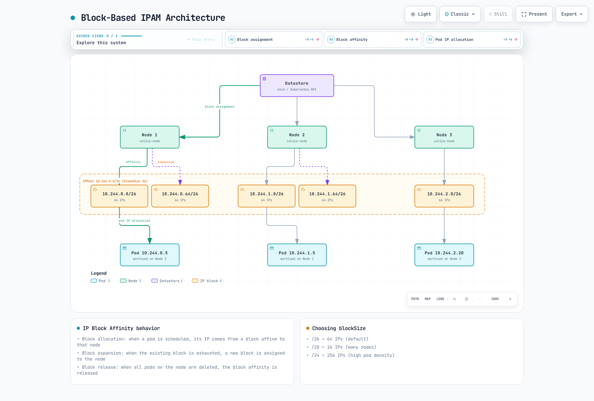
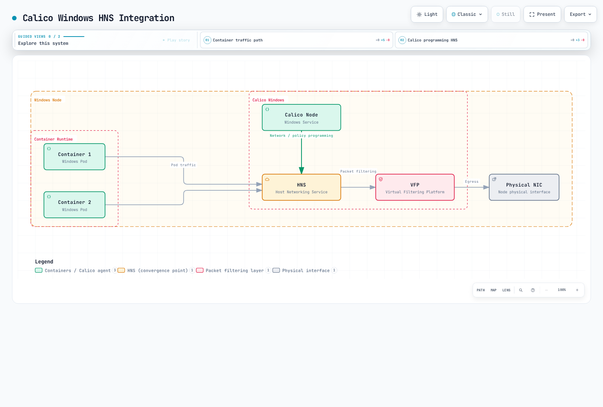
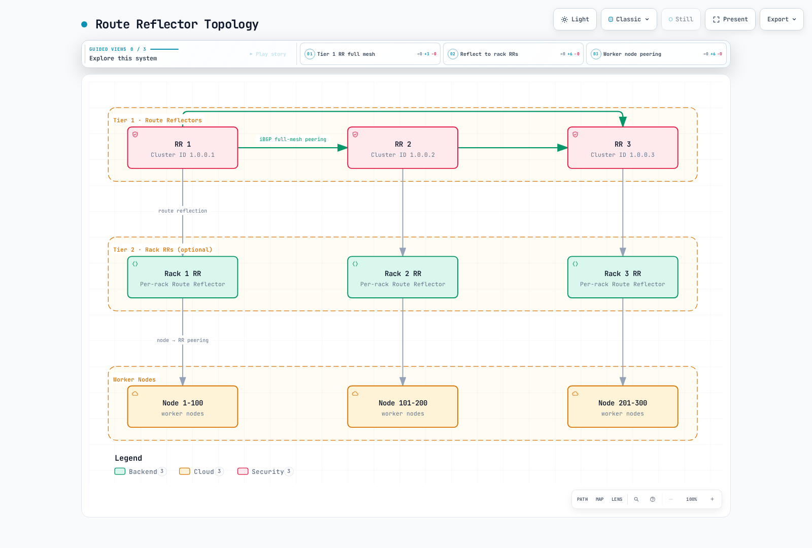

# 第 7 部分：Calico 高级主题

> **支持的版本**：Calico 3.32.2 / Kubernetes 1.34–1.36（测试范围）
> **最后更新**：September 12, 2026

## 概述

本章介绍生产环境中的 Calico 高级主题，包括深入了解 IPAM、WireGuard 加密、Egress Gateway、多集群联邦、Windows 容器支持以及大规模集群设计模式。

## 深入了解 IPAM

本节介绍 **Calico IPAM**。Host-local 和云提供商 IPAM 是不同的分配器；创建 Calico IPPool 并不会将另一个 CNI 切换为 Calico IPAM。

### 块、亲和性和分配限制

Calico 从与节点关联的块中分配地址。一个 IPv4 `/26` 包含 64 个地址，一个 IPv6 `/122` 也包含 64 个地址；但这并不保证在所有平台上都有 64 个可用的 Pod 地址。Windows 会为每个由 Calico 管理的块保留四个地址。



[🔍 查看交互式图表](https://www.atomai.click/kubernetes-docs/archmaps/en-networking-calico-07-advanced-topics-0.html)

> 该图展示的是一种分配模型，并不表示节点本地缓存能够消除所有数据存储写入。当某个块中的最后一个 Pod 消失时，该块的亲和性不一定会立即释放：隧道/VM 的分配以及协调/生命周期状态也会产生影响。

在正常的自动分配模式下，Calico 可以使用现有的亲和块、占用另一个符合条件的块，或在允许的情况下借用地址。`strictAffinity`、`autoAllocateBlocks`、全局/每请求块数限制、池选择和平台约束，都可能导致分配失败，即使另一个池中仍有空闲地址。


[🔍 查看交互式图表](https://www.atomai.click/kubernetes-docs/archmaps/en-networking-calico-07-advanced-topics-1.html)

> 这个简化流程假设池符合条件、启用了自动块分配、允许借用且没有限制上限。Windows 不支持借用；不要将此图理解为只有地址完全耗尽才会导致分配失败的无条件保证。

使用 `IPAMConfiguration/default` 检查全局设置。参考网页列出的默认块数上限为 20，但在没有配置的情况下，已发布的 **3.32.2 实现和公开 CRD 会将 `maxBlocksPerHost` 初始化为 0**。0 表示没有全局块数上限；每请求/平台限制仍然适用，现有集群则会保留其已配置的值。在已审查的 IPAM 配置路径中，设置正数全局上限时必须同时设置 `strictAffinity: true`。

### 在创建池之前选择块大小

IPv4 的默认值为 `/26`，IPv6 的默认值为 `/122`。支持的范围是 IPv4 `/20`–`/32` 和 IPv6 `/116`–`/128`。应根据预期地址需求、节点数量、路由聚合和分配开销来选择，而不是根据 GPU 带宽或“200 个节点就意味着 /28”这样的固定规则来决定。

```yaml
# Fresh-pool example; do not apply over an existing pool or overlapping pools.
apiVersion: projectcalico.org/v3
kind: IPPool
metadata:
  name: demo-ipv4-pool
spec:
  cidr: 10.244.0.0/16
  blockSize: 26
  ipipMode: Never
  vxlanMode: Always
  natOutgoing: true
  nodeSelector: all()
```

`blockSize` 和池 CIDR 不能原地更改。新建池/迁移必须保留实际集群的路由、Service/节点 CIDR 边界和工作负载分配计划；请参阅[网络模式](03-networking-modes.md)。不要让此聚合池与下方的子池示例重叠。

### Host-Local IPAM

Host-local 使用节点本地分配状态以及 Kubernetes 提供的每节点 PodCIDR 配置。Operator 通过 **`spec.cni.ipam.type: HostLocal`** 选择此模式：

```yaml
# Installation fragment: preserve other settings through the configuration owner.
apiVersion: operator.tigera.io/v1
kind: Installation
metadata:
  name: default
spec:
  cni:
    type: Calico
    ipam:
      type: HostLocal
```

不存在 `calicoNetwork.hostLocalIPAMEnabled` 开关。Kubernetes 控制器/网络设置必须已经提供有效且互不相同的节点 PodCIDR；手动修补现有节点并不是 IPAM 迁移流程。不要假定两种分配器之间存在通用的立即/延迟释放行为或可扩展性排名。

### 多个池和显式请求

使用互不重叠且用途有据可查的池。第三个示例仅供手动使用，这样通用工作负载就不会自动消耗非 SNAT 地址范围：

```yaml
# Alternative to demo-ipv4-pool; these sub-pools must not overlap another pool.
apiVersion: projectcalico.org/v3
kind: IPPool
metadata:
  name: production-pool
spec:
  cidr: 10.244.0.0/18
  blockSize: 26
  vxlanMode: Always
  natOutgoing: true
  nodeSelector: node-type == 'production'
---
apiVersion: projectcalico.org/v3
kind: IPPool
metadata:
  name: development-pool
spec:
  cidr: 10.244.64.0/18
  blockSize: 28
  vxlanMode: Always
  natOutgoing: true
  nodeSelector: node-type == 'development'
---
apiVersion: projectcalico.org/v3
kind: IPPool
metadata:
  name: routed-workloads-pool
spec:
  cidr: 10.244.128.0/18
  blockSize: 26
  ipipMode: Never
  vxlanMode: Never
  natOutgoing: false
  assignmentMode: Manual
  allowedUses: [Workload]
```

`natOutgoing: false` 需要可用的外部返回路由，且后续仍可能经过上游 NAT。它不会创建 egress gateway 或稳定的每个命名空间 SNAT 地址。对于 LoadBalancer 分配，请使用 [BGP 指南](04-bgp-deep-dive.md)中单独介绍的 `allowedUses: [LoadBalancer]` 流程。

以下 Pod 需要已准备好的命名空间、匹配的节点标签，以及用经过审核的工作负载镜像替换占位符：

```yaml
apiVersion: v1
kind: Pod
metadata:
  name: production-app
  namespace: calico-demo
  annotations:
    cni.projectcalico.org/ipv4pools: '["production-pool"]'
spec:
  nodeSelector:
    node-type: production
  containers:
    - name: app
      image: registry.example.com/team/app:approved
```

该注解用于请求 IP 池；`nodeSelector` 用于调度 Pod。在已审查的 Calico IPAM 代码中，为兼容性考虑，显式池请求会绕过池的节点/命名空间选择器，因此这些选择器**不能作为授权边界**。已禁用或不存在的池仍会导致失败。命名空间注解可以为 Pod 提供默认值，但这不会让池选择变成网络策略。

### IPv6 和双栈

Kubernetes 集群、CNI/IPAM、节点地址和底层网络必须已经支持所选 IP 协议族。仅添加池或设置 Felix 标志并不能转换集群的 IP 协议族配置。

```yaml
# A separate fresh dual-stack example.
apiVersion: projectcalico.org/v3
kind: IPPool
metadata:
  name: dual-ipv4-pool
spec:
  cidr: 10.244.0.0/16
  blockSize: 26
  vxlanMode: Always
  natOutgoing: true
---
apiVersion: projectcalico.org/v3
kind: IPPool
metadata:
  name: dual-ipv6-pool
spec:
  cidr: fd00:10:244::/48
  blockSize: 122
  ipipMode: Never
  vxlanMode: Always
  natOutgoing: false
```

兼容的 Linux 数据平面支持 IPv6 VXLAN；不支持 IPv6 IP-in-IP。上面的 ULA 地址范围不会仅仅因为使用了 IPv6 就变成全局可路由地址。`natOutgoing: false` 需要合适的返回路由或其他经过明确设计的出口路径。

节点地址自动检测应配置在 Operator 中（或相应的安装环境中），而不是添加虚构的 Felix 字段：

```yaml
# Operator configuration fragment, not a replacement for the existing Installation.
apiVersion: operator.tigera.io/v1
kind: Installation
metadata:
  name: default
spec:
  calicoNetwork:
    nodeAddressAutodetectionV4:
      kubernetes: NodeInternalIP
    nodeAddressAutodetectionV6:
      kubernetes: NodeInternalIP
```

Felix 的 `ipv6Support` 字段是布尔值，不是 `Enabled`。它控制 Felix 的处理行为，不能替代完整的双栈前提条件。

### 在释放地址之前调查耗尽问题

```bash
kubectl get ipamconfigurations.projectcalico.org default -o yaml
calicoctl ipam show
calicoctl ipam show --show-blocks
calicoctl ipam check --show-problem-ips -o ipam-report.json
```

检查池的适用性、预留、亲和性、每主机限制以及实际的工作负载/隧道/VM 归属。不要仅仅因为示例命令将某个地址称为孤立地址，就释放该地址。`calicoctl ipam release --block` 不是经过审查且受支持的 CLI 选项。

释放工具支持 `--from-report`，并可合并多个报告；其中至少一个报告必须是最新的，且基于报告的清理会携带分配序列信息。验证报告中的分配后，按照对应版本的恢复流程执行。不要将 `--force`、直接删除 IPAMBlock/BlockAffinity 或随意释放单个 IP 作为通用的耗尽问题解决方案。

## 检查节点亲和的 CIDR 块

`BlockAffinity` 由 Calico IPAM 管理，公开状态、节点、CIDR、删除状态和亲和类型。它不同于 `Node.spec.podCIDR`，并且当存在借用或迁移中的地址时，它并不能完整反映每条主机路由。

```bash
kubectl get blockaffinities.projectcalico.org \
  -o custom-columns='NAME:.metadata.name,CIDR:.spec.cidr,NODE:.spec.node,STATE:.spec.state,DELETED:.spec.deleted,TYPE:.spec.type'
kubectl get ippools.projectcalico.org \
  -o custom-columns='NAME:.metadata.name,CIDR:.spec.cidr,BLOCK_SIZE:.spec.blockSize'

# Review active host affinities; exclude deletion states and virtual affinities.
kubectl get blockaffinities.projectcalico.org -o json | jq -r \
  '.items[] | select(.spec.state == "confirmed" and .spec.deleted != true and ((.spec.type // "") == "" or .spec.type == "host")) | [.spec.cidr, .spec.node] | @tsv'
```

这些是资源清单输出，不是可以直接执行的 `ip route add` 命令。配置路由还需要实际的节点下一跳、当前分配状态、池导出/封装规则以及任何更具体的路由。不要假定占位节点 IP 或所有亲和记录都能组成有效的静态路由方案。

对于 **EKS Hybrid Nodes**，[专用 CNI 指南](https://docs.aws.amazon.com/eks/latest/userguide/hybrid-nodes-cni.html)介绍了 AWS 维护的 Cilium 构建版本，并将 Calico 示例迁至 Hybrid Examples 仓库。AWS 的[通用备用 CNI 页面](https://docs.aws.amazon.com/eks/latest/userguide/alternate-cni-plugins.html)仍然介绍了对 Hybrid Nodes 的核心 Cilium/Calico 支持。这些页面没有提供前后一致且带版本信息的 Calico 支持矩阵；仅迁移示例并不能证明支持已经终止。请确认计划部署所用的确切发行版、功能和支持责任方。本节介绍 Calico IPAM 资源清单，不是 Hybrid 安装指南。

## WireGuard 加密

WireGuard 可保护**具备相应能力且已配置的节点之间**的受支持流量。它不是应用到应用的 TLS，同一节点上的 Pod 流量也不会经过该节点间隧道。涉及不支持 WireGuard 的节点的流量可能仍未加密。在将加密视为已满足的要求之前，请检查实际的 CNI、IP 协议族以及工作负载/主机流量路径。


[🔍 查看交互式图表](https://www.atomai.click/kubernetes-docs/archmaps/en-networking-calico-07-advanced-topics-2.html)

> 图中的“明文”表示本地链路未受 WireGuard 隧道保护；应用本身仍可独立使用 TLS。示例展示的是默认 IPv4 WireGuard 端口 51820。IPv6 有单独的接口/端口设置。

### 仅启用所需的 IP 协议族

```yaml
# Example for an already compatible dual-stack Linux deployment.
apiVersion: projectcalico.org/v3
kind: FelixConfiguration
metadata:
  name: default
spec:
  wireguardEnabled: true
  wireguardEnabledV6: true
```

对 IPv4 使用 `wireguardEnabled`，对已启用的 IPv6 路径使用 `wireguardEnabledV6`；不要仅仅因为存在该字段就启用 IPv6。通过配置所有者保留其他 Felix 设置，并验证两端的内核支持情况。不存在 `WireguardCrossSubnet` 这样的 Operator IPPool 封装值。

除非实际底层网络/封装路径需要覆盖设置，否则应保留 MTU 自动检测。对于 1500 字节的 IPv4 底层网络，WireGuard 的 60 字节开销意味着 MTU 建议值为 1440；IPv6 开销和平台特定路径则有所不同。[MTU 讨论](03-networking-modes.md)解释了为什么不能盲目地将其他封装路径的开销相加。

`wireguardHostEncryptionEnabled` 涉及受支持的**节点间、由主机发起/主机网络**流量，而不是用于加密本地主机到 Pod 的链路。请参阅平台支持的流量矩阵，而不要将其视为通用开关。

### 密钥、保活和验证

Calico 管理节点密钥，并为对等节点发布公钥信息。WireGuard 协议会在握手期间派生新的会话密钥；这与管理员制定的节点身份轮换策略不同。

持久保活可在空闲期间保持 NAT/防火墙状态。WireGuard 示例中常见的 25 **秒**间隔并不是密钥轮换间隔。在已审查的 Open Source 架构中，`wireguardPersistentKeepAlive` 和 `wireguardPersistentKeepalive` 都不是受支持的 Felix 字段。

```bash
# On the intended node with wireguard-tools available:
WIREGUARD_INTERFACE=wireguard.cali
wg show "$WIREGUARD_INTERFACE" public-key
wg show "$WIREGUARD_INTERFACE" latest-handshakes
wg show "$WIREGUARD_INTERFACE" endpoints
wg show "$WIREGUARD_INTERFACE" transfer
```

```bash
# Kubernetes datastore: public identity information only.
kubectl get nodes -o json | jq -r \
  '.items[] | [.metadata.name, (.metadata.annotations["projectcalico.org/WireguardPublicKey"] // "-"), (.metadata.annotations["projectcalico.org/WireguardPublicKeyV6"] // "-")] | @tsv'
```

针对所需的 IP 协议族选择实际接口。公钥、握手和字节计数器有助于诊断，但不能证明每个应用流量都使用了加密。请验证预期的流量路径和加密传输方式。`calicoctl node status` 不是 WireGuard 状态表，执行此检查也无需输出私钥。

### 保留的性能记录

早期的其他语言版本提供了不同且未经验证的数据。未提供测试日期、硬件、加速配置、软件版本或原始结果。应将这些数值作为历史报告值保留，而不是视为当前 Calico/WireGuard 性能保证。

**记录 A（早期英文指南）：**

| 指标 | WireGuard | IPsec (AES-GCM) |
| --- | --- | --- |
| 相对于基线的吞吐量变化 | −5 至 −10% | −15 至 −25% |
| 增加的延迟 | 0.1–0.3 ms | 0.5–1.0 ms |
| CPU 使用率变化 | +10–15% | +30–50% |


**记录 B（早期韩文指南）：**

| 指标 | WireGuard | IPsec (AES-GCM) |
| --- | --- | --- |
| 吞吐量占基线的百分比 | 95–98% | 85–90% |
| 相对于基线的延迟变化 | +5–10% | +15–25% |
| CPU 使用率的定性描述 | 中 | 高 |


记录 B 使用未加密状态作为 100% 的基线，并将未加密状态下的 CPU 使用率描述为低。百分比变化没有说明是百分点还是相对 CPU 变化。这些记录不能合并为同一次实验。

### WireGuard 与 IPsec 的权衡

WireGuard 采用刻意精简的加密设计；IPsec 则是一个包含多种实现、算法和密钥管理选项的框架。CPU 开销、数据包开销、硬件卸载、漫游和配置复杂度，都取决于这些选择以及实际测量的路径。未注明版本的源码行数不是安全性指标，而且已审查的 Open Source Felix 架构中没有 `ipsecEnabled` 字段。

对于 FIPS 要求，请比较所选产品当前的认证记录、版本和运行条件。

## Egress Gateway

Calico Enterprise 的 egress gateway 是一个为选定客户端执行 SNAT 的**中转 Pod**。它有自己的产品/平台要求；本章开头列出的 Open Source 基线不是 Enterprise 兼容性矩阵。

流量路径为：客户端出口策略 → 到 gateway Pod 的隧道 → gateway SNAT → gateway 出口策略 → 外部网络。NetworkPolicy Allow 不会重定向数据包，也不会执行 SNAT。`BGPConfiguration.serviceExternalIPs` 用于通告 Service 路由，而不是分配工作负载出口身份。

### 当前商业版配置形式

文档中的本地 Calico-CNI 路径要求使用受支持的 Enterprise 安装、预先准备命名空间/Pod 安全权限、可路由的出口地址以及 UDP 4790 连通性。不支持 GKE 和 Windows。AWS 和 Azure 有各自的流程；不要将此池直接用于云提供商 CNI 设置。

通过现有默认 Felix 配置所有者，统一启用 `egressIPSupport`，并设置为 `EnabledPerNamespace`，或在获得授权的情况下设置为 `EnabledPerNamespaceOrPerPod`。gateway 资源是 **`operator.tigera.io/v1` EgressGateway**。Operator 会管理其镜像和配置；不要虚构一个 `calico/egress-gateway` Deployment。

```yaml
# Calico Enterprise example, not an Open Source gateway installation.
apiVersion: projectcalico.org/v3
kind: IPPool
metadata:
  name: egress-demo-pool
spec:
  cidr: 203.0.113.0/28
  blockSize: 32
  nodeSelector: "!all()"
  natOutgoing: false
---
apiVersion: operator.tigera.io/v1
kind: EgressGateway
metadata:
  name: approved-egress
  namespace: calico-egress
spec:
  replicas: 2
  ipPools:
    - cidr: 203.0.113.0/28
  template:
    metadata:
      labels:
        egress-code: approved
    spec:
      nodeSelector:
        kubernetes.io/os: linux
---
apiVersion: v1
kind: Namespace
metadata:
  name: calico-demo
  annotations:
    egress.projectcalico.org/selector: egress-code == 'approved'
    egress.projectcalico.org/namespaceSelector: projectcalico.org/name == 'calico-egress'
```

请将文档示例 CIDR 替换为你控制的地址，并为实际网络配置封装/路由。`/32` 块可避免为每个 gateway 预留较大的地址块。`!all()` 可阻止通用自动分配；显式请求该池仍然可以使用它，因此必须控制注解权限。

两个副本需要两个可用 IP，并且需要合适的节点/故障域放置；仅有副本并不能保证可用性。由于 gateway 选择默认使用客户端所在的命名空间，因此命名空间选择器是必需的。

设置 `natOutgoing: false` 时，gateway Pod IP 会保留到 Calico NAT 阶段之后，但上游 NAT 仍可能更改它。启用 gateway 池 NAT 则可能暴露 gateway 节点 IP。请验证外部接收方实际观察到的源地址，并允许预期的地址集合。替换或升级 gateway 可能会中断现有连接。

### 策略和身份边界

客户端出口策略看到的是**外部目标地址**。允许客户端连接 gateway Pod IP 并不会路由或授权其原始外部流量。在 gateway 出口处，原始客户端身份/源端口信息已经经过转换。目标 CIDR/端口策略仍然有用，但不支持在该挂载点使用基于域名的策略。

高级 `EgressGatewayPolicy` 路由有自己的目标/gateway 选择方式和 `maxNextHops` 字段。它不是先前虚构的 `projectcalico.org/v3 EgressGateway` 上的 `maxGatewaysPerClient` 字段。

对于 Open Source，在合适的场景中应使用独立配置的应用代理或底层网络/云 NAT 方案，并单独控制允许的流量。没有引导配置/监听器/上游配置的 Envoy Pod 并不是可用的出口代理。稳定的源地址有助于配置外部允许列表；但它本身并不能证明符合 PCI DSS/HIPAA，也不能提供应用授权。

## 多集群连通性和联邦

应区分路由可达性、端点身份和 Service 发现。BGP 会交换路由，但不会分发 Kubernetes 策略或 DNS 记录。Typha 会在其部署范围内分发状态；它不是早期图中虚构的共享 Federation Controller 的主实例。

### Open Source 路由连通性

为每个集群准备互不重叠的地址、双向路由、可达的下一跳和策略。考虑 NAT 的影响：本地 Calico 池以外的远程 Pod CIDR 可能会被 `natOutgoing` 伪装，从而改变接收方观察到的源地址。应规划适当的排除项和路由，而不要假设 Pod 身份能够保留。

```yaml
# Receiving cluster only, after routing/source preservation is verified.
apiVersion: projectcalico.org/v3
kind: GlobalNetworkPolicy
metadata:
  name: default.remote-client-access
spec:
  order: 100
  namespaceSelector: kubernetes.io/metadata.name == 'calico-demo'
  selector: app == 'shared-service'
  types: [Ingress]
  ingress:
    - action: Allow
      protocol: TCP
      source:
        nets: [10.245.0.0/16]
      destination:
        ports: [8080]
```

此策略仅选择本地接收端点。`GlobalNetworkPolicy` 表示集群/数据存储范围的作用域，并不意味着它会自动应用于远程集群。请验证发送方出口、接收方入口以及实际源地址。策略分发需要明确管理的流程；它不会因 BGP 或 Typha 而自动发生。

### Enterprise 联邦

当前 Enterprise 指南区分了以下能力：

| 能力 | 功能 |
| --- | --- |
| 联邦端点身份 | 将远程工作负载/主机端点信息用作本地策略计算的输入 |
| Federated Services Controller | 通过远程 Kubernetes API 读取 Service/端点信息，并维护选定的本地联邦 Service |
| 多集群网络 | 提供受支持的覆盖网络，或与单独配置的可路由 Pod 网络配合使用 |

联邦端点身份**不会复制网络策略**。远程策略不会自动在本地执行；每个集群的策略仍在本地应用。可路由的 Pod IP 和源地址保留是身份以及有用的远程 Service 端点的前提条件。

商业版联邦 Service 使用注解，按标签选择**后端 Service**，而不是 Pod：

```yaml
# Commercial controller integration; backing Services already exist.
apiVersion: v1
kind: Service
metadata:
  name: catalog-federated
  namespace: calico-demo
  annotations:
    federation.tigera.io/serviceSelector: app == 'catalog'
spec:
  type: ClusterIP
  ports:
    - name: http
      protocol: TCP
      port: 8080
```

选中的集群中，后端 Service 必须位于同名命名空间，并且公开名称和协议都匹配的端口。联邦 Service 不设置 `spec.selector`；其 `targetPort` 不是后端端口选择器。不要手动管理其端点记录。

远程 API 凭据、控制器安装、Kubernetes 版本/EndpointSlice 兼容性和网络可达性都是单独的前提条件。此示例并未建立这些条件，也不能证明跨集群故障转移有效。请遵循产品当前的联邦流程并测试真实路径；不要将指南中 2018 年的历史 Endpoints 输出复制为当前部署清单。

## Windows 容器支持

Calico 通过 **HNS** 支持 Windows，但存在大量功能/平台限制。控制组件和 Typha 仍需要 Linux 节点。混合集群并不能将 Calico eBPF 数据平面与 Windows 组合使用。

### 版本和平台交集

以 Kubernetes 1.36 为例，它处于 Calico 3.32 的测试范围内；Windows Server 2022 同时列在 Kubernetes 和 Calico 支持范围中。Kubernetes 1.36 还列出了 Server 2025，而 Calico 要求页面仍包含较早的 Server 1809 和 Server 2022 条目。不要假定旧操作系统或每个新支持的 Kubernetes 操作系统都已通过所选 Calico/提供商组合的验证。主机和容器基础镜像的操作系统/版本必须匹配，并使用兼容且受维护的运行时/kubelet/kube-proxy 版本。

Kubernetes Windows Pod 使用进程隔离，而不是 Hyper-V 容器隔离。Calico 当前记录的安装方式使用由 Operator 管理的 HostProcess 容器。旧版 3.29 ZIP/手动服务示例以及旧版说明中的运行时/kubelet 版本不是当前安装指南。

| 领域 | 当前 Calico Windows 限制 |
| --- | --- |
| 网络 | 不带 CrossSubnet 的 IPv4 VXLAN，或受支持的非覆盖 BGP；不支持 IPIP |
| VXLAN | UDP 4789；本指南不支持 Windows CrossSubnet/自定义 VXLAN MTU |
| IPAM | 不支持借用；每个由 Calico 管理的块保留四个地址，因此 `/26` 可提供 60 个 Pod 地址；还需考虑 Windows kube-proxy 的单块限制 |
| 路由 | Windows 可以使用受支持的 BGP 对等连接，但不能充当路由反射器，也不能通告 Service IP |
| 此处不支持 | IPv6/双栈、eBPF、WireGuard、主机端点策略、Istio 应用层策略 |
| 托管平台 | EKS Windows 使用 VPC CNI；AKS 使用 Azure CNI；GKE 不能与自我管理的 GCE 集群互换 |

### Operator 配置

先配置兼容的 Windows 节点，并确认 Linux 容量足以满足控制器/Typha HA 配置。Windows 指南要求该配置至少使用三个 Linux 工作节点。使用 Operator 命名空间中的 `kubernetes-services-endpoint` 准备稳定的直连 API 端点，并使用实际的 Service CIDR，而不要假定为 kubeadm 默认值。

以下是**自我管理 Calico-CNI VXLAN 备选方案**的配置形式。不要用此示例替换现有安装的池列表，也不要将它作为 EKS/Azure CNI 配置：

```yaml
# Self-managed Calico-CNI IPv4 VXLAN target configuration; preserve existing pools/settings.
apiVersion: operator.tigera.io/v1
kind: Installation
metadata:
  name: default
spec:
  serviceCIDRs:
    - 10.96.0.0/12
  cni:
    type: Calico
  calicoNetwork:
    linuxDataplane: Iptables
    windowsDataplane: HNS
    bgp: Disabled
    ipPools:
      - cidr: 10.244.0.0/16
        blockSize: 26
        encapsulation: VXLAN
        natOutgoing: Enabled
```

有效字段是 `spec.calicoNetwork.windowsDataplane`，不是根级别的 `spec.windowsDataplane` 或 `windowsIPAM`。此配置中的 VXLAN 使用 `VXLAN`，而不是 `VXLANCrossSubnet`，并禁用 BGP。非覆盖 BGP 备选方案使用不同配置；不要将 Linux IPIP 池与 Windows 对等节点混用。

```bash
kubectl get ipamconfigurations.projectcalico.org default -o yaml
# Required for the documented mixed Windows/Calico-IPAM installation:
kubectl patch ipamconfigurations.projectcalico.org default --type=merge \
  -p '{"spec":{"strictAffinity":true}}'
```

文档所述的 Calico-IPAM Windows 混合安装要求启用严格亲和性。在为 Pod 配置网络之前，应先规划块大小；之后不支持更改。确保 Windows 上存在版本/管理方合适的 kube-proxy。将旧版手动安装迁移到 HostProcess 可能会移除旧的 Calico 服务并替换文件，因此应先盘点并保留其配置。

```bash
kubectl get nodes -l kubernetes.io/os=windows -o wide
kubectl get pods -n calico-system -l k8s-app=calico-node-windows -o wide
kubectl logs -n calico-system -l k8s-app=calico-node-windows -c felix --tail=100
```

这只是配置审查，不是 Windows 配置或故障转移测试。请在两种操作系统上测试 Pod/Service 流量和策略；Windows NAT 更改可能仅适用于新配置网络的 Pod，而且某些 HNS 策略更新可能会重置连接。

### HNS 和数据包路径



[🔍 查看交互式图表](https://www.atomai.click/kubernetes-docs/archmaps/en-networking-calico-07-advanced-topics-7.html)

> HNS/HCS 管理网络和端点；虚拟交换机/VFP 机制负责执行数据路径。数据包不会经过 Calico 用户空间服务作为转发代理。图中的“Windows Service”方框表示一个逻辑代理：当前 Operator 安装会在 HostProcess 容器中运行这些组件。

## Calico 产品版本

应根据当前版本和功能需求选择，而不要将所有可观测性/策略能力都视为 Enterprise 独有。

| 能力 | Open Source 3.32 基线 | 商业版区别 |
| --- | --- | --- |
| 网络和策略 | Calico 网络、全局/命名空间策略、多个受支持的数据平面 | 其他产品/平台集成 |
| 策略层级/RBAC | 可用，包括支持 Calico 层级的授权 | 产品管理工作流和其他控制功能 |
| HTTP 策略 | 可通过配置的 Istio/Dikastes 集成使用 | 检查产品特定的执行路径 |
| 流量可视化/UI | Goldmane/Whisker 和分阶段策略工作流均可用 | 其他分析、报告和管理功能 |
| DNS 域名策略 | 已审查的 OSS CRD 中不包含 `domains` | 文档所述的商业版 DNS 策略 |
| 出口/联邦 | 可采用独立的路由/代理设计；没有虚构的 OSS gateway/联邦 CR | 受支持的 egress gateway、远程身份和联邦 Service |
| 支持 | 社区/项目支持 | 具体条款取决于购买的支持服务 |

Calico Cloud 是托管 SaaS 产品，Calico Enterprise 是自我管理产品。Cloud 文档还介绍了适用于单集群可观测性/策略管理的 Free Tier。请查看当前功能/保留期限/支持条款；不要根据无来源的对比表推断存在通用的 24/7 SLA、每节点定价、完全相同的数据平面功能集或内部 SaaS 数据流。

## 大规模集群设计

应根据实测的端点数量、策略复杂度、更新变化量、客户端连接数、CPU/RSS 和收敛目标进行设计。仅凭节点数量表无法确定生产容量。

### Operator Typha 扩展

已审查的 Tigera Operator **1.42.6** 对其计数节点使用以下计算方式：

```text
N <= 2: 1 replica
N <= 4: 2 replicas
otherwise: max(3, floor(N / 200) + 2)

100 nodes -> 3
500 nodes -> 4
1,000 nodes -> 7
2,000 nodes -> 12
5,000 nodes -> 27
```

这是实现中自动计算出的副本目标，并不是证明“每个 Typha 支持 200 个节点”的基准测试。节点计数逻辑会排除明确标记为不可调度的节点以及相关的 AKS 虚拟节点情况；实际的 Linux 节点放置/容量也必须能够满足计算结果。

Typha 会将数据存储更新扇出到 Felix；它不会汇总数据存储写入，也不会充当跨集群联邦控制器。请保留 Operator 的服务账号、RBAC、TLS 挂载、放置和生命周期行为。

### 支持的覆盖项

当前的 `typhaDeployment` 覆盖项不公开 `spec.replicas` 或任意容器 `env`。不要仅仅为了更改副本数量，就用不完整的手动示例替换由 Operator 管理的 Deployment。应通过配置所有者使用允许的覆盖字段：

```yaml
# Override shape only: these illustrative requests are not a capacity recommendation.
apiVersion: operator.tigera.io/v1
kind: Installation
metadata:
  name: default
spec:
  typhaDeployment:
    spec:
      template:
        spec:
          containers:
            - name: calico-typha
              resources:
                requests:
                  cpu: 500m
                  memory: 512Mi
```

应根据观测到的使用情况和故障域容量选择实际请求值；上面的值仅用于展示字段结构。请一并检查限制、反亲和性和拓扑约束，因为不可能实现的放置规则可能导致副本一直处于 Pending 状态。

```bash
kubectl get installation.operator.tigera.io default -o yaml
kubectl -n calico-system get deployment calico-typha -o yaml
# Requires a working resource-metrics API:
kubectl -n calico-system top pods -l k8s-app=calico-typha
```

### 路由反射器



[🔍 查看交互式图表](https://www.atomai.click/kubernetes-docs/archmaps/en-networking-calico-07-advanced-topics-6.html)

> 此图展示的是层级结构，并非完整的弹性部署：每个机架只显示了一个 RR/上行链路，标签也不是容量保证。集群 ID 和反射关系必须符合预期的层级结构。

请遵循维护中的 [BGP 迁移流程](04-bgp-deep-dive.md)：准备合适的 RR 节点，使用保留字段的节点注解，建立明确的会话/路由，验证实际流量，然后再移除旧的全网状结构。仅凭此图无法提供所需的冗余、下一跳或策略。

### Felix 调优有特定效果

| 设置领域 | 含义 |
| --- | --- |
| 路由/iptables 刷新间隔 | 重新检查本地数据平面状态；不是通用的 Kubernetes API 轮询间隔 |
| `iptablesBackend: NFT` | 选择 iptables-nft 前端；与 Calico 原生 `Nftables` 数据平面不同 |
| 日志/流量日志 | 观察受支持的日志管道及其成本；不要向 OSS 添加仅限商业版的文件聚合字段 |
| 健康检查超时 | 控制故障/就绪检测；延长超时不会加快编程速度 |
| 标记、路由表范围、故障保护机制 | 会影响共享的主机网络/控制连通性；不是通用的内存/CPU 调优参数 |
| eBPF/DSR | 需要满足平台前提条件的独立数据平面/网络路径变更，不是容量预设 |

`datastoreType`、`typhaAddr` 和 `typhaK8sServiceName` 不是应添加到已审查 FelixConfiguration API 的字段。早期配置中使用的旧版 `...Secs`/`...Millis` 字段名称也不是当前 API 字段。更改由所有者管理的设置之前，请阅读当前资源和参考文档。

### 数据存储选择

Kubernetes 数据存储可避免运维单独的 Calico etcd 服务，并且是当前 eBPF 数据平面的必需项。对于受支持的非 Kubernetes 安装或单独设计的安装，直接使用 etcd 可能是合适的，但“超过 5,000 个节点就必须使用 etcd”和“etcd 总是更快”都不是有依据的结论。

除非部署会使用名为 `etcd-config` 的 ConfigMap，否则它不会调整 etcd 进程的设置。它也无法调整云服务的托管控制平面数据存储。直接使用 etcd 需要单独规划拓扑、TLS/身份验证、备份、恢复和容量。

etcd 调优指南会根据网络和磁盘延迟调整心跳/选举设置。不要在未测量实际集群的情况下照搬配额/快照/超时预设。请将控制平面配置与 Calico 数据平面刷新间隔分开处理。

## 扩展更改前的验证

1. 建立当前分配、路由、策略和客户端连接的基线。
2. 通过相应所有者更改目标设置，并保留无关字段。
3. 观察资源使用情况、协调延迟、就绪状态以及实际的正向/负向流量路径。
4. 测试计划中的组件/节点/故障域丢失情况，并测试回滚。

此前给出的 CPU/内存/节点数量范围未经验证，只是规划估算，并非实测容量结果。本次审查期间并未执行大规模集群、Windows、gateway 或数据存储部署。

## 参考资料

- [Calico IPPool API](https://docs.tigera.io/calico/latest/reference/resources/ippool)
- [IPAMConfiguration API](https://docs.tigera.io/calico/latest/reference/resources/ipamconfig)
- [BlockAffinity API](https://docs.tigera.io/calico/latest/reference/resources/blockaffinity)
- [已发布的 IPAM 默认值和分配逻辑](https://raw.githubusercontent.com/projectcalico/calico/v3.32.2/libcalico-go/lib/ipam/ipam.go)
- [当前 AWS Hybrid Nodes CNI 支持](https://docs.aws.amazon.com/eks/latest/userguide/hybrid-nodes-cni.html)
- [WireGuard 协议](https://www.wireguard.com/protocol/)
- [WireGuard 保活语义](https://www.wireguard.com/quickstart/)
- [Calico 加密](https://docs.tigera.io/calico/latest/network-policy/encrypt-cluster-pod-traffic)
- [本地 Enterprise Egress Gateway](https://docs.tigera.io/calico-enterprise/latest/networking/egress/egress-gateway-on-prem)
- [AWS 上的 Enterprise Egress Gateway](https://docs.tigera.io/calico-enterprise/latest/networking/egress/egress-gateway-aws)
- [Enterprise 联邦范围](https://docs.tigera.io/calico-enterprise/latest/multicluster/federation/overview)
- [Federated Services Controller](https://docs.tigera.io/calico-enterprise/latest/multicluster/federation/services-controller)
- [Calico Windows 要求](https://docs.tigera.io/calico/latest/getting-started/kubernetes/windows-calico/requirements)
- [Calico Windows Operator 工作流](https://docs.tigera.io/calico/latest/getting-started/kubernetes/windows-calico/operator)
- [Calico Windows 限制](https://docs.tigera.io/calico/latest/getting-started/kubernetes/windows-calico/limitations)
- [Windows 网络架构](https://learn.microsoft.com/en-us/virtualization/windowscontainers/container-networking/architecture)
- [Kubernetes 1.36 Windows 文档源文件](https://raw.githubusercontent.com/kubernetes/website/release-1.36/content/en/docs/concepts/windows/intro.md)
- [当前 Calico 产品概述](https://docs.tigera.io/calico-cloud/about)
- [Operator 1.42.6 扩展函数](https://raw.githubusercontent.com/tigera/operator/v1.42.6/pkg/common/autoscale.go)
- [Operator 1.42.6 Typha 自动扩缩器](https://raw.githubusercontent.com/tigera/operator/v1.42.6/pkg/controller/installation/typha_autoscaler.go)
- [Operator API](https://docs.tigera.io/calico/latest/reference/installation/api)
- [Felix API](https://docs.tigera.io/calico/latest/reference/resources/felixconfig)
- [组件指标](https://docs.tigera.io/calico/latest/operations/monitor/monitor-component-metrics)
- [etcd 调优](https://etcd.io/docs/v3.6/tuning/)
- [etcd 配置](https://etcd.io/docs/v3.6/op-guide/configuration/)

## 测验

[高级主题测验](../../quizzes/networking/calico/07-advanced-topics-quiz.md)
