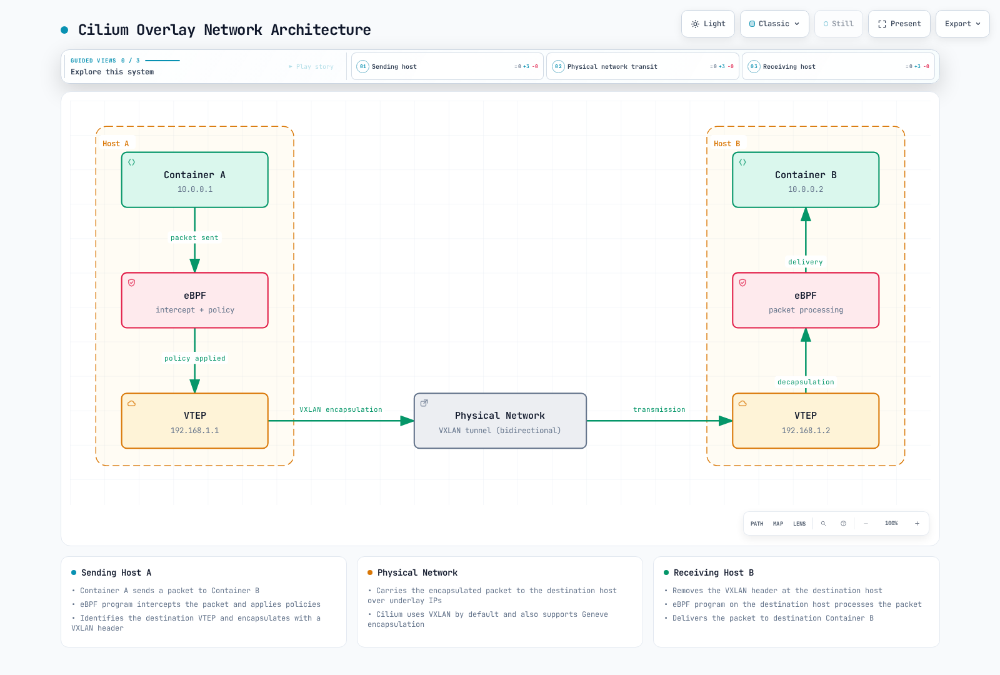

# 网络模型与 VXLAN

> **审查基线**：Cilium 1.20.2，已测试 Kubernetes 1.33–1.36、Linux 5.10+ 或已记录的等效回移版本，例如 RHEL 8.10 的 4.18 内核。
> **最后更新**：October 15, 2026

## 实验环境设置

使用[安装指南](README.md)准备一个可随时丢弃的集群以及与架构匹配的 Cilium CLI。将 kubectl 保持在 API server 的一个次要版本范围内；“v1.31 or higher”并不是兼容性规则。

下面的通用模式示例至少需要两个可调度的 Linux 节点、没有冲突的 Pod CNI、正常工作的 kube-proxy，以及不重叠的 Pod CIDR。原生路由示例还要求节点共享一个 L2 网段。这些并非 EKS ENI、GKE Dataplane V2、AKS 托管 Cilium 或原地 CNI 迁移方案。

### 网络分析工具

通过分析主机支持的软件包源安装 tcpdump/Wireshark。节点抓包必须在相关节点/网络命名空间上运行，而不仅仅是在运行 kubectl 的笔记本电脑上。agent monitor 报告已发出的 BPF 事件；它并非完整的数据包捕获工具。

```bash
kubectl config current-context
kubectl -n kube-system get pods -l k8s-app=cilium -o wide
export CILIUM_POD=cilium-REPLACE-WITH-AGENT-ON-TARGET-NODE
kubectl -n kube-system exec "$CILIUM_POD" -c cilium-agent -- \
  cilium-dbg monitor --type trace -v
```

对于下面显式的 VXLAN 配置文件，在相关 worker 上捕获一个有界样本：

```bash
sudo tcpdump -nn -i any -c 50 'udp port 8472'
```

如果配置的隧道端口不同，请使用该端口。生成跨节点 Pod 流量：同节点流量无需穿过 overlay。空的抓包结果可能表示节点、接口、端口或流量路径错误，而非网络故障。

## 容器网络模型比较

主机命名空间、桥接和节点间传输描述网络的不同方面，并且可以共存。它们并非通用的性能或安全性排名。

| 模型 | 机制 | 重要权衡 |
|---|---|---|
| 主机网络 | Pod 共享节点网络命名空间 | 端口冲突和更弱的网络命名空间隔离；并不必然带来最佳应用程序性能 |
| 桥接 | 虚拟 L2 桥接接口 | 节点间通信仍需要路由/传输；Cilium 不要求每个 endpoint 都使用 Linux bridge |
| Overlay | 封装流量通过 IP underlay 传输 | 额外的报头和处理开销，但 underlay 无需路由每个 Pod 前缀 |
| 原生/underlay 路由 | 网络可以路由工作负载地址 | 需要正确的转发/返回路由和地址规划；不会固有地提供或移除 policy/encryption |

### Cilium 网络模式

Cilium 的 `routingMode` 为 `tunnel` 或 `native`。VXLAN/Geneve 选择隧道协议。云 IPAM 集成是另一个配置维度，通常与原生 datapath 配对；它们不是第三个 `routingMode` 值。BGP 是路由通告机制，而不是独立的数据包转发模式。

## VXLAN 技术深入解析

VXLAN 通过 IP 网络在 UDP 中承载内部 Ethernet 帧。VTEP 封装/解封装流量；24 位 VNI 提供理论上 2^24 个标识符的空间。这并不承诺 Kubernetes 部署支持 1,600 万个租户。

标准化的 VXLAN 目标端口为 UDP 4789。**Cilium 默认将 UDP 8472 用于 VXLAN，并将 UDP 6081 用于 Geneve；两者均可配置。**Cilium 可以在封装中携带安全身份元数据，因此请勿将通用 VXLAN 网段数量等同于 Cilium 租户/policy 边界。

### VXLAN 数据包结构

```text
Outer Ethernet
  Outer IP (IPv4 or IPv6)
    Outer UDP (Cilium VXLAN default destination 8472; standard 4789)
      VXLAN header (8 bytes, including VNI)
        Inner Ethernet
          Inner IP packet and transport/application payload
```

IP 承载 UDP；外部 IP 报头本身并不承载在外部 UDP 报头内。VXLAN 分段不提供加密、完整性或自动 NetworkPolicy 隔离。应适当地限制 underlay 路径，并单独配置 policy/encryption。

### MTU 预算

对于没有额外封装/选项的普通 VXLAN，内部 IP 预算的缩减为：

| Underlay IP family | Outer IP + UDP + VXLAN + inner Ethernet | 1,500-byte underlay IP MTU 的内部 IP 预算 |
|---|---|---|
| IPv4 | 20 + 8 + 8 + 14 = 50 bytes | 1,450 bytes |
| IPv6 | 40 + 8 + 8 + 14 = 70 bytes | 1,430 bytes |

外部 Ethernet 报头位于该 underlay IP MTU 之外。加密、Geneve 选项和其他路径可能改变预算。有效路由 MTU 和 Pod veth 的设备 MTU 不必相同。

在 Cilium 1.20.2 中，Helm **`MTU` 会覆盖底层网络 MTU**；然后 Cilium 会计算路由开销。`MTU: 0` 选择自动检测。将 `MTU: 1450` 视为“最终 Pod payload MTU”可能会再次减去隧道开销。本地接口检测也无法证明整个路径上的最小 MTU。

### VXLAN 与其他封装的比较

| 技术 | 载体 / 标识符 | 协议或端口 | 边界 |
|---|---|---|---|
| VXLAN | UDP 中的 Ethernet；24 位 VNI | UDP 4789 标准；Cilium 8472 默认 | 固定基础报头；非加密 |
| Geneve | 带可扩展选项的通用网络虚拟化；24 位 VNI | UDP 6081 | 选项长度会改变开销 |
| GRE | 通用封装；基础 GRE 没有 VXLAN 风格的 VNI | IP protocol 47，不是 TCP/UDP port 47 | 必须考虑可选扩展；“无限网络”不是已定义的容量 |
| NVGRE | Ethernet over GRE；GRE key 内的 24 位 VSID | IP protocol 47 | 不同的标识符/流语义；支持情况取决于实现 |

## Cilium 的 Overlay 网络

如果没有覆盖性的平台/配置文件设置，Cilium 使用带 VXLAN 的隧道路由。跨节点 Pod 传输需要可达的节点地址、允许的隧道 UDP 流量以及可用的 MTU。Overlay 不会解决重叠的 Pod 地址范围，也不会使断开连接的节点变为可达。有关数据包路径、隧道设备、MTU 预算和原生路由变体，请参阅[Overlay 与原生路由](09-overlay-native-routing.md)。



[🔍 查看交互式图表](https://www.atomai.click/kubernetes-docs/archmaps/en-networking-cilium-03-networking-2.html)

该图为概念性流程。其地址不是每节点 IPAM 分配计划；实际节点 Pod 块必须以无重叠的方式一致分配。Policy 在配置的位置应用，且源/目标 hook 可能不同。

1. Cilium 从 control-plane 和 datapath 状态识别远程 endpoint/node。
2. 源端封装相关 Pod 数据包，并使用 underlay 节点地址发送。
3. 目标端解封装并处理/交付内部数据包。
4. Datapath 事件、路由状态和抓包有助于定位故障；仅缺少一个事件并不能确定原因。

## 路由机制

### 封装

Underlay 仅需要节点/隧道路由，而非每个 Pod 前缀的路由。代价包括报头和处理开销。只有当整个路径支持所选 MTU 时，较大的帧才能降低相对开销。

### 原生路由

节点和 underlay 必须路由 Pod 地址，包括返回流量。路由可以来自云网络、路由器、静态配置或其他路由组件。启用原生模式不会自动启动 BGP 或通告每个 Pod CIDR。

`autoDirectNodeRoutes: true` 为共享 L2 网络的节点安装直接 PodCIDR 路由。对于多个 L2 网段，当独立运行的路由路径处理它们时，`directRoutingSkipUnreachable` 可以跳过不可达的直接路由。它不会回退到 overlay 隧道。

**不要将隧道路由与 `autoDirectNodeRoutes: true` 结合使用：Cilium 1.20.2 会在启动时明确拒绝此组合。**旧的“混合模式”方案无效。原生路由仍可与特定功能的封装共存，例如已配置的 Geneve DSR 路径；那是独立的 Service 功能。

Cilium BGP Control Plane 向 peer 通告已配置的 Pod/Service 前缀。它**不会对本地 datapath 进行编程**，且不得将其视为自动提供缺失集群内路由的组件。

## 性能优化技术

在比较模式前，应使用相同的协议、payload 大小、并发度、节点放置、policy、encryption 和 proxy 设置进行测量。移除一个封装报头并不保证更低的应用延迟。

- **Datapath：**socket load balancing、受支持的 XDP 加速和 DSR 适用于特定路径。它们不会因 VXLAN 或原生路由而自动启用。
- **连接跟踪：**Cilium BPF 连接跟踪和 Linux netfilter conntrack 是不同的状态机制。绕过 netfilter 路径并不意味着所有已建立流量都会停止使用 Cilium 连接状态。
- **Maps：**根据实际容量和内存压力调整 map 大小。LRU 驱逐对缓存很有用，但并非每个 map 的通用优化方案。
- **主机调优：**CPU/NUMA 放置、IRQ 分配/合并及队列配置可能有助于或损害特定工作负载。Huge pages 不是通用的 Cilium 加速开关；需要针对实际使用方和环境提供证据。

## 云提供商特定网络

| 环境 | 正确区分 |
|---|---|
| AWS ENI IPAM | Cilium 分配可由 VPC 路由的 ENI 地址，并且具有 operator IAM/API/subnet/instance-capacity 要求。ENI security groups 和 Cilium policy 相互补充；这并不自动等同于 AWS VPC CNI 的每 Pod branch-ENI 功能 |
| EKS 平台 | 普通 EC2 节点上的替代 CNI 有独立的支持责任。Fargate 和 EKS Auto Mode 不支持用此通用实验配置文件替换其 CNI。Hybrid Nodes 具有独立的受支持安装路径 |
| Google Cloud | 自行管理的上游 Cilium 可以使用 Kubernetes host-scope IPAM 和可路由的 alias range。托管的 GKE Dataplane V2 使用 Google 托管的 Cilium/`anetd`；不要在其上安装另一个上游 dataplane，也不要假定公开的功能完全相同 |
| Azure | Azure CNI Powered by Cilium 由 AKS 托管并使用委托的 IPAM。上游 Azure IPAM 面向自行管理的 Azure VM/VMSS 集群；AKS BYOCNI 是另一个明确选定的部署模型 |

并非每条 Cilium policy 都会自动创建云 firewall/security-group 配置。请先选择平台指南和支持模型。

## 实验：Cilium 网络模式配置和性能测试

### 在新准备的集群上选择一种模式

保存此通用文件，首先在 Pod CIDR 与节点、Service、VPC 或已连接网络范围重叠时替换它。使所选范围与 cluster/kube-proxy 配置以及原生配置文件的 `ipv4NativeRoutingCIDR` 保持一致；仅更改一个文件是不够的。`kubeProxyReplacement: false` 有意假定 kube-proxy 正常工作。这些是 Helm values，而不是要用 kubectl 应用的 ConfigMap。

**`lab-common.yaml`**

```yaml
kubeProxyReplacement: false
ipv4:
  enabled: true
ipv6:
  enabled: false
ipam:
  mode: cluster-pool
  operator:
    clusterPoolIPv4PodCIDRList:
    - 10.244.0.0/16
    clusterPoolIPv4MaskSize: 24
MTU: 0
hubble:
  enabled: true
  relay:
    enabled: true
  ui:
    enabled: true
```


请从以下模式文件中准确选择一个。应为比较使用独立的可随时丢弃集群，而非在运行中的集群上反复重新安装 CNI。

**`mode-vxlan.yaml`**

```yaml
routingMode: tunnel
tunnelProtocol: vxlan
tunnelPort: 8472
autoDirectNodeRoutes: false
```

**`mode-geneve.yaml`**

```yaml
routingMode: tunnel
tunnelProtocol: geneve
tunnelPort: 6081
autoDirectNodeRoutes: false
```

**`mode-native.yaml`**

```yaml
routingMode: native
ipv4NativeRoutingCIDR: 10.244.0.0/16
autoDirectNodeRoutes: true
```


对于 VXLAN 示例：

```bash
kubectl config current-context
cilium install --version 1.20.2 --values lab-common.yaml --values mode-vxlan.yaml
cilium status --wait
```

仅在其网络前提条件成立时，才改选 `mode-geneve.yaml` 或 `mode-native.yaml`。不要应用已过时的 `tunnel: vxlan`、`ipv4-range` 或 `ipv4-service-range` ConfigMap 示例；请通过受支持的 Helm 字段配置 IPAM。

### 网络性能测试

使用 CLI 维护的性能工作负载，而非假定不相关的 manifest 会创建 `netperf-client` 和 `netperf-server`。在准备好的可随时丢弃集群上：

```bash
cilium connectivity perf --test-namespace cilium-net-perf \
  --namespace-labels docs-audit-lab=cilium-networking-03 \
  --duration 10s --samples 2 --crr --udp \
  --host-net=false --pod-net=true --same-node=true --other-node=true \
  --report-dir ./cilium-net-perf-results
```

持续时间适用于每个测试用例/样本，而不是总计十秒的运行。此操作会创建测试工作负载并产生网络负载。CLI 0.20.1 会为 namespace 追加序列后缀（默认单套件为 `cilium-net-perf-1`）。将版本、放置和设置与结果一同保存；不保证任何吞吐量/延迟数值。

TCP 请求/响应、连接速率和流测试回答的是不同问题。如果使用独立准备的 iperf3 设置，UDP 测试仍需要 TCP 控制连接和 UDP 数据路径；仅暴露 TCP 5201 的 Service 并不足够。提供的 UDP 速率不等于实际测得的吞吐量。

这些示例已根据当前官方 values、API schemas 和 CLI source 进行检查。此次审查没有在主机重启后渲染 Helm templates、部署集群或运行网络基准测试；在依赖结果前，请验证完整的平台/实验环境。

## 来源

- [Cilium 1.20.2 路由](https://github.com/cilium/cilium/blob/v1.20.2/Documentation/network/concepts/routing.rst), [Helm values](https://github.com/cilium/cilium/blob/v1.20.2/install/kubernetes/cilium/values.yaml), [启动验证](https://github.com/cilium/cilium/blob/v1.20.2/daemon/cmd/daemon_main.go), [MTU 计算](https://github.com/cilium/cilium/blob/v1.20.2/pkg/mtu/mtu.go), [MTU 选项](https://github.com/cilium/cilium/blob/v1.20.2/pkg/mtu/cell.go)
- [VXLAN RFC 7348](https://www.rfc-editor.org/rfc/rfc7348.txt), [Geneve RFC 8926](https://www.rfc-editor.org/rfc/rfc8926.txt), [GRE RFC 2784](https://www.rfc-editor.org/rfc/rfc2784.txt), [NVGRE RFC 7637](https://www.rfc-editor.org/rfc/rfc7637.txt)
- [BGP Control Plane](https://github.com/cilium/cilium/blob/v1.20.2/Documentation/network/bgp-control-plane/bgp-control-plane.rst), [AWS ENI](https://github.com/cilium/cilium/blob/v1.20.2/Documentation/network/concepts/ipam/eni.rst), [EKS 替代 CNI](https://docs.aws.amazon.com/eks/latest/userguide/alternate-cni-plugins.html), [GKE Dataplane V2](https://docs.cloud.google.com/kubernetes-engine/docs/concepts/dataplane-v2), [Azure IPAM](https://github.com/cilium/cilium/blob/v1.20.2/Documentation/network/concepts/ipam/azure.rst)
- [CLI 0.20.1 connectivity/perf 选项](https://github.com/cilium/cilium-cli/blob/v0.20.1/vendor/github.com/cilium/cilium/cilium-cli/cli/connectivity.go), [iperf3 调用](https://software.es.net/iperf/invoking.html), [kubectl 版本偏差](https://kubernetes.io/releases/version-skew-policy/)


[返回主页](README.md)

## 测验

完成[网络验证练习和预期结果](../../quizzes/networking/cilium/03-networking-quiz.md)。
