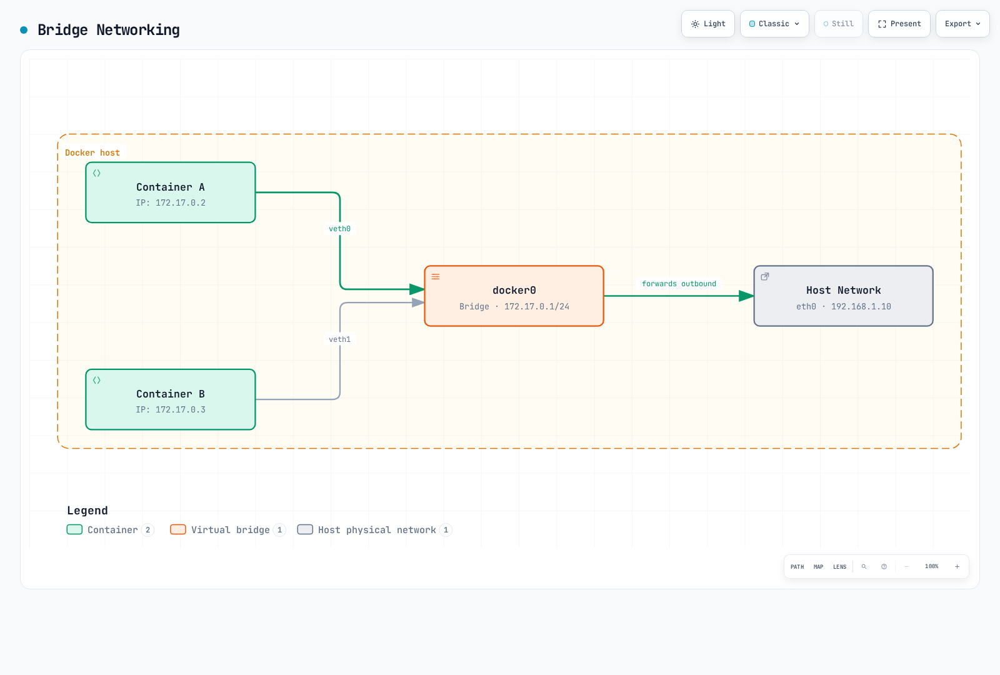
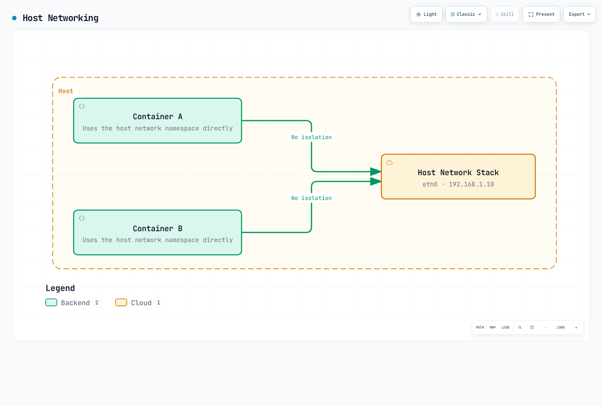
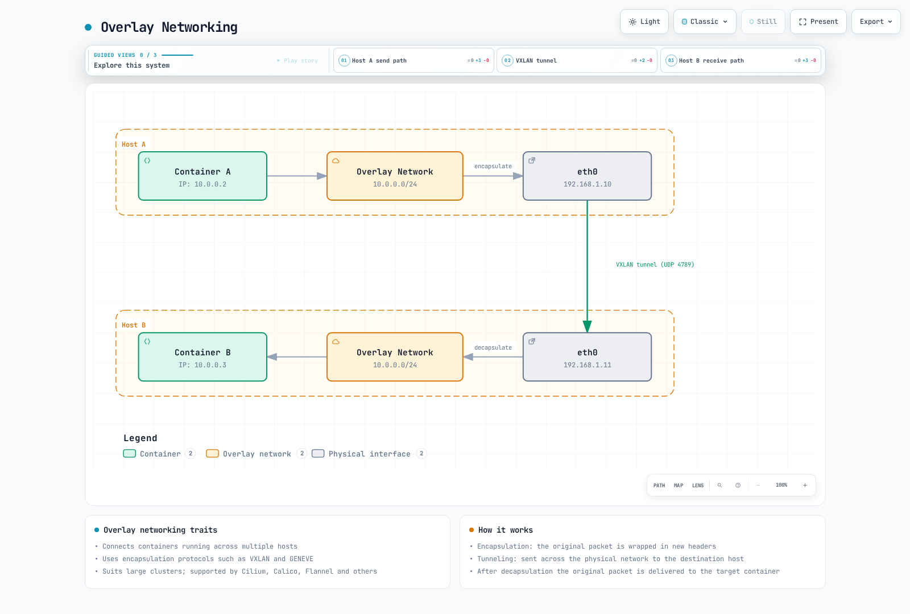
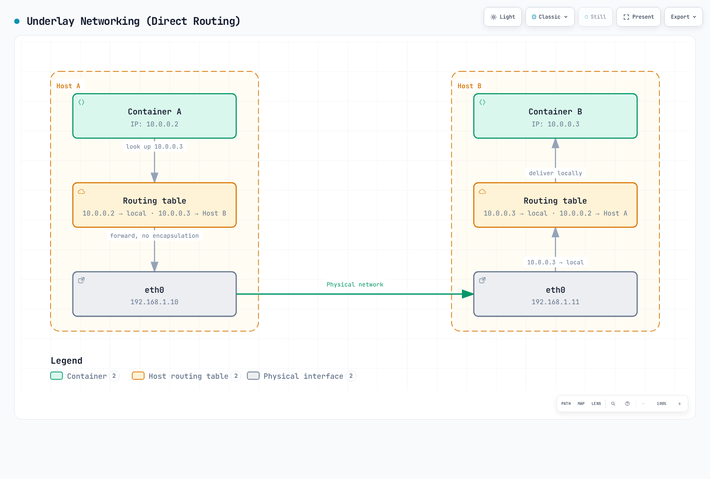
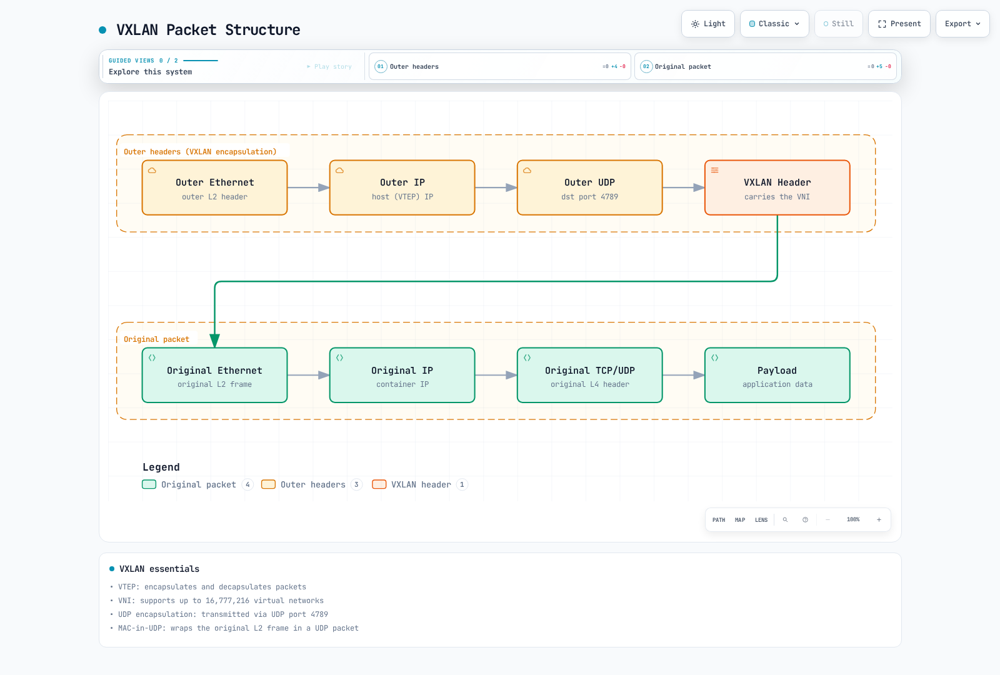
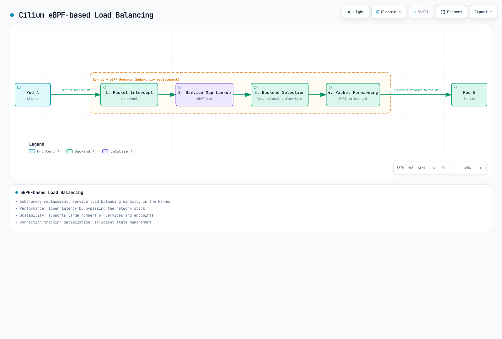

# 网络概念深入解析

> **审查基线**：Cilium 1.20.2。
> **最后审查**：October 15, 2026。

本文深入说明理解 Cilium 所需的核心网络概念。内容涵盖容器网络、覆盖网络、NAT、路由、DNS、负载均衡和策略。示例是为已准备好的测试环境提供的概念性或部分 Helm/API 配置，而非完整的安装或迁移方案。请在 [Cilium 概述](README.md) 中验证平台和版本前提条件；并非所有托管平台都允许相同的 CNI 功能。

## 学习目标

通过本文，你将了解：
- OSI 模型和 TCP/IP 协议栈的基本结构及各层作用
- 容器网络的基本原理和实现方法
- 覆盖网络与底层网络之间的差异
- NAT、路由和 DNS 等核心网络概念如何在 Cilium 中使用

## 目录

1. [OSI 模型和 TCP/IP 协议栈](#osi-model-and-tcp-ip-stack)
2. [容器网络基础](#container-networking-basics)
3. [覆盖网络](#overlay-networks)
4. [网络地址转换（NAT）](#network-address-translation-nat)
5. [路由协议](#routing-protocols)
6. [DNS 和服务发现](#dns-and-service-discovery)
7. [负载均衡概念](#load-balancing-concepts)
8. [网络安全基础](#network-security-basics)

## OSI 模型和 TCP/IP 协议栈

> **核心概念**：OSI 模型是一个概念框架，将网络通信划分为 7 个抽象层，使复杂的网络过程更易于理解。

OSI（开放系统互连，Open Systems Interconnection）模型是一个概念框架，将网络通信划分为 7 个抽象层。每一层负责特定的网络功能，从而可以分解复杂的网络过程以便理解。

### OSI 模型与 TCP/IP 模型对比


[🔍 查看交互式图示](https://www.atomai.click/kubernetes-docs/archmaps/en-networking-cilium-networking-concepts-0.html)

该映射是教学近似，而不是协议实现规范。图中的 SSL 是旧版标签；当前系统应使用受支持的 TLS 版本。

### OSI 七层模型

1. **物理层**
   - 将比特流转换为电信号、光信号或无线信号
   - 包括线缆、收发器和物理信号传输；交换机也会在更高层实现功能
   - 数据单元：比特

2. **数据链路层**
   - 负责物理网络中节点之间的数据传输
   - 使用 MAC（媒体访问控制，Media Access Control）地址进行设备识别
   - 错误检测，以及在链路协议提供此功能时进行恢复；以太网错误检测本身不会修复受损帧
   - 数据单元：帧
   - Ethernet 和 Wi-Fi 协议在此层运行

3. **网络层**
   - 负责不同网络之间的数据包路由
   - 逻辑寻址（IP 地址）
   - 路径确定和数据包转发
   - 数据单元：数据包
   - IP（互联网协议，Internet Protocol）是此层的核心协议

4. **传输层**
   - 端到端通信控制
   - 数据分段和重组
   - TCP 提供流量控制和重传；UDP 不提供这些保证
   - 数据单元：TCP 段或 UDP 数据报
   - TCP（传输控制协议，Transmission Control Protocol）和 UDP（用户数据报协议，User Datagram Protocol）是此层的主要协议

5. **会话层**
   - 通信会话的建立、维护和终止
   - 同步和对话控制
   - 检查点设置和恢复
   - 可在此层讨论会话管理；实际的 RPC 实现不一定映射到单一 OSI 层

6. **表示层**
   - 数据格式转换和加密
   - 字符编码、数据压缩、加密/解密
   - 编码/压缩体现此项职责；TLS 是互联网协议，而不是字面意义上的 OSI 表示层实现

7. **应用层**
   - 提供应用程序使用的网络服务，并不一定是图形用户界面
   - 电子邮件、文件传输、网页浏览等服务
   - HTTP、FTP、SMTP、DNS 都是此层的示例

### Cilium 与 OSI 模型的关系

Cilium 在多个 OSI 层运行：

| OSI 层 | Cilium 功能 | 示例 |
|-----------|----------------|---------|
| L2（数据链路） | 链路层可达性；可选的 L2 Announcements | 为已配置的 Service VIP 提供 ARP/NDP 响应 |
| L3（网络） | IP 路由、基于 CIDR 的策略 | Pod 之间的 IP 路由 |
| L4（传输） | 基于端口的过滤、连接跟踪 | Service 端口访问控制 |
| L7（应用） | 受支持的 HTTP/gRPC 和 DNS 代理规则 | HTTP 路径策略或 DNS 查询策略 |

在此基线中，L2 Announcements 仍为 Beta，且需要其控制器/设备配置。它不同于通用的 MAC 地址安全策略接口。

### TCP/IP 协议栈

TCP/IP 协议栈是一组构成互联网基础的协议，常被描述为四层架构并与 OSI 进行比较；它不是七层模型的直接实现。

1. **网络接口层**
   - 对应 OSI 模型的物理层和数据链路层
   - 负责与物理网络介质的接口
   - 包括 Ethernet 和 Wi-Fi 等协议

2. **互联网层**
   - 对应 OSI 模型的网络层
   - 使用 IP（互联网协议，Internet Protocol）进行数据包路由
   - 包括 ICMP（互联网控制消息协议，Internet Control Message Protocol）；ARP 在链路边界解析 IPv4 下一跳链路层地址，而 IPv6 使用邻居发现

3. **传输层**
   - 与 OSI 模型的传输层相同
   - 包括 TCP 和 UDP 协议
   - 提供面向连接（TCP）和无连接（UDP）通信

4. **应用层**
   - 集成 OSI 模型的会话层、表示层和应用层
   - 包括 HTTP、SMTP、FTP、DNS 等协议
   - 提供用户应用程序与网络之间的接口

### 按层划分的 Cilium 功能

Cilium 在各种网络层提供功能：

- **L2（数据链路层）**：链路可达性和可选的 L2 Service 公告；这不是通用的 MAC 地址 NetworkPolicy API，也不是通用的 ARP 欺骗防护
- **L3（网络层）**：基于 IP 地址的路由和过滤、IPAM
- **L4（传输层）**：基于端口的过滤、负载均衡、连接跟踪
- **L7（应用层）**：已配置的 HTTP/gRPC 代理功能和 DNS 策略；先前的 Kafka L7 策略 API 已移除

## 容器网络基础

容器网络是一种使容器化应用程序能够彼此通信并与外部世界通信的机制。Kubernetes 等容器编排平台使用多种网络模型和解决方案。

### 容器网络接口（CNI）

CNI（容器网络接口，Container Network Interface）定义了容器运行时与网络插件之间的标准接口。当前 Kubernetes 使用 CRI 容器运行时调用 CNI 插件。该接口允许存在多种网络实现；CNI 规范并不要求每个插件都实现 Kubernetes NetworkPolicy。

#### CNI 的关键组件：

1. **插件**：负责创建和配置网络接口的可执行文件
2. **配置文件**：定义插件行为的 JSON 格式文件
3. **IPAM（IP 地址管理）**：负责 IP 地址分配和管理的模块

#### CNI 插件的主要职责：

- 向容器网络命名空间添加/从中移除接口
- 分配和释放 IP 地址
- 配置路由表
- 网络实现可以单独提供策略控制器/数据路径强制执行；策略不是强制性的 CNI 执行操作

### 容器网络模型

容器网络模型有多种，各自适用于不同的用例和要求。

#### 1. 桥接网络

- 在主机上创建虚拟网桥以连接容器
- 每个容器通过虚拟以太网（veth）对连接到网桥
- 同一主机上容器之间的高效通信
- 默认网桥是独立 Linux Docker 的示例；它不是 Kubernetes 或 Cilium 网络模型



[🔍 查看交互式图示](https://www.atomai.click/kubernetes-docs/archmaps/en-networking-cilium-networking-concepts-1.html)

这是一个使用示意地址的 Linux Docker 网桥示例。主机的路由/NAT 路径已简化；它不是 Cilium 的默认网桥拓扑。

#### 2. 主机网络

- 容器直接使用主机的网络命名空间
- 没有单独的网络隔离
- 避免单独的容器网络命名空间；性能仍取决于实际工作负载和路径
- 存在端口冲突的可能性



[🔍 查看交互式图示](https://www.atomai.click/kubernetes-docs/archmaps/en-networking-cilium-networking-concepts-2.html)

这里的“无隔离”表示共享网络命名空间。它不表示移除了每个进程、文件系统或其他容器隔离边界。

#### 3. 覆盖网络

- 支持跨多个主机的容器通信
- 使用 VXLAN 和 GENEVE 等封装协议
- 适用于大规模集群
- 得到 Cilium、Calico、Flannel 等支持



[🔍 查看交互式图示](https://www.atomai.click/kubernetes-docs/archmaps/en-networking-cilium-networking-concepts-3.html)

该通用 VXLAN 图示使用标准 UDP 4789 和共享 L2 子网。Cilium 的默认 VXLAN 端口为 8472；其 Pod CIDR 分配必须遵循所选的 IPAM 模式，而不是照搬此图。

#### 4. 底层网络（直接路由）

- 直接利用物理网络基础设施
- 没有封装开销
- 需要对网络基础设施具有控制权
- 可与 BGP 等路由协议集成



[🔍 查看交互式图示](https://www.atomai.click/kubernetes-docs/archmaps/en-networking-cilium-networking-concepts-4.html)

这些条目展示主机路由。实际部署仍需为其 Pod 地址提供可达的下一跳和有效的转发/返回路由。

### Kubernetes 网络模型

Kubernetes 模型提供直接的 Pod 连通性，**但有意进行网络分段的情况除外**：

1. Pod 可以与其他 Pod 通信，而无需在 Pod 网络中强制使用代理或 NAT。
2. 节点代理必须能够与**该节点上的** Pod 通信。这并不笼统要求每个主机都能访问每个 Pod。
3. 外部连通性遵循集群的路由和安全策略；不要求不受限制的互联网访问。

NetworkPolicy 的强制执行取决于具备能力的网络实现。即使已安装的插件不执行它，API 也可能存在。

#### Kubernetes 网络组件：

1. **Pod 网络**：连接集群中所有 Pod 的网络
2. **Service 网络**：为一组 Pod 提供稳定端点
3. **集群 DNS**：用于服务发现的 DNS 服务
4. **Ingress/Egress**：管理与集群外部的通信

### Cilium 的容器网络方法

Cilium 利用 eBPF 提供高性能、可扩展的容器网络解决方案：

1. **基于 eBPF 的数据路径**：在内核内直接处理数据包
2. **支持多种网络模式**：覆盖网络（VXLAN、Geneve）和原生路由；通用 Helm 默认值为使用 VXLAN 的隧道模式，但受平台覆盖影响
3. **高级负载均衡**：kube-proxy 替代功能
4. **网络策略**：L3-L7 层面的细粒度策略
5. **集成 IPAM**：支持多种 IP 地址分配策略

不含平台覆盖的通用 Helm 安装默认使用 cluster-pool IPAM：operator 分配节点 CIDR，而 agent 从节点池中分配 Pod IP。`ipam.mode: kubernetes` 使用 Node 的 `spec.podCIDR`/`spec.podCIDRs`。ENI 模式使用 EC2 接口和 VPC 地址；它不是针对每种 EKS 计算模式的通用建议。请参阅 [IPAM 和策略](04-ipam-policy.md)。

## 覆盖网络

覆盖网络是一种在现有网络基础设施之上构建虚拟网络层的技术。该技术允许独立于物理网络拓扑来创建虚拟网络拓扑。在容器环境中，它被广泛用于实现跨多个主机的容器通信。

### 覆盖网络的工作方式

覆盖网络使用封装技术工作。原始数据包被封装在其他数据包中，并通过物理网络传输。

1. **数据包封装**：原始数据包（内部数据包）被包装上新的报头，有时还包括新的报尾。
2. **隧道传输**：封装后的数据包通过物理网络传输到目标主机。
3. **数据包解封装**：在目标主机上，移除外层报头并提取原始数据包。
4. **数据包转发**：将原始数据包转发到目标容器。

### 主要覆盖网络协议

#### VXLAN（虚拟可扩展局域网，Virtual Extensible LAN）

VXLAN 是容器网络中最广泛使用的覆盖协议之一。

- **VXLAN 隧道端点（VTEP）**：负责数据包的封装和解封装
- **VXLAN 网络标识符（VNI）**：一个可取 16,777,216 个值的 24 位字段；这不是 Cilium 支持的租户/端点容量
- **UDP 封装**：标准 VXLAN 使用 UDP 4789；Cilium 默认 VXLAN 隧道端口为 UDP 8472
- **MAC-in-UDP 封装**：将原始 L2 帧封装到 UDP 数据包中

VXLAN 数据包结构：



[🔍 查看交互式图示](https://www.atomai.click/kubernetes-docs/archmaps/en-networking-cilium-networking-concepts-5.html)

这是通用 VXLAN 线格式。UDP 4789 和 24 位 VNI 描述标准；Cilium 默认使用 UDP 8472，并将覆盖元数据用于身份标识。字段宽度并非集群容量保证。

#### GENEVE（通用网络虚拟化封装，Generic Network Virtualization Encapsulation）

GENEVE 是一种更灵活的覆盖协议，旨在克服 VXLAN 的限制。

- **可扩展选项报头**：支持各种元数据
- **协议无关**：可与各种虚拟化技术一起使用
- **UDP 封装**：通过 UDP 端口 6081 传输
- **灵活隧道**：支持各种网络虚拟化要求

#### IPsec

IPsec 是一组在 IP 数据包层提供安全服务的协议。

- **身份验证和加密**：IPsec 提供完整性/身份验证机制，并在适当模式下提供机密性
- **传输和隧道模式**：支持各种部署场景
- **安全关联（SA）**：定义通信双方之间的安全参数
- **互联网密钥交换（IKE）**：一种通用 IPsec 协商机制。Cilium 的 IPsec 设置则使用管理员提供的密钥 Secret 及其文档化的轮换流程

### 覆盖网络的优缺点

#### 优点：

- **灵活性**：可独立于物理网络拓扑配置虚拟网络
- **可扩展性**：支持大型网络段和大量端点
- **隔离性**：正确配置时，逻辑段可以分离流量；仅封装并非身份验证、加密或完整的策略边界
- **兼容性**：可与现有网络基础设施配合使用

#### 缺点：

- **开销**：封装增加数据包大小和处理开销
- **MTU 考量**：封装导致最大传输单元（MTU）减小
- **复杂性**：故障排查和调试可能更复杂
- **延迟**：封装会增加处理工作；应使用所选实现和卸载功能测量实际影响

### Cilium 中的覆盖网络

Cilium 支持 VXLAN 和 Geneve 等覆盖协议，并利用 eBPF 提供高效的数据包处理。

- **eBPF 辅助的 VXLAN 处理**：BPF 程序不会自行构建 VXLAN 报头；它们设置隧道元数据（`bpf_skb_set_tunnel_key`）并重定向到基于流的 `cilium_vxlan`（或 `cilium_geneve`）设备，内核的 VXLAN/Geneve 驱动程序在该设备上进行封装和解封装。请参阅 [覆盖与原生路由](09-overlay-native-routing.md)
- **高效路由**：通过优化路径转发数据包
- **加密选项**：通过 IPsec 或 WireGuard 加密覆盖网络
- **模式选择**：选择受支持的路由模式。将自动直接节点路由与隧道模式一起启用会被拒绝；它不是回退机制

#### Cilium VXLAN 配置示例：

用于**新的、已准备好的 IPv4 测试安装**的 Helm 值；请选择不重叠的 Pod CIDR。这不是实时 IPAM 迁移或替代 ConfigMap。

```yaml
# vxlan-values.yaml
routingMode: tunnel
tunnelProtocol: vxlan
tunnelPort: 8472
autoDirectNodeRoutes: false
ipv4:
  enabled: true
ipv6:
  enabled: false
ipam:
  mode: cluster-pool
  operator:
    clusterPoolIPv4PodCIDRList:
    - 10.244.0.0/16
    clusterPoolIPv4MaskSize: 24
```

## 网络地址转换（NAT）

网络地址转换（NAT）是修改 IP 数据包源地址或目标地址的过程。NAT 主要用于使私有网络中的设备能够与公共互联网通信，或使两个网络地址空间重叠的网络之间能够通信。

### NAT 的主要类型

#### 1. 源 NAT（SNAT）

源 NAT 修改数据包的源 IP 地址。它通常用于私有网络中的设备访问互联网。

- **工作方式**：重写源地址，有时也重写其端口；私有到公共的转换是一种常见用途
- **用例**：互联网访问、出站连接
- **跟踪**：在 NAT 表中存储连接状态


[🔍 查看交互式图示](https://www.atomai.click/kubernetes-docs/archmaps/en-networking-cilium-networking-concepts-6.html)

文档范围地址展示一个私有到公共的 SNAT 用例。SNAT 表示源转换；替换地址并不总是公共地址。

#### 2. 目标 NAT（DNAT）

目标 NAT 修改数据包的目标 IP 地址。它通常用于从公共互联网访问私有网络中的服务。

- **工作方式**：重写目标地址/端口；公共到私有的转发是一个示例
- **用例**：端口转发、负载均衡、入站连接
- **配置**：定义特定端口或端口范围的映射


[🔍 查看交互式图示](https://www.atomai.click/kubernetes-docs/archmaps/en-networking-cilium-networking-concepts-7.html)

这展示了使用文档地址的一个公共到私有 DNAT 用例。DNAT 是目标转换，也出现在其他地址域中。

#### 3. 端口地址转换（PAT）

PAT 同时修改 IP 地址和端口号。这使多个内部主机能够共享单个公共 IP 地址。

- **工作方式**：将内部主机的 IP:port 组合转换为单个公共 IP 的不同端口
- **用例**：节约 IP 地址、支持许多内部主机
- **限制**：端口和状态资源有限；同时流的数量还取决于协议、目标元组和映射重用，而不是通用的 65,000 连接上限


[🔍 查看交互式图示](https://www.atomai.click/kubernetes-docs/archmaps/en-networking-cilium-networking-concepts-8.html)

该示例对同一远程服务器使用不同的转换端口。大约 65,000 个端口的空间并非所有 NAT 连接的通用上限；协议、目标元组、映射行为和状态容量都很重要。

#### 4. 双重 NAT 和双向 NAT

**双重 NAT** 在流量跨越地址域时同时更改源地址和目标地址，并可帮助协调重叠的地址空间。地址映射、DNS/应用程序假设和返回路径必须一起设计。

RFC 2663 中的**双向 NAT** 则描述允许从任一地址域发起会话。按定义，它不表示更改每个数据包中的两个地址。

### NAT 的优缺点

#### 优点：

- **节约 IP 地址**：以有限数量的公共 IP 地址支持许多内部主机
- **隐藏地址**：可能隐藏内部地址，但 NAT 不能替代防火墙策略或身份验证
- **地址域协调**：适当的转换可以连接重叠的地址域；这本身并不提供隔离
- **灵活的网络设计**：可在不重新配置内部网络的情况下更换 ISP

#### 缺点：

- **连接跟踪开销**：维护状态表所需的资源
- **某些协议问题**：有些协议可能与 NAT 不兼容
- **端到端连接性丢失**：直接点对点通信存在困难
- **复杂的故障排查**：调试 NAT 相关问题可能很复杂

### Kubernetes 和 Cilium 中的 NAT

#### Kubernetes 中的 NAT

Kubernetes 在多种场景使用 NAT：

1. **集群外通信**：可能使用 SNAT，具体取决于地址可达性、伪装排除项和所选数据路径
2. **Service 实现**：基于数据包的实现可以转换 Service 目标；套接字级负载均衡可在此类数据包存在之前选择后端
3. **NodePort Service**：实现将节点 IP:port 转发到选定后端；返回路径行为取决于 SNAT/DSR 和流量策略
4. **LoadBalancer Service**：提供商/控制器行为各不相同，不必是从公共地址到 Pod 的单一步骤 DNAT

#### Cilium 中的 NAT

Cilium 利用 eBPF 提供高效的 NAT 实现：

1. **基于 eBPF 的 NAT**：直接在内核中执行 NAT
2. **高性能连接跟踪**：使用优化的 BPF 映射跟踪连接状态
3. **NAT 控制**：受支持的伪装排除项、Service 转发和 Egress Gateway 功能具有不同的配置和前提条件
4. **伪装**：在已配置的路径/设备上进行条件源转换；排除的 CIDR 和受支持模式会影响结果

Egress Gateway 是一项独立功能，它将匹配的出站流量经由选定节点引导，并对其执行 SNAT 以使用已配置的网关地址。它会更改原始源 IP；必须准备接口、地址和返回路径。新的 Pod 可在策略收敛前发送流量，因此它不是立即失效关闭的源 IP 保证。

#### Cilium NAT 配置示例：

此 Helm 片段假定一个已准备好的 kube-proxy 替代/BPF 伪装环境，且 API 端点可达。请先审查实际附加的设备和路由。从 SNAT 中排除 CIDR 不会创建返回路由；NAT 大小仅为示例，而非推荐的通用容量。

```yaml
# masquerade-values.yaml
enableIPv4Masquerade: true
kubeProxyReplacement: true
bpf:
  masquerade: true
  natMax: 262144
ipMasqAgent:
  enabled: true
  config:
    nonMasqueradeCIDRs:
    - 10.0.0.0/8
    - 172.16.0.0/12
    - 192.168.0.0/16
    masqLinkLocal: false
```

## 路由协议

路由协议定义规则和过程，用于确定数据包在网络中从源端到目标端的最优路径。这些协议在适应网络拓扑变化、高效转发流量和绕过网络故障方面发挥重要作用。

### 路由协议分类

#### 1. 内部网关协议（IGP）

内部网关协议用于在单个自治系统（AS）内交换路由信息。

##### 距离矢量协议

- **RIP（路由信息协议，Routing Information Protocol）**
  - 使用跳数作为度量指标
  - 有效度量最大为 15 跳；度量值 16 表示不可达
  - 实现简单，适合小型网络
  - 定期更新约每 30 秒一次，并对变化使用计时器随机化和触发更新

- **EIGRP（增强型内部网关路由协议，Enhanced Interior Gateway Routing Protocol）**
  - 可配置的复合度量；默认系数使用吞吐量/带宽和延迟，而非负载或可靠性
  - 仅发送部分更新
  - 快速收敛
  - Cisco 起源的协议，记录在信息性 RFC 7868 中；该文档并非 IETF 标准跟踪指定

##### 链路状态协议

- **OSPF（开放式最短路径优先，Open Shortest Path First）**
  - 使用 Dijkstra 算法计算最短路径
  - 基于区域的层次结构
  - 快速收敛
  - 支持大规模网络
  - 通过链路状态公告（LSA）交换拓扑信息

- **IS-IS（中间系统到中间系统，Intermediate System to Intermediate System）**
  - 与 OSPF 类似的链路状态协议
  - 广泛用于大型服务提供商网络
  - 支持多个网络层
  - 高效的路由更新

#### 2. 外部网关协议（EGP）

外部网关协议用于在不同自治系统之间交换路由信息。

- **BGP（边界网关协议，Border Gateway Protocol）**
  - 互联网的核心路由协议
  - 路径矢量协议
  - 基于策略的路由决策
  - 基于 TCP 的可靠会话
  - 通过路径属性（AS 路径、本地优先级等）选择路径
  - iBGP（内部 BGP）和 eBGP（外部 BGP）变体

### 容器网络中的路由协议

在容器环境中，传统路由协议与容器特定的路由机制并用。

#### 1. 使用 BGP 的容器网络

BGP 因以下原因在容器网络中越来越受欢迎：

- **可达性通告**：向路由器通告 Pod 或 Service 前缀；本地转发实现仍决定流量如何传输
- **可扩展性**：支持大规模集群和多集群环境
- **现有网络集成**：与数据中心网络基础设施集成
- **可用性**：多路径和收敛取决于路由器策略、计时器和可用的数据路径；仅有会话并不能保证快速故障转移

#### 2. 容器网络路由机制

- **基于主机的路由**：主机维护 Pod 路由，并可能参与单独配置的路由通告机制
- **集中式路由**：控制器集中管理路由决策
- **分布式路由**：节点之间直接交换路由信息
- **基于策略的路由**：根据流量特征作出路由决策

### Cilium 中的路由

Cilium 使用 eBPF 实现路由，并支持不同的数据路径模式。**主机路由是独立的维度**：BPF 主机路由可优化节点内的转发，并可能绕过部分主机栈/netfilter。它需要兼容的 kube-proxy 替代/BPF 伪装，并有集成约束。它不表示在节点之间选择原生路由而非隧道路由。

#### 1. 原生路由（直接路由）

在原生路由模式中，Cilium 不使用覆盖封装而直接路由 Pod IP。

- **工作方式**：Pod 流量使用底层路由且不使用覆盖封装；启用原生模式不会自动启用 BGP
- **优点**：避免覆盖封装开销；实际性能需要测量
- **要求**：相关 Pod 地址及其返回流量的有效路由，而不只是节点 IP 之间的可达性
- **用例**：性能关键型工作负载、单子网集群

原生路由需要有效的 Pod 路由，但选择 `routingMode: native` 不会自动通过 BGP 通告它们。请配置底层/返回路由，或配置适当的路由分发机制。前面的主机路由图示展示了转发原理。

#### 2. BGP 路由

Cilium 支持 BGP 路由，可将 Pod IP 与物理网络基础设施集成。

- **工作方式**：Cilium 通过 BGP 对等连接通告 Pod CIDR
- **优点**：与现有网络基础设施集成、高可用性
- **组件**：BGP 对等连接、路由过滤、community 属性
- **用例**：与数据中心网络集成、多集群环境

#### 3. 覆盖路由

Cilium 可以使用 VXLAN 或 Geneve 等覆盖协议在节点间路由 Pod 流量。

- **工作方式**：封装 Pod 数据包以在节点间传输
- **优点**：尽量减少网络基础设施要求、灵活部署
- **用例**：云环境、复杂网络拓扑

#### 4. 混合路由

不要假定 Cilium 在路由可达时自动使用原生路由，否则回退到覆盖网络。当前隧道模式不能与 `autoDirectNodeRoutes: true` 结合；agent 会拒绝该配置。请选择受支持的数据路径并配置其底层网络。

名为 `hybrid` 的有效负载均衡器模式是另一项功能：TCP 使用 DSR，而 UDP 使用 SNAT。它不是覆盖/原生路由回退。

### Cilium 路由配置示例

#### 原生路由配置：

此原生路由片段假定预期 Pod CIDR 和节点在共享 L2 网络上可达，以便自动直接路由。其他拓扑需要适当的路由机制。不得将其与隧道模式结合作为自动回退。

```yaml
# native-values.yaml
routingMode: native
autoDirectNodeRoutes: true
ipv4NativeRoutingCIDR: 10.244.0.0/16
```

#### BGP 路由配置：

以下功能标志只是前提条件之一。请按照 [高级主题](07-advanced-topics.md) 所述配置当前的 `CiliumBGPClusterConfig`、`CiliumBGPPeerConfig` 和 `CiliumBGPAdvertisement` 资源以及外部路由器。BGP 通告和数据路径路由模式是独立选择。

```yaml
# bgp-values.yaml
bgpControlPlane:
  enabled: true
```

#### 覆盖路由配置：

请使用上面的完整 VXLAN 值示例。在 agent 状态中验证运行模式和端口；不要使用一个小型 ConfigMap 覆盖安装设置。

## DNS 和服务发现

DNS（域名系统，Domain Name System）和服务发现对于现代网络应用至关重要，特别是在动态容器环境中。这些机制抽象服务位置，并使应用程序能够适应网络拓扑变化。

### DNS（域名系统，Domain Name System）

DNS 是一个将人类可读域名转换为 IP 地址的分布式系统。

#### DNS 的工作方式

1. **分层命名空间**：域名按由点分隔的层次结构组织（例如 www.example.com）
2. **分布式数据库**：分布在世界各地的 DNS 服务器网络
3. **迭代查询和递归查询**：处理客户端请求的两种主要方法
4. **缓存**：为了提升性能而临时存储结果

#### DNS 记录类型

- **A 记录**：将域名映射到 IPv4 地址
- **AAAA 记录**：将域名映射到 IPv6 地址
- **CNAME 记录**：域名的别名（规范名称）
- **MX 记录**：指定邮件服务器
- **SRV 记录**：指定提供特定服务的服务器
- **TXT 记录**：存储文本信息（主要用于验证和策略）
- **PTR 记录**：IP 地址到域名的反向映射（反向 DNS）

#### DNS 解析过程

一个常见的未缓存查找将应用程序的 stub resolver 与递归解析器分开：

| 步骤 | 查询/响应 |
| --- | --- |
| 1 | stub 向其配置的递归解析器请求 `www.example.com`。 |
| 2 | 解析器询问根服务器，并收到指向 `.com` 服务器的转介。 |
| 3 | 解析器询问 `.com` 服务器，并收到指向 `example.com` 权威服务器的转介。 |
| 4 | 解析器询问权威服务器并获取相关答案。 |
| 5 | 解析器按照 TTL 进行缓存，并将答案返回给 stub。 |

权威服务器通常不会在彼此之间转发该序列。缓存、别名和已配置的转发器可能改变确切的交换过程。

### 容器环境中的服务发现

服务发现是自动检测可用服务并在网络上定位它们的过程。在容器环境中，它对于有效管理动态创建和移除的服务尤为重要。

#### 服务发现方法

1. **基于 DNS 的服务发现**
   - 在注册服务时创建 DNS 记录
   - 客户端通过标准 DNS 查找发现服务
   - 简单且得到广泛支持
   - 示例：Kubernetes DNS、CoreDNS

2. **基于键值存储的服务发现**
   - 在集中式键值存储中存储服务信息
   - 客户端查询存储以发现服务
   - 支持丰富元数据
   - 示例：etcd、Consul、ZooKeeper

3. **基于 API 的服务发现**
   - 通过专用 API 提供服务信息
   - 客户端调用 API 以发现服务
   - 支持复杂查询和过滤
   - 示例：Kubernetes API Server

4. **基于 Mesh 的服务发现**
   - 服务网格基础设施处理服务发现
   - 支持客户端负载均衡和路由
   - 高级流量管理功能
   - 示例：Istio、Linkerd

### Kubernetes 中的 DNS 和服务发现

Kubernetes 提供集群内服务发现的内置机制。

#### Kubernetes Services

Kubernetes Services 为一组 Pod 提供稳定端点：

- **ClusterIP**：一个 Service 虚拟 IP，通常在集群内部使用；任何外部可路由性都是明确的网络设计，而非固有的安全边界
- **NodePort**：暴露在符合条件的节点地址上的节点端口，受流量策略、路由和防火墙规则约束
- **LoadBalancer**：请求提供商/控制器实现，该实现可以是公共或内部的
- **ExternalName**：外部服务的 DNS 别名

#### Kubernetes DNS

Kubernetes 运行集群 DNS 服务（通常为 CoreDNS）以支持服务发现：

- **Service DNS**：`<service-name>.<namespace>.svc.<cluster-domain>`；`cluster.local` 是常见的配置域，而非通用常量
- **Pod DNS**：旧的基于地址的 `pod.<cluster-domain>` 形式依赖实现/属于旧版。稳定的 Pod 名称通常使用 hostname/subdomain 以及相应的无头 Service
- **无头 Services**：DNS 可以返回端点地址而非 VIP；就绪性和 `publishNotReadyAddresses` 会影响发布哪些记录

DNS 查找和 Service 转发是分开的：

| 阶段 | 职责 |
| --- | --- |
| DNS 查找 | CoreDNS 使用 Kubernetes 对象状态将普通 Service 名称解析为其 ClusterIP。它不会为该连接选择应用程序后端。 |
| 连接 | 客户端将流量发送到返回的 Service 地址。 |
| 转发 | Service 实现（例如 Cilium 的数据路径）使用其派生自 Service/EndpointSlice 的状态选择符合条件的后端。 |
| 无头 Service | DNS 返回端点地址而非 Service VIP；客户端行为决定使用哪个地址。 |

对象监视和数据路径更新是异步的；DNS 响应不是后端健康探针。

#### Kubernetes 服务发现机制

1. **环境变量**：Service 链接可反映创建 Pod 时存在的 Services；它们不是实时发现源，并且可以禁用
2. **DNS**：通过集群 DNS 进行 Service 名称解析
3. **API Server**：通过直接查询 Kubernetes API 获取服务信息
4. **EndpointSlice 对象**：为 Service 实现提供后端地址、端口和就绪性信息

### Cilium 中的 DNS 和服务发现

Cilium 与 Kubernetes 服务发现机制集成，并提供附加功能。

#### Cilium 基于 DNS 的策略

Cilium 可以基于 DNS 名称定义网络策略：

- **基于 DNS 名称的过滤**：特定域名的访问控制
- **通配符支持**：`*.example.com` 匹配一个子域级别；此版本中 `**.example.com` 支持多个级别，二者都不包含顶点域，除非显式匹配
- **FQDN 策略**：基于完全限定域名（FQDN）的策略

此仅策略示例要求命名空间、带标签的工作负载和已验证的解析器路径存在。DNS 观察与 TCP 443 目标允许项是独立的。DNS `*` 允许所有查询名称；toFQDNs 不是主机名身份验证。

```yaml
# dns-policy.yaml
apiVersion: cilium.io/v2
kind: CiliumNetworkPolicy
metadata:
  name: dns-policy
  namespace: cilium-fqdn-demo
spec:
  endpointSelector:
    matchLabels:
      app: myapp
  egress:
  - toEndpoints:
    - matchLabels:
        k8s:io.kubernetes.pod.namespace: kube-system
        k8s:k8s-app: kube-dns
    toPorts:
    - ports:
      - port: '53'
        protocol: UDP
      - port: '53'
        protocol: TCP
      rules:
        dns:
        - matchPattern: '*'
  - toFQDNs:
    - matchName: api.example.com
    - matchPattern: '*.api.example.com'
    toPorts:
    - ports:
      - port: '443'
        protocol: TCP
```

#### Cilium 的服务发现增强功能

Cilium 提供多项增强 Kubernetes 服务发现的功能：

1. **基于 eBPF 的 Service 实现**：
   - kube-proxy 替代
   - 内核内直接 Service 负载均衡
   - 改进的性能和功能

2. **全局 Services**：
   - 跨多个集群的服务发现
   - 跨集群负载均衡
   - 匹配的 Service 名称/命名空间以及显式共享/ClusterMesh 配置

3. **Service 亲和性**：
   - 支持会话亲和性
   - ClientIP 亲和性独立于负载均衡算法；套接字级路径可以使用网络命名空间 cookie
   - 有状态连接支持

4. **健康检查集成**：
   - 后端状态遵循 Kubernetes 就绪性/EndpointSlice 信息和已配置的代理检查
   - 更改以异步方式传播
   - 不要假定每个 Cilium Service 都执行主动应用程序探测或瞬时故障转移

#### Cilium Service 配置示例：

会话亲和性在 Service 上配置；全局 Services 使用注解和可用的 ClusterMesh。对等 Service 必须具有相同的名称和命名空间。此示例不会创建应用程序、ClusterMesh 或外部负载均衡器。

```yaml
# global-service.yaml
apiVersion: v1
kind: Service
metadata:
  name: api
  namespace: cilium-service-demo
  annotations:
    service.cilium.io/global: 'true'
spec:
  type: ClusterIP
  selector:
    app: api
  ports:
  - name: http
    port: 80
    targetPort: 8080
  sessionAffinity: ClientIP
  sessionAffinityConfig:
    clientIP:
      timeoutSeconds: 10800
```

## 负载均衡概念

负载均衡是一种将网络流量分配到多个服务器或后端服务的技术，在结合合适容量和后端健康处理时，它可以优化资源利用率并支持吞吐量、延迟和可用性目标。在容器环境中，将流量有效分配到动态变化的后端实例尤为重要。

### 负载均衡类型

#### 1. L4（传输层）负载均衡

L4 负载均衡根据 IP 地址和端口号等传输层信息分配流量。

- **工作方式**：基于 TCP/UDP 报头信息进行路由决策
- **优点**：处理快速、开销低、可处理加密流量
- **缺点**：无法基于应用层信息执行高级路由
- **用例**：基于 TCP/UDP 的服务、高性能要求


[🔍 查看交互式图示](https://www.atomai.click/kubernetes-docs/archmaps/en-networking-cilium-networking-concepts-12.html)

分支表示可能的后端选择，而不是将一个连接广播到两个服务器。L4 转发可携带 TLS，而不检查已加密的 HTTP 负载。

#### 2. L7（应用层）负载均衡

L7 负载均衡根据 HTTP 报头、URL 和 cookie 等应用层信息分配流量。

- **工作方式**：通过检查 HTTP/HTTPS 请求内容进行路由决策
- **优点**：基于内容的路由、高级流量管理、安全功能
- **缺点**：代理处理成本；HTTPS 的 HTTP 内容检查需要适当的 TLS 终止
- **用例**：Web 应用程序、微服务、API 网关


[🔍 查看交互式图示](https://www.atomai.click/kubernetes-docs/archmaps/en-networking-cilium-networking-concepts-13.html)

所选路由取决于请求属性。经由 HTTPS 的 HTTP 内容路由需要适当的 TLS 终止/检查路径。

### 负载均衡算法

负载均衡算法决定如何将流量分配给后端服务器。

#### 1. 轮询

- **工作方式**：依次将请求分配给每个后端服务器
- **优点**：排序简单；相等的请求数并不表示相等的后端工作量
- **缺点**：不考虑服务器容量差异或当前负载
- **变体**：加权轮询（根据服务器容量应用权重）

#### 2. 最少连接

- **工作方式**：将新请求转发到活动连接数最少的服务器
- **优点**：考虑服务器负载，对长连接有效
- **缺点**：连接数并不总能准确反映负载
- **变体**：加权最少连接（根据服务器容量应用权重）

#### 3. IP 哈希

- **工作方式**：对客户端 IP 地址进行哈希，以一致地选择后端服务器
- **优点**：在输入/后端成员保持稳定时可提供稳定选择；它不是永久会话存储
- **缺点**：可能分布不均，特定服务器可能过载
- **变体**：源-目标 IP 哈希（同时考虑源和目标 IP）

#### 4. 最短响应时间

- **工作方式**：将请求转发到响应时间最短的服务器
- **优点**：考虑性能和可用性，适合对延迟敏感的应用
- **缺点**：响应时间测量开销，受网络可变性影响
- **变体**：加权响应时间（同时考虑服务器容量和响应时间）

#### 5. 随机选择

- **工作方式**：随机选择后端服务器
- **优点**：实现简单，不需要特殊状态跟踪
- **缺点**：可能分布不均
- **变体**：加权随机选择（根据服务器容量调整概率）

### 负载均衡器部署模型

#### 1. 硬件负载均衡器

- **特点**：专用物理设备
- **优点**：高性能、可靠性、专用硬件加速
- **缺点**：成本高、可扩展性有限、灵活性不足
- **示例**：应用交付控制器设备；某些产品系列也提供虚拟/软件版本

#### 2. 软件负载均衡器

- **特点**：在通用服务器上运行的软件
- **优点**：灵活性、成本效益、可编程性
- **缺点**：容量取决于实现、硬件和工作负载；软件并非必然比所有设备慢
- **示例**：NGINX、HAProxy、Envoy

#### 3. 云负载均衡器

- **特点**：由云提供商管理的服务
- **优点**：减少管理开销、自动扩展、高可用性
- **缺点**：供应商锁定、定制能力有限
- **示例**：AWS ELB/ALB/NLB、Google Cloud Load Balancing、Azure Load Balancer

#### 4. 容器原生负载均衡器

- **特点**：针对容器环境优化的负载均衡
- **优点**：与容器编排集成、动态服务发现
- **缺点**：专用于容器环境
- **示例**：Kubernetes Services、Istio、Cilium

### Kubernetes 中的负载均衡

Kubernetes 提供多个层次的负载均衡：

#### 1. Service 负载均衡

- **ClusterIP**：集群内部负载均衡
- **NodePort**：通过节点端口进行外部访问
- **LoadBalancer**：外部负载均衡器配置
- **ExternalName**：外部服务的 DNS 别名

#### 2. Ingress 控制器

- L7 负载均衡和路由
- 基于 URL 的路由和 TLS 终止；身份验证能力取决于控制器和配置
- 实现包括 Traefik、HAProxy 和基于 Istio 的控制器。社区 `ingress-nginx` 已于 2026 年 3 月停止维护；剩余工件并非受维护的安装建议

#### 3. 服务网格

- 微服务之间的高级流量管理
- 细粒度路由、流量拆分、故障注入
- 示例：Istio、Linkerd 和 Consul 服务网格；它们的流量管理和安全功能集有所不同

### Cilium 中的负载均衡

Cilium 使用 eBPF 实现高效的负载均衡：

#### 1. 基于 eBPF 的负载均衡

- **kube-proxy 替代**：内核内直接 Service 负载均衡
- **性能**：受支持的 BPF 路径可避免常规协议栈的部分环节；请针对实际工作负载量化结果
- **可扩展性**：支持大规模 Services 和端点
- **连接跟踪优化**：高效的状态管理



[🔍 查看交互式图示](https://www.atomai.click/kubernetes-docs/archmaps/en-networking-cilium-networking-concepts-14.html)

这描绘了数据包路径的 Service 转换。套接字级负载均衡则可在 Service-IP 数据包存在之前选择后端。延迟改善需要针对实际路径进行测量。

#### 2. 负载均衡算法

BPF Service 算法为**随机**（默认）和 **Maglev**。Maglev 对流信息进行哈希；它不只是源 IP 亲和性。普通套接字级东西向选择不同于应用 Maglev 的外部数据包路径。

`ClientIP` 会话亲和性独立地在 Service 上配置。其超时并非“Maglev 超时”；Maglev 没有定期重新均衡会话的计时器。成员、种子或表变更可重新映射选择，而由于哈希一致性，已移除后端也不能继续服务连接。

#### 3. L7 负载均衡

Cilium 还支持 L7（应用层）负载均衡：

- **基于 HTTP 报头的路由**：基于特定报头值进行路由
- **基于 URL 路径的路由**：基于 URL 模式分配流量
- **gRPC 路由**：基于 gRPC 方法和元数据进行路由
- **Kafka**：当前 Cilium 不提供先前的 Kafka topic L7 策略/路由功能；请使用适合 broker 的控制措施

#### 4. 全局 Service 负载均衡

Cilium 支持跨多个集群的负载均衡：

- **跨集群负载均衡**：在多个集群的后端之间分配流量
- **本地性偏好**：已配置的本地/远程亲和性不是对网络延迟的自动测量
- **故障处理**：取决于端点状态和远程缓存行为；默认零缓存 TTL 可保留陈旧的远程状态，因此必须测试应用程序故障转移

#### Cilium 负载均衡配置示例：

这些是用于已准备安装的 Helm 值。所示哈希种子是一个有效的**12 字节 base64 演示值**。对于部署，请为参与节点生成并持久化一个通用随机种子，并将种子/表变更视为影响连接的操作。请参阅[已准备的负载均衡配置文件](05-l2-l7-networking.md)。

```yaml
# load-balancing-values.yaml
kubeProxyReplacement: true
loadBalancer:
  algorithm: maglev
maglev:
  tableSize: 16381
  hashSeed: AAECAwQFBgcICQoL
```

## 网络安全基础

网络安全是保护网络基础设施、应用程序和数据免受未经授权的访问、滥用、故障或修改的实践。由于容器环境具有动态和分布式性质，网络安全在其中更为重要。

### 核心网络安全概念

#### 1. 深度防御

深度防御结合多种控制措施来降低单个故障的影响。共享依赖项或共同的错误配置仍可能影响多个层。

- **多层安全防护**：在网络、主机、应用程序和数据层进行保护
- **冗余控制措施**：组合各种安全机制
- **故障隔离**：设计和测试边界；故障的独立性并非自动获得
- **威胁检测和响应**：每一层的监控和响应

#### 2. 最小权限原则

最小权限原则是一种安全实践，只向用户、进程或应用程序授予完成其任务所需的最低权限。

- **细粒度访问控制**：仅限制访问必要资源
- **权限分离**：分离各种功能的权限
- **默认拒绝**：拒绝所有未被明确允许的访问
- **定期审查**：定期审计和调整权限

#### 3. 网络分段

网络分段是一种将网络划分为较小网段或区域的技术，用于增强安全性并限制威胁横向移动。

- **安全区域**：将安全要求相似的系统分组
- **微分段**：在工作负载级别进行细粒度控制
- **边界保护**：控制和监控区域之间的流量
- **威胁隔离**：限制安全漏洞的影响范围

#### 4. 加密

加密是转换数据以使未经授权方无法读取的过程。

- **传输中加密**：保护在网络上传输的数据（例如受支持的 TLS）
- **静态加密**：保护存储在磁盘或数据库中的数据
- **端到端加密**：保护整个通信路径上的数据
- **密钥管理**：安全地生成、存储和轮换加密密钥

### 容器网络安全威胁

容器环境带来了独特的安全挑战：

#### 1. 基于网络的攻击

- **DDoS（分布式拒绝服务）攻击**：大量流量扰乱服务可用性
- **端口扫描**：探测开放端口和漏洞
- **ARP 欺骗**：操纵地址解析协议以拦截网络流量
- **DNS 投毒**：将 DNS 查找重定向到恶意目标

#### 2. 应用层攻击

- **SQL 注入**：插入恶意 SQL 代码
- **XSS（跨站脚本）**：插入客户端脚本
- **CSRF（跨站请求伪造）**：通过已认证用户执行恶意操作
- **命令注入**：通过恶意输入执行系统命令

#### 3. 容器特定威胁

- **镜像漏洞**：容器镜像包含易受攻击的组件
- **权限提升**：在某个边界内或跨越边界获取权限；它不总是与容器逃逸相同的事件
- **横向移动**：从一个容器到另一个容器的未授权访问
- **卷挂载利用**：访问敏感主机路径

### 网络安全控制措施

#### 1. 防火墙

防火墙是根据定义的安全规则过滤网络流量的网络安全系统。

- **数据包过滤**：基于 IP 地址、端口、协议进行过滤
- **有状态检测**：跟踪连接状态的基于上下文的决策
- **应用层过滤**：理解和检查应用程序协议
- **下一代防火墙（NGFW）**：高级威胁检测和防护功能

#### 2. 入侵检测和防御系统（IDS/IPS）

IDS/IPS 是监控网络流量并检测或阻止恶意活动的系统。

- **基于特征的检测**：匹配已知攻击模式
- **异常检测**：识别偏离正常行为的活动
- **行为监控**：分析可疑活动模式
- **自动响应**：实时响应检测到的威胁

#### 3. 网络策略

网络策略是一组定义网络内允许通信的规则。

- **Ingress 控制**：限制入站流量
- **Egress 控制**：限制出站流量
- **细粒度策略**：工作负载级别的通信控制
- **基于标签的策略**：在动态环境中灵活应用策略

#### 4. 加密协议

加密协议通过网络提供安全通信。

- **TLS**：保护 Web 流量和 API 通信；SSL 协议已过时
- **IPsec**：网络层加密
- **WireGuard**：现代高效的 VPN 协议
- **mTLS（双向 TLS）**：同时验证客户端和服务器

### Kubernetes 中的网络安全

Kubernetes 为容器化应用程序的网络安全提供多种机制：

#### 1. 网络策略

Kubernetes NetworkPolicy 为选定 Pod 指定 L3/L4 允许项。它需要执行网络实现；来自适用策略的允许项会组合，现有/主机网络路径需要各自的语义。

- **Pod 选择器**：根据标签选择策略适用的 Pod
- **Ingress 规则**：控制入站流量
- **Egress 规则**：控制出站流量
- **基于 CIDR 的规则**：基于 IP 范围过滤

此 L4 示例使用自己的命名空间，并假定存在匹配的 frontend/API/database 工作负载和指定的 CoreDNS 标签。它包含 DNS Egress。请将其与后面的 L7 示例分开：宽泛的 L4 允许项可能绕过重叠的 L7 限制。

```yaml
# api-l4-policy.yaml
apiVersion: networking.k8s.io/v1
kind: NetworkPolicy
metadata:
  name: api-allow
  namespace: cilium-policy-l4-demo
spec:
  podSelector:
    matchLabels:
      app: api
  policyTypes:
  - Ingress
  - Egress
  ingress:
  - from:
    - podSelector:
        matchLabels:
          app: frontend
    ports:
    - protocol: TCP
      port: 8080
  egress:
  - to:
    - podSelector:
        matchLabels:
          app: database
    ports:
    - protocol: TCP
      port: 5432
  - to:
    - namespaceSelector:
        matchLabels:
          kubernetes.io/metadata.name: kube-system
      podSelector:
        matchLabels:
          k8s-app: kube-dns
    ports:
    - protocol: UDP
      port: 53
    - protocol: TCP
      port: 53
```

#### 2. 服务网格安全

服务网格是管理和保护微服务之间通信的基础设施层。

- **mTLS**：服务之间的加密通信
- **身份验证和授权**：服务身份验证和访问控制
- **流量策略**：细粒度路由和访问控制
- **可观测性**：服务间通信的可见性

#### 3. 安全上下文

安全上下文定义 Pod 和容器的权限及访问控制设置。

- **权限限制**：以非 root 用户运行
- **Capability 限制**：仅允许必要的 Linux capabilities
- **只读根文件系统**：限制写入容器根文件系统；挂载卷仍可以可写
- **seccomp 和 AppArmor**：限制系统调用和应用程序行为

### Cilium 的网络安全功能

Cilium 利用 eBPF 提供强大的网络安全功能：

#### 1. 基于身份的安全

Cilium 支持从安全相关标签派生的工作负载身份策略，以及在配置时的显式 CIDR/IP 控制。

- **基于标签的策略**：动态环境中的一致安全性
- **基于 Service Account 的策略**：基于 Kubernetes Service Account 的访问控制
- **基于 DNS 的策略**：基于 FQDN 的 Egress 控制
- **感知 API 的安全性**：基于 HTTP 方法和路径的过滤

`toCIDR` 选择目标范围，但默认情况下 CIDR 选择器不匹配受管理的集群内 Pod/节点；此版本对这些情况提供显式 Beta 选择加入。`world` 实体涵盖外部端点，而不是所有已知集群/ClusterMesh 身份。请使用适当的身份/实体范围，而不要将 `world` 视作允许所有集群的同义词。

#### 2. 透明加密

Cilium 可在无需更改应用程序的情况下加密受支持路径。节点隧道不覆盖同节点流量或所有外部目标。单独的 SPIRE 双向身份验证握手本身不会加密应用程序流量；Beta ztunnel 工作负载 mTLS 有其自身前提条件。

- **IPsec**：用于节点间流量的网络层加密
- **WireGuard**：现代高效的加密协议
- **透明集成**：无需应用程序更改即可应用加密
- **密钥轮换**：遵循所选模式的密钥生命周期；Cilium IPsec 需要已提供的密钥材料及其文档化的 Secret 轮换流程

#### 3. 威胁检测和可见性

Cilium/Hubble 提供可支持调查的网络观测。完整的 IDS/WAF、运行时强制执行或告警/响应工作流需要适当的单独配置或集成。

- **Hubble**：网络流监控和分析
- **流日志**：Pod 到 Pod 通信的详细日志
- **异常检测**：外部检测规则可以分析观察到的模式；Hubble 不会自动分类每种攻击
- **安全事件告警**：配置告警/SIEM 集成，并考虑事件丢失、噪声和不完整观测

#### 4. L3-L7 策略强制执行

Cilium 提供从网络层到应用层的全面策略强制执行。

- **L3/L4 策略**：基于 IP 和端口的过滤
- **L7 HTTP 过滤**：基于 URL、方法、报头的控制
- **L7 gRPC 过滤**：基于 gRPC 方法和元数据的控制
- **DNS 策略**：为 FQDN 规则进行查询过滤和 DNS 观察；没有当前 Kafka topic L7 策略

#### Cilium 网络安全配置示例：

此替代 L7 策略使用与 L4 示例不同的命名空间。它需要可见的明文 HTTP 或适当的 TLS 检查路径、真实带标签的依赖项以及解析器可达性。`.example` 外部名称是占位符；未配置可用的外部服务。

```yaml
# api-l7-policy.yaml
apiVersion: cilium.io/v2
kind: CiliumNetworkPolicy
metadata:
  name: secure-api
  namespace: cilium-policy-l7-demo
spec:
  endpointSelector:
    matchLabels:
      app: api
  ingress:
  - fromEndpoints:
    - matchLabels:
        k8s:io.kubernetes.pod.namespace: cilium-policy-l7-demo
        k8s:app: frontend
    toPorts:
    - ports:
      - port: '8080'
        protocol: TCP
      rules:
        http:
        - method: GET
          path: /api/v1/products
  egress:
  - toEndpoints:
    - matchLabels:
        k8s:io.kubernetes.pod.namespace: kube-system
        k8s:k8s-app: kube-dns
    toPorts:
    - ports:
      - port: '53'
        protocol: UDP
      - port: '53'
        protocol: TCP
      rules:
        dns:
        - matchPattern: '*'
  - toEndpoints:
    - matchLabels:
        k8s:io.kubernetes.pod.namespace: cilium-policy-l7-demo
        k8s:app: database
    toPorts:
    - ports:
      - port: '5432'
        protocol: TCP
  - toFQDNs:
    - matchName: api.external-service.example
    toPorts:
    - ports:
      - port: '443'
        protocol: TCP
```

### 网络安全最佳实践

#### 1. 默认拒绝策略

- 实施默认拒绝策略，仅允许被明确许可的流量
- 仅开放必要的通信路径
- 定期审查策略并移除不必要的规则
- 为策略更改维护审计追踪

#### 2. 深度防御方法

- 实施多层安全防护
- 结合网络、主机和应用层保护
- 使用各种安全机制提供冗余控制措施
- 消除单点故障

#### 3. 最小权限网络

- 仅允许最低必要的网络访问
- 为每个服务定义细粒度策略
- 阻止不必要的端口和协议
- 定期审查和调整访问

#### 4. 持续监控和审计

- 监控网络流量和策略违规
- 检测异常和潜在威胁
- 针对安全事件进行告警和响应
- 定期进行安全审计和漏洞评估

## 主要参考资料

- [Cilium 路由](https://raw.githubusercontent.com/cilium/cilium/v1.20.2/Documentation/network/concepts/routing.rst)
- [Cilium chart 值](https://raw.githubusercontent.com/cilium/cilium/v1.20.2/install/kubernetes/cilium/values.yaml)
- [Kube-proxy 替代](https://raw.githubusercontent.com/cilium/cilium/v1.20.2/Documentation/network/kubernetes/kubeproxy-free.rst)
- [伪装](https://raw.githubusercontent.com/cilium/cilium/v1.20.2/Documentation/network/concepts/masquerading.rst)
- [BGP 控制平面](https://raw.githubusercontent.com/cilium/cilium/v1.20.2/Documentation/network/bgp-control-plane/bgp-control-plane.rst)
- [全局 Services](https://raw.githubusercontent.com/cilium/cilium/v1.20.2/Documentation/network/clustermesh/global-services.rst)
- [策略语言](https://raw.githubusercontent.com/cilium/cilium/v1.20.2/Documentation/security/policy/layer3.rst)
- [DNS 策略](https://raw.githubusercontent.com/cilium/cilium/v1.20.2/Documentation/security/dns.rst)
- [IPsec](https://raw.githubusercontent.com/cilium/cilium/v1.20.2/Documentation/security/network/encryption-ipsec.rst)
- [WireGuard](https://raw.githubusercontent.com/cilium/cilium/v1.20.2/Documentation/security/network/encryption-wireguard.rst)
- [Kubernetes 网络模型](https://kubernetes.io/docs/concepts/services-networking/)
- [Services](https://kubernetes.io/docs/concepts/services-networking/service/)
- [Services 和 Pods 的 DNS](https://kubernetes.io/docs/concepts/services-networking/dns-pod-service/)
- [NetworkPolicy](https://kubernetes.io/docs/concepts/services-networking/network-policies/)
- [CNI 规范](https://raw.githubusercontent.com/containernetworking/cni/main/SPEC.md)
- [Docker 网桥网络](https://docs.docker.com/engine/network/drivers/bridge/)
- [Docker 主机网络](https://docs.docker.com/engine/network/drivers/host/)
- [Ingress NGINX 停止维护](https://kubernetes.io/blog/2025/11/11/ingress-nginx-retirement/)
- [互联网架构 / RFC 1122](https://www.rfc-editor.org/rfc/rfc1122.txt)
- [DNS / RFC 1034](https://www.rfc-editor.org/rfc/rfc1034.txt)
- [NAT 术语 / RFC 2663](https://www.rfc-editor.org/rfc/rfc2663.txt)
- [NAT 映射行为 / RFC 4787](https://www.rfc-editor.org/rfc/rfc4787.txt)
- [RIP v2 / RFC 2453](https://www.rfc-editor.org/rfc/rfc2453.txt)
- [EIGRP / RFC 7868](https://www.rfc-editor.org/rfc/rfc7868.txt)

## 测验

要测试你在本章所学内容，请尝试[主题测验](../../quizzes/networking/cilium/networking-concepts-quiz.md)。
