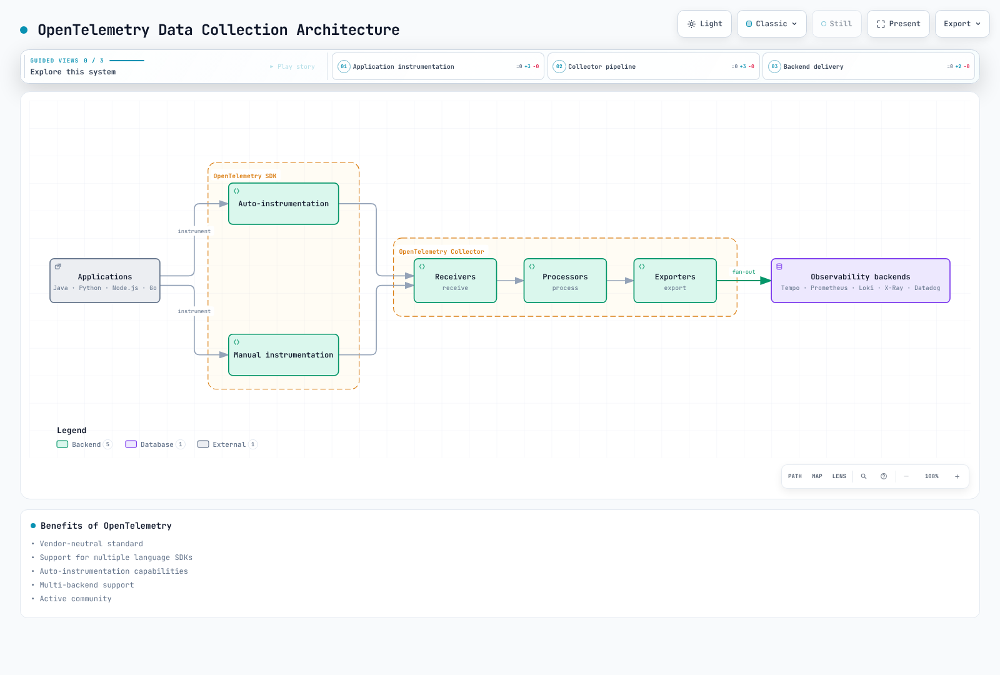
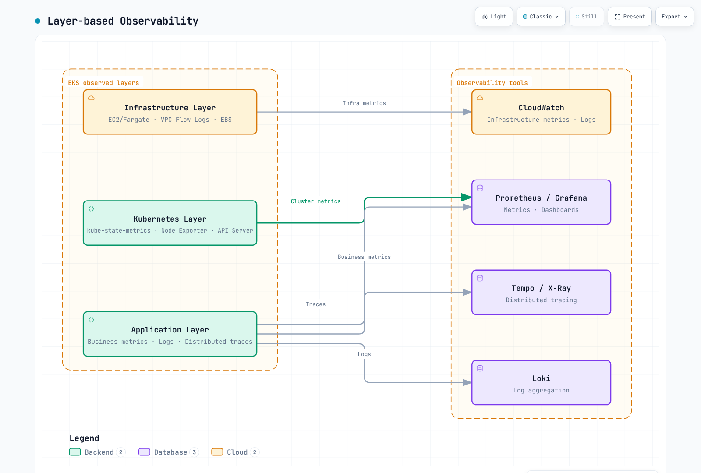

# 可观测性概览

> **最后审核**：2026 年 9 月 12 日。

## 简介

在现代分布式系统中，尤其是基于 Kubernetes 的微服务架构中，通过外部输出观察和了解系统内部状态的能力至关重要。这称为**可观测性**。

## 可观测性与监控

监控是收集和分析系统行为并对变化作出响应的活动。可观测性描述的是输出在多大程度上能帮助你了解内部状态。二者相辅相成：监控可以包括日志、追踪和诊断查询。

| 方面 | 监控 | 可观测性 |
| --- | --- | --- |
| **关注点** | 持续评估健康状况和对用户的影响 | 提供足够的可见性，以解释系统行为 |
| **实践** | SLO、仪表板、告警和调查 | 埋点、上下文、关联和探索 |
| **问题** | 发生了什么变化，为什么会故障？ | 是否有足够的证据回答这些问题？ |
| **数据** | 指标、日志、追踪和其他有用信号 | 这些信号的质量、覆盖率及相互关联 |
| **复杂性** | 适用于简单系统和分布式系统 | 围绕系统和运维目标设计 |

## 可观测性的三大支柱

日志、指标和追踪是三种广泛使用的信号，但它们并不能穷尽可观测性的定义。性能剖析也可以描述代码级的资源使用情况；各类信号的成熟度在 OpenTelemetry 中有所不同，其中性能剖析支持仍在开发中。

### 1. 日志

日志是系统中发生的单个事件的记录。

**特点：**
- 离散事件的记录；防篡改能力和保留保证取决于存储配置
- 包含时间戳和上下文信息
- 结构化（JSON）或非结构化格式
- 通过有意识地规划事件覆盖范围、访问控制和保留策略，可用于调试和审计

**使用场景：**
- 错误和异常追踪
- 安全审计
- 合规
- 详细调试

**工具作用**：Loki、Elasticsearch/OpenSearch 和 CloudWatch Logs 提供存储/查询后端；Fluent Bit 用于采集和转发记录。

### 2. 指标

指标是随时间变化的数值测量数据。

**特点：**
- 以时间序列数据的形式存储
- 支持聚合和数学运算
- 在控制基数和采集量时可实现高效存储
- 适合趋势分析

**常见的 Prometheus 指标类型：**
- **Counter**：持续递增的累计值，可重置为零，例如在重启时重置（如请求计数）
- **Gauge**：可增加或减少的当前测量值（如内存使用量）
- **Histogram**：观测值的分布（如响应时间）；经典直方图和原生直方图在表示方式和查询语法上有所不同
- **Summary**：观测次数/总和，以及根据具体实现预先计算的分位数；对实例分位数取平均并不能得出有效的全服务集群分位数

**工具**：Prometheus、VictoriaMetrics、CloudWatch Metrics、Datadog

### 3. 追踪

追踪通过 Span 描述相关工作经过的观测路径。埋点缺失、采样、传播失败和数据丢失都可能导致追踪不完整。

**特点：**
- 可视化服务之间的请求流
- 测量每个步骤的延迟
- 识别瓶颈
- 分析依赖关系

**组成部分：**
- **Trace**：通过共同的 TraceID 连接起来的相关 Span
- **Span**：单个工作单元
- **SpanContext**：用于传播追踪上下文的 TraceID、SpanID、追踪标志和 tracestate

**工具**：Tempo、Jaeger、X-Ray、Zipkin、Datadog APM

## 三大支柱之间的关联

在配置好埋点、采集和后端链接后，可以关联各种信号。仅仅存在这些信号，并不会自动连接每个事件。


[🔍 查看交互式图表](https://www.atomai.click/kubernetes-docs/archmaps/en-observability-readme-2.html)

图中为便于说明而缩短了 ID。在实际数据中，请使用下方展示的有效完整长度 ID。指标关联使用示例元数据；常规指标标签应保持有限的基数。

### Trace 到日志的关联

当存在活跃的追踪上下文时，记录 TraceID 和 SpanID，以便将发出的日志事件关联到 Span。后台日志或未埋点的日志可能没有这些 ID。以下是应用程序 JSON 示例，并非完整的 OTLP 请求负载。

```json
{
  "timestamp": "2025-02-15T10:30:00Z",
  "level": "ERROR",
  "message": "Payment processing failed",
  "traceId": "4bf92f3577b34da6a3ce929d0e0e4736",
  "spanId": "00f067aa0ba902b7",
  "service": "payment-service"
}
```

W3C 格式的 TraceID 包含 32 个十六进制字符，SpanID 包含 16 个；全零 ID 无效。JSON 中保留的是用于说明的历史事件时间戳。

### 指标到追踪的关联（Exemplar）

Exemplar 是一种独立的元数据，可将某个观测值关联到一条追踪。若在普通指标序列上按每个请求添加 TraceID，会造成高基数，因此应使用 Exemplar 或日志字段。以下是一个完整的经典直方图 OpenMetrics 文本示例，其中包含用于说明的测量值。

```text
# HELP http_request_duration_seconds Observed HTTP request duration.
# TYPE http_request_duration_seconds histogram
# UNIT http_request_duration_seconds seconds
http_request_duration_seconds_bucket{le="0.5"} 1000 # {trace_id="4bf92f3577b34da6a3ce929d0e0e4736"} 0.42
http_request_duration_seconds_bucket{le="+Inf"} 1000
http_request_duration_seconds_sum 123.4
http_request_duration_seconds_count 1000
# EOF
```

Exemplar 需要同时包含标签集和观测值（`0.42`）；时间戳为可选项。采集/存储系统必须支持并保留 Exemplar，数据源链接必须将 `trace_id` 标签映射到追踪后端。所引用的追踪也必须已被采样并保留。

## OpenTelemetry 与标准化

OpenTelemetry (OTel) 提供与供应商无关的 API、SDK、埋点和 Collector 工具。支持的信号和自动埋点能力因语言、框架和组件版本而异。



[🔍 查看交互式图表](https://www.atomai.click/kubernetes-docs/archmaps/en-observability-readme-3.html)

这是一种部署模式。应用也可以直接导出到受支持的后端。必须针对所选信号配置 Collector 接收器、处理器和导出器；各组件的成熟度有所不同。

**OpenTelemetry 的优势：**
- 与供应商无关的标准
- 支持多种语言的 SDK
- 自动埋点能力
- 支持多个后端
- 活跃的社区

## EKS 环境的可观测性策略

在 Amazon EKS 中实施有效可观测性的策略：

### 1. 分层可观测性



[🔍 查看交互式图表](https://www.atomai.click/kubernetes-docs/archmaps/en-observability-readme-4.html)

这些是信号路径示例，并不表示工具只能用于特定层。CloudWatch 和其他后端可以覆盖多个层级。节点级采集器必须采用所选 EKS 计算模式支持的访问方式和部署模式。

### 2. 工具选择示例

| 功能 | 自托管示例 | AWS 托管示例 | 商业平台 |
|----------|-------------|------------|------------|
| 指标 | Prometheus、VictoriaMetrics | CloudWatch、AMP | Datadog、New Relic |
| 日志 | Loki、Elasticsearch/OpenSearch | CloudWatch Logs | Splunk、Datadog |
| 追踪 | Tempo、Jaeger | X-Ray | Datadog APM、Dynatrace |
| 可视化 | Grafana | CloudWatch Dashboards | Datadog、Dynatrace |

### 3. 成本优化策略

- **采样**：在保留的追踪量与调查覆盖率之间取得平衡；尾部采样在作出决定前仍会接收并缓冲数据，因此无法消除所有上游成本
- **保留策略**：优化数据保留期限
- **分层存储**：检查后端支持的存储层级、查询路径和所需保留时长
- **聚合与基数**：控制采集量和标签维度，同时评估聚合会损失哪些诊断细节

## 可观测性成熟度模型

使用此实用规划模型来审视运维目标。它不是产品采购顺序，也不是通用认证等级。评估信号覆盖率、调查速度、可执行的告警和成本；只有在评估过自动分析的行为后，才引入自动分析。

| 审查领域 | 待评估能力 | 工具示例 |
| --- | --- | --- |
| 基础采集 | 所需服务/平台信号的可靠覆盖 | kubectl logs、CloudWatch |
| 集中化 | 合适的保留策略、访问控制和查询能力 | Loki、Prometheus、Grafana |
| 关联 | 通过请求、服务和部署上下文进行关联 | Tempo、Exemplar、TraceID |
| 可选自动化 | 已测试误报、缺失情况和响应行为的分析辅助 | Datadog Watchdog、Dynatrace Intelligence |

## 章节指南

本可观测性章节的组织结构如下：

### [日志记录](./logging/README.md)
日志采集、存储和分析的工具与策略：
- Loki：日志聚合和查询后端
- Fluent Bit：高性能日志采集器
- CloudWatch Logs：AWS 原生日志服务

### [指标](./metrics/README.md)
时间序列指标的采集和分析：
- Prometheus：业界标准指标系统
- VictoriaMetrics：指标存储和查询后端
- CloudWatch Metrics：AWS 原生指标服务

### [追踪](./tracing/README.md)
分布式追踪和请求流分析：
- Tempo：Grafana 的分布式追踪后端
- X-Ray：AWS 原生分布式追踪服务
- OpenTelemetry：标准化埋点
- Dynatrace：AI 驱动的 APM

### [Grafana（仪表板）](./grafana/README.md)
统一的可视化和仪表板：
- 数据源集成
- 仪表板设计模式
- 告警配置

### [告警](./alerting/README.md)
可执行的告警、路由和响应集成。

### [可观测性优化](./09-observability-optimization.md)
采集量、基数、保留策略和运营成本。

### [集成实验](../labs/observability/README.md)
循序渐进的基础设施、技术栈、应用、负载和追踪练习。

## 开始使用

从服务目标、调查问题以及现有平台/采集器能力入手。根据这些需求调整以下示例步骤：

1. **设置指标**：选择 Prometheus、VictoriaMetrics 或合适的托管后端
2. **设置日志采集**：部署 Loki 和 Fluent Bit
3. **设置追踪**：部署 Tempo 或 X-Ray
4. **可视化**：在选定的平台中连接所需的数据源和仪表板
5. **关联**：配置基于 TraceID 的链接

## 参考资料

- [OpenTelemetry 信号](https://opentelemetry.io/docs/concepts/signals/)
- [OpenTelemetry Collector](https://opentelemetry.io/docs/collector/)
- [OpenTelemetry 日志数据模型](https://opentelemetry.io/docs/specs/otel/logs/data-model/)
- [W3C Trace Context](https://www.w3.org/TR/trace-context/)
- [Prometheus 指标类型](https://raw.githubusercontent.com/prometheus/docs/main/docs/concepts/metric_types.md)
- [OpenMetrics 规范](https://raw.githubusercontent.com/prometheus/OpenMetrics/main/specification/OpenMetrics.md)
- [OpenTelemetry 采样](https://opentelemetry.io/docs/concepts/sampling/)
- [Grafana OpenTelemetry 文档](https://grafana.com/docs/opentelemetry/)
- [Amazon EKS 监控和日志记录](https://docs.aws.amazon.com/eks/latest/userguide/eks-observe.html)
- [AWS 可观测性最佳实践](https://aws-observability.github.io/observability-best-practices/)
- [SRE 工作手册：监控](https://sre.google/workbook/monitoring/)
- [Datadog Watchdog](https://docs.datadoghq.com/watchdog/)
- [Dynatrace Intelligence](https://docs.dynatrace.com/docs/dynatrace-intelligence)
