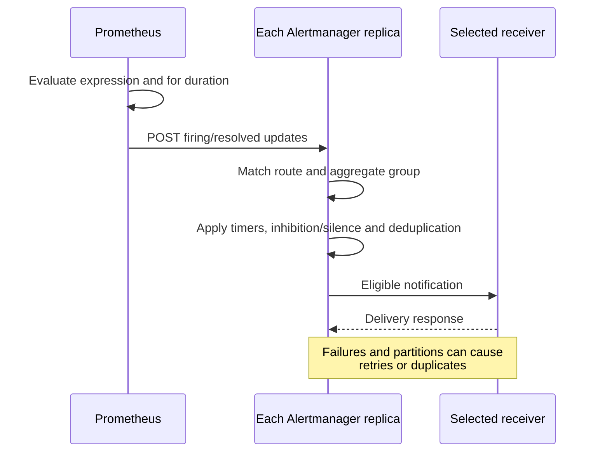
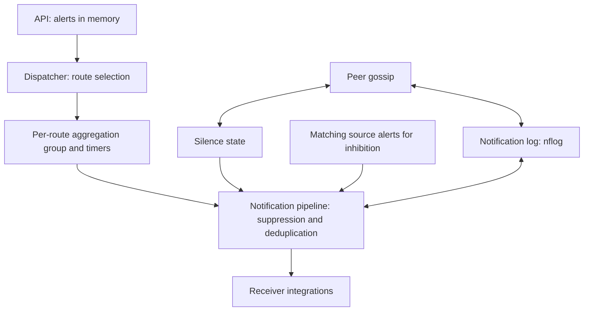
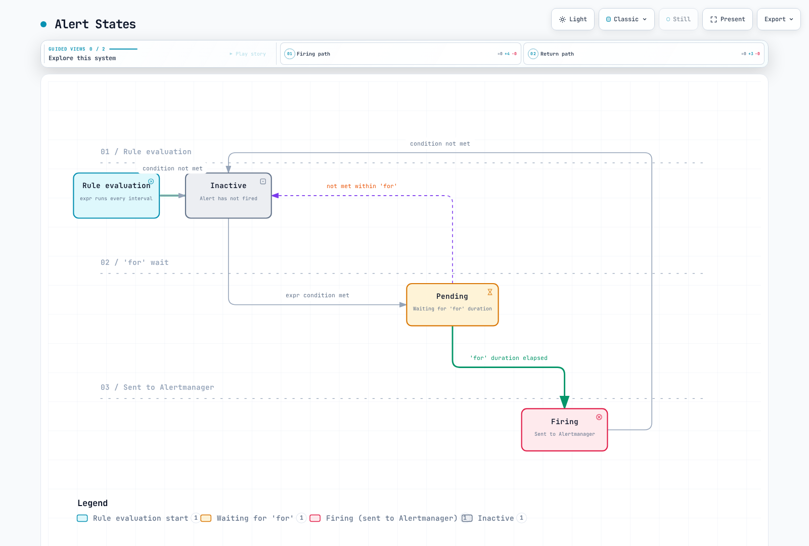
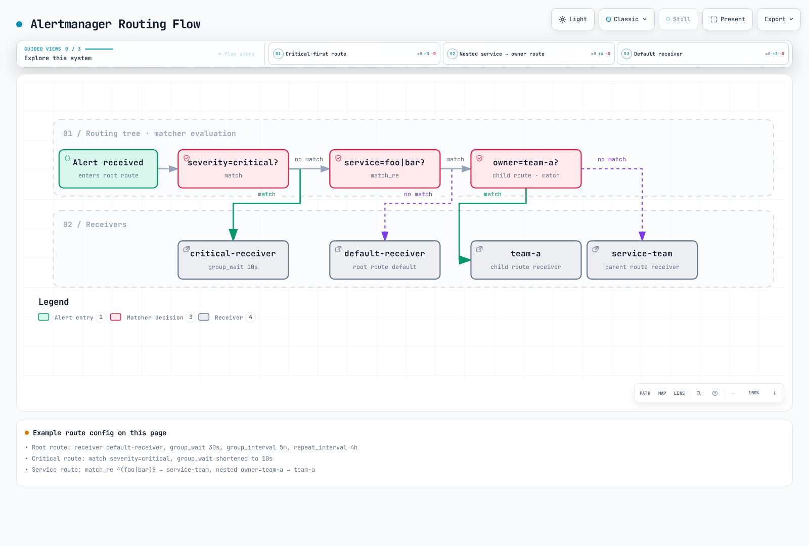
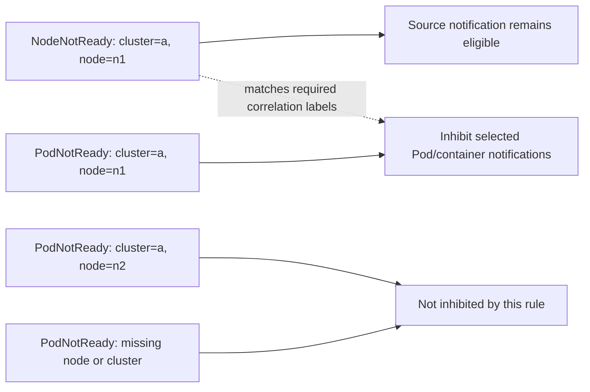
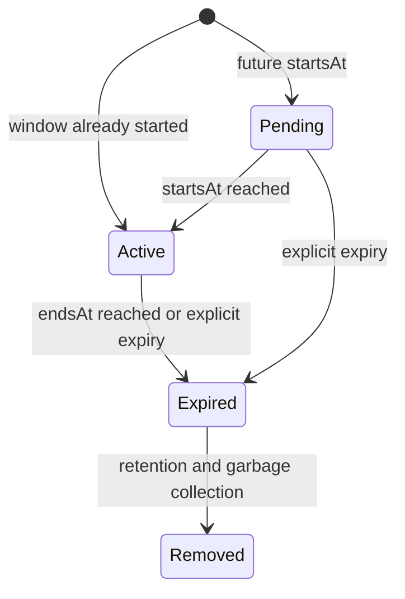
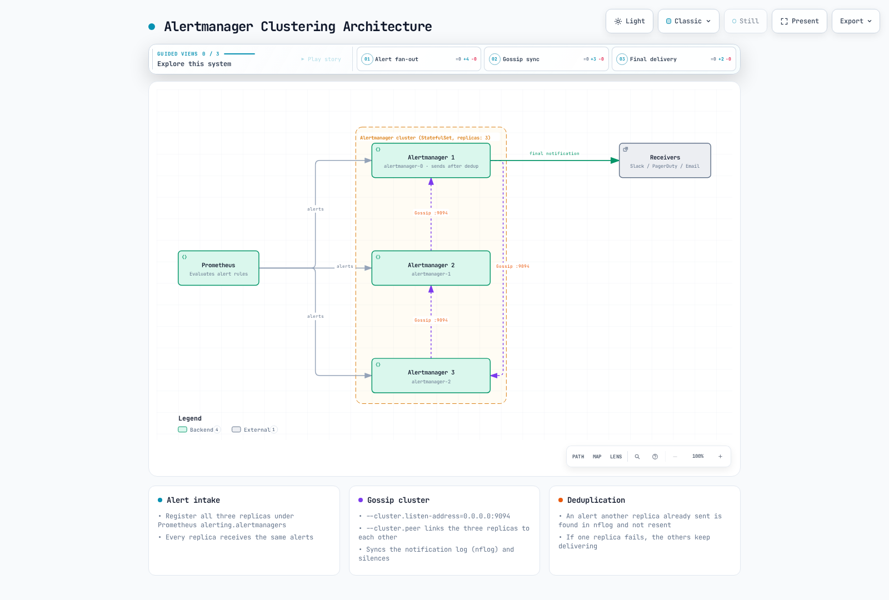

# Prometheus Alertmanager

> **评审基线**：Alertmanager 0.34.0；kube-prometheus-stack 90.0.0 / Operator 0.93.1；独立 chart 1.43.1
> **最后更新**：September 13, 2026

## 目录

- [Alertmanager 概述](#alertmanager-overview)
- [架构](#architecture)
- [安装和配置](#installation-and-configuration)
- [定义告警规则](#defining-alert-rules)
- [路由配置](#routing-configuration)
- [接收器配置](#receiver-configuration)
- [抑制规则](#inhibition-rules)
- [静默](#silencing)
- [模板自定义](#template-customization)
- [高可用配置](#high-availability-configuration)
- [AlertmanagerConfig CRD](#alertmanagerconfig-crd)
- [生产环境告警规则示例](#production-alert-rule-examples)
- [故障排查](#troubleshooting)

---

## Alertmanager 概述

Prometheus Alertmanager 是一个处理 Prometheus 服务器发送的告警的组件。它提供告警去重、分组、路由、抑制和静默等功能。

### 主要功能

1. **分组**会将某个路由/组的告警合并为通知。
2. **抑制和静默**会抑制通知，但不会更改底层 Prometheus 规则条件。
3. **路由**用于选择接收器；一个接收器可以包含多个集成。
4. **HA** 会以最终一致性共享静默和通知日志状态。在发生分区时，它倾向于重复发送，而不是抑制通知；它不保证恰好一次送达。

### Prometheus 告警流程

Prometheus 负责评估规则；Alertmanager 负责处理通知。此序列概述各自的职责，并不保证通知延迟。



## 架构

### Alertmanager 内部结构

dispatcher 会在**选择路由之后**创建组。抑制、静默/时间检查和通知日志去重都在通知管道中执行；它们并不是固定的预分组处理链。Gossip 不会取代 Prometheus 向每个副本发送告警。告警本身不会像静默/nflog 那样持久化。



### 组件说明

| 组件 | 作用 |
|-----------|------|
| **Dispatcher** | 根据路由树将告警路由到相应的接收器 |
| **Inhibitor** | 根据抑制规则抑制相关告警 |
| **Silencer** | 过滤与静默规则匹配的告警 |
| **Aggregation Group** | 将同一组中的告警分组处理 |
| **Notification Pipeline** | 处理实际的告警发送 |
| **nflog** | 记录已发送的告警（用于去重） |

---

## 安装和配置

以下是适用于 Kubernetes 1.35 Linux 工作节点基线的备选示例。两个 Helm chart 和手动 StatefulSet 分别由**不同的安装所有者**管理；请选择其中一种。已对 chart 进行渲染，在本地执行了配置/模板和合成规则，但未执行 Kubernetes 安装、实时 CNI 强制实施、SaaS 交付或生产容量测试。现有安装需要由所有者审核 values 合并和升级计划，不应盲目用本教程替换。

请准备 `monitoring` namespace、三个可调度节点以满足硬反亲和性要求、合适的默认 RWO StorageClass、通知凭据以及已批准的网络路径。EKS Fargate/Auto Mode 和托管控制平面指标有不同的采集/存储限制。特别是，EKS 托管的 etcd 不是客户可抓取的端点。此配置档会禁用 Grafana 和 etcd ServiceMonitor，以便聚焦示例；这并不是要求在现有 stack 中禁用组件。

### 通过 Helm 安装（kube-prometheus-stack）

对于**新 release**，使用下面锁定版本的 stack 配置档。90.0.0 版本包含 Operator 0.93.1 和 Alertmanager 0.34.0。这是经过核验的基线，并不意味着不存在更新的 chart。安装前请检查集群 RBAC、CRD、PVC、namespace 和所有者设置。

```bash
helm repo add prometheus-community https://prometheus-community.github.io/helm-charts
helm repo update
helm template prometheus prometheus-community/kube-prometheus-stack   --version 90.0.0 --namespace monitoring --kube-version 1.35.0   -f kube-prometheus-stack-values.yaml > stack-rendered.yaml
# After reviewing the prerequisites and rendered resources:
helm install prometheus prometheus-community/kube-prometheus-stack   --version 90.0.0 --namespace monitoring --create-namespace   -f kube-prometheus-stack-values.yaml --wait --timeout 10m
```

### Alertmanager 专用 Helm Chart

这是**独立部署的替代方案**，不是 stack 的附加安装步骤。它使用顶层的 `replicaCount`、`resources`、`persistence` 和 `config`；stack 使用 `alertmanager.alertmanagerSpec` 配置副本、资源和存储。先前混用的 values 并未按描述配置任一 chart。

```bash
helm template alertmanager prometheus-community/alertmanager   --version 1.43.1 --namespace monitoring --kube-version 1.35.0   -f alertmanager-values.yaml > alertmanager-rendered.yaml
helm install alertmanager prometheus-community/alertmanager   --version 1.43.1 --namespace monitoring --create-namespace   -f alertmanager-values.yaml --wait --timeout 10m
```

### values.yaml 示例

主配置如下方的 `alertmanager.yaml` 所示。接收器凭据是文件引用，而不是令牌值。所选工作负载启动前，请创建 `notification-credentials` 和 `alertmanager-templates`。文件缺失、频道错误或提供商凭据无效，都不能靠 Helm 渲染成功来解决。

创建**两个不同的 Slack incoming-webhook URL**，并在 Slack 中分别预先配置为对应的频道：`slack-normal-webhook-url` 对应 `#alerts`，`slack-critical-webhook-url` 对应 `#critical-alerts`。incoming webhook 无法通过 `channel` 字段覆盖其配置的频道。这两个文件都是 `notification-credentials` 中的键，并由 stack、独立部署和手动配置档挂载。URL 与频道的配置是提供商的前置条件；本地解析无法验证 Slack 是否成功送达。

**Stack 配置档（`kube-prometheus-stack-values.yaml`）：**

```yaml
grafana:
  enabled: false
alertmanager:
  enabled: true
  config:
    global:
      resolve_timeout: 5m
    route:
      receiver: default-receiver
      group_by:
      - cluster
      - alertname
      - namespace
      group_wait: 30s
      group_interval: 5m
      repeat_interval: 4h
      routes:
      - matchers:
        - severity="critical"
        receiver: critical-receiver
    receivers:
    - name: default-receiver
      slack_configs:
      - api_url_file: /etc/alertmanager/secrets/notification-credentials/slack-normal-webhook-url
        send_resolved: true
        title: '{{ template "slack.custom.title" . }}'
        text: '{{ template "slack.custom.text" . }}'
        color: '{{ template "slack.custom.color" . }}'
    - name: critical-receiver
      slack_configs:
      - api_url_file: /etc/alertmanager/secrets/notification-credentials/slack-critical-webhook-url
        send_resolved: true
        title: '{{ template "slack.custom.title" . }}'
        text: '{{ template "slack.custom.text" . }}'
        color: '{{ template "slack.custom.color" . }}'
      pagerduty_configs:
      - routing_key_file: /etc/alertmanager/secrets/notification-credentials/pagerduty-routing-key
        send_resolved: true
        severity: '{{ if eq .CommonLabels.severity "critical" }}critical{{ else if
          eq .CommonLabels.severity "warning" }}warning{{ else }}info{{ end }}'
        description: '{{ .CommonLabels.alertname }}'
        client: Alertmanager
        client_url: https://alertmanager.example.com
        details:
          cluster: '{{ .CommonLabels.cluster }}'
          namespace: '{{ .CommonLabels.namespace }}'
    inhibit_rules:
    - source_matchers:
      - severity="critical"
      - cluster=~".+"
      - namespace=~".+"
      - alertname=~".+"
      target_matchers:
      - severity="warning"
      - cluster=~".+"
      - namespace=~".+"
      - alertname=~".+"
      equal:
      - cluster
      - namespace
      - alertname
    templates:
    - /etc/alertmanager/configmaps/alertmanager-templates/*.tmpl
  podDisruptionBudget:
    enabled: true
    minAvailable: 2
  alertmanagerSpec:
    replicas: 3
    retention: 120h
    resources:
      requests:
        cpu: 100m
        memory: 256Mi
      limits:
        cpu: 500m
        memory: 512Mi
    podAntiAffinity: hard
    secrets:
    - notification-credentials
    configMaps:
    - alertmanager-templates
    storage:
      volumeClaimTemplate:
        spec:
          accessModes:
          - ReadWriteOnce
          resources:
            requests:
              storage: 10Gi
    automountServiceAccountToken: false
  serviceAccount:
    automountServiceAccountToken: false
prometheus:
  prometheusSpec:
    externalLabels:
      cluster: example-cluster
    ruleSelectorNilUsesHelmValues: false
    ruleSelector:
      matchLabels:
        release: prometheus
    ruleNamespaceSelector:
      matchLabels:
        kubernetes.io/metadata.name: monitoring
kubeEtcd:
  enabled: false
```

**独立配置档（`alertmanager-values.yaml`）：**

```yaml
replicaCount: 3
automountServiceAccountToken: false
resources:
  requests:
    cpu: 100m
    memory: 256Mi
  limits:
    cpu: 500m
    memory: 512Mi
podAntiAffinity: hard
podDisruptionBudget:
  minAvailable: 2
persistence:
  enabled: true
  size: 10Gi
config:
  global:
    resolve_timeout: 5m
  route:
    receiver: default-receiver
    group_by:
    - cluster
    - alertname
    - namespace
    group_wait: 30s
    group_interval: 5m
    repeat_interval: 4h
    routes:
    - matchers:
      - severity="critical"
      receiver: critical-receiver
  receivers:
  - name: default-receiver
    slack_configs:
    - api_url_file: /etc/alertmanager/secrets/notification-credentials/slack-normal-webhook-url
      send_resolved: true
      title: '{{ template "slack.custom.title" . }}'
      text: '{{ template "slack.custom.text" . }}'
      color: '{{ template "slack.custom.color" . }}'
  - name: critical-receiver
    slack_configs:
    - api_url_file: /etc/alertmanager/secrets/notification-credentials/slack-critical-webhook-url
      send_resolved: true
      title: '{{ template "slack.custom.title" . }}'
      text: '{{ template "slack.custom.text" . }}'
      color: '{{ template "slack.custom.color" . }}'
    pagerduty_configs:
    - routing_key_file: /etc/alertmanager/secrets/notification-credentials/pagerduty-routing-key
      send_resolved: true
      severity: '{{ if eq .CommonLabels.severity "critical" }}critical{{ else if eq
        .CommonLabels.severity "warning" }}warning{{ else }}info{{ end }}'
      description: '{{ .CommonLabels.alertname }}'
      client: Alertmanager
      client_url: https://alertmanager.example.com
      details:
        cluster: '{{ .CommonLabels.cluster }}'
        namespace: '{{ .CommonLabels.namespace }}'
  inhibit_rules:
  - source_matchers:
    - severity="critical"
    - cluster=~".+"
    - namespace=~".+"
    - alertname=~".+"
    target_matchers:
    - severity="warning"
    - cluster=~".+"
    - namespace=~".+"
    - alertname=~".+"
    equal:
    - cluster
    - namespace
    - alertname
  templates:
  - /etc/alertmanager/configmaps/alertmanager-templates/*.tmpl
  enabled: true
extraSecretMounts:
- name: notification-credentials
  secretName: notification-credentials
  mountPath: /etc/alertmanager/secrets/notification-credentials
  readOnly: true
extraVolumes:
- name: alertmanager-templates
  configMap:
    name: alertmanager-templates
extraVolumeMounts:
- name: alertmanager-templates
  mountPath: /etc/alertmanager/configmaps/alertmanager-templates
  readOnly: true
hostUsers: true
```

`hostUsers: true` 会使独立基线使用传统用户 namespace；启用 Pod 用户 namespace 需要单独进行运行时/平台检查。资源 requests/limits 和 10Gi PVC 仅用于示例性容量规划，并非经过测试的容量保证。硬反亲和性需要三个符合条件的节点。PDB 限制的是自愿中断，不涵盖所有故障。

### 通过 ConfigMap 直接配置

以下完整核心配置也嵌入在 chart 配置档中。对于手动部署，将其保存为 `alertmanager.yaml`，并将内容放入 ConfigMap 的 `alertmanager.yml` 键中。ConfigMap 包含路径和路由元数据，**不包含凭据**。不要将这种手动管理方式与 Operator 生成的 Secret 混用。

```yaml
global:
  resolve_timeout: 5m
route:
  receiver: default-receiver
  group_by:
  - cluster
  - alertname
  - namespace
  group_wait: 30s
  group_interval: 5m
  repeat_interval: 4h
  routes:
  - matchers:
    - severity="critical"
    receiver: critical-receiver
receivers:
- name: default-receiver
  slack_configs:
  - api_url_file: /etc/alertmanager/secrets/notification-credentials/slack-normal-webhook-url
    send_resolved: true
    title: '{{ template "slack.custom.title" . }}'
    text: '{{ template "slack.custom.text" . }}'
    color: '{{ template "slack.custom.color" . }}'
- name: critical-receiver
  slack_configs:
  - api_url_file: /etc/alertmanager/secrets/notification-credentials/slack-critical-webhook-url
    send_resolved: true
    title: '{{ template "slack.custom.title" . }}'
    text: '{{ template "slack.custom.text" . }}'
    color: '{{ template "slack.custom.color" . }}'
  pagerduty_configs:
  - routing_key_file: /etc/alertmanager/secrets/notification-credentials/pagerduty-routing-key
    send_resolved: true
    severity: '{{ if eq .CommonLabels.severity "critical" }}critical{{ else if eq
      .CommonLabels.severity "warning" }}warning{{ else }}info{{ end }}'
    description: '{{ .CommonLabels.alertname }}'
    client: Alertmanager
    client_url: https://alertmanager.example.com
    details:
      cluster: '{{ .CommonLabels.cluster }}'
      namespace: '{{ .CommonLabels.namespace }}'
inhibit_rules:
- source_matchers:
  - severity="critical"
  - cluster=~".+"
  - namespace=~".+"
  - alertname=~".+"
  target_matchers:
  - severity="warning"
  - cluster=~".+"
  - namespace=~".+"
  - alertname=~".+"
  equal:
  - cluster
  - namespace
  - alertname
templates:
- /etc/alertmanager/configmaps/alertmanager-templates/*.tmpl
```

```bash
# The directory/files must already contain approved credentials; do not commit them.
credential_dir="$PWD/private-notification-credentials"
chmod 700 "$credential_dir"
chmod 600 "$credential_dir"/*
kubectl -n monitoring create secret generic notification-credentials \
  --from-file=slack-normal-webhook-url="$credential_dir/slack-normal-webhook-url" \
  --from-file=slack-critical-webhook-url="$credential_dir/slack-critical-webhook-url" \
  --from-file=pagerduty-routing-key="$credential_dir/pagerduty-routing-key"
# Optional integrations need their own additional files; rotate existing Secrets separately.
```

```bash
kubectl -n monitoring create configmap alertmanager-config   --from-file=alertmanager.yml=alertmanager.yaml
```

请保护 Secret 读取/执行权限以及通知内容本身。只添加启用的集成所需的凭据文件。ConfigMap 投影不会自动触发 Alertmanager 重新加载：请使用所选所有者审核过的重新加载/滚动更新机制；重新加载无效配置时，应继续运行上一个有效配置。

## 定义告警规则

### PrometheusRule CRD

PrometheusRule 必须与 Prometheus 实例的**规则标签和 namespace 选择器**匹配。这些示例使用 `monitoring` 中的 `release: prometheus`，与显式配置的 stack values 相匹配。仅安装 CR 并不能证明它已被选中或成功加载。部署后请核对生效的规则和抓取标签。避免与 stack 现有规则集产生重复告警。

```yaml
apiVersion: monitoring.coreos.com/v1
kind: PrometheusRule
metadata:
  name: kubernetes-alerts
  namespace: monitoring
  labels:
    release: prometheus
spec:
  groups:
  - name: kubernetes.rules
    interval: 30s
    rules:
    - alert: NodeNotReady
      expr: max by (node) (kube_node_status_condition{condition="Ready",status="true"})
        == 0
      for: 5m
      labels:
        severity: critical
        team: sre
      annotations:
        summary: Node {{ $labels.node }} is not ready
        description: Node {{ $labels.node }} has been not ready for more than 5 minutes.
        runbook_url: https://runbooks.example.com/node-not-ready
```

### 告警规则组成部分

`alert` 和 `expr` 用于标识规则及其表达式。非空结果向量表示存在活动告警实例，即使其样本值为零。`for` 会在规则评估期间进行检查；它不是抓取间隔或通知截止时间。`labels` 会影响告警身份/路由；请将会变化的值放在 `annotations` 中，而不是标签中。可选的 `keep_firing_for` 会在条件清除后的一段时间内保留 Firing 状态。请检查已部署的 Prometheus/Operator 版本是否支持该功能。

### 告警状态

以下 Prometheus 状态示意图假设 `for` 时长为正值且未设置 keep_firing_for；对于 `for` 为零的规则，匹配评估时即可立即触发。



[交互式图示](https://www.atomai.click/kubernetes-docs/archmaps/en-observability-alerting-01-alertmanager-2.html)

## 路由配置

### 路由树结构

以下**路由测试配置**声明了所有接收器名称，但没有配置任何集成。在添加已批准的集成之前，它不会发送通知。通常，第一个匹配的同级路由会停止对其他同级路由的遍历；子路由可以选择更具体的接收器。

```yaml
route:
  receiver: default-receiver
  group_by:
  - cluster
  - alertname
  - namespace
  group_wait: 30s
  group_interval: 5m
  repeat_interval: 4h
  routes:
  - matchers:
    - severity="critical"
    receiver: critical-receiver
    group_wait: 10s
  - matchers:
    - service=~"foo|bar"
    receiver: service-team
    routes:
    - matchers:
      - owner="team-a"
      receiver: team-a
receivers:
- name: default-receiver
- name: critical-receiver
- name: service-team
- name: team-a
```

### 路由流程

仅根据标签进行路由，且 continue=false。图示使用旧版 match/match_re 表示法；经过核验的等价配置使用 matchers。时间窗口是否符合条件是独立检查项。



[交互式图示](https://www.atomai.click/kubernetes-docs/archmaps/en-observability-alerting-01-alertmanager-3.html)

### 匹配器

使用带有 `=`、`!=`、`=~` 或 `!~` 的带引号匹配器字符串。同一路由中的匹配器采用 AND 逻辑；正则表达式语义会完整锚定。空标签/缺失标签也会产生影响。在此版本中，旧版 `match`/`match_re` 字段仍可使用，但已弃用。组计时器会从父路由继承；活动/静默时间区间则不会。

```yaml
# Alternative child-route fragments; attach to a complete configuration.
routes:
  - matchers: ['severity="critical"', 'namespace="production"']
    receiver: prod-critical
  - matchers: ['service=~"(api|web|worker).*"', 'environment=~"prod.*"']
    receiver: prod-team
```

### 高级路由示例

将跨午夜的夜间时段拆分，并在**每个**时间区间条目中指定时区。旧的 `18:00→09:00` 范围无法通过原生校验。此扁平示例将时间约束放在实际接收器路由上。非工作时间的 critical 路由使用 `continue: true`：非活动路由仍会匹配标签，否则会阻止后续同级路由，因此不能让它吞掉工作时间路由。此处空的接收器集成是有意设置的测试占位项。

```yaml
route:
  receiver: 'null'
  group_by:
  - cluster
  - alertname
  - namespace
  group_wait: 30s
  group_interval: 5m
  repeat_interval: 4h
  routes:
  - matchers:
    - severity="critical"
    receiver: oncall
    active_time_intervals:
    - offhours
    continue: true
  - matchers:
    - team="infra"
    receiver: infra-team
    active_time_intervals:
    - business-hours
  - matchers:
    - team="dev"
    receiver: dev-team
    active_time_intervals:
    - business-hours
  - receiver: team-slack
    active_time_intervals:
    - business-hours
receivers:
- name: 'null'
- name: oncall
- name: infra-team
- name: dev-team
- name: team-slack
time_intervals:
- name: business-hours
  time_intervals:
  - weekdays:
    - monday:friday
    times:
    - start_time: 09:00
      end_time: '18:00'
    location: Asia/Seoul
- name: offhours
  time_intervals:
  - weekdays:
    - monday:friday
    times:
    - start_time: 00:00
      end_time: 09:00
    - start_time: '18:00'
      end_time: '24:00'
    location: Asia/Seoul
  - weekdays:
    - saturday
    - sunday
    location: Asia/Seoul
```

原生标签路由测试不会评估日历。已使用发布版时间区间实现，另行检查日历在开始/结束边界、周末以及 UTC/KST 时差下的行为。静默或非活动通知不会自动重定向到父路由的备用接收器。

## 接收器配置

### Slack 接收器

对已经绑定到目标 Slack 频道且受保护的 incoming-webhook URL，使用 `api_url_file`。以下普通示例使用 `slack-normal-webhook-url`；critical 路由使用独立的 critical 文件。[Slack 文档说明 incoming webhook 不支持覆盖频道](https://docs.slack.dev/messaging/sending-messages-using-incoming-webhooks/)。经过核验的自定义模板只输出已批准的字段；不要转储所有标签/注释。这些内容可能包含用户数据或机密，截断并不等于隐藏敏感数据。以下是完整配置中的接收器片段。

```yaml
receivers:
- name: slack-notifications
  slack_configs:
  - api_url_file: /etc/alertmanager/secrets/notification-credentials/slack-normal-webhook-url
    send_resolved: true
    title: '{{ template "slack.custom.title" . }}'
    text: '{{ template "slack.custom.text" . }}'
    color: '{{ template "slack.custom.color" . }}'
```

### PagerDuty 接收器

使用 Events API v2 的 `routing_key_file`；旧版 Prometheus 集成使用不同的服务密钥模式，并非同一种凭据。切勿同时设置两者。将严重性映射到 PagerDuty 支持的值；任意 Alertmanager 严重性字符串不会自动成为有效值。以下是完整配置中的接收器片段。

```yaml
receivers:
- name: pagerduty-critical
  pagerduty_configs:
  - routing_key_file: /etc/alertmanager/secrets/notification-credentials/pagerduty-routing-key
    send_resolved: true
    severity: '{{ if eq .CommonLabels.severity "critical" }}critical{{ else if eq
      .CommonLabels.severity "warning" }}warning{{ else }}info{{ end }}'
    description: '{{ .CommonLabels.alertname }}'
    client: Alertmanager
    client_url: https://alertmanager.example.com
    details:
      cluster: '{{ .CommonLabels.cluster }}'
      namespace: '{{ .CommonLabels.namespace }}'
```

### 电子邮件接收器

使用 `auth_password_file`，并要求通过有效的 SMTP 信任配置启用 TLS。地址均为占位符；请审核中继策略、发件人身份以及投递/退信监控。以下是完整配置中的接收器片段。

```yaml
receivers:
- name: email-alerts
  email_configs:
  - to: team@example.com
    from: alertmanager@example.com
    smarthost: smtp.example.com:587
    auth_username: alertmanager@example.com
    auth_password_file: /etc/alertmanager/secrets/notification-credentials/smtp-password
    require_tls: true
    send_resolved: true
    headers:
      Subject: '[{{ .Status | toUpper }}] {{ .CommonLabels.alertname }}'
    html: '{{ template "email.default.html" . }}'
```

### OpsGenie 接收器

这是供**现有客户迁移时参考**的内容。根据 [Atlassian](https://www.atlassian.com/licensing/opsgenie) 的信息，Opsgenie 于 2025 年 6 月 4 日停止销售；支持/访问将于 2027 年 4 月 5 日结束。不要围绕它设计新的长期依赖。请使用当前的 `responders` 格式和受保护的密钥文件。以下是完整配置中的接收器片段。

```yaml
receivers:
- name: opsgenie-existing
  opsgenie_configs:
  - api_key_file: /etc/alertmanager/secrets/notification-credentials/opsgenie-api-key
    api_url: https://api.opsgenie.com/
    send_resolved: true
    message: '{{ .CommonLabels.alertname }}'
    priority: '{{ if eq .CommonLabels.severity "critical" }}P1{{ else if eq .CommonLabels.severity
      "warning" }}P3{{ else }}P5{{ end }}'
    responders:
    - name: sre-team
      type: team
```

### Webhook 接收器

基本身份验证需要 HTTPS；`insecure_skip_verify: false` 并不会加密 `http://` URL。请提供自有接收器、匹配的 TLS 证书/信任配置以及已挂载的凭据文件。设置 `max_alerts: 10` 时，载荷可能会省略部分告警并报告 `truncatedAlerts`；消费者必须处理这种情况。接收器必须实现 Alertmanager webhook 协议，而不能只是返回通用健康检查响应。以下是完整配置中的接收器片段。

```yaml
receivers:
- name: webhook-receiver
  webhook_configs:
  - url: https://alert-webhook.monitoring.svc:8443/alerts
    send_resolved: true
    max_alerts: 10
    http_config:
      basic_auth:
        username: alertmanager
        password_file: /etc/alertmanager/secrets/notification-credentials/webhook-password
      tls_config:
        ca_file: /etc/alertmanager/secrets/notification-credentials/webhook-ca.crt
        insecure_skip_verify: false
```

### 多接收器配置

一个接收器可以通知多个集成，无需使用 `continue`。各提供商的失败和重试相互独立；某个提供商成功并不能证明所有提供商都成功。此示例需要所有列出提供商的文件以及 SMTP/TLS 配置。以下是完整配置中的接收器片段。

```yaml
receivers:
- name: team-all
  slack_configs:
  - api_url_file: /etc/alertmanager/secrets/notification-credentials/slack-normal-webhook-url
    send_resolved: true
    title: '{{ template "slack.custom.title" . }}'
    text: '{{ template "slack.custom.text" . }}'
    color: '{{ template "slack.custom.color" . }}'
  email_configs:
  - to: team@example.com
    from: alertmanager@example.com
    smarthost: smtp.example.com:587
    auth_username: alertmanager@example.com
    auth_password_file: /etc/alertmanager/secrets/notification-credentials/smtp-password
    require_tls: true
    send_resolved: true
    headers:
      Subject: '[{{ .Status | toUpper }}] {{ .CommonLabels.alertname }}'
    html: '{{ template "email.default.html" . }}'
  pagerduty_configs:
  - routing_key_file: /etc/alertmanager/secrets/notification-credentials/pagerduty-routing-key
    send_resolved: true
    severity: '{{ if eq .CommonLabels.severity "critical" }}critical{{ else if eq
      .CommonLabels.severity "warning" }}warning{{ else }}info{{ end }}'
    description: '{{ .CommonLabels.alertname }}'
    client: Alertmanager
    client_url: https://alertmanager.example.com
    details:
      cluster: '{{ .CommonLabels.cluster }}'
      namespace: '{{ .CommonLabels.namespace }}'
```

## 抑制规则

### 抑制概念

抑制针对匹配的**通知**，而不是规则评估或已存储的告警。请使用非空标签限定这种关联范围。节点条件不能成为抑制集群中所有服务告警的依据。



### 抑制规则配置

第一条规则使用带有 kube-state-metrics `node` 标签的 `NodeNotReady`。下方的 Pod 规则使用 `kube_pod_info` 添加节点信息；如果该指标缺失，则仍会保留告警。缺失标签在比较时等同于空值：请在进行相等匹配前要求 `cluster`/`node` 非空。本地测试复现了旧版对无关告警的抑制问题，并验证了这些保护条件。

当受监控集群无法发送告警时，`ClusterDown` 需要一个通过独立渠道送达的源告警。数据库规则需要稳定且共享的 `database_id`，而不是互不相关的抓取 `instance` 标签。启用这些规则前，请先定义这些输入。

```yaml
route:
  receiver: 'null'
receivers:
- name: 'null'
inhibit_rules:
- source_matchers:
  - alertname="NodeNotReady"
  - cluster=~".+"
  - node=~".+"
  target_matchers:
  - alertname=~"PodNotReady|PodCrashLooping|ContainerOOMKilled"
  - cluster=~".+"
  - node=~".+"
  equal:
  - cluster
  - node
- source_matchers:
  - severity="critical"
  - cluster=~".+"
  - namespace=~".+"
  - alertname=~".+"
  target_matchers:
  - severity="warning"
  - cluster=~".+"
  - namespace=~".+"
  - alertname=~".+"
  equal:
  - cluster
  - namespace
  - alertname
- source_matchers:
  - alertname="ClusterDown"
  - cluster=~".+"
  target_matchers:
  - alertname=~"Node.*"
  - cluster=~".+"
  equal:
  - cluster
- source_matchers:
  - alertname="DatabaseDown"
  - cluster=~".+"
  - database_id=~".+"
  target_matchers:
  - alertname=~"DatabaseConnection.*|DatabaseTimeout.*"
  - cluster=~".+"
  - database_id=~".+"
  equal:
  - cluster
  - database_id
```

### 抑制优先级

列表顺序**不是优先级系统**。任何适用的抑制规则都可以抑制目标告警。使用互不重叠的源/目标匹配器和非空关联标签，为基础设施→节点→服务依赖关系建模，然后测试无关节点/集群以及缺失标签。宽泛的 `alertname=~".*"` 加上缺失的 `datacenter` 可能会静默无关事件。不要仅凭严重性推断因果关系。

## 静默

### 创建静默

创建/到期静默会改变通知行为。请核对端点、精确匹配器、作者、原因和有限时间窗口。`--end` 要求明确选择一个未来的 RFC3339 时间；之前固定的 2025 年窗口无法静默当前告警。请使用受支持的 TLS/身份验证配置保护 HTTP 访问；`amtool --http.config.file` 接受受保护的客户端配置文件。

#### 使用 amtool CLI

```bash
# Use an approved authenticated endpoint, or an authorized local port-forward.
: "${ALERTMANAGER_URL:?Set the reviewed Alertmanager URL}"
amtool --alertmanager.url="$ALERTMANAGER_URL" silence add   'alertname="PodCrashLooping"' 'namespace="development"'   --duration=2h --comment="Approved deployment window" --author="operator"
amtool --alertmanager.url="$ALERTMANAGER_URL" silence query
# Copy the specific UUID from the approved operation, never a blanket selection.
: "${SILENCE_ID:?Set the exact silence UUID}"
amtool --alertmanager.url="$ALERTMANAGER_URL" silence expire "$SILENCE_ID"
```

#### 通过 API 创建静默

将此辅助程序的输出保存为 `silence.json`，进行审核，然后使用已配置的身份验证将其 POST 到已批准的 `/api/v2/silences` 端点。不要将凭据值放入命令参数，也不要共享包含运行数据的原始 API 载荷。

```python
# Generates a payload only; it makes no API call.
import datetime
import json
now = datetime.datetime.now(datetime.timezone.utc)
print(json.dumps({
    "matchers": [
        {"name": "alertname", "value": "HighCPU", "isRegex": False, "isEqual": True},
        {"name": "namespace", "value": "development", "isRegex": False, "isEqual": True}
    ],
    "startsAt": now.isoformat(),
    "endsAt": (now + datetime.timedelta(hours=2)).isoformat(),
    "createdBy": "operator",
    "comment": "Approved maintenance window"
}, indent=2))
```

### 静默管理最佳实践

使用经过批准的最短维护/部署窗口，并设置有期限的调查时段。“修复前”仍然需要一个有限的结束时间和所有者审核；四小时只是团队策略示例，并非 Alertmanager 限制。到期后会停止抑制，但记录仍会保留，直到达到保留期限/执行垃圾回收。本地 API 测试验证了这一差异。到期提醒需要单独配置的工作流。



## 模板自定义

### Go 模板基础知识

通知模板接收 `Data`：在根级别使用 `.CommonLabels`、`.CommonAnnotations`、`.GroupLabels` 和 `.Alerts`。在 `range .Alerts` 内部，点号表示单个 Alert，其中有 `.Labels`、`.Annotations` 和 `.StartsAt`。这与 Prometheus 规则注释模板（`$labels`、`$value`）不同。不要对不可信数据使用 `safeHtml`/`safeUrl` 来绕过转义。模板必须挂载并在配置中列出。

### Slack 模板示例

保存为 `slack.tmpl`。空白裁剪会确保颜色结果是一个有效的颜色字符串。这里只输出已批准的字段；此模板不会清理任意敏感注释值。

```text
{{ define "slack.custom.title" -}}
[{{ .Status | toUpper }}{{ if eq .Status "firing" }}:{{ len .Alerts.Firing }}{{ end }}] {{ .CommonLabels.alertname }}
{{- end }}
{{ define "slack.custom.text" -}}
{{ range .Alerts -}}
*Alert:* {{ .Labels.alertname }}
*Severity:* {{ .Labels.severity }}
*Cluster:* {{ .Labels.cluster }}
*Namespace:* {{ .Labels.namespace }}
*Summary:* {{ printf "%.100s" .Annotations.summary }}
*Started:* {{ .StartsAt.Format "2006-01-02 15:04:05 MST" }}
{{ end -}}
{{- end }}
{{ define "slack.custom.color" -}}
{{ if eq .Status "firing" }}{{ if eq .CommonLabels.severity "critical" }}#ff0000{{ else }}#ff9900{{ end }}{{ else }}#36a64f{{ end }}
{{- end }}
{{ define "custom.message" -}}
{{ .CommonLabels.alertname | title }}
{{ range .Alerts -}}
{{ .Labels.namespace | toUpper }}: {{ printf "%.100s" .Annotations.description }}
{{ .StartsAt.Format "2006-01-02 15:04" }}
{{ end -}}
{{ printf "%.2f%%" 95.5 }}
{{- end }}
```

### 模板函数

使用 `if`、`range`、管道以及 `toUpper`、`title`、`printf` 和 `date` 等函数。Go 模板没有 JavaScript 风格的三元表达式。`printf "%.100s"` 会按 rune 限制字符串长度；字节级的 `slice` 可能会拆分韩文 UTF-8 字符。上面的模板演示了根级与单条告警上下文以及数字格式化。

请使用合成通知 Data 进行测试，而不要使用生产载荷：

将此合成的仅模板输入保存为 `synthetic-notification.json`；其中的时间戳不会创建或发送告警。

```json
{
  "receiver": "local-test",
  "status": "firing",
  "groupLabels": {
    "alertname": "HighCPU"
  },
  "commonLabels": {
    "alertname": "HighCPU",
    "severity": "critical"
  },
  "commonAnnotations": {},
  "externalURL": "https://alertmanager.example.com",
  "alerts": [
    {
      "status": "firing",
      "labels": {
        "alertname": "HighCPU",
        "namespace": "demo",
        "cluster": "example-cluster",
        "severity": "critical"
      },
      "annotations": {
        "summary": "Synthetic example",
        "description": "Synthetic example"
      },
      "startsAt": "2026-09-13T00:00:00Z",
      "endsAt": "2026-09-13T01:00:00Z",
      "generatorURL": "",
      "fingerprint": "synthetic"
    }
  ]
}
```

```bash
amtool template render --template.glob=slack.tmpl   --template.data=synthetic-notification.json   --template.text='{{ template "slack.custom.title" . }}'
```

### 通过 ConfigMap 管理模板

Stack 配置档通过 `alertmanagerSpec.configMaps` 挂载此 ConfigMap；独立配置档使用显式卷。两者都配置 `/etc/alertmanager/configmaps/alertmanager-templates/*.tmpl`。如果创建的 ConfigMap 没有对应的挂载/路径，就不会产生任何作用。请通过所选安装所有者重新加载。

```yaml
apiVersion: v1
kind: ConfigMap
metadata:
  name: alertmanager-templates
  namespace: monitoring
data:
  slack.tmpl: '{{ define "slack.custom.title" -}}

    [{{ .Status | toUpper }}{{ if eq .Status "firing" }}:{{ len .Alerts.Firing }}{{
    end }}] {{ .CommonLabels.alertname }}

    {{- end }}

    {{ define "slack.custom.text" -}}

    {{ range .Alerts -}}

    *Alert:* {{ .Labels.alertname }}

    *Severity:* {{ .Labels.severity }}

    *Cluster:* {{ .Labels.cluster }}

    *Namespace:* {{ .Labels.namespace }}

    *Summary:* {{ printf "%.100s" .Annotations.summary }}

    *Started:* {{ .StartsAt.Format "2006-01-02 15:04:05 MST" }}

    {{ end -}}

    {{- end }}

    {{ define "slack.custom.color" -}}

    {{ if eq .Status "firing" }}{{ if eq .CommonLabels.severity "critical" }}#ff0000{{
    else }}#ff9900{{ end }}{{ else }}#36a64f{{ end }}

    {{- end }}

    {{ define "custom.message" -}}

    {{ .CommonLabels.alertname | title }}

    {{ range .Alerts -}}

    {{ .Labels.namespace | toUpper }}: {{ printf "%.100s" .Annotations.description
    }}

    {{ .StartsAt.Format "2006-01-02 15:04" }}

    {{ end -}}

    {{ printf "%.2f%%" 95.5 }}

    {{- end }}

    '
```

## 高可用配置

### 集群架构

健康且已收敛的 HA 示例：每个副本都会接收告警。图示中的单次送达并非普遍保证；分区或重试都可能导致重复。



[交互式图示](https://www.atomai.click/kubernetes-docs/archmaps/en-observability-alerting-01-alertmanager-6.html)

### StatefulSet 配置

这是**手动部署的替代方案**，使用前述 ConfigMap、模板和凭据 Secret。API/UI 和 gossip 端口是内部服务；它们不会仅仅因为使用 ClusterIP 就具备身份验证。请执行适当的网络访问控制，并在生产环境中先审核[受支持的 TLS/身份验证配置](https://github.com/prometheus/alertmanager/blob/v0.34.0/docs/https.md)。Gossip 默认未加密；其试验性的双向 TLS 传输具有不同的 TCP-only 行为。以下基线展示的是普通 TCP/UDP gossip，并非经过验证的安全生产拓扑。

并行 Pod 启动、用于发现尚未就绪 peer 的 headless DNS、两种 gossip 协议以及持久化状态均已明确配置。`publishNotReadyAddresses` 有助于 peer 发现，但不会使未就绪成员变为健康。告警本身不会持久化；Prometheus 必须重新发送告警。请审核 StorageClass/AZ 绑定、中断策略和资源容量规划。

```yaml
apiVersion: apps/v1
kind: StatefulSet
metadata:
  name: alertmanager-demo
  namespace: monitoring
spec:
  serviceName: alertmanager-demo
  podManagementPolicy: Parallel
  replicas: 3
  selector:
    matchLabels:
      app: alertmanager-demo
  template:
    metadata:
      labels:
        app: alertmanager-demo
    spec:
      automountServiceAccountToken: false
      securityContext:
        runAsNonRoot: true
        runAsUser: 65534
        runAsGroup: 65534
        fsGroup: 65534
        seccompProfile:
          type: RuntimeDefault
      affinity:
        podAntiAffinity:
          requiredDuringSchedulingIgnoredDuringExecution:
          - labelSelector:
              matchLabels:
                app: alertmanager-demo
            topologyKey: kubernetes.io/hostname
      containers:
      - name: alertmanager
        image: quay.io/prometheus/alertmanager:v0.34.0
        args:
        - --config.file=/etc/alertmanager/config-main/alertmanager.yml
        - --storage.path=/alertmanager
        - --data.retention=120h
        - --cluster.listen-address=0.0.0.0:9094
        - --cluster.peer=alertmanager-demo-0.alertmanager-demo.monitoring.svc:9094
        - --cluster.peer=alertmanager-demo-1.alertmanager-demo.monitoring.svc:9094
        - --cluster.peer=alertmanager-demo-2.alertmanager-demo.monitoring.svc:9094
        ports:
        - name: http
          containerPort: 9093
        - name: gossip-tcp
          containerPort: 9094
          protocol: TCP
        - name: gossip-udp
          containerPort: 9094
          protocol: UDP
        securityContext:
          allowPrivilegeEscalation: false
          readOnlyRootFilesystem: true
          capabilities:
            drop:
            - ALL
        readinessProbe:
          httpGet:
            path: /-/ready
            port: http
          periodSeconds: 5
        livenessProbe:
          httpGet:
            path: /-/healthy
            port: http
          initialDelaySeconds: 10
          periodSeconds: 10
        volumeMounts:
        - name: config
          mountPath: /etc/alertmanager/config-main
          readOnly: true
        - name: templates
          mountPath: /etc/alertmanager/configmaps/alertmanager-templates
          readOnly: true
        - name: credentials
          mountPath: /etc/alertmanager/secrets/notification-credentials
          readOnly: true
        - name: storage
          mountPath: /alertmanager
        resources:
          requests:
            cpu: 100m
            memory: 256Mi
          limits:
            cpu: 500m
            memory: 512Mi
      volumes:
      - name: config
        configMap:
          name: alertmanager-config
      - name: templates
        configMap:
          name: alertmanager-templates
      - name: credentials
        secret:
          secretName: notification-credentials
  volumeClaimTemplates:
  - metadata:
      name: storage
    spec:
      accessModes:
      - ReadWriteOnce
      resources:
        requests:
          storage: 10Gi
---
apiVersion: v1
kind: Service
metadata:
  name: alertmanager-demo
  namespace: monitoring
spec:
  clusterIP: None
  publishNotReadyAddresses: true
  selector:
    app: alertmanager-demo
  ports:
  - name: http
    port: 9093
    targetPort: http
  - name: gossip-tcp
    port: 9094
    targetPort: gossip-tcp
    protocol: TCP
  - name: gossip-udp
    port: 9094
    targetPort: gossip-udp
    protocol: UDP
---
apiVersion: policy/v1
kind: PodDisruptionBudget
metadata:
  name: alertmanager-demo
  namespace: monitoring
spec:
  minAvailable: 2
  selector:
    matchLabels:
      app: alertmanager-demo
```

### Prometheus 集成配置

将此片段合并到**手动管理的 Prometheus 所有者**的完整配置中。请选择 DNS 发现或列出每个副本的显式列表，不要同时配置两份重复列表。不要通过负载均衡在多个副本间分发通知。Operator stack 会管理自己的告警发现。

只有当 `prometheus_replica` 是等价 HA Prometheus 服务器的区分标签时，才应移除它。请保留 cluster/tenant 标签；不加区分地删除标签可能会合并无关告警。此示例使用 IPv4 DNS A 记录；IPv6 请使用已部署的地址族配置。

```yaml
global:
  external_labels:
    cluster: example-cluster
alerting:
  alert_relabel_configs:
  - action: labeldrop
    regex: prometheus_replica
  alertmanagers:
  - dns_sd_configs:
    - names:
      - alertmanager-demo.monitoring.svc.cluster.local
      type: A
      port: 9093
```

## AlertmanagerConfig CRD

### Namespace 范围的配置

打包的 Operator 0.93.1 CRD 仍以 **v1alpha1** 提供/存储。请将对象标签与下方的选择器配置相匹配，并显式选择已批准的 namespace。默认/namespace 范围匹配会将导入的路由/抑制规则限制在对象所在的 namespace；它不会对客户端提供的告警标签进行身份验证。请保护 CRD/Secret 写入权限和可信告警入口。全局 `alertmanagerConfiguration` 是另一种模式，此处不作说明。

```yaml
apiVersion: v1
kind: Namespace
metadata:
  name: team-a
  labels:
    monitoring.example.com/alert-configs: 'true'
---
apiVersion: monitoring.coreos.com/v1alpha1
kind: AlertmanagerConfig
metadata:
  name: team-a-config
  namespace: team-a
  labels:
    alertmanagerConfig: enabled
spec:
  route:
    receiver: team-a-slack
    groupBy:
    - alertname
    - namespace
    matchers:
    - name: namespace
      value: team-a
      matchType: '='
    routes:
    - receiver: team-a-critical
      matchers:
      - name: severity
        value: critical
        matchType: '='
  receivers:
  - name: team-a-slack
    slackConfigs:
    - apiURL:
        name: slack-webhook-secret
        key: normal-webhook-url
      sendResolved: true
  - name: team-a-critical
    slackConfigs:
    - apiURL:
        name: slack-webhook-secret
        key: critical-webhook-url
      sendResolved: true
    pagerdutyConfigs:
    - routingKey:
        name: pagerduty-secret
        key: routing-key
      sendResolved: true
  inhibitRules:
  - sourceMatch:
    - name: severity
      value: critical
      matchType: '='
    - name: cluster
      value: .+
      matchType: =~
    - name: alertname
      value: .+
      matchType: =~
    targetMatch:
    - name: severity
      value: warning
      matchType: '='
    - name: cluster
      value: .+
      matchType: =~
    - name: alertname
      value: .+
      matchType: =~
    equal:
    - cluster
    - namespace
    - alertname
```

### Secret 引用

对于 team-a 示例，请为 `#team-a-alerts` 和 `#team-a-critical` 创建不同的 URL。分别将其存储在 `slack-webhook-secret` 的 `normal-webhook-url` 和 `critical-webhook-url` 键下。AlertmanagerConfig 会选择这些不同的键；它不会通过更改频道字段来重定向同一个 webhook。

请先创建 namespace，再创建这些 Secret，并在所选配置被协调之前创建 Secret。Secret 名称/键必须与 AlertmanagerConfig 匹配，并且位于其所在的 namespace 中。请妥善保管本地凭据文件，并单独轮换已有 Secret。

```bash
# team-a namespace is declared in team-a-alertmanagerconfig.yaml.
# Supply protected files, without exposing values in argv or committed YAML.
kubectl -n team-a create secret generic slack-webhook-secret \
  --from-file=normal-webhook-url=private-team-a/slack-normal-webhook-url \
  --from-file=critical-webhook-url=private-team-a/slack-critical-webhook-url
kubectl -n team-a create secret generic pagerduty-secret   --from-file=routing-key=private-team-a/pagerduty-routing-key
```

### Alertmanager AlertmanagerConfig 选择

这是一个 **kube-prometheus-stack values 覆盖配置**，不是 Alertmanager API 对象。请将其与选定的 stack 配置档合并。先前 `team-a` 与 `enabled` 之间的标签不匹配，导致没有选中任何配置。显式指定 namespace 标签可避免意外选中所有 namespace。

```yaml
alertmanager:
  alertmanagerSpec:
    alertmanagerConfigSelector:
      matchLabels:
        alertmanagerConfig: enabled
    alertmanagerConfigNamespaceSelector:
      matchLabels:
        monitoring.example.com/alert-configs: 'true'
    alertmanagerConfigMatcherStrategy:
      type: OnNamespace
```

## 生产环境告警规则示例

### 节点告警

node-exporter 抓取失败并不能证明节点实际宕机；`NodeExporterUnavailable` 体现了这一区别。文件系统空间不足不是 Kubernetes 的 DiskPressure 条件，因此规则命名为 `NodeFilesystemSpaceLow`。请检查实际的 job/instance/device 标签以及只读文件系统。阈值仅为策略示例，并非适用于所有环境的生产限制。

```yaml
apiVersion: monitoring.coreos.com/v1
kind: PrometheusRule
metadata:
  name: node-alerts
  namespace: monitoring
  labels:
    release: prometheus
spec:
  groups:
  - name: node.rules
    rules:
    - alert: NodeExporterUnavailable
      expr: up{job="node-exporter"} == 0
      for: 5m
      labels:
        severity: critical
        team: sre
      annotations:
        summary: Node-exporter scrape unavailable for {{ $labels.instance }}
        description: The node-exporter target has not been scraped successfully for
          at least 5 minutes; inspect the exporter, access and network path. Physical
          node failure is not established.
    - alert: NodeHighCPU
      expr: 100 - (avg by(instance) (rate(node_cpu_seconds_total{mode="idle"}[5m]))
        * 100) > 80
      for: 10m
      labels:
        severity: warning
        team: sre
      annotations:
        summary: High CPU usage on {{ $labels.instance }}
        description: CPU usage is {{ $value | printf "%.2f" }}%
    - alert: NodeHighMemory
      expr: (1 - (node_memory_MemAvailable_bytes / node_memory_MemTotal_bytes)) *
        100 > 90
      for: 10m
      labels:
        severity: warning
        team: sre
      annotations:
        summary: High memory usage on {{ $labels.instance }}
        description: Memory usage is {{ $value | printf "%.2f" }}%
    - alert: NodeFilesystemSpaceLow
      expr: "(100 * node_filesystem_avail_bytes{fstype!~\"tmpfs|overlay\"}\n / node_filesystem_size_bytes{fstype!~\"\
        tmpfs|overlay\"} < 15)\nand (node_filesystem_size_bytes{fstype!~\"tmpfs|overlay\"\
        } > 0)\nand (node_filesystem_readonly{fstype!~\"tmpfs|overlay\"} == 0)"
      for: 5m
      labels:
        severity: warning
        team: sre
      annotations:
        summary: Low disk space on {{ $labels.instance }}
        description: Disk {{ $labels.mountpoint }} has only {{ $value | printf "%.2f"
          }}% free
    - alert: NodeNetworkErrors
      expr: 'rate(node_network_receive_errs_total[5m]) > 10

        or

        rate(node_network_transmit_errs_total[5m]) > 10'
      for: 5m
      labels:
        severity: warning
        team: sre
      annotations:
        summary: Network errors on {{ $labels.instance }}
    interval: 30s
```

### Pod 和容器告警

对于 `PodCrashLooping`，应在 UID/node 信息增强**之前**对每个指标序列应用 `max_over_time(waiting_reason[5m])`，然后要求该观测条件持续 `10m`。重试间隙可能会清除瞬时 waiting reason；这个有界时间窗口可以跨越短于五分钟的间隙。一次性的 waiting 样本会在满足十分钟保持时间之前过期。此规则检测的是重复出现的观测，而不是连续等待十分钟。清除告警可能会在最后一次观测后延迟最多五分钟，再加上抓取/评估延迟。

就绪状态并不只取决于 Pod 阶段。这些规则排除已完成/正在删除的 Pod，区分 CrashLoopBackOff 与普通重启，并结合近期重启和最后一次 OOM 原因。kube-state-metrics 2.20.0 中最后终止/删除指标仍为实验性指标；请验证其是否可用。节点信息通过 Pod UID 关联；即使 info 缺失，也会保留告警。内存限制必须为正值；CFS 周期节流百分比并不是 CPU 时间百分比。

```yaml
apiVersion: monitoring.coreos.com/v1
kind: PrometheusRule
metadata:
  name: pod-alerts
  namespace: monitoring
  labels:
    release: prometheus
spec:
  groups:
  - name: pod.rules
    rules:
    - alert: PodNotReady
      expr: "(((max by (namespace, pod, uid) (kube_pod_status_ready{condition=\"true\"\
        } == 0)\n and on (namespace, pod, uid)\n max by (namespace, pod, uid) (kube_pod_status_phase{phase=~\"\
        Pending|Running|Unknown\"} == 1))\n unless on (namespace, pod, uid) (kube_pod_deletion_timestamp\
        \ > 0)) * on (namespace, pod, uid) group_left (node) max by (namespace, pod,\
        \ uid, node) (kube_pod_info))\nor on (namespace, pod, uid) ((max by (namespace,\
        \ pod, uid) (kube_pod_status_ready{condition=\"true\"} == 0)\n and on (namespace,\
        \ pod, uid)\n max by (namespace, pod, uid) (kube_pod_status_phase{phase=~\"\
        Pending|Running|Unknown\"} == 1))\n unless on (namespace, pod, uid) (kube_pod_deletion_timestamp\
        \ > 0))"
      for: 15m
      labels:
        severity: warning
        team: sre
      annotations:
        summary: Pod {{ $labels.namespace }}/{{ $labels.pod }} is not ready
        description: A non-terminal, non-deleting Pod remained not ready for 15 minutes.
    - alert: PodCrashLooping
      expr: '((max by (namespace, pod, container, uid) (max_over_time(kube_pod_container_status_waiting_reason{reason="CrashLoopBackOff"}[5m]))
        == 1) * on (namespace, pod, uid) group_left (node) max by (namespace, pod,
        uid, node) (kube_pod_info))

        or on (namespace, pod, container, uid) (max by (namespace, pod, container,
        uid) (max_over_time(kube_pod_container_status_waiting_reason{reason="CrashLoopBackOff"}[5m]))
        == 1)'
      for: 10m
      labels:
        severity: warning
        team: sre
      annotations:
        summary: Recurring CrashLoopBackOff observations for {{ $labels.namespace
          }}/{{ $labels.pod }}
        description: CrashLoopBackOff was observed within each rolling 5-minute window
          for at least 10 minutes. Retry gaps are bridged; recovery can take up to
          5 minutes plus scrape/evaluation delay to clear.
    - alert: ContainerOOMKilled
      expr: "(((max by (namespace, pod, container, uid) (increase(kube_pod_container_status_restarts_total[5m]))\
        \ > 0)\n and on (namespace, pod, container, uid)\n (max by (namespace, pod,\
        \ container, uid) (kube_pod_container_status_last_terminated_reason{reason=\"\
        OOMKilled\"}) == 1)) * on (namespace, pod, uid) group_left (node) max by (namespace,\
        \ pod, uid, node) (kube_pod_info))\nor on (namespace, pod, container, uid)\
        \ ((max by (namespace, pod, container, uid) (increase(kube_pod_container_status_restarts_total[5m]))\
        \ > 0)\n and on (namespace, pod, container, uid)\n (max by (namespace, pod,\
        \ container, uid) (kube_pod_container_status_last_terminated_reason{reason=\"\
        OOMKilled\"}) == 1))"
      for: 0m
      labels:
        severity: warning
        team: sre
      annotations:
        summary: 'Recent restart with last termination reason OOMKilled: {{ $labels.namespace
          }}/{{ $labels.pod }}/{{ $labels.container }}'
        description: A five-minute restart increase plus the last reason is evidence
          of a recent OOM-related restart, not an exact OOM event counter.
    - alert: ContainerCPUThrottled
      expr: '(100 * sum by (namespace, pod, container) (rate(container_cpu_cfs_throttled_periods_total{container!="",container!="POD"}[5m]))
        / sum by (namespace, pod, container) (rate(container_cpu_cfs_periods_total{container!="",container!="POD"}[5m]))
        > 25)

        and on (namespace, pod, container) (sum by (namespace, pod, container) (rate(container_cpu_cfs_periods_total{container!="",container!="POD"}[5m]))
        > 0)'
      for: 10m
      labels:
        severity: warning
        team: sre
      annotations:
        summary: Container CPU throttling periods are high
        description: '{{ $value | printf "%.2f" }}% of measured CFS periods were throttled;
          this is not percentage of CPU time.'
    - alert: ContainerMemoryNearLimit
      expr: '(100 * max by (namespace, pod, container) (container_memory_working_set_bytes{container!="",container!="POD"})
        / max by (namespace, pod, container) (kube_pod_container_resource_limits{resource="memory",unit="byte"})
        > 90)

        and on (namespace, pod, container) (max by (namespace, pod, container) (kube_pod_container_resource_limits{resource="memory",unit="byte"})
        > 0)'
      for: 5m
      labels:
        severity: warning
        team: sre
      annotations:
        summary: Container {{ $labels.container }} memory usage is near limit
        description: Working set is {{ $value | printf "%.2f" }}% of the positive
          configured memory limit.
    interval: 30s
```

### API Server 告警

经过核验的 stack ServiceMonitor 使用 `job="apiserver"`；请验证实际目标标签。没有成功抓取可能意味着发现/RBAC/TLS/网络故障，并不一定表示 API server 故障。只有在总请求数存在时，错误率才会将缺失的 5xx 分子补为零，并且会排除零流量情况。百分比值乘以 100。客户端证书直方图在 Kubernetes 1.35 源码中为 ALPHA，用于观测请求证书；近期分位数并不是完整的证书清单，也不是 AWS IAM 凭据到期监控。

```yaml
apiVersion: monitoring.coreos.com/v1
kind: PrometheusRule
metadata:
  name: apiserver-alerts
  namespace: monitoring
  labels:
    release: prometheus
spec:
  groups:
  - name: apiserver.rules
    rules:
    - alert: KubeAPIServerScrapeUnavailable
      expr: absent(up{job="apiserver"} == 1)
      for: 5m
      labels:
        severity: critical
        team: sre
      annotations:
        summary: No successful API server scrape is observed
        description: Missing targets, credentials, networking or endpoint failure
          require investigation; this alone does not prove the control plane is down.
    - alert: KubeAPIServerLatencyHigh
      expr: "histogram_quantile(0.99,\n  sum(rate(apiserver_request_duration_seconds_bucket{job=\"\
        apiserver\",verb!~\"WATCH|CONNECT\"}[5m]))\n  by (verb, resource, le)\n) >\
        \ 1"
      for: 10m
      labels:
        severity: warning
        team: sre
      annotations:
        summary: API server latency is high
        description: 99th percentile latency for {{ $labels.verb }} {{ $labels.resource
          }} is {{ $value | printf "%.2f" }}s
    - alert: KubeAPIServerErrors
      expr: '(100 * (sum by (job) (rate(apiserver_request_total{job="apiserver",code=~"5.."}[5m]))
        or on (job) (0 * sum by (job) (rate(apiserver_request_total{job="apiserver"}[5m]))))
        / sum by (job) (rate(apiserver_request_total{job="apiserver"}[5m])) > 1)

        and on (job) (sum by (job) (rate(apiserver_request_total{job="apiserver"}[5m]))
        > 0)'
      for: 10m
      labels:
        severity: warning
        team: sre
      annotations:
        summary: API server error rate is high
        description: Error rate is {{ $value | printf "%.2f" }}%
    - alert: KubeClientCertificateExpiration
      expr: "(histogram_quantile(0.01,\n  sum by (job, instance, le) (rate(apiserver_client_certificate_expiration_seconds_bucket{job=\"\
        apiserver\"}[5m]))\n) < 604800)\nand on (job, instance)\n(sum by (job, instance)\
        \ (rate(apiserver_client_certificate_expiration_seconds_count{job=\"apiserver\"\
        }[5m])) > 0)"
      for: 0m
      labels:
        severity: warning
        team: sre
      annotations:
        summary: Recently observed client certificate remaining lifetime is low
        description: The estimated 1st percentile of recent request certificate observations
          is below 7 days; this is not a complete certificate inventory or AWS IAM
          credential expiry check.
    interval: 30s
```

### etcd 告警

这些可选规则用于明确抓取的**自管理 etcd** 部署，该部署预期有三个成员且 `job="etcd"`。不要将其部署为 EKS 托管 etcd 检查。检查过的 3.6.5 源码中存在 `etcd_server_id`；应统计不同的已观测 ID 并处理无数据的情况，而不是声称抓取计数可以证明 Raft 仲裁。数据库压力使用正的已配置配额，而不是固定的 6GB 阈值。物理分配大小与逻辑使用量不同。

```yaml
apiVersion: monitoring.coreos.com/v1
kind: PrometheusRule
metadata:
  name: etcd-alerts
  namespace: monitoring
  labels:
    release: prometheus
spec:
  groups:
  - name: etcd.rules
    rules:
    - alert: EtcdObservedMembersMissing
      expr: 'count(count by (server_id) (etcd_server_id{job="etcd"})) < 3

        or on () absent(etcd_server_id{job="etcd"})'
      for: 5m
      labels:
        severity: critical
        team: sre
      annotations:
        summary: Fewer than the expected three etcd server IDs are observed
        description: This example assumes three configured members and job=etcd. Scrape
          loss or missing metrics is not proof of Raft membership or quorum failure.
    - alert: EtcdNoLeader
      expr: etcd_server_has_leader{job="etcd"} == 0
      for: 1m
      labels:
        severity: critical
        team: sre
      annotations:
        summary: etcd cluster has no leader
    - alert: EtcdHighCommitDuration
      expr: histogram_quantile(0.99, rate(etcd_disk_backend_commit_duration_seconds_bucket{job="etcd"}[5m]))
        > 0.25
      for: 10m
      labels:
        severity: warning
        team: sre
      annotations:
        summary: etcd commit duration is high
        description: 99th percentile commit duration is {{ $value | printf "%.3f"
          }}s
    - alert: EtcdHighFsyncDuration
      expr: histogram_quantile(0.99, rate(etcd_disk_wal_fsync_duration_seconds_bucket{job="etcd"}[5m]))
        > 0.5
      for: 10m
      labels:
        severity: warning
        team: sre
      annotations:
        summary: etcd fsync duration is high
    - alert: EtcdDatabaseSizeLarge
      expr: '(100 * etcd_mvcc_db_total_size_in_bytes{job="etcd"} / etcd_server_quota_backend_bytes{job="etcd"}
        > 80)

        and (etcd_server_quota_backend_bytes{job="etcd"} > 0)'
      for: 5m
      labels:
        severity: warning
        team: sre
      annotations:
        summary: etcd backend database allocation is near its configured quota
        description: Physical allocation is {{ $value | printf "%.2f" }}% of the positive
          backend quota. Check fragmentation and current etcd maintenance guidance.
    interval: 30s
```

## 故障排查

### 常见问题及解决方案

#### 未发送告警

请检查已选择/加载的规则、Firing 状态、Alertmanager 发现、接收器/文件配置、抑制情况和投递失败。不要将生成的 Alertmanager 配置或 Secret 转储到日志中：其中可能包含提供商凭据。分享前请检查日志并隐藏敏感信息，同时限制日志范围。使用已配置身份验证的 API 检查状态。

```bash
# Read-only checks against explicitly selected existing workloads.
: "${CONTEXT:?Set the approved kubectl context}"
kubectl --context="$CONTEXT" -n monitoring get pods,svc
: "${ALERTMANAGER_POD:?Select the actual Pod name}"
kubectl --context="$CONTEXT" -n monitoring logs "$ALERTMANAGER_POD"   -c alertmanager --tail=100 --since=10m
# Local validation of a reviewed configuration file, without printing credentials:
amtool check-config alertmanager.yaml
amtool config routes test --config.file=routing-tree.yaml   --verify.receivers=critical-receiver severity=critical service=foo owner=team-a
```

#### 重复告警

检查等价的 Prometheus 副本是否只在预期的副本标签上不同，并且只在通知路径中删除该标签。检查集群成员关系/nflog、分区、重试、分组变更以及重复发送/保留计时。将 `pod` 添加到 `group_by` 会创建更多分组，并不是通用的重复告警修复方案。

#### 告警发送到了错误的接收器

先在本地测试确切的标签集和预期接收器，再分别测试时间窗口和实际投递。检查 first-match/continue 行为、继承的分组参数以及不会继承的活动/静默区间。

### amtool 命令参考

本地配置/路由/模板检查不同于经过身份验证的 API 读取和静默修改。切勿未经核对精确 ID 就将宽泛查询结果直接传入静默过期命令。

```bash
amtool check-config alertmanager.yaml
amtool config routes test --config.file=routing-tree.yaml   --verify.receivers=team-a severity=warning service=foo owner=team-a
: "${ALERTMANAGER_URL:?Set the approved endpoint}"
amtool --alertmanager.url="$ALERTMANAGER_URL" alert query alertname=HighCPU
amtool --alertmanager.url="$ALERTMANAGER_URL" silence query
```

### 指标验证

前六个说明已根据真实的 0.34.0 `/metrics` HELP 输出并使用本地合成流量进行了核对。计数器是累积值；请在事件分析中使用适当的 rate/increase 窗口，并考虑计数器重置。不要将尝试发送的通知标记为成功投递。

| 指标 | 含义 |
|---|---|
| `alertmanager_alerts_received_total` | 已接收的告警 |
| `alertmanager_alerts_invalid_total` | 无效的已接收告警 |
| `alertmanager_notifications_total` | **尝试发送的**通知，不是成功计数器 |
| `alertmanager_notifications_failed_total` | 发送失败的通知；请检查集成标签和重试行为 |
| `alertmanager_alerts` | 按状态统计的告警 |
| `alertmanager_silences` | 按状态统计的静默记录，可能包括已过期记录 |
| `alertmanager_cluster_members` | 启用 gossip 时的集群成员信息；在禁用 gossip 的单实例测试配置中不存在 |

### 调试提示

在启用提供商路由之前，请使用合成告警和自有的本地/测试接收器。不要将生产告警载荷转发到公开的 request-bin 服务。`localhost` 接收器指的是 Alertmanager 进程的网络 namespace，而不是你的笔记本电脑。调试日志可能泄露运行数据，因此必须限制范围，并通过所有者的配置恢复原状。

请将 shell API 请求放在 YAML 代码围栏之外。发送测试告警或重新加载配置属于有意执行的变更；只能对已批准的测试端点执行。webhook 响应只能证明请求到达了测试夹具，不能证明生产环境端到端的事件处理成功。

## 参考资料

- [Alertmanager 0.34 配置](https://github.com/prometheus/alertmanager/blob/v0.34.0/docs/configuration.md)
- [高可用](https://github.com/prometheus/alertmanager/blob/v0.34.0/docs/high_availability.md)
- [通知模板数据](https://github.com/prometheus/alertmanager/blob/v0.34.0/docs/notifications.md)
- [Prometheus Operator 告警](https://prometheus-operator.dev/docs/developer/alerting/)
- [kube-prometheus-stack 90 values](https://github.com/prometheus-community/helm-charts/blob/kube-prometheus-stack-90.0.0/charts/kube-prometheus-stack/values.yaml)
- [独立 Alertmanager 1.43.1 values](https://github.com/prometheus-community/helm-charts/blob/alertmanager-1.43.1/charts/alertmanager/values.yaml)
- [kube-state-metrics 2.20 Pod 指标](https://github.com/kubernetes/kube-state-metrics/blob/v2.20.0/docs/metrics/workload/pod-metrics.md)

## 测验

通过 [Alertmanager 测验](../../quizzes/observability/alerting/01-alertmanager-quiz.md)检验你的知识。
