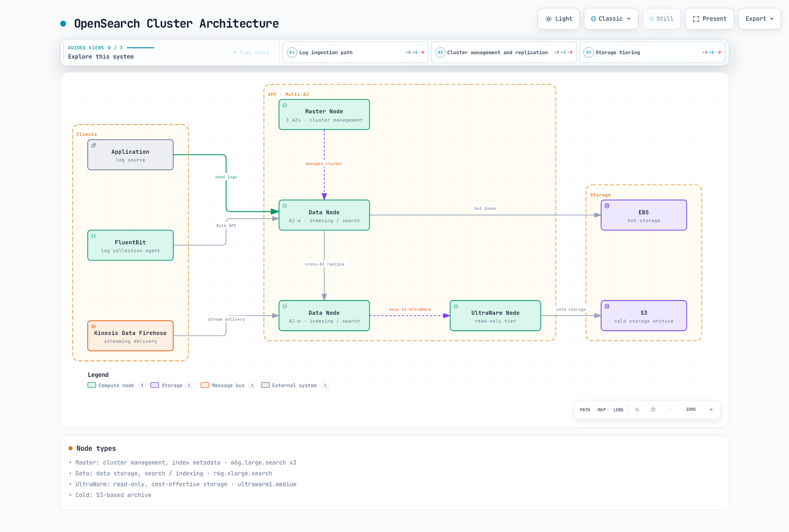
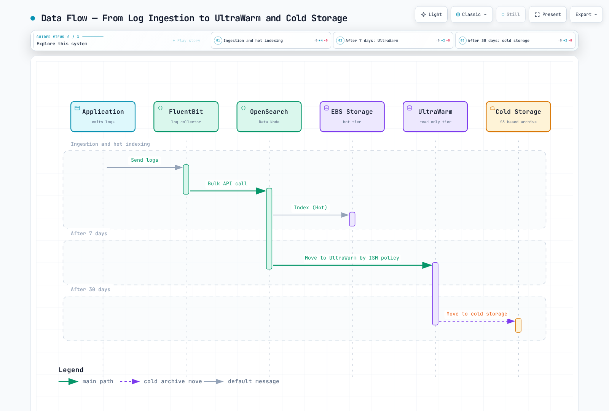

# Amazon OpenSearch Service

> **最后更新**：2026 年 9 月 13 日
> **示例基线**：预置型 OpenSearch Service 3.5；Terraform 1.15.7/AWS provider 6.69.1；AWS for Fluent Bit 3.4.15（Fluent Bit 5.0.9）。仅进行本地配置检查；未部署 domain、collector、SAML 会话或数据交付测试。

Amazon OpenSearch Service 管理搜索集群，并支持部分 OpenSearch 和旧版 Elasticsearch OSS 版本。本章介绍 VPC domain 以及传统的 hot/UltraWarm/cold 存储层。Serverless collections 和较新的优化型实例存储选项有各自独立的配置、API 和可用性要求。

<span id="table-of-contents"></span>
<span id="opensearch-vs-elasticsearch"></span>
<span id="amazon-opensearch-service-features"></span>
<span id="key-use-cases"></span>

## 概述

OpenSearch 是一个采用 Apache-2.0 许可证的搜索项目。它源自 Elasticsearch 7.10，并不意味着与所有当前的 Elasticsearch 客户端、插件或 API 兼容。Elastic 当前的源代码许可选择包括符合条件的源代码部分采用 AGPLv3，以及 SSPL/Elastic License 2.0；应检查具体组件和发行版，而不要把 Elasticsearch 视为许可模式始终不变的单一产品。

AWS 支持表目前将 OpenSearch 3.5 列为受支持版本。较早的 2.11 示例**仍在标准支持期内，支持期截至 2027 年 11 月 7 日**；不能仅仅因为存在较新版本就认定它已不受支持。对于现有 domain，在请求升级版本之前，请检查受支持的升级路径、重大变更、快照和客户端兼容性。

OpenSearch Service 可用于日志分析、全文搜索、聚合和安全分析工作流。启用某项服务或保留审计日志，本身并不能满足合规要求。

<span id="node-types"></span>

## 架构

### OpenSearch 集群架构



[查看交互式图表](https://www.atomai.click/kubernetes-docs/archmaps/en-observability-logging-02-opensearch-0.html)

该图为示意图，并非精确的副本/AZ 布局，也不是容量建议。图中的“Master”表示专用集群管理角色；AWS 配置字段仍使用 `dedicated_master_*`。“Kinesis Data Firehose”是**Amazon Data Firehose**的旧名称。UltraWarm 和 cold storage 均使用 S3 支持的存储；cold 数据必须先关联到 UltraWarm，才能进行查询。

| 角色或存储层 | 功能 |
|---|---|
| 专用集群管理节点 | 管理集群状态、元数据和分片分配。三个节点是常见的专用集群管理节点配置；这些节点不是数据副本。 |
| 数据节点 / hot storage | 索引和查询。EBS 的可用性和限制取决于所选实例系列。 |
| UltraWarm | 由 S3 支持的只读索引，并由 warm 节点提供缓存/计算能力。请检查引擎、实例和专用集群管理节点的前置条件。 |
| Cold storage | 具有独立生命周期的分离索引存储。要查询选定索引，请将其重新关联到 UltraWarm。 |

Multi-AZ with Standby 有额外的拓扑和副本要求。仅启用 zone awareness 并不会启用 Standby，也不能确立其可用性保证。请检查当前实例限制，包括 VPC Encryption Controls 和存储兼容性。原文中的 r6g/m6g 规格只是示例输入，不是基准测试结果。

补充资源：[AWS Instance Benchmark](https://benchmark.aws.atomai.click/)。服务容量仍需通过有代表性的 OpenSearch 工作负载测试来确定。

### 数据流



[查看交互式图表](https://www.atomai.click/kubernetes-docs/archmaps/en-observability-logging-02-opensearch-1.html)

7/30 天标签是示例**索引年龄条件**，并非自动默认值，也不代表精确的事件年龄保留期限。ISM 会定期运行，迁移是异步的。使用基于日期的索引时，迟到或重放的事件可能会写入较早的只读索引；启用迁移之前，请决定如何路由或归档这些事件。

<span id="creation-via-aws-console"></span>

## 创建 Domain

### 前置条件

准备同一 VPC 中位于不同 AZ 的三个私有子网、可访问的客户端安全组、现有的服务关联角色，以及获批的管理员/写入者/读取者 IAM 角色。该示例会验证子网 ID 是否不同，但不会远程验证其 AZ、路由、容量或所有权。

Terraform 配置采用 **IAM 签名 API 请求**和 IAM 主角色，不会在 Terraform state 中保存内部主密码。发送日志前，请配置 FGAC 角色映射。下文将浏览器 SSO 作为单独的访问配置进行讨论；要求使用 IAM 主体的 domain policy 需要 SigV4，并不会自动接受未签名的 SAML 浏览器请求。

### 通过 Terraform 创建

该示例使用 AWS 商业分区和首尔 Region。请一致地替换输入值，并检查区域可用性。应用该配置会创建资源；本次审查仅运行了本地验证。

```hcl
terraform {
  required_providers {
    aws = {
      source  = "hashicorp/aws"
      version = "6.69.1"
    }
  }
}

variable "region" {
  type    = string
  default = "ap-northeast-2"
}

variable "account_id" {
  type = string
  validation {
    condition     = can(regex("^[0-9]{12}$", var.account_id))
    error_message = "Use the owning AWS account ID."
  }
}

variable "vpc_id" {
  type = string
}

variable "subnet_ids" {
  type = list(string)
  validation {
    condition     = length(var.subnet_ids) == 3 && length(distinct(var.subnet_ids)) == 3
    error_message = "Provide three distinct subnet IDs, one in each intended AZ."
  }
}

variable "client_security_group_ids" {
  type = set(string)
}

variable "admin_role_arn" {
  type = string
}

variable "writer_role_arns" {
  type = set(string)
}

variable "reader_role_arns" {
  type    = set(string)
  default = []
}

provider "aws" {
  region = var.region
}

locals {
  domain_name = "logs-production"
  domain_arn  = "arn:aws:es:${var.region}:${var.account_id}:domain/${local.domain_name}"
  log_types   = toset(["INDEX_SLOW_LOGS", "SEARCH_SLOW_LOGS", "ES_APPLICATION_LOGS", "AUDIT_LOGS"])
  callers     = setunion(toset([var.admin_role_arn]), var.writer_role_arns, var.reader_role_arns)
}

resource "aws_security_group" "search" {
  name_prefix = "logs-search-"
  description = "OpenSearch HTTPS from approved client security groups"
  vpc_id      = var.vpc_id
}

resource "aws_vpc_security_group_ingress_rule" "clients" {
  for_each                     = var.client_security_group_ids
  security_group_id            = aws_security_group.search.id
  referenced_security_group_id = each.value
  from_port                    = 443
  to_port                      = 443
  ip_protocol                  = "tcp"
}

resource "aws_vpc_security_group_egress_rule" "outbound" {
  security_group_id = aws_security_group.search.id
  cidr_ipv4         = "0.0.0.0/0"
  ip_protocol       = "-1"
}

resource "aws_cloudwatch_log_group" "search" {
  for_each          = local.log_types
  name              = "/aws/opensearch/${local.domain_name}/${lower(each.value)}"
  retention_in_days = 30
}

resource "aws_cloudwatch_log_resource_policy" "search" {
  policy_name = "logs-production-opensearch"
  policy_document = jsonencode({
    Version = "2012-10-17"
    Statement = [{
      Effect    = "Allow"
      Principal = { Service = "es.amazonaws.com" }
      Action    = ["logs:CreateLogStream", "logs:PutLogEvents"]
      Resource  = [for group in aws_cloudwatch_log_group.search : "${group.arn}:*"]
      Condition = {
        StringEquals = { "aws:SourceAccount" = var.account_id }
        ArnEquals    = { "aws:SourceArn" = local.domain_arn }
      }
    }]
  })
}

resource "aws_opensearch_domain" "logs" {
  domain_name    = local.domain_name
  engine_version = "OpenSearch_3.5"

  cluster_config {
    instance_type                 = "r6g.xlarge.search"
    instance_count                = 3
    dedicated_master_enabled      = true
    dedicated_master_type         = "m6g.large.search"
    dedicated_master_count        = 3
    zone_awareness_enabled        = true
    multi_az_with_standby_enabled = false
    zone_awareness_config {
      availability_zone_count = 3
    }
    warm_enabled = true
    warm_type    = "ultrawarm1.medium.search"
    warm_count   = 2
    cold_storage_options {
      enabled = true
    }
  }

  ebs_options {
    ebs_enabled = true
    volume_type = "gp3"
    volume_size = 500
  }

  vpc_options {
    subnet_ids         = var.subnet_ids
    security_group_ids = [aws_security_group.search.id]
  }

  encrypt_at_rest {
    enabled = true
  }
  node_to_node_encryption {
    enabled = true
  }
  domain_endpoint_options {
    enforce_https       = true
    tls_security_policy = "Policy-Min-TLS-1-2-PFS-2023-10"
  }
  advanced_security_options {
    enabled                        = true
    internal_user_database_enabled = false
    master_user_options {
      master_user_arn = var.admin_role_arn
    }
  }

  access_policies = jsonencode({
    Version = "2012-10-17"
    Statement = [{
      Effect    = "Allow"
      Principal = { AWS = sort(tolist(local.callers)) }
      Action    = ["es:ESHttp*"]
      Resource  = "${local.domain_arn}/*"
    }]
  })

  dynamic "log_publishing_options" {
    for_each = aws_cloudwatch_log_group.search
    content {
      cloudwatch_log_group_arn = log_publishing_options.value.arn
      log_type                 = log_publishing_options.key
      enabled                  = true
    }
  }

  depends_on = [aws_cloudwatch_log_resource_policy.search]
}

output "domain_endpoint" {
  value = aws_opensearch_domain.logs.endpoint
}

output "dashboards_endpoint" {
  value = aws_opensearch_domain.logs.dashboard_endpoint
}
```

初始规格、500GiB EBS 卷和 30 天 CloudWatch 保留期均为示例值。该配置明确使用**不带 Standby 的** Multi-AZ。此参考配置中的安全组出站访问范围仍然较广；生产环境中应针对实际支持的连接设计出站限制。

Domain access policy 允许指定的 IAM 角色执行 HTTP 操作；必须通过 **FGAC** 限制其索引/集群权限。仅基于 URI 的 IAM 权限无法限制批量请求正文中包含的索引名称。仅向 collector 角色授予预期的写入者映射。

平台的服务关联角色是账户级依赖。应在其所属的基础设施 state 中复用或导入该角色，而不要尝试在每次部署时创建同一个角色。

OpenSearch domains 每小时创建一次自动快照，保留 14 天（最多 336 个）。旧版 `automated_snapshot_start_hour` 示例适用于更早的 Elasticsearch 版本，不适用于此 OpenSearch 配置。快照是恢复手段，不能替代经过测试的保留/还原计划。集群状态为 red 时，可能无法创建快照。

CloudWatch 发布需要在配置 domain 之前设置范围受限的资源策略。配置慢日志目标并不会启用所有慢日志阈值，发布审计日志也不会配置所有审计事件。请有针对性地配置相应的引擎/审计设置；日志中的查询和文档内容也需要访问控制与保留控制。

<span id="index-aliases"></span>

## 索引管理

下方的主 collector 会写入**每日索引**，命名格式为 `logs-production-YYYY.MM.DD`。模板、ISM 模式和查询示例都使用这一模式。后面会介绍单独的 rollover 练习；不要在不说明的情况下混用这两种写入策略。

以下请求块使用 OpenSearch Dashboards Dev Tools 语法。它们不是独立的 JSON 文件，也不是本次审查实际执行的命令。请使用经过授权的数据平面客户端和预期的 domain。

### 索引模板

```http
PUT _index_template/logs-template
{
  "index_patterns": [
    "logs-production-*"
  ],
  "priority": 100,
  "template": {
    "settings": {
      "number_of_shards": 3,
      "number_of_replicas": 1,
      "refresh_interval": "5s",
      "index.codec": "best_compression",
      "index.translog.durability": "request"
    },
    "mappings": {
      "dynamic": false,
      "properties": {
        "@timestamp": {
          "type": "date"
        },
        "cluster_name": {
          "type": "keyword"
        },
        "environment": {
          "type": "keyword"
        },
        "stream": {
          "type": "keyword"
        },
        "log": {
          "type": "text",
          "index": false
        },
        "kubernetes": {
          "properties": {
            "namespace_name": {
              "type": "keyword"
            },
            "pod_name": {
              "type": "keyword"
            },
            "container_name": {
              "type": "keyword"
            },
            "host": {
              "type": "keyword"
            }
          }
        },
        "app": {
          "properties": {
            "level": {
              "type": "keyword"
            },
            "message": {
              "type": "text",
              "fields": {
                "keyword": {
                  "type": "keyword",
                  "ignore_above": 256
                }
              }
            },
            "error_type": {
              "type": "keyword"
            },
            "trace_id": {
              "type": "keyword"
            },
            "span_id": {
              "type": "keyword"
            },
            "request_id": {
              "type": "keyword"
            },
            "http": {
              "properties": {
                "method": {
                  "type": "keyword"
                },
                "status_code": {
                  "type": "integer"
                },
                "path": {
                  "type": "keyword"
                },
                "response_time_ms": {
                  "type": "float"
                }
              }
            }
          }
        }
      }
    }
  }
}
```

Kubernetes filter 生成的是 `kubernetes.namespace_name`，而不是 `kubernetes.namespace`。应用 JSON 会嵌套在 `app` 下，以便与 collector 元数据分开。应用必须输出文档规定的字段和单位；示例使用小写的 `app.level`，并以毫秒表示 `app.http.response_time_ms`。

collector 添加元数据之前的示例应用记录如下，为单行格式：

```json
{"level":"error","message":"request failed","error_type":"upstream_timeout","http":{"method":"GET","path":"/orders","status_code":503,"response_time_ms":1250}}
```

`message.keyword` 子字段明确定义为 `app.message.keyword`；仅有 `text` 映射并不会自动创建该字段。超过其 `ignore_above` 限制的值不会被索引到该子字段中。聚合时可考虑使用有界的 `error_type` 分类体系，而不是使用任意消息。

`dynamic: false` 会限制新映射字段，但**不会从 `_source` 中移除未知字段**。原始 `log` 字段会被存储，但不会建立搜索索引。请审查数据重复、敏感数据隐藏和原始数据访问控制。`translog.durability: request` 是比未作说明的 async/30s 持久性折衷更安全的基线；但这两种设置都不能保证从所有存储或副本故障中恢复。

### ISM（索引状态管理）策略

```http
PUT _plugins/_ism/policies/logs-lifecycle
{
  "policy": {
    "description": "Illustrative daily-index hot/warm/cold retention; confirm ownership and late-arrival handling.",
    "schema_version": 1,
    "default_state": "hot",
    "states": [
      {
        "name": "hot",
        "actions": [],
        "transitions": [
          {
            "state_name": "warm",
            "conditions": {
              "min_index_age": "7d"
            }
          }
        ]
      },
      {
        "name": "warm",
        "actions": [
          {
            "warm_migration": {}
          }
        ],
        "transitions": [
          {
            "state_name": "cold",
            "conditions": {
              "min_index_age": "30d"
            }
          }
        ]
      },
      {
        "name": "cold",
        "actions": [
          {
            "cold_migration": {
              "timestamp_field": "@timestamp"
            }
          }
        ],
        "transitions": [
          {
            "state_name": "delete",
            "conditions": {
              "min_index_age": "90d"
            }
          }
        ]
      },
      {
        "name": "delete",
        "actions": [
          {
            "cold_delete": {}
          }
        ],
        "transitions": []
      }
    ],
    "ism_template": [
      {
        "index_patterns": [
          "logs-production-*"
        ],
        "priority": 100
      }
    ]
  }
}
```

此策略会附加到新创建的匹配索引。对于现有索引，需要有计划地执行策略附加操作；更改之前，请检查 `_plugins/_ism/explain/INDEX` 和策略版本。

每个 action 对象只包含一个 action（以及它支持的重试/超时元数据）。托管式 `warm_migration`、`cold_migration` 和 **`cold_delete`** 与自行管理的 ISM 操作有所不同。Cold 索引需要使用 `cold_delete`，而 ISM cold migration 需要指定 timestamp 字段。不要将 warm migration、副本更改和 force merge 放在同一个 action 对象中。

ISM 通常每 5–8 分钟评估一次作业，并且在集群状态为 red 时不会运行。索引年龄从索引创建时开始计算。示例中的 90 天删除期限是组织的选择，不是普遍适用的法律要求，也不是精确的逐条记录过期时间。启用删除之前，请验证迟到数据处理方式、快照和恢复流程。

### 索引别名和 Rollover

此独立练习使用前缀 `rollover-logs-*` 和写入别名，不会更改每日 collector 配置。

```http
PUT _index_template/rollover-logs
{
  "index_patterns": [
    "rollover-logs-*"
  ],
  "priority": 100,
  "template": {
    "settings": {
      "number_of_shards": 3,
      "number_of_replicas": 1,
      "plugins.index_state_management.rollover_alias": "rollover-logs-write"
    },
    "mappings": {
      "properties": {
        "@timestamp": {
          "type": "date"
        },
        "message": {
          "type": "text"
        }
      }
    }
  }
}

PUT _plugins/_ism/policies/rollover-logs
{
  "policy": {
    "description": "Independent rollover example; not attached to date-based collector indexes.",
    "schema_version": 1,
    "default_state": "write",
    "states": [
      {
        "name": "write",
        "actions": [
          {
            "rollover": {
              "min_index_age": "1d",
              "min_primary_shard_size": "30gb"
            }
          }
        ],
        "transitions": []
      }
    ],
    "ism_template": [
      {
        "index_patterns": [
          "rollover-logs-*"
        ],
        "priority": 100
      }
    ]
  }
}

PUT rollover-logs-000001
{
  "aliases": {
    "rollover-logs-write": {
      "is_write_index": true
    }
  }
}

POST rollover-logs-write/_doc
{
  "@timestamp": "2026-09-13T00:00:00Z",
  "message": "synthetic rollover example"
}

GET _plugins/_ism/explain/rollover-logs-000001

POST rollover-logs-write/_rollover
{
  "conditions": {
    "max_age": "1d",
    "max_size": "90gb"
  }
}
```

自动 ISM rollover 需要设置 rollover alias、使用合适的编号索引，并配置写入别名。仅仅因为存在别名，按日期写入的 writer 并不会使用该别名。

ISM 的 `min_primary_shard_size: 30gb` 指单个主分片。OpenSearch 3.5 的 rollover REST 解析器接受 `max_age`、`max_docs` 和 `max_size`；`max_size` 衡量的是**主分片存储总量**，不包括副本。因此，REST 示例中的 90GB 条件与每个主分片 30GB 的阈值不是一回事。Rollover 条件彼此独立，并不要求同时满足所有阈值。

<span id="direct-ingestion-from-fluentbit-to-opensearch"></span>
<span id="fluentbit-daemonset-using-irsa"></span>

## 数据摄取

### 直接通过 Fluent Bit 摄取

以下六个资源构成适用于符合条件的 **Linux EC2 节点**的参考 collector 配置。Fargate 使用其平台日志路由器；Windows 和其他节点平台需要各自的路径和部署模型。部署节点日志读取器之前，请确认主机路径、准入策略例外和资源需求。

设置真实的 domain 主机名、Region 和 IRSA 角色。该角色的 OIDC 信任必须与 `system:serviceaccount:logging:fluent-bit` 匹配；还需要授权其 IAM/数据平面访问权限和 FGAC 写入者角色。只有在节点/agent/SDK 支持的情况下，Pod Identity 才是可选方案。

```yaml
apiVersion: v1
kind: Namespace
metadata:
  name: logging
---
apiVersion: v1
kind: ServiceAccount
metadata:
  name: fluent-bit
  namespace: logging
  annotations:
    eks.amazonaws.com/role-arn: arn:aws:iam::123456789012:role/FluentBitOpenSearchRole
---
apiVersion: rbac.authorization.k8s.io/v1
kind: ClusterRole
metadata:
  name: fluent-bit-metadata
rules:
- apiGroups:
  - ''
  resources:
  - namespaces
  - pods
  verbs:
  - get
  - list
  - watch
---
apiVersion: rbac.authorization.k8s.io/v1
kind: ClusterRoleBinding
metadata:
  name: fluent-bit-metadata
roleRef:
  apiGroup: rbac.authorization.k8s.io
  kind: ClusterRole
  name: fluent-bit-metadata
subjects:
- kind: ServiceAccount
  name: fluent-bit
  namespace: logging
---
apiVersion: v1
kind: ConfigMap
metadata:
  name: fluent-bit-config
  namespace: logging
data:
  fluent-bit.conf: |
    [SERVICE]
        Flush          5
        Log_Level      info
        HTTP_Server    Off
        storage.path   /buffers/storage
        storage.sync   normal

    [INPUT]
        Name               tail
        Tag                kube.*
        Path               /var/log/containers/*.log
        Exclude_Path       /var/log/containers/fluent-bit-*_logging_fluent-bit-*.log
        multiline.parser   docker, cri
        DB                 /buffers/tail.db
        Mem_Buf_Limit      50MB
        Skip_Long_Lines    On
        Refresh_Interval   10
        storage.type       filesystem

    [FILTER]
        Name                kubernetes
        Match               kube.*
        Kube_Tag_Prefix     kube.var.log.containers.
        Merge_Log           On
        Merge_Log_Key       app
        Keep_Log            On
        Labels              Off
        Annotations         Off
        K8S-Logging.Parser  Off
        K8S-Logging.Exclude Off

    [FILTER]
        Name    modify
        Match   kube.*
        Set     cluster_name example-eks
        Set     environment example

    [OUTPUT]
        Name                    opensearch
        Match                   kube.*
        Host                    REPLACE_WITH_DOMAIN_ENDPOINT
        Port                    443
        tls                     On
        tls.verify              On
        AWS_Auth                On
        AWS_Region              ap-northeast-2
        Suppress_Type_Name      On
        Logstash_Format         On
        Logstash_Prefix         logs-production
        Time_Key                @timestamp
        Generate_ID             On
        Retry_Limit             5
        Buffer_Size             5MB
        Compress                gzip
        storage.total_limit_size 1G
---
apiVersion: apps/v1
kind: DaemonSet
metadata:
  name: fluent-bit
  namespace: logging
spec:
  selector:
    matchLabels:
      app: fluent-bit
  template:
    metadata:
      labels:
        app: fluent-bit
    spec:
      serviceAccountName: fluent-bit
      nodeSelector:
        kubernetes.io/os: linux
      tolerations:
      - operator: Exists
        effect: NoSchedule
      containers:
      - name: fluent-bit
        image: public.ecr.aws/aws-observability/aws-for-fluent-bit:3.4.15@sha256:88e1b56cedb230486afeca6eeb26c5f6bd59c48879d0054d1674d5a58838c607
        args:
        - -c
        - /fluent-bit/custom/fluent-bit.conf
        securityContext:
          runAsUser: 0
          allowPrivilegeEscalation: false
          readOnlyRootFilesystem: true
          capabilities:
            drop:
            - ALL
          seccompProfile:
            type: RuntimeDefault
        resources:
          requests:
            cpu: 100m
            memory: 128Mi
          limits:
            memory: 512Mi
        volumeMounts:
        - name: logs
          mountPath: /var/log
          readOnly: true
        - name: buffers
          mountPath: /buffers
        - name: config
          mountPath: /fluent-bit/custom
          readOnly: true
        - name: tmp
          mountPath: /tmp
        command:
        - /fluent-bit/bin/fluent-bit
      volumes:
      - name: logs
        hostPath:
          path: /var/log
          type: Directory
      - name: buffers
        hostPath:
          path: /var/lib/fluent-bit-opensearch
          type: DirectoryOrCreate
      - name: config
        configMap:
          name: fluent-bit-config
      - name: tmp
        emptyDir: {}
```

镜像索引已固定，并检查了其 Linux amd64/arm64 元数据。此镜像的默认 CMD 是一个入口脚本；该示例显式调用 `/fluent-bit/bin/fluent-bit` 并使用**原生 OpenSearch output**。它不会加载旧版 Go output 插件，也未进行镜像运行时测试。

重要的配置关系：

- `multiline.parser docker, cri` 会处理受支持的容器日志帧格式；随后 Kubernetes filter 会将应用 JSON 合并到 `app` 下。
- 只读的 `/var/log` 挂载用于读取日志。Tail DB 和文件系统缓冲区使用单独的可写节点路径。只有在节点/路径仍然存在时，这些数据才会在 Pod 重启后保留；它们不是跨节点的持久存储。
- 元数据 RBAC 仅允许读取 Pods/namespaces。agent 本身会读取节点日志，因此应保护其 namespace、角色和配置。
- 在此示例中，应用注解不能悄然覆盖解析行为或排除日志。collector 生成的集群/环境值会被有意设置。请将 collector 自身的日志排除在此管道之外，以减少反馈循环。
- 对于无类型的 OpenSearch 2.x/3.x API，必须使用 `Suppress_Type_Name On`。`Type _doc` 不能替代它。
- `Logstash_Format On` 会创建按日期命名的索引，并生成 `@timestamp` 字段。它不会写入可选的 rollover alias。
- 重试、`Generate_ID`、内存缓冲区和 output 的存储上限，并不保证恰好一次或无损交付。请测试部分 bulk 错误、超大行、重启偏移量、重试上限、磁盘压力和迟到记录。Output 上限不会限制节点的全部磁盘使用量。

保留的原始日志可能包含 `app` 下已有的数据。存储前应隐藏禁止保留的内容，并监控被拒绝的记录。不要将请求正文跟踪作为永久诊断设置启用。

<span id="ingestion-via-kinesis-data-firehose"></span>

### 通过 Amazon Data Firehose 摄取

Data Firehose 是一条可选的托管交付路径，提供缓冲、重试和备份控制；它并非对所有工作负载来说都是最便宜或最简单的选择。其 Terraform 资源仍名为 `aws_kinesis_firehose_delivery_stream`。

以下可选资源文件使用上方的 domain，以及现有且获批的交付角色、子网、安全组和私有备份 bucket 输入：

```hcl
variable "firehose_role_arn" {
  type = string
}

variable "firehose_subnet_ids" {
  type = list(string)
}

variable "firehose_security_group_ids" {
  type = list(string)
}

variable "backup_bucket_arn" {
  type = string
}

resource "aws_cloudwatch_log_group" "firehose" {
  name              = "/aws/kinesisfirehose/logs-to-opensearch"
  retention_in_days = 30
}

resource "aws_cloudwatch_log_stream" "firehose" {
  name           = "opensearch-delivery"
  log_group_name = aws_cloudwatch_log_group.firehose.name
}

resource "aws_kinesis_firehose_delivery_stream" "logs" {
  name        = "logs-to-opensearch"
  destination = "opensearch"

  opensearch_configuration {
    domain_arn            = aws_opensearch_domain.logs.arn
    role_arn              = var.firehose_role_arn
    index_name            = "logs-production-firehose"
    index_rotation_period = "OneDay"
    buffering_interval    = 60
    buffering_size        = 5
    retry_duration        = 300
    s3_backup_mode        = "FailedDocumentsOnly"

    vpc_config {
      subnet_ids         = var.firehose_subnet_ids
      security_group_ids = var.firehose_security_group_ids
      role_arn           = var.firehose_role_arn
    }

    cloudwatch_logging_options {
      enabled         = true
      log_group_name  = aws_cloudwatch_log_group.firehose.name
      log_stream_name = aws_cloudwatch_log_stream.firehose.name
    }

    s3_configuration {
      role_arn           = var.firehose_role_arn
      bucket_arn         = var.backup_bucket_arn
      prefix             = "opensearch-failed/"
      buffering_size     = 10
      buffering_interval = 400
      compression_format = "GZIP"
    }
  }
}
```

交付角色需要相应的 OpenSearch/FGAC、S3、CloudWatch 和 VPC/ENI 权限，以及任何所需的 KMS 权限；其信任关系与部署者的 `iam:PassRole` 权限是分开的。请将交付角色加入 domain 的调用者输入和写入者映射，并允许其 VPC 连接访问端口 443。

`FailedDocumentsOnly` 才能指定备份模式；仅将 S3 前缀命名为 `failed/` 并不能做到这一点。请测试失败处理以及从私有备份 bucket 重放数据。Firehose 记录需要符合索引映射的 schema，包括时间戳；该服务不会自动创建此处所示的 Kubernetes 元数据/应用封装结构。

<span id="dashboard-access-setup"></span>
<span id="create-index-pattern"></span>
<span id="visualization-creation"></span>

## OpenSearch Dashboards

### 访问和索引模式

请使用获批的 VPC 连接方式和与 domain access policy 兼容的身份验证方法。普通 SSH tunnel 本身无法保留原始 TLS 主机名、SSO 重定向或 SigV4 签名。不要为了让 `https://localhost:9200` 看起来可用而禁用证书验证。ALB 并不是完整的原生 domain/Dashboards 集成方案。

配置好经过身份验证的访问后，为 `logs-production-*` 创建 data view/index pattern，并选择 `@timestamp`。菜单名称会因 Dashboards 版本和启用的体验而异。

### 搜索查询示例

```http
GET logs-production-*/_search
{
  "query": {
    "bool": {
      "filter": [
        {
          "term": {
            "app.level": "error"
          }
        },
        {
          "range": {
            "@timestamp": {
              "gte": "now-1h"
            }
          }
        },
        {
          "term": {
            "kubernetes.namespace_name": "production"
          }
        }
      ]
    }
  },
  "sort": [
    {
      "@timestamp": {
        "order": "desc"
      }
    }
  ],
  "size": 100
}

GET logs-production-*/_search
{
  "size": 0,
  "query": {
    "bool": {
      "filter": [
        {
          "term": {
            "app.level": "error"
          }
        },
        {
          "range": {
            "@timestamp": {
              "gte": "now-24h"
            }
          }
        }
      ]
    }
  },
  "aggs": {
    "by_namespace": {
      "terms": {
        "field": "kubernetes.namespace_name",
        "size": 20
      },
      "aggs": {
        "by_type": {
          "terms": {
            "field": "app.error_type",
            "size": 10
          }
        }
      }
    }
  }
}

GET logs-production-*/_search
{
  "size": 0,
  "query": {
    "bool": {
      "filter": [
        {
          "exists": {
            "field": "app.http.response_time_ms"
          }
        },
        {
          "range": {
            "@timestamp": {
              "gte": "now-1h"
            }
          }
        }
      ]
    }
  },
  "aggs": {
    "response_time_percentiles": {
      "percentiles": {
        "field": "app.http.response_time_ms",
        "percents": [
          50,
          75,
          90,
          95,
          99
        ]
      }
    }
  }
}
```

这些示例使用 filter context 对精确的 keyword/时间条件进行筛选。第二个查询会先实际筛选出错误，再聚合 namespace。Terms aggregation 会返回选定的前 N 项，并可能存在分布式近似结果/省略的 bucket；它并不包含每个 namespace 的完整计数。百分位数为近似值，使用映射为毫秒的字段。

创建可视化时，可选择 `app.level`、基于 `@timestamp` 的时间直方图，或明确映射的 `app.message.keyword`/`app.error_type` 字段。在仪表板中提到字段名并不会创建其映射。

<span id="fine-grained-access-control-fgac"></span>
<span id="document-level-security-dls"></span>
<span id="field-level-security-fls"></span>

## 安全配置

### 精细访问控制

网络访问、domain 资源策略和 FGAC 是不同的层。Terraform IAM 主体策略要求使用 SigV4。安全组规则或成功的 IAM 请求都不会自动授予索引访问权限。

管理员可以为 collector 定义写入者角色，并为读取者限制 namespace：

```http
PUT _plugins/_security/api/roles/logs-writer
{
  "cluster_permissions": [
    "cluster_composite_ops"
  ],
  "index_permissions": [
    {
      "index_patterns": [
        "logs-production-*"
      ],
      "allowed_actions": [
        "create_index",
        "write"
      ]
    }
  ]
}

PUT _plugins/_security/api/rolesmapping/logs-writer
{
  "backend_roles": [
    "arn:aws:iam::123456789012:role/FluentBitOpenSearchRole"
  ]
}

PUT _plugins/_security/api/roles/team-a-logs
{
  "cluster_permissions": [
    "cluster_composite_ops_ro"
  ],
  "index_permissions": [
    {
      "index_patterns": [
        "logs-production-*"
      ],
      "dls": "{\"term\":{\"kubernetes.namespace_name\":\"team-a\"}}",
      "allowed_actions": [
        "read"
      ]
    }
  ]
}

PUT _plugins/_security/api/rolesmapping/team-a-logs
{
  "backend_roles": [
    "arn:aws:iam::123456789012:role/TeamAReaderRole"
  ]
}
```

请将角色 ARN 替换为获批的身份。如果使用 Firehose 路径，写入者映射还必须包含 Firehose 交付角色。不要向日常读取者授予 `cluster_all` 或主角色权限。IAM backend-role 映射与内部/SAML 用户名属于不同的身份机制。

### 文档级安全和字段级安全

DLS 根据已存储字段筛选文档。在此示例中，namespace 元数据必须来自受信任的 collector；应用提供的字符串不能证明租户身份。

若要限制读取者权限，可使用以下**组合**角色，保留 namespace 限制，并且只包含选定的响应字段：

```http
PUT _plugins/_security/api/roles/team-a-limited
{
  "cluster_permissions": [
    "cluster_composite_ops_ro"
  ],
  "index_permissions": [
    {
      "index_patterns": [
        "logs-production-*"
      ],
      "fls": [
        "@timestamp",
        "kubernetes.namespace_name",
        "app.level",
        "app.message"
      ],
      "allowed_actions": [
        "read"
      ],
      "dls": "{\"term\":{\"kubernetes.namespace_name\":\"team-a\"}}"
    }
  ]
}
```

请使用预期的角色映射，而不要将受限角色添加到已经拥有更广泛权限的身份上。评估所有生效角色的完整集合。原始 `log` 字段被有意排除在此允许列表之外，因为它可能重复包含其他被隐藏的 JSON 字段。

FLS 控制返回的字段，而不控制允许返回的消息字符串中的内容。它不会从 `_source`、快照或日志存档中删除信息。请测试 search、get、multi-search 和 aggregation 访问，并从源头上避免记录禁止的数据。

### 配置 SAML 身份验证

托管式 OpenSearch Service SAML 应通过 **AWS domain configuration API** 配置，而不是通过上传自行管理的 `opensearch-security/config.yml` 配置。

以下本地辅助脚本会序列化获批的 IdP XML，无需手动转义。请根据审核过的 IdP 配置，替换示例管理组和角色属性键：

```python
from pathlib import Path
import json
import xml.etree.ElementTree as ET

metadata = Path("idp-metadata.xml").read_text(encoding="utf-8")
root = ET.fromstring(metadata)
if root.tag.rsplit("}", 1)[-1] != "EntityDescriptor" or not root.get("entityID"):
    raise ValueError("Provide approved metadata for one IdP EntityDescriptor")
options = {
    "SAMLOptions": {
        "Enabled": True,
        "Idp": {"EntityId": root.get("entityID"), "MetadataContent": metadata},
        "MasterBackendRole": "opensearch-admin",
        "RolesKey": "Role",
        "SessionTimeoutMinutes": 60,
    }
}
Path("advanced-security-saml.json").write_text(json.dumps(options, indent=2) + "\n")
```

```bash
aws opensearch update-domain-config \
  --domain-name logs-production --region ap-northeast-2 \
  --advanced-security-options file://advanced-security-saml.json
```

这只是 payload 示例，并非端到端 SSO 部署方案。请验证元数据可信度、entity ID、证书、ACS/Dashboards URL 和映射。SAML 浏览器流量需要匹配的 domain access policy 设计；启用 `SAMLOptions` 并不会让此类流量自动转换为上述仅适用于 IAM 的策略所需的 SigV4。请遵循一种一致的身份验证配置，并在更改现有 domain 之前测试管理员恢复流程。

<span id="storage-tiering"></span>
<span id="cost-comparison-based-on-100gb-day"></span>
<span id="index-optimization"></span>
<span id="reserved-instances"></span>

## 成本优化

### 存储和索引设置

请估算所选 Region、节点系列/数量、副本、EBS、warm 节点计算/存储、cold storage 以及数据传输/摄取路径的价格。此前按每日 100GB 计算的美元总额和固定节省百分比缺少足够的假设，无法复现；它们不是当前预算，也不是经过测量的比较结果。

索引压缩、refresh interval、分片数和字段映射会在存储/CPU、搜索新鲜度、查询能力和恢复成本之间产生权衡。请在创建模板时设置 `index.codec` 等静态选项；不要不加判断地向所有打开的生产索引发送静态设置变更。移除文本位置或禁用字段可能会破坏查询。

Reserved Instance 的节省取决于符合条件的使用量、Region、期限和付款方式。仅有一年的预期使用时间不足以证明购买合理；节点折扣也不会免除所有存储/交付费用。请依据当前价格和实际测得的需求，而不是旧的固定 21/24/36% 数字进行决策。

<span id="inverted-index-inefficiency"></span>
<span id="aggregation-query-performance-degradation"></span>
<span id="scaling-cost-issues"></span>
<span id="clickhouse-migration-decision-criteria"></span>

## 大规模日志环境中的限制

OpenSearch 将倒排索引与用于许多聚合和排序的**列式 doc values**结合使用。它并非总会在聚合时重新读取每个完整的 `_source` 文档。映射、选择性、分片、缓存、段布局和并发工作都会影响性能。

原始 OpenSearch/ClickHouse 延迟和压缩数据没有可复现的硬件、版本、数据或查询说明。不要将其转化为通用的 100GB 迁移阈值，也不要据此断言 90% 的组织都具有某种查询模式。

请使用相同的数据、保留期限、持久性和并发要求，对有代表性的全文、筛选、聚合和调查查询进行比较。评估摄取/回填成本、schema 演进、权限、仪表板、运维技能和回滚。双写实验需要数据对账和成本控制；固定两周或两个月的时间表并非保证。

<span id="feature-comparison"></span>
<span id="recommendations-by-use-case"></span>
<span id="migration-considerations"></span>

## 与 Loki 的比较

| 方面 | OpenSearch | Loki |
|---|---|---|
| 索引/查询模型 | 映射字段、倒排索引和 doc values；Query DSL 以及受支持的 SQL/PPL 功能 | Stream label 索引、chunk 扫描以及 LogQL 管道/指标 |
| 文本搜索 | 分析器、相关性和全文查询能力 | 在选定的 stream 和时间范围内筛选/搜索文本 |
| 访问控制 | 网络/IAM/FGAC，以及已配置的文档/字段控制 | 身份验证网关、租户授权和策略/运维控制 |
| 成本和运维 | 取决于预置/托管模式和工作负载 | 取决于部署模式、stream、对象存储、缓存和查询 |
| 迁移 | 重建映射/查询，并验证权限/数据正确性 | 重新设计 label/元数据/查询，并验证权限/数据正确性 |

任何一种产品都不会自动成为合规首选、最便宜的选择或易于运维的方案。Loki 仍支持文本搜索和衍生指标；迁移会改变语义和能力，而不是符合固定的 3–5 倍成本或节省 60–80% 的规则。

## 验证和参考资料

本地检查覆盖 Terraform 资源配置以及已发布的数据/配置契约，但无法证明 AWS 实时授权、某个 Region 中受支持 SKU 的容量、collector 交付、ISM 转换/删除、SAML 身份验证或查询性能。检查了镜像索引/配置元数据，但未拉取可执行层，也未运行容器。

- [服务/版本支持](https://docs.aws.amazon.com/opensearch-service/latest/developerguide/what-is.html)
- [支持的实例类型](https://docs.aws.amazon.com/opensearch-service/latest/developerguide/supported-instance-types.html) 和 [Multi-AZ](https://docs.aws.amazon.com/opensearch-service/latest/developerguide/managedomains-multiaz.html)
- [VPC 访问](https://docs.aws.amazon.com/opensearch-service/latest/developerguide/vpc.html)、[访问策略](https://docs.aws.amazon.com/opensearch-service/latest/developerguide/ac.html)和 [FGAC](https://docs.aws.amazon.com/opensearch-service/latest/developerguide/fgac.html)
- [UltraWarm](https://docs.aws.amazon.com/opensearch-service/latest/developerguide/ultrawarm.html)、[cold storage](https://docs.aws.amazon.com/opensearch-service/latest/developerguide/cold-storage.html)、[托管式 ISM](https://docs.aws.amazon.com/opensearch-service/latest/developerguide/ism.html) 和 [ISM 策略参考](https://docs.opensearch.org/latest/im-plugin/ism/policies/)
- [Rollover API](https://docs.opensearch.org/latest/api-reference/index-apis/rollover/) 和 [doc values](https://docs.opensearch.org/latest/field-types/mapping-parameters/doc-values/)
- [快照](https://docs.aws.amazon.com/opensearch-service/latest/developerguide/managedomains-snapshots.html)、[CloudWatch 日志](https://docs.aws.amazon.com/opensearch-service/latest/developerguide/createdomain-configure-slow-logs.html)和 [SAML](https://docs.aws.amazon.com/opensearch-service/latest/developerguide/saml.html)
- [AWS for Fluent Bit 发布历史](https://github.com/aws/aws-for-fluent-bit/blob/mainline/CHANGELOG.md) 和 [OpenSearch output 配置](https://raw.githubusercontent.com/fluent/fluent-bit-docs/master/pipeline/outputs/opensearch.md)
- [Data Firehose 目标配置](https://docs.aws.amazon.com/firehose/latest/dev/create-destination.html)
- [当前服务定价](https://aws.amazon.com/opensearch-service/pricing/)
- [Elastic 许可常见问题](https://www.elastic.co/pricing/faq/licensing)

## 测验

请参加 [OpenSearch 测验](../../quizzes/observability/logging/02-opensearch-quiz.md)，检验你对这些区别的理解。
