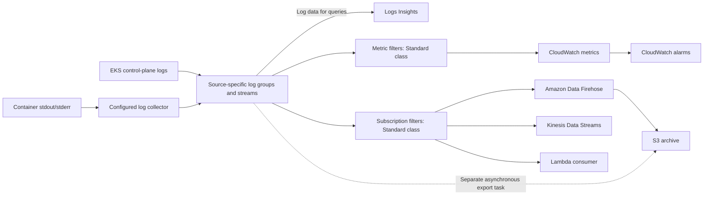

# CloudWatch Logs

> **最后更新**: September 13, 2026
> **已检查示例**: AWS provider 6.69.1；可选的 CloudWatch Observability Helm chart 6.6.0；手动配置 AWS for Fluent Bit 3.4.15/Fluent Bit 5.0.9。仅检查了本地配置、SDK 和合成负载。未执行任何 AWS 资源操作、日志传送、Insights 查询或告警。

Amazon CloudWatch Logs 管理日志摄取、存储和分析。你仍需配置日志生产者、身份、网络、保留期、配额和下游使用方。EKS 控制平面日志、工作负载日志和 EKS Auto Mode 托管组件日志属于独立的收集路径。

## 目录

1. [概述](#overview)
2. [EKS 控制平面日志记录](#eks-control-plane-logging)
3. [Container Insights](#container-insights)
4. [FluentBit 集成](#fluentbit-integration)
5. [CloudWatch Logs Insights](#cloudwatch-logs-insights)
6. [订阅筛选条件](#subscription-filters)
7. [成本优化](#cost-optimization)

## 概述

<span id="cloudwatch-logs-features"></span>

### 功能和日志类别

| 区域 | 检查内容 |
|---|---|
| 托管服务 | 无需运维搜索集群，但仍需指定收集器和传送集成的负责人 |
| 容量 | 事件大小、API、订阅和目标配额均适用；摄取量并非不受限制 |
| 安全性 | IAM、加密、数据保护和私有连接需要分别配置 |
| 时效性 | 传送和告警是异步的；必须考虑重试以及重复或丢失的传送 |
| Standard 类 | 支持本章使用的指标筛选条件和订阅 |
| Infrequent Access | 摄取价格较低，但功能集不同；不支持订阅筛选条件、指标筛选条件或 EMF |
| Delivery 类 | Lambda 日志传送到 S3/Firehose 的独立选项；CloudWatch 保留期固定为两天，且不支持 Logs Insights 查询 |

创建日志组后，无法更改其类别。目前 Infrequent Access 支持的功能包括 S3 导出、Logs Insights 和数据保护，因此，过去笼统声称它不支持这些功能的说法是不正确的。更改收集设计前，请查看当前功能表。

<span id="terminology"></span>

### 核心概念



订阅筛选条件**不能**将 S3 bucket ARN 作为目标。通过 Firehose 持续传送到 S3，与异步 S3 导出任务是不同的路径。CloudWatch Logs 批次也不能通过 Firehose 的 OpenSearch 目标传送；请改用文档说明的 CloudWatch-to-OpenSearch 集成。直接发送到 Firehose 的应用程序记录属于不同的输入约定。

| 术语 | 含义 |
|---|---|
| 日志组 | 共享保留期、访问权限和配置的边界；例如 `/aws/eks/example-eks/cluster` |
| 日志流 | 日志组内的一系列日志事件 |
| 日志事件 | 时间戳和消息，受服务限制约束 |
| 保留期 | 受支持的离散保留期限；如果未设置保留期，则不会过期 |

## EKS 控制平面日志记录

### 日志类型

五种类型分别是 `api`、`audit`、`authenticator`、`controllerManager` 和 `scheduler`。它们分别涵盖 API 服务器诊断信息、审计事件、IAM 身份验证、controller-manager 诊断信息和调度信息。工作节点和应用程序日志是独立的。

默认情况下会禁用控制平面日志记录。请根据诊断、安全和保留要求选择类型；API 并未强制要求采用早前表格中的“必需”选项。通常需要几分钟才能传送日志，且传送尽力而为。启用日志记录无法找回已轮换的历史日志。

<span id="enable-via-aws-cli"></span>

### 启用并观察更新

对于现有集群，请将以下内容保存为 `control-plane-logging.json`：

```json
{
  "clusterLogging": [
    {
      "types": [
        "api",
        "audit",
        "authenticator",
        "controllerManager",
        "scheduler"
      ],
      "enabled": true
    }
  ]
}
```

```bash
DOCS_CLUSTER=example-eks
DOCS_REGION=ap-northeast-2

aws eks describe-cluster --name "$DOCS_CLUSTER" --region "$DOCS_REGION" \
  --query 'cluster.{version:version,logging:logging}'

UPDATE_ID=$(aws eks update-cluster-config \
  --name "$DOCS_CLUSTER" --region "$DOCS_REGION" \
  --logging file://control-plane-logging.json --query update.id --output text)

aws eks describe-update --name "$DOCS_CLUSTER" --region "$DOCS_REGION" \
  --update-id "$UPDATE_ID" --query 'update.{status:status,errors:errors}'
```

更新必须达到 `Successful` 状态；仅仅接受请求并不足够。更新日志配置时，每个集群子网最多可能需要五个空闲 IP 地址。若要禁用某种类型，请明确审查这一更改，不要复制第二个会悄悄关闭现有日志的示例。

<span id="configure-with-terraform"></span>

### Terraform 资源归属和保留期

对于由 Terraform 管理的集群，请在**现有集群资源所属的配置**中更改 `enabled_cluster_log_types`。不要仅为了启用日志而创建另一个 `aws_eks_cluster` 资源，也不要复制过时的 Kubernetes 1.29 创建示例。

以下独立文件用于管理日志组和手动收集器策略：

```hcl
terraform {
  required_providers {
    aws = {
      source  = "hashicorp/aws"
      version = "6.69.1"
    }
  }
}

variable "region" {
  type    = string
  default = "ap-northeast-2"
}

variable "account_id" {
  type = string
  validation {
    condition     = can(regex("^[0-9]{12}$", var.account_id))
    error_message = "Use the owning account ID."
  }
}

variable "cluster_name" {
  type    = string
  default = "example-eks"
}

provider "aws" {
  region = var.region
}

resource "aws_cloudwatch_log_group" "application" {
  name              = "/aws/containerinsights/${var.cluster_name}/application"
  log_group_class   = "STANDARD"
  retention_in_days = 30

  lifecycle {
    prevent_destroy = true
  }
}

resource "aws_cloudwatch_log_group" "control_plane" {
  name              = "/aws/eks/${var.cluster_name}/cluster"
  log_group_class   = "STANDARD"
  retention_in_days = 30

  lifecycle {
    prevent_destroy = true
  }
}

resource "aws_iam_policy" "collector" {
  name_prefix = "fluent-bit-cloudwatch-"
  policy = jsonencode({
    Version = "2012-10-17"
    Statement = [{
      Effect   = "Allow"
      Action   = ["logs:CreateLogStream", "logs:PutLogEvents"]
      Resource = "${aws_cloudwatch_log_group.application.arn}:*"
    }]
  })
}

output "collector_policy_arn" {
  value = aws_iam_policy.collector.arn
}
```

如果日志组已存在，请复用其所属配置，或在应用更改前将其导入预期状态。例如，控制平面日志组使用导入 ID `/aws/eks/example-eks/cluster`。不要将同一日志组再次声明为“审计”日志组：所有五种控制平面类型共享此日志组及其保留期。

30 天只是示例，并非法律要求。`prevent_destroy` 可以阻止 Terraform 销毁资源，但无法阻止降低保留期或在 Terraform 之外删除资源。CloudWatch 会加密存储的日志数据；如需使用客户管理的 KMS key，则必须单独规划其 key policy 和运维工作。

### 日志组结构

```text
/aws/eks/example-eks/cluster
  kube-apiserver-...          API server
  kube-apiserver-audit-...    Audit
  authenticator-...          IAM authentication
  kube-controller-manager-... Controller manager
  kube-scheduler-...         Scheduler
```

日志流后缀会轮换。旧图中的示例 `/aws/eks/cluster/logs` 并非控制平面的实际日志组命名约定。

## Container Insights

<span id="container-insights-overview"></span>
<span id="installation-methods"></span>
<span id="cloudwatch-agent-fluentbit-recommended"></span>
<span id="install-via-helm-chart"></span>
<span id="irsa-setup"></span>

### 安装选项

请使用当前的 **Amazon CloudWatch Observability EKS add-on** 或其 **amazon-cloudwatch-observability** Helm chart。之前的 ADOT exporter chart 和未替换变量的 quickstart URL 并非等效的安装方式。

对于 add-on，请查找与实际集群兼容的版本，检查所选配置架构，并配置文档说明的 IAM 关联。Chart 版本并不是 EKS add-on 版本字符串。

```bash
K8S_VERSION=$(aws eks describe-cluster --name "$DOCS_CLUSTER" \
  --region "$DOCS_REGION" --query cluster.version --output text)
aws eks describe-addon-versions \
  --addon-name amazon-cloudwatch-observability \
  --kubernetes-version "$K8S_VERSION" --region "$DOCS_REGION"
```

可选的 Helm 示例使用以下 `cloudwatch-values.yaml`。它选择传统的 Container Insights 路径和容器日志；此处禁用了 Application Signals 和独立的 OTel Container Insights 管道。

```yaml
clusterName: example-eks
region: ap-northeast-2
containerInsights:
  enabled: true
containerLogs:
  enabled: true
applicationSignals:
  enabled: false
otelContainerInsights:
  enabled: false
  logs:
    enabled: false
```

```bash
helm repo add aws-observability https://aws-observability.github.io/helm-charts
helm repo update aws-observability
helm upgrade --install cloudwatch-observability \
  aws-observability/amazon-cloudwatch-observability \
  --version 6.6.0 --namespace amazon-cloudwatch --create-namespace \
  --values cloudwatch-values.yaml
```

请在**安装之前**设置 IAM 权限。在此 chart 中，Fluent Bit DaemonSet 使用 `cloudwatch-agent` ServiceAccount；其名称和命名空间必须与所选 Pod Identity 关联相匹配。请遵循官方关联和角色信任要求。为名称不同的 ServiceAccount 配置的 IRSA 角色无法授权手动创建的 `fluent-bit` Pod。不要在 EKS 托管 add-on 上安装此 chart，也不要在同一批日志上运行重复的收集器。

<span id="collected-logs"></span>

### 收集的日志和平台

| 常见组后缀 | 内容和限制 |
|---|---|
| `application` | `/aws/containerinsights/CLUSTER/application` 下的容器 stdout/stderr |
| `dataplane` | 配置的 kubelet/runtime/VPC CNI/kube-proxy 来源；实际组件因平台而异 |
| `host` | 配置的 Linux 文件/日志或 Windows 事件日志；并非每种 OS 都有 `/var/log/messages`、`/var/log/secure` 或 `/var/log/dmesg` |
| `performance` | 性能事件，通常采用 EMF；不能与应用程序日志消息互换 |

受支持的 add-on/chart 同时提供 Linux 和 Windows 路径，但 EKS Windows 不支持 Application Signals。Fargate 使用其平台日志路由器，而不是此手动 DaemonSet。请分别验证 Hybrid Nodes 和 Auto Mode；不要假设所有环境都存在传统 EC2 主机路径。

EKS Auto Mode 中 AWS 管理的 Karpenter、EBS CSI、load-balancer-controller 和 IPAM 日志使用独立的**托管日志传送**设置。其日志类型为 `AUTO_MODE_COMPUTE_LOGS`、`AUTO_MODE_BLOCK_STORAGE_LOGS`、`AUTO_MODE_LOAD_BALANCING_LOGS` 和 `AUTO_MODE_IPAM_LOGS`。文档说明的 `PutDeliverySource` → `PutDeliveryDestination` → `CreateDelivery` 流程可以将日志传送到日志组、S3 或 Firehose。这与 `PutSubscriptionFilter` 以及启用五种控制平面日志类型不同。

## FluentBit 集成

<span id="fluentbit-configmap"></span>
<span id="fluentbit-daemonset"></span>

### 手动应用程序日志收集器

这是适用于符合条件的 Linux EC2 节点的**仅收集应用程序日志的替代配置**。它不会安装完整的 Container Insights 指标管道，也不保证收集所有主机或数据平面日志。

请先创建或复用应用程序日志组。上方的收集器策略允许在该日志组中创建日志流和写入事件；它有意不创建日志组或更改保留期。因此，手动配置不需要 `cloudwatch:PutMetricData`、`s3:PutObject` 或宽泛的 `logs:*` 权限。

请准备经批准的 IRSA 角色，其 OIDC 信任条件与 `system:serviceaccount:logging:fluent-bit-cloudwatch` 及 audience `sts.amazonaws.com` 相匹配，并附加生成的策略。`eksctl --role-only` 工作流可以创建角色，同时由清单管理 ServiceAccount。请一致地替换角色 ARN、集群名称和 Region。

```yaml
apiVersion: v1
kind: Namespace
metadata:
  name: logging
---
apiVersion: v1
kind: ServiceAccount
metadata:
  name: fluent-bit-cloudwatch
  namespace: logging
  annotations:
    eks.amazonaws.com/role-arn: arn:aws:iam::123456789012:role/FluentBitCloudWatchLogsRole
---
apiVersion: rbac.authorization.k8s.io/v1
kind: ClusterRole
metadata:
  name: fluent-bit-cloudwatch-metadata
rules:
- apiGroups:
  - ''
  resources:
  - namespaces
  - pods
  verbs:
  - get
  - list
  - watch
---
apiVersion: rbac.authorization.k8s.io/v1
kind: ClusterRoleBinding
metadata:
  name: fluent-bit-cloudwatch-metadata
roleRef:
  apiGroup: rbac.authorization.k8s.io
  kind: ClusterRole
  name: fluent-bit-cloudwatch-metadata
subjects:
- kind: ServiceAccount
  name: fluent-bit-cloudwatch
  namespace: logging
---
apiVersion: v1
kind: ConfigMap
metadata:
  name: fluent-bit-cloudwatch-config
  namespace: logging
data:
  fluent-bit.conf: |
    [SERVICE]
        Flush         5
        Grace         30
        Log_Level     info
        HTTP_Server   Off
        storage.path  /buffers/storage

    [INPUT]
        Name              tail
        Tag               application.*
        Path              /var/log/containers/*.log
        Exclude_Path      /var/log/containers/fluent-bit-cloudwatch-*_logging_fluent-bit-*.log
        multiline.parser  docker, cri
        DB                /buffers/tail.db
        Mem_Buf_Limit     50MB
        Skip_Long_Lines   On
        Read_from_Head    Off
        storage.type      filesystem

    [FILTER]
        Name                kubernetes
        Match               application.*
        Kube_Tag_Prefix     application.var.log.containers.
        Use_Kubelet         Off
        Merge_Log           On
        Merge_Log_Key       log_processed
        Keep_Log            On
        Labels              Off
        Annotations         Off
        K8S-Logging.Parser  Off
        K8S-Logging.Exclude Off

    [OUTPUT]
        Name                     cloudwatch_logs
        Match                    application.*
        region                   ap-northeast-2
        log_group_name           /aws/containerinsights/example-eks/application
        log_stream_prefix        ${HOST_NAME}-
        auto_create_group        false
        Retry_Limit              5
        storage.total_limit_size 1G
---
apiVersion: apps/v1
kind: DaemonSet
metadata:
  name: fluent-bit-cloudwatch
  namespace: logging
spec:
  selector:
    matchLabels:
      app: fluent-bit-cloudwatch
  template:
    metadata:
      labels:
        app: fluent-bit-cloudwatch
    spec:
      serviceAccountName: fluent-bit-cloudwatch
      nodeSelector:
        kubernetes.io/os: linux
      tolerations:
      - operator: Exists
        effect: NoSchedule
      containers:
      - name: fluent-bit
        image: public.ecr.aws/aws-observability/aws-for-fluent-bit:3.4.15@sha256:88e1b56cedb230486afeca6eeb26c5f6bd59c48879d0054d1674d5a58838c607
        args:
        - -c
        - /fluent-bit/custom/fluent-bit.conf
        securityContext:
          runAsUser: 0
          allowPrivilegeEscalation: false
          readOnlyRootFilesystem: true
          capabilities:
            drop:
            - ALL
          seccompProfile:
            type: RuntimeDefault
        resources:
          requests:
            cpu: 100m
            memory: 128Mi
          limits:
            memory: 512Mi
        volumeMounts:
        - name: logs
          mountPath: /var/log
          readOnly: true
        - name: buffers
          mountPath: /buffers
        - name: config
          mountPath: /fluent-bit/custom
          readOnly: true
        - name: tmp
          mountPath: /tmp
        command:
        - /fluent-bit/bin/fluent-bit
        env:
        - name: HOST_NAME
          valueFrom:
            fieldRef:
              fieldPath: spec.nodeName
      volumes:
      - name: logs
        hostPath:
          path: /var/log
          type: Directory
      - name: buffers
        hostPath:
          path: /var/lib/fluent-bit-cloudwatch
          type: DirectoryOrCreate
      - name: config
        configMap:
          name: fluent-bit-cloudwatch-config
      - name: tmp
        emptyDir: {}
      terminationGracePeriodSeconds: 45
```

原生插件是 `cloudwatch_logs`；旧版 Go 插件名为 `cloudwatch`。镜像的默认命令是一个入口脚本，因此，手动清单会显式启动原生 Fluent Bit 二进制文件并指定其配置。

Tail DB 和文件系统缓冲区可写，并且与只读日志挂载分开。Grace 为 30 秒，Pod 终止宽限期为 45 秒，但这并不能保证所有缓冲数据都已传送。节点丢失、磁盘已满、日志行过长、重试次数有限以及重启偏移量等情况仍可能导致日志丢失。`Read_from_Head Off` 会影响此前未见过的文件；持久化偏移量仍然重要。

此配置通过 API 服务器查询元数据，而不是通过主机网络访问 kubelet。应用程序注解无法更改解析方式或排除日志。不要在自定义收集器中将保留值 `extra_user_agent: container-insights` 用作其为托管安装的标识。

### 记录约定和主机日志来源

发送到 CloudWatch 的一个示例增强事件如下：

```json
{"log":"{\"level\":\"error\",\"message\":\"upstream request failed\",\"error_type\":\"upstream_timeout\",\"http\":{\"response_time_ms\":1250,\"status_code\":503}}","stream":"stderr","kubernetes":{"namespace_name":"production","pod_name":"api-example","container_name":"api"},"log_processed":{"level":"error","message":"upstream request failed","error_type":"upstream_timeout","http":{"response_time_ms":1250,"status_code":503}}}
```

应用程序字段位于 `log_processed` 下，可信的 Kubernetes 元数据位于 `kubernetes` 下。原始 `log` 字符串会重复包含应用程序数据；请在收集前遮蔽禁止收集的字段。下方的查询、订阅和指标筛选示例都使用这一确切的 JSON 封装以及小写的 `level: error`。

如需收集 Linux journal，请检查持久化 journal 是否位于 `/var/log/journal`，或临时 journal 是否位于 `/run/log/journal`。配置 `systemd` 输入、适当的 unit 筛选条件、只读挂载、独立的可写 DB、输出组和 IAM 权限。不要盲目挂载 Docker 旧版路径 `/var/lib/docker/containers`，也不要要求 containerd/Bottlerocket/AL2023 节点上存在并不存在的文本文件。这些特定于平台的主机配置不会由手动配置部署。

## CloudWatch Logs Insights

以下示例使用 **Logs Insights QL**，而不是 SQL。请选择预期的日志组和有界时间范围。本地审查检查了已发布的语法和约定；未调用托管查询服务。

### 基本查询语法

```text
fields @timestamp, @message
| filter @message like /(?i)error/
| sort @timestamp desc
| limit 100
```

不区分大小写的正则表达式使用 `/(?i)error/`，而不是 JavaScript 的 `/error/i` 后缀。文本匹配可能会匹配到并非应用程序结构化错误级别的词语。

对于收集器使用的 JSON 封装：

```text
fields jsonParse(@message) as record
| filter record.log_processed.level = "error"
| fields @timestamp, record.log_processed.message as message
| sort @timestamp desc
| limit 100
```

对于包含 `user_id=12345` 的实际文本字段：

```text
fields @timestamp, @message
| parse @message /user_id=(?<user_id>\d+)/
| filter user_id = "12345"
| limit 100
```

不要依赖假设 JSON 键顺序和空白字符任意变化的 glob。`jsonParse` 和显式的嵌套字段可以清楚地说明预期记录结构。

### EKS 日志查询示例

API 服务器诊断查询会排除前缀重叠的审计流：

```text
fields @timestamp, @logStream, @message
| filter @logStream like /^kube-apiserver-/
| filter @logStream not like /^kube-apiserver-audit-/
| filter @message like /(?i)error/
| sort @timestamp desc
| limit 50
```

查询特定 Kubernetes 用户名的审计活动：

```text
fields jsonParse(@message) as audit
| filter @logStream like /^kube-apiserver-audit-/
| filter audit.user.username = "example-user"
| fields @timestamp, audit.verb as verb, audit.objectRef as objectRef
| sort @timestamp desc
| limit 100
```

Authenticator 诊断信息：

```text
fields @timestamp, @message
| filter @logStream like /^authenticator-/
| filter @message like /(?i)(AccessDenied|Forbidden|unauthorized)/
| sort @timestamp desc
| limit 100
```

Pod 创建/删除审计事件：

```text
fields jsonParse(@message) as audit
| filter @logStream like /^kube-apiserver-audit-/
| filter audit.verb in ["create", "delete"]
| filter audit.objectRef.resource = "pods"
| fields @timestamp, audit.verb as verb, audit.objectRef.name as pod
| sort @timestamp desc
| limit 100
```

这些是诊断搜索，并不能证明审计记录捕获了每个操作，也不能证明文本匹配就能确定根本原因。

### 应用程序日志查询

按命名空间统计错误：

```text
fields jsonParse(@message) as record
| filter record.log_processed.level = "error"
| stats count(*) as error_count by record.kubernetes.namespace_name as namespace
| sort error_count desc
```

使用声明的数值型毫秒字段查询慢响应：

```text
fields jsonParse(@message) as record
| filter record.kubernetes.container_name = "api"
| filter record.log_processed.http.response_time_ms > 1000
| fields @timestamp, record.log_processed.http.response_time_ms as response_time_ms
| sort response_time_ms desc
| limit 100
```

按小时统计事件数：

```text
stats count(*) as log_count by bin(1h) as bucket
| sort bucket asc
```

在 `stats` 之后，对已定义的 bucket 别名排序；原始的逐事件 `@timestamp` 不再是分组输出。

最常见的错误类别：

```text
fields jsonParse(@message) as record
| filter record.log_processed.level = "error"
| stats count(*) as error_count by record.log_processed.error_type as error_type
| sort error_count desc
| limit 10
```

与按每条唯一的完整消息分组相比，类别范围有限的查询通常更易于解释。不要将请求 ID 或任意消息设为无界指标维度。

### 高级查询

```text
fields jsonParse(@message) as record
| filter ispresent(record.log_processed.http.response_time_ms)
| stats pct(record.log_processed.http.response_time_ms, 50) as p50_ms,
        pct(record.log_processed.http.response_time_ms, 90) as p90_ms,
        pct(record.log_processed.http.response_time_ms, 99) as p99_ms
  by bin(5m) as bucket
| sort bucket asc
```

QL 聚合函数是 `pct`，而不是 `percentile`。生产者必须输出数值型毫秒值；旧的 nginx 示例中通配符数量不匹配，且虚构了字段位置。

```text
fields @timestamp, @message, @logStream
| filter @message like /Back-off restarting failed container/
| stats count(*) as backoff_log_events by @logStream
| sort backoff_log_events desc
```

此查询统计匹配的**日志事件**，而不是容器重启次数。kubelet 事件/消息可能不存在、重复出现或经过聚合。如果需要实际的重启计数，请使用适当的 Kubernetes 重启指标。

CLI/API 查询支持 `SOURCE`，控制台查询编辑器不支持：

```text
SOURCE logGroups(accountIdentifier:['111122223333'], namePrefix:['/aws/containerinsights/prod-', '/aws/containerinsights/stage-'])
| fields @timestamp, @message, @logStream
| filter @message like /(?i)error/
| sort @timestamp desc
| limit 100
```

`accountIdentifier` 为单数。跨账户查询需要已批准的监控账户/源账户设置和权限；提及第二个账户或日志组并不会自动创建访问权限。省略账户/前缀选择可能会大幅扩大查询范围。

## 订阅筛选条件

订阅筛选条件会异步转发新匹配的事件。传送至少一次，因此可能出现重复。可重试的目标故障最多可重试 24 小时；不可重试的错误和持续故障可能导致传送丢失。请监控配额、`DeliveryErrors` 和 `DeliveryThrottling`。订阅不会回填所有历史日志。

这些示例中的 Lambda、Kinesis 和 Firehose 直接目标与日志组位于同一账户。跨账户传送需使用受支持的逻辑目标及其目标策略；任意跨账户 Lambda ARN 不能替代此方式。

<span id="export-to-s3"></span>

### 通过 Firehose 存档到 S3

此可选文件使用上方的日志组、现有的私有 S3 bucket 和经批准的 Firehose 传送角色：

```hcl
variable "firehose_delivery_role_arn" {
  type = string
}

variable "archive_bucket_arn" {
  type = string
}

resource "aws_cloudwatch_log_group" "firehose" {
  name              = "/aws/kinesisfirehose/cloudwatch-archive"
  retention_in_days = 30
}

resource "aws_cloudwatch_log_stream" "firehose" {
  name           = "S3Delivery"
  log_group_name = aws_cloudwatch_log_group.firehose.name
}

resource "aws_kinesis_firehose_delivery_stream" "archive" {
  name        = "cloudwatch-archive"
  destination = "extended_s3"

  extended_s3_configuration {
    role_arn            = var.firehose_delivery_role_arn
    bucket_arn          = var.archive_bucket_arn
    prefix              = "cloudwatch/year=!{timestamp:yyyy}/month=!{timestamp:MM}/day=!{timestamp:dd}/"
    error_output_prefix = "errors/!{firehose:error-output-type}/year=!{timestamp:yyyy}/"
    buffering_size      = 64
    buffering_interval  = 300
    compression_format  = "UNCOMPRESSED"

    cloudwatch_logging_options {
      enabled         = true
      log_group_name  = aws_cloudwatch_log_group.firehose.name
      log_stream_name = aws_cloudwatch_log_stream.firehose.name
    }
  }
}

resource "aws_iam_role" "logs_to_firehose" {
  name_prefix = "cloudwatch-to-firehose-"
  assume_role_policy = jsonencode({
    Version = "2012-10-17"
    Statement = [{
      Effect    = "Allow"
      Principal = { Service = "logs.amazonaws.com" }
      Action    = "sts:AssumeRole"
      Condition = {
        StringEquals = { "aws:SourceAccount" = var.account_id }
        ArnLike      = { "aws:SourceArn" = "arn:aws:logs:${var.region}:${var.account_id}:*" }
      }
    }]
  })
}

resource "aws_iam_role_policy" "logs_to_firehose" {
  role = aws_iam_role.logs_to_firehose.id
  policy = jsonencode({
    Version = "2012-10-17"
    Statement = [{
      Effect   = "Allow"
      Action   = ["firehose:PutRecord", "firehose:PutRecordBatch"]
      Resource = aws_kinesis_firehose_delivery_stream.archive.arn
    }]
  })
}

resource "aws_cloudwatch_log_subscription_filter" "archive" {
  name            = "application-archive"
  log_group_name  = aws_cloudwatch_log_group.application.name
  filter_pattern  = ""
  destination_arn = aws_kinesis_firehose_delivery_stream.archive.arn
  role_arn        = aws_iam_role.logs_to_firehose.arn

  depends_on = [aws_iam_role_policy.logs_to_firehose]
}
```

传送角色需要经过审查的 Firehose 信任策略、bucket/prefix 访问权限、可选的 KMS 权限和目标日志权限。CloudWatch-to-Firehose 角色是独立的，部署者需要范围受限的 `iam:PassRole` 权限。避免将传送错误日志再次订阅到其自身管道。

CloudWatch 订阅记录已采用 gzip 压缩。此处的 `UNCOMPRESSED` 会禁用**额外的 Firehose 压缩**；它不会将传入负载转换为纯文本，也不会移除 CloudWatch 封装。使用方必须处理实际的存档记录格式。

如需解压后的输出，请有意配置 Firehose 文档说明的解压功能。可选的消息提取会移除 `owner`、`logGroup`、`logStream` 和其他封装元数据。不要将托管日志输入与配置为解压 CloudWatch 订阅的流混用，也不要认为这些设置能够使不受支持的 CloudWatch→Firehose→OpenSearch 路径变得有效。

### 使用 Lambda 处理

此示例会处理上文的结构化封装，忽略控制消息，并发送错误**摘要**而不是原始日志文本。将其保存为 `log_processor.py`：

```python
import base64
import gzip
import hashlib
import io
import json
import os

import boto3

# Example processing limit, not an AWS service quota.
MAX_UNCOMPRESSED_BYTES = 8 * 1024 * 1024


def summarize(event):
    compressed = base64.b64decode(event["awslogs"]["data"], validate=True)
    with gzip.GzipFile(fileobj=io.BytesIO(compressed)) as stream:
        payload = stream.read(MAX_UNCOMPRESSED_BYTES + 1)
    if len(payload) > MAX_UNCOMPRESSED_BYTES:
        raise ValueError("Batch exceeds this example's processing limit")
    batch = json.loads(payload)
    if batch.get("messageType") == "CONTROL_MESSAGE":
        return None
    if batch.get("messageType") != "DATA_MESSAGE":
        raise ValueError("Unsupported subscription message type")

    errors = []
    unparsed = 0
    for item in batch["logEvents"]:
        try:
            record = json.loads(item["message"])
            application = record["log_processed"]
            if not isinstance(application, dict):
                raise ValueError("Expected an application object")
        except (ValueError, KeyError, TypeError):
            unparsed += 1
            continue
        if application.get("level") == "error":
            errors.append(item)
    if not errors:
        return None

    # Raw messages are intentionally excluded from the notification.
    event_keys = [
        hashlib.sha256(
            json.dumps([batch["owner"], batch["logGroup"], batch["logStream"], item["id"]],
                       ensure_ascii=True).encode("utf-8")
        ).hexdigest()
        for item in errors[:20]
    ]
    return {
        "errorCount": len(errors),
        "unparsedRecords": unparsed,
        "sampleEventKeys": event_keys,
    }


def lambda_handler(event, context):
    summary = summarize(event)
    if summary is None:
        return {"notified": False}
    topic_arn = os.environ["ALERT_TOPIC_ARN"]  # Non-secret destination identifier.
    message = json.dumps(summary, ensure_ascii=True)
    if len(message.encode("utf-8")) > 262144:
        raise ValueError("SNS message is too large")
    boto3.client("sns").publish(
        TopicArn=topic_arn,
        Subject="CloudWatch Logs error batch",
        Message=message,
    )
    return {"notified": True, "errorCount": summary["errorCount"]}
```

`ALERT_TOPIC_ARN` 是经批准的同 Region topic 的非机密目标标识符。Lambda 执行角色需要范围受限的 `sns:Publish` 权限、自身的日志权限以及适用的 KMS 权限。其日志组不得递归地馈入同一订阅。

8 MiB 处理上限是选定的示例限制，并非 AWS 配额。无效封装会引发错误；不符合预期应用程序架构的记录不会被视为结构化错误。请监控解析失败、配置故障处理，并在部署前测试重放。SNS 非 SMS 消息的大小限制按 **UTF-8 字节数**计算，而不是 1,000 个字符；固定主题也低于主题长度限制。

事件 key 有助于调查，但**不是持久化去重机制**。重复调用可能发送重复通知。生产使用方需要明确制定幂等性和故障目标决策。

<span id="create-alerts-with-metric-filters"></span>

### 指标筛选条件和告警

以下可选文件将已部署的、未限定限定符的 Lambda 函数 ARN 与日志连接起来，并创建计数指标/告警。它使用与收集器相同的 JSON 字段，并查询：

```hcl
variable "processor_function_arn" {
  type = string
}

variable "alerts_topic_arn" {
  type = string
}

resource "aws_lambda_permission" "cloudwatch" {
  statement_id   = "AllowOwnedCloudWatchLogGroup"
  action         = "lambda:InvokeFunction"
  function_name  = var.processor_function_arn
  principal      = "logs.${var.region}.amazonaws.com"
  source_arn     = "${aws_cloudwatch_log_group.application.arn}:*"
  source_account = var.account_id
}

resource "aws_cloudwatch_log_subscription_filter" "processor" {
  name            = "structured-errors"
  log_group_name  = aws_cloudwatch_log_group.application.name
  filter_pattern  = "{ $.log_processed.level = \"error\" }"
  destination_arn = var.processor_function_arn

  depends_on = [aws_lambda_permission.cloudwatch]
}

resource "aws_cloudwatch_log_metric_filter" "errors" {
  name           = "StructuredErrorCount"
  log_group_name = aws_cloudwatch_log_group.application.name
  pattern        = "{ $.log_processed.level = \"error\" }"

  metric_transformation {
    name          = "ErrorCount"
    namespace     = "Example/Logs"
    value         = "1"
    default_value = "0"
    unit          = "Count"
  }
}

resource "aws_cloudwatch_metric_alarm" "high_error_count" {
  alarm_name          = "ExampleHighErrorCount"
  comparison_operator = "GreaterThanThreshold"
  evaluation_periods  = 2
  datapoints_to_alarm = 2
  metric_name         = "ErrorCount"
  namespace           = "Example/Logs"
  period              = 300
  statistic           = "Sum"
  threshold           = 100
  treat_missing_data  = "missing"
  alarm_description   = "More than 100 matching error events in each of two 5-minute periods"
  alarm_actions       = [var.alerts_topic_arn]
}
```

Lambda 订阅之前需要先配置权限，并将权限限制为日志组 ARN 和源账户。SNS 告警目标也需要相应的 topic policy。函数部署、执行角色策略、topic 订阅和端到端通知都是独立的前提条件。

此告警监控的是**错误计数**，而不是错误率：两个连续的五分钟周期内，每个周期都有超过 100 个匹配事件。`default_value = 0` 适用于日志已到达但没有任何匹配项的情况；没有传入日志时，数据仍可能缺失。`treat_missing_data = "missing"` 不会将无活动视为健康。指标筛选条件不会回填历史事件，重复事件也可能影响计数。

<span id="_3-archive-to-s3"></span>

### 导出任务和 S3 生命周期

对于有界的历史数据导出，请使用 CloudWatch 独立的 S3 导出任务 API，以及相应的 bucket/KMS 权限。导出数据最长可能延迟 12 小时，且不保证顺序；服务不建议使用定期导出任务进行持续归档。

归档生命周期规则应由 bucket 的单一配置负责人管理。请将经过审查且限定前缀范围的规则合并到该配置中，不要通过第二个 Terraform 资源替换现有规则。选择 Standard-IA 或 Glacier 层级前，请考虑小对象转换行为、最低存储期限、检索成本和 Object Lock。

## 成本优化

### 成本结构

请查看当前按区域/类别/层级划分的摄取、保留存储、查询扫描、托管日志传送、转换和下游服务定价。Firehose、S3、KMS、Lambda、自定义指标和告警并非一概免费。旧表格未能证实其首尔费率，也未能证实存在零成本的“Logs to S3”路径。

以下为**假设性计算，并非当前区域定价**：

| 假设 | 月度计算 |
|---|---|
| 每天摄取 100GB，持续 30 天，假设价格为 $0.50/GB | 3,000 × $0.50 = $1,500 |
| 稳定状态下保留 30 天，假设已存储比例为 0.5，价格为 $0.03/GB-month | 平均 1,500GB × $0.03 = $45 |
| 每天扫描 200GB，持续 30 天，假设价格为 $0.005/GB | 6,000 × $0.005 = $30 |
| 仅在上述假设下计算的小计 | **$1,575** |

这不是首月的存储增长曲线、压缩基准或完整账单。原有的 $1,576 总额混用了每日和每月查询值。请使用测得的平均保留字节数、扫描量、当前费率和所有其他费用类别。

<span id="cost-reduction-strategies"></span>
<span id="_1-log-filtering"></span>
<span id="_2-retention-period-optimization"></span>
<span id="_4-adjust-log-levels"></span>

### 筛选、保留期和日志级别

仅筛选并丢弃那些符合诊断和安全要求、可以丢弃的记录。Fluent Bit 经典配置并非 YAML。对于此记录结构，命名空间筛选应使用 `$kubernetes['namespace_name']` 这样的记录访问器，而不是不存在的扁平字段 `kubernetes_namespace_name`。

避免使用宽泛的子字符串筛选条件，仅因记录提及健康检查路径就丢弃有用的错误。优先使用经过审查的事件类型等显式字段，并验证既应保留也应丢弃的示例。

开发、生产和审计需求可以采用不同的保留期，但更改保留期可能会删除数据。一个组内所有控制平面流共享该组的策略。应用程序日志级别属于应用程序约定：除非应用程序读取并实现该设置，否则在 ConfigMap 中设置 `LOG_LEVEL: INFO` 不会产生任何效果。临时提高日志详细程度时，需要配置访问控制、到期时间和容量预算。

### 成本监控

使用 `AWS/Logs` 指标，例如带有 `LogGroupName` 维度和 `Sum` 统计值的 `IncomingBytes` 和 `IncomingLogEvents`。这些指标反映摄取量，而非整张账单。`@billedDuration` 是 Lambda 字段，并非 CloudWatch Logs 的存储或摄取计费指标。

```bash
aws logs describe-log-groups --region "$DOCS_REGION" \
  --log-group-name-prefix /aws/containerinsights/example-eks/ \
  --query 'logGroups[].{name:logGroupName,retention:retentionInDays,class:logGroupClass,storedBytes:storedBytes}'

# Example complete month; End is exclusive.
aws ce get-dimension-values --region us-east-1 \
  --time-period Start=2026-08-01,End=2026-09-01 \
  --dimension SERVICE --search-string CloudWatch
```

请在 Cost Explorer 筛选条件中使用返回的计费服务值；估算完整管道时，也要包括相关服务。`storedBytes` 是日志组属性，并非可保证存在的同名 `AWS/Logs` 指标。查询所有日志来估算费用的操作本身也可能产生查询费用。

## 验证和参考资料

此次审查检查了本地 Terraform/Helm 配置、Kubernetes 架构、SDK 负载类型、合成 Lambda 事件、双语示例、测验答案和 Markdown 渲染。这些检查并不能证明实时 IAM 配置正确、收集器已成功传送、托管 QL 已执行、Firehose 已完成归档、告警已送达或实际成本符合预期。

- [EKS 控制平面日志](https://docs.aws.amazon.com/eks/latest/userguide/control-plane-logs.html)
- [CloudWatch Observability add-on 和 Helm 安装](https://docs.aws.amazon.com/AmazonCloudWatch/latest/monitoring/install-CloudWatch-Observability-EKS-addon.html)
- [Auto Mode 托管组件日志传送](https://docs.aws.amazon.com/eks/latest/userguide/auto-managed-component-logs.html)
- [日志类别](https://docs.aws.amazon.com/AmazonCloudWatch/latest/logs/CloudWatch_Logs_Log_Classes.html)和[配额](https://docs.aws.amazon.com/AmazonCloudWatch/latest/logs/cloudwatch_limits_cwl.html)
- [Fluent Bit 原生 CloudWatch 输出](https://raw.githubusercontent.com/fluent/fluent-bit-docs/master/pipeline/outputs/cloudwatch.md)
- [QL filter](https://docs.aws.amazon.com/AmazonCloudWatch/latest/logs/CWL_QuerySyntax-Filter.html)、[stats](https://docs.aws.amazon.com/AmazonCloudWatch/latest/logs/CWL_QuerySyntax-Stats.html)、[函数](https://docs.aws.amazon.com/AmazonCloudWatch/latest/logs/CWL_QuerySyntax-operations-functions.html)和 [SOURCE](https://docs.aws.amazon.com/AmazonCloudWatch/latest/logs/CWL_QuerySyntax-Source.html)
- [订阅示例](https://docs.aws.amazon.com/AmazonCloudWatch/latest/logs/SubscriptionFilters.html)和[目标 API](https://docs.aws.amazon.com/AmazonCloudWatchLogs/latest/APIReference/API_PutSubscriptionFilter.html)
- [CloudWatch Logs 到 Firehose 的限制](https://docs.aws.amazon.com/firehose/latest/dev/writing-with-cloudwatch-logs.html)、[解压](https://docs.aws.amazon.com/firehose/latest/dev/writing-with-cloudwatch-logs-decompression.html)和[消息提取](https://docs.aws.amazon.com/firehose/latest/dev/Message_extraction.html)
- [指标筛选条件](https://docs.aws.amazon.com/AmazonCloudWatch/latest/logs/MonitoringLogData.html)、[S3 导出任务](https://docs.aws.amazon.com/AmazonCloudWatch/latest/logs/S3Export.html)和 [CloudWatch Logs 服务指标](https://docs.aws.amazon.com/AmazonCloudWatch/latest/logs/CloudWatch-Logs-Monitoring-CloudWatch-Metrics.html)
- [SNS Publish API](https://docs.aws.amazon.com/sns/latest/api/API_Publish.html)和[当前 CloudWatch 定价](https://aws.amazon.com/cloudwatch/pricing/)

## 测验

请通过 [CloudWatch Logs 测验](../../quizzes/observability/logging/03-cloudwatch-logs-quiz.md)检查你是否理解这些区别。
