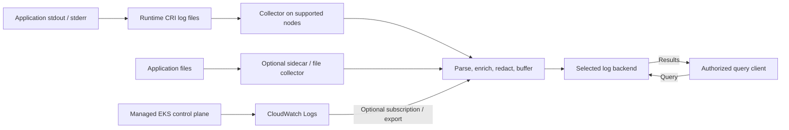

# 日志

> **最后更新**：2026年9月13日

日志将应用程序行为、基础设施事件和审计证据联系起来。
事件结构、采集责任、投递失败处理、访问控制、保留期限和查询方式应统筹设计。
仅选择采集器或后端，并不能保证记录完整、租户隔离或符合法规要求。

## 日志基础

### 结构化记录仍需要解析

JSON 能明确字段并便于验证和搜索，但仍需解码、映射时间戳和类型，
并正确处理容器运行时的日志分帧。JSON 可能比纯文本更大，
也不会自动移除敏感信息。除非经过测试的多行格式另有要求，
否则每行应生成一条事件。

此合成示例保留了其原始的 2025 时间戳，作为格式说明，
而非关于当前事故的声明：

```json
{
  "timestamp": "2025-02-15T10:23:45.123Z",
  "level": "ERROR",
  "message": "Database connection timed out",
  "service": "example-api",
  "operation": "database.connect",
  "timeout_ms": 30000,
  "trace_id": "4bf92f3577b34da6a3ce929d0e0e4736",
  "span_id": "00f067aa0ba902b7"
}
```

为便于阅读，上面展示了展开的 JSON。按行输出的生成器可以这样编码，
包括含有换行符的消息：

```python
import json


def encode_log(record):
    # JSON escapes embedded newlines; append exactly one record delimiter.
    return json.dumps(record, ensure_ascii=False, separators=(",", ":")) + "\n"
```

这些只是应用程序字段约定，并非 OTLP 线格式规范。请按需配置
采集器和后端，将字段映射到 OpenTelemetry 的 Timestamp、SeverityText/SeverityNumber、
Body、Resource、Attributes 和 trace context。

Trace ID 是 16 字节的值（此表示形式为 32 个十六进制字符）；
span ID 为 8 字节（16 个十六进制字符）。全零 ID 无效。请附加
当前实际的跟踪上下文，不要为每条日志生成无关的新 ID。没有 span 的启动或系统记录
可以省略 trace context；并非每条 JSON 日志都必须包含这些字段。
ID 正确本身并不会创建 span，也不保证跨服务关联。

只采集实际需要的业务和上下文信息。不要把原始
会话令牌、密码、客户数据、IP 地址或请求正文列为通用默认字段。
带有身份信息的审计数据可能确有用途，但必须制定明确的
访问、保留和脱敏策略。路由时应优先使用可信采集器元数据，
不要允许应用程序 JSON 任意声明租户或命名空间。

### Severity 不是通用的 0–5 量表

不同框架使用的名称和数值级别各不相同，应明确映射其含义。
OpenTelemetry 日志模型中的级别范围如下：

| Severity | SeverityNumber |
| --- | --- |
| TRACE | 1–4 |
| DEBUG | 5–8 |
| INFO | 9–12 |
| WARN | 13–16 |
| ERROR | 17–20 |
| FATAL | 21–24 |

在该模型中，零表示未指定严重性。ERROR 并不总是
表示可恢复；也不能只凭级别标签决定重试或恢复策略。
INFO 通常适合作为生产运维的起点；审计和安全事件
以及临时启用的调试都需要各自的要求。仅为减少日志量而把所有级别提高到 WARN，
可能会丢失必要证据。

## 采集和处理

下列各层表示不同职责，不一定对应相互独立的进程。
应有针对性地选择日志目的地，无须将每条记录
复制到所有后端。托管 EKS 控制平面日志直接进入 CloudWatch，
而不经过工作节点日志文件。



| 模式 | 适当用途和限制 |
| --- | --- |
| 标准输出/标准错误 + 节点采集器 | 常见的 Linux 工作节点路径；运行时文件和采集器权限仍然重要 |
| 文件 + sidecar | 适用于旧版或仅写文件的应用程序，也可用于应用专属处理；须谨慎考虑共享卷、启动/关闭流程和开销 |
| 应用程序/SDK 推送 | 可直接传送结构化事件；缓冲、身份验证和失败处理会影响应用程序 |
| 托管平台路由器 | 例如 EKS Fargate 内置的日志路由器；需使用其支持的配置模型 |

DaemonSet 会根据选择器、亲和性、容忍度、操作系统
和滚动更新行为调度到符合条件的节点上。它不能证明每个节点上的采集器都健康，
也不能证明每个容器都已纳入采集。多个采集器或滚动更新重叠可能导致重复采集。
sidecar 本身并不能构成可靠的多租户安全边界。

### 默认 Linux 日志路径和生命周期

常见默认布局为：

```text
Runtime log files:
  /var/log/pods/<namespace>_<pod>_<uid>/<container>/0.log

Compatibility symlinks pointing to those files:
  /var/log/containers/<pod>_<namespace>_<container>-<container-id>.log
```

Kubelet 指定运行时的 CRI 日志路径并管理轮转。`podLogsDir` 可以
更改默认路径，不同操作系统和运行时的布局也可能不同。请检查实际
部署情况，不要给每个 containerd 工作负载都添加仅适用于 Docker 的挂载。
`kubectl logs` 显示当前日志文件；若旧日志仍被保留，`--previous` 可以查看上一个
容器实例的日志。它并不是历史日志归档。

日志轮转只限制本地文件数量和大小，并不实现集中保留或备份。
节点丢失、驱逐或删除可能在采集前移除记录。sidecar 的
`emptyDir` 在同一 Pod 中容器重启后仍会保留，但 Pod 删除后就不再存在。
采集器的偏移量数据库、队列和持久存储必须与
输出确认和重试机制一并设计。缓冲容量有限；重试可能造成记录重复。
应在故障期间测量丢失和重复、积压、存储耗尽以及恢复情况。

为每条记录选择一条主要路由。既转发记录又将记录写入标准输出的 sidecar，
可能导致节点采集器再次收集同一记录。避免递归采集采集器自身的输出，
也不要将记录转发回同一个已订阅的源日志组。

### Fluent Bit 处理片段

以下是**经典格式的 Fluent Bit 配置**，不是 YAML。它只展示
过滤器片段；实际输入、CRI/多行解析器、标签格式、
RBAC/缓存访问、存储和输出都应另行提供并验证。

```text
# Fluent Bit classic-format FILTER fragment, not YAML or a complete pipeline.
# Requires matching tail input tags and CRI/Docker parsing.
[FILTER]
    Name               kubernetes
    Match              kube.*
    Kube_Tag_Prefix     kube.var.log.containers.
    Merge_Log          On
    Merge_Log_Key      app
    Keep_Log           On
    K8S-Logging.Parser  Off
    Labels             Off
    Annotations        Off

[FILTER]
    Name               modify
    Match              kube.*
    Set                cluster_name example-cluster
    Set                environment demo
```

`Merge_Log_Key app` 会将解析后的应用程序字段与采集器元数据分开保存。
`Set` 会替换所选的可信集群/环境值；`Add` 则会保留
已经存在的值。此片段不会自动信任工作负载指定的解析器或注解。
请让 `Kube_Tag_Prefix` 与实际输入标签相匹配。

使用 `Keep_Log On` 时，脱敏必须同时覆盖原始日志和解析后的
副本。只有经过测试的策略才可以移除原始副本。不要丢弃任何包含
`HealthCheck` 的行：失败的健康检查可能正是需要的证据。只有在检查过
应用程序格式和故障情形后，才能过滤定义明确的常规事件。

本概述不会把使用 `latest` 镜像的不完整 DaemonSet 当作完整
安装方案。实际部署采集器需要固定镜像版本、完整配置、
服务账户/RBAC、正确的挂载、权限和资源。部署细节请参阅
[采集器章节](05-collectors.md)，并验证所选平台和后端配置。

## EKS 日志路径

### 控制平面日志

EKS 可以将 `api`、`audit`、`authenticator`、`controllerManager` 和 `scheduler`
日志直接发送到账户中的 CloudWatch Logs。它们分别用于：
API 诊断、审计事件、IAM 身份验证诊断、控制器诊断和
调度器诊断。请按运维和安全要求选择所需类型。

将此请求保存为 `control-plane-logging.json`：

```json
{
  "clusterLogging": [
    {
      "types": [
        "api",
        "audit",
        "authenticator",
        "controllerManager",
        "scheduler"
      ],
      "enabled": true
    }
  ]
}
```
```bash
export AWS_REGION=ap-northeast-2
export CLUSTER_NAME=my-cluster

# Inspect the existing configuration before choosing a change.
aws eks describe-cluster --name "$CLUSTER_NAME" --region "$AWS_REGION" \
  --query 'cluster.logging'

# This changes the cluster logging configuration and can incur log charges.
aws eks update-cluster-config --name "$CLUSTER_NAME" --region "$AWS_REGION" \
  --logging file://control-plane-logging.json

# Use the actual update ID from the response, then inspect status/errors.
: "${UPDATE_ID:?Set the returned update ID}"
aws eks describe-update --name "$CLUSTER_NAME" --region "$AWS_REGION" \
  --update-id "$UPDATE_ID"
```

日志配置更新是异步的。EKS 文档指出，更新时每个子网最多需要五个可用 IP 地址。
请核实更新状态、已发出的日志流以及日志组的保留策略和权限。日志投递尽力而为，
通常会在几分钟内完成；启用某种日志类型不会补发所有先前事件。

审计事件遵循审计策略及其级别、阶段和排除规则。它们不能
证明每个请求或请求正文都已记录；仅启用 `audit` 也不能
证明符合合规要求。节点 DaemonSet 不会读取托管控制平面主机上的日志。
将 CloudWatch 日志转发到其他位置属于独立的订阅/导出路径，
有各自的编码、IAM、投递和重复处理要求。

### Fargate 和 Container Insights

EKS Fargate 提供托管的 Fluent Bit 日志路由器，通过
`aws-observability` 命名空间中的 `aws-logging` 配置；配置长度上限为文档所述的 5,300 个字符，
并且只能使用受支持的配置节和插件。不要在那里安装普通的主机 DaemonSet。
请配置日志目的地所需的权限，并测试新工作负载的日志。
Auto Mode、混合型和 Windows 环境也需要使用各自受支持的采集路径。

该命名空间必须带有 `aws-observability: enabled` 标签。请按文档所述向
Fargate Pod 执行角色授予访问日志目的地所需的权限。ConfigMap 更改
只会应用于新 Pod，不会影响已有 Pod；请规划受控滚动更新并验证日志投递。


CloudWatch Agent 的 `logs.metrics_collected.kubernetes` 会发送 Container Insights
性能数据；这本身并不采集应用程序的标准输出/标准错误日志。
应用程序日志需要由 Fluent Bit 或已配置的 OTel 日志路径单独处理。
只有实际工作负载或 Operator 会读取的 ConfigMap 才会生效。
有关这些模型和配置边界，请参阅已审查的
[CloudWatch 指南](../metrics/04-cloudwatch-metrics.md)。

## 存储、保留和成本决策

| 后端 | 设计问题 |
| --- | --- |
| Loki | LogQL、按标签索引的流/数据块和受支持的元数据/过滤路径；选择标签、租户隔离/身份验证、存储和查询容量 |
| OpenSearch | 搜索/聚合 API、映射和索引生命周期；区分自托管、托管域、UltraWarm 和 Serverless |
| CloudWatch Logs | 托管日志组、IAM、保留策略以及 Logs Insights QL/SQL/PPL；功能因日志类别和区域而异 |
| ClickHouse | 列式 SQL 分析、模式/排序/分区/TTL 选择，以及所选的自托管或云存储模式 |

OpenSearch 并非一概“只使用 S3 快照”：UltraWarm 使用 S3 和缓存，
而 Serverless 将存储与计算分离。CloudWatch 不是由用户配置的
S3 日志后端，但支持单独的导出、投递和集成路径。产品提供的
租户标识符或 sidecar 不能替代经过身份验证的路由和后端
访问控制。

全文过滤、索引和查询延迟是不同的问题。请使用有代表性的数据量、
查询条件、并发量、冷数据和恢复场景进行测试。
避免不加条件地给出“优秀/有限”的排名，声称“无模式就不需要模式”，
或在未测量数据集和配置的情况下给出压缩率。

### 应针对实际记录制定保留策略

不要把 `financial` 一律设为保留七年、把 `healthcare` 一律设为保留六年，
也不要将通用日志保留一年当作普遍适用的法律规则。应确定适用的记录类别、
司法辖区、合同要求、法律保全以及经批准的负责人策略。
热/温/冷存储层级属于运维选择，并不能证明已履行上述义务。
删除和访问计划还应涵盖副本、对象版本、备份和导出数据，
并单独测试恢复流程。

### 比较可比成本

旧版 2025 年表格混用了每 GB 存储和摄取价格，并将自托管
查询称为免费。之后的 100 GB 估算也没有给出可复现的区域、运行小时数、
保留期、容量和工作负载依据。这些只是示例性估算，并非
生产环境测量；仅修改日期或某一项价格并不能让估算变得可靠。

比较日志摄取量、保留或压缩后的字节数、索引开销、副本、计算资源、
查询扫描量/容量、存储请求、网络传输、备份和运维工作。
对象存储价格只是成本的一部分。即使服务不按查询次数收费，
查询仍会消耗已配置的 CPU、内存和 I/O。Loki 加 S3 不一定总是成本
最低的选择，某个后端也不会仅因其名称就自动满足合规要求。

1. 明确所需的查询能力、数据新鲜度、保留期限、访问控制和恢复目标。
2. 筛选满足这些要求的部署模式。
3. 使用有代表性的数据和查询，以及故障/恢复场景进行回放测试。
4. 比较完整成本和运维责任。
5. 记录剩余假设，并在生产使用前验证它们。

## 后续步骤和验证范围

Promtail 已于 **2026-03-02** 结束生命周期。新项目请使用 Alloy 或其他受支持的客户端，
并规划现有 Promtail 部署的迁移。引用的公告明确将 `lambda-promtail` 单独处理；
不要扩大其停止维护范围的表述。

- [Loki](01-loki.md)
- [OpenSearch](02-opensearch.md)
- [CloudWatch Logs](03-cloudwatch-logs.md)
- [ClickHouse](04-clickhouse.md)
- [采集器：Fluent Bit、Alloy 和 OpenTelemetry](05-collectors.md)

本次审计检查了源事实、示例序列化和 ID，以及请求/配置
结构。未执行 EKS 日志配置变更或采集器部署，也未配置租户/存储、
作出法律判断、测量生产成本，或测试日志投递/恢复。

## 参考资料

- [Kubernetes 日志架构](https://kubernetes.io/docs/concepts/cluster-administration/logging/)
- [Kubelet 旧版日志符号链接](https://github.com/kubernetes/kubernetes/blob/v1.36.2/pkg/kubelet/kuberuntime/legacy.go)
- [DaemonSet 行为](https://kubernetes.io/docs/concepts/workloads/controllers/daemonset/)
- [Kubernetes 审计策略](https://kubernetes.io/docs/tasks/debug/debug-cluster/audit/)
- [OpenTelemetry 日志数据模型](https://opentelemetry.io/docs/specs/otel/logs/data-model/)
- [W3C 跟踪上下文](https://www.w3.org/TR/trace-context/)
- [EKS 控制平面日志](https://docs.aws.amazon.com/eks/latest/userguide/control-plane-logs.html)
- [EKS Fargate 日志路由器](https://docs.aws.amazon.com/eks/latest/userguide/fargate-logging.html)
- [Fluent Bit Kubernetes 过滤器源文档](https://github.com/fluent/fluent-bit-docs/blob/master/pipeline/filters/kubernetes.md)
- [Fluent Bit modify 过滤器](https://github.com/fluent/fluent-bit-docs/blob/master/pipeline/filters/modify.md)
- [Loki 架构](https://grafana.com/docs/loki/latest/get-started/overview/)
- [Promtail 生命周期结束说明](https://grafana.com/docs/loki/latest/send-data/promtail/)
- [OpenSearch UltraWarm](https://docs.aws.amazon.com/opensearch-service/latest/developerguide/ultrawarm.html)
- [OpenSearch Serverless](https://docs.aws.amazon.com/opensearch-service/latest/developerguide/serverless-overview.html)
- [CloudWatch Logs 查询语言](https://docs.aws.amazon.com/AmazonCloudWatch/latest/logs/AnalyzingLogData.html)
- [CloudWatch 日志类别](https://docs.aws.amazon.com/AmazonCloudWatch/latest/logs/CloudWatch_Logs_Log_Classes.html)
- [ClickHouse 概览](https://github.com/ClickHouse/ClickHouse)

[测验](../../quizzes/observability/logging/README-quiz.md)
