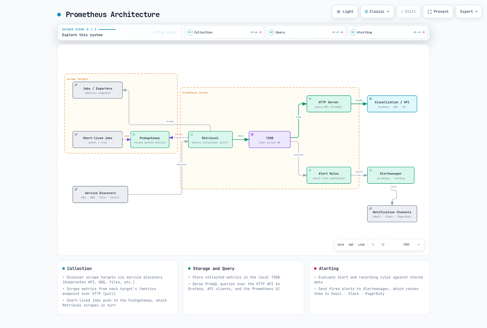
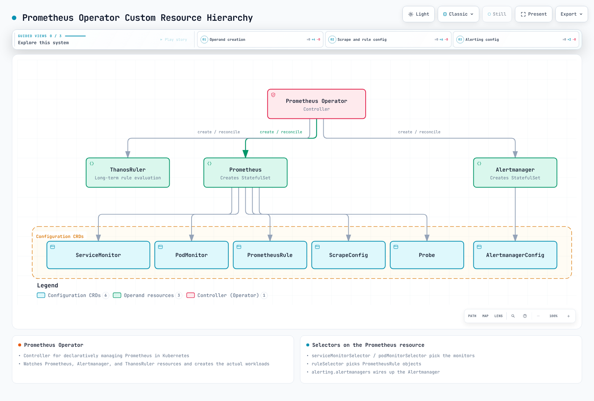

# Prometheus

> **最后更新**：2026年11月19日。下文介绍了本地配置/查询检查；未执行集群或云部署。

## 目录

- [简介和版本](#introduction-and-versions)
- [架构和组件](#architecture-and-components)
- [PromQL](#promql)
- [发现和 Operator 选择器](#discovery-and-operator-selectors)
- [kube-prometheus-stack 安装](#kube-prometheus-stack-installation)
- [规则和 Alertmanager](#rules-and-alertmanager)
- [远程写入和 AMP](#remote-write-and-amp)
- [性能、高可用和故障排查](#performance-ha-and-troubleshooting)

## 简介和版本 {#introduction-and-versions}

Prometheus 是 CNCF 监控工具包，最初由 SoundCloud 开发。它会收集数值型时间序列，将其存储在本地 TSDB 中，执行 PromQL 以及记录规则/告警规则，并将告警发送给 Alertmanager。常规采集通过 HTTP 抓取完成；远程写入和可选的批处理集成则提供其他传输路径。它不是事件日志、链路追踪存储，也不是精确到每个请求的计费账本。

本地数据保留时间可配置，也可以超过 30 天。是否使用独立存储，取决于数据保留时间、容量、共享查询以及故障/恢复需求。

本章使用于2026年9月6日发布的官方 **kube-prometheus-stack 90.0.0** 软件包。已将其组件版本作为一个版本组合进行检查：

| 组件 | 软件包默认版本 |
|---|---|
| Prometheus Operator | 0.93.1 |
| Prometheus | 3.14.0，distroless 镜像 |
| Alertmanager | 0.34.0 |
| Grafana | 13.2.1，子 Chart 13.2.2 |
| kube-state-metrics | 2.20.0，子 Chart 8.4.2 |
| node-exporter | 1.12.1，子 Chart 4.56.3 |

Chart 的 `kubeVersion` 防护条件为 `>=1.25.0-0`。这并非完整的兼容性矩阵，也不表示 Kubernetes 1.25 及更高版本都会一直受支持。请检查实际集群、组件支持情况、准入策略和存储驱动。

此配置面向 **由 Linux EC2 实例承载的 EKS 工作节点**。Fargate 不支持 DaemonSet；Auto Mode、Hybrid Nodes 和 Windows 需要针对平台检查采集器/存储配置。

### 2026年11月更新

- [Prometheus 3.16.0](https://github.com/prometheus/prometheus/releases/tag/v3.16.0) 于2026-11-04发布。主要更新：平滑向量选择器和锚定（扩展范围）向量选择器现已稳定并始终启用；新增实验性的 PromQL 查询成本估算，以及通过 `--enable-feature=query-cost` 配置执行限制；新增通过实验性函数标志启用的实验性 `integral()` 函数；Agent 模式支持 `metadata-wal-records`。本章示例已在 3.14.0 上验证，尚未在 3.16 上重新运行。

### 2026年9月更新

- 根据[9月11日的 Kubernetes 博客文章](https://kubernetes.io/blog/2026/09/11/kubernetes-v1-37-native-histograms-beta/)，用于 Kubernetes 组件指标的 [Prometheus 原生直方图](https://prometheus.io/docs/specs/native_histograms/)支持（KEP-5808）已晋升至 Beta，并在 v1.37 中默认启用。高分辨率、低基数的桶取代固定的 `le` 桶，从而提高延迟指标的准确性，同时降低存储和抓取开销。要从中受益，抓取数据的 Prometheus 也必须配置为摄取原生直方图；现有的经典直方图查询/仪表板还需要单独检查。

### 2026年7月历史更新

- [7月14日的 Kubernetes exporter 文章](https://kubernetes.io/blog/2026/07/14/custom-metrics-exporter-kubernetes/)介绍了应用插桩和自定义 exporter。使用 HPA 还需要适当的 metrics API/adapter；仅进行抓取并不能将任意指标接入 HPA。
- [7月21日的 AMP 公告](https://aws.amazon.com/about-aws/whats-new/2026/07/amazon-managed-service-prometheus-1500m-metrics-workspace/)介绍了每个工作区最多支持 15 亿活跃时间序列和 200,000 条记录/告警规则。这些是公布的扩展上限，并不表示默认配额会自动获得，也不保证审批通过。请检查目标工作区/账户的当前配额。

## 架构和组件 {#architecture-and-components}



[交互式图表](https://www.atomai.click/kubernetes-docs/archmaps/en-observability-metrics-01-prometheus-0.html)

Pushgateway 分支适用于合适的服务级批处理任务，是可选项，并非所有短生命周期 Pod 都需要。各组需要进行生命周期管理；请参阅[指标概览](README.md)。`up` 表示抓取健康状况，而非应用可用性。

| 组件 | 职责和前置条件 |
|---|---|
| Prometheus | 发现、抓取、本地 TSDB、查询 API 和规则评估 |
| kube-state-metrics | API 对象状态；需要 ServiceAccount、RBAC 和抓取端点 |
| node-exporter | 主机操作系统指标；需要检查主机访问/挂载和平台支持情况 |
| kubelet/cAdvisor | 容器测量数据；需验证服务证书、授权和端点可用性 |
| metrics-server / adapters | 用于自动扩缩容的资源/自定义指标 API；与历史 TSDB 存储分开 |
| Alertmanager | 对告警进行分组、去重、抑制，并将其路由到已配置的接收端 |
| Grafana | 查询/可视化数据源；身份验证和数据库/存储需要单独配置 |

Chart 会提供 exporter 和辅助资源。不完整的独立 Deployment/DaemonSet 代码片段不会提供缺失的 ServiceAccount、RBAC 和 Service，也不应因此创建重复的监控堆栈。

### TSDB 和配置层

近期样本使用 head/WAL；压实后的块包含数据块、索引和元数据。墓碑用于标记已删除的范围。WAL 重放有助于崩溃恢复，但不能替代备份，无法应对卷丢失，也不能保证恢复每个事件。

| 层 | 正确的设置 |
|---|---|
| 进程标志 | `--storage.tsdb.path`、`--storage.tsdb.retention.time`、`--storage.tsdb.retention.size` |
| Prometheus 配置 | `global`、`scrape_configs`、`rule_files`、`remote_write` |
| Operator `Prometheus.spec` | `retention`、`retentionSize`、`storage`、`replicas`、`shards` |
| 本 Chart 的 values | `prometheus.prometheusSpec.retention`、`storageSpec` 以及下方的 values |

旧式 `storage.tsdb.path/retention.time/...` YAML 不是有效的进程配置。在**单独的独立安装**中，基本标志如下：

```sh
prometheus --config.file=prometheus.yml \
  --storage.tsdb.path=/prometheus \
  --storage.tsdb.retention.time=15d \
  --storage.tsdb.retention.size=15GB
```

对于 Operator 安装，请配置所属 Helm values。保留大小并非磁盘总量的硬性上限：还要为 WAL、head、索引和压实留出空间。请使用受支持的本地/块存储；任意 NFS 不能作为受支持的替代方案。

## PromQL

以下示例假设 `job="example-app"`，以及 Chart 的 node-exporter/kube-state-metrics job 标签。请根据实际目标调整。`example_queue_depth` 和 `temperature_celsius` 是应用自定义 gauge，并非内置 Kubernetes 指标。

### 选择器、范围和速率

即时选择器会根据回看/陈旧规则查找符合条件的样本；“当前”并不保证恰好在评估时刻有观测值。范围选择器会选择一个样本时间区间。子查询会以指定分辨率评估表达式，而不是每隔 N 个已存储的原始样本选取一个。

| 用途 | PromQL |
|---|---|
| 即时选择器 | `http_requests_total{job="example-app"}` |
| 正向/正则过滤 | `http_requests_total{job="example-app",method="GET",status=~"2[0-9]{2}"}` |
| 负向正则 | `http_requests_total{job="example-app",status!~"5[0-9]{2}"}` |
| 范围向量 | `http_requests_total{job="example-app"}[5m]` |
| 分辨率为五分钟的一小时子查询 | `rate(http_requests_total{job="example-app"}[5m])[1h:5m]` |
| 一小时前的速率窗口 | `rate(http_requests_total{job="example-app"}[5m] offset 1h)` |
| 每秒平均计数器速率 | `rate(http_requests_total{job="example-app"}[5m])` |
| 根据最近两个可用样本计算的速率 | `irate(http_requests_total{job="example-app"}[5m])` |
| 外推的计数器增量 | `increase(http_requests_total{job="example-app"}[1h])` |

负向匹配器可以选中缺少该标签的时间序列。`rate()` 和 `increase()` 会处理已观测到的重置并进行外推，但无法恢复所有遗漏的增量。请先应用 **rate，再做聚合**。`irate()` 对最新样本较敏感，通常不太适合稳定的告警条件。

范围向量是范围函数的输入，并不是现成的范围查询图表。例如，查询经评估的速率序列时，请使用 `rate(counter[5m])`。

### 聚合、Gauge 和时间

| 用途 | PromQL |
|---|---|
| 按方法统计请求速率 | `sum by (method) (rate(http_requests_total{job="example-app"}[5m]))` |
| 聚合时去掉 instance | `sum without (instance) (rate(http_requests_total{job="example-app"}[5m]))` |
| 对去重后的 Running 指标求和 | `sum(max by (namespace,pod,uid) (kube_pod_status_phase{job="kube-state-metrics",phase="Running"}))` |
| 最大可用内存 | `max(node_memory_MemAvailable_bytes{job="node-exporter"})` |
| 排除空/基础设施容器标签后的 Pod CPU 排名 | `topk(5, sum by (namespace,pod) (rate(container_cpu_usage_seconds_total{job="kubelet",container!="",container!="POD"}[5m])))` |
| 对当前队列深度 Gauge 求分位数 | `quantile(0.95, example_queue_depth{job="example-app"})` |
| 速率的标准差 | `stddev(rate(http_requests_total{job="example-app"}[5m]))` |
| Gauge 的外推变化量 | `delta(temperature_celsius{job="example-app"}[1h])` |
| Gauge 每秒斜率 | `deriv(temperature_celsius{job="example-app"}[1h])` |
| 与 20°C 的绝对偏差 | `abs(temperature_celsius{job="example-app"} - 20)` |
| 向上取整 | `ceil(example_queue_depth{job="example-app"})` |
| 限定在某个范围内 | `clamp(example_queue_depth{job="example-app"}, 0, 100)` |
| 平方根 | `sqrt(example_queue_depth{job="example-app"})` |
| 自然对数 | `ln(example_queue_depth{job="example-app"})` |
| Unix 秒级评估时间 | `time()` |
| 所选样本的时间戳 | `timestamp(up{job="example-app"})` |
| 样本的 UTC 小时 | `hour(timestamp(up{job="example-app"}))` |

统计 `kube_pod_status_phase{phase="Running"}` 的时间序列会把值为零的序列也计算在内。移除重复的 exporter 标识后，对 0/1 指标求和；如果只存在值为零的指标，结果为零，而缺失的遥测数据仍然是缺失状态。

Gauge 的 `quantile()` 示例用于比较各个时间序列的值。它不会计算直方图的请求延迟 p95，也不会合并 Summary 的 p99 值。数学函数对输入值域有限制；例如，对非正数取对数需要有意处理。相关函数包括 `floor`、`round`、`clamp_min` 和 `clamp_max`。

此业务时段过滤器使用 **UTC**，而非浏览器/集群时区：

```promql
sum(rate(http_requests_total{job="example-app"}[5m])) and on() (hour() >= 9 < 18)
```

### 分布和预测

```promql
histogram_quantile(0.95, sum by (le) (rate(http_request_duration_seconds_bucket{job="example-app"}[5m])))
```

```promql
histogram_quantile(0.99, sum by (le,method) (rate(http_request_duration_seconds_bucket{job="example-app"}[5m])))
```

```promql
sum(rate(http_request_duration_seconds_sum{job="example-app"}[5m])) / sum(rate(http_request_duration_seconds_count{job="example-app"}[5m]))
```

请聚合兼容的经典桶并保留 `le`。分位数会在桶内插值。Summary 分位数同样是近似值，不能通过求平均得到整个集群的百分位数；sum/count 则可以计算整个集群的均值。

`predict_linear()` 会外推拟合出的 Gauge 趋势。负向预测是需要调查的信号，并不保证未来一定会发生磁盘故障：

```promql
predict_linear(node_filesystem_avail_bytes{job="node-exporter",mountpoint="/",fstype!~"tmpfs|overlay"}[6h], 86400)
```

Prometheus 3 将 `holt_winters` 重命名为 `double_exponential_smoothing`。这是 **Holt 线性平滑，而非季节性三指数预测**，并且需要 Gauge 浮点样本。可选表达式：`double_exponential_smoothing(example_queue_depth{job="example-app"}[1h], 0.5, 0.5)`。执行评估的服务器需要设置 `--enable-feature=promql-experimental-functions`。本地审计检查了其解析器语法；不表示实验性值评估已通过。

### 运维示例

| 用途 | PromQL |
|---|---|
| CPU 非空闲百分比 | `100 * (1 - avg by (instance) (rate(node_cpu_seconds_total{job="node-exporter",mode="idle"}[5m])))` |
| 未报告为 MemAvailable 的内存占比 | `100 * (1 - node_memory_MemAvailable_bytes{job="node-exporter"} / node_memory_MemTotal_bytes{job="node-exporter"})` |
| 预计一小时内的重启增量超过三次 | `increase(kube_pod_container_status_restarts_total{job="kube-state-metrics"}[1h]) > 3` |
| 文件系统不可用空间百分比 | `100 * (1 - node_filesystem_avail_bytes{job="node-exporter",mountpoint="/"} / node_filesystem_size_bytes{job="node-exporter",mountpoint="/"})` |
| 每秒接收 + 发送字节数 | `rate(node_network_receive_bytes_total{job="node-exporter",device="eth0"}[5m]) + rate(node_network_transmit_bytes_total{job="node-exporter",device="eth0"}[5m])` |

计算错误百分比时，健康服务可能没有 5xx 时间序列。下方的零值回退仅用于存在匹配总流量分组的情况；不会为缺失的服务凭空创建健康数据。

```promql
100 * (sum by (namespace, service) (rate(http_requests_total{job="example-app",status=~"5[0-9]{2}"}[5m])) or on (namespace, service) (0 * (sum by (namespace, service) (rate(http_requests_total{job="example-app"}[5m]))))) / (sum by (namespace, service) (rate(http_requests_total{job="example-app"}[5m])))
```

观测到健康流量时结果为 0，只有 5xx 流量时结果为 100，分母为零时结果未定义。缺失的遥测数据仍然缺失；请单独监控采集故障。

## 发现和 Operator 选择器 {#discovery-and-operator-selectors}



[交互式图表](https://www.atomai.click/kubernetes-docs/archmaps/en-observability-metrics-01-prometheus-1.html)

图中的 Prometheus/Alertmanager 节点表示**自定义资源**。Operator 会读取这些资源，并协调实际工作负载，例如 StatefulSet。对象或 Prometheus server 不会独立创建 StatefulSet。

| 选择阶段 | 被选对象 |
|---|---|
| Prometheus `serviceMonitorNamespaceSelector` | 包含 ServiceMonitor 对象的命名空间 |
| Prometheus `serviceMonitorSelector` | 这些 ServiceMonitor 对象上的标签 |
| ServiceMonitor `namespaceSelector` / `selector` | 目标 Service 的命名空间和标签 |
| ServiceMonitor 端点 `port` | **Service 端口名称**，而非任意容器端口号 |
| PodMonitor 选择器 / 端点 `port` | Pod 标签和已声明的容器端口名称 |

RBAC、发现和网络/TLS 访问是彼此独立的要求。选择器不能替代授权。Helm 的 `*SelectorNilUsesHelmValues` 布尔值会影响标签选择器默认值，而不会影响所有目标命名空间。

### 配置一致的应用抓取

假设 `example-app` 中已经存在经过插桩的 Deployment，Pod 标签为 `app: example-app`，并且声明了一个名为 `metrics`、提供 `/metrics` 的端口。下方的 Service 不会创建该应用：

```yaml
# service.yaml
apiVersion: v1
kind: Service
metadata:
  name: example-app
  namespace: example-app
  labels:
    app: example-app
    metrics-job: example-app
spec:
  selector:
    app: example-app
  ports:
  - name: http-metrics
    port: 8080
    targetPort: metrics
```

```yaml
# servicemonitor.yaml
apiVersion: monitoring.coreos.com/v1
kind: ServiceMonitor
metadata:
  name: example-app
  namespace: monitoring
  labels:
    release: kube-prom
spec:
  jobLabel: metrics-job
  selector:
    matchLabels:
      app: example-app
  namespaceSelector:
    matchNames:
    - example-app
  endpoints:
  - port: http-metrics
    path: /metrics
    interval: 30s
    scrapeTimeout: 10s
    relabelings:
    - sourceLabels:
      - __meta_kubernetes_service_name
      targetLabel: service
    - sourceLabels:
      - __meta_kubernetes_namespace
      targetLabel: namespace
    - sourceLabels:
      - __meta_kubernetes_pod_name
      targetLabel: pod
```

ServiceMonitor 的 `release: kube-prom` 与安装相匹配。其 `jobLabel` 会读取 Service 上的 `metrics-job: example-app`，从而设置应用查询所用的 job 标签。

PodMonitor 是针对同一批 Pod 的**替代方案**。请为某个端点选择一种预期的采集路径，以避免重复摄取：

```yaml
# podmonitor.yaml
apiVersion: monitoring.coreos.com/v1
kind: PodMonitor
metadata:
  name: example-app-pods
  namespace: monitoring
  labels:
    release: kube-prom
spec:
  selector:
    matchLabels:
      app: example-app
  namespaceSelector:
    matchNames:
    - example-app
  podMetricsEndpoints:
  - port: metrics
    interval: 30s
    path: /metrics
    relabelings:
    - targetLabel: job
      replacement: example-app
    - targetLabel: service
      replacement: example-app
```

### 其他发现路径

- 独立/Agent Pod 发现可以使用[概览中的命名端口配置](README.md#metric-collection-models)，该配置会保留发现机制提供的 IPv4/IPv6 地址。除非实际配置会读取，否则 `prometheus.io/scheme` 之类的注解不会生效。
- 对 Service 进行黑盒探测需要已安装的 exporter、定义好的探测模块、适当的目标 URL/scheme 和 `Probe`/抓取配置。`up` 表示 exporter 抓取状态；探测成功是另一个独立信号。
- 节点发现会访问 kubelet 端点，不会自动访问 node-exporter。请验证服务证书、正确的 CA 和节点指标 RBAC。Kubernetes API CA 不能证明任意节点证书受其信任。
- 请使用经过审核的命名空间/Service/团队标签，而不要不受限制地使用节点 `labelmap`。移除标识标签并不等于执行聚合。

## kube-prometheus-stack 安装 {#kube-prometheus-stack-installation}

以下命令会更改集群，**并非审计中执行的命令**。请使用预期的上下文和由你管理的 release。对于现有安装，请检查实际 values、CRD、存储和升级说明，而不是安装重复的堆栈。

此配置的前置条件：

- 已获授权的 Helm/Kubernetes 访问权限，以及充足的 Linux EC2 节点资源。
- 可用的默认块存储 StorageClass/CSI 驱动，或为每个 PVC 明确指定并经过审核的类名。不能保证一定存在 `gp3`。
- 在 Linux EC2 节点上已有 `monitoring` 命名空间、Secrets Store CSI 驱动和 AWS provider（ASCP）。在 AWS Secrets Manager（`ap-northeast-2`）中准备 `observability/grafana-admin`，其 JSON 字符串键为 `admin-password`；不要将其同步到 Kubernetes Secret。
- `metrics-demo-grafana` ServiceAccount 需要一个作用域限定为该 Secret 的 IRSA 角色。请替换下方的示例 IAM 角色 ARN，并应用匹配的 SecretProviderClass。请参阅[完整的身份、KMS、挂载和轮换前置条件](https://github.com/Atom-oh/kubernetes-docs/blob/5ff787faed758902c12a74e8429466f434bb26ae/examples/observability/secret-profiles/README.md)。
- 已验证 kubelet TLS 信任配置。此配置会启用证书验证；如果证书由其他颁发者签发，请提供正确的 CA，而不要绕过验证。

此处的规格仅作示例。每个 Prometheus 副本都会获得自己的 PVC；保留大小不会限制 WAL/head/压实的使用量。Grafana 仍为单副本，使用 PVC 支持的数据库。仅增加副本并不能实现共享数据库高可用。

```yaml
# kube-prometheus-stack 90.0.0; replace the example IRSA role ARN before use.
fullnameOverride: metrics-demo
kubeControllerManager:
  enabled: false
kubeScheduler:
  enabled: false
kubeEtcd:
  enabled: false
kubeProxy:
  enabled: false
kubelet:
  serviceMonitor:
    tlsConfig:
      insecureSkipVerify: false
prometheus:
  serviceAccount:
    create: true
    name: metrics-demo-prometheus
  prometheusSpec:
    replicas: 1
    shards: 1
    retention: 15d
    retentionSize: 15GB
    storageSpec:
      volumeClaimTemplate:
        spec:
          accessModes:
          - ReadWriteOnce
          resources:
            requests:
              storage: 20Gi
    resources:
      requests:
        cpu: 500m
        memory: 2Gi
      limits:
        memory: 4Gi
    externalLabels:
      cluster: eks-metrics-demo
    serviceMonitorSelectorNilUsesHelmValues: true
    serviceMonitorNamespaceSelector: &id001
      matchExpressions:
      - key: kubernetes.io/metadata.name
        operator: In
        values:
        - monitoring
        - example-app
    podMonitorSelectorNilUsesHelmValues: true
    podMonitorNamespaceSelector: *id001
    ruleSelectorNilUsesHelmValues: true
    ruleNamespaceSelector:
      matchLabels:
        kubernetes.io/metadata.name: monitoring
alertmanager:
  alertmanagerSpec:
    replicas: 1
    storage:
      volumeClaimTemplate:
        spec:
          accessModes:
          - ReadWriteOnce
          resources:
            requests:
              storage: 5Gi
grafana:
  fullnameOverride: metrics-demo-grafana
  replicas: 1
  persistence:
    enabled: true
    size: 10Gi
  sidecar:
    dashboards:
      searchNamespace: monitoring
      skipReload: true
      initDashboards: true
      provider:
        updateIntervalSeconds: 30
    datasources:
      searchNamespace: monitoring
      skipReload: true
      initDatasources: true
  serviceAccount:
    create: true
    name: metrics-demo-grafana
    annotations:
      eks.amazonaws.com/role-arn: arn:aws:iam::111122223333:role/metrics-grafana-secrets
  env:
    GF_SECURITY_ADMIN_USER: admin
    GF_SECURITY_ADMIN_PASSWORD: $__file{/mnt/grafana-secrets/admin-password}
  grafana.ini:
    security:
      admin_user: admin
      admin_password: $__file{/mnt/grafana-secrets/admin-password}
  extraVolumes:
  - name: grafana-secrets
    csi:
      driver: secrets-store.csi.k8s.io
      readOnly: true
      volumeAttributes:
        secretProviderClass: metrics-grafana-admin
  extraVolumeMounts:
  - name: grafana-secrets
    mountPath: /mnt/grafana-secrets
    readOnly: true
```

此 EKS 配置会禁用托管控制平面组件和此处未假设其端点可公开访问的 kube-proxy 的监控器。它不会禁用 Kubernetes 本身。`monitoring`/`example-app` 中的 ServiceMonitor 需要匹配的 release 标签；规则只从 `monitoring` 中选择。

在 `GF_SECURITY_ADMIN_PASSWORD` 中，Grafana 接收的是**字面量文件 provider 表达式**，而非密码值。这会抑制 Chart 自动生成的凭据环境变量引用。Grafana 13.2.1 会在环境变量覆盖后，于自身配置内部求值 `$__file{...}`；没有 `__FILE` 入口点，也没有 shell 会导出文件内容。只读 CSI 文件必须可由 UID/GID 472 读取（`fsGroup: 472`，权限模式 `0440`），且仅由 Grafana 主容器挂载。请使用不含前导/尾随空白的密码，因为文件 provider 会移除这些空白。

dashboard/datasource init 容器会在启动前填充 provisioning 文件。Sidecar 会继续监视文件，但使用 `skipReload: true`，因此都不需要管理员凭据。Grafana 每 30 秒轮询一次 dashboard 文件；**更新 datasource 需要受控地重启 Pod**。`admin_password` 仅会初始化新数据库：更改 AWS Secret、CSI 轮换或重启，都不会重置现有 PVC/数据库中的管理员密码。请使用获批的密码更改/SSO 流程并协调 Secret；保留 PVC。

请使用完整的[可复用配置](https://github.com/Atom-oh/kubernetes-docs/blob/5ff787faed758902c12a74e8429466f434bb26ae/examples/observability/secret-profiles/README.md)，其中包括 `grafana-secret-provider.yaml`。本地渲染/测试覆盖配置和挂载，不覆盖实际 CSI 权限、登录或轮换。主要规范：[Grafana 配置](https://grafana.com/docs/grafana/latest/setup-grafana/configure-grafana/)和 [AWS ASCP](https://github.com/aws/secrets-store-csi-driver-provider-aws/blob/main/README.md)。

在仓库根目录准备好前置条件后，只需安装一次：

```sh
PROFILE=examples/observability/secret-profiles
kubectl apply -f "$PROFILE/grafana-secret-provider.yaml"
helm repo add prometheus-community https://prometheus-community.github.io/helm-charts
helm repo update prometheus-community
helm template kube-prom prometheus-community/kube-prometheus-stack \
  --version 90.0.0 --namespace monitoring -f "$PROFILE/prometheus-values.yaml" \
  > grafana-reviewed-render.yaml
# Review resources, prerequisites and ownership before this cluster-changing command.
helm upgrade --install kube-prom prometheus-community/kube-prometheus-stack \
  --version 90.0.0 --namespace monitoring -f "$PROFILE/prometheus-values.yaml" \
  --wait --timeout 15m
```

请检查 CRD 是否已建立、Operator 健康状况、PVC 绑定情况和实际目标。只有在 CRD 建立后，才应用所选的应用监控器/规则。

Chart 的 CRD 升级处理因版本而异。请阅读升级说明，不要假设所有 CRD 迁移都能通过普通 Helm 升级完成。Chart 90 还将 Grafana 依赖项更改为社区仓库；升级时请验证现有身份验证/provisioning values，并保留数据库/PVC 备份。

## 规则和 Alertmanager {#rules-and-alertmanager}

以下选定的 PrometheusRule 包含告警和记录规则示例。CPU 记录规则使用 `rate`，并统一采用比率单位。错误表达式的单位是百分比，因此阈值为 1，注解也会输出百分比。

```yaml
# prometheusrule.yaml
apiVersion: monitoring.coreos.com/v1
kind: PrometheusRule
metadata:
  name: example-rules
  namespace: monitoring
  labels:
    release: kube-prom
spec:
  groups:
  - name: example-alerts
    interval: 30s
    rules:
    - alert: NodeMemoryHigh
      expr: 100 * (1 - node_memory_MemAvailable_bytes{job="node-exporter"} / node_memory_MemTotal_bytes{job="node-exporter"})
        > 90
      for: 5m
      labels:
        severity: warning
        team: infrastructure
      annotations:
        summary: Node {{ $labels.instance }} memory availability is low
        description: '{{ printf "%.2f" $value }}% is not reported as MemAvailable.'
    - alert: PodRestartingFrequently
      expr: increase(kube_pod_container_status_restarts_total{job="kube-state-metrics"}[1h]) > 5
      for: 10m
      labels:
        severity: warning
      annotations:
        summary: Pod {{ $labels.namespace }}/{{ $labels.pod }} is restarting
        description: '{{ printf "%.2f" $value }} estimated restarts in one hour.'
    - alert: ProjectedDiskExhaustion
      expr: predict_linear(node_filesystem_avail_bytes{job="node-exporter",mountpoint="/",fstype!~"tmpfs|overlay"}[6h],
        86400) < 0
      for: 1h
      labels:
        severity: warning
      annotations:
        summary: Projected disk exhaustion on {{ $labels.instance }}
        description: The fitted six-hour trend projects negative free space in 24 hours; inspect the filesystem
          and workload.
    - alert: HighErrorRate
      expr: (100 * (sum by (namespace, service) (rate(http_requests_total{job="example-app",status=~"5[0-9]{2}"}[5m]))
        or on (namespace, service) (0 * (sum by (namespace, service) (rate(http_requests_total{job="example-app"}[5m])))))
        / (sum by (namespace, service) (rate(http_requests_total{job="example-app"}[5m])))) > 1
      for: 5m
      labels:
        severity: warning
        team: backend
      annotations:
        summary: High error rate on {{ $labels.namespace }}/{{ $labels.service }}
        description: '{{ printf "%.2f" $value }}% of requests are 5xx, above the 1% threshold.'
  - name: example-recording
    rules:
    - record: instance:node_cpu_utilization:ratio_rate5m
      expr: 100 * (1 - avg by (instance) (rate(node_cpu_seconds_total{job="node-exporter",mode="idle"}[5m])))
        / 100
    - record: instance:node_memory_not_available:ratio
      expr: max by (instance) ((1 - node_memory_MemAvailable_bytes{job="node-exporter"} / node_memory_MemTotal_bytes{job="node-exporter"}))
```

`for` 表示在告警触发前，同一组告警标签必须在多次评估中持续满足表达式条件。数据缺失或标签变化都可能中断待处理状态。它不是 Alertmanager 的通知延迟或重复间隔。预测告警描述的是一种预测，并不表示故障一定会发生。

### AlertmanagerConfig 和命名空间边界

Operator 0.93.1 打包的 AlertmanagerConfig CRD 使用 **v1alpha1**。此示例将其用作管理员拥有的**全局配置**。引用的 Secret 必须存在于 `monitoring` 中。启用通知前，请替换/批准地址、频道和 provider 目标。

Operator API 将 `alertmanagerConfiguration` 标记为实验性功能：请遵守版本边界并测试升级。通常，选中的普通命名空间级 AlertmanagerConfig 会获得命名空间匹配器；位于 `monitoring` 中的配置不会自动接收所有命名空间中的应用告警。此全局配置有意采用了范围更广的管理边界。

```yaml
# alertmanagerconfig.yaml
apiVersion: monitoring.coreos.com/v1alpha1
kind: AlertmanagerConfig
metadata:
  name: main-config
  namespace: monitoring
spec:
  route:
    receiver: default
    groupBy:
    - alertname
    - namespace
    - severity
    groupWait: 30s
    groupInterval: 5m
    repeatInterval: 4h
    routes:
    - receiver: pagerduty-critical
      matchers:
      - name: severity
        matchType: '='
        value: critical
      groupWait: 10s
      repeatInterval: 1h
    - receiver: slack-backend
      matchers:
      - name: team
        matchType: '='
        value: backend
    - receiver: slack-warnings
      matchers:
      - name: severity
        matchType: '='
        value: warning
      groupWait: 1m
  inhibitRules:
  - sourceMatch:
    - name: severity
      matchType: '='
      value: critical
    targetMatch:
    - name: severity
      matchType: '='
      value: warning
    equal:
    - alertname
    - cluster
    - namespace
    - service
    - instance
    - pod
    - container
  receivers:
  - name: default
    emailConfigs:
    - to: alerts@example.com
      from: alertmanager@example.com
      smarthost: smtp.example.com:587
      authUsername: alertmanager
      authPassword:
        name: alertmanager-smtp
        key: password
      requireTLS: true
  - name: slack-backend
    slackConfigs:
    - apiURL:
        name: alertmanager-slack
        key: webhook-url
      channel: '#team-backend-alerts'
      sendResolved: true
  - name: slack-warnings
    slackConfigs:
    - apiURL:
        name: alertmanager-slack
        key: webhook-url
      channel: '#alerts'
      sendResolved: true
  - name: pagerduty-critical
    pagerdutyConfigs:
    - routingKey:
        name: alertmanager-pagerduty
        key: routing-key
      sendResolved: true
```

默认情况下，同级路由会在首次匹配后停止。严重告警路由排在最前；后端路由位于通用警告路由之前，因此可以匹配。只有在确实需要多路投递时，才有意设置 `continue`。抑制规则会同时匹配资源标识和告警名称：某个 Service/节点的严重告警不能抑制无关警告。请为告警系列选择有意义的相等标签字段；两个告警都缺少的标签会被视为相等。

CR 中的 `groupBy` 在原生 Alertmanager 配置中会变为 `group_by`。分组控制通知批次，并不等同于对相同告警去重。`groupWait`、`groupInterval` 和 `repeatInterval` 分别控制通知时间，与 PrometheusRule 的 `for` 无关。

创建所引用的 Secret 和 AlertmanagerConfig 后，将此附加 values 文件合并到**同一个**固定版本的 release 中：

```yaml
# alerting-values.yaml
alertmanager:
  alertmanagerSpec:
    alertmanagerConfiguration:
      name: main-config
```

```sh
helm upgrade --install kube-prom prometheus-community/kube-prometheus-stack \
  --version 90.0.0 --namespace monitoring \
  -f values.yaml -f alerting-values.yaml --wait --timeout 15m
```

原生路由检查使用了接收端名称，但没有发送通知。仍需通过受控验证来检查 Secret 获取、provider 身份验证和实际通知投递。

## 远程写入和 AMP {#remote-write-and-amp}

远程写入会异步地将样本转发到已配置的后端。它不会发送告警，不保证缓冲区无限大，也不能替代备份。请监控积压、重试和接收端限制。除非经过审核的聚合/丢弃策略已明确其后果，否则应保留完整的直方图分布。

### 作用域限定的 AMP 摄取

以下账户和工作区标识符均为**虚构占位符**。请在端点、IAM 资源和角色注解中一致地替换为获批的 Region/账户/工作区。摄取角色只需要对该工作区具有 `aps:RemoteWrite` 权限；查询权限应授予相应的查询客户端，不应自动授予采集器。

```json
{
  "Version": "2012-10-17",
  "Statement": [
    {
      "Effect": "Allow",
      "Action": "aps:RemoteWrite",
      "Resource": "arn:aws:aps:ap-northeast-2:111122223333:workspace/ws-11111111-1111-4111-8111-111111111111"
    }
  ]
}
```

请通过环境中现有的 IaC 负责人创建/管理角色。对于 IRSA 示例，其信任关系必须引用目标集群的 IAM OIDC provider，并同时要求 audience 为 `sts.amazonaws.com`、subject 为 `system:serviceaccount:monitoring:metrics-demo-prometheus`。仅有 OIDC issuer URL 并不能证明 IAM provider/信任关系确实存在。

此配置中的 ServiceAccount 及其注解由 Helm 管理。避免再由第二个管理方创建同一个 ServiceAccount。如果要重复使用现有账户，请协调资源所有权和 Chart 的 `create` 设置。EKS Pod Identity 是另一种凭据交付设计；请单独配置并验证，不要混用互不兼容的假设。

```yaml
# amp-values.yaml
prometheus:
  serviceAccount:
    create: true
    name: metrics-demo-prometheus
    annotations:
      eks.amazonaws.com/role-arn: arn:aws:iam::111122223333:role/metrics-prometheus-amp
  prometheusSpec:
    replicas: 2
    shards: 1
    podAntiAffinity: hard
    podAntiAffinityTopologyKey: kubernetes.io/hostname
    replicaExternalLabelName: __replica__
    externalLabels:
      cluster: eks-metrics-demo
    remoteWrite:
    - url: https://aps-workspaces.ap-northeast-2.amazonaws.com/workspaces/ws-11111111-1111-4111-8111-111111111111/api/v1/remote_write
      sigv4:
        region: ap-northeast-2
      queueConfig:
        capacity: 10000
        maxSamplesPerSend: 2000
        maxShards: 10
```

完成身份/工作区验证后，在同一个 release 中将可选 AMP 文件与基础 values 合并。两个副本采用硬节点反亲和性时，至少需要两个合适的节点，并且每个副本的 PVC 都必须可用。

AMP 高可用去重需要 `cluster` 和 `__replica__`。Operator 的 `replicaExternalLabelName` 会提供受支持的 Pod 级标识；手动添加额外副本标签不能替代它。请检查现有指标标签，确保与高可用标签不冲突。

此示例有意设置 `shards: 1`。分片会划分目标集合；副本则会复制目标集合。如果引入分片，每个分片的高可用副本组都需要独立的去重标识和完整查询方案。不要在一个高可用标识下发送互相独立的分片，并假设不会丢失数据。

这些查询描述的是本地集群。跨集群的中心化/AMP 查询必须包含预期的集群范围，或进行显式聚合。

### 其他接收端

VictoriaMetrics 单节点通常会在其配置的 HTTP 端口上接受 `/api/v1/write`。集群的 vminsert 端点使用 `/insert/<tenant>/prometheus/api/v1/write`；vmauth 或其他获批的访问层必须提供预期的路由/身份验证。Tenant ID 不是凭据。Mimir/其他接收端有各自的 URL、身份和高可用约定。

不要照搬旧规则，丢弃所有亚秒级直方图桶或整个控制平面延迟指标系列；应先评估由此造成的分位数/SLO 信息损失。队列默认值只是起点，不代表经过测量得出的生产环境最优值。

## 性能、高可用和故障排查 {#performance-ha-and-troubleshooting}

### 根据测量进行调优

Head 中的时间序列/数据块、基数变化、抓取负载和并发查询都会影响内存。减少历史数据保留时间并不能普遍解决活跃 head 或查询导致的 OOM。请先检查实际使用情况和查询负载，再更改限制。

以下可选 values 片段展示的是查询限制，并非容量建议：

```yaml
# tuning-values.yaml
prometheus:
  prometheusSpec:
    query:
      maxConcurrency: 10
      maxSamples: 50000000
      timeout: 2m
```

延长超时时间或增大 `maxSamples` 可能增加资源风险。提高这两项限制之前，请先检查高开销表达式、范围、聚合和记录规则。

对于**独立安装**的抓取配置，以下示例会限制一个 job，并丢弃一个经过审核的调试指标系列：

```yaml
# scrape-limits.yaml
scrape_configs:
- job_name: example-app
  scrape_interval: 30s
  scrape_timeout: 10s
  sample_limit: 10000
  static_configs:
  - targets:
    - example-app.example-app.svc:8080
  metric_relabel_configs:
  - source_labels:
    - __name__
    regex: example_debug_payload_total
    action: drop
```

`sample_limit` 是指标标签重写后的抓取接受上限。超过上限会导致抓取失败；它不会将端点结果整齐地截断为 10,000 个样本。延长间隔会降低分辨率并延迟检测；移除所有 `go_.*`/`process_.*` 指标则会丢失运行时诊断信息。

`labeldrop` 可能会将原本不同的样本合并到同一时间序列中；它不会对这些样本求和。移除标识标签前，请保留唯一性并评估对接收端/基数的影响。请将基数查询限定在预期的 job 范围内：

```promql
topk(10, count by (__name__) ({job="example-app"}))
```

不要将不受支持的 TSDB 标志或字符串形式的 `additionalArgs` 复制到 Operator CR 中。其 `additionalArgs` 使用命名参数对象；CR Schema 有效并不能证明所选 Prometheus 二进制文件支持某个标志。没有特定版本的证据时，请避免覆盖内部块/数据块行为。

### 高可用边界

Prometheus 的 `replicas` 和 `shards` 都会增加 Pod 数量，但解决的问题不同。反亲和性需要足够的节点；跨可用区恢复能力还需要合适的放置策略和存储。查询一个分片并不能提供所有目标的数据。

采集器高可用并不会自动使 Alertmanager、Grafana、PVC 或远程存储具备高可用性。Alertmanager 副本需要可用的对等通信以及独立的放置位置/存储；Grafana 高可用需要合适的共享数据库/身份验证设计。请保持接收端专用的去重标签和告警标识一致。

### 从受管理的 release 开始排查

请验证上下文、release 标识和生成的资源名称。以下名称对应示例中的 `fullnameOverride: metrics-demo`，并不适用于所有 Chart 安装：

```sh
kubectl config current-context
helm status kube-prom --namespace monitoring
kubectl get prometheus,alertmanager,servicemonitor,podmonitor,prometheusrule \
  --namespace monitoring
kubectl get pods,pvc --namespace monitoring
kubectl get pods --namespace monitoring -l app.kubernetes.io/name=prometheus -o wide
kubectl top pod --namespace monitoring
```

`kubectl top` 需要可正常工作的 Resource Metrics API。它并不能测量 Prometheus 内存压力的所有成因。

检查私有 API 时，请将端口转发绑定到 loopback，并让进程在单独的终端中持续运行：

```sh
kubectl port-forward --namespace monitoring --address 127.0.0.1 \
  service/metrics-demo-prometheus 9090:9090
```

```sh
curl --fail --silent --show-error --max-time 10 \
  http://127.0.0.1:9090/api/v1/targets \
  | jq '.data.activeTargets[] | select(.health != "up") | {labels, scrapeUrl, lastError}'
curl --fail --silent --show-error --max-time 10 http://127.0.0.1:9090/api/v1/status/tsdb
curl --fail --silent --show-error --max-time 10 http://127.0.0.1:9090/api/v1/status/flags
curl --fail --silent --show-error --max-time 10 http://127.0.0.1:9090/api/v1/status/runtimeinfo
curl --fail --silent --show-error --max-time 10 http://127.0.0.1:9090/api/v1/rules
curl --fail --silent --show-error --max-time 10 http://127.0.0.1:9090/api/v1/alerts
```

| 症状 | 更改资源前的检查项 |
|---|---|
| OOMKilled | 容器限制、head 时间序列/变化、查询并发/范围、样本和工作负载峰值 |
| PVC Pending | 实际 StorageClass/CSI 可用性、访问模式、容量和可用区调度 |
| 缺少目标 | 两种 monitor 选择器、命名空间选择、Service 标签/端口、Pod 标签和 Operator 协调状态 |
| 目标不可用 | 目标 URL、CA/SAN/身份验证、RBAC/网络路径和端点响应；出现错误并不表示目标不存在 |
| 没有通知 | 规则状态、标签稳定性、选定/全局配置、命名空间约束、路由顺序/抑制、Secret 和 provider 状态 |
| 远程写入积压 | 凭据/Region/工作区、接收端错误/配额、队列/WAL 容量和重复标签约定 |

distroless Prometheus 镜像不保证包含 shell、`wget` 或 `curl`；不要假设 `kubectl exec ... wget` 一定能用。从 Pod 网络上下文测试时，请使用获批的诊断工具。配置/目标/日志输出应视为运维数据，避免公开敏感端点或凭据。

## 验证和参考资料

本地审计渲染了固定版本的 Helm 基础/告警/AMP 配置，验证了已发布 CRD 的结构，在合成样本上评估了核心 PromQL/规则，并检查了原生 Alertmanager 路由。未执行发现、准入/CEL、存储绑定、IAM 强制执行、外部 Secret 和通知投递。实验性平滑仅通过解析器验证；尽管启用了功能标志，其值测试样本仍未被已发布的 promtool 测试引擎接受。

- [Chart 90.0.0 发布说明](https://github.com/prometheus-community/helm-charts/releases/tag/kube-prometheus-stack-90.0.0)和[版本化升级说明](https://github.com/prometheus-community/helm-charts/blob/kube-prometheus-stack-90.0.0/charts/kube-prometheus-stack/README.md)
- [Operator 0.93.1 API 参考](https://github.com/prometheus-operator/prometheus-operator/blob/v0.93.1/Documentation/api-reference/api.md)
- [Prometheus 3.14 配置](https://github.com/prometheus/prometheus/blob/v3.14.0/docs/configuration/configuration.md)、[函数](https://github.com/prometheus/prometheus/blob/v3.14.0/docs/querying/functions.md)和[存储](https://github.com/prometheus/prometheus/blob/v3.14.0/docs/storage.md)
- [AMP 摄取](https://docs.aws.amazon.com/prometheus/latest/userguide/AMP-onboard-ingest-metrics-existing-Prometheus.html)、[高可用去重](https://docs.aws.amazon.com/prometheus/latest/userguide/AMP-ingest-dedupe.html)和[配额](https://docs.aws.amazon.com/prometheus/latest/userguide/AMP_quotas.html)
- [指标概览](README.md)和 [Prometheus 测验](../../quizzes/observability/metrics/01-prometheus-quiz.md)
