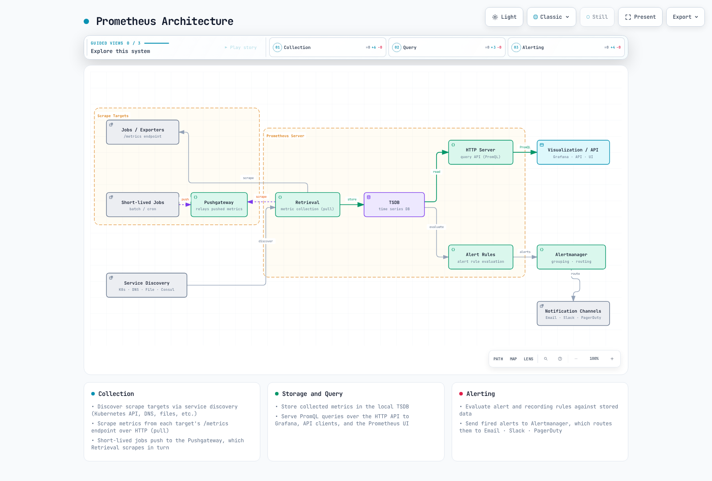

# Prometheus

> **最后更新**：2026 年 9 月 14 日。下文介绍本地配置/查询检查；未执行任何集群或云部署。

## 目录

- [简介与版本](#introduction-and-versions)
- [架构与组件](#architecture-and-components)
- [PromQL](#promql)
- [发现与 Operator 选择器](#discovery-and-operator-selectors)
- [kube-prometheus-stack 安装](#kube-prometheus-stack-installation)
- [规则与 Alertmanager](#rules-and-alertmanager)
- [远程写入与 AMP](#remote-write-and-amp)
- [性能、高可用与故障排除](#performance-ha-and-troubleshooting)

## 简介与版本 {#introduction-and-versions}

Prometheus 是 CNCF 监控工具包，最初由 SoundCloud 开发。它收集数值时间序列，将其存储在本地 TSDB 中，评估 PromQL 和 recording/alert 规则，并向 Alertmanager 发送告警。常规采集通过 HTTP 抓取进行；远程写入和可选的批处理集成则提供了其他传输途径。它不是事件日志、链路追踪存储，也不是精确的逐请求计费台账。

本地数据保留时间可配置，也可以超过 30 天。是否使用单独的存储，取决于保留时长、容量、共享查询以及故障/恢复需求。

本章使用官方 **kube-prometheus-stack 90.0.0** 软件包，该版本于 2026 年 9 月 6 日发布。各组件版本经过整体检查：

| 组件 | 软件包默认版本 |
|---|---|
| Prometheus Operator | 0.93.1 |
| Prometheus | 3.14.0，distroless 镜像 |
| Alertmanager | 0.34.0 |
| Grafana | 13.2.1，子 chart 13.2.2 |
| kube-state-metrics | 2.20.0，子 chart 8.4.2 |
| node-exporter | 1.12.1，子 chart 4.56.3 |

Chart 的 `kubeVersion` 限制为 `>=1.25.0-0`。这并不是完整的兼容性矩阵，也不表示每个 Kubernetes 1.25+ 版本都仍受支持。请检查实际集群、组件支持情况、准入策略和存储驱动。

此配置面向 **由 Linux EC2 支持的 EKS 工作节点**。Fargate 不支持 DaemonSets；Auto Mode、Hybrid Nodes 和 Windows 需要针对平台检查采集器/存储。

### 2026 年 9 月更新

- 根据[9 月 11 日的 Kubernetes 博客](https://kubernetes.io/blog/2026/09/11/kubernetes-v1-37-native-histograms-beta/)，Kubernetes 组件指标对 [Prometheus 原生直方图](https://prometheus.io/docs/specs/native_histograms/)的支持（KEP-5808）升级为 Beta，并在 v1.37 中默认启用。高分辨率、低基数的分桶取代固定的 `le` 分桶，在减少存储和抓取开销的同时提高延迟指标的准确性。要从中受益，抓取数据的 Prometheus 也必须配置为接收原生直方图，现有的经典直方图查询/仪表板也需要单独审查。

### 2026 年 7 月历史更新

- [7 月 14 日的 Kubernetes exporter 文章](https://kubernetes.io/blog/2026/07/14/custom-metrics-exporter-kubernetes/)介绍了应用埋点和自定义 exporter。使用 HPA 还需要适当的 metrics API/adapter；仅进行抓取并不会将任意指标接入 HPA。
- [7 月 21 日的 AMP 公告](https://aws.amazon.com/about-aws/whats-new/2026/07/amazon-managed-service-prometheus-1500m-metrics-workspace/)介绍了每个工作区最高支持 15 亿个活跃时间序列和 20 万条 recording/alerting 规则。这些是公布的扩展限制，并不代表会自动授予默认配额或保证审批通过。请检查目标工作区/账户的当前配额。

## 架构与组件 {#architecture-and-components}



[交互式图表](https://www.atomai.click/kubernetes-docs/archmaps/en-observability-metrics-01-prometheus-0.html)

Pushgateway 分支适用于特定的服务级批处理任务，是可选项，并非每个短生命周期 Pod 都需要。分组需要生命周期管理；请参阅[指标概览](README.md)。`up` 表示抓取健康状况，不代表应用可用性。

| 组件 | 职责与前提条件 |
|---|---|
| Prometheus | 发现、抓取、本地 TSDB、查询 API 和规则评估 |
| kube-state-metrics | API 对象状态；需要 ServiceAccount、RBAC 和抓取端点 |
| node-exporter | 主机操作系统指标；需要检查主机访问/挂载和平台支持 |
| kubelet/cAdvisor | 容器测量数据；请确认服务证书、授权和端点可用性 |
| metrics-server / adapters | 用于自动扩缩的资源/自定义指标 API；与历史 TSDB 存储分离 |
| Alertmanager | 对告警进行分组、去重、抑制，并路由到已配置的接收端 |
| Grafana | 查询/可视化数据源；身份验证和数据库/存储需要单独配置 |

该 chart 提供 exporters 和配套资源。不完整的独立 Deployment/DaemonSet 片段不会提供缺失的 ServiceAccount、RBAC 和 Service，也不应据此创建重复的监控堆栈。

### TSDB 与配置层

近期样本使用 head/WAL；压缩后的块包含 chunks、索引和元数据。Tombstone 用于标记已删除的数据范围。WAL 重放有助于崩溃恢复，但不能替代备份、无法应对卷丢失，也不能保证恢复每个事件。

| 层级 | 对应设置 |
|---|---|
| 进程标志 | `--storage.tsdb.path`、`--storage.tsdb.retention.time`、`--storage.tsdb.retention.size` |
| Prometheus 配置 | `global`、`scrape_configs`、`rule_files`、`remote_write` |
| Operator `Prometheus.spec` | `retention`、`retentionSize`、`storage`、`replicas`、`shards` |
| 此 chart 的 values | `prometheus.prometheusSpec.retention`、`storageSpec` 及下文所列 values |

旧式 `storage.tsdb.path/retention.time/...` YAML 不是有效的进程配置。在**单独的独立安装**中，基本标志如下：

```sh
prometheus --config.file=prometheus.yml \
  --storage.tsdb.path=/prometheus \
  --storage.tsdb.retention.time=15d \
  --storage.tsdb.retention.size=15GB
```

对于 Operator 安装，请配置所属 Helm values。保留大小不是整个磁盘的硬性上限：请为 WAL、head、索引和压缩留出空间。使用受支持的本地/块存储；不支持用任意 NFS 替代。

## PromQL

示例假定 `job="example-app"`，并使用 chart 中 node-exporter/kube-state-metrics 的 job 标签。请根据实际目标调整。`example_queue_depth` 和 `temperature_celsius` 是应用定义的 Gauge，并非内置 Kubernetes 指标。

### 选择器、范围与速率

瞬时选择器使用回看/陈旧性规则查找符合条件的样本；“当前”并不保证在精确的评估时间点有观测值。范围选择器会选取一个样本区间。子查询会按其分辨率评估表达式，而不是每隔 N 个已存储的原始样本进行选择。

| 用途 | PromQL |
|---|---|
| 瞬时选择器 | `http_requests_total{job="example-app"}` |
| 正向/正则过滤 | `http_requests_total{job="example-app",method="GET",status=~"2[0-9]{2}"}` |
| 负向正则 | `http_requests_total{job="example-app",status!~"5[0-9]{2}"}` |
| 范围向量 | `http_requests_total{job="example-app"}[5m]` |
| 分辨率为五分钟的一小时子查询 | `rate(http_requests_total{job="example-app"}[5m])[1h:5m]` |
| 一小时前的速率窗口 | `rate(http_requests_total{job="example-app"}[5m] offset 1h)` |
| 平均每秒计数器速率 | `rate(http_requests_total{job="example-app"}[5m])` |
| 根据最近两个可用样本计算速率 | `irate(http_requests_total{job="example-app"}[5m])` |
| 外推的计数器增量 | `increase(http_requests_total{job="example-app"}[1h])` |

负向匹配器可能会选择不带该标签的时间序列。`rate()` 和 `increase()` 会处理观测到的重置并进行外推；它们无法恢复所有漏记的增量。请先应用 **rate，再进行聚合**。`irate()` 对最新样本很敏感，通常不太适合稳定的告警条件。

范围向量是范围函数的输入，不是可直接绘制范围查询图表的数据。例如，请在请求经过评估的速率时间序列时使用 `rate(counter[5m])`。

### 聚合、Gauge 与时间

| 用途 | PromQL |
|---|---|
| 按方法统计请求速率 | `sum by (method) (rate(http_requests_total{job="example-app"}[5m]))` |
| 聚合时去除 instance | `sum without (instance) (rate(http_requests_total{job="example-app"}[5m]))` |
| 对去重后的 Running 指示值求和 | `sum(max by (namespace,pod,uid) (kube_pod_status_phase{job="kube-state-metrics",phase="Running"}))` |
| 最大可用内存 | `max(node_memory_MemAvailable_bytes{job="node-exporter"})` |
| 忽略空容器/基础设施容器标签后的 Pod CPU Top 列表 | `topk(5, sum by (namespace,pod) (rate(container_cpu_usage_seconds_total{job="kubelet",container!="",container!="POD"}[5m])))` |
| 当前队列深度 Gauge 的分位数 | `quantile(0.95, example_queue_depth{job="example-app"})` |
| 速率的标准差 | `stddev(rate(http_requests_total{job="example-app"}[5m]))` |
| Gauge 外推变化量 | `delta(temperature_celsius{job="example-app"}[1h])` |
| Gauge 每秒速率 | `deriv(temperature_celsius{job="example-app"}[1h])` |
| 与 20°C 的绝对偏差 | `abs(temperature_celsius{job="example-app"} - 20)` |
| 向上取整 | `ceil(example_queue_depth{job="example-app"})` |
| 限定在某个范围内 | `clamp(example_queue_depth{job="example-app"}, 0, 100)` |
| 平方根 | `sqrt(example_queue_depth{job="example-app"})` |
| 自然对数 | `ln(example_queue_depth{job="example-app"})` |
| 以 Unix 秒表示的评估时间 | `time()` |
| 所选样本的时间戳 | `timestamp(up{job="example-app"})` |
| 样本的 UTC 小时 | `hour(timestamp(up{job="example-app"}))` |

统计 `kube_pod_status_phase{phase="Running"}` 序列时，值为零的序列也会计入。去除重复的 exporter 身份后，对 0/1 指示值求和；如果只有值为零的指示值，结果为零，而缺失的遥测数据仍然是缺失状态。

Gauge `quantile()` 示例比较的是各个序列之间的值。它不会计算直方图请求延迟的 p95，也不会合并 Summary p99 值。数学函数对输入值域有要求；例如，非正数的对数需要经过有意处理。相关函数包括 `floor`、`round`、`clamp_min` 和 `clamp_max`。

此营业时间过滤器使用 **UTC**，而非浏览器/集群时区：

```promql
sum(rate(http_requests_total{job="example-app"}[5m])) and on() (hour() >= 9 < 18)
```

### 分布与预测

```promql
histogram_quantile(0.95, sum by (le) (rate(http_request_duration_seconds_bucket{job="example-app"}[5m])))
```

```promql
histogram_quantile(0.99, sum by (le,method) (rate(http_request_duration_seconds_bucket{job="example-app"}[5m])))
```

```promql
sum(rate(http_request_duration_seconds_sum{job="example-app"}[5m])) / sum(rate(http_request_duration_seconds_count{job="example-app"}[5m]))
```

聚合兼容的经典分桶，并保留 `le`。分位数会在分桶内插值。Summary 分位数同样是近似值，不能通过求平均得到整个集群的百分位；sum/count 可以计算整个集群的平均值。

`predict_linear()` 会外推拟合的 Gauge 趋势。预测值为负是需要调查的理由，并不保证未来一定会发生磁盘故障：

```promql
predict_linear(node_filesystem_avail_bytes{job="node-exporter",mountpoint="/",fstype!~"tmpfs|overlay"}[6h], 86400)
```

Prometheus 3 将 `holt_winters` 重命名为 `double_exponential_smoothing`。这是 **Holt 线性平滑，而非季节性三重指数预测**，且需要 Gauge 浮点样本。可选表达式：`double_exponential_smoothing(example_queue_depth{job="example-app"}[1h], 0.5, 0.5)`。执行评估的服务器需要设置 `--enable-feature=promql-experimental-functions`。本地审计检查了它的解析器语法；但并未声称实验性值评估通过。

### 运维示例

| 用途 | PromQL |
|---|---|
| CPU 非空闲百分比 | `100 * (1 - avg by (instance) (rate(node_cpu_seconds_total{job="node-exporter",mode="idle"}[5m])))` |
| 未报告为 MemAvailable 的占比 | `100 * (1 - node_memory_MemAvailable_bytes{job="node-exporter"} / node_memory_MemTotal_bytes{job="node-exporter"})` |
| 估算的重启次数增加超过三次 | `increase(kube_pod_container_status_restarts_total{job="kube-state-metrics"}[1h]) > 3` |
| 文件系统不可用空间百分比 | `100 * (1 - node_filesystem_avail_bytes{job="node-exporter",mountpoint="/"} / node_filesystem_size_bytes{job="node-exporter",mountpoint="/"})` |
| 接收 + 发送字节数/秒 | `rate(node_network_receive_bytes_total{job="node-exporter",device="eth0"}[5m]) + rate(node_network_transmit_bytes_total{job="node-exporter",device="eth0"}[5m])` |

对于错误百分比，健康服务可能没有 5xx 序列。以下零值回退仅适用于存在匹配总流量分组的情况；它不会为缺失的服务虚构健康数据。

```promql
100 * (sum by (namespace, service) (rate(http_requests_total{job="example-app",status=~"5[0-9]{2}"}[5m])) or on (namespace, service) (0 * (sum by (namespace, service) (rate(http_requests_total{job="example-app"}[5m]))))) / (sum by (namespace, service) (rate(http_requests_total{job="example-app"}[5m])))
```

观测到的健康流量会得到 0，全部为 5xx 的流量会得到 100，分母为零时结果仍未定义。缺失的遥测数据仍然缺失；请单独监控采集故障。

## 发现与 Operator 选择器 {#discovery-and-operator-selectors}


[交互式图表](https://www.atomai.click/kubernetes-docs/archmaps/en-observability-metrics-01-prometheus-1.html)

此图中的 Prometheus/Alertmanager 节点表示**自定义资源**。Operator 会读取这些资源，并协调实际工作负载，例如 StatefulSet。对象或 Prometheus server 不会独立创建 StatefulSet。

| 选择阶段 | 选中的对象 |
|---|---|
| Prometheus `serviceMonitorNamespaceSelector` | 包含 ServiceMonitor 对象的命名空间 |
| Prometheus `serviceMonitorSelector` | 这些 ServiceMonitor 对象上的标签 |
| ServiceMonitor `namespaceSelector` / `selector` | 目标 Service 的命名空间和标签 |
| ServiceMonitor endpoint `port` | **Service 端口名称**，不是任意的容器端口号 |
| PodMonitor selector / endpoint `port` | Pod 标签和声明的容器端口名称 |

RBAC、发现和网络/TLS 访问是彼此独立的要求。选择器不能替代授权。Helm 的 `*SelectorNilUsesHelmValues` 布尔值会影响标签选择器默认值，而非所有目标命名空间。

### 连贯的应用抓取配置

假设 `example-app` 中已有经过埋点的 Deployment，Pod 标签为 `app: example-app`，并声明了一个名为 `metrics`、提供 `/metrics` 的端口。下方的 Service 不会创建应用：

```yaml
# service.yaml
apiVersion: v1
kind: Service
metadata:
  name: example-app
  namespace: example-app
  labels:
    app: example-app
    metrics-job: example-app
spec:
  selector:
    app: example-app
  ports:
  - name: http-metrics
    port: 8080
    targetPort: metrics
```

```yaml
# servicemonitor.yaml
apiVersion: monitoring.coreos.com/v1
kind: ServiceMonitor
metadata:
  name: example-app
  namespace: monitoring
  labels:
    release: kube-prom
spec:
  jobLabel: metrics-job
  selector:
    matchLabels:
      app: example-app
  namespaceSelector:
    matchNames:
    - example-app
  endpoints:
  - port: http-metrics
    path: /metrics
    interval: 30s
    scrapeTimeout: 10s
    relabelings:
    - sourceLabels:
      - __meta_kubernetes_service_name
      targetLabel: service
    - sourceLabels:
      - __meta_kubernetes_namespace
      targetLabel: namespace
    - sourceLabels:
      - __meta_kubernetes_pod_name
      targetLabel: pod
```

ServiceMonitor 的 `release: kube-prom` 与此次安装相匹配。其 `jobLabel` 会读取 Service 的 `metrics-job: example-app`，从而建立应用查询使用的 job 标签。

PodMonitor 是针对相同 Pod 的**替代方案**。请为某个端点选择一种预期的采集路径，以避免重复摄取：

```yaml
# podmonitor.yaml
apiVersion: monitoring.coreos.com/v1
kind: PodMonitor
metadata:
  name: example-app-pods
  namespace: monitoring
  labels:
    release: kube-prom
spec:
  selector:
    matchLabels:
      app: example-app
  namespaceSelector:
    matchNames:
    - example-app
  podMetricsEndpoints:
  - port: metrics
    interval: 30s
    path: /metrics
    relabelings:
    - targetLabel: job
      replacement: example-app
    - targetLabel: service
      replacement: example-app
```

### 其他发现路径

- 独立/agent Pod 发现可以使用[概览中的命名端口配置](README.md#metric-collection-models)，以保留发现提供的 IPv4/IPv6 地址。除非实际配置使用了 `prometheus.io/scheme` 之类的注解，否则该注解不会生效。
- Service 黑盒探测需要已安装的 exporter、已定义的 probe 模块、适当的目标 URL/方案以及 `Probe`/抓取配置。`up` 表示 exporter 抓取情况；探测成功是另一项信号。
- 节点发现会访问 kubelet 端点，而不会自动访问 node-exporter。请确认服务证书、正确的 CA 和节点指标 RBAC。Kubernetes API CA 并不能证明任意节点证书都可信。
- 请使用经过审查的命名空间/Service/团队标签，而非不受限制的节点 `labelmap`。删除身份标签并不等同于聚合操作。

## kube-prometheus-stack 安装 {#kube-prometheus-stack-installation}

以下是会更改集群的 Operator 命令，**本次审计中并未执行**。请使用预期的 context 和自有 release。对于现有安装，请检查实际 values、CRD、存储和升级说明，不要安装重复的监控堆栈。

此配置的前提条件：

- 获得授权的 Helm/Kubernetes 访问权限，以及充足的 Linux EC2 节点资源。
- 可正常工作的默认块存储 StorageClass/CSI 驱动，或为每个 PVC 指定经过审查的类名。不能保证一定存在 `gp3`。
- 在 Linux EC2 节点上已有 `monitoring` 命名空间、Secrets Store CSI driver 和 AWS provider (ASCP)。在 AWS Secrets Manager (`ap-northeast-2`) 中准备 `observability/grafana-admin`，其中包含 JSON 字符串键 `admin-password`；不要将其同步到 Kubernetes Secret。
- `metrics-demo-grafana` ServiceAccount 需要一个范围限定为该 secret 的 IRSA 角色。请替换下方的示例 IAM 角色 ARN，并应用匹配的 SecretProviderClass。请参阅[完整的身份、KMS、挂载和轮换前提条件](https://github.com/Atom-oh/kubernetes-docs/blob/5ff787faed758902c12a74e8429466f434bb26ae/examples/observability/secret-profiles/README.md)。
- 已验证 kubelet TLS 信任。此配置启用了证书验证；如果证书由其他颁发者签发，请提供适当的 CA，而不是绕过验证。

以下容量配置仅作示例。每个 Prometheus 副本都有自己的 PVC；保留大小不会限制 WAL/head/压缩所需的空间。Grafana 仍为单副本，并使用 PVC 支持的数据库。仅增加副本并不能实现共享数据库高可用。

```yaml
# kube-prometheus-stack 90.0.0; replace the example IRSA role ARN before use.
fullnameOverride: metrics-demo
kubeControllerManager:
  enabled: false
kubeScheduler:
  enabled: false
kubeEtcd:
  enabled: false
kubeProxy:
  enabled: false
kubelet:
  serviceMonitor:
    tlsConfig:
      insecureSkipVerify: false
prometheus:
  serviceAccount:
    create: true
    name: metrics-demo-prometheus
  prometheusSpec:
    replicas: 1
    shards: 1
    retention: 15d
    retentionSize: 15GB
    storageSpec:
      volumeClaimTemplate:
        spec:
          accessModes:
          - ReadWriteOnce
          resources:
            requests:
              storage: 20Gi
    resources:
      requests:
        cpu: 500m
        memory: 2Gi
      limits:
        memory: 4Gi
    externalLabels:
      cluster: eks-metrics-demo
    serviceMonitorSelectorNilUsesHelmValues: true
    serviceMonitorNamespaceSelector: &id001
      matchExpressions:
      - key: kubernetes.io/metadata.name
        operator: In
        values:
        - monitoring
        - example-app
    podMonitorSelectorNilUsesHelmValues: true
    podMonitorNamespaceSelector: *id001
    ruleSelectorNilUsesHelmValues: true
    ruleNamespaceSelector:
      matchLabels:
        kubernetes.io/metadata.name: monitoring
alertmanager:
  alertmanagerSpec:
    replicas: 1
    storage:
      volumeClaimTemplate:
        spec:
          accessModes:
          - ReadWriteOnce
          resources:
            requests:
              storage: 5Gi
grafana:
  fullnameOverride: metrics-demo-grafana
  replicas: 1
  persistence:
    enabled: true
    size: 10Gi
  sidecar:
    dashboards:
      searchNamespace: monitoring
      skipReload: true
      initDashboards: true
      provider:
        updateIntervalSeconds: 30
    datasources:
      searchNamespace: monitoring
      skipReload: true
      initDatasources: true
  serviceAccount:
    create: true
    name: metrics-demo-grafana
    annotations:
      eks.amazonaws.com/role-arn: arn:aws:iam::111122223333:role/metrics-grafana-secrets
  env:
    GF_SECURITY_ADMIN_USER: admin
    GF_SECURITY_ADMIN_PASSWORD: $__file{/mnt/grafana-secrets/admin-password}
  grafana.ini:
    security:
      admin_user: admin
      admin_password: $__file{/mnt/grafana-secrets/admin-password}
  extraVolumes:
  - name: grafana-secrets
    csi:
      driver: secrets-store.csi.k8s.io
      readOnly: true
      volumeAttributes:
        secretProviderClass: metrics-grafana-admin
  extraVolumeMounts:
  - name: grafana-secrets
    mountPath: /mnt/grafana-secrets
    readOnly: true
```

此 EKS 配置会禁用托管控制平面组件的 monitors，以及此处未假设已开放的 kube-proxy 端点。它不会禁用 Kubernetes 本身。`monitoring`/`example-app` 中的 ServiceMonitor 需要匹配的 release 标签；规则从 `monitoring` 中选择。

Grafana 在 `GF_SECURITY_ADMIN_PASSWORD` 中接收的是**字面量文件提供器表达式**，而非密码值。这会抑制 chart 自动生成的凭据环境变量引用。Grafana 13.2.1 会在环境覆盖之后，于配置中评估 `$__file{...}`；没有 `__FILE` entrypoint，也没有 shell 会导出该文件的内容。只读 CSI 文件必须可由 UID/GID 472 读取（`fsGroup: 472`、模式 `0440`），并且只有 Grafana 主容器会挂载它。请使用首尾不含空格的密码，文件提供器会去除空格。

dashboard/datasource init 容器会在启动前填充 provisioning 文件。Sidecar 会继续监视文件，但使用 `skipReload: true`，因此无需管理员凭据。Grafana 每 30 秒轮询 dashboard 文件；**datasource 更新需要以受控方式重启 Pod**。`admin_password` 仅用于初始化新数据库：更改 AWS secret、CSI 轮换或重启，都不会重置现有 PVC/数据库中的管理员密码。请使用获批的密码更改/SSO 流程并协调 secret；保留 PVC。

请使用完整的[可复用配置](https://github.com/Atom-oh/kubernetes-docs/blob/5ff787faed758902c12a74e8429466f434bb26ae/examples/observability/secret-profiles/README.md)，包括 `grafana-secret-provider.yaml`。本地渲染/测试涵盖配置和挂载，不涵盖实时 CSI 权限、登录或轮换。主要参考：[Grafana 配置](https://grafana.com/docs/grafana/latest/setup-grafana/configure-grafana/)和 [AWS ASCP](https://github.com/aws/secrets-store-csi-driver-provider-aws/blob/main/README.md)。

在仓库根目录中，准备好前提条件后只需安装一次：

```sh
PROFILE=examples/observability/secret-profiles
kubectl apply -f "$PROFILE/grafana-secret-provider.yaml"
helm repo add prometheus-community https://prometheus-community.github.io/helm-charts
helm repo update prometheus-community
helm template kube-prom prometheus-community/kube-prometheus-stack \
  --version 90.0.0 --namespace monitoring -f "$PROFILE/prometheus-values.yaml" \
  > grafana-reviewed-render.yaml
# Review resources, prerequisites and ownership before this cluster-changing command.
helm upgrade --install kube-prom prometheus-community/kube-prometheus-stack \
  --version 90.0.0 --namespace monitoring -f "$PROFILE/prometheus-values.yaml" \
  --wait --timeout 15m
```

请检查 CRD 是否已建立、Operator 是否健康、PVC 是否绑定以及实际目标。只有在 CRD 建立后，才应用所选的应用 monitor/规则。

Chart 的 CRD 升级处理因版本而异。请阅读升级说明，不要假定普通 Helm upgrade 会涵盖所有 CRD 迁移。Chart 90 还将 Grafana 依赖项更改为社区仓库；升级时请验证现有身份验证/provisioning values，并保留数据库/PVC 备份。

## 规则与 Alertmanager {#rules-and-alertmanager}

下方所选的 PrometheusRule 包含告警和 recording 示例。CPU recording 使用 `rate`，并保持比率单位一致。错误表达式的单位是百分比，因此阈值为 1，注释会显示百分比。

```yaml
# prometheusrule.yaml
apiVersion: monitoring.coreos.com/v1
kind: PrometheusRule
metadata:
  name: example-rules
  namespace: monitoring
  labels:
    release: kube-prom
spec:
  groups:
  - name: example-alerts
    interval: 30s
    rules:
    - alert: NodeMemoryHigh
      expr: 100 * (1 - node_memory_MemAvailable_bytes{job="node-exporter"} / node_memory_MemTotal_bytes{job="node-exporter"})
        > 90
      for: 5m
      labels:
        severity: warning
        team: infrastructure
      annotations:
        summary: Node {{ $labels.instance }} memory availability is low
        description: '{{ printf "%.2f" $value }}% is not reported as MemAvailable.'
    - alert: PodRestartingFrequently
      expr: increase(kube_pod_container_status_restarts_total{job="kube-state-metrics"}[1h]) > 5
      for: 10m
      labels:
        severity: warning
      annotations:
        summary: Pod {{ $labels.namespace }}/{{ $labels.pod }} is restarting
        description: '{{ printf "%.2f" $value }} estimated restarts in one hour.'
    - alert: ProjectedDiskExhaustion
      expr: predict_linear(node_filesystem_avail_bytes{job="node-exporter",mountpoint="/",fstype!~"tmpfs|overlay"}[6h],
        86400) < 0
      for: 1h
      labels:
        severity: warning
      annotations:
        summary: Projected disk exhaustion on {{ $labels.instance }}
        description: The fitted six-hour trend projects negative free space in 24 hours; inspect the filesystem
          and workload.
    - alert: HighErrorRate
      expr: (100 * (sum by (namespace, service) (rate(http_requests_total{job="example-app",status=~"5[0-9]{2}"}[5m]))
        or on (namespace, service) (0 * (sum by (namespace, service) (rate(http_requests_total{job="example-app"}[5m])))))
        / (sum by (namespace, service) (rate(http_requests_total{job="example-app"}[5m])))) > 1
      for: 5m
      labels:
        severity: warning
        team: backend
      annotations:
        summary: High error rate on {{ $labels.namespace }}/{{ $labels.service }}
        description: '{{ printf "%.2f" $value }}% of requests are 5xx, above the 1% threshold.'
  - name: example-recording
    rules:
    - record: instance:node_cpu_utilization:ratio_rate5m
      expr: 100 * (1 - avg by (instance) (rate(node_cpu_seconds_total{job="node-exporter",mode="idle"}[5m])))
        / 100
    - record: instance:node_memory_not_available:ratio
      expr: max by (instance) ((1 - node_memory_MemAvailable_bytes{job="node-exporter"} / node_memory_MemTotal_bytes{job="node-exporter"}))
```

`for` 表示同一组告警标签必须在多次评估中持续满足表达式，才能触发告警。数据缺失或标签变化可能会中断待处理状态。它不是 Alertmanager 的通知延迟或重复间隔。预测类告警描述的是预测结果，并不代表故障必然发生。

### AlertmanagerConfig 与命名空间边界

Operator 0.93.1 附带的 AlertmanagerConfig CRD 提供 **v1alpha1**。此示例将其用作由管理员负责的**全局配置**。引用的 Secret 必须存在于 `monitoring` 中。启用通知前，请替换/批准地址、频道和提供方目标。

Operator API 将 `alertmanagerConfiguration` 标记为实验性功能：请保留版本边界并测试升级。通常被选中的普通命名空间级 AlertmanagerConfig 会添加命名空间匹配器；`monitoring` 中的配置不会自动接收每个命名空间的应用告警。全局配置有意采用更广泛的管理边界。

```yaml
# alertmanagerconfig.yaml
apiVersion: monitoring.coreos.com/v1alpha1
kind: AlertmanagerConfig
metadata:
  name: main-config
  namespace: monitoring
spec:
  route:
    receiver: default
    groupBy:
    - alertname
    - namespace
    - severity
    groupWait: 30s
    groupInterval: 5m
    repeatInterval: 4h
    routes:
    - receiver: pagerduty-critical
      matchers:
      - name: severity
        matchType: '='
        value: critical
      groupWait: 10s
      repeatInterval: 1h
    - receiver: slack-backend
      matchers:
      - name: team
        matchType: '='
        value: backend
    - receiver: slack-warnings
      matchers:
      - name: severity
        matchType: '='
        value: warning
      groupWait: 1m
  inhibitRules:
  - sourceMatch:
    - name: severity
      matchType: '='
      value: critical
    targetMatch:
    - name: severity
      matchType: '='
      value: warning
    equal:
    - alertname
    - cluster
    - namespace
    - service
    - instance
    - pod
    - container
  receivers:
  - name: default
    emailConfigs:
    - to: alerts@example.com
      from: alertmanager@example.com
      smarthost: smtp.example.com:587
      authUsername: alertmanager
      authPassword:
        name: alertmanager-smtp
        key: password
      requireTLS: true
  - name: slack-backend
    slackConfigs:
    - apiURL:
        name: alertmanager-slack
        key: webhook-url
      channel: '#team-backend-alerts'
      sendResolved: true
  - name: slack-warnings
    slackConfigs:
    - apiURL:
        name: alertmanager-slack
        key: webhook-url
      channel: '#alerts'
      sendResolved: true
  - name: pagerduty-critical
    pagerdutyConfigs:
    - routingKey:
        name: alertmanager-pagerduty
        key: routing-key
      sendResolved: true
```

默认情况下，同级路由在首次匹配后会停止继续匹配。Critical 路由排在前面；backend 路由位于通用 warning 路由之前，因此可以命中。只有在有意需要多路投递时才设置 `continue`。抑制匹配的是资源身份以及告警名称：某个 Service/节点的 critical 告警不应抑制无关的 warning。请为告警系列选择有意义的相等标签字段；两个告警中都缺失的标签会被视为相等。

CR 中的 `groupBy` 会转换为原生 Alertmanager 配置中的 `group_by`。分组控制通知批次；这与对相同告警去重不同。`groupWait`、`groupInterval` 和 `repeatInterval` 控制通知时序，与 PrometheusRule 的 `for` 相互独立。

创建引用的 Secret 和 AlertmanagerConfig 后，请将以下附加 values 文件合并到**同一个**固定版本的 release：

```yaml
# alerting-values.yaml
alertmanager:
  alertmanagerSpec:
    alertmanagerConfiguration:
      name: main-config
```

```sh
helm upgrade --install kube-prom prometheus-community/kube-prometheus-stack \
  --version 90.0.0 --namespace monitoring \
  -f values.yaml -f alerting-values.yaml --wait --timeout 15m
```

原生路由检查使用的是不会发送通知的接收端名称。仍需通过受控验证来确认 Secret 获取、提供方身份验证和实际通知投递。

## 远程写入与 AMP {#remote-write-and-amp}

远程写入会异步地将样本转发到已配置的后端。它不会传递告警、保证无限缓冲，也不能替代备份。请监控积压、重试和接收端限制。除非经过审查的聚合/丢弃策略已明确其影响，否则应保留完整的直方图分布。

### AMP 范围限定的摄取

以下账户和工作区标识符均为**虚构占位符**。请在端点、IAM 资源和角色注解中一致地替换为获批的 Region/账户/工作区。摄取角色只需要对此工作区授予 `aps:RemoteWrite`；查询权限应授予相应的查询客户端，而非自动授予采集器。

```json
{
  "Version": "2012-10-17",
  "Statement": [
    {
      "Effect": "Allow",
      "Action": "aps:RemoteWrite",
      "Resource": "arn:aws:aps:ap-northeast-2:111122223333:workspace/ws-11111111-1111-4111-8111-111111111111"
    }
  ]
}
```

请通过环境中现有的 IaC 负责人创建/管理角色。对于 IRSA 示例，其信任策略必须引用目标集群的 IAM OIDC provider，并同时要求 audience 为 `sts.amazonaws.com`、subject 为 `system:serviceaccount:monitoring:metrics-demo-prometheus`。仅有 OIDC issuer URL 并不能证明 IAM provider/信任策略已经存在。

此配置中的 ServiceAccount 由 Helm 管理，并由 Helm 添加注解。避免再通过第二个管理方创建相同的 ServiceAccount。如果复用已有账户，请协调资源所有权和 chart 的 `create` 设置。EKS Pod Identity 是另一种凭据传递设计；请单独配置并验证，不要混用互不兼容的假设。

```yaml
# amp-values.yaml
prometheus:
  serviceAccount:
    create: true
    name: metrics-demo-prometheus
    annotations:
      eks.amazonaws.com/role-arn: arn:aws:iam::111122223333:role/metrics-prometheus-amp
  prometheusSpec:
    replicas: 2
    shards: 1
    podAntiAffinity: hard
    podAntiAffinityTopologyKey: kubernetes.io/hostname
    replicaExternalLabelName: __replica__
    externalLabels:
      cluster: eks-metrics-demo
    remoteWrite:
    - url: https://aps-workspaces.ap-northeast-2.amazonaws.com/workspaces/ws-11111111-1111-4111-8111-111111111111/api/v1/remote_write
      sigv4:
        region: ap-northeast-2
      queueConfig:
        capacity: 10000
        maxSamplesPerSend: 2000
        maxShards: 10
```

身份/工作区验证完成后，请在同一个 release 中将可选 AMP 文件与基础 values 合并。两个副本使用硬性节点反亲和性，至少需要两个符合条件的节点，并且每个副本都要有可用的 PVC。

AMP 高可用去重需要 `cluster` 和 `__replica__`。Operator 的 `replicaExternalLabelName` 会提供其支持的 Pod 身份；手动编写额外的副本标签不能替代该设置。请检查现有指标标签是否与高可用标签冲突。

此示例有意使用 `shards: 1`。分片会划分目标集合；复制会复制目标集合。如果引入分片，则每个分片的高可用副本组都需要单独的去重身份和完整查询设计。不要将独立分片以相同的高可用身份发送，并假定不会丢失数据。

这些查询描述的是单个本地集群。跨集群查询 Central/AMP 时，必须包含预期的集群范围，或明确进行聚合。

### 其他接收端

VictoriaMetrics 单节点通常会在其配置的 HTTP 端口接受 `/api/v1/write`。集群的 vminsert 端点使用 `/insert/<tenant>/prometheus/api/v1/write`；vmauth 或其他获批的访问层必须提供预期的路由/身份验证。Tenant ID 不是凭据。Mimir/其他接收端有各自的 URL、身份和高可用约定。

不要照搬旧规则，在未评估分位数/SLO 损失的情况下丢弃所有亚秒级直方图分桶或整个控制平面延迟指标系列。队列默认值只是起点，并非经过测量的生产环境最优值。

## 性能、高可用与故障排除 {#performance-ha-and-troubleshooting}

### 根据测量结果调优

Head series/chunks、基数变化、抓取负载和并发查询都会影响内存。缩短历史数据保留时间并不能普遍解决活动 head 或查询导致的 OOM。请先检查实际使用情况和查询负载，再进行更改。

以下可选 values 片段展示的是查询限制，并非容量建议：

```yaml
# tuning-values.yaml
prometheus:
  prometheusSpec:
    query:
      maxConcurrency: 10
      maxSamples: 50000000
      timeout: 2m
```

延长超时或增大 `maxSamples` 会增加资源暴露风险。在提高这两个限制之前，请先检查开销较大的表达式、范围、聚合和 recording 规则。

对于**独立的**抓取配置，以下示例限制一个 job，并丢弃一个经过审查的 debug 指标系列：

```yaml
# scrape-limits.yaml
scrape_configs:
- job_name: example-app
  scrape_interval: 30s
  scrape_timeout: 10s
  sample_limit: 10000
  static_configs:
  - targets:
    - example-app.example-app.svc:8080
  metric_relabel_configs:
  - source_labels:
    - __name__
    regex: example_debug_payload_total
    action: drop
```

`sample_limit` 是在指标重新标记后应用的抓取接收限制。超过该限制会导致抓取失败；它不会把端点的样本整齐地截断到 10,000 个。延长抓取间隔会降低分辨率并延迟检测，而删除所有 `go_.*`/`process_.*` 指标则会丢弃运行时诊断信息。

`labeldrop` 可能会将先前彼此不同的样本折叠到同一个序列；它不会对这些样本求和。删除身份标签之前，请保留唯一性，并评估对接收端/基数的影响。请将基数查询限定到预期的 job：

```promql
topk(10, count by (__name__) ({job="example-app"}))
```

不要将不受支持的 TSDB 标志或字符串形式的 `additionalArgs` 复制到 Operator CR 中。其 `additionalArgs` 使用带名称的参数对象，而且有效的 CR schema 并不能证明所选 Prometheus 二进制文件中存在相应标志。没有针对具体版本的证据时，请避免覆盖内部块/chunk 行为。

### 高可用边界

Prometheus 的 `replicas` 和 `shards` 会增加 Pod 数量，但解决的是不同问题。反亲和性需要足够的节点；具备可用区容错能力还需要合适的调度和存储。查询单个 shard 无法提供所有目标的数据。

采集器高可用并不会自动使 Alertmanager、Grafana、PVC 或远程存储实现高可用。Alertmanager 副本需要正常的对等连接以及独立的放置位置/存储；Grafana 高可用需要适当的共享数据库/身份验证设计。请保持接收端专用的去重标签和告警身份一致。

### 从自有 release 进行故障排除

请验证 context、release 身份和生成的资源名称。以下名称适用于示例中的 `fullnameOverride: metrics-demo`，并不适用于所有 chart 安装：

```sh
kubectl config current-context
helm status kube-prom --namespace monitoring
kubectl get prometheus,alertmanager,servicemonitor,podmonitor,prometheusrule \
  --namespace monitoring
kubectl get pods,pvc --namespace monitoring
kubectl get pods --namespace monitoring -l app.kubernetes.io/name=prometheus -o wide
kubectl top pod --namespace monitoring
```

`kubectl top` 需要可正常工作的 Resource Metrics API。它不能测量 Prometheus 内存压力的所有成因。

如需私有 API 检查，请将端口转发绑定到 loopback，并在另一个终端中保持该进程运行：

```sh
kubectl port-forward --namespace monitoring --address 127.0.0.1 \
  service/metrics-demo-prometheus 9090:9090
```

```sh
curl --fail --silent --show-error --max-time 10 \
  http://127.0.0.1:9090/api/v1/targets \
  | jq '.data.activeTargets[] | select(.health != "up") | {labels, scrapeUrl, lastError}'
curl --fail --silent --show-error --max-time 10 http://127.0.0.1:9090/api/v1/status/tsdb
curl --fail --silent --show-error --max-time 10 http://127.0.0.1:9090/api/v1/status/flags
curl --fail --silent --show-error --max-time 10 http://127.0.0.1:9090/api/v1/status/runtimeinfo
curl --fail --silent --show-error --max-time 10 http://127.0.0.1:9090/api/v1/rules
curl --fail --silent --show-error --max-time 10 http://127.0.0.1:9090/api/v1/alerts
```

| 症状 | 调整资源前的检查项 |
|---|---|
| OOMKilled | 容器限制、head series/变化、查询并发/范围、样本数和工作负载峰值 |
| PVC Pending | 实际 StorageClass/CSI 可用性、访问模式、容量和可用区调度 |
| 缺少目标 | 两类 monitor 选择器、命名空间选择、Service 标签/端口、Pod 标签和 Operator 协调 |
| Target down | 目标 URL、CA/SAN/身份验证、RBAC/网络路径和端点响应；出现错误并不能证明目标不存在 |
| 没有通知 | 规则状态、标签稳定性、所选/全局配置、命名空间强制策略、路由顺序/抑制、Secret 和提供方状态 |
| 远程积压 | 凭据/Region/工作区、接收端错误/配额、队列/WAL 容量和重复标签约定 |

distroless Prometheus 镜像不保证包含 shell、`wget` 或 `curl`；不要假设 `kubectl exec ... wget` 一定可用。需要从 Pod 网络上下文测试时，请使用获批的诊断工具。配置/目标/日志输出属于运维数据，请避免发布敏感端点或凭据。

## 验证与参考资料

本地审计渲染了固定版本的 Helm 基础/告警/AMP 配置，验证了已发布 CRD 的结构，使用合成样本评估了核心 PromQL/规则，并检查了原生 Alertmanager 路由。未执行发现、准入/CEL、存储绑定、IAM 强制策略、外部 secret 和通知投递。实验性平滑仅通过解析器验证；尽管启用了功能标志，其值样例仍未通过已发布的 promtool 测试引擎。

- [Chart 90.0.0 发布说明](https://github.com/prometheus-community/helm-charts/releases/tag/kube-prometheus-stack-90.0.0)和[版本化升级说明](https://github.com/prometheus-community/helm-charts/blob/kube-prometheus-stack-90.0.0/charts/kube-prometheus-stack/README.md)
- [Operator 0.93.1 API 参考](https://github.com/prometheus-operator/prometheus-operator/blob/v0.93.1/Documentation/api-reference/api.md)
- [Prometheus 3.14 配置](https://github.com/prometheus/prometheus/blob/v3.14.0/docs/configuration/configuration.md)、[函数](https://github.com/prometheus/prometheus/blob/v3.14.0/docs/querying/functions.md)和[存储](https://github.com/prometheus/prometheus/blob/v3.14.0/docs/storage.md)
- [AMP 摄取](https://docs.aws.amazon.com/prometheus/latest/userguide/AMP-onboard-ingest-metrics-existing-Prometheus.html)、[高可用去重](https://docs.aws.amazon.com/prometheus/latest/userguide/AMP-ingest-dedupe.html)和[配额](https://docs.aws.amazon.com/prometheus/latest/userguide/AMP_quotas.html)
- [指标概览](README.md)和 [Prometheus 测验](../../quizzes/observability/metrics/01-prometheus-quiz.md)
