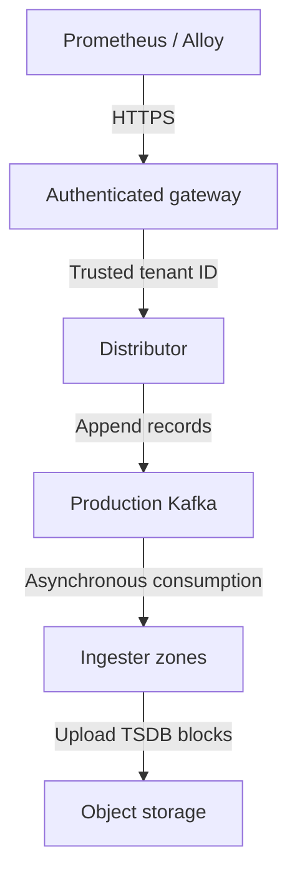
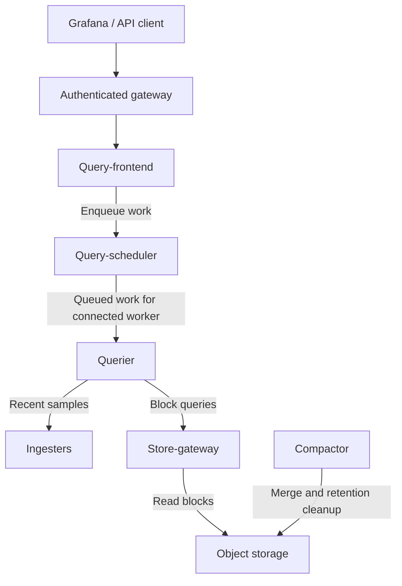

# Grafana Mimir

> **审阅基线**：Mimir 3.2.1 / mimir-distributed Helm chart 6.2.0
> **最后更新**：2026 年 9 月 12 日

Grafana Mimir 是兼容 Prometheus 的指标后端，支持感知租户的摄取、查询和长期块存储。容量、查询兼容性和运行成本取决于所选架构、配置和工作负载；保留时长和扩展能力都不是无限的。

## Mimir、Cortex 与 Thanos

Mimir 和 Cortex 是起源相关但彼此独立的项目。不要把 Mimir 理解为 Cortex 已不可用的通知。Thanos 同时支持 sidecar 和 remote-write Receiver；并非每种 Thanos 部署都必须使用 sidecar。

| 项目 | 可比较的部署选项 |
| --- | --- |
| Mimir | 感知租户的 remote write、对象存储，以及当前基于 Kafka 的 ingest-storage 架构 |
| Cortex | 独立的 Prometheus 兼容多租户后端；应核对其自身的版本和存储配置 |
| Thanos | 基于 sidecar 的集成或基于 Receive 的摄取、共享查询和对象存储组件 |

请使用相同工作负载比较故障恢复、实际查询行为、存储/请求/传输成本和团队运维能力。没有依据的“快/中等”排名不能作为基准测试证据。参阅 [Cortex](https://cortexmetrics.io/docs/) 和 [Thanos Receive](https://thanos.io/tip/components/receive.md/)。

## 核心架构

### Ingest storage 与经典写入路径

从 Mimir 3.0 开始，ingest storage 已稳定，并且是首选架构。Distributor 验证传入的样本并将记录追加到 Kafka。只有在 Kafka 写入按配置的持久性/复制条件成功后，写入才会获确认；这不表示数据块已经到达 S3。



每个 Ingester 消费一个分区；不同可用区中的 Ingester 可以消费同一分区，以提高读取路径的可用性。分区分配取决于 Ingester 实例 ID 的数字后缀。Kafka 分区容量和保留期必须覆盖计划中的 Ingester 序号、积压量和恢复窗口。Broker 复制/ISR、持久化和故障恢复还需要各自的配置。

Ingester 在内存 TSDB 和本地 WAL 中保留数据，定期生成数据块（默认每块覆盖两小时）并上传。本地 TSDB 保留时间为 Querier/Store-gateway 提供发现已上传数据块的时间；它不同于长期保留期。持久磁盘有助于恢复，但 WAL 与对象存储的任何组合都无法保证从所有故障或已过期的 Kafka 积压中恢复。

**经典**架构会将写入从 Distributor 直接发送到 Ingester quorum。它的 Ingester 复制因子不是 Kafka 写入复制设置。现有部署仍可使用经典模式；二进制默认值与 Helm 默认值并不相同。Chart 6.x 会启用 ingest storage，而检查过的 3.2.1 二进制中 `ingest_storage.enabled` 的默认值为 false。请遵循[架构说明](https://grafana.com/docs/mimir/latest/get-started/about-grafana-mimir-architecture/about-ingest-storage-architecture/)和[迁移流程](https://grafana.com/docs/mimir/latest/set-up/migrate/migrate-ingest-storage/)，不要只改一个 flag 就切换运行中的安装。

### 查询路径与组件



此图展示请求和工作项的关系；查询结果经由 Frontend 返回。Frontend 拆分/分片工作、使用结果缓存并合并响应。Scheduler 将工作排入 Querier 队列。Querier 从 Ingester 和 Store-gateway 获取所需数据；在数据块交接期间，两者的数据可能重叠，并非完全互斥的近期/历史时间段。

Kafka 消费是异步的，因此默认读取路径不保证写后读一致性。客户端可以请求 `X-Read-Consistency: strong`；此时 Ingester 会等待分区偏移量传播，但会产生超时和延迟影响。在任何 Broker 或 Ingester 故障期间，这都不是保证。

| 组件 | 职责 |
| --- | --- |
| Distributor | 验证/限制传入写入，并将其发送到 Kafka；经典模式下则发送到 Ingester |
| Ingester | 消费其 Kafka 分区、维护本地 TSDB/WAL、提供近期样本并上传数据块 |
| Store-gateway | 使用对象存储、本地索引头和已配置的缓存提供数据块数据 |
| Compactor | 合并数据块、去重复制样本并执行符合条件的保留清理 |
| Query-frontend / scheduler / querier | 规划/缓存/排队查询并执行生成的工作 |
| Ruler / Alertmanager | 可选的规则评估和告警处理；存储/身份/高可用需单独配置 |

Compaction 不会提供虚构的 `compactor.downsampling_enabled` 选项。Recording rule 可以生成派生序列，但不会自动降采样或删除原始序列。

## 多租户与身份验证

`X-Scope-OrgID` 用于标识租户；它**不是身份验证**。应使用 Gateway 对调用方进行身份验证、授权其租户、覆盖任何不可信的租户标头，并且只转发允许的请求。限制对后端服务的直接访问。只有受信任的代理明确实现了映射时，Basic Auth 用户名才会成为租户 ID。Chart 的默认路由 Gateway 本身并未建立此安全策略。

此 Prometheus 示例假设 HTTPS Gateway 和已挂载的凭据文件均已就绪。Gateway 根据经过身份验证的身份推导租户，因此客户端无需在此处选择租户标头。

```yaml
remote_write:
  - url: https://metrics.example.internal/api/v1/push
    authorization:
      type: Bearer
      credentials_file: /etc/prometheus/credentials/mimir-token
```

直接提供租户标头只适用于另行建立信任的测试路径。按租户隔离对象键和限制，并不能阻止未经身份验证的调用方选择其他租户。禁用多租户会将请求映射到共享租户，这并不会增加保护。参阅[身份验证与授权](https://grafana.com/docs/mimir/latest/manage/secure/authentication-and-authorization/)。

### 租户限制与运行时配置

主配置使用 `limits` 设置默认值。每租户的 `overrides` 应放在单独的运行时配置文件中，而不是主 Mimir 配置的顶层块中。使用此 Chart 时，应像下例那样使用顶层 `runtimeConfig.overrides`。运行时文件可以覆盖受支持的限制，且无需重启进程；这不代表所有启动设置都能热加载。请验证[运行时配置](https://grafana.com/docs/mimir/latest/configure/about-runtime-configuration/)的访问和重新加载结果。

## 在 EKS 上使用 Helm 配置

Chart **6.2.0** 声明 appVersion **3.2.0**，并要求 Kubernetes `^1.32.0-0`。此示例明确选择于 2026 年 9 月 10 日发布的 **3.2.1** 补丁镜像。Chart 的版本约束不是 EKS 支持/生命周期矩阵。请检查所选 EKS 版本、CSI 驱动、准入策略和 rollout operator 依赖；每周发布的开发版 Chart 属于独立发布流。

### 准备依赖项

下面是**可供审查的可渲染配置**，不是生产部署测试。应用前需准备：

- 一个外部生产 Kafka 集群/Topic，能够接受示例所示的客户端证书身份验证，且配置了适当的 Broker 复制/保留设置和已授权的生产者/消费者操作。请将示例 bootstrap 地址/端口替换为实际端点。其他 SASL/MSK 配置需要使用匹配的 Mimir 选项和身份设置。
- `monitoring` 命名空间中的 Secret `mimir-kafka-client-tls`，包含 `ca.crt`、`tls.crt` 和 `tls.key`。每个加载此共享 TLS 配置的 Mimir 进程都需要这些文件，包括自身不消费 Kafka 的组件。
- 三个已存在的 S3 bucket，以及下文所述、已授权的 `mimir-storage` Service Account。Mimir 不会创建这些 bucket。
- 实际 AZ 标签、合适且已存在的 StorageClass，以及足够的可调度节点/PVC 容量。`gp3` 只是 StorageClass 名称示例。EKS Auto Mode 和 EBS CSI add-on 使用不同的 provisioner；应选择与集群存储管理方匹配的 StorageClass。
- 到 Distributor 和 Query-frontend 的已认证外部路由。示例禁用了未经身份验证的 Chart 路由 Gateway，也不会创建替代的公共 Ingress。

此配置启用了 rollout operator。安装/升级前必须审查其 CRD、Webhook、权限和所有权；下面的 `--include-crds` 会将它们包含在本地输出中。除非已审查按可用区进行的 rollout 行为，否则不要在现有部署中禁用它。三可用区配置需要实际的 zone selector；逻辑名称本身不会形成地理冗余。

### Values 与本地渲染

将以下内容保存为 `mimir-values.yaml`。YAML anchor 用于复用相同的证书挂载和 AZ 定义。副本数量、卷大小以及速率/查询限制只是示例，应依据工作负载测量进行调整。渲染出的三可用区配置在**每个可用区各有一个 Ingester 和一个 Store-gateway**，总计各三个；单个 Compactor 并不构成普遍的高可用声明。

```yaml
image:
  tag: 3.2.1
serviceAccount:
  create: false
  name: mimir-storage
minio:
  enabled: false
kafka:
  enabled: false
gateway:
  enabled: false
distributor:
  replicas: 2
  extraVolumes: &kafka-volumes
  - name: kafka-client-tls
    secret:
      secretName: mimir-kafka-client-tls
  extraVolumeMounts: &kafka-mounts
  - name: kafka-client-tls
    mountPath: /etc/mimir/kafka-tls
    readOnly: true
ingester:
  replicas: 3
  persistentVolume:
    enabled: true
    storageClass: gp3
    size: 50Gi
  zoneAwareReplication:
    enabled: true
    topologyKey: kubernetes.io/hostname
    zones: &az-zones
    - name: zone-a
      nodeSelector:
        topology.kubernetes.io/zone: ap-northeast-2a
    - name: zone-b
      nodeSelector:
        topology.kubernetes.io/zone: ap-northeast-2b
    - name: zone-c
      nodeSelector:
        topology.kubernetes.io/zone: ap-northeast-2c
  extraVolumes: *kafka-volumes
  extraVolumeMounts: *kafka-mounts
store_gateway:
  replicas: 3
  persistentVolume:
    enabled: true
    storageClass: gp3
    size: 20Gi
  zoneAwareReplication:
    enabled: true
    topologyKey: kubernetes.io/hostname
    zones: *az-zones
  extraVolumes: *kafka-volumes
  extraVolumeMounts: *kafka-mounts
compactor:
  replicas: 1
  persistentVolume:
    enabled: true
    storageClass: gp3
    size: 50Gi
  extraVolumes: *kafka-volumes
  extraVolumeMounts: *kafka-mounts
querier:
  replicas: 2
  extraVolumes: *kafka-volumes
  extraVolumeMounts: *kafka-mounts
query_frontend:
  replicas: 2
  extraVolumes: *kafka-volumes
  extraVolumeMounts: *kafka-mounts
query_scheduler:
  enabled: true
  replicas: 2
  extraVolumes: *kafka-volumes
  extraVolumeMounts: *kafka-mounts
ruler:
  enabled: false
alertmanager:
  enabled: false
rollout_operator:
  enabled: true
chunks-cache:
  enabled: true
index-cache:
  enabled: true
metadata-cache:
  enabled: true
results-cache:
  enabled: true
mimir:
  structuredConfig:
    common:
      storage:
        backend: s3
        s3:
          endpoint: s3.ap-northeast-2.amazonaws.com
          region: ap-northeast-2
    blocks_storage:
      s3:
        bucket_name: example-mimir-blocks
    ruler_storage:
      s3:
        bucket_name: example-mimir-rules
    alertmanager_storage:
      s3:
        bucket_name: example-mimir-alerts
    ingest_storage:
      enabled: true
      kafka:
        address: kafka.metrics.example.internal:9093
        topic: mimir-ingest
        auto_create_topic_enabled: false
        tls_enabled: true
        tls_ca_path: /etc/mimir/kafka-tls/ca.crt
        tls_cert_path: /etc/mimir/kafka-tls/tls.crt
        tls_key_path: /etc/mimir/kafka-tls/tls.key
    frontend:
      split_queries_by_interval: 24h
    querier:
      max_concurrent: 20
      max_samples: 50000000
      timeout: 2m
    limits:
      ingestion_rate: 100000
      ingestion_burst_size: 200000
      max_global_series_per_user: 5000000
      compactor_blocks_retention_period: 365d
      max_total_query_length: 30d
      max_query_parallelism: 32
      query_sharding_total_shards: 16
      align_queries_with_step: false
runtimeConfig:
  overrides:
    tenant-1:
      ingestion_rate: 50000
      ingestion_burst_size: 100000
      max_global_series_per_user: 1000000
overrides_exporter:
  extraVolumes: *kafka-volumes
  extraVolumeMounts: *kafka-mounts
```

```bash
helm repo add grafana https://grafana.github.io/helm-charts
helm repo update grafana
helm template mimir grafana/mimir-distributed \
  --version 6.2.0 --namespace monitoring --include-crds \
  --kube-version 1.36.2 -f mimir-values.yaml > mimir-rendered.yaml
```

`--kube-version` 提供离线渲染能力，不会升级集群，也不是实时兼容性测试。应用前应检查渲染后的 Service、selector、PVC、安全上下文、CRD 和工作负载配置。捆绑的单节点 Kafka 和 MinIO 默认配置供演示使用；将它们的 `enabled` 设为 false 只会禁用这些捆绑部署，不会禁用 Mimir 的 ingest storage 或 S3 后端。

本示例禁用了 Ruler 和 Alertmanager。启用其中任一项都需要为其单独配置副本、存储、安全设置，以及共享配置中的证书挂载。参阅[生产环境配置](https://grafana.com/docs/helm-charts/mimir-distributed/latest/run-production-environment-with-helm/)。

### 现有经典架构安装

Chart 5.x→6.x 还会改变 Gateway 和 rollout operator 的要求。保留经典架构需要同时禁用 ingest storage 并允许 Ingester Push RPC。此片段描述的是这一选择，不是完整迁移计划，也不应盲目合并到新的 Kafka 安装中。

```yaml
kafka:
  enabled: false
mimir:
  structuredConfig:
    ingest_storage:
      enabled: false
    ingester:
      push_grpc_method_enabled: true
```

请使用[5.x→6.x 迁移指南](https://grafana.com/docs/helm-charts/mimir-distributed/latest/migration-guides/migrate-helm-chart-5.x-to-6.0/)并审查 values 差异。不要假设升级 Chart 会回填数据、建立 Kafka 持久性、保持可用性或安全删除旧 Webhook。

## S3 与工作负载身份

### Bucket 与 IRSA

示例为 blocks、rules 和 Alertmanager 状态分别使用不同的 bucket。Blocks 不能与 ruler 或 Alertmanager store 共用相同的 bucket **和存储前缀**。对应的存储目标会拒绝这种冲突布局；仅启动 Distributor 的检查不会验证每个存储角色。也可以使用有意区分且受支持的 `storage_prefix`。不要假定任意 `blocks/` 生命周期筛选条件都与实际配置的布局相符。

请准备 EKS 集群的 OIDC provider 和 IRSA 角色，并在其信任策略中将 `sub` 限定为 `system:serviceaccount:monitoring:mimir-storage`，将 `aud` 限定为 `sts.amazonaws.com`。Chart 的 `serviceAccount.create: false` 和 `name: mimir-storage` 必须与预先准备的账户相符。验证角色注释和投射 Token 的传递。Kubernetes RBAC 不会授予 S3 权限。

适用于三个示例 bucket 的受限 S3 policy 如下；请替换 bucket 名称，并单独审查任何 KMS/密钥策略要求：

```json
{
  "Version": "2012-10-17",
  "Statement": [
    {
      "Effect": "Allow",
      "Action": ["s3:ListBucket"],
      "Resource": ["arn:aws:s3:::example-mimir-blocks", "arn:aws:s3:::example-mimir-rules", "arn:aws:s3:::example-mimir-alerts"]
    },
    {
      "Effect": "Allow",
      "Action": ["s3:GetObject", "s3:PutObject", "s3:DeleteObject"],
      "Resource": ["arn:aws:s3:::example-mimir-blocks/*", "arn:aws:s3:::example-mimir-rules/*", "arn:aws:s3:::example-mimir-alerts/*"]
    }
  ]
}
```

检查过的 S3 provider 链支持 IRSA web-identity Token 文件和角色 ARN。此 values 文件中没有嵌入静态访问密钥或 Secret，也没有通过 `extraEnvFrom` 注入它们。请验证实际 STS/S3 访问，并防止意外回退到节点凭据。不要在未核对所选凭据提供程序的支持与设置前，就将 IRSA 等同于 EKS Pod Identity。保持 S3 Block Public Access 启用，并审查加密、版本控制、Object Lock 和备份要求。

参阅 [Mimir 对象存储](https://grafana.com/docs/mimir/latest/configure/configure-object-storage-backend/)和 [EKS Service Account IAM 角色](https://docs.aws.amazon.com/eks/latest/userguide/associate-service-account-role.html)。

### 生命周期与保留

`limits.compactor_blocks_retention_period: 365d` 设置保留策略。清理是异步且以数据块为单位进行的：扫描/标记/删除调度、数据块时间范围和 `compactor.deletion_delay` 都会影响实际移除时间。这不是准确的删除期限，也不会自动满足法规要求。删除延迟不等于备份/撤销保证；删除当前对象也不会清除所有非当前版本或备份。

不要添加会绕过 Mimir 删除仍在使用数据块的冲突 S3 过期规则。未完成的 multipart upload 清理是单独的 bucket 管理选项。存储类别转换需要分析对象大小、最短存储时长、请求/检索成本和 Compactor 重写情况；固定的“90 天 → STANDARD_IA”规则并非普遍适用。参阅 [S3 转换注意事项](https://docs.aws.amazon.com/AmazonS3/latest/userguide/lifecycle-transition-general-considerations.html)。

## 查询、缓存与性能

### 当前配置键

Mimir 的主查询 Frontend 配置项是 `frontend`，而 Helm 工作负载配置使用 `query_frontend`。两者属于不同的配置命名空间。当前示例使用 `querier.max_samples`、`limits.max_total_query_length`、`limits.query_sharding_total_shards` 和 `limits.align_queries_with_step`；此前的 `query_frontend.query_sharding.enabled/total_shards`、`align_querier_with_step` 和 `max_fetched_samples_per_query` 示例不能作为有效替代项。

当需要精确保留请求时间戳/符合 PromQL 语义时，应禁用 step 对齐。对齐 step 可以提高缓存复用率，但会改变语义。提高查询并行度、分片数、样本数或超时设置，可能增加内存和下游负载，而不是解决瓶颈。

### 缓存职责

| Chart 缓存 | 配置职责 |
| --- | --- |
| `results-cache` | Frontend 查询结果；部分命中仍需执行未缓存的工作 |
| `index-cache` | 数据块索引/postings/series 信息 |
| `chunks-cache` | 数据块内容 |
| `metadata-cache` | 对象存储元数据操作 |

Metadata 或 index-cache 命中本身并不构成完整查询结果。这些缓存并非三个按顺序执行的“命中 → 返回答案”阶段。本地 index-header 文件和 TSDB/WAL 磁盘也不同于 Memcached。更改缓存前，请验证命中率、延迟、内存/条目大小、淘汰和冷缓存行为。参阅 [Query-frontend](https://grafana.com/docs/mimir/latest/references/architecture/components/query-frontend/)和 [Store-gateway](https://grafana.com/docs/mimir/latest/references/architecture/components/store-gateway/)。

### 容量与可用性

针对摄取样本/序列/基数、Ingester 内存/WAL/磁盘、Kafka 积压、Frontend 排队、Querier 内存/CPU、Store-gateway 缓存未命中和 Compactor 进度进行性能分析。Chart 的 small/large 规格只是起始估算，不是容量保证。增加副本或并发数前，应检查查询形态和租户限制。

持久性和可用性需要分别审查 Kafka 写入复制、Ingester 分区/可用区覆盖、Store-gateway 部署、可调度容量、对象存储、Frontend/Scheduler 副本和 rollout 行为。仅靠缓存复制不能保证数据持久性。速率/基数限制可能拒绝数据；它们不会自动保留或聚合被拒绝的样本。

若要减少摄取量，应根据数据情况使用经过审查的 Collector 侧 relabeling 或 Recording rule。Mimir 也支持 `limits.drop_labels`，包括按租户设置的运行时覆盖。这会改变摄取的标签集，本身并不能安全地降低任意基数。删除身份标签可能合并之前不同的序列，因此部署前应测试冲突以及查询/告警语义。

## 与 VictoriaMetrics 的比较

| 维度 | Mimir | VictoriaMetrics |
| --- | --- | --- |
| 开源许可证 | AGPL-3.0 | Apache-2.0；需区分企业版功能 |
| 部署方式 | 可选二进制目标；本示例使用微服务 | 单节点和集群模式 |
| 存储 | 生产数据块使用对象存储；本地开发可使用文件系统后端 | 经审查的单节点/集群架构使用本地存储路径；另有独立备份路径 |
| 查询行为 | 兼容 PromQL 的 API，但有文档说明的功能/配置限制 | MetricsQL，语义有文档说明的差异 |
| 多租户 | 租户 ID 加上强制实施的身份验证/授权层 | 租户/账户路径加上强制实施的身份验证/授权层 |
| 成本/性能 | 测量摄取、查询、Kafka、缓存、对象请求和运维成本 | 对等工作负载、复制、磁盘和运维成本也应测量 |

Grafana 集成或多租户需求都不能决定哪个方案普遍更优。请验证迁移/查询一致性、保留期、故障恢复、团队能力和总成本。参阅[经审查的 VictoriaMetrics 指南](02-victoriametrics.md)。

## 监控与故障排除

使用与版本匹配的 Mimir mixin/集成监控部署。检查当前的 `cortex_ingester_active_series`、`cortex_distributor_received_samples_total`、`cortex_ingest_storage_reader_last_consumed_offset` 和 Compactor 进度指标；单独的计数器/偏移量并不代表积压、吞吐量或 SLO。已弃用的 Grafana Agent 元监控路径不应成为新的默认选择；当前文档指向 Alloy/Kubernetes Monitoring 集成。

此示例 Compactor 告警使用了固定 mixin 中存在的指标。它统计一个时间窗口内的失败次数，不一定是连续失败；请根据部署的抓取设置限定聚合标签，并单独添加目标缺失监控。

```yaml
groups:
  - name: mimir-example
    rules:
      - alert: MimirCompactorRepeatedFailures
        expr: sum by (cluster, namespace, pod) (increase(cortex_compactor_runs_failed_total{reason!="shutdown"}[2h])) >= 2
        for: 5m
        labels:
          severity: warning
```

对于渲染出的 release 名称/命名空间，经过授权的操作员可以通过 localhost 端口转发检查 Query-frontend：

```bash
kubectl -n monitoring get pods
kubectl -n monitoring get pvc
kubectl -n monitoring port-forward service/mimir-query-frontend 18080:8080
```

在另一个终端中：

```bash
curl --fail --silent --show-error http://127.0.0.1:18080/ready
curl --fail --silent --show-error http://127.0.0.1:18080/api/v1/status/buildinfo
```

`buildinfo` 返回构建元数据，而不是慢查询信息。遇到超时时，应调查排队、查询统计/日志，并使用有界查询样本。遇到 Ingester OOM，应检查实际序列/基数和缓冲区，再调整实例限制。遇到 Compactor 延迟，应先检查对象权限、磁盘、失败和积压，再修改资源设置。保护 `/config`、`/runtime_config`、租户统计、ring 和 metrics 端点；不要将其作为公共诊断端点暴露。各组件使用不同的 ring 端点；使用 Kafka 时，partition ring 也很重要。

## 验证与参考

示例使用 Chart 6.2.0 渲染，并通过 Mimir 3.2.1 的 `-print.config` 对八个已部署组件目标进行解析/验证；该命令会在服务初始化前退出。将本地测试证书路径替换成了准备好的 Secret 卷路径。这验证的是配置结构和校验行为，不是 Kafka/mTLS/IRSA/S3 连接、PVC 配置、运行时重新加载、高可用或负载性能。没有创建任何云资源。

- [配置参考](https://grafana.com/docs/mimir/latest/configure/configuration-parameters/)
- [Mimir Helm chart](https://grafana.com/docs/helm-charts/mimir-distributed/latest/)
- [Mimir 部署模式](https://grafana.com/docs/mimir/latest/references/architecture/deployment-modes/)
- [HTTP API 参考](https://grafana.com/docs/mimir/latest/references/http-api/)

## 测验

通过完成 [Grafana Mimir 测验](../../quizzes/observability/metrics/03-mimir-quiz.md)来检验本章内容。
