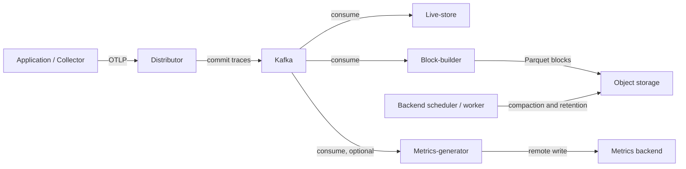
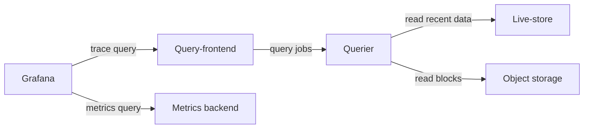

# Grafana Tempo

> **审阅基线**：Tempo 3.0.3；`tempo-distributed` chart 3.6.0（appVersion 3.0.3）
> **最后更新**：September 13, 2026

## 简介

Grafana Tempo 使用对象存储、Parquet 块和 TraceQL 存储及查询分布式追踪。TraceID 用于定位**保留且已成功摄取的数据**；它无法恢复因采样、导出失败或保留策略而丢失的 span。Tempo 不使用独立的通用搜索数据库，但专用列、元数据、缓存、计算资源和对象存储请求仍会产生开销。

本章将本地单体示例与分布式 EKS 配置基线分开说明。本地二进制、查询编译器、Helm 渲染和配置解析均已检查。EKS 部署、Kafka 身份验证、S3 授权、高可用性和生产环境容量规划**均未经过实际验证**。

## 主要功能

| 功能 | 范围 |
|---------|-------|
| 对象存储 | S3、GCS 和 Azure Blob；有界开发示例使用本地存储 |
| TraceQL | 属性、时长、状态和结构查询；指标函数不同于逐追踪聚合 |
| 协议 | OTLP，以及 Jaeger 和 Zipkin 等可选接收器；启用相应的 chart 端口 |
| 关联 | 当标识符和数据源 UID 相匹配时，Grafana 可链接追踪、日志、指标和 exemplars |
| 部署模式 | 单体 `target: all`，或使用兼容 Kafka 的摄取队列的微服务模式 |
| 指标生成 | 可选的 span 指标和服务图；需要处理器和正常工作的远程写入目标 |

## 架构

**Tempo 3 微服务需要 Kafka。单体模式不需要。** distributor 在将数据提交到 Kafka 后确认摄取；live-store、block-builder 和 metrics-generator 独立消费数据。live-store 提供近期数据服务；block-builder 写入长期存储块。query-frontend 拆分工作，querier 从近期存储或对象存储读取数据。



读取路径（使用相同的存储和指标组件）：



箭头表示请求和数据流，并未展示所有响应或控制平面连接。Grafana **查询**指标后端；metrics-generator 不会在 Grafana 中存储指标。

### 组件详情

| 组件 | Tempo 3 职责 | 运维注意事项 |
|-----------|-------------------------|---------------------------|
| Distributor | 验证追踪并将其路由到 Kafka 分区 | 背压、已接受/拒绝的字节数和 span 数 |
| Live-store | 近期追踪查询和本地 WAL | 消费者滞后、本地容量和分区所有权 |
| Block-builder | 消费 Kafka 并写入 Parquet 块 | 分区分配和对象存储吞吐量 |
| Query-frontend / querier | 拆分、调度和执行查询 | 排队、扫描字节数、并发和缓存 |
| Backend scheduler / worker | 压缩、保留和后台作业 | 调度器协调、worker 资源和失败的作业 |
| Metrics-generator | 派生 span 指标和服务图 | 基数、处理器启用情况和远程写入运行状况 |

Tempo 2 的 `ingester` 和 `compactor` 配置不能作为 Tempo 3 安装指南。分布式 **2→3 迁移采用并行部署方式**，使用兼容的现有块（`vParquet4` 或更高版本）、新的摄取路径和受控的流量切换。不支持从 3→2 降级。未经[官方迁移流程](https://grafana.com/docs/tempo/latest/set-up-for-tracing/setup-tempo/upgrade/)，不要让相互竞争的部署同时写入相同数据。

Kafka 复制、同步副本、保留期限和磁盘容量决定写入路径的持久性。Tempo 副本数无法确定 Kafka 的持久性，也不能保证零数据丢失。在 chart 3.6.0 中，live-store 和 block-builder 数据卷是 `emptyDir`；三个副本并不意味着有三个持久性 PVC。

## Helm 安装（分布式模式）

### 1. 添加 Helm 仓库

使用受维护的社区 chart，并明确指定版本：

```bash
helm repo add grafana-community https://grafana-community.github.io/helm-charts
helm repo update grafana-community
helm show chart grafana-community/tempo-distributed --version 3.6.0
helm show values grafana-community/tempo-distributed --version 3.6.0 > tempo-defaults.yaml
```

该 chart 声明 Kubernetes 版本约束为 `^1.25.0-0`。这是 chart 的约束，**并非**对所有 Kubernetes/EKS 版本或附加组件组合的测试矩阵。

### 2. values.yaml 配置

将以下内容保存为 `tempo-distributed-values.yaml`。这是一个**仅用于渲染的起点**，其中包含占位账户/存储桶名称以及隔离测试用的 Kafka 地址。

```yaml
# Render-only baseline. Read the Kafka security/deployment gates first.
fullnameOverride: tempo
reportingEnabled: false
serviceAccount:
  create: true
  name: tempo
  annotations:
    eks.amazonaws.com/role-arn: arn:aws:iam::123456789012:role/tempo-s3
traces:
  otlp:
    grpc:
      enabled: true
    http:
      enabled: true
ingest:
  kafka:
    address: kafka-bootstrap.kafka.svc.cluster.local:9092
    topic: tempo-traces
    auto_create_topic_enabled: false
storage:
  trace:
    backend: s3
    s3:
      bucket: replace-with-owned-tempo-bucket
      region: ap-northeast-2
      endpoint: s3.ap-northeast-2.amazonaws.com
      insecure: false
backendScheduler:
  config:
    provider:
      compaction:
        compaction:
          block_retention: 336h
metricsGenerator:
  enabled: false
gateway:
  enabled: false
ingress:
  enabled: false
metaMonitoring:
  serviceMonitor:
    enabled: false
tempo:
  structuredConfig:
    distributor:
      receivers:
        otlp:
          protocols:
            grpc:
              max_recv_msg_size_mib: 16
    overrides:
      defaults:
        ingestion:
          rate_limit_bytes: 15000000
          burst_size_bytes: 20000000
```

部署前，请解决以下要求：

- 单独创建并拥有 Kafka topic。默认的三个 live-store/block-builder 副本和 `partitions_per_instance: 1` 需要相匹配的分区设计；仅扩展 Pod 并不会重新分配所有 block-builder 分配项。
- 端到端验证 Kafka 传输和身份验证。**Tempo 3.0.3 的 Kafka 客户端支持 SASL/PLAIN，但不提供 Kafka TLS、SCRAM 或 MSK IAM 配置**。PLAIN 不提供加密。此示例不是可直接用于生产的安全 MSK 配置。网络/代理解决方案必须覆盖所有广播的 broker 端点，而不仅仅是 bootstrap 端点，并且必须在投入生产前进行独立测试。
- 使用下一节中的 S3 存储桶和角色。设置确切的 ServiceAccount 名称和角色注解；创建一个不相关的 ServiceAccount 并不足够。
- 使用实际的集群网络控制和经过身份验证的传输，限制 OTLP、查询、memberlist 和组件 RPC 的访问。内部负载均衡器或单独的 `X-Scope-OrgID` header 都不构成身份验证。
- 为工作负载设置资源、调度、干扰预算和存储/恢复策略。PodDisruptionBudget 限制自愿驱逐；反亲和性控制 Pod 放置。两者都不能证明服务具备可用性。

接收大小限制以 **MiB** 为单位；摄取速率/突发值以 **字节** 为单位。16 MiB 和 15/20 MB 只是示例限制，并非经测量得出的容量值。

可选的指标生成功能需要同时启用功能，并配置现有的、经过身份验证的接收端。只有在创建包含三个指定证书文件的 `tempo-metrics-client` Secret 并替换 URL 后，才合并以下第二个文件：

```yaml
metricsGenerator:
  enabled: true
  config:
    storage:
      remote_write:
        - url: https://metrics-write.example.org/api/v1/write
          send_exemplars: true
          tls_config:
            ca_file: /etc/metrics-tls/ca.crt
            cert_file: /etc/metrics-tls/tls.crt
            key_file: /etc/metrics-tls/tls.key
  extraVolumes:
    - name: metrics-tls
      secret:
        secretName: tempo-metrics-client
  extraVolumeMounts:
    - name: metrics-tls
      mountPath: /etc/metrics-tls
      readOnly: true
overrides:
  defaults:
    metrics_generator:
      processors: [span-metrics, service-graphs]
      generate_native_histograms: both
```

接收端必须接受 Prometheus 远程写入；exemplars 和原生直方图也需要目标端支持。此 chart 的默认 generator WAL 是临时存储。请单独验证重放/队列/存储行为；不要将 `send_exemplars: true` 视为交付保证。

### 3. IRSA 配置

此示例使用确切的身份 `system:serviceaccount:monitoring:tempo`。其角色信任策略同时通过 OIDC 的 `sub` 和 `aud` 声明进行限制。此角色仅允许访问自有的 Tempo 存储桶。避免在环境变量或 Helm values 中使用静态访问密钥。

这里展示的是 IRSA 这一具体方案，并非 EKS 工作负载身份的唯一选择。Pod Identity 替代方案必须根据固定 Tempo 镜像使用的凭证提供程序进行检查。还需验证 STS 可访问性、存储桶策略、VPC 端点和任何 KMS 密钥策略；成功渲染 YAML 并不能证明这些条件均已满足。

### 4. 执行安装

先渲染并检查，不要连接集群：

```bash
helm template tempo grafana-community/tempo-distributed \
  --version 3.6.0 --namespace monitoring --kube-version 1.36.2 \
  -f tempo-distributed-values.yaml > tempo-rendered.yaml
```

`--kube-version` 用于选择渲染功能；它不能证明与 EKS 1.36.2 兼容。检查 Service 端口、Pod 身份、ConfigMap、资源设置和可选的 generator 配置。提取渲染后的 `tempo.yaml`，并使用**匹配的**二进制文件验证：

```bash
tempo -config.file=tempo.yaml -config.verify=true
```

此命令会在服务初始化前退出。它不会连接 Kafka/S3，也不会完整测试任意接收器配置。**在解决前述部署要求之前，不要运行 Helm install**。之后，请在自己的部署流程下使用经过审核的 values 和自有的 release/namespace，并制定回滚/迁移计划。

如需进行本地单进程检查，请将此独立文件保存为 `tempo-local.yaml`，并针对你的操作系统/架构使用经验证的官方 Tempo 3.0.3 二进制文件：

```yaml
target: all
stream_over_http_enabled: true
server:
  http_listen_address: 127.0.0.1
  http_listen_port: 3200
  grpc_listen_address: 127.0.0.1
  grpc_listen_port: 9095
distributor:
  receivers:
    otlp:
      protocols:
        grpc:
          endpoint: 127.0.0.1:4317
        http:
          endpoint: 127.0.0.1:4318
storage:
  trace:
    backend: local
    wal:
      path: ./tempo-data/wal
    local:
      path: ./tempo-data/blocks
live_store:
  wal:
    path: ./tempo-data/live-store/traces
  shutdown_marker_dir: ./tempo-data/live-store/shutdown-marker
  ring:
    instance_addr: 127.0.0.1
    instance_interface_names: [lo]
metrics_generator:
  storage:
    path: ./tempo-data/generator/wal
backend_scheduler:
  local_work_path: ./tempo-data/scheduler
memberlist:
  bind_addr: [127.0.0.1]
  advertise_addr: 127.0.0.1
usage_report:
  reporting_enabled: false
```

```bash
tempo -config.file=tempo-local.yaml -config.verify=true
tempo -config.file=tempo-local.yaml
# In a second terminal:
curl --fail http://127.0.0.1:3200/ready
```

它仅绑定到回环地址、禁用使用情况报告，并在 `./tempo-data` 下写入数据。按 Ctrl-C 停止此进程。这只是一个本地实例，不涉及 Kafka、S3、身份验证网关或高可用性声明。

## TraceQL 查询

### 基本语法

使用 Grafana Explore 的 TraceID 模式直接查找，或在 TraceQL intrinsic 中使用完整的 32 位十六进制 ID：

```traceql
{ trace:id = "4bf92f3577b34da6a3ce929d0e0e4736" }
{ resource.service.name = "payment-service" }
{ span.http.response.status_code >= 400 }
{ duration > 1s }
{ status = error }
```

这些是独立的查询。Span 状态 `error` 与所有 HTTP 状态码 ≥400 并不完全相同。属性名称取决于发送数据的 SDK 所使用的语义约定版本：较早的 `http.status_code` 和 `db.system` 数据仍可使用其原始名称查询；Tempo 不会自动重命名存储的属性。

### 高级查询示例

```traceql
{ span.db.system.name = "postgresql" && duration > 100ms }
{ span.http.route = "/api/payment" && status = error }
{ resource.service.name = "api-gateway" } >> { resource.service.name = "payment-service" }
{ resource.service.name = "order-service" } > { span.db.system.name = "postgresql" }
{ resource.service.name = "order-service" } ~ { resource.service.name = "inventory-service" }
{ trace:rootService = "api-gateway" } | count() > 50
{ duration > 2s } | by(resource.service.name) | avg(duration) > 2s
{ status = error } | rate() by (resource.service.name)
{ } | avg_over_time(duration) by (resource.service.name)
```

- `A >> B` 返回 A 的匹配**后代 B**；`A > B` 返回 A 的匹配直接子级 B。若要获取父级，请使用对应的反向关系，而不要将子级描述成父级。
- `A ~ B` 匹配兄弟节点。它不能证明存在从 A 到 B 的网络调用。
- `count()` 统计**当前 spanset** 中的 span。如果先筛选出错误再计数，统计的是错误 span，而不是追踪中的所有 span。`traceSpanCount` 不是有效的 intrinsic。
- 此版本接受 `nestedSetParent`，但它是内部嵌套集父级标记，并非嵌套深度计数器。
- `by(...) | avg(...) > ...` 用于筛选逐追踪 spanset；`rate()` 和 `avg_over_time(...)` 会生成时间序列。前者表示错误 span 速率，**不是错误率占比**。在 Grafana 或查询 API 中选择时间区间；时长筛选条件并非墙上时钟时间范围。

类似 `{ span.user.id = "synthetic-user-123" }` 的查询需要明确发送该属性。使用合成或经批准的假名化标识符；不要把个人数据作为追踪的前提。优先使用低基数的 `http.route`，而不是包含用户 ID 或查询字符串的字面 URL。

### 在 Grafana 中使用 TraceQL

创建 Tempo 数据源时，使用端口 **3200** 上的 query-frontend URL，然后选择 Explore → Tempo → Search/TraceQL。`tempo` UID 必须与日志链接和 exemplar 目标保持一致。提高查询并发数或限制之前，先缩短时间范围。

## S3 后端配置

### S3 存储桶设置

使用专用存储桶，启用 Block Public Access 和强制存储桶所有者所有权，并开启加密。在一个基础设施状态中维护其所有权；不要同时通过 CLI 片段和 Terraform 创建同一个存储桶。

Tempo 的 `block_retention: 336h` 是通过后台处理异步执行的保留目标，并非精确的删除期限。对所有对象统一设置“30 天后删除”的 S3 策略，可能与压缩和元数据处理冲突。除非有记录完备且考虑后端行为的生命周期设计，否则不要添加此类策略。如果启用了版本控制，删除当前对象可能会留下非当前版本并继续产生费用；请单独定义这些版本的保留和恢复要求。

### 使用 Terraform 配置 S3 和 IRSA

此 AWS provider **6.69.1** 示例使用 SSE-S3 和一个**现有的**集群 OIDC provider。替换账户、全局唯一的存储桶名称和 issuer 输入值。此示例不会创建 EKS 集群、Kafka 或 KMS 密钥。

```hcl
terraform {
  required_version = ">= 1.6.0"
  required_providers {
    aws = {
      source  = "hashicorp/aws"
      version = "6.69.1"
    }
  }
}

variable "region" {
  type    = string
  default = "ap-northeast-2"
}
variable "account_id" {
  type = string
  validation {
    condition     = can(regex("^[0-9]{12}$", var.account_id))
    error_message = "Supply the bucket and role owner account ID."
  }
}
variable "bucket_name" { type = string }
variable "oidc_provider_arn" { type = string }
variable "oidc_issuer_hostpath" {
  type        = string
  description = "Existing cluster OIDC issuer without https://."
}
provider "aws" { region = var.region }

resource "aws_s3_bucket" "tempo" {
  bucket        = var.bucket_name
  force_destroy = false
  lifecycle { prevent_destroy = true }
}
resource "aws_s3_bucket_public_access_block" "tempo" {
  bucket                  = aws_s3_bucket.tempo.id
  block_public_acls       = true
  block_public_policy     = true
  ignore_public_acls      = true
  restrict_public_buckets = true
}
resource "aws_s3_bucket_ownership_controls" "tempo" {
  bucket = aws_s3_bucket.tempo.id
  rule { object_ownership = "BucketOwnerEnforced" }
}
resource "aws_s3_bucket_server_side_encryption_configuration" "tempo" {
  bucket = aws_s3_bucket.tempo.id
  rule {
    apply_server_side_encryption_by_default { sse_algorithm = "AES256" }
  }
}
resource "aws_s3_bucket_policy" "tempo" {
  bucket = aws_s3_bucket.tempo.id
  policy = jsonencode({
    Version = "2012-10-17"
    Statement = [{
      Sid       = "DenyInsecureTransport"
      Effect    = "Deny"
      Principal = "*"
      Action    = "s3:*"
      Resource  = [aws_s3_bucket.tempo.arn, "${aws_s3_bucket.tempo.arn}/*"]
      Condition = { Bool = { "aws:SecureTransport" = "false" } }
    }]
  })
}
resource "aws_iam_role" "tempo" {
  name = "tempo-s3"
  assume_role_policy = jsonencode({
    Version = "2012-10-17"
    Statement = [{
      Effect    = "Allow"
      Principal = { Federated = var.oidc_provider_arn }
      Action    = "sts:AssumeRoleWithWebIdentity"
      Condition = {
        StringEquals = {
          "${var.oidc_issuer_hostpath}:aud" = "sts.amazonaws.com"
          "${var.oidc_issuer_hostpath}:sub" = "system:serviceaccount:monitoring:tempo"
        }
      }
    }]
  })
}
resource "aws_iam_role_policy" "tempo" {
  role = aws_iam_role.tempo.id
  policy = jsonencode({
    Version = "2012-10-17"
    Statement = [
      {
        Effect    = "Allow"
        Action    = ["s3:ListBucket", "s3:GetBucketLocation"]
        Resource  = aws_s3_bucket.tempo.arn
        Condition = { StringEquals = { "aws:ResourceAccount" = var.account_id } }
      },
      {
        Effect    = "Allow"
        Action    = ["s3:GetObject", "s3:PutObject", "s3:DeleteObject", "s3:AbortMultipartUpload"]
        Resource  = "${aws_s3_bucket.tempo.arn}/*"
        Condition = { StringEquals = { "aws:ResourceAccount" = var.account_id } }
      }
    ]
  })
}
output "tempo_role_arn" { value = aws_iam_role.tempo.arn }
output "tempo_bucket" { value = aws_s3_bucket.tempo.id }
```

在 Helm values 中使用 `tempo_role_arn` 和 `tempo_bucket`。在 plan 之前，Terraform 格式化/schema 验证会很有帮助；应用前请审核实际 plan 和所有权。对于 SSE-KMS，请明确提供自有密钥、兼容的存储桶/Tempo 设置、范围受限的 `kms:GenerateDataKey`/`kms:Decrypt` 权限，以及允许该工作负载访问的密钥策略。未定义的 `aws_kms_key` 引用并不是完整配置。

## 追踪到日志关联（Loki 集成）

### Grafana 数据源配置

这是一个 **Grafana provisioning 文件**，并非特定 chart 的 `values.yaml`。通过 Grafana chart 支持的机制挂载此文件。三个内部 URL 均为现有受控访问服务的占位符：

```yaml
apiVersion: 1
datasources:
  - name: Tempo
    uid: tempo
    type: tempo
    access: proxy
    url: http://tempo-query-frontend.monitoring.svc.cluster.local:3200
    jsonData:
      tracesToLogsV2:
        datasourceUid: loki
        spanStartTimeShift: '-1m'
        spanEndTimeShift: '1m'
        tags: [{key: service.name, value: service_name}]
        filterByTraceID: true
        filterBySpanID: false
        customQuery: false
      tracesToMetrics:
        datasourceUid: prometheus
        tags: [{key: service.name, value: service}]
        queries:
          - name: Span request rate
            query: 'sum(rate(traces_spanmetrics_calls_total{$$__tags}[5m]))'
          - name: Span error ratio
            query: '(sum(rate(traces_spanmetrics_calls_total{$$__tags,status_code="STATUS_CODE_ERROR"}[5m])) or (0 * sum(rate(traces_spanmetrics_calls_total{$$__tags}[5m])))) / (sum(rate(traces_spanmetrics_calls_total{$$__tags}[5m])) > 0)'
      serviceMap:
        datasourceUid: prometheus
      nodeGraph:
        enabled: true
  - name: Loki
    uid: loki
    type: loki
    access: proxy
    url: http://loki-gateway.logging.svc.cluster.local
    jsonData:
      derivedFields:
        - name: TraceID
          matcherRegex: '"traceId"\s*:\s*"([0-9a-f]{32})"'
          datasourceUid: tempo
          url: '$${__value.raw}'
  - name: Prometheus
    uid: prometheus
    type: prometheus
    access: proxy
    url: http://prometheus-operated.monitoring.svc.cluster.local:9090
    jsonData:
      httpMethod: POST
      exemplarTraceIdDestinations:
        - name: traceID
          datasourceUid: tempo
```

Tempo 的 `tracesToLogsV2` 实现**追踪→日志**；Loki 的 `derivedFields` 实现**日志→追踪**。此示例将 OTel 的 `service.name` 属性映射到 Loki 现有的 `service_name` label。请验证 Collector 的映射；链接本身无法生成 label 或日志记录。由于并非每条日志都有 span ID，因此禁用了 span 筛选。

在 provisioning YAML 中，`$$` 可为 Grafana 的运行时宏保留一个字面 `$`。`__tags` 会展开为一组 label 匹配器；不要将其嵌入为 `service="..."` 的值。错误率查询会使用总量序列填补缺失的错误序列，并且仅在总速率为正时进行除法。流量为零和遥测数据缺失时，结果仍为空。

Span 指标 label `service` 和状态值 `STATUS_CODE_ERROR` 必须与实际生成的序列相符。Exemplars 使用观测到的 exemplar label 名称（图示 generator 配置使用 `traceID`）；其他生产方可能使用 `trace_id`。采样可能导致这些指标与完整的应用请求计数不同。

### 应用程序日志

对于使用 OpenTelemetry API 1.44 的 Python，应检查 context 是否有效，而不是检查 `span.is_recording()`。有效的非记录型 span 仍可用于关联日志：

```python
import datetime
import json
import logging
from opentelemetry import trace


class TraceJsonFormatter(logging.Formatter):
    def format(self, record):
        payload = {
            "timestamp": datetime.datetime.fromtimestamp(
                record.created, datetime.timezone.utc
            ).isoformat(),
            "level": record.levelname,
            "message": record.getMessage(),
        }
        context = trace.get_current_span().get_span_context()
        if context.is_valid:
            payload["traceId"] = f"{context.trace_id:032x}"
            payload["spanId"] = f"{context.span_id:016x}"
        if record.exc_info:
            payload["exception"] = self.formatException(record.exc_info)
        return json.dumps(payload, ensure_ascii=False)


logger = logging.getLogger("payment")
logger.setLevel(logging.INFO)
logger.propagate = False
# Configure once at application startup.
if not logger.handlers:
    handler = logging.StreamHandler()
    handler.setFormatter(TraceJsonFormatter())
    logger.addHandler(handler)
```

这会保留 UTC 时间戳、消息格式和异常信息，并省略无效 ID，而不是伪造全零追踪。只配置一次 handler；跨异步边界传播 OTel context，并在源头对敏感消息/异常进行脱敏。

对于 Java，请使用[追踪概览中的作用域 MDC helper](README.md#linking-logs-via-traceid)：验证当前 `SpanContext`，为日志作用域设置 ID，并在 `finally` 中恢复之前的 MDC 值。仅执行 `MDC.put` 可能会在复用的线程上泄漏先前请求的 ID。已检查 Java API 契约；本章未运行 Java 应用程序。

## 性能调优

### 优化摄取速率

测量已接受/拒绝的字节数和 span 数、exporter 重试次数、Kafka producer 错误和消费者滞后。在没有内存和队列容量的情况下增加接收器大小、摄取限制或副本数，可能只是转移瓶颈，而非消除瓶颈。解读生成的指标时，应保留上游采样假设。

使用 `overrides.defaults.ingestion` 设置租户限制，并使用接收器的 `max_recv_msg_size_mib` 字段设置 gRPC 消息大小。旧的 `distributor.rate_limit` 区块和 Tempo 2 的 `ingester` 调优区块均无法配置 Tempo 3。

### 优化压缩

通过 chart 的 `backendScheduler.config.provider.compaction.compaction` 设置和对应的 backend-worker 配置来配置保留策略。监控作业积压时间、失败情况、对象存储请求和临时工作空间。增加压缩并发可能会增加对象存储流量和内存；旧架构并不存在适用于所有情况的“每个集群一个 compactor”规则。

### 优化查询性能

首先缩短时间范围并提高筛选的选择性；然后检查扫描字节数、排队情况、querier 并发和相关缓存角色。应根据固定的 chart/配置设置缓存字段，而不要复制已移除的 `cache:` 布局。对象存储请求对冲可能降低尾延迟，但会增加请求量；应通过测量验证这种权衡。

Tempo 3 的 live-store 中 `fail_on_high_lag` 默认值为 true，query-frontend 的 `query_end_cutoff` 默认值为 30s。近期数据的搜索可见性可能比直接 TraceID 查找有所延迟。不要只为让空白 dashboard 看起来正常就禁用这些保护措施。

### 资源建议

根据摄取量为 distributor 配置容量，根据近期追踪量/滞后为 live-store 配置容量，根据分配的分区和块大小为 block-builder 配置容量，根据查询并发量为 querier 配置容量，并根据活跃序列数为 generator 配置容量。旧版未经测量的 Tempo 2 Ingester/Compactor CPU 和磁盘表格并非 Tempo 3 的容量建议。应在有代表性的流量下测量 CPU、RSS、本地/WAL 使用量、Kafka 滞后、请求成本和饱和情况。

## 故障排查

### 常见问题和解决方案

#### 1. 未显示追踪数据

检查 SDK 导出错误、采样、传播的 context、Collector 队列、OTLP 传输、租户路由和保留策略。对 `/v1/traces` 发送 GET 请求并不能测试数据摄取；应发送有效的 OTLP POST，然后查询已知的合成 TraceID。`/ready` 探针成功并不能单独证明所有阶段均正常。

#### 2. S3 权限错误

检查确切的 ServiceAccount、角色信任策略、存储桶策略、端点访问，以及适用时的 KMS 策略。不要转储 Pod 环境变量或投射的 token。不要假设 Tempo 镜像中包含 AWS CLI 或 shell。

```bash
kubectl get serviceaccount tempo -n monitoring -o yaml
kubectl get pods -n monitoring -l app.kubernetes.io/instance=tempo \
  -o custom-columns=NAME:.metadata.name,SA:.spec.serviceAccountName
kubectl logs -n monitoring -l app.kubernetes.io/component=block-builder --tail=100
```

限制诊断输出的访问权限：日志可能包含运维元数据或应用程序属性。

#### 3. 查询超时

检查 query-frontend/querier 日志、时间范围、Kafka 滞后、可用的 live-store 分区和 S3 限流情况。只有在测量内存和后端限制后，才提高并发数。空结果、超时和遥测缺失是不同的状态，应分别处理。

#### 4. Live-store 内存压力

对于 Tempo 3，请检查 live-store 内存、近期数据窗口、块轮换和分区所有权。对于仍在运行的 Tempo 2 部署，请在迁移期间使用对应版本的 ingester 文档；将 `ingester.max_block_duration: 30m` 复制到 Tempo 3 并不能调整 live-store。

### 实用调试命令

使用经授权的端口转发来检查实际的 query-frontend：

```bash
kubectl port-forward -n monitoring service/tempo-query-frontend 3200:3200
# In a second terminal:
curl --fail http://127.0.0.1:3200/ready
curl --fail http://127.0.0.1:3200/metrics
curl --fail http://127.0.0.1:3200/api/traces/4bf92f3577b34da6a3ce929d0e0e4736
```

最后一个 ID 必须确实存在于该部署中。只读 ring/status 端点因组件而异；使用前请验证固定版本的 API。已移除的 `/ingester/ring`、`/compactor/ring` 和强制 flush 命令并非通用的 Tempo 3 诊断工具。

### 监控 dashboard

使用部署实际发出的序列，并添加其目标标签：

```promql
sum(rate(tempo_distributor_spans_received_total[5m]))
sum(process_resident_memory_bytes{job=~"tempo.*"})
histogram_quantile(0.99, sum by (le) (rate(tempo_request_duration_seconds_bucket{route="api_search"}[5m])))
```

这些面板分别表示**每秒接收的 span 数**、**进程 RSS 字节数**和 **HTTP 搜索请求 p99 秒数**。内存选择器假定了你的抓取作业命名方式；请先检查标签。字节写入计数器不代表内存，span 数也不等于追踪数。该请求直方图/路由是在本地 Tempo 3.0.3 冒烟测试中观测到的；它并非分布式端到端延迟测量值。

## 参考资料

- [Tempo 3.0.3 版本发布](https://github.com/grafana/tempo/releases/tag/v3.0.3)，[chart 3.6.0 values](https://github.com/grafana-community/helm-charts/blob/tempo-distributed-3.6.0/charts/tempo-distributed/values.yaml)
- [Tempo 架构](https://grafana.com/docs/tempo/latest/introduction/architecture/)，[Kafka 客户端实现](https://github.com/grafana/tempo/blob/v3.0.3/pkg/ingest/writer_client.go)
- [TraceQL 语法](https://grafana.com/docs/tempo/latest/traceql/construct-traceql-queries/)，[Grafana provisioning](https://grafana.com/docs/grafana/latest/datasources/tempo/configure-tempo-data-source/provision/)
- [EKS IRSA 关联](https://docs.aws.amazon.com/eks/latest/userguide/associate-service-account-role.html)，[S3 Block Public Access](https://docs.aws.amazon.com/AmazonS3/latest/userguide/access-control-block-public-access.html)

## 测验

通过 [Tempo 测验](../../quizzes/observability/tracing/01-tempo-quiz.md)测试本章内容。
