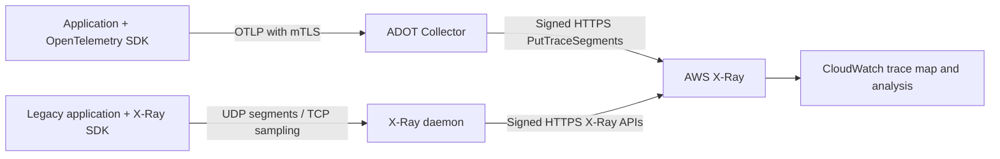
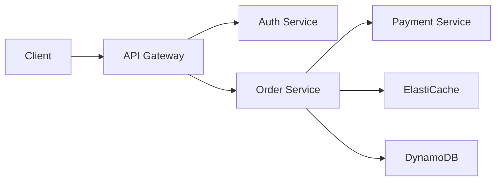

# AWS X-Ray

> **最后更新**: September 13, 2026

## 简介

AWS X-Ray 是一项 AWS 原生服务，用于跟踪和分析分布式应用程序中的请求。在 EKS 环境中使用 X-Ray，可以可视化微服务之间的请求流、识别性能瓶颈并确定错误的根本原因。

**X-Ray SDK 和守护进程自 2026 年 2 月 25 日起已处于维护模式**，仅提供安全修复；当前的[支持时间表](https://docs.aws.amazon.com/xray/latest/devguide/xray-sdk-daemon-timeline.html)尚未公布结束日期。这是指检测组件的生命周期，并非 X-Ray 服务退役。AWS 建议新建检测以及迁移时使用 OpenTelemetry。下面的守护进程示例是一种旧版兼容路径。

## 主要功能

| 功能 | 描述 |
|---------|-------------|
| **服务映射** | 自动可视化服务依赖关系 |
| **请求跟踪** | 端到端跟踪请求路径 |
| **分析工具** | 响应时间分布、错误率分析 |
| **AWS 集成** | 原生支持 Lambda、API Gateway、ECS、EKS |
| **采样规则** | 集中式采样配置 |
| **组和警报** | 基于筛选条件分组并设置 CloudWatch 警报 |

## 架构

下图展示了本文介绍的两种数据采集方案。守护进程会向 AWS 发送经过签名的 HTTPS 请求；UDP/TCP2000 是其面向应用程序的旧版协议。配置的 ADOT awsxray exporter 使用 PutTraceSegments，而不是 CloudWatch 原生 OTLP 端点。



EKS 不会自动为每个应用程序添加检测。Lambda/API Gateway 和其他服务集成需要各自受支持的跟踪配置和传播机制。CloudWatch 原生 OTLP 是一条独立的摄取路径，需要 Transaction Search 和 SigV4 前置条件，详见下文。

## 部署 X-Ray 守护进程

### 以 DaemonSet 方式部署

```yaml
# xray-daemon.yaml
apiVersion: v1
kind: ServiceAccount
metadata:
  name: xray-daemon
  namespace: amazon-cloudwatch
  annotations:
    eks.amazonaws.com/role-arn: arn:aws:iam::123456789012:role/xray-daemon-role
---
apiVersion: apps/v1
kind: DaemonSet
metadata:
  name: xray-daemon
  namespace: amazon-cloudwatch
spec:
  selector:
    matchLabels:
      app: xray-daemon
  updateStrategy:
    type: RollingUpdate
  template:
    metadata:
      labels:
        app: xray-daemon
    spec:
      serviceAccountName: xray-daemon
      nodeSelector:
        kubernetes.io/os: linux
      containers:
        - name: xray-daemon
          image: amazon/aws-xray-daemon:3.7.0@sha256:a2303d37f9dd7077c93e596689cb1de12f2ef8333c15b088ba223840164f6bc2
          args: ["-o", "-n", "ap-northeast-2"]
          ports:
            - name: xray-udp
              containerPort: 2000
              protocol: UDP
            - name: xray-tcp
              containerPort: 2000
              protocol: TCP
          resources:
            requests:
              cpu: 50m
              memory: 64Mi
            limits:
              cpu: 100m
              memory: 128Mi
          env:
            - name: AWS_REGION
              value: ap-northeast-2
      tolerations:
        - key: node-role.kubernetes.io/master
          effect: NoSchedule
---
apiVersion: v1
kind: Service
metadata:
  name: xray-daemon
  namespace: amazon-cloudwatch
spec:
  selector:
    app: xray-daemon
  ports:
    - name: xray-udp
      port: 2000
      protocol: UDP
    - name: xray-tcp
      port: 2000
      protocol: TCP
  type: ClusterIP
```

此维护路径使用的映像固定为经过验证的官方 3.7.0 多架构清单（Linux amd64/arm64）。它的入口点是 `/xray`，而不是 `/usr/bin/xray`；`-o` 会禁用 EC2 元数据增强，`-n` 用于指定区域。DaemonSet 不会在 EKS Fargate 上运行。此 ClusterIP Service 可能会选择另一个节点上的守护进程，因此无法保证流量发送到本地节点，也无法保证 UDP 不丢失。

对于旧版 SDK 客户端，请设置 `AWS_XRAY_DAEMON_ADDRESS=xray-daemon.amazon-cloudwatch.svc.cluster.local:2000`。UDP segment 和 TCP 采样流量都必须能够到达。应将这条未加密的旧版路径限制为受信任的工作负载；如需经过身份验证的 TLS 数据采集，请使用 OpenTelemetry 路径。每个数据生产者选择一种数据采集路径。


### IRSA 配置

通过其现有负责人创建 `amazon-cloudwatch` 命名空间。旧版守护进程的 `xray-daemon` ServiceAccount 必须引用为其准备的专属角色。以下权限策略涵盖 segment/遥测数据导出和集中式采样调用；请将区域替换为实际部署区域：

```json
{
  "Version": "2012-10-17",
  "Statement": [
    {
      "Effect": "Allow",
      "Action": [
        "xray:PutTraceSegments",
        "xray:PutTelemetryRecords",
        "xray:GetSamplingRules",
        "xray:GetSamplingTargets",
        "xray:GetSamplingStatisticSummaries"
      ],
      "Resource": "*",
      "Condition": {
        "StringEquals": {
          "aws:RequestedRegion": "ap-northeast-2"
        }
      }
    }
  ]
}
```

这些 X-Ray 操作使用 `Resource: "*"`，此处通过 `aws:RequestedRegion` 加以限制。守护进程的策略与下面范围更窄的 ADOT 策略相互独立。两种策略都不会授予操作员创建组或采样规则的权限。

对于任一 collector，请使用集群已注册的 OIDC 提供方准备 IRSA 角色，并设置 `aud=sts.amazonaws.com` 和**准确的命名空间/ServiceAccount subject**。下面的信任策略示例适用于 `adot-collector`；守护进程角色则需要使用 `system:serviceaccount:amazon-cloudwatch:xray-daemon`。请一致替换示例账户、区域和 OIDC ID。

```json
{
  "Version": "2012-10-17",
  "Statement": [
    {
      "Effect": "Allow",
      "Principal": {
        "Federated": "arn:aws:iam::123456789012:oidc-provider/oidc.eks.ap-northeast-2.amazonaws.com/id/EXAMPLE"
      },
      "Action": "sts:AssumeRoleWithWebIdentity",
      "Condition": {
        "StringEquals": {
          "oidc.eks.ap-northeast-2.amazonaws.com/id/EXAMPLE:aud": "sts.amazonaws.com",
          "oidc.eks.ap-northeast-2.amazonaws.com/id/EXAMPLE:sub": "system:serviceaccount:amazon-cloudwatch:adot-collector"
        }
      }
    }
  ]
}
```

请让 IAM/基础设施负责人创建或更新预期角色，并附加相匹配的权限策略。保留现有 ServiceAccount 的所有权；不要将 `eksctl --override-existing-serviceaccounts` 作为通用设置步骤运行。请在获批环境中验证渲染后 Pod 的投射令牌、角色 ARN、SDK 凭证解析和实际授权。仅有 ServiceAccount 注释并不能证明授权有效。

## 部署 ADOT Collector

此跟踪管道使用 [ADOT Collector 0.50.0](https://github.com/aws-observability/aws-otel-collector/releases/tag/v0.50.0)，其基础版本为 Collector/Contrib 0.158.0。发布版 ADOT 有自己的组件清单；不要假定它包含上游 Contrib 发布版中的所有组件。此固定版本的 collector 二进制文件已在本地使用合成 OTLP/X-Ray 数据和伪造的 loopback X-Ray 端点进行了测试。本次没有测试 AWS 授权、Kubernetes 部署或生产环境可用性。

<a id="adot-collector-daemonset"></a>

### Collector 部署和前置条件

此示例使用一个中心 **Deployment** 和 ClusterIP Service，不配置 host port。这不是高可用配置。应用程序必须显式选择其 DNS 端点；安装此组件不会自动为应用程序添加检测。DaemonSet 是另一种独立的调度设计，且 EKS Fargate 不支持 DaemonSet。在 Fargate 上运行 Deployment 仍需要匹配的 Fargate profile，以及受支持的资源/存储/网络配置。

应用这些资源前：

- 按照上一节准备命名空间和 IRSA 角色，并将 subject 设置为 `system:serviceaccount:amazon-cloudwatch:adot-collector`。
- 通过获批的证书流程提供现有 Kubernetes Secret `adot-collector-tls`。其中包含 `server.crt`、`server.key` 和 `ca.crt`。服务器证书必须涵盖实际的 Service DNS 名称，例如 `adot-collector.amazon-cloudwatch.svc.cluster.local`；CA 必须信任预期的客户端证书。
- 将获批的 CA/客户端证书/密钥文件挂载到数据生产者。限制对 Secret 的访问、工作负载对端口 4317/4318 的访问以及对运行状况端点的访问；规划证书轮换。不要将证书私钥内容或 AWS 凭证放入环境变量。
- 替换集群/账户/区域的值，并检查最终工作负载身份。资源处理器会显式设置一个集群名称；它不会发现所有 Pod/node 元数据，也不得将其他集群的流量错误标记为本集群流量。

以下 ADOT 管道会禁用 exporter 遥测，并且只使用经典 X-Ray `PutTraceSegments` 导出路径，因此其工作负载权限策略如下：

```json
{
  "Version": "2012-10-17",
  "Statement": [
    {
      "Effect": "Allow",
      "Action": ["xray:PutTraceSegments"],
      "Resource": "*",
      "Condition": {
        "StringEquals": {
          "aws:RequestedRegion": "ap-northeast-2"
        }
      }
    }
  ]
}
```

请将此完整 ConfigMap 与以下工作负载/Service 清单配合使用：

```yaml
apiVersion: v1
kind: ConfigMap
metadata:
  name: adot-collector-config
  namespace: amazon-cloudwatch
data:
  collector.yaml: |
    receivers:
      otlp:
        protocols:
          grpc:
            endpoint: 0.0.0.0:4317
            tls:
              cert_file: /etc/otel/tls/server.crt
              key_file: /etc/otel/tls/server.key
              client_ca_file: /etc/otel/tls/ca.crt
              min_version: "1.2"
          http:
            endpoint: 0.0.0.0:4318
            tls:
              cert_file: /etc/otel/tls/server.crt
              key_file: /etc/otel/tls/server.key
              client_ca_file: /etc/otel/tls/ca.crt
              min_version: "1.2"
    processors:
      memory_limiter:
        check_interval: 1s
        limit_mib: 400
        spike_limit_mib: 100
      resource:
        attributes:
          - key: cloud.provider
            value: aws
            action: upsert
          - key: k8s.cluster.name
            value: ${env:CLUSTER_NAME}
            action: upsert
      batch:
        timeout: 5s
        send_batch_size: 256
        send_batch_max_size: 512
    exporters:
      awsxray:
        region: ap-northeast-2
        local_mode: true
        index_all_attributes: false
        indexed_attributes:
          - deployment.environment.name
          - app.operation
        telemetry:
          enabled: false
    extensions:
      health_check:
        endpoint: 0.0.0.0:13133
    service:
      extensions: [health_check]
      pipelines:
        traces:
          receivers: [otlp]
          processors: [memory_limiter, resource, batch]
          exporters: [awsxray]
```

```yaml
apiVersion: v1
kind: ServiceAccount
metadata:
  name: adot-collector
  namespace: amazon-cloudwatch
  annotations:
    eks.amazonaws.com/role-arn: arn:aws:iam::123456789012:role/adot-xray-role
automountServiceAccountToken: false
---
apiVersion: apps/v1
kind: Deployment
metadata:
  name: adot-collector
  namespace: amazon-cloudwatch
spec:
  replicas: 1
  selector:
    matchLabels:
      app: adot-collector
  template:
    metadata:
      labels:
        app: adot-collector
    spec:
      serviceAccountName: adot-collector
      nodeSelector:
        kubernetes.io/os: linux
      automountServiceAccountToken: false
      terminationGracePeriodSeconds: 30
      securityContext:
        runAsNonRoot: true
        runAsUser: 4317
        runAsGroup: 4317
        fsGroup: 4317
        seccompProfile:
          type: RuntimeDefault
      containers:
        - name: collector
          image: public.ecr.aws/aws-observability/aws-otel-collector:v0.50.0
          args: ["--config=/conf/collector.yaml"]
          env:
            - name: CLUSTER_NAME
              value: replace-with-cluster-name
            - name: AWS_REGION
              value: ap-northeast-2
            - name: AWS_EC2_METADATA_DISABLED
              value: "true"
            - name: GOMEMLIMIT
              value: 400MiB
          resources:
            requests:
              cpu: 100m
              memory: 256Mi
            limits:
              cpu: 500m
              memory: 512Mi
          securityContext:
            allowPrivilegeEscalation: false
            readOnlyRootFilesystem: true
            capabilities:
              drop: [ALL]
          ports:
            - name: otlp-grpc
              containerPort: 4317
            - name: otlp-http
              containerPort: 4318
            - name: health
              containerPort: 13133
          volumeMounts:
            - name: config
              mountPath: /conf
              readOnly: true
            - name: tls
              mountPath: /etc/otel/tls
              readOnly: true
          readinessProbe:
            httpGet:
              path: /
              port: health
            initialDelaySeconds: 5
          livenessProbe:
            httpGet:
              path: /
              port: health
            initialDelaySeconds: 15
      volumes:
        - name: config
          configMap:
            name: adot-collector-config
        - name: tls
          secret:
            secretName: adot-collector-tls
            defaultMode: 0440
---
apiVersion: v1
kind: Service
metadata:
  name: adot-collector
  namespace: amazon-cloudwatch
spec:
  type: ClusterIP
  selector:
    app: adot-collector
  ports:
    - name: otlp-grpc
      port: 4317
      targetPort: otlp-grpc
    - name: otlp-http
      port: 4318
      targetPort: otlp-http
```

容器映像提供了 `RUN_IN_CONTAINER=True`；在独立的原生 collector 测试中，需要此变量，以免其自定义 CLI 日志写入 `/opt`。其 CLI 不能与所有上游 `otelcol` 命令互换。本地测试使用了带版本号的 AWS 二进制文件、测试证书和仅指向 loopback 的目标。

所提配置通过了五项本地 mTLS 检查，包括在没有客户端证书时拒绝连接，以及在使用受信任证书时接受连接。这三个 Kubernetes 资源通过了本地 OpenAPI schema 验证。这些结果不能验证实际 Secret、IRSA 注入、CNI 策略、调度或 AWS 权限。运行状况端点报告的是 collector 进程的运行状况，而不是成功传送到 X-Ray 的状态。队列、重试、内存压力、终止和后端故障仍可能导致遥测数据丢失；请规划容量，并监控被拒绝/丢弃/导出失败的数据。

### 旧版 X-Ray Receiver 和独立遥测管道

ADOT 0.50.0 还包含 `awsxray` receiver。其受支持的 UDP 配置如下：

```yaml
# Receiver fragment only; requires an explicitly connected trace pipeline.
receivers:
  awsxray:
    endpoint: 0.0.0.0:2000
    transport: udp
```

此旧版 receiver 可替代通过守护进程发送 SDK segment 的方式；请避免为同一数据生产者重复配置跟踪路径。它还会默认启动 TCP 采样代理。如果使用集中式采样，除了 UDP2000，还要配置并限制所需的 TCP2000 Service/代理路径和采样权限。旧版协议不受 OTLP receiver 的 mTLS 设置保护。原生审计确认了 OTLP 和 X-Ray UDP 接收功能；但未执行远程 AWS 采样。

指标、应用程序日志和跟踪各自都需要连接好的管道和后端配置。仅仅声明一个 `awscloudwatchlogs` exporter，并不会将跟踪转换成日志，也不会将其写入臆造的 `/aws/xray/traces` 日志组。指标 remote-write 端点同样需要实际的 receiver、身份验证和 TLS 配置；它不是 X-Ray 的前置条件。

## OpenTelemetry 与 X-Ray 集成

以下示例使用上文经过身份验证的 collector Service。数据生产者需要能够访问该 Service，并能够访问其挂载的客户端 TLS 文件；它们不需要 collector 的 AWS 凭证。这些示例会创建合成 span，不执行任何支付、数据库或 AWS 业务操作。

精确的验证基准为 Python SDK/exporter1.44.0 与 Flask3.1.3、Go SDK/exporter1.44.0 与 Go1.26.8，以及 Java1.66.0 API 源码。这些固定版本并不构成通用 AWS 兼容性矩阵，也不表示每种语言都使用相同的最新版本。Python 和 Go 已在本地测试；Java API/配置已根据带标签的源代码进行检查，但本次审计没有可用的 JDK/Maven 编译环境。

有限时长的演示进程请使用以下设置。OTLP/HTTP 端点包含 `/v1/traces`。请将客户端私钥保存在受保护的挂载文件中。此有限演示会对根 span 进行采样，并遵从远程父级的采样决策；生产环境应选择经过测量的采样器，不要将演示用的全根 span 采样设置复制到不受限制的生产流量中。通用 SDK sampler 不会自动获取 X-Ray 集中式规则。

```bash
# Application-process configuration; mounted file paths are not secret contents.
export OTEL_SDK_DISABLED=false
export OTEL_SERVICE_NAME=inventory-demo
export OTEL_TRACES_EXPORTER=otlp
export OTEL_METRICS_EXPORTER=none
export OTEL_LOGS_EXPORTER=none
export OTEL_EXPORTER_OTLP_TRACES_PROTOCOL=http/protobuf
export OTEL_EXPORTER_OTLP_TRACES_ENDPOINT=https://adot-collector.amazon-cloudwatch.svc.cluster.local:4318/v1/traces
export OTEL_EXPORTER_OTLP_TRACES_CERTIFICATE=/etc/otel/client/ca.crt
export OTEL_EXPORTER_OTLP_TRACES_CLIENT_CERTIFICATE=/etc/otel/client/client.crt
export OTEL_EXPORTER_OTLP_TRACES_CLIENT_KEY=/etc/otel/client/client.key
export OTEL_PROPAGATORS=tracecontext
export OTEL_TRACES_SAMPLER=parentbased_always_on
```

### 应用程序配置（Java）

将 `InventoryDemo.java` 保存到现有 Java 项目中。自动配置会读取标准的 OTLP 端点、协议和 CA/客户端密钥/客户端证书文件设置。它不会自动为整个应用程序添加检测。如果 agent/framework 已负责管理 SDK，请勿再次初始化 SDK。`OpenTelemetrySdk` 实现了 Closeable；关闭它会协调 provider 的关闭，但方法调用完成并不能证明数据已传送到后端。

```xml
<!-- Dependency fragment for an existing Java17+ Maven project. -->
<dependencies>
  <dependency>
    <groupId>io.opentelemetry</groupId>
    <artifactId>opentelemetry-sdk-extension-autoconfigure</artifactId>
    <version>1.66.0</version>
  </dependency>
  <dependency>
    <groupId>io.opentelemetry</groupId>
    <artifactId>opentelemetry-exporter-otlp</artifactId>
    <version>1.66.0</version>
  </dependency>
</dependencies>
```

```java
import io.opentelemetry.api.trace.Span;
import io.opentelemetry.api.trace.Tracer;
import io.opentelemetry.context.Scope;
import io.opentelemetry.sdk.OpenTelemetrySdk;
import io.opentelemetry.sdk.autoconfigure.AutoConfiguredOpenTelemetrySdk;

// Standalone finite demo; do not create a second SDK when an agent/framework owns it.
public final class InventoryDemo {
    public static void main(String[] args) {
        try (OpenTelemetrySdk sdk = AutoConfiguredOpenTelemetrySdk.builder()
                .build().getOpenTelemetrySdk()) {
            Tracer tracer = sdk.getTracer("inventory-demo");
            Span root = tracer.spanBuilder("inventory.demo").startSpan();
            try (Scope ignored = root.makeCurrent()) {
                root.setAttribute("app.operation", "inventory.demo");
                root.setAttribute("deployment.environment.name", "demo");
                Span child = tracer.spanBuilder("inventory.lookup").startSpan();
                try {
                    child.setAttribute("lookup.result", "demo");
                    // No AWS or database call is performed by this example.
                } finally {
                    child.end();
                }
            } finally {
                root.end();
            }
        } // SDK close shuts down providers/exporters; delivery must still be monitored.
    }
}
```

### 应用程序配置（Python）

请在隔离的应用程序环境中使用 `opentelemetry-api==1.44.0`、`opentelemetry-sdk==1.44.0`、`opentelemetry-exporter-otlp-proto-http==1.44.0` 和 `Flask==3.1.3`。将以下内容保存为 `payment_demo.py`。其 `/api/payment` 端点只会返回合成响应；它不会处理或验证真实支付。本地 Flask 开发服务器不是生产 WSGI 部署。

```python
"""Synthetic Flask instrumentation example: no payment is processed."""
import os
from pathlib import Path
from urllib.parse import urlparse

from flask import Flask, jsonify, request
from opentelemetry.exporter.otlp.proto.http.trace_exporter import OTLPSpanExporter
from opentelemetry.sdk.resources import Resource
from opentelemetry.sdk.trace import TracerProvider
from opentelemetry.sdk.trace.export import BatchSpanProcessor
from opentelemetry.sdk.trace.sampling import ParentBased, ALWAYS_ON
from opentelemetry.trace import SpanKind
from opentelemetry.trace.propagation.tracecontext import TraceContextTextMapPropagator


def configure_provider():
    endpoint = os.environ["OTEL_EXPORTER_OTLP_TRACES_ENDPOINT"]
    url = urlparse(endpoint)
    if url.scheme != "https" or not url.hostname or url.username or url.password:
        raise ValueError("Configure an HTTPS collector endpoint without URL credentials")
    certs = {
        "certificate_file": os.environ["OTEL_EXPORTER_OTLP_TRACES_CERTIFICATE"],
        "client_certificate_file": os.environ["OTEL_EXPORTER_OTLP_TRACES_CLIENT_CERTIFICATE"],
        "client_key_file": os.environ["OTEL_EXPORTER_OTLP_TRACES_CLIENT_KEY"],
    }
    for path in certs.values():
        if not Path(path).is_file():
            raise ValueError("A required mounted TLS file is missing")
    provider = TracerProvider(
        resource=Resource.create({"service.name": "payment-demo"}),
        # Finite demo traffic only. Select a measured production sampling policy.
        sampler=ParentBased(ALWAYS_ON),
    )
    provider.add_span_processor(BatchSpanProcessor(
        OTLPSpanExporter(endpoint=endpoint, timeout=5, **certs),
        max_queue_size=256, max_export_batch_size=64,
    ))
    return provider


def create_app(provider):
    app = Flask(__name__)
    tracer = provider.get_tracer("payment-demo")
    propagator = TraceContextTextMapPropagator()

    @app.post("/api/payment")
    def payment_demo():
        carrier = {name.lower(): value for name, value in request.headers.items()}
        parent = propagator.extract(carrier)
        with tracer.start_as_current_span(
            "POST /api/payment", context=parent, kind=SpanKind.SERVER
        ) as span:
            span.set_attribute("app.operation", "payment.demo")
            span.set_attribute("deployment.environment.name", "demo")
            span.set_attribute("http.request.method", "POST")
            span.set_attribute("http.route", "/api/payment")
            with tracer.start_as_current_span("validation.demo") as child:
                child.set_attribute("validation.result", "accepted")
            span.set_attribute("http.response.status_code", 202)
            # No request payload/Authorization/user ID is added to telemetry.
            return jsonify(status="demo-only-no-payment-processed"), 202

    return app


if __name__ == "__main__":
    provider = configure_provider()
    try:
        # Local development server only; not a production WSGI deployment.
        create_app(provider).run(host="127.0.0.1", port=8080)
    finally:
        provider.shutdown()
```

### 应用程序配置（Go）

将以下 `go.mod` 和 `main.go` 保存到单独的示例目录中，使用 `go mod tidy` 解析固定版本的依赖项，并仅在配置了预期 collector/TLS 环境的情况下运行。此示例会发出两个有限 span。`DEMO_TRACEPARENT` 是一个可选的演示 carrier；真实 HTTP handler 必须从请求标头中提取上下文，并将其注入传出的请求。仅创建 SDK 并不会为每个 HTTP/数据库库自动添加检测。

```text
module example.invalid/xray-otel-demo

go 1.25.0

require (
    go.opentelemetry.io/otel v1.44.0
    go.opentelemetry.io/otel/exporters/otlp/otlptrace/otlptracehttp v1.44.0
    go.opentelemetry.io/otel/sdk v1.44.0
    go.opentelemetry.io/otel/trace v1.44.0
)
```

```go
package main

import (
	"context"
	"fmt"
	"log"
	"net/url"
	"os"
	"time"

	"go.opentelemetry.io/otel/attribute"
	"go.opentelemetry.io/otel/exporters/otlp/otlptrace/otlptracehttp"
	"go.opentelemetry.io/otel/propagation"
	"go.opentelemetry.io/otel/sdk/resource"
	sdktrace "go.opentelemetry.io/otel/sdk/trace"
	"go.opentelemetry.io/otel/trace"
)

func configureProvider(ctx context.Context) (*sdktrace.TracerProvider, error) {
	endpoint := os.Getenv("OTEL_EXPORTER_OTLP_TRACES_ENDPOINT")
	u, err := url.Parse(endpoint)
	if err != nil || u.Scheme != "https" || u.Hostname() == "" || u.User != nil {
		return nil, fmt.Errorf("configure an HTTPS collector endpoint without URL credentials")
	}
	for _, name := range []string{
		"OTEL_EXPORTER_OTLP_TRACES_CERTIFICATE",
		"OTEL_EXPORTER_OTLP_TRACES_CLIENT_CERTIFICATE",
		"OTEL_EXPORTER_OTLP_TRACES_CLIENT_KEY",
	} {
		info, err := os.Stat(os.Getenv(name))
		if err != nil || !info.Mode().IsRegular() {
			return nil, fmt.Errorf("required mounted TLS file is missing: %s", name)
		}
	}
	// This exporter reads the standard signal-specific TLS file environment settings.
	exporter, err := otlptracehttp.New(ctx,
		otlptracehttp.WithEndpointURL(endpoint),
		otlptracehttp.WithTimeout(5*time.Second))
	if err != nil {
		return nil, err
	}
	return sdktrace.NewTracerProvider(
		sdktrace.WithResource(resource.NewSchemaless(
			attribute.String("service.name", "inventory-demo"))),
		// Finite demo only; honors a remote parent's unsampled decision.
		sdktrace.WithSampler(sdktrace.ParentBased(sdktrace.AlwaysSample())),
		sdktrace.WithBatcher(exporter),
	), nil
}

func emitDemo(ctx context.Context, tracer trace.Tracer) {
	ctx, parent := tracer.Start(ctx, "inventory.demo")
	defer parent.End()
	parent.SetAttributes(
		attribute.String("app.operation", "inventory.demo"),
		attribute.String("deployment.environment.name", "demo"))
	_, child := tracer.Start(ctx, "inventory.lookup")
	child.SetAttributes(attribute.String("lookup.result", "demo"))
	child.End()
}

func run() error {
	ctx := context.Background()
	provider, err := configureProvider(ctx)
	if err != nil {
		return err
	}
	// Optional CLI demonstration carrier, not automatic HTTP instrumentation.
	parent := propagation.TraceContext{}.Extract(ctx,
		propagation.MapCarrier{"traceparent": os.Getenv("DEMO_TRACEPARENT")})
	emitDemo(parent, provider.Tracer("inventory-demo"))
	shutdown, cancel := context.WithTimeout(ctx, 10*time.Second)
	defer cancel()
	return provider.Shutdown(shutdown)
}

func main() {
	if err := run(); err != nil {
		log.Fatal(err)
	}
}
```

Python 示例通过了 13 项检查，涵盖大小写混合的传入标头、父子 span 标识、未采样的父级、排除敏感负载，以及实际的 loopback mTLS OTLP POST。Go 通过了 4 项原生测试，涵盖 mTLS/protobuf 导出、W3C 标识、未采样的父级、拒绝明文连接和缺少 TLS 文件的情况。这两项测试都未连接 AWS，也未展示生产应用程序性能。Java 导入、生命周期和 TLS 自动配置仅通过源码验证。

请谨慎选择传播格式：此处使用 W3C Trace Context。X-Amzn-Trace-Id 互操作可能需要针对特定语言/集成使用相应的 AWS propagator，但 W3C trace 并非在所有情况下都必须使用 X-Ray 专用 ID 生成器。如果接受多种格式，应明确定义优先级和信任边界，而不是盲目组合 propagator。异步工作必须显式传递其父级上下文。

## 采样规则

### 集中式采样配置

X-Ray 集中式规则仅适用于使用兼容 X-Ray 远程 sampler 的数据生产者。通用 OpenTelemetry `parentbased_traceidratio` sampler 不会获取这些规则，而创建规则也不会在 SDK 中启用远程采样。collector 的 `awsxray` exporter 只会导出已选中的 span；它不会追溯性地选择请求。

头部采样会在已知完整响应之前做出决定。匹配未来的 HTTP500 或最终耗时，并不能保证捕获每个错误/慢请求。经典 X-Ray SDK 会忽略包含 `Attributes` 的规则，并支持 `ResourceARN: "*"`；之前的错误属性规则并不是一个有效的全错误策略。广泛匹配的“慢请求”规则也无法检查最终延迟。

规则按数字优先级升序匹配。Reservoir 目标和固定采样率属于尽力而为的采样行为；如果每秒到达的请求不足 10 个，就无法保证每秒采集 10 条 trace。父级决策、受支持的 sampler 实现和分布式配额都会产生影响。

以下是三个彼此独立的请求文件。它们的 AWS API 结构已在本地验证，但尚未应用到 AWS。

**通用 API 请求策略 `sampling-production.json`：**

```json
{
  "SamplingRule": {
    "RuleName": "docs-production-api",
    "ResourceARN": "*",
    "Priority": 1000,
    "FixedRate": 0.05,
    "ReservoirSize": 10,
    "ServiceName": "*",
    "ServiceType": "*",
    "Host": "*",
    "HTTPMethod": "*",
    "URLPath": "/api/*",
    "Version": 1,
    "Attributes": {}
  }
}
```

**优先级较高、用于排除 GET 健康检查的 `sampling-health.json`：**

```json
{
  "SamplingRule": {
    "RuleName": "docs-health-checks",
    "ResourceARN": "*",
    "Priority": 100,
    "FixedRate": 0,
    "ReservoirSize": 0,
    "ServiceName": "*",
    "ServiceType": "*",
    "Host": "*",
    "HTTPMethod": "GET",
    "URLPath": "/health*",
    "Version": 1,
    "Attributes": {}
  }
}
```

**可选的请求级自适应示例 `sampling-adaptive.json`：**

当前的 [SamplingRateBoost](https://docs.aws.amazon.com/xray/latest/api/API_SamplingRateBoost.html) 支持根据异常临时提高采样率，并设置最高采样率和冷却时间。`MaxRate: 0.5` 是绝对采样率上限，而不是相对提高 50%。这不是追溯性尾部采样，也不能保证捕获所有失败请求。使用前请确认数据生产者支持自适应采样。

```json
{
  "SamplingRule": {
    "RuleName": "docs-adaptive-checkout",
    "ResourceARN": "*",
    "Priority": 200,
    "FixedRate": 0.05,
    "ReservoirSize": 1,
    "ServiceName": "*",
    "ServiceType": "*",
    "Host": "*",
    "HTTPMethod": "POST",
    "URLPath": "/api/checkout*",
    "Version": 1,
    "Attributes": {},
    "SamplingRateBoost": {
      "MaxRate": 0.5,
      "CooldownWindowMinutes": 10
    }
  }
}
```

### 管理采样规则

在创建、更新或删除任何内容之前，请检查目标账户/区域中现有规则的名称和优先级。请使用具有所需规则管理权限的操作员角色；collector 写入权限并不足够。

```bash
set -euo pipefail
: "${AWS_REGION:?Set the reviewed Region}"
aws xray get-sampling-rules --region "$AWS_REGION"
aws xray get-sampling-statistic-summaries --region "$AWS_REGION"
# AWS mutation: apply only a reviewed new rule with no conflicting owner.
aws xray create-sampling-rule --region "$AWS_REGION"   --cli-input-json file://sampling-production.json
```

对于你拥有的现有规则，请使用 `update-sampling-rule` 并保留其先前配置。只有在明确退役由你拥有的规则时，才使用 `delete-sampling-rule` 删除；查询失败或猜测规则名称，都不能证明删除该规则是安全的。

如需根据错误/延迟保留已完成的 trace，请评估单独设计的尾部采样管道。它必须在上游任何头部丢弃发生之前接收相关 span，为每条 trace 保留适当的 sampler，并能处理迟到的 span 和有限的内存。它无法恢复已丢弃的 span，也不能保证无损捕获所有错误。

### 筛选表达式示例

以下是用于 X-Ray 查询 UI/API 的筛选表达式，不是 shell 命令或 Logs Insights 查询。Duration 值以秒为单位；`> 2` 表示严格大于两秒。请选择数据生产者实际发出并已编入索引的 annotation。

```text
service("order-service")
http.status >= 400
responsetime > 2
annotation[environment] = "demo"
service("api-gateway") AND responsetime > 1 AND !fault
edge("api-gateway", "order-service")
```

## 服务映射

### 使用跟踪映射

CloudWatch 的跟踪映射整合了 X-Ray 映射和旧版 ServiceLens 映射。流量颜色表示不同类别：红色表示服务器故障（HTTP5xx），黄色表示客户端错误（HTTP4xx），紫色表示节流（HTTP429），绿色表示成功流量。它们不是任意设置的延迟警告阈值。

原始韩文示意图使用了以下拓扑结构。其数值保留为**示例性聚合平均值**，并非实际测量值、单个 trace 的累加耗时或 QPS 排名。出站连接较多并不能证明 Order Service 接收的请求最多。



| 组件 | 原始示例平均值 |
|---|---:|
| Client |250ms|
| API Gateway |50ms|
| Auth Service |30ms|
| Order Service |100ms|
| Payment Service |150ms；示例错误率为 2%|
| ElastiCache |5ms|
| DynamoDB |20ms|

### 查看服务图

```bash
# Read-only AWS API example; requires the approved operator role.
set -euo pipefail
: "${AWS_REGION:?Set the reviewed Region}"
END_TIME=$(date -u +%s)
START_TIME=$((END_TIME - 3600))
aws xray get-service-graph --region "$AWS_REGION"   --start-time "$START_TIME" --end-time "$END_TIME"
# Add --group-name only for a verified existing group.
```

## CloudWatch ServiceLens 集成

### 配置实际的数据采集路径

CloudWatch 可以关联跟踪、指标和日志，但前提是这些数据确实已被采集，并且共享适当的服务/跟踪标识符。未挂载的 ConfigMap 并不会配置 agent。请使用 [CloudWatch Observability EKS add-on](https://docs.aws.amazon.com/AmazonCloudWatch/latest/monitoring/install-CloudWatch-Observability-EKS-addon.html) 或获批的现有 agent/operator 配置，并保留其所有者、IAM 身份、Secret/CA 设置和受支持的平台行为。不要在已有其他 collector 占用的 host port 上启动额外 receiver。仅有前文的 ConfigMap 并不能建立此集成。

CloudWatch 原生 OTLP 跟踪摄取使用 HTTPS 端点 `https://xray.REGION.amazonaws.com/v1/traces`、**带 SigV4 的 HTTP**，并且需要启用 [Transaction Search](https://docs.aws.amazon.com/AmazonCloudWatch/latest/monitoring/CloudWatch-Transaction-Search.html)。将通用的未签名 OTLP exporter 指向该 URL 并不足够。这与上文的 ADOT awsxray exporter 不同；后者会将 OTLP span 转换为经典 X-Ray segment 文档。

Transaction Search 会将结构化 span 存储在 CloudWatch 的 `aws/spans` 日志组中。其索引采样控制与数据生产者的头部采样和 span 摄取相互独立。X-Ray 支持 W3C 128 位 trace ID；经典 segment 表示法使用 `1-8hex-24hex`，但并非在所有情况下都必须使用 X-Ray 专用 SDK ID 生成器。只有在实际的上游/下游集成需要时才选择 X-Amzn-Trace-Id 传播；如果接受多种传播格式，请明确定义优先级。

### Span 分析查询

以下是适用于 `aws/spans` 的**独立 Logs Insights QL 查询**，基于[文档记录的 span 字段](https://docs.aws.amazon.com/AmazonCloudWatch/latest/monitoring/CloudWatch-Transaction-Search-search-analyze-spans.html)。请先检查数据摄取路径中的实际字段；并非每个自定义 span 都包含 AWS 本地服务或 HTTP 属性。没有名为 `xray.traces` 的 SQL 表。以下示例根据文档记录的查询/字段规范进行了检查，并未在托管 CloudWatch 账户中执行。

```text
fields @timestamp, durationNano, attributes.aws.local.service
| filter ispresent(durationNano)
| limit 20

# Separate query: sampled span durations in milliseconds, not request-level SLOs.
filter ispresent(durationNano) and ispresent(attributes.aws.local.service)
| stats count(*) as sampled_spans,
        avg(durationNano) / 1000000 as avg_ms,
        pct(durationNano, 99) / 1000000 as p99_ms
  by attributes.aws.local.service
| sort p99_ms desc

# Separate query: largest sampled HTTP 5xx span counts.
filter attributes.http.response.status_code >= 500
| stats count(*) as sampled_5xx_spans by attributes.aws.local.service
| sort sampled_5xx_spans desc
```

在查询 UI 中选择预期的时间范围和 span/service 范围。一个请求可能包含多个 span；采样的 span 数量和 span 耗时百分位数并不等同于无偏的应用程序错误率或请求延迟 SLO。请求级速率应使用范围一致的请求指标，并考虑无错误的正常流量、缺失数据和采样偏差。降序排列会选择数值最大的项目。

## 组和筛选条件

### 创建 X-Ray 组

请使用已授权的操作员角色和目标区域。创建前请检查现有组；对于你拥有的现有组，请使用更新操作。下面的演示筛选表达式会匹配 SDK 示例发出的、已显式编入索引的环境属性。适当时，请将其替换为实际的生产字段/值。

```bash
set -euo pipefail
: "${AWS_REGION:?Set the reviewed Region}"
aws xray get-groups --region "$AWS_REGION"
# AWS mutations: create only reviewed new groups whose names are not already owned.
aws xray create-group --region "$AWS_REGION" --group-name docs-demo \
  --filter-expression 'annotation[deployment.environment.name] = "demo"'
aws xray create-group --region "$AWS_REGION" --group-name docs-errors \
  --filter-expression 'fault = true OR error = true'
aws xray create-group --region "$AWS_REGION" --group-name docs-slow \
  --filter-expression 'responsetime > 1'
aws xray create-group --region "$AWS_REGION" --group-name docs-payment \
  --filter-expression 'service("payment-demo")'
```

组会筛选已采集的 trace，并公开相关指标；它们不会定义 IAM 隔离、保留期限或数据生产者采样。请单独配置并测试 CloudWatch 警报。结果为空可能表示属性不匹配、发生采样、数据缺失或时间范围不正确，并不一定意味着应用程序运行正常。

## 最佳实践

### 1. Segment 和 Subsegment 设计

为有意义的操作使用范围有限的名称，并保留父级上下文。以下旧版 Java SDK 片段展示的是嵌套同步工作，并非完整应用程序，也不会实际执行 AWS 操作。X-Ray Java 2.21.1 的 Segment/Subsegment 实现了 AutoCloseable，因此可以使用 try-with-resources；如果中间件已创建 segment，应复用该 segment，而不是再添加一个根 segment。异步/线程切换需要显式使用受支持的上下文传播。新代码应优先使用 OpenTelemetry。

```java
// Legacy X-Ray SDK structure fragment; no database/payment/queue call is executed.
// AWSXRay, Segment and Subsegment are from the reviewed X-Ray Java SDK.
try (Segment segment = AWSXRay.beginSegment("ProcessOrder")) {
    segment.putAnnotation("operation", "checkout");
    segment.putAnnotation("environment", "demo");
    try (Subsegment lookup = AWSXRay.beginSubsegment("inventory.lookup")) {
        lookup.putMetadata("operation", "GetItem");
        // Invoke the application's reviewed client here, without recording secrets.
    }
    try (Subsegment payment = AWSXRay.beginSubsegment("payment.authorize")) {
        payment.putAnnotation("payment_method", "card");
    }
    try (Subsegment notification = AWSXRay.beginSubsegment("notification.publish")) {
        notification.putMetadata("operation", "SendMessage");
    }
}
```

### 2. 使用 Annotations 和 Metadata

X-Ray 对每条 trace 最多索引 **50 个 annotation**，而不是每个 segment 独立索引 50 个。请有意识地使用低基数值字段。Metadata 不会像 annotation 一样编入索引，但仍会被存储并且可以访问；它不构成数据遮蔽或隐私边界。采集前请移除访问令牌、cookie、私钥、原始请求/响应负载、用户标识符和 SQL 参数。还需要审查 Transaction Search 的 span/日志访问权限和保留期限。collector 的 `index_all_attributes=false` 不会移除未编入索引的属性。

```java
// Synthetic, bounded examples. Never attach complete request/response bodies.
segment.putAnnotation("environment", "demo");
segment.putAnnotation("operation", "checkout");
segment.putMetadata("diagnostics", Map.of(
    "operation", "GetItem",
    "result_category", "success"
));
```

### 3. 成本优化

请根据所选路径使用实际的 SDK/远程 sampler 或 collector 配置；通用的 sampling.default/errors YAML 块既不是 X-Ray API，也不是 ADOT 配置。将健康检查排除规则放在更宽泛的 API 规则之前，并衡量其效果。头部采样无法保证捕获所有最终发生的错误。请根据当前定价，分别评估记录、检索/扫描、Transaction Search 摄取/索引、CloudWatch 保留期限和 collector 容量。索引采样和数据生产者采样是不同的控制机制；降低其中一项不一定能减少所有存储的 span 或所有费用。

## 测验

请通过 [X-Ray 测验](../../quizzes/observability/tracing/02-xray-quiz.md)测试你的知识。
