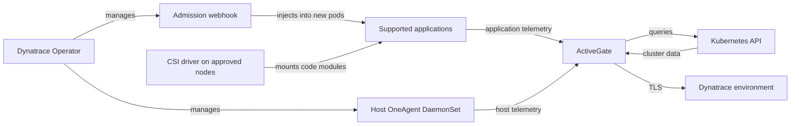
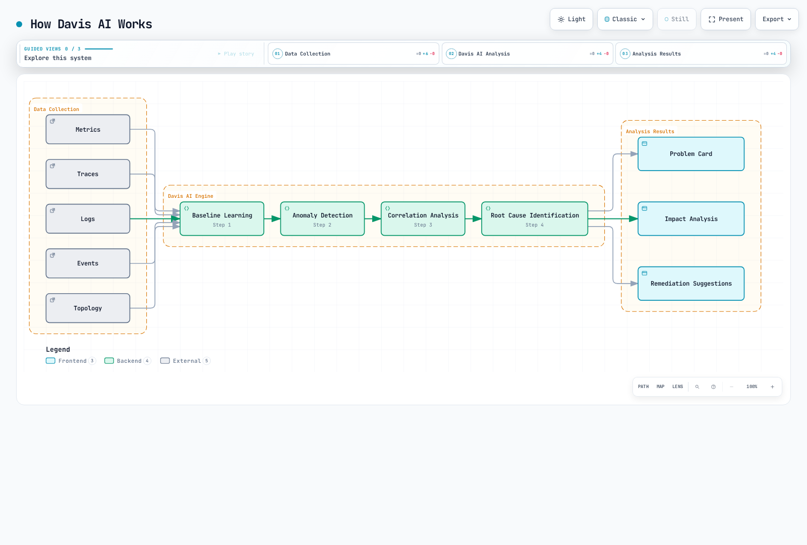

# Dynatrace

> **最后更新**：October 16, 2026

## 简介

Dynatrace 将应用程序和基础设施遥测与拓扑及问题分析相结合。OneAgent 自动插桩取决于受支持的运行时、部署模式和权限；仅安装 Operator 并不能提供所有信号。PurePath 提供受支持的请求/代码上下文，而 Smartscape 则映射观测到的依赖关系。两者都不保证捕获每个请求、方法或依赖关系。

本指南使用 **Dynatrace Operator/chart 1.10.2**、**DynaKube v1beta6** 和 **EKS 1.35 Linux EC2 节点基线**。已检查 Helm 渲染结果、CRD schema 和本地示例；未执行 EKS 安装、租户 API 调用、实时 OneAgent 插桩或生产容量测试。

## 主要功能

| 功能 | 提供的能力及要求 |
|---|---|
| **OneAgent** | 主机/进程以及受支持的应用程序可见性；模式和主机权限至关重要。 |
| **自动插桩** | 为受支持的运行时注入代码模块；通常需要重新创建现有 Pod。 |
| **Davis AI / Dynatrace Intelligence** | 基于可用证据进行关联、异常分析和因果分析。 |
| **PurePath** | 分布式请求分析；采样和受支持的技术会影响覆盖范围。 |
| **Smartscape** | 根据观测到的遥测推断关系，并非完整的资产清单。 |
| **Full Stack** | 应用程序和基础设施能力；RUM、合成监控及其他信号有各自的设置和用量要求。 |

## 架构

云原生 Full Stack 路径将**注入控制**与**遥测传输**分开。Webhook 会修改新建的应用程序 Pod；CSI 驱动程序提供代码模块；主机 OneAgent 收集节点/进程信号。ActiveGate 可以路由流量并查询 Kubernetes API。该图省略了可选的直连路由和其他摄取组件。



## 使用 Helm 在 EKS 上部署

### 1. 安装 Dynatrace Operator

安装前，请对照[支持的发行版](https://docs.dynatrace.com/docs/ingest-from/setup-on-k8s/deployment/supported-technologies)和[技术矩阵](https://docs.dynatrace.com/docs/ingest-from/technology-support/support-model-and-issues)进行检查。Chart 的 `kubeVersion >=1.25` 约束并不代表完整的兼容性说明。

| 目标 | 审查时的适用范围 |
|---|---|
| 受支持的 Linux EC2 节点上的 EKS 1.35 | 矩阵要求 OneAgent/ActiveGate **1.329+** 和 Operator **1.6+**，建议使用 Operator **1.9+**。本指南固定使用 1.10.2。 |
| Kubernetes 1.36 | OneAgent/ActiveGate 的最低版本为 **1.335**；请单独检查平台与版本组合。 |
| Kubernetes 1.37 | OneAgent/ActiveGate 的最低版本为 **1.335**；超出本指南的验证范围，因此请单独检查平台与版本组合。 |
| EKS Fargate | 使用 [Fargate 专用 EKS 工作流](https://docs.dynatrace.com/docs/ingest-from/setup-on-k8s/deployment/marketplaces/eks-dto)进行**不含 CSI 的应用程序监控**；不使用主机 OneAgent。 |
| Bottlerocket | 支持应用程序监控和 ActiveGate Kubernetes 监控；所引发行版表中不支持 OneAgent 主机监控。 |
| EKS Auto Mode | 不要根据常规 EKS 条目推断其全面支持主机 Agent。请确认托管节点的 OS、权限和供应商支持；本方案未经 Auto Mode 验证。 |

主方案请使用经批准且受支持的 EC2 节点。管理员必须为该节点池应用自定义节点标签 `monitoring.example.com/dynatrace-host=true`，并将受监控的应用程序调度到带有 CSI 驱动程序的节点上。该标签是放置约定，不是安全边界。请明确规划节点污点/容忍配置；不要默认容忍所有污点。

安装 CRD、webhook 和集群 RBAC 需要经授权的部署者。主机 OneAgent/CSI 所需权限不适用于普通的受限应用程序命名空间。请审查 [Operator 安全权限](https://docs.dynatrace.com/docs/ingest-from/setup-on-k8s/reference/security)、准入例外和受保护的 `dynatrace` 命名空间。不要仅为确保安装成功而授予可选的集群范围 Secrets/ConfigMaps 读取权限。

**现有安装：**请遵循[升级和已存储版本迁移说明](https://docs.dynatrace.com/docs/ingest-from/setup-on-k8s/guides/deployment-and-configuration/updates-and-maintenance/update-uninstall-operator)。如果集群中存储着 `v1beta1`/`v1beta2` DynaKube，文档规定的迁移路径要求先经过 **Operator 1.7.3，再升级到 1.8+**。仅将 YAML 改为 `v1beta6` 并不会迁移已持久化的对象。请检查 CRD `status.storedVersions`；不要清除它或禁用迁移检查。下面的安装命令适用于**新版本发布**，而非从原先的 1.0 示例直接升级。

```bash
kubectl get nodes -l monitoring.example.com/dynatrace-host=true
kubectl get crd dynakubes.dynatrace.com \
  -o jsonpath='{.status.storedVersions}' --ignore-not-found
kubectl create namespace dynatrace
```

### 2. 创建 API 令牌

请根据租户的令牌类型，使用当前的[令牌和权限指南](https://docs.dynatrace.com/docs/ingest-from/setup-on-k8s/deployment/tokens-permissions)：

- **最新的 Dynatrace 平台令牌：**使用专用服务用户和文档所述的 `Kubernetes Operator` 与 `Kubernetes Ingest` 策略，并设置环境限制。Operator 权限涵盖所需的 `fleet-management` 和 `settings` 操作；摄取使用相应的 `openpipeline`/`storage` 权限。用户权限和令牌范围都会生效。
- **Classic 访问令牌：**将 Operator 和摄取凭据分开保存。当前指南记录了安装程序/连接/ActiveGate 令牌所需权限；从 Operator 1.7 起不再需要 `entities.read`，从 1.7 起设置权限为可选。不要沿用旧版的无限制权限清单。
- 仅摄取已启用的信号。Classic OTLP 范围为 `openTelemetryTrace.ingest`、`metrics.ingest` 和 `logs.ingest`；部署事件和设置写入使用不同权限。

平台令牌 API 调用使用 `Bearer`；Classic 访问令牌调用使用 `Api-Token`。不要混用它们的范围名称或请求头。请轮换限定范围的凭据，并限制可读取其文件和 Kubernetes Secret 的人员。

### 3. 创建 Secret

将生成的两个令牌值放入受保护的本地文件中，**末尾不要带换行符**，文件名分别为 `apiToken` 和 `dataIngestToken`。Base64 是编码，不是加密。不要提交令牌 YAML，不要将令牌值放入命令参数，也不要输出 Pod 环境变量。此操作会创建新的 Secret；轮换现有 Secret 是一项单独的受控操作。

```bash
token_dir="$PWD/private-dynatrace-tokens"
chmod 700 "$token_dir"
chmod 600 "$token_dir/apiToken" "$token_dir/dataIngestToken"
kubectl create secret generic dynakube --namespace dynatrace \
  --from-file=apiToken="$token_dir/apiToken" \
  --from-file=dataIngestToken="$token_dir/dataIngestToken"
```

### 4. 配置 values.yaml

以下是 chart **1.10.2** 的配置值。保留 chart 中兼容的默认镜像设置。如果需要调整，该版本使用 `operator.requests`/`operator.limits` 和 `webhook.requests`/`webhook.limits`，而不是嵌套的 `resources`。此 chart 会忽略以前示例中的 `operator.image.tag` 和 `operator.resources`。OneAgent/ActiveGate 自定义配置应放在相应的 DynaKube 字段中，不要自行臆造 chart 键。

```yaml
# values-fullstack.yaml
installCRD: true
debugLogs: false
operator:
  nodeSelector:
    kubernetes.io/os: linux
    monitoring.example.com/dynatrace-host: 'true'
webhook:
  nodeSelector:
    kubernetes.io/os: linux
    monitoring.example.com/dynatrace-host: 'true'
csidriver:
  enabled: true
  nodeSelector:
    kubernetes.io/os: linux
    monitoring.example.com/dynatrace-host: 'true'
```

### 5. 安装 Operator

使用官方 OCI chart，并固定版本。此命令假设使用 **Helm 3**；Helm 4 使用 `--rollback-on-failure` 代替 `--atomic`。请先审查渲染后的 RBAC、CSI 主机挂载和准入权限。Helm 回滚无法撤销所有 CRD 或外部影响。

```bash
helm template dynatrace-operator \
  oci://public.ecr.aws/dynatrace/dynatrace-operator \
  --version 1.10.2 --namespace dynatrace --kube-version 1.35.0 \
  --values values-fullstack.yaml > dynatrace-rendered.yaml

helm install dynatrace-operator \
  oci://public.ecr.aws/dynatrace/dynatrace-operator \
  --version 1.10.2 --namespace dynatrace \
  --values values-fullstack.yaml --atomic --timeout 10m
```

### 6. 配置 DynaKube CR

为此 DynaKube 仅选择一种监控模式。将 `ENVIRONMENTID` 替换为经批准的环境 ID；API URL 使用 `.live.dynatrace.com/api`，而不是 Web 应用程序的 `.apps` 源站。已发布的 [v1beta6 Full Stack 示例](https://github.com/Dynatrace/dynatrace-operator/blob/v1.10.2/assets/samples/dynakube/v1beta6/cloudNativeFullStack.yaml)也记录了 `dynatrace-api`；这是 ActiveGate 的真实能力。

```yaml
# dynakube-fullstack.yaml
apiVersion: dynatrace.com/v1beta6
kind: DynaKube
metadata:
  name: dynakube
  namespace: dynatrace
spec:
  apiUrl: https://ENVIRONMENTID.live.dynatrace.com/api
  tokens: dynakube
  metadataEnrichment:
    enabled: true
    namespaceSelector:
      matchLabels:
        monitoring.example.com/dynatrace: 'true'
  oneAgent:
    hostGroup: eks-production
    cloudNativeFullStack:
      namespaceSelector:
        matchLabels:
          monitoring.example.com/dynatrace: 'true'
      nodeSelector:
        kubernetes.io/os: linux
        monitoring.example.com/dynatrace-host: 'true'
  activeGate:
    capabilities:
    - routing
    - kubernetes-monitoring
    - dynatrace-api
    replicas: 2
    nodeSelector:
      kubernetes.io/os: linux
      monitoring.example.com/dynatrace-host: 'true'
```

请创建专用的示例应用程序命名空间，或通过其所属配置为现有命名空间添加标签。注入选择器适用于 **webhook 修改**，不适用于所有 OneAgent 主机遥测或 ActiveGate 的集群 API 查询。仅设置 `replicas: 2` 并不能证明容量充足或具备故障域冗余；请根据实际工作负载确定 ActiveGate 的规模和分布。

```yaml
# application-namespace.yaml
apiVersion: v1
kind: Namespace
metadata:
  name: observability-demo
  labels:
    monitoring.example.com/dynatrace: 'true'
```

### 7. 部署和验证

验证前置条件后，应用所选 CR 和命名空间。滚动发布应用程序前，请先检查状态。这些命令不会自动重启现有进程；请通过常规发布流程重新创建选定的应用程序 Pod。

```bash
kubectl apply -f application-namespace.yaml
kubectl apply -f dynakube-fullstack.yaml
kubectl get dynakube dynakube -n dynatrace
kubectl get deploy,ds,sts,pods -n dynatrace
kubectl get dynakube dynakube -n dynatrace -o jsonpath='{.status.conditions}'
```

## Cloud Native Full Stack 模式

Cloud Native Full Stack 通过 webhook/CSI 路径结合主机监控和应用程序代码模块注入。它不是仅限应用程序的 sidecar 模式，也不是通用的节省资源设置。`oneAgent.hostGroup` 用于设置主机组；主机 Agent 的资源覆盖值应放在 `cloudNativeFullStack.oneAgentResources` 下。请验证资源规格，不要沿用随意设定的限制值。

**1.10.2 仍提供 Classic Full Stack。**以下是使用基于主机的注入的完整替代方案。不要将其与同名的 Cloud Native CR 同时应用；请选择一种受支持的模式转换方案并做好规划。两种 Full Stack 方案都需要访问主机。

```yaml
# dynakube-classic.yaml
apiVersion: dynatrace.com/v1beta6
kind: DynaKube
metadata:
  name: dynakube
  namespace: dynatrace
spec:
  apiUrl: https://ENVIRONMENTID.live.dynatrace.com/api
  tokens: dynakube
  metadataEnrichment:
    enabled: true
    namespaceSelector:
      matchLabels:
        monitoring.example.com/dynatrace: 'true'
  oneAgent:
    hostGroup: eks-production
    classicFullStack:
      nodeSelector:
        kubernetes.io/os: linux
        monitoring.example.com/dynatrace-host: 'true'
  activeGate:
    capabilities:
    - routing
    - kubernetes-monitoring
    - dynatrace-api
    replicas: 2
    nodeSelector:
      kubernetes.io/os: linux
      monitoring.example.com/dynatrace-host: 'true'
```

## 仅应用程序监控

`applicationMonitoring` 不包含主机 OneAgent。CSI 是 **chart 级选项**，不是 `applicationMonitoring.useCSIDriver`。对于不使用 CSI 的新建仅应用程序监控安装，请使用下面的 `values-app-only.yaml` **代替** Full Stack 配置值，并使用仅应用程序监控 CR。未经供应商迁移流程，不要在现有 Full Stack 安装中禁用 CSI。

以下节点选择器仍指向经批准的 EC2 节点池。EKS Fargate 部署需要按照所引工作流使用匹配的 Fargate profile 和放置配置；仅禁用 CSI 并不会让此 EC2 方案自动变成 Fargate 方案。不要在同一集群/环境中组合单独的 `hostMonitoring` 和 `applicationMonitoring` DynaKube；如果两者都需要，请使用 Cloud Native Full Stack。

```yaml
# values-app-only.yaml
installCRD: true
debugLogs: false
operator:
  nodeSelector:
    kubernetes.io/os: linux
    monitoring.example.com/dynatrace-host: 'true'
webhook:
  nodeSelector:
    kubernetes.io/os: linux
    monitoring.example.com/dynatrace-host: 'true'
csidriver:
  enabled: false
  nodeSelector:
    kubernetes.io/os: linux
    monitoring.example.com/dynatrace-host: 'true'
```

```yaml
# dynakube-app-only.yaml
apiVersion: dynatrace.com/v1beta6
kind: DynaKube
metadata:
  name: dynakube
  namespace: dynatrace
spec:
  apiUrl: https://ENVIRONMENTID.live.dynatrace.com/api
  tokens: dynakube
  metadataEnrichment:
    enabled: true
    namespaceSelector:
      matchLabels:
        monitoring.example.com/dynatrace: 'true'
  oneAgent:
    applicationMonitoring:
      namespaceSelector:
        matchLabels:
          monitoring.example.com/dynatrace: 'true'
  activeGate:
    capabilities:
    - routing
    - kubernetes-monitoring
    - dynatrace-api
    replicas: 2
    nodeSelector:
      kubernetes.io/os: linux
      monitoring.example.com/dynatrace-host: 'true'
```

## Davis AI 根因分析

### Davis AI 的工作原理

下面这幅现有插图是对信号关联和问题输出的**概念性说明**，并非固定的处理算法，也不能证明根因判断必然准确。Smartscape 和 PurePath 提供观测到的上下文；插桩缺失可能会隐藏依赖关系。当前的 [Dynatrace Intelligence](https://docs.dynatrace.com/docs/dynatrace-intelligence) 包含其他功能以及处于 Preview 阶段的经批准智能体操作。仅检测到问题并不代表有权更改生产代码或基础设施。



[查看交互式图表](https://www.atomai.click/kubernetes-docs/archmaps/en-observability-tracing-04-dynatrace-1.html)

### 问题警报配置

之前的 `/api/config/v1/alertingProfiles` 端点已弃用。请通过 `POST /api/v2/settings/objects` 使用 [Settings schema `builtin:alerting.profile`](https://docs.dynatrace.com/docs/dynatrace-api/environment-api/settings/schemas/builtin-alerting-profile)。首先使用 `?validateOnly=true` 验证；检查每个响应项的代码，包括多状态响应。验证仍需要该端点的写入权限，也不会创建通知目标。

将此内容保存为 `alerting-profile.json`。这些标签是**必须已存在的 Dynatrace 实体标签**，并非 Kubernetes 标签的自动转换。当前枚举值是 `ERRORS`（复数）；`PERFORMANCE` 仍然有效。

```json
[
  {
    "schemaId": "builtin:alerting.profile",
    "scope": "environment",
    "value": {
      "name": "EKS Production Alerts",
      "severityRules": [
        {
          "severityLevel": "AVAILABILITY",
          "delayInMinutes": 0,
          "tagFilterIncludeMode": "INCLUDE_ANY",
          "tagFilter": [
            "cluster:eks-production"
          ]
        },
        {
          "severityLevel": "ERRORS",
          "delayInMinutes": 5,
          "tagFilterIncludeMode": "INCLUDE_ANY",
          "tagFilter": [
            "environment:production"
          ]
        },
        {
          "severityLevel": "PERFORMANCE",
          "delayInMinutes": 15,
          "tagFilterIncludeMode": "INCLUDE_ANY",
          "tagFilter": [
            "tier:critical"
          ]
        }
      ],
      "eventFilters": []
    }
  }
]
```

### 自定义部署事件

[Events v2 API](https://docs.dynatrace.com/docs/dynatrace-api/environment-api/events-v2/post-event) 接受 `CUSTOM_DEPLOYMENT`。请使用已验证的服务实体 ID，避免未经检查的服务名称字符串扩大选择范围。下面的辅助脚本需要 Python 3 和 `requests`；默认只预览，只有使用 `--send` 才会发送一次，不跟随重定向，并检查 **201 响应正文和每条报告的状态**，而不只是 HTTP 成功状态。发生超时时，是否已接受请求尚不明确：请先调查再重试，因为此示例不提供幂等性保证。

SaaS 源站允许列表刻意排除了 Managed/自定义源站；对于这些部署，请根据实际情况调整并审查。Classic 调用需要 `events.ingest`；平台调用需要文档所述的事件摄取范围，例如 `openpipeline:events.davis:ingest`，并使用 `--scheme Bearer`。请使用受保护的令牌文件，其中只包含凭据。这是 HTTP 客户端代码，不是 Dynatrace SDK，导入时不会发起任何调用。

```python
# deployment_event.py
"""Prepare one deployment annotation; send only when explicitly requested."""
from pathlib import Path
from urllib.parse import urlsplit
import argparse
import json
import re
import requests

def payload_for(entity_id, version):
    if not isinstance(entity_id, str) or not re.fullmatch(r"SERVICE-[0-9A-F]{16}", entity_id):
        raise ValueError("Use one verified SERVICE entity ID")
    if not isinstance(version, str) or not 1 <= len(version) <= 128:
        raise ValueError("Version must contain 1–128 characters")
    if any(ord(char) < 32 or ord(char) == 127 for char in version):
        raise ValueError("Version must not contain control characters")
    return {
        "eventType": "CUSTOM_DEPLOYMENT",
        "title": f"Deployment {version}",
        "entitySelector": f'type(SERVICE),entityId("{entity_id}")',
        "properties": {"release.version": version, "deployment.source": "ci"},
    }

def send_event(environment_url, token_file, entity_id, version, *, scheme="Api-Token", session=None):
    payload = payload_for(entity_id, version)
    parsed = urlsplit(environment_url)
    if (parsed.scheme != "https" or parsed.username or parsed.password
            or parsed.port not in (None, 443)
            or not re.fullmatch(r"[a-z0-9-]+\.live\.dynatrace\.com", parsed.hostname or "")
            or parsed.path not in ("", "/") or parsed.query or parsed.fragment):
        raise ValueError("Use the approved SaaS environment origin, without .apps or a path")
    if scheme not in ("Api-Token", "Bearer"):
        raise ValueError("Choose the authentication scheme required by the token family")
    token = Path(token_file).read_text(encoding="utf-8")
    if not token or token != token.strip() or any(ord(c) < 33 or ord(c) > 126 for c in token):
        raise ValueError("Token file must contain only the token, without whitespace")
    client = session if session is not None else requests.Session()
    try:
        response = client.post(
            f"https://{parsed.hostname}/api/v2/events/ingest",
            headers={"Authorization": f"{scheme} {token}", "Content-Type": "application/json"},
            json=payload, timeout=(5, 30), allow_redirects=False,
        )
        if response.status_code != 201:
            raise RuntimeError(f"Unexpected event API status: {response.status_code}")
        body = response.json()
        if not isinstance(body, dict):
            raise RuntimeError("Invalid event response")
        results = body.get("eventIngestResults")
        if (type(body.get("reportCount")) is not int or body["reportCount"] != 1
                or not isinstance(results, list) or len(results) != 1
                or not isinstance(results[0], dict) or results[0].get("status") != "OK"
                or not isinstance(results[0].get("correlationId"), str)
                or not results[0]["correlationId"]):
            raise RuntimeError("The response did not confirm one successful event report")
        return results[0]["correlationId"]
    finally:
        if session is None:
            client.close()

if __name__ == "__main__":
    parser = argparse.ArgumentParser()
    parser.add_argument("--entity-id", required=True)
    parser.add_argument("--version", required=True)
    parser.add_argument("--send", action="store_true")
    parser.add_argument("--environment-url")
    parser.add_argument("--token-file")
    parser.add_argument("--scheme", choices=["Api-Token", "Bearer"], default="Api-Token")
    args = parser.parse_args()
    if not args.send:
        print(json.dumps(payload_for(args.entity_id, args.version), indent=2))
    else:
        if not args.environment_url or not args.token_file:
            parser.error("--send requires --environment-url and --token-file")
        print("Event report:", send_event(args.environment_url, args.token_file,
              args.entity_id, args.version, scheme=args.scheme))
```

```bash
python3 deployment_event.py --entity-id SERVICE-0123456789ABCDEF --version 2.3.0
```

上面的 ID 仅供说明：发送前请将其替换为环境中已验证的实体 ID。要发送，请明确添加 `--send --environment-url https://ENVIRONMENTID.live.dynatrace.com --token-file /protected/path/events-token`，并指定正确的方案。不要将 Operator 凭据用于这项独立的 CI 职责。

## 自动插桩

### 支持的技术

OneAgent 支持多个技术系列。请在[支持矩阵](https://docs.dynatrace.com/docs/ingest-from/technology-support/support-model-and-issues)中检查具体的运行时/框架版本、架构和部署模式，不要将以下示例视为与版本无关的保证。

| 系列 | 请对照矩阵检查的示例 |
|---|---|
| Java | JVM 和 Spring/Spring Boot、Micronaut、Quarkus 或 Jakarta EE 版本 |
| Node.js | Node 运行时和 HTTP/框架插桩，包括 Express 系列应用程序 |
| Python | 运行时以及 Django/Flask/FastAPI 插桩路径 |
| .NET | .NET 运行时、ASP.NET Core 与 Windows/.NET Framework 部署方式 |
| Go | Go 版本、编译/构建标志和受支持的 HTTP 框架插桩 |
| PHP | PHP 运行时以及 Laravel/Symfony 框架版本 |

### 验证自动插桩

检查容器名称、镜像和就绪状态，不要输出环境变量值或凭据。然后通过受支持的应用程序发送已授权的测试请求，并在目标租户中验证服务/trace 可见性。Pod 就绪并不能证明 trace 已送达。请查看[注入选择器和退出注入选项](https://docs.dynatrace.com/docs/ingest-from/setup-on-k8s/guides/deployment-and-configuration/monitoring-and-instrumentation/annotate)：`dynatrace.com/inject: "false"` 会选择退出注入，而将其设置为 `"true"` 并不会覆盖所有选择规则。

```bash
kubectl get pods -n observability-demo \
  -o custom-columns='NAME:.metadata.name,INIT:.spec.initContainers[*].name,IMAGES:.spec.containers[*].image,READY:.status.containerStatuses[*].ready'
```

### 自定义服务定义

[自定义 Java 服务 API](https://docs.dynatrace.com/docs/dynatrace-api/configuration-api/service-api/custom-services-api/post-rule) 仍支持 `POST /api/config/v1/service/customServices/java`。下面的显式方法签名是有效的**配置格式**，但不能证明示例应用程序中存在该方法。请使用 `/api/config/v1/service/customServices/java/validator` 验证正文（成功时返回 204），然后在检查类、返回类型、参数和 OneAgent 支持情况后再创建。Classic 授权使用 `WriteConfig`；平台授权遵循该端点的 `settings:objects:write` 要求。

```json
{
  "name": "Payment Gateway",
  "enabled": true,
  "rules": [
    {
      "enabled": true,
      "className": "com.example.payment.PaymentGateway",
      "methodRules": [
        {
          "methodName": "processPayment",
          "returnType": "com.example.payment.PaymentResult",
          "argumentTypes": []
        }
      ]
    }
  ],
  "queueEntryPoint": false
}
```

## Kubernetes 监控集成

### 集群指标

ActiveGate 的 `kubernetes-monitoring` 能力会查询 Kubernetes API 以获取集群/工作负载状态。其范围与应用程序注入相互独立。对于仅安装 ActiveGate 的场景，下面的完整替代方案包含必需的环境 URL。不要无意中将其叠加到前面的同名 DynaKube 上。

```yaml
# dynakube-platform.yaml
apiVersion: dynatrace.com/v1beta6
kind: DynaKube
metadata:
  name: dynakube
  namespace: dynatrace
spec:
  apiUrl: https://ENVIRONMENTID.live.dynatrace.com/api
  tokens: dynakube
  metadataEnrichment:
    enabled: false
  activeGate:
    capabilities:
    - routing
    - kubernetes-monitoring
    - dynatrace-api
    replicas: 2
    nodeSelector:
      kubernetes.io/os: linux
      monitoring.example.com/dynatrace-host: 'true'
```

请通过当前的平台设置和文档所述的能力选项配置工作负载/事件/Prometheus 监控。以前那些任意的 `[kubernetes_monitoring] monitor_*` 和 `kubernetes_namespace_filter` 属性，并非经过验证的替代配置。授予更多权限前，请审查实际 RBAC 和选定的采集功能。

### Prometheus 指标采集

对于文档所述的 [ActiveGate Prometheus 集成](https://docs.dynatrace.com/docs/observe/infrastructure-observability/container-platform-monitoring/kubernetes-monitoring/monitor-prometheus-metrics)，请在集群设置中启用工作负载监控和带注解的 exporter，并允许预期的网络路径。注解应放在 **Pod 模板**上。请将下方占位镜像替换为由你方维护、且确实会在 `/metrics` 路径的 8080 端口提供 Prometheus 文本的应用程序；这是完整的 Deployment 配置格式，并未提供可直接运行的应用程序。

```yaml
# prometheus-application.yaml
apiVersion: apps/v1
kind: Deployment
metadata:
  name: metrics-demo
  namespace: observability-demo
spec:
  replicas: 1
  selector:
    matchLabels:
      app: metrics-demo
  template:
    metadata:
      labels:
        app: metrics-demo
      annotations:
        metrics.dynatrace.com/scrape: 'true'
        metrics.dynatrace.com/port: '8080'
        metrics.dynatrace.com/path: /metrics
    spec:
      automountServiceAccountToken: false
      containers:
      - name: app
        image: registry.example.com/app:metrics-demo
        ports:
        - name: metrics
          containerPort: 8080
      nodeSelector:
        kubernetes.io/os: linux
        monitoring.example.com/dynatrace-host: 'true'
```

此集成会跨命名空间发现带注解的 Pod，不受 DynaKube 注入选择器影响。所引 ActiveGate 模块文档规定的限制为：1,000 个 exporter Pod、每个 Pod 1,000 个指标，以及每个 Pod 500,000 个数据点。它支持 counter、gauge、histogram 和 summary，不支持所有 OpenMetrics 功能或 exemplars。对于更大规模的部署，请评估文档所述的 Collector/Target Allocator 替代方案及其单独权限。

## 成本结构

### 许可模式

请区分现代的 **Dynatrace Platform Subscription (DPS)** 用量与仍使用 **Classic 许可**的合同。请参阅费率表和[当前能力用量单位](https://www.dynatrace.com/pricing/)；本指南不假设固定美元价格或保证节省成本。

| DPS 能力 | 用量单位示例 |
|---|---|
| Full-Stack Monitoring | 内存 GiB-小时，按模式适用相应规则 |
| Infrastructure Monitoring | 主机小时 |
| Kubernetes Platform Monitoring | Pod 小时，受文档所述 Full-Stack 包含规则约束 |
| Code Monitoring | 容器小时 |
| Logs | 按所选计划计量摄取的 GiB、保留的 GiB-天和查询用量 |
| Digital experience | RUM 会话；合成操作/请求使用独立单位 |
| Application security | 按能力计量的内存 GiB-小时或主机小时 |

Full Stack 并不意味着日志摄取、保留、查询、RUM 或合成测试不受限制。年度承诺、费率表和超额用量都会影响实际账单。

### 成本优化策略

- 有计划地选择所需的应用程序注入和信号采集。命名空间注入选择器不会限制主机或集群监控用量。
- 根据遥测量为 Agent 分配合适资源；Agent 容器的内存限制并不是受监控主机 RAM 的计费限制。
- 使用当前能力设置并遵循隐私要求，控制日志量、保留时间、查询模式和可选的会话回放。
- 对于仅应用程序模式，请将其单独的内存计量/最低用量规则纳入考量，并注意其不包含主机基础设施监控。

### 主机单位计算

旧的 `max(memory/16, vCPU/1.5)` 公式不正确。[Classic Full-Stack 主机单位](https://docs.dynatrace.com/docs/license/classic-licensing/application-and-infrastructure-monitoring)采用 RAM 分档。以下是 **Classic 示例**，并非当前 DPS 价格模式：

| 主机示例 | Classic Full-Stack 权重 | 一个完整对齐小时的 DPS 主机 Full-Stack 用量 |
|---|---:|---:|
| 4 vCPU、16 GiB RAM | 1 HU | 16 内存 GiB-小时 |
| 8 vCPU、32 GiB RAM | 2 HU | 32 内存 GiB-小时 |
| 2 vCPU、8 GiB RAM | 0.5 HU | 8 内存 GiB-小时 |

对于 DPS 物理/虚拟主机，[Full-Stack 规则](https://docs.dynatrace.com/docs/license/capabilities/app-infra-observability/full-stack-monitoring)规定，内存向上取整到 0.25 GiB 的倍数，最低为 4 GiB，并按覆盖的**每 15 分钟日历区间**计费。对于固定内存，用量为 `max(4, ceil(memoryGiB × 4) / 4) × coveredIntervals × 0.25`。请计算日历区间数量，而不要仅对总运行时间取整：跨越一个边界可能覆盖两个区间。仅应用程序/容器的计算方式有不同的最低值和计量/版本规则；不要将此主机公式用于它们。

## OpenTelemetry 集成

Dynatrace 的[原生 OTLP 端点](https://docs.dynatrace.com/docs/ingest-from/opentelemetry/otlp-api)接受**使用二进制 Protobuf 的 HTTP**，不接受原生 gRPC 或 JSON。Collector 可以接收本地 gRPC 并通过 HTTP 导出。以下完整配置已使用 Contrib **0.160.0** 解析；在生产环境中，Dynatrace 建议使用其自有且受支持的 Collector 发行版和组件/版本矩阵。

[当前配置指南](https://docs.dynatrace.com/docs/ingest-from/opentelemetry/collector/configuration)要求使用 delta 指标暂时性。`cumulative_to_delta` 会在内存中跟踪累积流；请确保每个流始终路由到同一个转换实例。首次观测会建立基线，重启或流淘汰会影响转换。25 小时的陈旧时间设置假设报告间隔短于此值，它并非基数预算。

接收器仅绑定到 loopback，适用于本地应用或同一 Pod 中的 sidecar。多 Pod 网关需要明确配置经过身份验证/TLS 保护的接收器访问和网络控制。请替换环境 ID，然后挂载受保护的 `headers.yaml`，其中包含一个完整映射，例如 `Authorization: "Api-Token REPLACE_WITH_INGEST_TOKEN"`。不要在本文档、环境变量或 ConfigMap 中放入真实令牌。此示例使用上述 Classic 三种信号摄取范围。

```yaml
# otel-collector.yaml
receivers:
  otlp:
    protocols:
      grpc:
        endpoint: 127.0.0.1:4317
      http:
        endpoint: 127.0.0.1:4318
processors:
  memory_limiter:
    check_interval: 1s
    limit_mib: 256
    spike_limit_mib: 64
  cumulative_to_delta:
    max_staleness: 25h
  batch:
    timeout: 5s
exporters:
  otlp_http/dynatrace:
    endpoint: https://ENVIRONMENTID.live.dynatrace.com/api/v2/otlp
    headers: ${file:/var/run/secrets/dynatrace/headers.yaml}
service:
  pipelines:
    traces:
      receivers: [otlp]
      processors: [memory_limiter, batch]
      exporters: [otlp_http/dynatrace]
    metrics:
      receivers: [otlp]
      processors: [memory_limiter, cumulative_to_delta, batch]
      exporters: [otlp_http/dynatrace]
    logs:
      receivers: [otlp]
      processors: [memory_limiter, batch]
      exporters: [otlp_http/dynatrace]
```

```bash
otelcol-contrib validate --config=otel-collector.yaml
```

启动前，请使用**已安装发行版的二进制文件**进行验证。文件提供程序会读取完整的 headers 映射；它不会使用 `:key` 后缀选择子键。默认情况下，TLS 验证保持启用。Exporter 会追加 `/v1/traces`、`/v1/metrics` 和 `/v1/logs`；不要在其基础端点中重复添加这些后缀。

ActiveGate 摄取端点的端口/路径以及能力/存储要求不同；仅启用 `routing` 并不会创建所有 OTLP 摄取管道。Collector 验证或本地 HTTP 测试不能证明租户已接受数据、配额充足或端到端传输成功。经授权部署后，请检查部分成功响应和服务器端可见性。

## 故障排查

### 常见问题

| 症状 | 检查内容 |
|---|---|
| CR 被拒绝 | 已提供的 API 版本和当前 CRD 字段；根级 `namespaceSelector`/`hostGroup` 和 `applicationMonitoring.useCSIDriver` 都不是有效的替代字段。 |
| Operator/CSI/ActiveGate 处于 Pending 状态 | 经批准的节点标签、污点、资源、准入限制和 CSI 可用性。 |
| 缺少注入模块 | 命名空间选择器、退出注入注解、受支持的运行时，以及是否重新创建了应用程序 Pod。 |
| 身份验证失败 | 令牌类型、文件空白字符、有效期、范围和环境限制。请勿通过输出令牌值来诊断问题。 |
| 缺少主机遥测 | 受支持的 OS 和模式、主机权限及 OneAgent 状态；仅应用程序模式不会启用主机监控。 |
| 缺少 OTLP 指标 | HTTP/Protobuf 端点、delta 转换、流路由和响应详情。 |
| 无法连接外部服务 | DNS、经批准的出站流量/代理和受信任的证书链。代理并不等于真正断开连接的 SaaS 部署。 |

ActiveGate 可以缓冲遥测，某些摄取配置也需要持久化存储，但它并不是长期使用的 Grail lakehouse。请检查当前 Pod/工作负载状态，不要在容器内使用未经文档说明的 Java CLI 路径。

### 验证日志采集

请先列出 Pod 和容器名称，再从明确指定的组件中获取有范围限制的日志。分享前请审查/遮盖诊断日志和支持归档中的敏感信息：其中可能包含敏感的应用程序或配置数据。Agent 就绪状态和日志输出本身都不能验证租户是否已摄取日志。

```bash
kubectl get pods -n dynatrace \
  -o custom-columns='POD:.metadata.name,CONTAINERS:.spec.containers[*].name,READY:.status.containerStatuses[*].ready'
# Replace with names from the preceding output.
dynatrace_pod='REPLACE_WITH_POD_NAME'
dynatrace_container='REPLACE_WITH_CONTAINER_NAME'
kubectl logs -n dynatrace "$dynatrace_pod" -c "$dynatrace_container" \
  --tail=100 --since=10m
```

## 测验

请通过 [Dynatrace 测验](../../quizzes/observability/tracing/04-dynatrace-quiz.md)检验你的知识。
