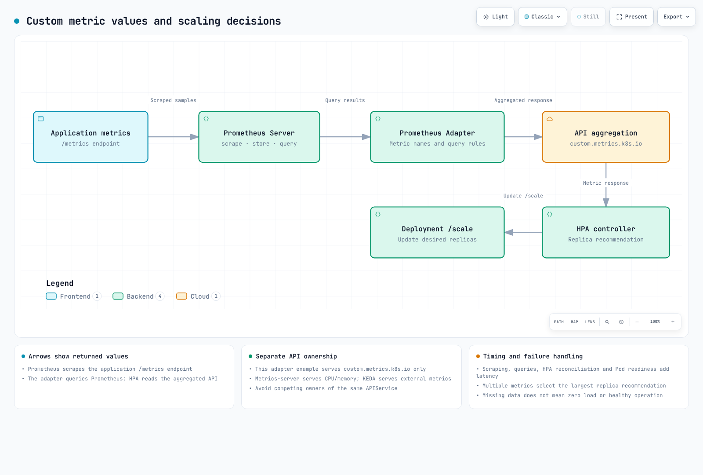

# 扩缩容策略

> **生产验证**：采用 Spot 之前，请使用 [EKS Spot 生产实验与结果评估](./17-spot-production-experiments.md) 验证回收、回退、正确性和成本。配置示例和预估节省额并非测量结果。

> **审查基线**：Prometheus Adapter 0.12.0 / chart 5.3.0、KEDA 2.21.0、VPA 1.8.0 / 官方 chart 0.14.0、Goldilocks 4.16.2 / chart 11.2.0\
> **最后审查时间**：2026 年 10 月 16 日。已检查版本化 chart、CRD、Kubernetes OpenAPI 和本地渲染。未执行实时安装、负载测试、SQS/数据库访问或 Pod 调整大小。

< [上一章：GitOps 自动化](05-gitops-automation.md) | [目录](README.md) | [下一章：运维告警](07-observability-alerts.md) >

将自定义指标 HPA、KEDA、VPA 和 Spot 放置策略分开处理。**一个自动扩缩器必须负责一个工作负载的副本数。** 目标为 `podinfo` 的 HPA、RPS ScaledObject 和 Cron ScaledObject 是互斥选项；不要同时应用它们。

KEDA 2.21 的官方部署文档列出的已测试 Kubernetes 版本范围为 1.34–1.36。请检查该范围，并单独验证更新的发行版。本章对原生对象的检查使用 Kubernetes 1.36.2 OpenAPI；这并非实时兼容性测试。

## 1. HPA 和自定义指标



[交互式图表](https://www.atomai.click/kubernetes-docs/archmaps/en-ops-06-scaling-strategies-0.html)

| API | 本例中的提供方 | 职责 |
|---|---|---|
| `metrics.k8s.io` | metrics-server | CPU 和内存资源指标 |
| `custom.metrics.k8s.io` | Prometheus Adapter | 与 Kubernetes 对象（如 Pod）相关的指标 |
| `external.metrics.k8s.io` | 选择 KEDA 时使用 KEDA metrics API server | 外部事件指标 |

Prometheus Adapter 也可以提供资源/外部 API，但本例仅启用自定义指标。避免由多个组件竞争同一个 APIService 的所有权。仅安装 CloudWatch Exporter 并不会创建 Kubernetes 外部指标 API。

### 前提条件和演示应用

准备好 metrics-server、Prometheus Operator/Prometheus 和 cert-manager。将 values 中的 Prometheus Service 地址替换为实际端点。其 `serviceMonitorSelector` 和 `serviceMonitorNamespaceSelector` 必须能够选中 `scaling-demo` 中的 ServiceMonitor。验证采集到的时间序列具有预期的 `namespace`、`pod` 和 `service` 目标标签。

下方已验证 Podinfo 6.15.0 公共多平台镜像的 digest。将本例改用于其他应用时，请替换为经过批准、实现实际指标、探针和关闭契约的应用。

```yaml
# fixtures/application.yaml
apiVersion: v1
kind: Namespace
metadata:
  name: scaling-demo
---
apiVersion: apps/v1
kind: Deployment
metadata:
  name: podinfo
  namespace: scaling-demo
spec:
  replicas: 3
  selector:
    matchLabels:
      app: podinfo
  template:
    metadata:
      labels:
        app: podinfo
    spec:
      automountServiceAccountToken: false
      terminationGracePeriodSeconds: 45
      containers:
        - name: podinfo
          image: ghcr.io/stefanprodan/podinfo@sha256:ec73780a8425f59ea49f5bc8cdff0d598805a224fbaa1f86c67a244f250fa9da
          ports:
            - name: http
              containerPort: 9898
          resources:
            requests:
              cpu: 100m
              memory: 128Mi
            limits:
              cpu: "1"
              memory: 512Mi
          readinessProbe:
            httpGet:
              path: /readyz
              port: http
          livenessProbe:
            httpGet:
              path: /healthz
              port: http
---
apiVersion: v1
kind: Service
metadata:
  name: podinfo
  namespace: scaling-demo
  labels:
    app: podinfo
spec:
  selector:
    app: podinfo
  ports:
    - name: http
      port: 80
      targetPort: http
---
apiVersion: monitoring.coreos.com/v1
kind: ServiceMonitor
metadata:
  name: podinfo
  namespace: scaling-demo
spec:
  selector:
    matchLabels:
      app: podinfo
  namespaceSelector:
    matchNames: [scaling-demo]
  endpoints:
    - port: http
      path: /metrics
      interval: 15s
```

Podinfo 的 `http_requests_total` 是 HTTP 请求计数器。健康检查等运维请求也可能计入，因此不要假定它只衡量生产业务流量。避免再添加一条基于 annotation 的抓取路径，以免重复采集同一目标。

### Adapter 配置

```yaml
# fixtures/adapter-values.yaml
replicas: 2
prometheus:
  url: http://prometheus.monitoring.svc
  port: 9090
certManager:
  enabled: true
podDisruptionBudget:
  enabled: true
  minAvailable: 1
  maxUnavailable: null
resources:
  requests:
    cpu: 100m
    memory: 128Mi
  limits:
    cpu: 500m
    memory: 512Mi
rules:
  default: false
  external: []
  custom:
    - seriesQuery: 'http_requests_total{namespace="scaling-demo",pod!=""}'
      resources:
        overrides:
          namespace:
            resource: namespace
          pod:
            resource: pod
      name:
        matches: "^http_requests_total$"
        as: http_requests_per_second
      metricsQuery: 'sum(rate(http_requests_total{<<.LabelMatchers>>}[2m])) by (<<.GroupBy>>)'
```

```bash
helm repo add prometheus-community https://prometheus-community.github.io/helm-charts
helm repo update
helm upgrade --install prometheus-adapter prometheus-community/prometheus-adapter \
  --version 5.3.0 --namespace monitoring --create-namespace \
  --kube-context "$TARGET_CONTEXT" --values adapter-values.yaml

kubectl --context "$TARGET_CONTEXT" get --raw \
  /apis/custom.metrics.k8s.io/v1beta1
```

cert-manager 会管理证书和 APIService CA 注入。不要仅凭 `tls.enable=false` 之类的 Helm 选项名称推断传输加密；请检查渲染后的 APIService、证书和验证设置。本例未配置外部规则，因此预期不存在由 Adapter 管理的外部 API。

Helm `rules.custom` 与 Adapter 服务端的原始配置结构不同。创建任意 ConfigMap 并不会让现有 chart 自动读取它。只保留一个配置所有者。

### 使用每 Pod RPS 和 CPU 的 HPA

```yaml
# fixtures/hpa.yaml
apiVersion: autoscaling/v2
kind: HorizontalPodAutoscaler
metadata:
  name: podinfo
  namespace: scaling-demo
spec:
  scaleTargetRef:
    apiVersion: apps/v1
    kind: Deployment
    name: podinfo
  minReplicas: 3
  maxReplicas: 20
  metrics:
    - type: Pods
      pods:
        metric:
          name: http_requests_per_second
        target:
          type: AverageValue
          averageValue: "100"
    - type: Resource
      resource:
        name: cpu
        target:
          type: Utilization
          averageUtilization: 70
  behavior:
    scaleUp:
      stabilizationWindowSeconds: 0
      policies:
        - type: Percent
          value: 100
          periodSeconds: 15
        - type: Pods
          value: 4
          periodSeconds: 15
      selectPolicy: Max
    scaleDown:
      stabilizationWindowSeconds: 300
      policies:
        - type: Percent
          value: 10
          periodSeconds: 60
        - type: Pods
          value: 2
          periodSeconds: 60
      selectPolicy: Min
```

多个指标并非优先级列表，也不是简单的“CPU 回退”。HPA 会计算各项建议，并选择**副本数要求最大**的结果。某个指标不可用可能会阻止缩容；若有效指标要求扩容，仍可能增加副本数。

假设所有目标 Pod/指标都已就绪，基本计算公式为 `ceil(currentReplicas × currentMetric / targetMetric)`。4 个 Pod 的平均 RPS 为 250、目标值为 100 时，计算得出的目标副本数为 10。最小值/最大值、未就绪的 Pod、缺失的指标、容差和行为配置都可能改变实际决策。

| 设置 | 含义 |
|---|---|
| 扩容稳定窗口 | 参考近期较低的建议值，以抑制快速扩容 |
| 缩容稳定窗口 | 参考近期较高的建议值，以抑制快速缩容 |
| `periodSeconds` | 允许变更幅度的回看窗口 |
| `selectPolicy: Max` | 允许变更幅度更大的策略 |
| 缩容时的 `Min` | 允许删除 Pod 较少的策略 |

稳定窗口并不是每次观测后都重新开始一段固定时长的休眠。`periodSeconds` 支持 1–1,800，稳定窗口支持 0–3,600；300 秒的策略有效。增加 500% 表示**在当前数量基础上额外增加 500%**，最多达到当前数量的 6 倍。

当前有 20 个副本时，本例缩容配置中的 Percent 10% 和 Pods 2 策略各自最多允许删除 2 个。历史记录、建议值和其他限制仍会生效；这并不保证某个特定时刻恰好有 18 个就绪 Pod。

通用 HPA 的 `minReplicas: 0` 取决于 Kubernetes 版本、`HPAScaleToZero` 和指标前提条件。本例使用 3；通过 KEDA 实现外部队列缩容至零的方式另行展示。指标 API 响应成功并不能消除镜像拉取、节点容量或应用启动延迟。

### 外部指标和检查

队列深度是 gauge。将累计的 `*_total` 计数器重命名，并不会使其变成当前积压量。对于使用每 Pod 工作目标值的全局队列，`AverageValue` 通常是相关的目标类型；不要假定 `Value` 的计算方式相同。

CloudWatch 集成需要直接使用 KEDA scaler，或配置完整的 Exporter → Prometheus → Adapter 外部规则链路。实际 Exporter 名称/标签必须与 HPA 一致，并避免 APIService 所有权冲突。不要为 `AWS/ApplicationELB RequestCount` 随意添加 TargetGroup 维度。请参阅[经过审查的 KEDA 指南](../autoscaling/01-keda.md)中的 CloudWatch 示例。

```bash
kubectl --context "$TARGET_CONTEXT" get --raw \
  '/apis/custom.metrics.k8s.io/v1beta1/namespaces/scaling-demo/pods/*/http_requests_per_second'
kubectl --context "$TARGET_CONTEXT" describe hpa podinfo -n scaling-demo
kubectl --context "$TARGET_CONTEXT" get deployment,pods -n scaling-demo
```

请在单独的测试环境中运行有界负载测试，不要使用过时的 BusyBox 镜像运行无界循环。确保 GitOps 对 Deployment `replicas` 的管理与自动扩缩器的所有权一致。

## 2. KEDA 事件驱动扩缩容

KEDA operator 管理 ScaledObject/HPA 以及激活/缩容至零的转换。HPA 会参与零以上的水平扩缩容。ScaledJob 会单独创建 Job；HPA 不会更改 Job 的副本数字段。

### 安装和 AWS 身份

通用安装、兼容性和网络配置请参阅 [KEDA 指南](../autoscaling/01-keda.md)。AWS 示例明确使用 **KEDA operator 上的 IRSA**。请先准备集群 OIDC provider、精确的 namespace/ServiceAccount 信任配置和队列读取角色。

```yaml
# fixtures/keda-values.yaml
# This example explicitly uses IRSA on the KEDA operator.
# Prepare the cluster OIDC provider, scoped trust and queue-read role first.
podIdentity:
  aws:
    irsa:
      enabled: true
      roleArn: arn:aws:iam::123456789012:role/KedaQueueReadRole
```

```bash
helm repo add kedacore https://kedacore.github.io/charts
helm repo update
helm upgrade --install keda kedacore/keda \
  --version 2.21.0 --namespace keda --create-namespace \
  --kube-context "$TARGET_CONTEXT" --values keda-values.yaml
```

请将角色 ARN 替换为经过批准的角色。旧版 `provider: aws-eks` 选项并不代表 EKS Pod Identity。IRSA 和 Pod Identity 是不同的配置；若选择其他方法，必须具备相应的 operator SDK 凭证链、关联和信任配置。

### RPS ScaledObject

移除冲突的 HPA 所有权或遵循受支持的迁移流程后，再选择这个**替代方案**。

```yaml
# fixtures/keda-rps.yaml
# Alternative to hpa.yaml. Do not let both own podinfo's replica count.
apiVersion: keda.sh/v1alpha1
kind: ScaledObject
metadata:
  name: podinfo
  namespace: scaling-demo
spec:
  scaleTargetRef:
    apiVersion: apps/v1
    kind: Deployment
    name: podinfo
  minReplicaCount: 3
  maxReplicaCount: 20
  pollingInterval: 15
  cooldownPeriod: 300
  fallback:
    failureThreshold: 3
    replicas: 5
  advanced:
    horizontalPodAutoscalerConfig:
      behavior:
        scaleDown:
          stabilizationWindowSeconds: 300
  triggers:
    - type: prometheus
      name: requests
      metricType: AverageValue
      metadata:
        serverAddress: http://prometheus.monitoring.svc:9090
        query: sum(rate(http_requests_total{namespace="scaling-demo",service="podinfo"}[2m]))
        threshold: "100"
        activationThreshold: "0"
        ignoreNullValues: "false"
    - type: cpu
      metricType: Utilization
      metadata:
        value: "70"
```

`AverageValue` 阈值 100 表示**每个 Pod 的目标值为 100 RPS**，并不是无条件按总流量触发扩容的阈值。例如，总流量为 1,000 RPS 时，在其他限制生效前，意味着需要 10 个副本。激活阈值控制激活，与 HPA 目标值不同。

`ignoreNullValues=false` 可以避免将缺失的查询结果默默视为正常的零负载。请返回一个聚合值，并有意处理错误、NaN 和零流量。针对受支持指标的重复故障，fallback 可提供应对方式；但它无法恢复所有指标提供方、HPA 或节点故障。

HTTP 示例会保留 3 个 Pod。如果所有 Pod 都被移除，而唯一的活动信号又来自这些 Pod，新 HTTP 流量可能没有可供观测/激活的路径。缩容至零需要外部队列或其他激活机制。

### SQS 队列

请准备实际的 `sqs-worker` Deployment 及其专属队列消费者权限。KEDA 读取队列属性所需的权限，与 worker 接收/删除/更改可见性所需的权限不同。

```yaml
# fixtures/keda-sqs.yaml
apiVersion: keda.sh/v1alpha1
kind: TriggerAuthentication
metadata:
  name: keda-aws
  namespace: scaling-demo
spec:
  podIdentity:
    provider: aws
    identityOwner: keda
---
apiVersion: keda.sh/v1alpha1
kind: ScaledObject
metadata:
  name: sqs-worker
  namespace: scaling-demo
spec:
  scaleTargetRef:
    apiVersion: apps/v1
    kind: Deployment
    name: sqs-worker
  minReplicaCount: 0
  maxReplicaCount: 50
  pollingInterval: 15
  cooldownPeriod: 60
  triggers:
    - type: aws-sqs-queue
      authenticationRef:
        name: keda-aws
      metadata:
        queueURL: https://sqs.ap-northeast-2.amazonaws.com/REPLACE_ACCOUNT/my-queue
        queueLength: "10"
        activationQueueLength: "0"
        scaleOnInFlight: "true"
        scaleOnDelayed: "false"
        awsRegion: ap-northeast-2
```

`activationQueueLength: "0"` 表示队列长度大于零时激活。值为 `"1"` 表示**大于一**，而非大于等于一。请审查处理中/延迟消息的处理方式和可见性超时。DLQ 积压不会自动计入。

轮询指 KEDA 的检查，而非 HPA 同步周期或 Pod 启动时长。从一个副本扩到多个，与扩缩至零的转换不同；`cooldownPeriod` 并非适用于所有情况的缩容休眠时间。对于长时间运行的工作，需要周全处理终止、重试、去重和可见性。

### PostgreSQL 工作队列

由于数据库连接数增加而扩展应用，可能会加剧连接压力。本例使用 worker 实际消费的待处理工作量。

```yaml
# fixtures/keda-postgresql.yaml
apiVersion: keda.sh/v1alpha1
kind: TriggerAuthentication
metadata:
  name: queue-database
  namespace: scaling-demo
spec:
  secretTargetRef:
    - parameter: connection
      name: queue-database
      key: connection
---
apiVersion: keda.sh/v1alpha1
kind: ScaledObject
metadata:
  name: database-worker
  namespace: scaling-demo
spec:
  scaleTargetRef:
    apiVersion: apps/v1
    kind: Deployment
    name: database-worker
  minReplicaCount: 1
  maxReplicaCount: 10
  triggers:
    - type: postgresql
      authenticationRef:
        name: queue-database
      metricType: AverageValue
      metadata:
        query: SELECT count(*) FROM public.job_queue WHERE status = 'pending'
        targetQueryValue: "50"
        activationTargetQueryValue: "0"
```

`queue-database` Secret 的 `connection` 键必须包含有效的 DSN。在 KEDA operator 环境中使用 `sslmode=verify-full` 和所需的 CA 路径，配置主机名/CA 验证。不要将凭证提交到 Git。应单独授予 KEDA 对队列表的读取权限，而 worker 的写入权限应另行配置。

请返回一个数值。过滤掉所有超过一小时的待处理任务可能会掩盖积压。worker 仍需具备原子认领、去重和完成状态管理能力。

### Cron 和多个指标

```yaml
# fixtures/keda-cron.yaml
# Alternative to the preceding podinfo HPA/ScaledObject.
apiVersion: keda.sh/v1alpha1
kind: ScaledObject
metadata:
  name: podinfo
  namespace: scaling-demo
spec:
  scaleTargetRef:
    name: podinfo
  minReplicaCount: 3
  maxReplicaCount: 50
  triggers:
    - type: cron
      metadata:
        timezone: Asia/Seoul
        start: "0 9 * * 1-5"
        end: "0 18 * * 1-5"
        desiredReplicas: "20"
    - type: cron
      metadata:
        timezone: Asia/Seoul
        start: "30 11 * * 1-5"
        end: "30 13 * * 1-5"
        desiredReplicas: "40"
    - type: prometheus
      metricType: AverageValue
      metadata:
        serverAddress: http://prometheus.monitoring.svc:9090
        query: sum(rate(http_requests_total{namespace="scaling-demo",service="podinfo"}[2m]))
        threshold: "100"
        ignoreNullValues: "false"
```

工作时间内的 20 个副本和午餐时段的 40 个副本会与基于指标的需求进行比较。有效需求中最大的值胜出；Cron 和 Prometheus 没有任意优先级。上述时段之外的最小值为 3。添加跨夜/周末计划时，请在配置时区中测试时间边界和重叠时段。

当前 KEDA 支持 `advanced.scalingModifiers`。将公式说成尚未推出的功能，或声称目前仅支持 OR 行为，都是不正确的。本例将一个 worker 消费的两个**单位相同的队列 gauge** 组合起来：

```yaml
# fixtures/keda-composite.yaml
# Requires a worker that consumes both queues and the two named gauge series.
apiVersion: keda.sh/v1alpha1
kind: ScaledObject
metadata:
  name: shared-queue-worker
  namespace: scaling-demo
spec:
  scaleTargetRef:
    name: shared-queue-worker
  minReplicaCount: 1
  maxReplicaCount: 30
  advanced:
    scalingModifiers:
      formula: queue_a + queue_b
      target: "50"
      activationTarget: "0"
      metricType: AverageValue
  triggers:
    - type: prometheus
      name: queue_a
      metadata:
        serverAddress: http://prometheus.monitoring.svc:9090
        query: sum(queue_messages_pending{queue="a"})
        threshold: "50"
        ignoreNullValues: "false"
    - type: prometheus
      name: queue_b
      metadata:
        serverAddress: http://prometheus.monitoring.svc:9090
        query: sum(queue_messages_pending{queue="b"})
        threshold: "50"
        ignoreNullValues: "false"
```

触发器名称必须能够在表达式中使用，且公式必须返回数值指标。不要随意组合资源触发器或单位不兼容的指标。如需实现类似 AND 的行为，请设计条件数值结果，并测试饥饿、激活和故障处理。

### ScaledJob

这是一个模板，需要提供实际的 worker 镜像和 `batch-worker` ServiceAccount。

```yaml
# fixtures/keda-job.yaml
# Supply an actual bounded, idempotent SQS consumer image and worker identity.
apiVersion: keda.sh/v1alpha1
kind: ScaledJob
metadata:
  name: batch-processor
  namespace: scaling-demo
spec:
  pollingInterval: 30
  minReplicaCount: 0
  maxReplicaCount: 20
  successfulJobsHistoryLimit: 5
  failedJobsHistoryLimit: 5
  scalingStrategy:
    strategy: default
  jobTargetRef:
    parallelism: 1
    completions: 1
    activeDeadlineSeconds: 600
    backoffLimit: 2
    template:
      spec:
        serviceAccountName: batch-worker
        restartPolicy: Never
        containers:
          - name: processor
            image: REPLACE_WITH_APPROVED_WORKER_IMAGE
            env:
              - name: SQS_QUEUE_URL
                value: https://sqs.ap-northeast-2.amazonaws.com/REPLACE_ACCOUNT/batch-queue
            resources:
              requests:
                cpu: 250m
                memory: 256Mi
  triggers:
    - type: aws-sqs-queue
      authenticationRef:
        name: keda-aws
      metadata:
        queueURL: https://sqs.ap-northeast-2.amazonaws.com/REPLACE_ACCOUNT/batch-queue
        queueLength: "1"
        awsRegion: ap-northeast-2
```

历史记录限制表示**数量**，而非秒数。`queueLength: "1"` 并不能保证某个特定消息恰好只被分配给一个 Job 一次。worker 必须接收/处理/删除消息，并能容忍重试。default、accurate、custom 和 eager 策略对队列以及运行中/待处理 Job 如何影响创建的处理方式各不相同。

ScaledJob 的 Cron 触发器可能会在活动时段内重复创建 Job。对于“每天执行一次”的任务，请使用 Kubernetes CronJob，并明确配置 schedule/timeZone、并发和重试策略。不要在调优示例中意外保留启用状态的 `autoscaling.keda.sh/paused-replicas`。

## 3. VPA 和原地调整大小

VPA 主要用于推荐**资源 requests**。limits 取决于 controlledValues 和现有比例；它不会在所有情况下都独立计算最优 limit。

### 官方 chart 和推荐模式

使用官方 VPA chart 0.14.0 和 VPA 1.8.0。不要在现有 VPA 安装之上再安装第二个 VPA；应先审查 CRD/RBAC/配置迁移。以下配置使用 cert-manager/cainjector 管理 webhook 证书。

```yaml
# fixtures/vpa-values.yaml
admissionController:
  replicas: 2
  certGen:
    enabled: false
  certManager:
    enabled: true
    createSelfSignedIssuer:
      enabled: true
recommender:
  replicas: 2
updater:
  replicas: 2
  extraArgs:
    - --in-place-skip-disruption-budget=false
```

```bash
helm upgrade --install vpa \
  https://github.com/kubernetes/autoscaler/releases/download/vertical-pod-autoscaler-chart-0.14.0/vertical-pod-autoscaler-0.14.0.tgz \
  --namespace vpa --create-namespace --kube-context "$TARGET_CONTEXT" \
  --values vpa-values.yaml
```

此 chart 使用 `replicas`；不要将其他 chart 的 `replicaCount` 或 extraArgs 结构混用进来。它会为多个 recommender/updater 副本启用 leader election。此处明确禁用了跳过 disruption budget 的行为。添加未记录的 Prometheus 历史数据选项，并不会自动建立可用的历史数据管道。

```yaml
# fixtures/vpa.yaml
apiVersion: autoscaling.k8s.io/v1
kind: VerticalPodAutoscaler
metadata:
  name: podinfo
  namespace: scaling-demo
spec:
  targetRef:
    apiVersion: apps/v1
    kind: Deployment
    name: podinfo
  updatePolicy:
    updateMode: "Off"
  resourcePolicy:
    containerPolicies:
      - containerName: podinfo
        controlledResources: [cpu, memory]
        controlledValues: RequestsOnly
        minAllowed:
          cpu: 100m
          memory: 128Mi
        maxAllowed:
          cpu: "1"
          memory: 512Mi
```

`Off` 会生成建议，但不会将建议应用到 Pod。在应用建议前，请检查 requests/limits、配额和节点容量。不要在同一个 Deployment 上安装多个互为替代的 VPA。

| 模式 | VPA 1.8.0 行为 |
|---|---|
| `Off` | 仅生成建议 |
| `Initial` | 在创建 Pod 时应用 |
| `Recreate` | 需要时通过驱逐/重新创建应用 |
| `InPlaceOrRecreate` | 尝试原地更新，失败时回退到重新创建 |
| `InPlace` | 重试原地更新，不回退到驱逐；需要单独启用功能门控 |
| `Auto` | 已弃用，目前等同于 Recreate；请选择明确的模式 |

请检查 VPA 1.8.0 原地模式对 Kubernetes 1.33+ 及其他前提条件的要求。旧版 `InPlaceOrRecreate` VPA 功能门控已在 1.7 中移除，但 `InPlace` 需要 `--feature-gates=InPlace=true`。`minReplicas` 是 updater 的资格条件，并不保证一定有这么多可用的 Pod。

### Kubernetes 调整大小

Pod 原地调整大小在 1.27 中以 alpha 形式推出，在 1.33 中升级为 beta，并在 1.35 中达到稳定状态。这不意味着所有 1.27+ 集群都默认支持无中断更新。请检查受支持的节点/运行时、QoS 和调整大小策略。

```yaml
# Container fragment; select the restart behavior required by the application.
resizePolicy:
  - resourceName: cpu
    restartPolicy: NotRequired
  - resourceName: memory
    restartPolicy: RestartContainer
```

此补丁会更改演示 Pod 的 CPU request。使用 resize 子资源前，请确认实际 Pod 名称。

```json
{
  "spec": {
    "containers": [
      {
        "name": "podinfo",
        "resources": {
          "requests": {"cpu": "200m"},
          "limits": {"cpu": "1"}
        }
      }
    ]
  }
}
```

```bash
kubectl --context "$TARGET_CONTEXT" patch pod "$POD_NAME" -n scaling-demo \
  --subresource=resize --type=strategic --patch-file=resize-patch.json
kubectl --context "$TARGET_CONTEXT" get pod "$POD_NAME" -n scaling-demo -o json |
  jq '.status.conditions[]? | select(.type | startswith("PodResize"))'
```

检查 `PodResizePending` 上的 Deferred/Infeasible 原因以及 `PodResizeInProgress`。不要仅依赖已过时的 `.status.resize` 字段。采用 `RestartContainer` 策略时，Pod 可以保持不变，但其容器会重启。QoS 变化、不受支持的 init/ephemeral container、节点策略和操作系统都会带来更多限制。

直接调整 Pod 大小不会永久更新 Deployment 模板。若替换 Pod 时应保留预期设置，请通过 VPA 或 Git 持久化这些设置。

### Goldilocks 和与 HPA 共存

```yaml
# fixtures/goldilocks-values.yaml
vpa:
  enabled: false
controller:
  enabled: true
dashboard:
  enabled: true
  service:
    type: ClusterIP
```

```bash
helm repo add fairwinds-stable https://charts.fairwinds.com/stable
helm repo update
helm upgrade --install goldilocks fairwinds-stable/goldilocks \
  --version 11.2.0 --namespace goldilocks --create-namespace \
  --kube-context "$TARGET_CONTEXT" --values goldilocks-values.yaml
```

复用现有的 VPA 安装，并让 dashboard 保持为 ClusterIP。请使用经过身份验证的内部路由或 localhost 端口转发来进行审查。在 namespace 中启用 Goldilocks 可能会创建 VPA；避免它与现有手动管理的 VPA 目标产生所有权冲突。

基于 CPU 利用率的 HPA 与 VPA 对 CPU request 的调整会通过利用率分母相互影响。`Initial` 仍会更改新 Pod 的 requests。可以先仅生成建议，或让 HPA 使用 RPS/积压等工作负载指标，同时由 VPA 负责资源配置，并验证二者组合后的行为。CPU HPA 加上仅调整内存的 VPA，仍会对重启/调度产生影响。

## 4. Pod 删除成本

该 annotation 是一种**尽力而为的 ReplicaSet 缩容偏好**。它并不是适用于节点中断、驱逐、Job、StatefulSet 或不同 Deployment 间副本比例的全局优先级。

```yaml
metadata:
  annotations:
    controller.kubernetes.io/pod-deletion-cost: "100"
```

当前 ReplicaSet 的排序逻辑会先比较分配情况、Pod 阶段和就绪状态，然后再比较删除成本。之后才会考虑节点副本密度、就绪时长、重启次数和创建时间。较低的成本并不总能让某个 Pod 排在所有其他候选者之前。

取值范围为有符号 32 位整数，默认值为零。更改偏好前，请核实**同一 ReplicaSet** 中 Pod 的所有权和当前状态：

```bash
kubectl --context "$TARGET_CONTEXT" get pod "$POD_A" "$POD_B" \
  -n scaling-demo -o json |
  jq '.items[] | {name:.metadata.name,node:.spec.nodeName,
    owners:.metadata.ownerReferences,phase:.status.phase}'

kubectl --context "$TARGET_CONTEXT" annotate pod "$POD_A" -n scaling-demo \
  controller.kubernetes.io/pod-deletion-cost=-100 --overwrite
kubectl --context "$TARGET_CONTEXT" annotate pod "$POD_B" -n scaling-demo \
  controller.kubernetes.io/pod-deletion-cost=100 --overwrite
```

在每个 Pod 模板中设置相同的成本，无法区分这些 Pod。CREATE 准入 webhook 通常无法知道未来分配到的节点。`preStop` 会在 Pod 被选中删除后运行，来不及影响这次选择。

真正的动态控制器需要在绑定后处理、精确检查控制器所有权/UID、范围受限的 patch 权限、处理 annotation 为空的情况、watch 重连以及 API 错误处理。Pod 就绪并不能证明工作已完成；为 Job 进度添加 annotation 也不会让 Job 终止遵循 ReplicaSet 删除成本规则。

## 5. Spot 放置和终止

以下配置假定使用一个带有现有 `default` NodeClass 的演示 Auto Mode 集群。两个池都提供相同的工作负载标签，因此两种容量类型都符合条件。

```yaml
# fixtures/nodepools.yaml
apiVersion: karpenter.sh/v1
kind: NodePool
metadata:
  name: web-spot
spec:
  weight: 100
  template:
    metadata:
      labels:
        workload-type: web
    spec:
      nodeClassRef:
        group: eks.amazonaws.com
        kind: NodeClass
        name: default
      requirements:
        - key: karpenter.sh/capacity-type
          operator: In
          values: [spot]
        - key: kubernetes.io/arch
          operator: In
          values: [amd64, arm64]
        - key: node.kubernetes.io/instance-type
          operator: In
          values: [m7i.large, m7i.xlarge, m7g.large, m7g.xlarge, c7i.large, c7g.large]
  limits:
    cpu: "100"
    memory: 200Gi
  disruption:
    consolidationPolicy: WhenEmpty
    consolidateAfter: 5m
    budgets:
      - nodes: "10%"
---
apiVersion: karpenter.sh/v1
kind: NodePool
metadata:
  name: web-ondemand
spec:
  weight: 10
  template:
    metadata:
      labels:
        workload-type: web
    spec:
      nodeClassRef:
        group: eks.amazonaws.com
        kind: NodeClass
        name: default
      requirements:
        - key: karpenter.sh/capacity-type
          operator: In
          values: [on-demand]
        - key: kubernetes.io/arch
          operator: In
          values: [amd64, arm64]
        - key: node.kubernetes.io/instance-type
          operator: In
          values: [m7i.large, m7i.xlarge, m7g.large, m7g.xlarge, c7i.large, c7g.large]
  limits:
    cpu: "50"
    memory: 100Gi
  disruption:
    consolidationPolicy: WhenEmpty
    consolidateAfter: 10m
    budgets:
      - nodes: "10%"
```

更高的权重表示更倾向于优先配置该资源。它不能保证只有在 Spot 容量全部耗尽后才使用 On-Demand，也不能保证固定的 Spot 百分比或预留备用容量。现有节点、调度约束、AZ/实例类型可用性、配额和容量都会影响结果。

Auto Mode/Karpenter 使用 `karpenter.sh/capacity-type`，取值为 `spot`/`on-demand`。请将其与托管节点组的 `eks.amazonaws.com/capacityType` 和自定义 taint 区分开来。本例使用的标签不是 `kubernetes.io/capacity-type`。

### 放置补丁和 PDB

```yaml
# fixtures/placement-patch.yaml
# Kustomize strategic-merge patch for application.yaml; not standalone.
apiVersion: apps/v1
kind: Deployment
metadata:
  name: podinfo
  namespace: scaling-demo
spec:
  template:
    spec:
      nodeSelector:
        workload-type: web
      affinity:
        nodeAffinity:
          preferredDuringSchedulingIgnoredDuringExecution:
            - weight: 80
              preference:
                matchExpressions:
                  - key: karpenter.sh/capacity-type
                    operator: In
                    values: [spot]
      topologySpreadConstraints:
        - maxSkew: 1
          topologyKey: topology.kubernetes.io/zone
          whenUnsatisfiable: DoNotSchedule
          labelSelector:
            matchLabels:
              app: podinfo
        - maxSkew: 1
          topologyKey: kubernetes.io/hostname
          whenUnsatisfiable: ScheduleAnyway
          labelSelector:
            matchLabels:
              app: podinfo
```

```yaml
# fixtures/pdb.yaml
apiVersion: policy/v1
kind: PodDisruptionBudget
metadata:
  name: podinfo
  namespace: scaling-demo
spec:
  minAvailable: 2
  selector:
    matchLabels:
      app: podinfo
```

```yaml
# fixtures/kustomization.yaml
apiVersion: kustomize.config.k8s.io/v1beta1
kind: Kustomization
resources:
  - application.yaml
  - hpa.yaml
  - nodepools.yaml
  - pdb.yaml
patches:
  - path: placement-patch.yaml
```

将这些文件放在一起，并检查 `kustomize build .` 的输出。此补丁不是独立的 Deployment。`ScheduleAnyway` 是软约束，而 `DoNotSchedule` 仍取决于符合条件的拓扑域。拓扑分布约束不会创建任意的 80/20 比例，也不会预留节点。

PDB 只会约束受其支持的自愿驱逐。它无法阻止 HPA/ReplicaSet 减少副本，也无法阻止 Spot 节点实际丢失。`minAvailable: 2` 并不保证任何时候总有两个 Pod 在运行。

### 中断和优雅关闭

不要在 Auto Mode 已管理的中断处理机制之上再添加一个 drain controller。自管理的 Karpenter 需要中断队列/EventBridge 配置和相应权限。只有在节点模式明确且前提条件齐全时，才使用 Node Termination Handler。

不要将 Spot 通知理解为应用程序有 120 秒的保证剩余时间。请考虑休眠例外、检测/drain/终止延迟以及实际截止时间。

`terminationGracePeriodSeconds` 属于 **Pod spec**，而且 preStop 会占用这段时间。请实现实际的 SIGTERM/drain 行为，并在移除就绪状态后验证连接、消息和重试处理。操作 `/tmp/unhealthy` 不会自动导致 HTTP 探针失败，输出“close connections”也不会关闭数据库连接池。

外部通知/Pushgateway 调用不得无限期阻塞终止。Priority class 和删除成本都无法阻止 Spot 资源回收。

### 成本和容量

对 CPU request gauge 使用 `increase()` 并不等于节点运行时长。请使用实际运行时间，以及对应的时间/AZ/平台/购买类型成本数据。不得将缺失的价格视为免费。

将实际支出与使用量等效且定义明确的 On-Demand 基线进行比较。请说明 Savings Plans/RI、EKS/Auto Mode、存储、网络、重试和闲置容量的计算方式。固定的“70% 折扣”或“80/20 组合至少节省 50%”都不是保证值。

创建定向 Capacity Reservation 并不会让 NodePool 自动使用它。请检查受支持的 NodeClass 选择器、AZ/实例类型匹配、定价和未使用容量。请通过符合可用性要求的负载测试和故障测试验证回退设计。

## 参考资料

- [HPA 行为](https://kubernetes.io/docs/tasks/run-application/horizontal-pod-autoscale/)
- [KEDA 2.21 ScaledObject](https://keda.sh/docs/2.21/reference/scaledobject-spec/)
- [KEDA 2.21 ScaledJob](https://keda.sh/docs/2.21/reference/scaledjob-spec/)
- [VPA 1.8.0 功能](https://github.com/kubernetes/autoscaler/blob/vertical-pod-autoscaler-1.8.0/vertical-pod-autoscaler/docs/features.md)
- [Pod 调整大小](https://kubernetes.io/docs/tasks/configure-pod-container/resize-container-resources/)
- [ReplicaSet 删除成本](https://kubernetes.io/docs/concepts/workloads/controllers/replicaset/#pod-deletion-cost)
- [本章测验](../quizzes/ops/06-scaling-strategies-quiz.md)

< [上一章：GitOps 自动化](05-gitops-automation.md) | [目录](README.md) | [下一章：运维告警](07-observability-alerts.md) >
