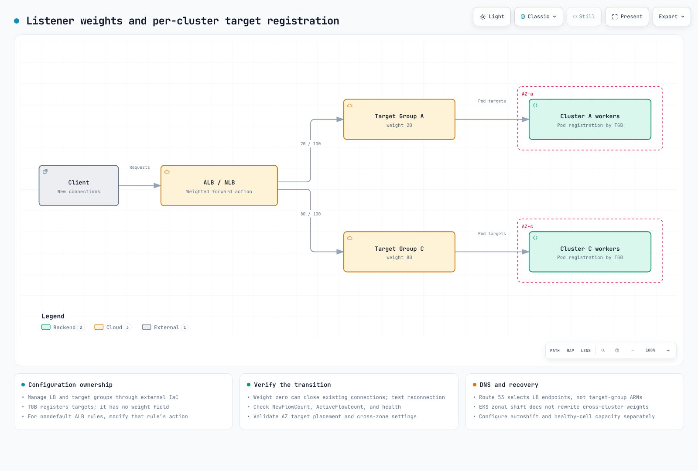
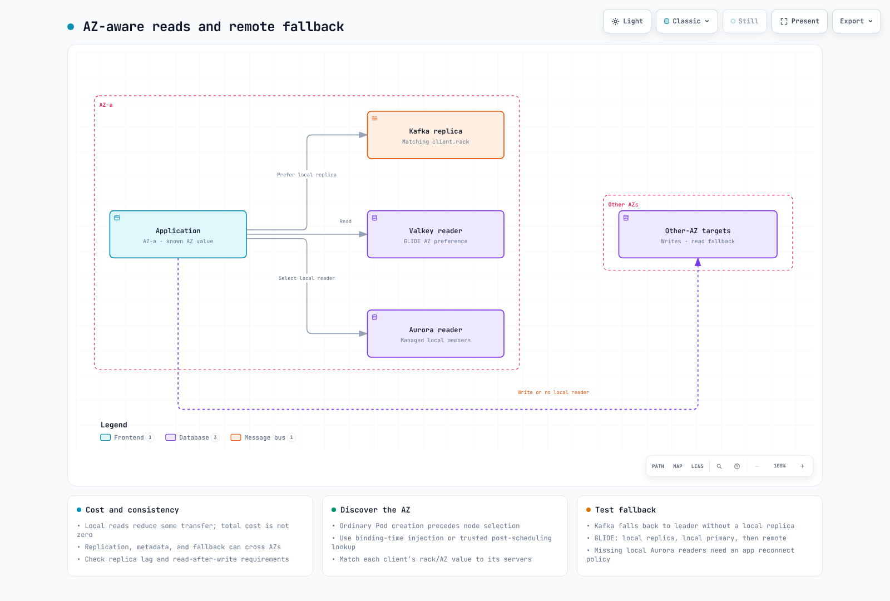
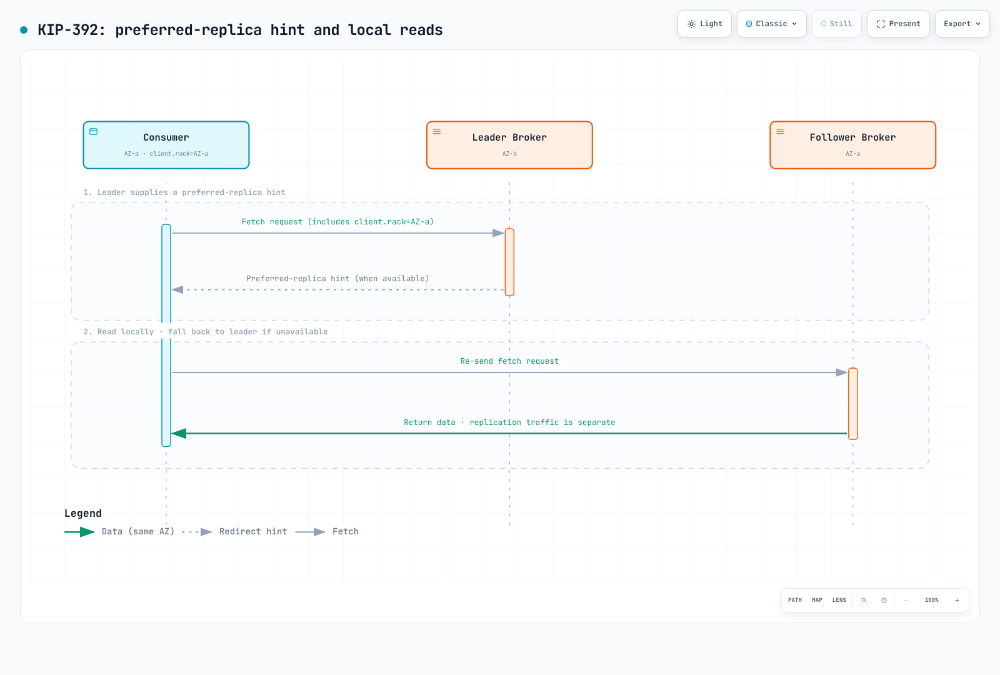

# 可用区集群运维：流量切换、升级回滚和数据层 AZ 亲和性

> **审查基线**：EKS 回滚和 ARC 文档、Strimzi 1.3.0、Valkey GLIDE 2.5.2、AWS Advanced JDBC Wrapper 4.4.0
> **最后审核日期**：October 16, 2026。已检查配置示例；未执行线上集群流量切换和故障实验。

< [上一章：Tekton Pipelines](14-tekton-pipelines.md) | [目录](./README.md) | [下一章：故障排查手册](16-troubleshooting-playbook.md) >

***

本指南结合了**跨集群流量切换、具备 AZ 本地工作节点的部署、有条件的版本回滚，以及支持 AZ 感知的数据读取**。并非所有团队都适合默认采用可用区集群架构。只有在能够独立运维单元容量、路由、部署和数据依赖时，才应考虑这种架构。

此处的可用区部署描述的是**工作节点和应用的部署位置**。[托管 EKS 控制平面](https://docs.aws.amazon.com/eks/latest/userguide/eks-architecture.html)仍分布在多个 AZ 中。整个集群并非位于单个 AZ 内。

## 目录

1. [为何采用可用区运维](#why-zonal-operations)
2. [流量层：Target Group + TargetGroupBinding + 权重切换](#traffic-layer-target-group--targetgroupbinding--weight-shifting)
3. [升级：原地回滚和原生回滚的适用条件](#upgrades-conditions-for-in-place-and-native-rollback)
4. [数据层：优先使用同 AZ 读取](#data-layer-prefer-same-az-reads)
5. [推荐组合摘要](#recommended-combination-summary)

***

## 为何采用可用区运维 {#why-zonal-operations}

| 方面 | 单个多 AZ 集群 | 每个集群的工作节点各位于一个 AZ |
|--------|------------------------|--------------------------------------|
| 故障隔离 | 健康 AZ 中的副本和备用容量可处理恢复 | 一个单元可能失去所有工作节点；共享数据库、路由和区域级依赖可能影响其他单元 |
| 跨 AZ 成本 | 取决于服务和数据路径 | 本地应用流量可能减少，但复制、共享服务和 LB 转发仍可能跨 AZ |
| 升级 | 控制平面和节点分阶段变更，并管理版本偏差 | 依次升级各单元时，需要确保剩余单元具备兼容版本和足够容量 |
| 运维复杂性 | 一个集群 | 多个集群和协调式路由 |

参阅 AWS 的 [Amazon EKS 单元化架构指南](https://aws.amazon.com/solutions/guidance/cell-based-architecture-for-amazon-eks/)。尽量减少单元间依赖，并为健康单元配置足够容量，以承接故障单元的流量。通过 DNS 选择每个单元的 LB，以及在一个 LB 后按权重分配流量到多个目标组，是两种不同的路由设计。应根据实际流量路径和各项服务的计费规则测算成本。

相关指南：[高级基础设施](02-infrastructure-advanced.md)和 [EKS 弹性](../eks/10-eks-resiliency.md)。

***

<span id="traffic-layer-target-group--targetgroupbinding--weight-shifting"></span>

## 流量层：Target Group + TargetGroupBinding + 权重切换



[🔍 查看交互式图表](https://www.atomai.click/kubernetes-docs/archmaps/en-ops-15-zonal-operations-guide-0.html)

两个集群共用一个 LB 时：

1. 使用 IaC 在集群外创建 NLB/ALB 和目标组，以便替换集群时不会删除 LB。
2. 使用 `TargetGroupBinding` 将每个集群的 Service 绑定到各自的目标组。
3. 修改**监听器的转发操作**中的权重。TGB 本身没有权重字段。应在 IaC 和控制器之间明确分配目标组及监听器配置的管理责任。

TGB 示例假设使用 `production` 命名空间、`app-service:80`、位于预期 VPC 中的 IP 类型目标组，以及已存在的 AWS Load Balancer Controller。请替换示例 ARN，并验证目标运行状况和网络访问。

此示例使用**单独安装的 AWS Load Balancer Controller**。内置 Auto Mode TGB 使用 eks.amazonaws.com/v1，并遵循不同的[标签和生命周期规则](https://docs.aws.amazon.com/eks/latest/userguide/auto-configure-alb.html)。AWS 文档指出，删除该内置 TGB 或集群时，目标组也会被删除；请勿将此所有权模式与由外部管理的目标组混用。

```yaml
apiVersion: elbv2.k8s.aws/v1beta1
kind: TargetGroupBinding
metadata:
  name: zone-a-tgb
  namespace: production
spec:
  targetGroupARN: arn:aws:elasticloadbalancing:ap-northeast-2:ACCOUNT:targetgroup/zone-a-tg/xxxxxxxxxxxx
  serviceRef:
    name: app-service
    port: 80
  targetType: ip
```

```bash
set -euo pipefail
# NLB listener whose existing default action forwards to these two groups.
# Nondefault ALB rules require modify-rule, not this operation.
: "${LISTENER_ARN:?}" "${ZONE_A_TG_ARN:?}" "${ZONE_C_TG_ARN:?}"
aws elbv2 describe-listeners \
  --listener-arns "$LISTENER_ARN" \
  --query 'Listeners[0].DefaultActions' --output json > current-actions.json
jq -e --arg a "$ZONE_A_TG_ARN" --arg c "$ZONE_C_TG_ARN" '
  if $a == $c or length != 1 or .[0].Type != "forward"
     or ([.[0].ForwardConfig.TargetGroups[].TargetGroupArn] | sort)
        != ([$a, $c] | sort)
  then error("Expected one forward action with exactly the two selected groups")
  else
    .[0].ForwardConfig.TargetGroups |= map(
      .Weight = (if .TargetGroupArn == $a then 20 else 80 end))
  end
' current-actions.json > proposed-actions.json &&
aws elbv2 modify-listener \
  --listener-arn "$LISTENER_ARN" \
  --default-actions file://proposed-actions.json
```

执行前，应将此变更与 IaC 计划协调一致。普通 NLB 权重变更会影响**新流**，但**权重为零需要单独处理**。[当前用户指南](https://docs.aws.amazon.com/elasticloadbalancing/latest/network/load-balancer-listeners.html)说明，设为零后不久，该组将不再接收新连接，现有连接也会被关闭。不要假设现有连接会一直保留到自然关闭；切换为零之前，应测试应用排空、重新连接和重试行为。在更改节点前，按照[官方指南](https://aws.amazon.com/blogs/networking-and-content-delivery/network-load-balancers-now-support-weighted-target-groups/)检查每个目标组的 `NewFlowCount` 和 `ActiveFlowCount`、运行状况、错误率及连接排空情况。验证目标组的协议/IP 版本兼容性和跨区设置。如果目标被限制在不同 AZ 中，禁用跨区负载均衡可能会阻碍预期的权重分配。

Route 53 加权记录选择的是 **LB DNS 终端节点**，而不是目标组 ARN。TTL、客户端缓存和长连接也会导致 DNS 切换无法即时生效。有关外围配置，请参阅 [AWS Load Balancer Controller](../networking/03-aws-lb-controller.md) 和[高级基础设施](02-infrastructure-advanced.md)。

**计划内流量切换和故障响应**：权重变更支持计划内切换，但不能自动检测故障。[ARC 可用区切换](https://docs.aws.amazon.com/eks/latest/userguide/zone-shift.html)由运维人员发起。**可用区自动切换**需要单独启用、演练并配置告警。EKS 资源切换会改变该集群内受影响 AZ 的终端节点/节点处理方式；它不会改写另一个集群的目标组权重。还应单独规划 LB 资源的切换。

> **EKS Auto Mode 支持**：根据 [2026 年 7 月的发布公告](https://aws.amazon.com/about-aws/whats-new/2026/07/eks-auto-mode-arc-zonal-shift/)，启用集群可用区切换后，Auto Mode 可在切换期间限制受影响 AZ 中的新资源调配和自愿中断。此操作本身不会启用自动切换。**如果从唯一包含工作节点的 AZ 切走，可能导致服务中断**。EKS 切换需要健康 AZ 中的副本、CoreDNS 和备用容量。工作节点只位于一个 AZ 的单元需要将外部单元路由纳入恢复方案。

***

## 升级：原地回滚和原生回滚的适用条件 {#upgrades-conditions-for-in-place-and-native-rollback}

[原生 EKS 版本回滚](https://docs.aws.amazon.com/eks/latest/userguide/rollback-cluster.html)于 2026 年 7 月推出，可在升级完成后的七天内发起回滚，恢复到**紧邻的上一个次要版本**。七天是符合回滚条件的时间窗口，并非恢复时间保证。请检查集群创建版本、支持状态、后续升级、功能兼容性和 Rollback Readiness Insights。

- **Auto Mode**：EKS 先回滚 Auto Mode 节点，然后回滚控制平面。PDB 和 NodePool 中断预算仍然适用；回滚并非即时完成。
- **托管节点组**：使用 `UpdateNodegroupVersion` 单独回滚。运维人员应单独准备自管理节点和 Hybrid 节点。节点运行的版本不得高于控制平面版本。
- **附加组件、数据和应用**：回滚不会恢复附加组件版本、etcd 数据、持久卷数据或应用变更。应分别规划兼容性和数据迁移恢复方案。
- **`--force`：可以绕过就绪情况洞察**，但不能绕过资格前提或 Auto Mode 中断控制。按照常规回滚流程操作前，应先解决问题。

回滚功能本身不额外收费；现有集群、计算和流量费用仍然适用。验证剩余单元容量和恢复目标后，再选择原地回滚或蓝绿方案。

| 方法 | 适用条件 |
|----------|------------------------|
| **蓝绿集群** | 在单独的环境中验证，并保留流量回切到旧环境的能力；共享数据变更需要单独的恢复方案 |
| **可用区原地升级 + 原生回滚** | 现有单元集群可承接流量，并且已测试资格、兼容性和恢复时间 |
| **Route 53 加权 DNS 切换** | 使用不同的 LB 终端节点，包括跨区域/账户设计，并已考虑 DNS 缓存和运行状况行为 |

运维顺序为：**检查剩余单元容量 → 调整权重 → 确认连接排空 → 升级 → 验证 → 恢复权重**。详细步骤和针对节点的适用条件，请参阅[升级运维](11-upgrade-operations.md)和 [EKS 升级](../eks/08-eks-upgrades.md)。

***

## 数据层：优先使用同 AZ 读取 {#data-layer-prefer-same-az-reads}

如果同一 AZ 中存在合适的副本，并且应用能够接受其一致性行为，应优先使用本地读取。写入、复制、初始元数据请求和故障回退仍可能跨 AZ。应同时衡量复制延迟、错误、实际连接目标和传输量。



[🔍 查看交互式图表](https://www.atomai.click/kubernetes-docs/archmaps/en-ops-15-zonal-operations-guide-1.html)

首先确定 Pod 所在的 AZ。Downward API 可以暴露 Pod 字段，但不会直接查询节点标签。

- **注入节点元数据**：普通 Pod 创建准入发生在调度之前，因此此时还不知道目标节点。[AWS MSK 指南](https://aws.amazon.com/blogs/big-data/optimize-traffic-costs-of-amazon-msk-consumers-on-amazon-eks-with-rack-awareness/)会处理 **`Pod/binding` 请求**，读取选定节点并注入其 AZ ID。应一起配置 Kyverno 绑定请求筛选器、读取节点的 RBAC 权限，并确保在 Pod 启动前完成注入。
- **调度后查询**：通过 Downward API 暴露 `spec.nodeName`，并使用受信任的初始化组件读取节点标签。不要向所有应用授予广泛的节点读取权限。
- **EC2 IMDSv2**：如果有意开放 EC2 元数据访问，应先获取令牌，再读取位置相关信息。不要假设 IMDSv1 GET 可用，也不要不加区分地移除元数据限制。此方法不直接适用于 Fargate。
- **Operator 支持**：Strimzi 会为其管理的 Broker 和受支持的客户端资源配置机架感知功能，但不会自动在无关应用的 Deployment 中设置 `client.rack`。

**不要混用 AZ 名称和 AZ ID**。Kafka 的 `broker.rack` 和 `client.rack` 必须使用匹配的字符串。如果 MSK 使用 AZ ID，不要替换成 `ap-northeast-2a` 这样的名称。GLIDE 的 `client_az` 同样必须与服务器报告的 AZ 值匹配。

### Kafka：KIP-392 跟随者读取

[Kafka 2.4 引入的 KIP-392](https://cwiki.apache.org/confluence/display/KAFKA/KIP-392:+Allow+consumers+to+fetch+from+closest+replica)允许消费者从同机架副本读取。此处的版本是该功能的引入版本，并非建议今天部署 Kafka 2.4。



[🔍 查看交互式图表](https://www.atomai.click/kubernetes-docs/archmaps/en-ops-15-zonal-operations-guide-10.html)

- **Broker**：配置 `replica.selector.class=org.apache.kafka.common.replica.RackAwareReplicaSelector` 和 `broker.rack`。
- **消费者**：将 `client.rack` 设置为消费者所在的机架。如果没有合适的本地副本，则回退到 Leader。
- **Strimzi 1.3.0**：以下内容是应合并到现有 Kafka CR 中的**配置片段**，不是完整部署。还需要 KafkaNodePools、监听器、存储和其他配置。从 Strimzi 1.0 开始，CR API 为 `v1`；还需指定机架类型。

```yaml
apiVersion: kafka.strimzi.io/v1
kind: Kafka
metadata:
  name: my-cluster
spec:
  kafka:
    rack:
      type: topology-label
      topologyKey: topology.kubernetes.io/zone
    config:
      replica.selector.class: org.apache.kafka.common.replica.RackAwareReplicaSelector
```

此配置会设置 Broker 的 `broker.rack`。普通应用消费者的 `client.rack` 需要单独设置。KafkaConnect、MirrorMaker 2 和 Bridge 各自有 CR 机架设置。还应遵循 [Strimzi 文档](https://strimzi.io/docs/operators/1.3.0/configuring.html)分配 Broker 的部署位置。跟随者读取可能因复制延迟而增加读取延迟。

[KIP-881](https://cwiki.apache.org/confluence/display/KAFKA/KIP-881%3A+Rack-aware+Partition+Assignment+for+Kafka+Consumers)讨论的是机架感知分区分配，这是另一种独立机制。请检查消费者版本和分配器的支持情况。有关部署指导，请参阅 [EKS 上的 Kafka](../data-on-eks/kafka/README.md)。

### Redis/Valkey（ElastiCache）：AZ 亲和性读取策略

以下是本文讨论的 [Valkey GLIDE](https://valkey.io/blog/az-affinity-strategy/) `ReadFrom` 主要选项。GLIDE 2.5.2 还包含 `ALL_NODES`；此处并未列出全部枚举值。

| 策略 | 行为 |
|----------|----------|
| `PRIMARY` | 从主节点读取（默认） |
| `PREFER_REPLICA` | 在副本间轮询；没有可用副本时再读取主节点 |
| `AZ_AFFINITY` | 优先使用本地副本，然后使用其他副本或主节点 |
| `AZ_AFFINITY_REPLICAS_AND_PRIMARY` | 本地副本 → 本地主节点 → 其他 AZ 中的副本或主节点 |

只有在应用能够容忍陈旧数据时，才考虑从副本读取；读取占比本身不足以决定策略。请验证服务器 AZ 元数据支持/配置、主节点负载和回退行为。对于要求**数据新鲜度或读后写一致性**的请求，应单独设计，例如根据数据模型适时使用主节点读取。

此 `valkey-glide==2.5.2` 示例**创建集群模式配置**，但不会建立连接。示例启用了 TLS；如果需要身份验证，请提供 `credentials`。如果禁用了集群模式，则应改用 `GlideClientConfiguration` 和 `GlideClient`。

```python
from glide import GlideClusterClientConfiguration, NodeAddress, ReadFrom


def cache_config(host: str, client_az: str, credentials=None):
    if not host or not client_az:
        raise ValueError("Cache endpoint and client AZ are required")
    return GlideClusterClientConfiguration(
        addresses=[NodeAddress(host, 6379)],
        use_tls=True,
        credentials=credentials,
        read_from=ReadFrom.AZ_AFFINITY_REPLICAS_AND_PRIMARY,
        client_az=client_az,
    )
```

[HotelTrader 案例研究](https://aws.amazon.com/blogs/database/how-hoteltrader-cut-inter-az-cost-95-and-latency-by-49-with-valkey-glide-on-amazon-elasticache/)报告称，在同时采用 **AZ 感知路由和请求批处理**后，跨 AZ 传输成本降低了 95%，平均延迟降低了 49%。这些是该 ECS/ElastiCache 工作负载的结果，并非单靠路由选项即可保证实现的效果。

### Aurora/RDS：读取器终端节点的限制与替代方案

Aurora 的[默认读取器终端节点](https://docs.aws.amazon.com/AmazonRDS/latest/AuroraUserGuide/Aurora.Endpoints.Reader.html)会在读取副本之间平衡**连接**；它不保证优先使用特定 AZ，也不按查询进行负载均衡。如果没有副本，它可能会连接到写入器。仅更改 DNS 不会将已有连接池连接转移到其他实例。

1. **每个 AZ 使用自定义终端节点**：验证实例的 AZ 和读取器角色后，明确选择实例 ID。在此创建示例中，将名称替换为实际资源。

   ```bash
   aws rds create-db-cluster-endpoint \
     --db-cluster-identifier my-aurora-cluster \
     --db-cluster-endpoint-identifier reader-az-a \
     --endpoint-type READER \
     --static-members db-instance-az-a-1 db-instance-az-a-2
   ```

   CLI/API 支持 `READER` 终端节点。升级为写入器的成员会被排除；新副本不会自动添加到静态列表中。请检查[成员资格行为](https://docs.aws.amazon.com/AmazonRDS/latest/AuroraUserGuide/Aurora.Endpoints.Custom.Considerations.html)，并在本地读取器不可用时提供应用回退终端节点或明确的故障策略。

2. **AWS Advanced JDBC Wrapper 4.4.0：**[`fastestResponse`](https://github.com/aws/aws-advanced-jdbc-wrapper/blob/4.4.0/docs/using-the-jdbc-driver/HostSelectionStrategies.md)会根据测得的响应时间选择主机。还需加载 `fastestResponseStrategy` 插件。这不是基于 AZ 标签的约束；不能保证选出的最快主机位于本地。

[Issue #1139](https://github.com/aws/aws-advanced-jdbc-wrapper/issues/1139)已于**2025 年 5 月关闭**；讨论认为 2.5.5 中的响应时间功能满足了该需求。该 Issue 并非仍未解决的功能请求，也不能证明自定义终端节点是唯一解决方案。

### 可互补的 Kubernetes Service 层选项

[拓扑感知路由](https://kubernetes.io/docs/concepts/services-networking/topology-aware-routing/)和 [Istio 区域感知路由](../service-mesh/istio/resilience/03-zone-aware-routing.md)可以补充 Service 终端节点选择。本地终端节点不足、健康状况变化和配置问题都可能导致流量被发送到其他 AZ。它们不会自动控制外部数据库/缓存/Kafka 连接。使用本地终端节点只是优先策略，并不保证整个读取路径始终位于一个 AZ 内。

***

## 推荐组合摘要 {#recommended-combination-summary}

| 层 | 选择标准 | 替代方案/回退 |
|-------|--------------------|----------------------|
| 架构 | 单元运维相互独立，且健康单元具备足够容量 | 单个多 AZ 集群仍然是有效选择 |
| 流量切换 | LB 转发操作权重和 TGB 目标注册 | Route 53 选择 LB 终端节点 |
| 故障响应 | 手动执行可用区切换/单独启用自动切换 | 工作节点只位于单个 AZ 的单元需要外部单元路由 |
| 升级 | 已测试资格、兼容性和恢复时间 | 采用蓝绿方案，并单独处理数据恢复 |
| Kafka 读取 | Broker 选择器与匹配的消费者机架 | 没有合适的本地副本时使用 Leader |
| 缓存读取 | GLIDE 策略与数据新鲜度和 AZ 元数据相匹配 | 验证远程回退和主节点负载 |
| 数据库读取 | 维护本地读取器列表或按响应时间选择 | 处理本地读取器缺失和重新连接 |

先测量负载、成本和恢复时间基线，再在生产环境之外演练流量切换和回滚。也可以独立引入读取路径优化：先在小范围内验证一致性、回退和成本，再逐步扩大范围。

***

< [上一章：Tekton Pipelines](14-tekton-pipelines.md) | [目录](./README.md) | [下一章：故障排查手册](16-troubleshooting-playbook.md) >
